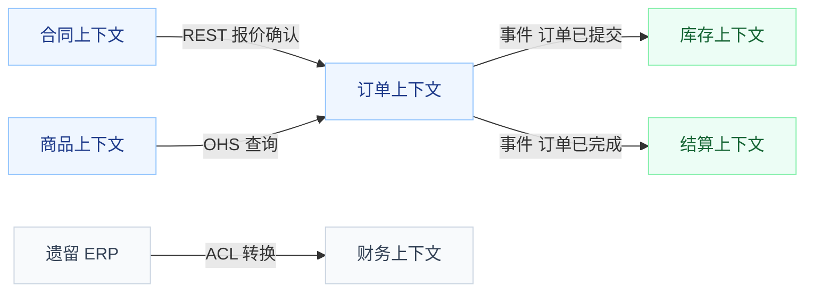

# 业务架构与领域建模

> 这篇从业务能力地图讲起，经过子域划分、事件风暴、限界上下文、聚合设计、上下文映射和领域事件，最后落到一次从单体 ERP 拆出六个上下文的完整建模案例。
>
> 学完能画出能力地图、主持一场事件风暴、划出限界上下文与聚合边界，并用上下文映射表说明服务之间为什么这样集成。

## 一、业务架构解决什么问题

业务架构（Business Architecture）回答"业务能力如何被组织和系统承载"，不是画组织架构图。它的产物是三张东西：能力地图、子域划分、上下文边界。领域建模（Domain Modeling）是在这些边界内把业务规则表达成可执行的模型。

三者的关系必须先分清，否则会把流程当能力、把部门当边界：

| 概念 | 回答 | 产物 | 变化频率 |
|---|---|---|---|
| 业务能力 | 企业会做什么 | 能力地图 | 低 |
| 业务流程 | 怎么一步步做完 | 流程图、SOP | 中 |
| 领域模型 | 业务规则怎么表达 | 聚合、实体、事件 | 中高 |
| 系统架构 | 能力怎么部署和集成 | 上下文、接口、依赖 | 中 |

### 1.1 什么时候需要做领域建模

不是所有系统都值得建模。判据是"业务规则是否复杂到需要被显式表达"。

| 系统类型 | 是否需要 | 理由 |
|---|---|---|
| 表单增删改查 | 不需要 | 规则就是字段校验 |
| 有状态流转的业务 | 需要 | 状态机与不变量多 |
| 多角色协同 | 需要 | 权限与流程耦合 |
| 计费、结算、库存 | 必须 | 金额与数量错一次就是事故 |
| 纯展示与报表 | 不需要 | 读模型为主 |

> 边界：领域建模的成本在"统一语言"和"边界共识"，不在画图。团队没有业务专家参与时，建模会退化成技术人员猜规则，产出的模型一定和业务对不上。

### 1.2 统一语言是建模的前置条件

统一语言（Ubiquitous Language）是同一上下文内，业务和技术用同一个词指同一件事。没有它，模型会在"订单"到底是"购买意向"还是"履约单据"上反复摇摆。

| 业务说法 | 技术实现 | 统一后的定义 |
|---|---|---|
| 下单 | 创建 order 记录 | 提交购买意向，生成待支付订单 |
| 发货 | 更新 delivery 表 | 仓库出库，生成履约单 |
| 结算 | 调财务接口 | 按账期生成应收 |

统一语言只在一个限界上下文内成立，跨上下文必须显式翻译，这正是第五章要解决的问题。

## 二、能力地图：先看企业会做什么

能力地图（Business Capability Map）把企业能力按层级拆开，回答"哪些能力是差异化竞争力，哪些只是必要成本"。它是子域划分的输入。

### 2.1 三层结构与画法

一级是能力域（如交易、履约、财务），二级是能力（如下单、库存分配、对账），三级是能力项（如下单里的优惠计算、库存锁定）。画到二级足够做架构决策，三级留给产品需求。

一个 B2B 交易平台的能力地图片段（示例）：

| 一级能力域 | 二级能力 | 战略重要度 | 现状成熟度 |
|---|---|---|---|
| 交易 | 询价报价 | 高 | 中 |
| 交易 | 合同签订 | 高 | 低 |
| 履约 | 库存分配 | 高 | 高 |
| 履约 | 物流跟踪 | 低 | 高 |
| 财务 | 账期结算 | 高 | 低 |
| 财务 | 发票开具 | 低 | 高 |

### 2.2 从能力地图读出投入策略

把"战略重要度"和"成熟度"交叉，得到四种处置：

| 组合 | 处置 | 例子 |
|---|---|---|
| 高重要 + 低成熟 | 自建、重点投入 | 合同签订 |
| 高重要 + 高成熟 | 保持、优化成本 | 库存分配 |
| 低重要 + 低成熟 | 采购或外包 | 电子签章 |
| 低重要 + 高成熟 | 标准化、别改 | 发票开具 |

> 最容易错：把组织部门直接映射成能力域。采购部管的不止"采购"能力，"供应商准入"可能属于风控；能力按"做什么"划分，不按"谁做"划分。

### 2.3 能力地图与康威定律

康威定律（Conway's Law）说系统结构会复制组织的沟通结构。能力地图的第三用途就是主动利用这条定律：让团队边界和能力边界对齐，而不是让组织随机地塑造系统。

| 情况 | 表现 | 处置 |
|---|---|---|
| 能力与团队对齐 | 改能力只动一个团队 | 保持 |
| 一个能力多个团队 | 每次改动跨三地会议 | 收归一个团队 |
| 一个团队多个核心能力 | 单点风险、优先级打架 | 拆团队或降级能力 |

> 边界：能力地图画完后要和真实组织对照一次。对不上不是坏事，它就是下一轮组织或边界调整的依据；假装对得上才是坏事。

## 三、子域：核心、支撑、通用

子域（Subdomain）是业务能力的聚类，按对竞争力的贡献分三类。分类决定投入方式，这是业务架构里最有价值的一次取舍。

### 3.1 三类子域的判定

| 类型 | 判据 | 投入 | 建模深度 |
|---|---|---|---|
| 核心域 Core | 差异化、复杂、频繁变 | 自建、最强团队 | 深，富领域模型 |
| 支撑域 Supporting | 必要但不差异化 | 自建或低代码 | 中，够用即可 |
| 通用域 Generic | 行业标准能力 | 采购/SaaS | 浅，防腐层隔离 |

判定用四个问题：这项能力是否让客户选择我们？竞争对手是否容易复制？规则是否复杂到需要专家？是否有成熟产品可直接买？

### 3.2 子域划分的产出

每个子域写清四件事：名称、包含的能力、核心业务规则、归属团队。这张表是后面限界上下文的候选池。

| 子域 | 类型 | 包含能力 | 建模优先级 |
|---|---|---|---|
| 定价与合同 | 核心 | 询价、报价、合同 | P0 |
| 订单履约 | 核心 | 下单、库存分配、发货 | P0 |
| 账期结算 | 核心 | 对账、应收、催收 | P1 |
| 商品目录 | 支撑 | 商品、类目、属性 | P2 |
| 身份权限 | 通用 | 登录、角色 | 采购 |

> 边界：核心域不是"技术最难"的域，是"业务上最值得自己做的"域。一个内部审批系统再复杂，也只是支撑域；它的复杂度不值得用富领域模型。

## 四、事件风暴：从业务事件找边界

事件风暴（Event Storming）是用便利贴把业务流程摊开、从中发现领域事件、命令、聚合和边界的协作方法。它比访谈有效，因为业务和技术在同一张墙上对齐时间线。

### 4.1 材料与角色

| 材料 | 颜色约定 | 写什么 |
|---|---|---|
| 领域事件 | 橙色 | 已发生的业务事实，过去式 |
| 命令 | 蓝色 | 触发事件的动作 |
| 聚合 | 黄色 | 处理命令、产生事件的实体 |
| 读模型 | 绿色 | 决策所需的数据视图 |
| 外部系统 | 粉色 | 第三方、遗留系统 |
| 热点 | 红色 | 争议、规则不清 |

角色至少三类：业务专家（懂规则）、领域专家（懂流程）、开发（懂实现约束）。5–8 人，超过 10 人就会变成开会。

### 4.2 一次 4 小时事件风暴的步骤

1. 定范围：只做一个端到端流程，如"从询价到发货"，不做全公司。
2. 铺事件：每人静默写 15 分钟，按时间线贴，只写已发生的事实。
3. 补命令：每个事件往前问"什么动作导致它"，贴蓝色。
4. 找聚合：把处理同一命令、守同一组规则的事件圈在一起。
5. 标热点：规则冲突、口径不一致的地方贴红色，不当场争论。
6. 划边界：按语言变化和事务边界，把聚合分成候选上下文。
7. 收口：拍照、录入、一周内出候选上下文清单。

事件命名必须用过去式且带业务含义：`订单已提交`、`库存已锁定`、`合同已生效`。`处理订单`、`更新状态`这类词不是事件，是代码方法。

### 4.3 一场风暴的产出样例

| 时间线 | 命令 | 领域事件 | 聚合 | 热点 |
|---|---|---|---|---|
| 1 | 提交询价 | 询价单已创建 | 询价单 | 报价有效期口径 |
| 2 | 确认报价 | 报价已确认 | 报价单 | 折扣审批权限 |
| 3 | 签订合同 | 合同已生效 | 合同 | 电子签章法律效力 |
| 4 | 提交订单 | 订单已提交 | 订单 | 信用额度校验时机 |
| 5 | 锁定库存 | 库存已锁定 | 库存 | 超卖处理 |
| 6 | 确认发货 | 履约单已创建 | 履约单 | 部分发货 |

> 边界：事件风暴产出的是"候选边界"，不是最终架构。它擅长暴露语言冲突和规则盲区，不擅长算容量和选中间件；后者交给架构评审。

### 4.4 从风暴结果到上下文候选

风暴结束后的整理比风暴本身更容易走偏。不要按便利贴的颜色分组，按"判定依据"分组：

| 分组依据 | 问法 | 分组结果 |
|---|---|---|
| 语言 | 这个词在这里和那里同义吗 | 语言不同的拆开 |
| 事务 | 这些事件要一起成功吗 | 不需要的拆开 |
| 规则 | 这组不变量由谁守 | 同一组规则归一个聚合 |
| 团队 | 谁长期维护 | 作为约束参考 |

整理时保留一份"未决清单"：跨上下文的规则争议、口径不一致的指标、法律或合规待确认项。未决项不要在现场定，标记负责人和截止时间，两周内闭环。

## 五、限界上下文：语言与模型的边界

限界上下文（Bounded Context）是一个模型成立的边界：在这个边界内，术语、规则、数据含义一致；跨出边界，同一个词可能指不同的东西。

### 5.1 同一术语在不同上下文的含义

| 术语 | 销售上下文 | 履约上下文 | 财务上下文 |
|---|---|---|---|
| 订单 | 购买意向，可取消 | 出库任务，不可取消 | 应收凭据 |
| 客户 | 潜在买家 | 收货方 | 付款方 |
| 金额 | 报价含税 | 不含税成本 | 含税应收 |

这张表就是"为什么不能共用一个 Order 实体"的证据。强行共用会导致一个字段承载三种语义，最后谁都不敢改。

### 5.2 上下文与子域的关系

子域是业务问题的划分，上下文是解决方案的边界。常见对应关系：

| 关系 | 说明 | 例子 |
|---|---|---|
| 1:1 | 一个子域一个上下文 | 结算子域 → 结算上下文 |
| 1:N | 一个子域拆多个上下文 | 履约拆成库存、物流 |
| N:1 | 多个子域合并 | 小团队把商品与类目合并 |

小团队常见做法是 N:1：先合并，等语言冲突真正出现再拆。过早拆分的成本是分布式事务和运维复杂度，远高于模型不纯。

### 5.3 上下文大小的判断

| 信号 | 说明 | 处置 |
|---|---|---|
| 语言冲突 | 同一词含义不同 | 拆 |
| 事务边界不同 | 不需要强一致 | 拆 |
| 团队认知负载 | 一个人讲不清全流程 | 拆 |
| 变更节奏不同 | 一边周更一边季度更 | 拆 |
| 共享数据频繁 | 每次改动都要同步 | 考虑合并 |

> 最容易错：按组织架构划上下文。组织会调整，边界跟着抖；正确的锚是语言和一致性需求，团队边界只能作为约束之一。

### 5.4 上下文的命名与代码结构

上下文名称要在统一语言里成立，代码结构要能看出上下文边界。

| 命名方式 | 示例 | 评价 |
|---|---|---|
| 按业务能力 | ordering、billing | 好，语言自然 |
| 按技术分层 | dao、service | 差，和技术重叠 |
| 按组织名 | team-a | 差，组织改了就失效 |

代码结构上，一个上下文对应一个可独立部署的模块（服务或单体里的 module），上下文之间禁止直接引用对方内部类，只能走接口或事件。单体阶段用 Maven 多模块或包级隔离也能守住边界，"先单体后拆分"是低风险路径。

> 最容易错：微服务拆了但共享一个数据库和实体类。边界只在代码目录上，数据模型还纠缠在一起，一次改表照样全停。

## 六、聚合：一致性边界

聚合（Aggregate）是一组必须一起保持一致的对象，聚合根（Aggregate Root）是外部唯一入口。聚合的核心不是"打包实体"，而是"用一次事务守住一组不变量"。

### 6.1 聚合的三条规则

1. 一个事务只改一个聚合；
2. 外部只能通过聚合根访问内部对象；
3. 聚合之间只引用 ID，不引用对象。

这三条决定了事务边界。跨聚合的强一致要靠领域事件和补偿，不能靠一个大事务。

### 6.2 不变量决定聚合边界

订单聚合的不变量清单（示例）：

| 不变量 | 规则 | 谁守 |
|---|---|---|
| 订单总额 | 明细之和 = 总额 | 订单聚合 |
| 明细数量 | 1–999 | 订单聚合 |
| 状态流转 | 待支付 → 已支付 → 已发货 | 订单聚合 |
| 库存充足 | 可用库存 ≥ 下单量 | 库存聚合 |
| 信用额度 | 未结应收 + 本单 ≤ 额度 | 客户信用聚合 |

前三条在订单内，后两条跨聚合，所以库存和信用不能塞进订单聚合，只能在下单流程里用"预留 + 确认"两段式处理。

### 6.3 聚合大小与性能

| 聚合设计 | 优点 | 风险 |
|---|---|---|
| 大聚合（订单含明细） | 强一致简单 | 并发冲突、加载慢 |
| 小聚合（明细独立） | 并发好 | 总额一致性要额外保证 |
| 一聚合一根 | 边界清晰 | 过度拆分，事务多 |

经验值：聚合内对象数控制在几十个以内，超过就说明边界可能错了；高频并发修改的计数类数据（库存、余额）单独成聚合，用乐观锁或分段扣减。

> 边界：聚合不是"数据库表关系的镜像"。两张表有外键不代表要在一个聚合里；判断标准是"是否必须同一事务守住同一条业务规则"。

### 6.4 仓储与聚合的加载

仓储（Repository）按聚合根加载，一次加载整个聚合，不允许"只查明细表"绕过聚合根。加载粒度直接决定聚合的可用大小。

| 做法 | 后果 |
|---|---|
| 按聚合根整加载 | 一致性好，大聚合慢 |
| 按字段懒加载 | 边界被绕过，规则失效 |
| 分页查明细 | 明细脱离聚合，状态机被跳过 |

大聚合的缓解手段是快照：把聚合的只读视图（如订单列表）单独做成读模型，查询走读模型，写操作才加载聚合。这是 CQRS（Command Query Responsibility Segregation）的最小用法，不需要上全套事件溯源。

> 边界：只有"读多写少、读模型字段与写模型差异大"的场景值得拆读写模型。简单 CRUD 拆读写只会增加同步代码。

## 七、上下文映射：边界之间怎么集成

上下文映射（Context Map）记录上下文之间的关系和集成方式。它是一张依赖表，不是一张架构图：每个箭头都要写清"谁依赖谁、用什么协议、谁负责翻译"。

### 7.1 五种常用关系

| 模式 | 关系 | 适用 | 代价 |
|---|---|---|---|
| 防腐层 ACL | 下游翻译上游模型 | 接遗留或外部系统 | 多一层转换 |
| 开放主机服务 OHS | 上游提供稳定 API | 上游强势、下游多 | 上游要维护契约 |
| 发布语言 PL | 共享事件/文档格式 | 异步集成 | 格式演进管理 |
| 共享内核 SK | 共享一小块模型 | 同一团队、极稳定 | 耦合高 |
| 客户-供应商 | 下游有话语权 | 内部团队协作 | 需协调排期 |

### 7.2 一张可执行的映射表

| 上游 | 下游 | 模式 | 协议 | 翻译责任 |
|---|---|---|---|---|
| 合同 | 订单 | 客户-供应商 | 同步 REST | 订单侧 ACL |
| 订单 | 库存 | 发布语言 | 事件 | 库存侧订阅 |
| 订单 | 结算 | 发布语言 | 事件 | 结算侧订阅 |
| 商品 | 全部 | 开放主机服务 | REST + 缓存 | 上游定契约 |
| 遗留 ERP | 财务 | 防腐层 | 批量文件 | 防腐层转换 |

依赖方向必须单向。出现双向同步依赖（A 调 B 写，B 回调 A 写）时，说明边界划错了，或者是分布式事务没想清楚。



> 边界：共享内核是最容易滥用的模式。它要求两个上下文同步发布、同步升级，只适合同一团队内极小且极稳定的模型（如统一的金额类型）；跨团队共享内核会变成"共享数据库"的变体。

### 7.3 同步与异步的选型

| 需求 | 方式 | 理由 |
|---|---|---|
| 下游必须立刻知道结果 | 同步调用 | 如锁库存失败要立刻回滚 |
| 下游可延迟处理 | 事件 | 如发通知、记流水 |
| 下游要读上游数据 | 开放主机服务 + 缓存 | 查询多、容忍短暂旧值 |
| 上游不能感知下游 | 发布语言 | 一发布多订阅 |
| 接遗留系统 | 防腐层 | 隔离模型污染 |

同步调用必须设超时和降级：下游挂了，上游要么快速失败，要么走本地兜底，绝不能无限等待。跨上下文的同步调用链原则上不超过两层，再深就必须改成异步。

## 八、领域事件：跨边界的事实

领域事件（Domain Event）是"上下文中发生的、业务关心的事实"。它既是聚合的输出，也是上下文之间异步集成的主要手段。

### 8.1 领域事件与集成事件的区别

| 维度 | 领域事件 | 集成事件 |
|---|---|---|
| 范围 | 上下文内部 | 跨上下文/跨系统 |
| 载荷 | 可含内部字段 | 稳定、最小、带版本 |
| 演进 | 随模型改 | 兼容期内不改 |
| 发布 | 聚合内记录 | 事务性发件箱 |

不要直接把领域事件序列化后发到消息队列：内部字段一改，所有下游都崩。正确做法是在边界上做一次翻译，产出带版本号的集成事件。

### 8.2 事务性发件箱

"业务写库成功、消息发送失败"是异步集成的经典不一致。事务性发件箱（Transactional Outbox）把事件和业务数据写进同一事务，再由独立进程投递。

```sql
-- 片段：事件与业务数据同事务写入，保证不丢
BEGIN;
INSERT INTO orders (id, tenant_id, status, total)
VALUES ('o-1001', 't-9', 'SUBMITTED', 128000);
INSERT INTO outbox (id, aggregate_id, event_type, payload, occurred_at)
VALUES ('e-1', 'o-1001', 'order.submitted.v1',
        '{"orderId":"o-1001","total":128000}', now());
COMMIT;
```

投递进程用 `SELECT ... FOR UPDATE SKIP LOCKED` 拉取未发送记录，发送成功后标记。消费端必须幂等：用事件 ID 去重，重复投递不产生副作用。

| 检查项 | 要求 |
|---|---|
| 事件 ID | 全局唯一，消费端去重键 |
| 发生时间 | 业务时间，不是发送时间 |
| 聚合版本 | 支持乐观并发与顺序判断 |
| 版本号 | `order.submitted.v1` 显式带版本 |
| 重试 | 指数退避 + 死信队列 |

### 8.3 事件顺序与一致性

同一聚合的事件必须有序，跨聚合不保证顺序。消费端不能假设"订单已提交"一定早于"库存已锁定"到达，除非两者由同一聚合发出。

> 最容易错：用事件做"分布式事务"，以为发了事件就一定会成功。事件只能保证最终一致，中间态要能被业务接受；不能接受中间态的场景，说明边界划错了，应该放回同一个聚合。

### 8.4 什么时候不该用事件

事件带来最终一致和可追溯，也带来调试成本。以下场景应直接同步调用：

| 场景 | 原因 |
|---|---|
| 强一致校验（余额扣减、库存锁定） | 失败要立刻反馈 |
| 用户等待结果的写操作 | 异步会让界面无法确认 |
| 只有一个消费者 | 直接调用更简单 |
| 团队没有消息运维能力 | 丢消息比丢请求更难查 |

> 边界：事件的收益随消费者数量增长，只有一个订阅者时，事件只是把一次同步调用拆成两次，还多了一个故障点。

### 8.5 事件版本的演进

集成事件一旦被下游订阅，就成了契约。演进规则只有一条：只加不改。

| 变更 | 兼容性 | 做法 |
|---|---|---|
| 新增可选字段 | 兼容 | 直接加 |
| 字段改名 | 不兼容 | 新旧双写，新增版本 |
| 删除字段 | 不兼容 | 先标记废弃，观察一个周期 |
| 语义变化 | 不兼容 | 必须升版本 |

版本号放事件类型而不是载荷里（`order.submitted.v2`），消费端按主题订阅，可以灰度迁移。保留期至少覆盖所有下游的升级周期，通常是两个发布周期。

> 最容易错：把内部实体的全量字段塞进事件，以为"多给点没关系"。下游会依赖这些字段，内部模型就再也改不动了。

## 九、模型验证与演进

模型对不对，不看图好不好看，看三件事：变更是否局部、语言是否一致、边界是否稳定。这一章给验证方法和演进策略。

### 9.1 三个验证信号

| 信号 | 好的表现 | 坏的表现 |
|---|---|---|
| 变更局部性 | 改一条规则只动一个上下文 | 一次需求改五个服务 |
| 语言一致性 | 同一上下文一个词一个义 | 同一字段三种解释 |
| 边界稳定性 | 半年内上下文数量稳定 | 每月都在拆合 |

### 9.2 验收清单

- 每个上下文有明确的职责一句话，且不与相邻上下文重叠；
- 每个聚合的不变量能列成表，且都能在单事务内守住；
- 上下文映射表里没有双向依赖；
- 每个跨边界事件有版本号和幂等键；
- 核心域有业务专家参与评审，且统一语言写进了代码命名。

### 9.3 演进：什么时候拆，什么时候合

边界不是一次定终身。拆与合各有两个触发条件：

| 方向 | 触发 | 动作 |
|---|---|---|
| 拆 | 同一词出现两种含义 | 按语言拆上下文 |
| 拆 | 变更节奏差异超过一个数量级 | 独立发布 |
| 合 | 每次改动都要跨两个上下文同步 | 合并 |
| 合 | 两个上下文共用一个团队、一套发布 | 合并为一个模块 |

拆之前先做"绞杀者"过渡：新上下文只读旧库，双写校验，再切读、切写。合之前先确认不是"团队懒得维护契约"，因为合并会永久牺牲独立演进能力。

### 9.4 失败模式

- 把组织架构当限界上下文，团队一调整边界就崩；
- 一个聚合装下整个订单链路，事务大、锁等待高；
- 所有上下文共享一个数据库和一张订单表，边界只是目录；
- 领域事件直接对外发布，内部字段改动导致下游全挂；
- 事件没有幂等，重投一次就重复扣款；
- 只做一次事件风暴就固化边界，业务变了模型不跟着变。

## 十、最佳实践案例

### 10.1 案例背景

一家做工业耗材 B2B 交易的公司，2024 年时全部业务跑在一套自研单体 ERP 上：商品、报价、合同、订单、库存、结算在同一进程、同一个 MySQL 库，五张核心表互相外键，订单表 180 个字段。团队 23 人，五个小组，但所有需求都要改同一套代码，一次发布要两周。

具体症状有三个：改报价规则会碰坏订单状态机，回归测试要三天；"订单"在销售、仓库、财务口中是三个意思，需求评审经常吵到散会；结算对账每月末停业 4 小时，因为要锁表跑批。

目标是 9 个月内把交易主链路拆成可独立发布的上下文，发布频率从双周提到每周，跨模块回归范围缩小一半，月末对账不停业。约束：不能停机，预算不允许重写全部系统，团队没有微服务经验，财务合规要求流水可追溯 5 年。

### 10.2 案例实操

第一步，画能力地图，先确定"哪些能力值得自己建模"。团队花两周和业务负责人逐条过，产出 5 个一级域、23 个二级能力，并按战略重要度打了分。结论很直接：报价与合同、订单履约、账期结算是核心域；商品目录是支撑域；身份权限、电子签章、发票是通用域，直接采购。

| 一级域 | 核心能力 | 类型 | 处置 |
|---|---|---|---|
| 交易 | 询价、报价、合同 | 核心 | 自建，深建模 |
| 履约 | 下单、库存分配、发货 | 核心 | 自建，深建模 |
| 财务 | 对账、应收、催收 | 核心 | 自建，深建模 |
| 商品 | 目录、类目、属性 | 支撑 | 自建，简单模型 |
| 基础 | 身份、签章、发票 | 通用 | 采购 |

第二步，做事件风暴。范围定为"询价到发货"，两天、三轮，参与人 8 个（3 个业务专家、2 个领域专家、3 个开发）。第一轮只贴事件，产出 87 个；第二轮补命令和聚合，压到 41 个有效事件；第三轮标出 12 个热点，其中 4 个直接改变了边界判断。

热点里最关键的一个是"信用额度校验放在哪"。业务专家的说法是"下单时就该卡住"，财务的说法是"发货前确认即可"。争论暴露了真实规则：额度校验依赖应收数据，而应收在结算上下文里。最终决定下单时只做"预占额度"，发货前由结算确认，这条规则后来成了订单与结算两个上下文的契约。

第三步，划子域和限界上下文。按"语言是否一致、是否需要同一事务"两个判据，把 41 个事件归成 6 个候选上下文。原先以为要拆 9 个，合并了 3 个：报价与合同合并（同一批人、语言一致、变更同步），库存与物流合并（都围绕履约单），商品与类目合并（支撑域，不值得拆）。

| 上下文 | 核心聚合 | 关键不变量 | 团队 |
|---|---|---|---|
| 报价合同 | 报价单、合同 | 报价有效期、折扣审批 | 交易组 |
| 订单 | 订单 | 总额=明细和、状态机 | 交易组 |
| 库存 | 库存、预留单 | 可用量 ≥ 0、不超卖 | 履约组 |
| 履约 | 履约单 | 发货量 ≤ 订单量 | 履约组 |
| 结算 | 应收、对账单 | 应收=已发未结、账期 | 财务组 |
| 商品 | 商品、类目 | SKU 唯一、类目深度 | 平台组 |

第四步，定聚合边界。订单聚合最初把明细、优惠、支付记录全装进去，评审时发现两个问题：优惠计算依赖商品上下文的价格，支付记录高频更新。于是把优惠拆成"订单优惠快照"（值对象）、支付记录独立成聚合，订单只保留金额和状态。库存单独成聚合，用"预留 + 确认 + 释放"三段式，避免下单事务跨库。

| 聚合 | 包含 | 明确排除 | 理由 |
|---|---|---|---|
| 订单 | 订单头、明细、金额 | 支付流水、库存 | 高频更新，跨库 |
| 库存 | 可用量、预留 | 仓库库位 | 库位属仓储上下文 |
| 结算 | 应收单、账期 | 发票 | 发票走通用域 |

第五步，写上下文映射表，确定集成方式。原则是"核心域之间用事件异步，支撑域被查询用同步"。合同到订单是客户-供应商关系（订单侧有话语权，要求合同提供报价快照）；订单到库存、结算用发布语言（事件）；遗留 ERP 只保留财务凭证导出，用防腐层转换。

| 上游 | 下游 | 模式 | 协议 | 一致性 |
|---|---|---|---|---|
| 报价合同 | 订单 | 客户-供应商 | REST | 强，下单时校验 |
| 订单 | 库存 | 发布语言 | 事件 | 最终，秒级 |
| 订单 | 结算 | 发布语言 | 事件 | 最终，分钟级 |
| 商品 | 订单/库存 | 开放主机服务 | REST + 本地缓存 | 最终，分钟级 |
| 遗留 ERP | 财务归档 | 防腐层 | 批量文件 | 天级 |

依赖表同时用来排执行顺序：商品上下文最先拆（被依赖最多、逻辑最简单，用来验证拆分流程），订单与库存第二批（耦合最深，需要双写过渡），结算最后（合规要求最高，要留对账校验）。

| 批次 | 上下文 | 依赖方 | 风险 |
|---|---|---|---|
| 1 | 商品 | 订单、库存 | 低，只读 |
| 2 | 订单、库存 | 履约、结算 | 高，双写期 |
| 3 | 履约 | 结算 | 中 |
| 4 | 结算 | 财务归档 | 高，合规 |

第六步，落地领域事件。订单状态变更写入 outbox 表，与订单同事务；投递进程按 `SKIP LOCKED` 拉取；库存和结算各自消费，用事件 ID 去重。事件格式统一为 `order.submitted.v1`，载荷只放 ID、金额、租户和时间，不放明细——明细由下游按需回查，避免事件变成数据同步通道。

过渡期用"绞杀者"方式：单体仍写主库，新上下文通过 CDC 订阅变更，双写校验跑了两周，差异率降到 0 后切读，再切写。整个切换没有停机窗口。

### 10.3 案例结果

九个月后（示例数据）：发布频率从双周一次到每周 2–3 次；跨模块回归从 3 天降到 1 天以内；月末对账从停业 4 小时变为在线增量对账，延迟 10 分钟内；订单相关缺陷中"改一处坏另一处"的比例从 38% 降到 9%；6 个上下文、5 个团队，边界在随后一年没有调整。

代价也记录清楚：异步链路让排查变难，团队补了事件追踪 ID，否则一次丢事件要查两天；库存最终一致带来短暂的"显示有货但下单失败"，产品侧加了预占提示；拆出 6 个服务后运维成本上升，CI/CD 和监控投入约占项目总工时的 30%。

复盘四条。第一，事件风暴最大的价值不是产出边界，是让业务和财务在同一张墙上吵出"信用额度到底谁说了算"，这条规则后来省掉了大量返工。第二，先拆商品上下文验证流程，比一上来拆订单稳妥得多；被依赖少的边界是最好的练兵场。第三，聚合边界要用不变量验证，最初把支付记录塞进订单聚合，就是因为没问"它和订单总额是否需要同一事务"。第四，事件必须带版本和幂等键，第一版没带版本，改字段时下游停了半天。
