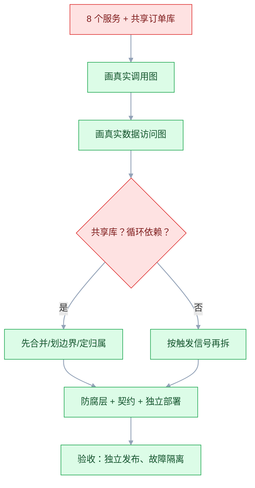

# 服务拆分与数据归属

## 一、工程案例：把“分布式单体”拆回能独立发布的三个服务

**场景**：一个电商系统三年前从单体拆成 8 个微服务，结果：发布一次要协调 8 个团队，改一个接口要发 5 个 PR；所有服务共享同一个订单库，任何服务都能改订单表；支付服务调用户服务拿余额，用户服务又调订单服务拿订单状态，循环依赖；一次大促，订单服务挂了，支付、库存、物流全跟着挂。团队 15 人，运维 2 人。

**目标**：不是拆得更细，而是把边界、数据归属、依赖方向重新定清楚。交付：

- 一张现状依赖与共享表分析；
- 一张服务边界与数据归属表；
- 一张依赖规则与防腐层设计；
- 一套拆分与合并方案；
- 一张验收清单（8 项）。

**为什么必须做**：拆服务解决的是“团队和发布边界”，不是“代码量”。共享库、循环依赖、分布式事务没解决，拆得越多越糟。

**动手前确认**：先画两张图：真实调用图（不是架构图）、真实数据库访问图（哪个服务动了哪张表）。没有这两张，拆分就是猜。下面的数据是示例。

### 1.1 先看现状：分布式单体的症状

| 症状 | 现状（示例） | 说明 |
|---|---|---|
| 服务数 | 8 | 团队 15 人，平均不到 2 人一个服务 |
| 共享表 | 订单表被 6 个服务写 | 数据边界完全失效 |
| 循环依赖 | 支付↔用户↔订单 | 调用图成环 |
| 发布协调 | 一次上线 5 个服务 | 没有独立发布 |
| 故障扩散 | 订单服务挂，全站挂 | 没有隔离和降级 |
| 事务 | 跨服务调用用同步 HTTP | 没有最终一致机制 |

这不是“微服务”，是“把单体调用换成了网络调用”。

### 1.2 服务边界

重新划边界，按“数据归属 + 团队 + 变更频率”：

| 服务 | 职责 | 拥有的数据 | 团队 |
|---|---|---|---|
| 交易 | 订单、购物车、结算 | 订单表、订单行 | 交易组 4 人 |
| 支付 | 支付单、渠道路由、回调 | 支付流水、渠道配置 | 支付组 3 人 |
| 用户 | 账号、权限、会员 | 用户表、会员表 | 平台组 3 人 |
| 商品 | 商品、类目、库存可见 | 商品表、类目 | 商品组 2 人 |
| 库存 | 库存、预占、扣减 | 库存表、预占表 | 交易组兼任 |
| 履约 | 物流、发货、售后 | 发运单、售后单 | 交易组兼任 |

原则：**一个服务只拥有自己的表；需要别人的数据，走 API 或读模型，不连库**。

### 1.3 数据归属

| 数据 | 权威源 | 其他方 | 冲突 |
|---|---|---|---|
| 订单 | 交易 | 支付、履约、BI | 支付单 vs 订单号 |
| 支付单 | 支付 | 交易、BI | 回调重复 |
| 用户 | 用户 | 交易、支付、BI | 会员等级 |
| 商品 | 商品 | 交易、搜索、BI | 价格、上下架 |
| 库存 | 库存 | 交易、履约 | 预占 vs 实物 |

“订单状态”是最容易出问题的字段：交易写，支付读，履约也读。规则：只有交易能写订单状态；支付只写支付单状态；履约只写发运单状态。订单状态由交易根据事件汇总。

### 1.4 依赖规则与防腐层

| 规则 | 说明 |
|---|---|
| 单向依赖 | 交易 → 支付 → 用户；不允许反向 |
| 禁止连库 | 跨服务禁止直连数据库 |
| 防腐层 | 老系统模型通过 ACL 转换，不污染新模型 |
| 契约优先 | 接口变更必须通知下游，留兼容期 |
| 超时重试 | 同步调用有超时、重试上限、熔断 |
| 事件解耦 | 状态变更发事件，不靠对方轮询 |

交易要用户信息，不能直连用户库；要么用户服务提供 API，要么交易服务维护“用户读模型”，通过事件更新。后者更适合高频读取。

### 1.5 拆分与合并

| 动作 | 对象 | 理由 |
|---|---|---|
| 合并 | 8 → 5 个服务 | 人少，服务多只会增加协调成本 |
| 拆出 | 支付独立 | 安全边界、独立扩容、独立发布 |
| 合并 | 库存并回交易 | 库存和订单强一致，同一团队 |
| 保留 | 商品、用户 | 边界清楚、被多方依赖 |
| 新增 | 防腐层适配老系统 | 隔离遗留模型 |

不要为“未来可能拆”预留服务。先用模块化单体跑，触发信号到了再拆。

### 1.6 触发信号

出现任意两条，才考虑拆：

- 团队按业务域划分，两个团队为一个发布窗口排队；
- 单服务发布频率明显高于其他；
- 单服务需要独立扩容，且扩容成本超过拆分成本；
- 单库写入达到上限，分库分表无法解决；
- 故障隔离成为硬要求。

### 1.7 验收（8 项）

1. 数据：每个服务只写自己的表，跨库写为 0。
2. 依赖：调用图无环，禁止连库的规则有 CI 检查。
3. 发布：每个服务可独立发布，回滚 ≤ 10 分钟。
4. 隔离：停掉支付服务，交易服务仍能下单（可标记待支付）。
5. 事务：跨服务一致性用 outbox/事件实现，无同步 HTTP 分布式事务。
6. 契约：接口有版本，变更有兼容期，有消费者契约测试。
7. 容量：单服务压测达标，连接池、线程池有上限。
8. 组织：服务边界和团队边界一一对应。

## 二、高频问答：会卡住你的地方，也是面试最常问的

### 2.1 服务拆得越细越好

**现场**

问两句：这个服务有独立 owner 吗？独立发布有意义吗？两个都是否，就该合并。

**要点**

- 拆分把复杂度从代码转移到网络、数据、运维。
- 团队小、边界不清时，拆得越多越难维护，纳米服务的协调成本大于收益。
- 服务数要和团队规模匹配，15 人 8 个服务，平均不到 2 人一个，注定没人真正负责。

**追问**

- 拆细了最典型的症状？→ 改一个功能要发多个服务，联调排期比开发还长。
- 什么时候该合并？→ 同一团队维护、数据强一致、发布总是一起，合回去更划算。
- 拆之前先做什么？→ 先画真实调用图和数据访问图，没有这两张就是猜。

### 2.2 共享库最方便

**现场**

画数据访问图；一张表被多个服务写，就是共享库。

**要点**

- 共享库让数据边界失效，任何服务改表都会影响别人，最后变成分布式单体。
- 症状很直接：订单表被 6 个服务写，改一个字段要协调 6 个团队。
- 一个表只能有一个写源，其他方走 API、读模型或事件。

**追问**

- 只读共享可以吗？→ 短时间可以，长期也要收口成读模型或接口，否则 schema 一改就崩。
- 读模型怎么保持同步？→ 订阅事件更新，定期对账兜住差异。
- 已经共享了怎么迁？→ 先停跨库写，再拆读，最后切流，每步可回滚。

### 2.3 循环依赖无所谓

**现场**

看调用图；A→B→C→A 就是环，必须破。

**要点**

- 循环依赖让发布顺序、故障扩散、事务边界全部复杂化。
- 环上的服务谁也不能独立发布，故障会沿着环来回放大。
- 破环的手段是单向依赖 + 事件：把反向调用改成订阅或读模型。

**追问**

- 怎么破 A→B→C→A？→ 找环上最弱的一条边改成异步事件，或抽一个公共上下文。
- 环一定要彻底消除吗？→ 至少要保证主链路单向，反向数据走异步。
- 循环依赖有哪些隐蔽形式？→ 共享库、公共 SDK 里的双向调用、回调接口。

### 2.4 用分布式事务保一致

**现场**

问一句：这个业务能接受秒级延迟吗？能，就用事件 + 补偿。

**要点**

- 强一致事务把多个服务绑死，性能和可用性都差。
- 大多数业务场景应该用最终一致：outbox + 事件 + 幂等 + 对账。
- 跨服务强一致尽量避免，必要时才用 Saga/TCC，并且要接受它带来的复杂度和失败处理。

**追问**

- outbox 解决什么问题？→ 把业务数据和待发消息放同一事务，避免双写不一致。
- Saga 和 TCC 怎么选？→ Saga 适合长流程和可补偿业务，TCC 适合资源预留型业务，实现更重。
- 最终一致怎么保证不丢？→ 幂等消费 + 重试上限 + 死信 + 定期对账。

### 2.5 接口先做，边界后想

**现场**

问一句：这个接口背后的表谁拥有？答不上来就是边界没定。

**要点**

- 边界不清就写接口，接口会跟着数据模型走，最后把共享库问题固化。
- 接口是契约，契约背后必须有明确的数据归属，否则改一次就要全链路对齐。
- 顺序是先定边界和数据归属，再定接口和版本。

**追问**

- 接口已经写了一堆怎么办？→ 从数据访问图倒推归属，把跨库访问逐个收口。
- 契约怎么管？→ 有版本、有兼容期、有消费者契约测试。
- 事件算接口吗？→ 算，跨上下文的集成事件也要版本化，兼容旧消费者。

### 2.6 按技术层拆服务

**现场**

看一次需求变更要动几个服务；动全部就是技术分层。

**要点**

- 按技术层拆，改一个功能要动所有层，发布和事务都困难。
- 服务应该按业务域拆，一个服务端到端负责一块业务能力。
- 技术分层的价值在代码组织，不在部署单元。

**追问**

- Controller/Service/Dao 分服务错在哪？→ 每个功能都要跨三个服务改，事务和发布都碎掉。
- BFF 算技术层吗？→ 不算，它是按端聚合的边界层，有明确的业务职责。
- 已经这么拆了怎么救？→ 先合并回按域的服务，再在里面分层。

### 2.7 康威定律是宿命

**现场**

看服务边界和团队边界是否一致；不一致就会长期扯皮。

**要点**

- 康威定律是描述现象，不是宿命。
- 可以用逆康威调整团队边界来塑造系统边界。
- 但调整组织比改代码慢，别指望一次组织调整就解决架构问题。

**追问**

- 团队边界和系统边界谁先动？→ 一般先调团队，再让系统边界跟着长；紧急时先用规则顶住。
- 边界不一致的症状？→ 两个团队为一个发布窗口排队，故障要跨团队排查。
- Team Topologies 怎么用？→ 按业务流、平台、赋能、复杂子系统四类团队划分，让拓扑决定系统拓扑。

### 2.8 拆分后性能更好

**现场**

先定位瓶颈：CPU、DB、锁、网络；只有瓶颈模块需要独立扩容时才拆。

**要点**

- 拆分把本地调用变成网络调用，增加序列化、超时、重试。
- 没有按瓶颈拆，性能可能更差。
- 拆分真正的收益是发布边界和故障隔离，不是性能。

**追问**

- 拆完更慢先查什么？→ 调用链层数和序列化开销，再看是否引入了跨服务查询。
- 什么时候拆真能提速？→ 瓶颈模块确实需要独立扩容，且拆分后调用链没变长。
- 不拆怎么扛？→ 缓存、读写分离、异步化、连接池和 SQL 优化。

### 2.9 微服务一定比模块化单体好

**现场**

问两句：团队有服务治理经验吗？独立发布是硬需求吗？两个都是否，模块化单体更合适。

**要点**

- 模块化单体在团队小、边界清楚时更高效。
- 微服务不是终点，是权衡后的选择。
- 先合并再拆分经常是正确的一步，服务过细时该做的是合回去。

**追问**

- 模块化单体的边界靠什么守？→ 依赖检查进 CI、模块公开接口、独立 schema。
- 什么时候必须转微服务？→ 独立发布和独立扩容成为硬需求，且团队有治理能力。
- 转的过程中怎么不停服？→ 双跑、灰度切流、每步可回滚。

### 2.10 数据归属以后再理

**现场**

抽查核心表，看有几个服务在写；超过 2 个就要先治理。

**要点**

- 数据归属不清，接口和数据同步会越做越乱，后期治理成本更高。
- 数据归属和一致性方案都要在拆分前定，不要上线后补。
- 一个表只有一个写源，其余方走 API、读模型或事件。

**追问**

- 权威源怎么定？→ 看谁执行业务规则，不是看谁先建的表。
- 订单状态这种多方关心的字段怎么办？→ 只有交易能写，其他方订阅事件或读模型。
- 数据已经乱了怎么收？→ 先画数据访问图，停跨库写，再拆读、对账、切流。

## 三、核心知识

### 3.1 拆分的依据

| 依据 | 问题 |
|---|---|
| 数据归属 | 谁拥有这张表 |
| 变更频率 | 哪些功能总是一起改 |
| 团队边界 | 谁负责 |
| 一致性要求 | 是否需要强一致 |
| 扩容需求 | 是否需要独立扩缩 |
| 故障隔离 | 故障是否需要互不影响 |
| 安全边界 | 是否需要独立权限/审计 |

单一依据都不够，要综合判断。

> **面试**：常问「拆服务应该依据什么？」答：数据归属、变更频率、团队边界、一致性、扩容、隔离、安全，单一依据不够，要综合判断。

### 3.2 数据归属原则

| 原则 | 说明 |
|---|---|
| 一个写源 | 一个表只有一个服务写 |
| 事件传播 | 状态变更用事件通知，不共享表 |
| 读模型 | 高频读取的数据可以建副本 |
| 接口契约 | 跨服务访问走 API，不连库 |
| 对账 | 数据副本定期比对 |

数据归属不清，服务拆了也白拆。

### 3.3 依赖管理

| 反模式 | 后果 |
|---|---|
| 循环依赖 | 发布顺序、故障扩散 |
| 共享库 | 数据边界失效 |
| 同步链过长 | 延迟叠加、级联失败 |
| 无超时重试 | 雪崩 |
| 接口无版本 | 升级破坏下游 |

依赖要“少、单向、有契约、有超时”。

### 3.4 防腐层

防腐层（ACL）隔离外部/遗留模型：

- 定义：在新旧系统之间加一层转换；
- 作用：防止老模型污染新模型，隔离变化；
- 位置：通常在调用方，不在提供方；
- 代价：多一层代码，需要维护映射。

没有防腐层，老系统的坏味道会渗进新系统。

> **面试**：常问「防腐层放在调用方还是提供方？」答：放调用方，负责翻译、适配和协议转换，防止上游模型污染自己的领域。

### 3.5 通信方式

| 方式 | 适合 | 代价 |
|---|---|---|
| 同步 HTTP/gRPC | 查询、强一致写 | 级联失败、延迟叠加 |
| 异步消息 | 通知、状态变更、削峰 | 最终一致、重复、乱序 |
| 事件溯源 | 审计、复杂领域 | 查询复杂、投影延迟 |
| 批量文件 | 财务、BI、对账 | 延迟 |

主链路可同步，旁路必须异步。

### 3.6 一致性策略

| 场景 | 方案 |
|---|---|
| 同库多表 | 本地事务 |
| 跨服务强一致 | 尽量避免；必要时 Saga/TCC |
| 跨服务最终一致 | outbox + 事件 + 幂等 + 对账 |
| 查询一致性 | 读己之写、缓存失效 |

一致性方案要在拆分前定，不要上线后补。

> **面试**：常问「跨服务一致性怎么保证？」答：优先最终一致，用 outbox + 事件 + 幂等 + 对账；强一致只在必要时用 Saga/TCC。

### 3.7 拆分步骤

| 步骤 | 动作 | 退出条件 |
|---|---|---|
| 1 分析 | 调用图、数据图、变更热点 | 边界清晰 |
| 2 定边界 | 服务职责、数据归属 | 无共享写 |
| 3 防腐层 | 隔离老模型 | 新模型独立 |
| 4 契约 | API、事件、版本 | 契约测试通过 |
| 5 双跑 | 新旧并行，只读比对 | 差异 < 0.1% |
| 6 切流 | 灰度切流 | 稳定运行 |
| 7 收尾 | 下线旧接口 | 无回访 |

每步可回滚，不要一次性切。

### 3.8 组织与架构

| 组织模式 | 适合 |
|---|---|
| 全功能小团队 | 端到端负责，减少交接 |
| 平台团队 | 网关、消息、观测、CI/CD |
| 按业务域 | 边界与团队一致 |
| 矩阵 | 复杂，慎用 |

团队边界和系统边界对齐，是康威定律的正确用法。

### 3.9 反模式

| 反模式 | 表现 |
|---|---|
| 分布式单体 | 服务拆了，库还共享 |
| 纳米服务 | 服务太小，协调成本 > 收益 |
| 共享数据库 | 多个服务写一张表 |
| 同步链过长 | 5 个服务串行调用 |
| 事件洪水 | 所有变更都发事件，无治理 |
| 无 owner 服务 | 没人负责，没人敢改 |

### 3.10 判断是否拆分

问五个问题：

1. 这个边界内的东西是否一起变化？
2. 这个边界能否独立部署和回滚？
3. 这个边界是否拥有自己的数据？
4. 这个边界有明确 owner 吗？
5. 不拆会损失什么？

五个都能答“是”，才拆。

> **面试**：常问「一个边界能不能独立成服务，看哪几条？」答：是否一起变化、能否独立部署回滚、是否拥有自己的数据、有没有 owner、不拆会损失什么。

## 四、冷门知识汇总

- **架构量子**：可独立部署、独立运行、拥有独立数据的最小单元。它比“服务”更适合判断边界。
- **康威定律与逆康威**：系统结构会复制组织沟通结构；反过来，先调整团队，再让系统边界跟着长。
- **Team Topologies**：把团队分为 Stream-aligned（业务流）、Enabling（赋能）、Platform（平台）、Complicated Subsystem（复杂子系统）。团队拓扑决定系统拓扑。
- **数据契约（Data Contract）**：源系统对下游承诺 schema、语义、质量、SLA。它比接口文档更强调责任。
- **领域驱动设计的“上下文映射”**：合作关系、共享内核、客户-供应商、遵奉者、防腐层、开放主机、发布语言。拆分服务前先画上下文映射。
- **Saga 与进程管理器**：Saga 是长事务的编排/协同实现；进程管理器（Process Manager）是有状态的编排，适合复杂流程。
- **BFF（Backend for Frontend）**：为不同前端定制聚合层，避免前端拼多个接口。它常作为拆分的过渡层。
- **Strangler Fig（绞杀者）**：用新系统逐步替换旧系统，外层路由先切流量。迁移遗留系统的标准做法。
- **防腐层不是“加一层接口”**：它要隔离模型，包括翻译、适配、协议转换，还要防止上游模型渗透。
- **“分布式单体”的识别**：改一个功能要发布多个服务、多个服务写同一张表、同步调用链超过 3 层。
- **读模型（Read Model / CQRS）**：查询不直接读写模型，而是读物化视图。它解耦读写，但引入延迟和一致性成本。
- **outbox 与双写**：outbox 把业务数据和待发消息放同一事务，避免双写不一致。
- **服务网格不是银弹**：它解决通信横切问题（流量、安全、观测），不解决边界和数据归属。
- **“先合并再拆分”**：很多时候正确的第一步是合并过细的服务，而不是继续拆。
- **微服务的“拥有者”**：没有明确 owner 的服务，最后没人维护、没人敢改。拆服务前先确认 owner。