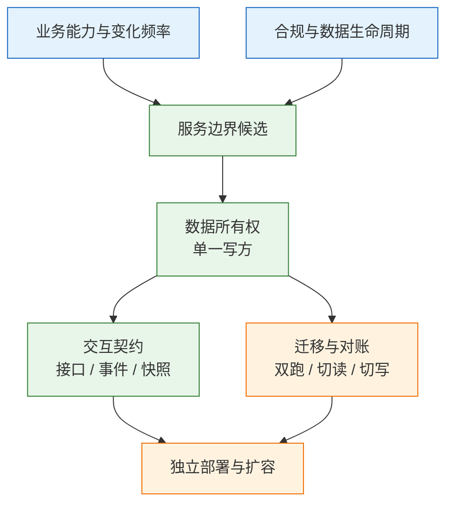
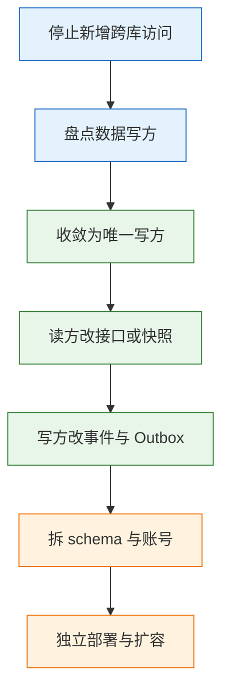

# 服务拆分与数据归属

---

## 一、服务拆分与数据归属是什么

### 1.1 核心概念

一个电商系统把单体拆成订单、用户、商品、库存四个服务。半年后出现四种现象：订单服务为了显示收货地址，直接查用户库的 `user_address` 表；商品服务给 `product` 表加字段，订单服务的 SQL 报错并一起回滚；大促时订单与库存同时更新 `stock` 表，行锁互相等待，下单 P99 从 200 ms 涨到 2 s；报表要跨四个库 JOIN，只能导出 CSV 再拼。

四个服务、四套部署，实际共享一个数据库。这就是分布式单体：进程分开了，数据和事务还绑在一起，拆分的成本全付了，收益一点没拿到。

服务拆分（Service Decomposition）是按业务能力、变化频率和故障边界，把系统划成若干可独立开发、部署和扩容的单元。它关心的是进程与发布边界，不是代码目录。

数据归属（Data Ownership）是给每份数据指定唯一的权威写方，并规定其他单元只能通过接口、事件或快照获取。它关心的是事实源与写入权限，不是表放在哪个库。

| 概念 | 回答的问题 | 典型产出 |
|---|---|---|
| 服务边界 | 哪些能力放在同一部署单元 | 服务清单与职责说明 |
| 数据所有权 | 每份数据由谁写、谁只能读 | 数据归属表 |
| 交互契约 | 服务之间如何取数与通知 | 接口、事件、schema |
| 迁移方案 | 如何从共享库走到独立库 | 阶段计划与回滚预案 |

服务拆分的难点不是把代码分成几个进程，而是决定哪份数据归谁写。只要两个服务还能写同一张表，它们就还是一个系统，只是多了一次网络调用。数据所有权定不下来，服务数量越多，联调、发布和故障定位的成本上升得越快。

拆分的顺序常被弄反。先定服务数量，再想数据怎么分，最后发现跨服务查询太多，只能回退到共享库；正确顺序是先定数据写方，再定服务边界，最后定部署形态。

### 1.2 与相邻技术的关系

服务拆分容易与领域建模、分层架构、分库分表、组织调整混在一起。它们各自解决不同层面的问题。

限界上下文给出模型边界，服务拆分给出部署边界。一个上下文可以是一个服务，也可以是一个模块；一个服务也可以承载多个上下文。上下文没划清就直接拆进程，会把同一套模型复制到多个服务，最后靠同步接口维持一致。

分层架构解决代码职责，不解决数据归属。Controller、Service、Repository 分得再整齐，只要两个服务连同一个库，边界仍然是假的。

分库分表解决容量与性能，不改变所有权。把一张表哈希到多个库，写方仍然是同一个服务；它和“把表交给另一个服务”是两件事。分库分表之后跨库 JOIN 消失，但跨服务查询可能一个都没少。

组织边界会影响服务边界，但不等于服务边界。康威定律指出系统结构会向沟通结构靠拢，按团队拆服务在短期内顺滑，长期会随组织调整反复改名。稳定的做法是先看业务能力和数据所有权，再让团队围绕边界组建。

| 相邻方法 | 解决的问题 | 与服务拆分的关系 | 混用的后果 |
|---|---|---|---|
| 限界上下文 | 模型语言一致 | 提供边界候选 | 按模型直接切进程 |
| 分层架构 | 代码职责分离 | 服务内部的实现结构 | 误以为分层等于拆分 |
| 分库分表 | 单表容量与性能 | 同一写方内的存储扩展 | 把分片当独立服务 |
| 康威定律 | 组织影响系统结构 | 团队与边界相互塑造 | 按部门切服务 |
| API 网关 | 统一接入与治理 | 服务的外部入口 | 网关承担业务聚合 |

> **注意**：服务拆分不是微服务的同义词。单体内部同样可以做模块拆分和数据归属，而且成本更低。进程拆分是最后一步，不是第一步。

### 1.3 拆分框架与架构组成

从业务能力到独立部署，中间要经过边界识别、数据归属、契约设计和迁移四段。每一段都有可检查的产出，跳过任何一段，拆分都会退回共享库。



| 层 | 判断对象 | 产出 | 验收证据 |
|---|---|---|---|
| 能力层 | 变更频率、故障影响 | 边界候选清单 | 每个候选有 owner |
| 数据层 | 写方、读方、生命周期 | 数据归属表 | 每份数据只有一个写方 |
| 契约层 | 同步、异步、快照 | 接口与事件定义 | 契约测试通过 |
| 部署层 | 扩容、隔离、回滚 | 部署单元与预案 | 可独立发布与回退 |

框架的核心是“先数据、后进程”。数据归属清楚，服务边界自然收敛；数据归属模糊，服务拆得再细也会通过共享表重新耦合。

---

## 二、拆分边界的识别

### 2.1 变更成本与故障成本

拆分不是目标，降低变更成本和故障成本才是。两类成本要分开测算，否则很容易为了一个很少发生的故障，付出每天都在发生的联调代价。

| 成本类型 | 典型表现 | 拆分收益 | 拆分代价 |
|---|---|---|---|
| 变更成本 | 改一处要全量回归 | 独立发布、独立回滚 | 契约变更要协调 |
| 扩容成本 | 一个模块吃满 CPU | 按服务扩缩容 | 容量规划更复杂 |
| 故障成本 | 一个模块拖垮主链路 | 故障隔离与降级 | 链路更长、排障更难 |
| 数据成本 | 合规要求隔离 | 独立库与权限 | 跨库查询与对账 |

变更成本看发布频率和回归范围，扩容成本看资源曲线是否同步，故障成本看故障传播路径，数据成本看合规与保留期。四项里只有一项突出时，优先做模块化；两项以上同时突出，才值得拆进程。

### 2.2 值得拆与不该拆的信号

| 信号 | 观察方式 | 结论 |
|---|---|---|
| 流量差异大 | 某模块流量是其他的数倍 | 值得独立扩容 |
| 故障需隔离 | 故障会拖垮主链路 | 值得独立部署 |
| 发布频率高 | 发布次数远高于其他模块 | 值得独立发布 |
| 合规要隔离 | 支付、医疗、跨境数据 | 值得独立库与权限 |
| 团队有 owner | 有明确负责人和值班 | 边界可落地 |
| 强事务与 JOIN | 同一批数据反复联表 | 暂不拆 |
| 边界仍在探索 | 业务每周变化 | 先模块化 |
| 拆完仍共享库 | 无法确定唯一写方 | 不拆 |

最容易被忽略的是最后一条反信号：拆完还得共享数据库，就先别拆。先做模块化，把 schema 分开，把跨模块直接读表降为零，再考虑进程拆分。

> **注意**：信号只说明“可能值得拆”，不说明“现在就能拆”。值得拆是收益判断，能拆是条件判断；条件不具备时强行拆，会把变更成本转成分布式一致性成本。

### 2.3 团队粒度与服务数量约束

服务数量要与团队数量和边界稳定性匹配。一个八人团队维护十二个服务，平均每个服务不到一人，结果是谁都不熟、发布排队、故障互相甩锅。

| 约束 | 说明 | 越界表现 |
|---|---|---|
| 值班能力 | 每个服务都要有人 on-call | 故障无人认领 |
| 认知负荷 | 一人最多精通少量服务 | 改动靠猜、回归靠运气 |
| 发布协调 | 服务越多，联调组合越多 | 发布窗口互相等待 |
| 边界稳定 | 探索期边界变化快 | 频繁改名与合并 |

粒度判断还有一个简单标准：一个服务能否由一个小团队从设计、开发、发布到值班完整负责。答案是“不能”，说明服务太细，或者团队还没准备好。

### 2.4 边界候选的验证

候选边界要用五项检查验证。通过后再进入数据归属设计，不通过就回到能力与变化频率重新划分。

| 验证项 | 通过标准 | 不通过的处理 |
|---|---|---|
| 语言一致 | 边界内术语只有一种含义 | 合并或拆出子边界 |
| 数据唯一 | 每份数据有唯一写方 | 先收敛写方 |
| 发布独立 | 变更不需要联合发布 | 消除共享表与共享包 |
| 故障可控 | 下游故障有降级路径 | 补超时、隔离与降级 |
| 回滚可行 | 旧路径可在一段时间内恢复 | 保留双跑与回滚窗口 |

---

## 三、数据归属的判定

### 3.1 单一写者原则

数据归属的核心规则只有一句：每一份数据只有一个服务负责写，其他服务只能通过接口或事件读。

这条规则推出来的结果很具体：订单表只能订单服务写，库存服务不能直接改订单状态；用户地址只能用户服务写，订单服务要存快照；商品价格只能商品服务写，下单时把价格快照进订单行；报表不能直接 JOIN 业务库，要走 CDC 到分析库。

| 数据 | 权威写方 | 读方获取方式 |
|---|---|---|
| 订单与订单行 | 订单服务 | 订单接口、事件 |
| 用户地址 | 用户服务 | 下单时快照 |
| 商品名称与价格 | 商品服务 | 下单时快照 |
| 库存可售量 | 库存服务 | 同步预占接口 |
| 支付状态 | 支付服务 | 事件与对账 |

> **架构红线**：任何服务不得直连另一个服务的数据库读表或写表。跨服务数据只能通过接口、事件或快照获得。直连数据库会把发布、索引、故障和权限重新绑在一起；两个服务还能写同一张表，它们就还是一个系统。

单一写者不是“只能有一个实例”。写方可以多副本、可分片，但逻辑上的写权限只属于一个服务。分片键、主键生成和写入校验都由这个服务统一负责。

### 3.2 数据分类

拆分前要做一次数据盘点，把每份数据分成三类。分类决定了归属原则和迁移方式。

| 类型 | 例子 | 归属原则 | 典型错误 |
|---|---|---|---|
| 实体数据 | 订单、支付单、库存 | 归写入它的上下文 | 多方共写 |
| 参考数据 | 商品、门店、汇率 | 主数据上下文统一维护 | 各服务各存一份 |
| 派生数据 | 报表、搜索索引、统计 | 从事件或 CDC 重建 | 当作真相源 |

盘点时会发现很多“看起来是 A 的、实际被 B 写”的数据。这些就是拆分的第一批工作项：先把写方收敛到一个服务，再谈拆进程。

派生数据要明确标注“可重建”。搜索索引、缓存、宽表、报表都应有重建脚本和重建时限；没有重建能力的派生数据，实际上已经变成了第二个真相源。

### 3.3 跨服务数据关系

跨服务的数据关系有四种，代价依次升高。选择依据是实时性要求、数据量和失败代价。

| 模式 | 做法 | 适合 | 代价 |
|---|---|---|---|
| 私有表 + API | 数据归一个服务，其他服务调用接口 | 实时性高、数据量小 | 同步依赖、需限流降级 |
| 事件投影 | 订阅变更事件，本地建读模型 | 查询多、可接受延迟 | 延迟、重复、重建成本 |
| 只读副本 | 对方开只读库或视图 | 过渡期、报表 | schema 耦合 |
| 共享库共享表 | 直接读写同一张表 | 几乎只适合单体内部 | 锁竞争、无法独立发布 |

只读副本和视图是过渡手段，不是目标架构。它们能先把读流量挪走，但只要对方改表结构还会坏，就仍然是耦合。

> **注意**：只读副本常被当作“已经拆完”的证据，实际上它只是把写冲突换成了 schema 冲突。上线前要写清退出时间，否则过渡方案会永久留存。

### 3.4 主数据与快照

客户、商品、组织、门店这类被多个上下文引用的数据，适合建独立的主数据上下文，提供稳定 ID 和查询接口。业务上下文在交易发生时存快照，而不是每次实时回查。

| 场景 | 实时查询 | 快照 |
|---|---|---|
| 下单时的地址 | 地址变更会影响历史订单 | 固定为交易事实 |
| 下单时的价格 | 改价会篡改历史金额 | 以订单为准 |
| 商品名称展示 | 改名会改变历史凭证 | 保留当时名称 |
| 库存可用量 | 必须知道当前值 | 不适合快照 |

快照不是缓存。缓存可以失效、可以刷新，快照一旦写入就代表当时的事实，后续不随源数据变化。订单里的地址、商品名、价格都应是快照，否则用户改地址、商品改名后，历史订单会跟着变，对账和对客解释都会出问题。

---

## 四、跨服务查询与接口契约

### 4.1 查询场景与方案

拆完服务后最常见的性能退化，是“一个列表页调两百次接口”。原来一条 SQL 的 JOIN，变成了循环里的 RPC。

| 场景 | 方案 | 说明 | 代价 |
|---|---|---|---|
| 详情页依赖两三个服务 | API 组合或 BFF | 并行调用、聚合结果 | 多一层部署 |
| 列表页依赖多个服务 | 读模型或宽表 | 事件或 CDC 预聚合 | 投影延迟与重建 |
| 多维筛选与搜索 | 搜索引擎 | 接受秒级延迟 | 索引一致性 |
| 跨域报表与历史分析 | 数据仓库或湖 | CDC 入仓 | 链路与存储成本 |

BFF（Backend for Frontend）适合不同端需要不同聚合的场景：App 要精简字段，后台要全量字段，各有一个 BFF。让一个通用接口适配所有端，最后会变成一张巨大的万能查询接口。

读模型适合查询远多于写、能接受延迟的场景。订单列表把订单、支付、物流投影到一张宽表，查询只读宽表；代价是投影链路要能重建、能对账。

最不该做的是在订单服务里开一个用户库只读连接，然后写跨库 JOIN。这会把两个服务的发布、索引和故障重新绑在一起。

### 4.2 接口契约

接口是数据所有权的契约边界。字段返回越多，耦合越深，后续拆分越难。

| 契约项 | 要求 | 验证方式 |
|---|---|---|
| 字段范围 | 只暴露稳定 ID 与业务字段 | 契约评审 |
| 超时与错误码 | 每个接口写清 SLA | 消费者驱动契约测试 |
| 兼容性 | 加字段兼容，删改要版本化 | 双跑一个发布周期 |
| 限流与降级 | 读方按 SLA 设计降级 | 故障演练 |

契约变更遵守三条规则：新增字段必须可选并有默认值；删除字段先标记废弃，观察调用方清零后再删；修改语义等同于新增接口，不能让旧调用方在无感知的情况下改变行为。

一个数据有多个读方时，不要为每个读方开定制接口。定制接口短期省事，长期会形成多套语义，最后没人说得清哪个才是权威。

### 4.3 一致性与事件

跨服务一致性不靠分布式事务，靠状态机、事件、补偿和对账。常用机制各有代价。

| 机制 | 解决的问题 | 代价 |
|---|---|---|
| 本地事务 + Outbox | 业务写入与事件发送一致 | 投递器与积压监控 |
| Saga | 长事务的补偿与回滚 | 状态多、补偿要幂等 |
| 幂等键 | 重复请求与重复消息 | 存储与过期策略 |
| 定时对账 | 最终发现不一致 | 延迟与人工处理 |

Outbox 的做法是把业务数据和待发消息写进同一个本地事务，再由独立投递器发送。它解决的是“业务提交了但事件没发出去”，不解决“消费者处理失败”；后者要靠重试、死信队列和对账。

Saga 把长流程拆成若干本地事务，每一步都有补偿动作。补偿不是回滚，退款成功后的“补偿”是再退一次或冲正，必须按业务语义设计，不能机械照搬数据库回滚。

---

## 五、拆分与迁移步骤

### 5.1 模块化与 schema 拆分

迁移的第一步不是新建服务，而是在现有进程内把边界做出来。模块之间只通过接口调用，禁止跨模块读表。

| 阶段 | 动作 | 完成标准 |
|---|---|---|
| 模块化 | 按边界分模块，接口替代直接调用 | 跨模块读表为零 |
| 拆 schema | 每模块独立 schema 与账号 | 无跨 schema 写权限 |
| 独立库 | 每服务独立实例 | 连接串与权限隔离 |
| 建服务 | 新服务承接读写 | 双跑对账通过 |

先拆 schema，再拆进程，是最省成本的路径。在同一个进程内做到“订单模块不碰用户表”，比一上来拆服务容易得多；数据库账号权限也能强制约束越界访问。

模块边界要写成可检查的依赖规则，而不是口头约定。下面三条用简写表达，落地时转成依赖检查工具或数据库授权规则：

```text
order-module   -> user-api, product-api, stock-api
order-module  -/-> user-impl, product-impl, stock-impl
order-module  -/-> user_schema, product_schema
```

前两条约束代码依赖方向，第三条约束数据库权限。规则进入 CI 后，越界会在合并前暴露，而不是等到上线后由故障提醒。

### 5.2 双写与 CDC

迁移期需要把旧库数据同步到新库。两种常见方式：双写和 CDC（Change Data Capture，变更数据捕获）。

| 方式 | 可靠性 | 业务改造 | 适用 |
|---|---|---|---|
| 双写 | 依赖应用，第二次写可能失败 | 需要改代码 | 短期、写入量小 |
| CDC | 读数据库日志，不侵入业务 | 无需改业务代码 | 中长期、持续同步 |

双写必须有主写方。迁移期只能有一个服务是权威写方，另一方是副本；两边都能写，冲突无法裁决。CDC 读取 MySQL binlog 或 PostgreSQL WAL，业务代码不用改，也不会因为第二个写失败而回滚主业务；代价是延迟和 schema 变化要处理。

选择依据是迁移周期和改造能力。迁移在数周内结束、写入量不大，双写更容易控制；迁移持续数月、表多且业务代码不宜再动，优先 CDC。两者也可以组合：CDC 负责存量与持续同步，双写只用于少数必须同步确认的字段。

> **注意**：CDC 不是免运维。表结构变更、大事务、日志保留期、位点丢失都会影响同步；上线前要压测延迟，并准备全量重建通道。

### 5.3 切读、切写与回滚

迁移按读、写、下线三段推进。切读先于切写，出问题时还能回到旧库读。


| 阶段 | 动作 | 回退方式 |
|---|---|---|
| 切读 | 按租户或用户灰度 | 切回旧库读 |
| 切写 | 主写方切到新服务 | 保留反向同步 |
| 观察 | 监控差异与延迟 | 回滚窗口内可切回 |
| 下线 | 删除旧表与旧代码 | 备份与归档 |

旧表要保留一个完整业务周期的回滚窗口，至少覆盖月结。确认对账、报表和下游都不依赖后再删；删除前做一次全量备份，并验证恢复。

切读的放量门槛要提前定：双跑差异率、接口错误率、P99 延迟、对账未决条数。任一指标越线即停止放量并回切；回切动作要在五分钟内可执行，否则灰度就只是把风险推迟到高峰时段。

### 5.4 对账与验收

迁移的验收不是“新服务能启动”，而是四类一致性同时成立。少一项都可能在上线后变成资损。

| 验收项 | 方法 | 通过标准 |
|---|---|---|
| 行数一致 | 全量与增量计数 | 差异可解释 |
| 金额一致 | 分桶汇总比对 | 分币种零差异 |
| 抽样一致 | 随机抽样逐字段比对 | 无业务字段偏差 |
| 规则一致 | 用同一批用例跑新旧逻辑 | 结果完全一致 |

对账要自动化、可重复，不能靠一次性手工核对。差异要能定位到具体记录和字段，否则“差异率很低”无法支撑上线决策。

按日汇总的比对可以直接落成 SQL，新旧库各执行一次，再按日期与币种对齐：

```sql
-- 按日、按币种汇总，新旧库使用同一口径
SELECT order_date,
       currency,
       COUNT(*) AS order_cnt,
       SUM(total_amount) AS total_amt
FROM orders
WHERE order_date = :biz_date
GROUP BY order_date, currency;
```

行数允许有可解释的差异，金额必须逐币种对齐；差异记录要落表并带业务主键，便于逐条追查。阈值由业务和财务共同确认，不能由开发单方面设定。

---

## 六、完整案例：订单域拆分

系统现状：日订单 50 万、峰值 200 TPS，一个 MySQL 库 60 张表，订单服务直接 JOIN 用户地址、商品、库存。大促时库存行锁导致下单 P99 达到 2 s。

60 张表按业务可分为订单、用户、商品、库存四组。表数量本身不是问题，订单服务跨组直读地址、商品、库存三组，才是锁竞争与发布耦合的来源。瓶颈也不是单点，而是 SQL 联表、行锁、发布单元三类耦合叠加；只加索引或只加节点，最多缓解其中一项。

### 6.1 现状与瓶颈

| 瓶颈 | 原因 | 影响 |
|---|---|---|
| 下单慢 | 跨表 JOIN 与行锁等待 | P99 2 s |
| 发布耦合 | 改商品表影响订单 | 联合回滚 |
| 扩容无效 | 订单与库存共库 | 加节点不解决问题 |
| 报表受限 | 在线库跨表聚合 | 影响交易 |

### 6.2 数据归属决策

| 数据 | 归属 | 订单怎么拿 |
|---|---|---|
| 用户地址 | 用户服务 | 下单时存地址快照 |
| 商品名称与价格 | 商品服务 | 下单时存快照 |
| 库存 | 库存服务 | 同步预占，200 ms 超时 |
| 订单 | 订单服务 | 本地事务写订单与 Outbox |
| 支付 | 支付服务 | 事件通知，状态机推进 |

不同数据用不同策略，这是关键。地址、商品名、价格是交易时的事实，用快照，彻底消除运行时依赖；库存必须当场知道结果，用同步预占，失败快速返回；支付可以稍后知道，用事件加对账，不阻塞下单；报表是离线分析，用 CDC 到分析库，不查在线库。

同步与异步的分界不是技术偏好，而是失败代价。库存预占失败必须当场拒绝，否则会超卖；支付结果晚几秒只会让订单多停留一会儿“待支付”，代价可接受。把支付改成同步会拉长下单链路，把库存改成异步则会把超卖风险推给下游。

### 6.3 迁移执行

| 阶段 | 动作 | 验证 | 回滚动作 |
|---|---|---|---|
| 1 | 订单模块停止直读用户、商品表 | 静态检查零直连 | 无 |
| 2 | 拆出订单 schema 与独立账号 | 权限验证 | 保留旧库连接 |
| 3 | 新订单服务上线，CDC 同步 | 延迟低于阈值 | 停新服务 |
| 4 | 双跑对账 | 行数、金额、抽样一致 | 修正差异后重跑 |
| 5 | 灰度切读 | 错误率与延迟达标 | 切回旧库读 |
| 6 | 切写并保留反向同步 | 可回滚 | 反向同步回旧库 |
| 7 | 下线旧表 | 备份与恢复演练 | 从备份恢复 |

执行顺序不能并行推进。第一步没做完就拆 schema，旧代码会立刻报错；第四步没通过就切读，等于把差异直接暴露给用户；第六步没有反向同步，切写后回滚会丢增量。

### 6.4 代价与决策记录

拆分有真实代价，必须在拆分前写进 ADR（Architecture Decision Record，架构决策记录），否则上线后会被当成缺陷。ADR 至少写四段：背景与瓶颈、决策与取舍、代价与影响、回滚条件。

以地址快照为例，决策记录写明：订单服务不再直读用户地址，改为下单时快照；原因是跨库 JOIN 导致发布耦合与锁等待；代价是历史订单展示下单时地址；回滚条件是双跑差异超标或切读错误率越线。

| 代价 | 表现 | 应对 |
|---|---|---|
| 历史订单不随地址变化 | 客服看到旧地址 | 页面标注“下单时地址” |
| 商品改名后订单仍旧名 | 报表名称不一致 | 以订单快照为准 |
| 库存接口故障则下单不可用 | 下单失败率上升 | 排队、重试或明确降级 |
| 多一条 CDC 与对账链路 | 运维成本增加 | 监控延迟与差异 |

结果：订单库从 60 张表降到 8 张，下单不再 JOIN 其他库，P99 降到 120 ms；库存服务独立扩容，大促单独加节点。收益来自数据归属，不是来自“用了微服务”。

---

## 七、分布式单体的识别与收敛

### 7.1 特征表

| 特征 | 说明 | 处理 |
|---|---|---|
| 共享数据库 | 多个服务连同一个库 | 拆 schema，一库一个 owner |
| 共享表 | 两个服务读写同一张表 | 定唯一写方，改接口或事件 |
| 共享实体包 | 服务间共用同一个 `Order` 类 | 各自建模型，用契约交互 |
| 同步调用链 | A 调 B 调 C 调 D | 并行、异步、超时预算 |
| 联合发布 | 一个需求要发多个服务 | 消除共享表，向后兼容 |
| 跨服务事务 | 一个事务改两个库 | 拆聚合，Saga 与 Outbox |
| 无 owner | 服务挂了不知道找谁 | 明确 owner 与 on-call |
| 跨库报表 | 在线查询跨库 JOIN | CDC 入仓或读模型 |

出现三条以上，基本可以判定“拆了但没拆干净”。这时继续拆更多服务，只会放大问题。

### 7.2 收敛路径

收敛的顺序与拆分相反：先停新增跨库访问，再收敛写方，再改交互方式，最后才谈独立部署。收敛期间允许旧代码暂时保留，但新代码不得再引入跨库查询；否则一边收敛一边新增，边界永远收不拢。



### 7.3 合并与拆分判断

不是所有过细的服务都要继续维护。出现下列情况，合并比继续拆分更合理。

| 情况 | 动作 |
|---|---|
| 两个服务总是一起发布 | 合并或消除共享表 |
| 一个服务只有一两个用例 | 合并回宿主服务 |
| 跨服务调用占多数请求 | 重新划边界 |
| 团队无人能独立值班 | 减少服务数量 |
| 边界稳定且故障需隔离 | 保持独立 |

> **注意**：合并服务同样是架构决策，需要评估数据归属和发布流程。把两个共享表的服务合并，可能只是把分布式单体变回单体，并没有解决边界问题。

---

## 八、常见失败模式与排查

### 8.1 失败模式判断表

| 现象 | 最可能原因 | 处理 |
|---|---|---|
| 拆完列表页更慢 | 循环 RPC、N+1 查询 | 批量接口、并行、读模型 |
| 两个服务数据不一致 | 双写无主写方或事件丢失 | 定权威写方，Outbox 加对账 |
| 改表导致别的服务挂 | 共享表或只读副本耦合 | 拆表，改接口或事件 |
| 迁移后金额对不上 | 只校验行数 | 行数、金额、抽样、规则四项对账 |
| 回滚回不去 | 旧表已删、旧代码下线 | 保留回滚窗口与反向同步 |
| 库存超卖 | 预占与扣减非原子 | 聚合内完成，幂等键防重 |
| 地址改了历史订单也变 | 实时查询未存快照 | 交易时存快照 |
| 服务越多交付越慢 | 粒度按表或技术拆 | 合并过细服务，按能力重组 |

### 8.2 排查与处置顺序

1. 确认数据写方：这份数据谁在写，是否存在第二个写方。
2. 确认读路径：读方用的是接口、事件还是直连数据库。
3. 确认发布耦合：改一个服务是否需要同时发布其他服务。
4. 确认事务边界：是否存在跨库事务或跨服务强一致要求。
5. 确认查询形态：详情、列表还是报表，对应组合、读模型还是数仓。
6. 确认迁移能力：能否双跑、对账、回滚，旧路径是否还在。

处置顺序不能颠倒。先停新增跨库访问，再收敛写方，最后才拆进程；反过来做，通常会把共享表复制成更多份。跨服务直连数据库属于架构红线，发现即停止新增，已存在的按“盘点、收敛、替换、下线”四步处理。

### 8.3 拆分检查清单

| 检查项 | 通过标准 | 证据 |
|---|---|---|
| 拆分理由 | 变更、扩容、故障、合规至少一项成立 | 成本测算 |
| 数据归属 | 每份数据只有一个写方 | 数据归属表 |
| 跨服务读 | 无直连数据库，全部走接口或事件 | 连接串与权限审计 |
| 契约 | 有 SLA、错误码、版本策略 | 契约测试报告 |
| 一致性 | 有 Outbox、补偿与对账 | 故障注入结果 |
| 迁移 | 双跑、切读、切写、回滚齐全 | 迁移演练记录 |
| 运维 | 每个服务有 owner 与值班 | on-call 名单 |
| 粒度 | 团队能完整负责每个服务 | 服务与团队映射 |

> **注意**：清单通过不代表拆分成功。真正的验收标准是：任意一个服务可以独立发布、独立回滚、独立扩容，且不需要联合发布；做不到这一条，边界就还没有成立。

> **核心结论**：服务边界由数据所有权决定，共享表的“微服务”只是分布式单体；一份数据一个写方，读方用接口、事件或快照；先模块化、拆 schema，再拆进程，迁移必须双跑对账并保留回滚窗口。
