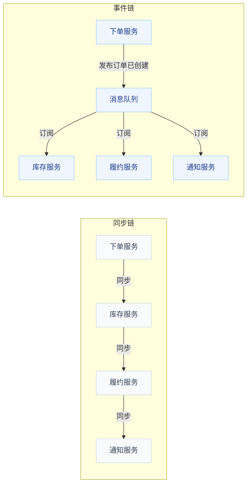
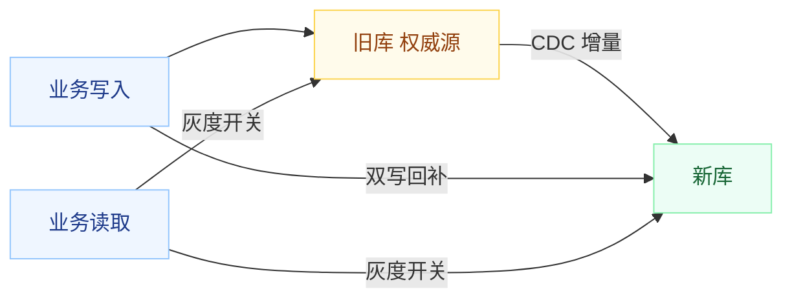

# 服务拆分与数据归属

> 这篇从服务拆分的证据与输入讲起，经过粒度判定、分布式单体反模式、数据归属与单一写者、数据分类、跨服务取数、迁移切流，最后落到四类对账和一份可复盘的拆分决策。
>
> 学完能为一套业务系统定出有据可依的服务边界，写清数据归属表，为跨服务查询选择合适的取数模式，并组织一次带回滚方案的数据迁移切流。

## 一、服务拆分的依据与输入

拆分是手段，解决的是变更冲突、部署耦合、故障扩散和团队协作成本，不是为了"上微服务"。拆分之前必须先回答：当前最痛的是哪一条，拆完之后这一条是否真的变便宜。

拆分的依据来自四类信号，每一类都要有证据，不能靠感觉：

| 信号 | 回答什么 | 证据来源 |
|---|---|---|
| 业务能力 | 系统有哪些内聚的业务域 | 领域模型、限界上下文清单 |
| 变更热点 | 代码改在哪里、谁在改 | 近半年提交记录、发布记录 |
| 故障隔离 | 故障从哪里扩散到哪里 | 故障复盘、告警拓扑 |
| 团队边界 | 沟通成本在哪里产生 | 团队结构、协作日历 |

四类信号里，业务能力是骨架，其余三类是校验。业务模型来自上一阶段的产物：限界上下文、聚合、事件风暴（Event Storming）的输出，见 [01-业务架构与领域建模](./01-业务架构与领域建模.md)。没有领域模型就直接拆服务，拆出来的边界会跟着组织直觉走，三个月后和团队结构一起漂移。

变更热点是四类信号里最容易被忽略、也最诚实的一条。统计近半年所有提交的模块归属和提交人：

```bash
# 按目录统计近 180 天的提交量，找出变更热点（git 示例）
git log --since="180 days ago" --name-only --pretty=format: \
  | grep -v '^$' | cut -d/ -f1-2 | sort | uniq -c | sort -rn | head -20
```

```text
  523 src/main/java/com/shop/order
  461 src/main/java/com/shop/fulfillment
  152 src/main/java/com/shop/inventory
   37 src/main/java/com/shop/marketing
```

输出说明：变更集中在订单和履约两个模块（示例数据）。这类数据是拆分的第一手证据——变更热点在哪里，独立部署的收益就在哪里；半年没动过的模块，拆出去只增加运维面，不减少任何成本。

> 边界：拆分依据必须在拆分决策里写成可验证的句子，例如"订单模块近半年 523 次提交、涉及 3 个团队，独立部署后发布阻塞可消除"。写不出这句话，说明证据还不够。

## 二、拆分粒度与边界判定

一个服务的合理粒度是：一个限界上下文，加一组只为该上下文服务的数据，加一个独立的变更理由。三个条件少一个，边界就是错的。

| 条件 | 含义 | 缺失的后果 |
|---|---|---|
| 一个限界上下文 | 业务语言、模型内聚 | 服务互相理解对方的模型，接口越改越乱 |
| 一组专属数据 | 表只被本服务读写 | 回到共享库，拆了等于没拆 |
| 一个变更理由 | 发布节奏独立 | 两个团队仍要约时间一起发版 |

判定粒度粗细，看两个方向的症状：

- **过粗**：一个服务里有两组以上独立的变更理由；发布窗口需要两个团队同时到场；任何一个模块的故障会拖垮全部；
- **过细**：一个业务请求要穿过五个以上服务；大量服务只做转发和拼装；团队一个人要维护五个服务。

### 2.1 四种错误的切分依据

绝大多数拆分失败，不是因为粒度选错，而是因为切分依据选错。四种常见错误依据和它们的结局：

| 错误依据 | 典型说法 | 结局 |
|---|---|---|
| 按技术分层 | 拆成 web 层、service 层、dao 层 | 改一个功能要动三个服务，同步发布 |
| 按表拆 | 一张表一个服务 | 事务跨库，join 全部变成接口调用 |
| 按团队人数 | 三个组就拆三个服务 | 边界随组织调整而漂移 |
| 按调用频率 | 热点接口单独拆出去 | 数据归属被切碎，读方到处冗余 |

这四种依据的共同问题，是把"部署单元"当成了"边界"。技术分层拆的是代码职责，不是业务能力；按表拆切的是数据结构，不是聚合；按人数拆把组织图当成了领域图；按频率拆把性能优化伪装成了架构决策。四者都会导向第三章的分布式单体。

正确的依据只有一条：**业务能力内聚，数据自洽，变更独立。** 技术分层、表结构、调用频率都可以作为辅助证据，但不能单独决定边界。

康威定律（Conway's Law）在拆分时是硬约束，不是参考：系统结构最终会和团队的沟通结构同构。反过来用它——先定团队边界（每个服务一个可以独立决策的小团队），再把系统边界对齐到团队边界，而不是先画好架构图再硬塞给团队。团队拓扑（Team Topologies）给了一个可用的参照：平台型团队维护基础设施，流型团队按业务流拥有服务，尽量减少服务间同步协作。

> 边界：不要一步到位拆成微服务。先把单体内部按限界上下文做成模块（模块化单体，Modular Monolith），模块间只走公开接口、不直连对方表；等某个模块的变更频率或故障隔离需求真的越界了，再把这一个模块拆出去。模块化单体是零成本回退的位置，微服务不是。

## 三、分布式单体反模式

分布式单体（Distributed Monolith）是拆分失败最常见的形态：服务在部署上是分布的，在变更和数据上是耦合的。它同时承担了单体的耦合成本和分布式的通信成本，比不拆更糟。

识别分布式单体，看五个症状：

| 症状 | 表现 | 根因 |
|---|---|---|
| 同步发布 | 改一个接口，N 个服务要一起升级 | 契约无版本管理 |
| 链式故障 | 下游一个服务超时，全链路请求堆积 | 同步调用链过长 |
| 共享数据库 | 多个服务读写同一个库 | 数据没有归属 |
| 共享领域库 | 一个 jar / 包被所有服务引用 | 复用做成了耦合 |
| 事务跨库 | 一个业务动作要改两个服务的库 | 边界切在聚合内部 |

其中共享数据库和事务跨库是两个致命项：它们让"独立部署"变成假象——任何一张表的变更都会波及所有使用方，回滚和扩容都要全员协调。第三章的规则因此顺理成章：拆服务必须同时拆数据，否则不拆。

同步调用链是性能层面的放大器。一次下单穿过五个同步服务，每个 99.9% 可用，链路整体可用度是 0.999 的五次方约 99.5%，全年不可用约 44 小时。异步化（事件驱动）把"必须全部成功"变成"各自成功"，链路可用度由最慢的一环决定，不再相乘：



> 边界：异步不是默认选项。库存扣减这类"不满足就不能下单"的强前置校验，用同步调用加超时和降级；下单成功后的通知、积分、推荐这类"最终做到即可"的动作，才走事件。判断标准是业务语义，不是技术偏好。

## 四、数据归属与单一写者

数据归属是拆分的核心决策，比服务的代码边界更重要：代码怎么分包可以重构，表归了谁、别人怎么读，改起来要迁移数据。

规则只有一条：**每张表（更准确说，每个聚合）有且只有一个归属服务，它是这条数据唯一的写者。** 其他服务获取数据只有两条路：调归属服务的接口，或订阅归属服务发布的事件。这条规则叫单一写者（Single Writer）原则。

违反单一写者的后果，每一条都直接映射到故障模式：

- **双写不一致**：两个服务都能改一行数据，网络或事务失败后出现两个版本，没有仲裁者；
- **删除无人敢做**：不知道谁还在读这张表，数据只增不删，库越滚越大；
- **变更瘫痪**：改表结构需要所有写入方协调发版；
- **锁竞争跨服务**：两个服务的流量在同一张表上互相加锁，一方的峰值打死另一方。

数据归属表是这条规则的落地载体，也是本文后面所有章节（跨服务取数、迁移切流、对账）的输入。最小可用的一张归属表：

| 数据对象 | 归属服务 | 写者 | 读方 | 获取方式 |
|---|---|---|---|---|
| orders 订单表 | 订单服务 | 订单服务 | 履约、报表 | 事件投影 + 接口兜底 |
| stock 库存表 | 库存服务 | 库存服务 | 订单 | 同步接口 |
| stock_flow 流水表 | 库存服务 | 库存服务 | 对账系统 | 只读账号抽取 |

写归属表时有三条纪律：

1. 写者列只能出现一个服务，出现两个就回到本节规则重新切分；
2. 读方列写全所有现实读方，漏写的一方会私连数据库；
3. 获取方式只能是"接口"或"事件投影"，出现"直连库"就是反模式，除非读方是数仓这类离线系统。

### 4.1 事务边界必须落在服务内

一个数据库事务只能落在一个服务的库里，这是单一写者原则的直接推论，也是拆分时最容易破的一条。凡是需要"同时成功"的两处写入，只有三种合法归宿：

| 场景 | 做法 | 代价 |
|---|---|---|
| 两处写入同属一个聚合 | 放在同一服务同一事务 | 无，边界正确 |
| 两处写入有先后、允许短暂不一致 | 本地事务 + 事件 + 对账 | 需要收敛机制 |
| 两处写入必须原子 | 重新审视边界，通常该合并 | 承认切错了 |

第三种情况最常见于"订单创建时扣库存"。如果坚持两库强一致，就会引入 2PC 或 TCC，把一次拆分升级成分布式事务项目；正确做法是把"扣减"建模为库存服务的独立动作，订单侧只记录"已预占"，用状态机加超时释放来兜底。这不是妥协，是把一致性需求降到了业务真正需要的级别——库存预占允许秒级不一致，因为超时释放机制会兜住。

反过来，如果业务确实要求"钱和单同时成立"（例如账户扣款与流水记账），这两张表就应该在同一个服务里。**跨服务强一致的唯一正确答案，通常是边界划错了。** 拆分评审时必须逐条列出业务动作涉及的表，凡是跨服务的"原子写"，要么合并服务，要么改语义。

> 边界：数仓、报表这类离线分析系统是只读复制的合理例外，通过 binlog / CDC 抽取，不直连业务库、不参与写入。业务服务之间不存在这个例外。

## 五、数据分类：从归属到读取策略

归属服务定了写者；读方按一致性要求和实时性分成不同类别，决定各自的取数方式。只分"自有数据、他人数据"两类不够用，实际要分五类：

| 数据类别 | 特征 | 读方策略 | 一致性要求 |
|---|---|---|---|
| 私有数据 | 只有归属服务用 | 不出服务 | 不涉及 |
| 事务数据 | 记录业务动作 | 事件投影 | 顺序一致 |
| 引用数据 | 状态、金额 | 同步接口或本地缓存 | 读己之写 |
| 引用/字典数据 | 商品资料、地区表 | 本地副本 + 事件刷新 | 分钟级滞后可接受 |
| 汇总数据 | 报表、宽表 | 只读库 / 检索引擎 | 最终一致 |

区分的核心是**一致性要求**这一列：事务数据（订单状态、支付流水）要求读方看到与写方相同甚至更强的顺序，用事件投影保证；引用数据（商品名、类目）滞后一分钟无业务损失，用带过期时间的本地缓存，收到变更事件后刷新。把引用数据按事务数据的一致性来供给，成本翻倍；把事务数据按引用数据供给，客诉翻倍。

跨服务的外键关系也要按这个分类处理。订单表里的 `sku_id` 不做外键约束——跨服务的引用完整性（Referential Integrity）不由数据库保证，由三件事共同保证：

1. **写入时校验**：下单调商品服务的接口确认 SKU 有效；
2. **冗余关键字段**：订单行冗余 `sku_name`、`price_snapshot`，商品改名不影响历史订单展示；
3. **订阅变更事件**：商品下架时订单服务收到事件，把可复购标记置为不可复购。

冗余快照是跨服务引用的标准做法：凡是"下单时刻的语义"，下单时就复制下来；凡是"最新语义"（当前库存、当前价格），永远实时去问归属服务。

## 六、跨服务查询与取数

跨服务查询没有银弹，只有四种模式按场景选用。判断维度是三个：一致性要求、查询复杂度（是否要跨多个服务聚合、是否要分页排序）、读写比。

| 模式 | 一致性 | 适用场景 | 主要代价 |
|---|---|---|---|
| 同步接口组合 | 强 | 低并发实时详情 | 链路可用度相乘 |
| 事件物化视图 | 最终一致 | 列表页、高频读 | 冗余与对账成本 |
| CQRS 读模型 | 可调 | 复杂查询、多条件 | 模型同步复杂度 |
| 数仓 / 检索引擎 | 离线或秒级 | 报表、全文检索 | 数据新鲜度 |

四种模式的决策顺序：

**同步接口组合**用在"单个请求、聚合少量服务、并发不高"的场景，例如订单详情页拼一个用户昵称。网关或 BFF（Backend For Frontend）层负责聚合，每个下游调用带独立超时；一个下游失败时返回降级值（昵称缺失显示"用户"），而不是整页失败。

**事件物化视图**（Materialized View）是列表页的标准答案。订单服务发布"订单已创建 / 已支付 / 已发货"事件，查询服务订阅后维护一张本地订单视图表，列表查询完全不触发跨服务调用。代价是冗余存储和投影延迟，需要第七章的对账兜底。

**CQRS 读模型**是物化视图的完整形态：写侧只管业务规则，读侧为每种查询建独立模型。适合条件组合多变的后台查询。边界要清楚：CQRS 增加的是读侧灵活性，付出的是两套模型的同步复杂度；查询模式稳定时不要引入。

**数仓 / 检索引擎**解决分析型和全文型查询，通过 CDC 或事件流接入，与业务库物理隔离。业务服务永远不直连数仓反查实时数据——新鲜度不对等。

一个必须直面的场景：**跨服务的 join**。订单列表要显示商品名和用户名，三种做法的取舍：

| 做法 | 优点 | 缺点 |
|---|---|---|
| 下单时冗余快照字段 | 读零成本 | 字段变更不回溯 |
| 查询服务实时聚合 | 数据最新 | 延迟与可用性差 |
| 读模型里冗余 + 事件回填 | 兼顾两者 | 实现最重 |

订单这种"历史语义"场景选冗余快照；库存这种"当前语义"场景必须实时查归属服务。

### 6.1 聚合层的超时预算

同步接口组合的前提，是整条聚合链有明确的超时预算，并且逐层递减。没有预算的聚合接口，最慢的下游决定整个页面的延迟，一个慢服务拖死全部调用方。

```text
页面总预算：800ms（用户可感知阈值）
├── 订单查询：400ms（核心内容，不允许降级）
│   ├── 库存接口：120ms（预算 = 400 − 自身开销）
│   └── 优惠接口：150ms
├── 用户信息：200ms（可降级，超时返回"用户"）
└── 推荐位：150ms（可降级，超时返回占位）
```

三条纪律：

1. **总预算先定，再向下分解**，不是各环节自己定、然后被动手动加总；
2. **下层预算必须小于上层预算减去自身开销**，避免"上游已放弃、下游还在算"；
3. **每个预算都要有对应降级值**，可降级与不可降级在代码里显式区分，不能都靠全局超时兜底。

> 边界：所有跨服务取数方案在评审时的第一个问题都是"读到的数据可以旧到什么程度"。答不出具体时间窗口（如"支付状态允许滞后 3 秒，商品名允许滞后 5 分钟"），方案就无法验收，也无法设计对账。

## 七、数据迁移与切流

拆分落地时最难的一步不是拆代码，是把数据从共享库迁到归属服务自己的库，并且不能停机、不能丢数据、能回滚。标准做法是双写加切流，分六个阶段，每个阶段有独立的验证指标和回滚点：

| 阶段 | 动作 | 验证指标 | 回滚方式 |
|---|---|---|---|
| 1 存量迁移 | 旧库全量导入新库 | 行数一致、抽检一致 | 清空新库重来 |
| 2 增量同步 | CDC 追平增量 | 同步延迟趋近 0 | 停同步重来 |
| 3 双写灰度 | 新写入两库都写 | 双写差异率 0 | 关双写 |
| 4 读切换 | 灰度流量读新库 | 读结果与旧库一致 | 切回旧库 |
| 5 写切换 | 写入只走新库 | 业务指标正常 | 双写回补 |
| 6 旧库下线 | 停写、观察、归档 | 观察期无回退需求 | 已无回滚 |

各阶段的关键设计：

**存量迁移**用带主键边界的分批导出，不用一次性全表导出（长事务锁表）。以主键分段，每批 1 万行，批间休眠，业务低峰执行。

**增量同步**用 binlog 订阅（CDC，Change Data Capture），从存量迁移开始时刻的 binlog 位点回放，保证不丢窗口。Kafka Connect、Canal、Debezium 都是成熟工具，选型看现有中间件栈，不引入新组件。

**双写**是切流的信任来源。写路径先写旧库（旧库仍是权威源），成功后异步写新库；双写失败只告警不阻断业务。双写期间新库可能落后，所以读必须仍走旧库，直到差异率为零的时段持续稳定。

**读写切换**都是流量开关控制，按用户或租户维度灰度：先 1% 读流量、再 10%、再全量读；写同理。写切到新库后，旧库还要继续被双写回补一段时间——这是回滚的唯一保证。观察期至少覆盖一个业务周期（电商至少一个周末高峰），再停旧库写入。

切流的铁律：**任何阶段出问题，回滚动作必须是"切开关"，不能是"改代码"。** 所有开关集中在配置中心，可以秒级生效，并且事先演练过。

### 7.1 切流前的数据校验

切流推进的每个门禁都要有可执行的校验语句，而不是"抽查看起来没问题"。校验分三层，从粗到细：

```sql
-- 第一层：分段行数与金额汇总，旧库执行一次、新库执行一次
SELECT COUNT(*)          AS row_cnt,
       SUM(amount_cents) AS amount_sum,
       MAX(updated_at)   AS last_update
FROM orders
WHERE id BETWEEN 1000000 AND 1099999;
```

```text
旧库：row_cnt=48211  amount_sum=193884500  last_update=2026-11-12 23:58:41
新库：row_cnt=48211  amount_sum=193884500  last_update=2026-11-12 23:58:41
```

第一层一致只能说明总量一致，不能排除"一条多、一条少"的抵消。第二层做逐行摘要比对，按主键分段计算每段的哈希：

```sql
-- 第二层：分段摘要，两侧结果必须逐段相等（示例，MySQL 8.4）
SELECT COUNT(*) AS cnt,
       BIT_XOR(CRC32(CONCAT_WS('|', id, status, amount_cents, updated_at))) AS digest
FROM orders
WHERE id BETWEEN 1000000 AND 1099999;
```

```text
旧库：cnt=48211  digest=3184920117
新库：cnt=48211  digest=3184920117
```

第三层才是逐行比对，只对摘要不一致的分段执行，定位到具体主键后人工或程序判定。三层校验的耗时从秒级到小时级递增，按需下探，避免每次全量逐行。

校验结果要沉淀成门禁表，切流的每一步都有"通过 / 不通过"的记录，出现回滚时可以快速定位是哪个阶段、哪批数据出的问题。



> 边界：双写阶段新旧库之间不追求分布式事务，允许短暂差异，靠对账收敛（见第八章）。追求双库强一致会把一次拆分升级成一个分布式事务项目，成本完全不成比例。

## 八、四类对账

拆分之后，跨服务的数据流转从"同一个事务"变成"接口调用加事件投递"，差异不再是异常，而是常态。对账（Reconciliation）是把常态差异约束在业务可接受范围内的机制，也是切流能不能收尾的判据。

对账分四类，覆盖不同的时间和粒度：

| 类型 | 比对对象 | 频率 | 解决什么 |
|---|---|---|---|
| 存量对账 | 两库全量数据 | 切流前、周期性 | 长期漂移 |
| 增量对账 | 时间窗口内增量 | 小时级 | 同步链路断档 |
| 实时对账 | 关键动作两侧 | 秒级 | 单笔资损 |
| 业务对账 | 上下游总额闭环 | 日终 | 系统性遗漏 |

四类对账的具体做法：

**存量对账**按主键分段全量比对，不比业务对错，只比两侧记录是否一致。切流前的通过标准是连续三个全量周期差异为零。周期性运行（每周）用于发现长期漂移，例如某次代码改动悄悄绕过了双写。

**增量对账**按时间窗口（如每小时）比对两侧新增和变更记录，能发现同步链路的断档：CDC 挂了六小时，存量对账要等一周后才能发现，增量对账一小时就报警。

**实时对账**针对每一笔不能出错的动作——支付、扣库存、退款——在动作两侧记录后立即比对。实现上是一条独立的比对队列：动作完成时向队列投"预期值"，数据落库后投"实际值"，两个值聚齐后比对。差异实时告警，工单直接派给归属服务值班人。

**业务对账**站在业务总额层面：当天订单服务说卖了 10,000 单，支付服务说收了 9,998 笔款，物流服务说发了 9,996 个包裹，三者差额要能逐笔解释。业务对账是最后一道网，前三种对账都漏掉的系统性问题，最终在这里现形。

对账体系要有自己的指标，才能被管理和改进：

| 指标 | 定义 | 健康参考值 |
|---|---|---|
| 差异率 | 差异记录数 / 总记录数 | < 0.01% |
| 自动修复率 | 程序修复 / 全部差异 | > 90% |
| 差异 MTTR | 发现到修复的中位时长 | < 30 分钟 |

差异处理的标准流程是：告警 → 自动归因（按差异模式分类）→ 可自动修复的由修复任务重放事件 → 不能自动修复的人工裁决 → 差异模式回溯到代码或配置改进。对账不是为了消灭差异告警，是为了让每个差异都有解释和归宿。

### 8.1 差异归因与修复

差异必须先分类再修复，否则修复动作本身就是新的风险源。四类常见归因和对应处理：

| 归因 | 特征 | 修复动作 |
|---|---|---|
| 延迟 | 新库暂时缺最新记录 | 等待窗口，超时再重放 |
| 丢失 | 旧库有、新库无，且超窗口 | 按主键补数 |
| 乱序 | 状态出现回退或跳变 | 按聚合序号重放 |
| 重复 | 同一业务键出现多条 | 唯一约束加清理脚本 |

归因靠可观察特征，不靠猜：延迟的差异会随时间自行收敛，丢失不会；乱序表现为状态值倒退（已发货变已支付），重复表现为行数多于源端。四类之外还有第五类"口径差异"——两侧计算规则不同（一个含测试单、一个不含），表现为系统性偏差且长期稳定。口径差异不能靠修复任务解决，必须先统一口径再重算，否则会陷入"修了又出"的循环。

每条差异都要能回答三个问题：哪条记录、什么原因、谁负责修。答不全的差异进入人工队列，不能自动关闭。

> 边界：对账先于拆分上线。新服务上线第一天就必须有增量对账在跑；等到出了客诉再补对账，损失已经发生且无从追溯。

## 九、最佳实践案例

### 9.1 案例背景

某中型电商，年 GMV 约 6 亿（示例），单体应用加单一 MySQL 库，三个团队共 11 人维护。现状问题：近半年一次库存表死锁导致下单全链路不可用 40 分钟；发布互相阻塞，平均每周因跨团队发版协调延迟一次发版；订单和履约模块合计占近 70% 的提交量。目标是把订单、库存、履约拆成三个独立服务，把库存故障隔离在履约链路之外。约束：不能停机迁移；切换窗口 6 周；团队没有专职 DBA，数据迁移只能用现有 MySQL 8.4 和 Kafka；预算不允许引入新中间件。

### 9.2 案例实操

第一步先用证据定拆分范围，而不是直接拆。提交统计显示订单加履约占 70% 变更、库存占故障面；商品和营销模块半年提交量不足 40 次，不拆，保留在单体内。据此本轮只拆三个服务，其余下轮再说。

第二步画依赖矩阵和归属表。先按"服务 × 表"盘点读写关系，识别共享表：

| 表 | 订单 | 库存 | 履约 | 判定 |
|---|---|---|---|---|
| orders | 读写 | 读 | 读 | 归订单 |
| stock | 读 | 读写 | 读 | 归库存 |
| stock_flow | 读 | 读写 | 读 | 归库存 |
| shipment | 读 | 不用 | 读写 | 归履约 |
| sku | 读 | 读 | 读 | 归商品（本轮不拆） |

依赖矩阵暴露两个问题：`sku` 被三方读、`orders` 被三方读——这两张表是耦合的根源。处理：`sku` 属商品域，本轮不拆服务，但先立归属规则（单体内模块间禁止直连表，走接口），为下一轮拆分铺路；`orders` 归订单服务，履约只通过事件获取。

第三步定数据归属表和取数方式。归属表按第四章模板落成正式文档并过评审；取数决策：订单列表页由查询服务的事件物化视图供数；下单时库存校验走同步接口（强前置）；履约取订单走事件投影。一致性窗口写成可验收条款：订单事件投影延迟 P99 ≤ 5 秒，库存接口 P99 ≤ 150ms。

第四步执行切流，按第七章六阶段推进。关键节点（示例数据）：存量迁移 2,400 万行，分批 4 小时完成；CDC 增量追平后延迟稳定在 1 秒内；双写运行 11 天，其中前 3 天差异率 0.008%，全部为乱序回放，由修复任务自动追平，第 4–10 天连续 7 天差异率为 0，第 11 天在周一低峰执行写切换；读灰度从 1% 到全量用 4 天；旧库双写回补保留 12 天。

第五步对账先行。切流前两周，增量对账（小时级）和实时对账（库存扣减、订单创建两条链路）就已上线；切流全程以对账差异率作为每一步推进的门禁——差异率不归零，不进下一阶段。

### 9.3 案例结果

结果指标（示例数据）：切流期间零 P1 故障，未触发写回滚；库存一次预演死锁（高并发压测中）只影响履约链路，下单成功率不受影响，验证了故障隔离目标；发布阻塞从每周约 1 次降为 0，三个服务在切流后 8 周内合计独立发版 47 次；订单事件物化视图延迟 P99 稳定在 3.2 秒，满足 5 秒条款。

失败模式复盘：一是双写前 3 天的差异全部来自事件乱序，说明"乱序回放"应作为对账系统的默认预期，而不是异常；二是库存扣减仍走同步接口，下单对库存的可用性依赖没有消除，只是从数据库锁变成了接口依赖，这是遗留风险，计划后续改为"预扣加异步确认"；三是 `sku` 表的归属规则立得晚，切流期间仍出现两次跨模块直连查询，说明规则必须代码化（CI 里加访问检查）而不是只写在文档里。

复盘里最有价值的一条：**对账先于切流上线，是整个迁移敢按开关推进的根本原因。** 每一步的门禁都是对账差异率，而不是人的信心。
