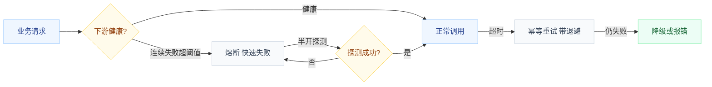

# 分布式基础与一致性

> 这篇从分布式系统无法回避的故障模型讲起，经过 CAP 与 BASE、五档一致性模型、复制与 quorum、时钟与顺序、幂等、重试与故障放大，最后落到一份可以逐条验收的一致性决策清单和一次完整演练。
>
> 学完能判断一个业务动作需要哪一档一致性，为一组副本选定读写 quorum，设计出可安全重放的幂等接口，并用差异率、重复率、读旧值率这些指标验证方案达标。

## 一、故障模型

分布式系统的第一性事实是：网络不可靠、节点会挂、时钟不准，而且这些事在正常运行期间就会发生，不需要等机房断电。所有一致性方案都是对特定故障模型的假设，假设写不清，方案就无法验收。

先区分四类故障，企业系统绝大多数只处理前两类：

| 故障类型 | 表现 | 企业系统是否处理 |
|---|---|---|
| 崩溃故障 | 节点停止响应，但行为正确 | 必须处理 |
| 网络分区 | 节点活着，但互相不可达 | 必须处理 |
| 时序故障 | 消息延迟、乱序、重复 | 必须处理 |
| 拜占庭故障 | 节点返回错误结果或恶意行为 | 一般不考虑 |

崩溃与分区的关键区别在于"能不能确定对方的状态"。崩溃可以由进程监控确认；分区不能——A 连不上 B 时，可能是 B 挂了，可能是网络断了，也可能是 B 活着但回应很慢。这三种情况在 A 的视角完全一样，这就是分布式系统里最根本的不确定性：**超时无法区分"没做"和"做了但回应丢了"**。

这个不确定性直接演绎出两条设计铁律：

1. 任何超时都不能当作"操作失败"，只能当作"结果未知"；
2. 凡是结果未知的操作，调用方必须能安全重试，也就是幂等（第六章）。

可用度要按链路算，不能按单节点算。串联链路的可用度是各环节相乘：

```text
单服务可用度 99.9%
两个同步依赖串联：0.999 × 0.999 = 0.998001（约 99.8%）
五个同步依赖串联：0.999^5 = 0.99501（约 99.5%，全年不可用约 44 小时）
```

输出说明：每增加一个必须同步成功的依赖，整体可用度就下降一个量级的位置。这就是为什么同步调用链要尽量短、要有超时预算、非关键依赖要能降级——不是性能优化，是可用度算术。

### 1.1 故障检测的三个参数

故障检测本身也是分布式决策，参数定错会把"检测"变成"误杀"。三个参数按系统类型分档设定：

| 参数 | 数据库/中间件 | 内部服务 | 跨机房 |
|---|---|---|---|
| 心跳间隔 | 1–5s | 5–10s | 10–30s |
| 超时判定 | 2 次心跳未达 | 3 次心跳未达 | 5 次心跳未达 |
| 恢复探测 | 每 5s 试探 | 每 10s 试探 | 每 30s 试探 |

超时判定次数取奇数是为了多数派裁决；跨机房放宽是因为网络抖动概率高，单次心跳丢失就判死会频繁误杀。误杀的代价不只是多余切换：主从切换有数据丢失窗口，检测越敏感，切换越频繁，丢失窗口越多。

两个推导关系要写进设计：

1. **超时值必须大于正常响应的 P99 × 安全系数**（通常取 2–3 倍），否则高峰期正常抖动会被当成故障；
2. **客户端超时必须小于服务端超时**，否则客户端已放弃、服务端还在执行，产生无人等待的"孤儿请求"。

> 边界：故障模型要写进设计文档，例如"假设单机房内网分区概率低但存在，跨机房链路每月至少一次秒级抖动；不考虑拜占庭故障"。没有这句话，后面关于 CAP、重试、对账的所有取舍都没有依据。

## 二、CAP 与 BASE

CAP 常被误读成"三选二"。准确表述是：当网络分区（Partition）发生时，系统只能在一致性（Consistency）和可用性（Availability）之间选一个；P 不是可选项，是前提。

三个字母在企业语境下的具体含义：

| 字母 | 含义 | 判断标准 |
|---|---|---|
| C 一致性 | 所有节点读到同一份最新数据 | 读到的值等于最后一次成功写入 |
| A 可用性 | 每个请求都得到非错误响应 | 不保证是最新值 |
| P 分区容忍 | 分区时系统继续运行 | 不因网络断裂整体停摆 |

分区发生时只能二选一：

- **选 C（CP）**：少数派节点拒绝服务，保证不返回旧数据。典型场景是库存扣减、支付状态、分布式锁、配置中心。代价是分区期间部分请求直接失败。
- **选 A（AP）**：所有节点都响应，允许返回旧数据，事后收敛。典型场景是商品浏览、推荐、社交动态、购物车。代价是短期读到旧值，需要业务能接受。

真实系统往往按操作分别选，而不是整个系统选一个。同一个订单服务里，下单扣库存是 CP，订单列表是 AP，这不是摇摆，是按业务语义分类。

分区之外还有一层更常见的约束：延迟。CAP 只谈分区，PACELC 补上了正常运行时的一致性—延迟权衡——没有分区时（E），仍然要在一致性和延迟（L）之间取舍。跨地域同步复制就是典型：强一致要等远端确认，P99 直接增加一个 RTT。

BASE 是 AP 取向的工程化表述：基本可用（Basically Available）、软状态（Soft State）、最终一致（Eventually Consistent）。它不放弃正确性，只是把"正确"的时间点从"写入瞬间"推迟到"收敛之后"，并且要求有对账机制保证真的会收敛。没有对账的最终一致，等价于"永远不一致"。

| 取向 | 适用动作 | 代价 |
|---|---|---|
| CP | 扣库存、支付、额度 | 分区时部分失败 |
| AP | 浏览、推荐、购物车 | 短期旧值，需收敛 |
| 混合 | 下单主流程 CP、周边 AP | 需要按动作分类 |

> 边界：不要用 CAP 解释性能问题。接口慢是延迟问题，不是 CAP 问题；CAP 只在分区期间才生效。把 CAP 当成"选两个"的口诀，会在评审时给出错误的论据。

## 三、一致性模型

一致性模型（Consistency Model）描述的是"一个写操作完成后，读操作能看到什么"。它是一条连续光谱，从最强到最弱，成本递减、可用度递增。选型的动作是：为每个读场景找到够用的最弱一档。

| 模型 | 保证 | 典型实现 |
|---|---|---|
| 线性一致 | 所有读写像单机，实时全序 | etcd、ZooKeeper、单主同步复制 |
| 顺序一致 | 所有节点顺序相同，不保证实时 | 单主异步复制 + 有序消费 |
| 因果一致 | 有因果关系的操作有序 | 向量时钟、会话粘滞 |
| 读己之写 | 同一客户端能读到自己刚写的 | 写后读走主、会话固定 |
| 最终一致 | 停止写入后最终收敛 | 异步复制、事件投影 |

企业系统最常需要、也最常被错过的两档，是读己之写和单调读：

- **读己之写（Read-Your-Writes）**：用户提交表单后立即刷新，必须看到自己的修改。实现很朴素——把该用户的读请求在写入后的一段时间内固定路由到主库，或记录写入版本号在副本上等待追平。电商的"支付成功页"、"地址修改后返回列表"都是这一类。
- **单调读（Monotonic Reads）**：同一个用户不会先看到新值、再看到旧值。用户刷新两次页面，第二次不能退回旧状态。实现靠会话粘滞（同一用户固定读同一个副本）或客户端记录已读版本号，拒绝更旧的响应。

这两档常常被"最终一致"一句话带过，然后变成线上客诉：用户改了地址、刷新后显示旧地址，再刷新又变新——这就是单调读被破坏。

一致性（Consistency）和事务隔离级别（Isolation Level）是两个维度，不能混用：一致性描述多副本之间的数据新旧，隔离级别描述并发事务之间的可见性。数据库配了可重复读（Repeatable Read），不代表跨机房副本读到的就是最新值。

> 边界：一致性模型不是越强越好。强一致的价格是延迟和分区期间的可用性；对商品标题、评价数这类数据套线性一致，等于用支付系统的成本做展示页。反过来，对余额、库存套最终一致，等于把资损写进设计。

## 四、复制与 quorum

复制（Replication）是一切一致性的物理基础，三种拓扑决定了能力的上限：

| 拓扑 | 写路径 | 一致性能力 | 故障切换 |
|---|---|---|---|
| 单主 | 主库写，复制到从库 | 强到最终一致可调 | 需选主 |
| 多主 | 任意节点可写 | 冲突解决，因果一致 | 天然多活 |
| 无主 | 客户端写多个副本 | quorum 可调 | 无切换概念 |

单主复制是企业主流。同步复制（synchronous）保证主库提交前从库已落盘，强一致但写延迟包含网络 RTT；半同步（semi-synchronous）保证至少一个从库确认，兼顾一致性与延迟；异步复制延迟最低，但主库故障时会丢最后一段数据。MySQL 的半同步、PostgreSQL 的 synchronous_commit 都是这一档。

无主复制（Dynamo 风格）用 quorum 表达一致性强度。设副本数 N、写成功数 W、读成功数 R：

```text
W + R > N   → 读写集合必然相交，读能看到最新写入
W + R ≤ N   → 读写集合可能不相交，读到旧值
```

常见配置的取舍（N=3）：

| 配置 | 一致性 | 写可用性 | 适用 |
|---|---|---|---|
| W=3, R=1 | 强 | 任一节点故障即写失败 | 配置、元数据 |
| W=2, R=2 | 强 | 容忍一个节点故障 | 订单、支付记录 |
| W=1, R=1 | 弱 | 最高 | 日志、指标、埋点 |

W+R>N 只是"集合相交"的必要条件，不是强一致的充分条件，还需要两个机制配合：

1. **读修复（Read Repair）**：读时发现副本版本不一致，把新版本回写到旧副本；
2. **反熵（Anti-Entropy）**：后台定期比对副本，修复长期不一致。没有反熵，冷数据可能永远停在旧版本。

这两个机制解释了为什么"配了 quorum 就强一致"是错的：如果写操作没有版本号或时间戳，读修复无从判断谁更新；如果写成功数刚好等于 W，剩余副本的修复只能靠后台。工程上要么依赖存储引擎自带的修复（Cassandra 的 hinted handoff、read repair），要么自己实现对账。

单主复制的主从延迟是读一致性问题的主要来源。监控复制延迟不能只看秒数平均值，要看 P99 和"落后事务数"：

```sql
-- MySQL 8.4：查看从库复制状态（关键字段）
SHOW REPLICA STATUS\G
-- 关注：Replica_IO_Running / Replica_SQL_Running 均为 Yes
--       Seconds_Behind_Source（秒级延迟，仅供参考）
--       Retrieved_Gtid_Set 与 Executed_Gtid_Set 的差集（实际落后事务数）
```

```text
Replica_IO_Running: Yes
Replica_SQL_Running: Yes
Seconds_Behind_Source: 2
Retrieved_Gtid_Set: 3e11d9a4-...:1-918273
Executed_Gtid_Set:  3e11d9a4-...:1-918201
```

输出说明：`Seconds_Behind_Source` 为 2 秒看似正常，但 GTID 差集有 72 个事务，说明延迟是"事务级别"的，且大事务会让秒数瞬间跳变。判断能不能读副本，用 GTID 差集和业务可接受窗口比较，而不是盯秒数。

### 4.1 主从切换与脑裂

主库故障后的切换，风险不在"切不过去"，在"切过去之后旧主还活着"——两个节点都认为自己是主，各自接受写入，这就是脑裂（Split Brain），数据分叉后几乎无法自动合并。

防脑裂靠三件事，缺一不可：

| 机制 | 作用 | 典型实现 |
|---|---|---|
| 多数派选主 | 只有拿到多数票的节点能成为主 | Raft、Paxos、etcd |
| 隔离令牌 | 旧主被新主接管后不得再写 | fencing token、租约 |
| 写入确认 | 主库提交需多数副本确认 | 半同步、quorum 写 |

多数派选主解决"谁来当主"，fencing 解决"旧主还能不能写"。只有选主没有 fencing 的系统，在网络分区恢复的瞬间可能出现双主写入：旧主在分区期间一直服务，分区恢复后它的写入与新主冲突。存储层如果支持单调递增的令牌（每次选主令牌加一），旧主携带旧令牌的写入会被拒绝，这是最可靠的隔离方式。

MySQL 生态常用外部仲裁（如 Orchestrator、MHA）加半同步：切换前先确认旧主已停止写入或已被隔离，再提升延迟最小的从库。切换流程必须固定为四步：

1. 判定主库不可达，且达到超时阈值（不是一次心跳丢失）；
2. 隔离旧主（撤流量、封端口、或依赖 fencing），确保它不会再接受写；
3. 提升从库，等待其 GTID 追平到最新可确认位点；
4. 切换路由并校验：新主可写、复制关系重建、业务读写正常。

第二步最容易被跳过。跳过它的切换，在"其实是网络抖动、旧主还活着"的场景下必然脑裂。

> 边界：quorum 的 N 是副本数，不是节点数。同机架、同可用区的副本不能算独立故障域；三个副本放在同一台物理机上的三块盘，等于 N=1。故障域要和 quorum 一起设计。

## 五、时钟与顺序

分布式系统里没有全局时钟。每个节点有自己的物理时钟，靠 NTP 或 PTP 同步，同步误差在毫秒级，虚拟机和容器里可能达到几十毫秒甚至跳变。任何"用时间戳判断先后"的跨节点逻辑，都必须先问：两台机器的时钟差多少。

物理时钟的四个事实：

1. `System.currentTimeMillis()` 是墙钟（wall clock），会被 NTP 校正，可能倒退；
2. 单调钟（monotonic clock）不倒退，但各节点起点不同，不能跨节点比较；
3. 容器迁移、虚拟机暂停会让时钟跳变，长连接和超时计算都会受影响；
4. 数据库的 `NOW()` 取的是数据库服务器时间，与业务服务器时间不同源。

因此三类时间用法要分清：

| 用途 | 该用什么 | 不该用什么 |
|---|---|---|
| 计算耗时、超时 | 单调钟 | 墙钟（会倒退） |
| 记录业务发生时间 | 带时区的墙钟 | 本地时间字符串 |
| 判断事件先后 | 逻辑时钟 / 版本号 | 跨节点时间戳 |

逻辑时钟解决"谁先发生"。Lamport 时钟给每个事件一个递增计数，保证有因果关系的两个事件计数有序；向量时钟（Vector Clock）记录每个节点的计数向量，能判断并发还是有因果；混合逻辑时钟（Hybrid Logical Clock，HLC）把物理时间和逻辑计数结合，既接近真实时间又保证单调，CockroachDB、MongoDB 的会话因果一致性都基于这类机制。

实际系统里最常用的是版本号，而不是完整时钟：

- 数据库行的 `version` 列，更新时 `WHERE version = ?`，实现乐观锁和顺序判定；
- 事件的 `(aggregate_id, sequence)` 组合，保证同一聚合内严格有序；
- 消息队列的分区键，保证同一 key 落在同一分区、按序消费。

这几个手段的共同点是：**顺序由数据自己携带，不依赖机器时间**。跨服务判断"订单支付事件是否早于发货事件"，必须用订单聚合的序号，不能用两个事件的时间戳——两台机器的时钟差几十毫秒，就足以让顺序颠倒。

### 5.1 时钟回拨的工程处理

时钟回拨不是罕见事故，NTP 校时、虚拟机迁移、容器热迁移都会触发。回拨的幅度可能只有几毫秒，也可能达到数分钟。四类典型影响和对应处理：

| 现象 | 影响 | 处理 |
|---|---|---|
| 定时任务重复执行 | 同一窗口跑两次 | 用单调钟计时 + 分布式锁 |
| 序列号重复 | 主键冲突或覆盖 | 序列号不依赖墙钟 |
| 缓存 TTL 提前失效 | 命中率骤降 | 用相对时间，不用绝对时间戳 |
| 事件顺序颠倒 | 状态回退 | 用聚合序号排序 |

以最常见的雪花算法（Snowflake）为例，它的 ID 由时间戳、机器号、序列号拼成，强依赖时钟单调。生产实现必须处理回拨：

```text
if (当前时间 < 上次生成时间) {
    回拨量 = 上次生成时间 - 当前时间
    if (回拨量 <= 5ms)  等待回拨量，再继续
    else                拒绝生成并告警（或切换备用 workerId）
}
```

这段逻辑的关键不是"等待"本身，而是**拒绝而不是硬生成**：回拨较大时继续用旧时间戳生成，会产生重复 ID，而重复 ID 在下游是静默覆盖，比报错难查得多。

同样的原则适用于所有"时间参与唯一性"的设计：订单号里的日期段、日志文件名里的时间、消息的排序键。凡是时间参与唯一性或顺序的地方，都要问一句"时钟回拨了会怎样"，答不出就换成不依赖时钟的方案。

> 边界：时间戳仍然要存，但只用于展示、排查和粗粒度窗口（如"最近 24 小时"），不用于精确排序和幂等判断。把时间戳当幂等键的一部分，会在时钟回拨时产生重复或误判。

## 六、幂等

幂等（Idempotency）指同一操作执行一次和执行多次，对系统状态的影响相同。它是重试、消息重投、网络超时这些场景的唯一安全阀——分布式系统里"至少一次"投递是常态，"恰好一次"只是包装。

四类实现手段，按可靠性从高到低：

| 手段 | 做法 | 适用 |
|---|---|---|
| 唯一约束 | 数据库唯一索引挡住重复插入 | 创建型操作 |
| 幂等令牌 | 客户端生成 key，服务端去重表 | 支付、下单 |
| 状态机前置条件 | 只允许特定状态迁移 | 订单、工单流转 |
| 版本号乐观锁 | 带版本更新，失败即放弃 | 更新型操作 |

**唯一约束**最可靠，因为去重发生在数据库层，不依赖应用逻辑。缺点是把幂等语义绑在某个业务字段上，字段选错就失效——用"订单号"做唯一键，同一订单的多次合法修改会被误挡。

**幂等令牌（Idempotency Key）**是通用方案。客户端（或网关）为每个业务意图生成一个 key，服务端维护去重表：key 首次出现时执行业务并记录结果，再次出现时直接返回首次结果。关键设计有四点：

1. key 由调用方生成，不由服务端生成（服务端生成就失去了"同一意图"的语义）；
2. 去重表与业务操作在同一个本地事务里写入，保证"记了 key 就一定做了业务"；
3. 记录首次的响应体，重放时返回相同结果，而不是只返回"已处理"；
4. 设置合理的 key 有效期（如 24 小时），过期清理，避免表无限增长。

HTTP 语义层面，GET、PUT、DELETE 按规范应当幂等，POST 不幂等。所以支付、下单这类 POST 接口必须显式加幂等键，通常放在 `Idempotency-Key` 请求头。网关若做统一重试，必须同时保证请求体可重放且携带幂等键。

**状态机前置条件**适合有明确生命周期的实体。订单从"待支付"到"已支付"，用 `UPDATE orders SET status='PAID' WHERE id=? AND status='PENDING'`，影响行数为 0 就说明已经迁移过或状态不对，直接返回当前状态。这种写法天然幂等，而且不需要额外的去重表。

**版本号乐观锁**解决并发更新覆盖。两个请求同时改同一行，后到的那个版本已变，更新失败后应重新读取再决策，而不是盲目重试覆盖。

> 边界：幂等的前提是"同一意图能被识别"。如果两次请求的参数不同但业务上等价（例如金额相同、时间差一秒），系统无法自动判定。这类场景要么由调用方保证 key 稳定，要么在业务层定义等价规则，不能指望技术手段兜底。

## 七、重试与故障放大

重试是最容易被滥用的可靠性手段：它能救一次瞬时抖动，也能把一次局部故障放大成全站雪崩。

重试的放大效应是乘法。三层调用链，每层重试 3 次，一次用户请求在最坏情况下产生 27 次最底层调用：

```text
用户请求 → A（重试 3 次）→ B（重试 3 次）→ C（重试 3 次）
最坏放大：3 × 3 × 3 = 27 倍
```

当下游已经过载时，重试流量会让它更过载，超时更多，重试更多——这就是重试风暴（Retry Storm）。三个约束可以切断这个循环：

1. **只在最外层重试**：调用链内部不重试，把重试决策集中到入口层或网关，避免乘法放大；
2. **重试预算（Retry Budget）**：限制重试请求占总请求的比例（如 10%），超出即停止重试，直接失败；
3. **指数退避加抖动（Exponential Backoff with Jitter）**：第 n 次重试等待 `base × 2^n`，并叠加随机抖动，避免所有客户端同一时刻重试形成尖峰。

```text
第 1 次重试：等待 100ms + random(0, 100ms)
第 2 次重试：等待 200ms + random(0, 200ms)
第 3 次重试：等待 400ms + random(0, 400ms)
上限：2s，最多 3 次；超过即返回失败，由业务提示用户
```

并不是所有错误都该重试，判定标准是"重试有没有可能改变结果"：

| 错误类型 | 是否重试 | 原因 |
|---|---|---|
| 连接被拒绝、连接超时 | 是 | 瞬时不可达，可能恢复 |
| 5xx（503、504） | 是，带退避 | 下游过载或重启 |
| 4xx（400、401、403、404） | 否 | 请求本身有问题 |
| 429 限流 | 是，按 Retry-After | 需遵守对方节奏 |
| 业务失败（余额不足） | 否 | 重试结果不变 |
| 读超时（结果未知） | 是，但必须幂等 | 可能已执行成功 |

读超时是最危险的一类：请求发出去了，回应没回来，操作可能已经成功。这时重试必须依赖幂等键，否则就是重复下单、重复扣款。

重试之外还需要三层防护，作用不同，不能互相替代：

- **超时（Timeout）**：给每次调用设上限，且总超时要小于上游的超时（超时预算逐层递减），避免下游还在算、上游已经放弃；
- **熔断（Circuit Breaker）**：下游连续失败达到阈值后直接快速失败一段时间，给下游恢复窗口；
- **舱壁（Bulkhead）**：按依赖隔离线程池或连接池，一个下游慢不拖垮全部调用。

### 7.1 超时预算的逐层分配

重试、熔断都建立在超时合理的前提下；超时不合理，重试只会更快地打死下游。超时是一笔预算，从入口到出口逐层分配，规则是逐层递减：

```text
入口总预算：1000ms（用户可感知上限）
├── 本层自身开销：100ms（序列化、校验、日志）
├── 余额查询：300ms（不可降级，核心路径）
├── 风控接口：200ms（不可降级，超时走人工复核）
├── 推荐列表：150ms（可降级，超时返回空位）
└── 剩余 250ms：缓冲，不分配给任何依赖
```

三条分配纪律：

1. **先定入口总预算**，再逐层往下分；不能各层自己设超时再被动加总；
2. **每层至少留 20% 缓冲**，预算全部占满时，一次 GC 停顿或网络抖动就击穿总预算；
3. **可降级依赖的超时要短于不可降级依赖**，让不重要的先失败、先释放资源。

预算定好后要落到配置而不是代码常量，入口预算变更时能整链调整，而不是逐个服务改代码重新发布。



> 边界：重试解决"偶发失败"，不解决"容量不足"。下游已经打满时，正确动作是限流和降级，不是加重试。压测里看到的"加重试后成功率上升"，往往是把失败延后到了雪崩时刻。

## 八、决策清单与验收指标

一致性方案的评审不靠"已经采用最终一致"这类描述，靠逐条回答下面六个问题，每个答案都要能落到配置或代码。

决策清单：

1. 这个动作的故障模型假设是什么？分区、丢包、时钟漂移各自容忍到什么程度？
2. 它必须强一致，还是可以最终一致？可以旧多久（具体秒数）？
3. 读路径走主库还是副本？副本延迟超过阈值时怎么降级？
4. 写路径的副本确认数是多少？W+R 与 N 的关系是否满足要求？
5. 这个操作可重试吗？幂等键是什么、存在哪里、有效期多长？
6. 收敛靠什么保证？对账频率、差异告警阈值、修复责任人是哪个服务？

六个问题里第 2 和第 6 最常被跳过：答不出"可以旧多久"，就无法选一致性模型；答不出"靠什么收敛"，最终一致就是一句空话。

验收指标也要提前定义，否则上线后无法判断方案是否达标：

| 指标 | 定义 | 示例目标 |
|---|---|---|
| 读旧值率 | 读到过期数据的请求占比 | < 0.1% |
| 副本延迟 | 主从 GTID 差集对应时长 | P99 < 3s |
| 重复写入率 | 重复请求被幂等拦截的比例 | 100% 拦截 |
| 重试放大比 | 实际调用数 / 用户请求数 | < 1.2 |
| 收敛时长 | 差异从产生到消除的中位时长 | < 10min |

失败模式清单，按出现频率排序：

- 用超时当失败，重试后产生重复数据；
- 最终一致没有对账，差异永远不被发现；
- 所有读都走副本，写后立即读读到旧值；
- 时钟回拨导致定时任务重复执行或漏执行；
- 重试没有退避和预算，故障时流量翻倍；
- quorum 配了 W+R>N，但没有版本号，读修复无从判断新旧；
- 把 CAP 当性能论据，评审时得出错误结论；
- 一致性目标写成"高可用、强一致"，无法验收。

## 九、最佳实践案例

### 9.1 案例背景

某支付平台的订单查询与账户服务，MySQL 8.4 单主两从（异步复制），Redis 缓存订单状态。大促前压测暴露三个问题：支付成功页有约 4% 的用户看到"待支付"（读到了复制延迟的旧状态）；重复支付工单每月约 12 单（用户重复点击加网关重试）；一次从库延迟 40 秒，导致订单列表大面积显示旧状态，客诉集中爆发。目标是在不引入新中间件、不停机的前提下，把读旧值率和重复支付压到可接受范围。约束：团队 3 人、改造窗口 3 周、只能使用现有 MySQL 与 Redis、不允许改动支付渠道回调协议。

### 9.2 案例实操

第一步按动作分类一致性需求，而不是整体定调。清单如下（示例）：

| 动作 | 一致性要求 | 读路径决策 |
|---|---|---|
| 支付结果页 | 读己之写 + 强一致 | 强制读主库 |
| 订单详情 | 读己之写（本人刚操作） | 写后 5 秒内读主 |
| 订单列表 | 单调读 | 会话粘滞同一从库 |
| 商品与优惠展示 | 最终一致 | 读从库 + 缓存 |

分类依据是可接受的旧值窗口：支付结果页不能旧，窗口为 0；订单列表可以旧 3 秒，但不能来回跳；商品信息可以旧 1 分钟。

第二步比较三个可选方案，而不是默认选"最终一致"：

| 选项 | 做法 | 代价 | 主要风险 |
|---|---|---|---|
| A 全量强一致 | 所有读写走主库 | 主库压力翻倍 | 峰值扛不住 |
| B 全量最终一致 | 全部读副本加缓存 | 改造成本最低 | 旧值客诉、重复支付 |
| C 按动作分级 | 分类治理读路径 | 改造量中等 | 需长期治理读路径 |

选 C。理由有三条：支付结果页的旧值窗口是 0，B 方案直接违反业务要求；A 方案在主库 CPU 长期 70% 的现状下不可行；C 的改造成本集中在读路径和幂等，3 人 3 周可以完成，且每类动作的收益和代价都能单独验收。

第三步定复制与读策略。写路径从异步复制改为半同步（至少一个从库确认），把主库故障时的数据丢失窗口从"秒级"压到"零已确认事务"；读路径按上表分流，并加副本延迟熔断：GTID 差集换算的延迟超过 3 秒时，本人相关的读自动降级到主库，其余读返回缓存旧值并标注"数据更新中"。

第四步设计幂等。支付接口引入幂等键：客户端在下单时生成 `payment_intent_id`（UUID），支付请求与回调都携带该键；服务端建 `payment_idempotency` 表，`intent_id` 唯一索引，去重记录与支付单在同一本地事务写入，记录首次响应体；键有效期 24 小时，到期由定时任务清理。网关的重试策略改为：只在入口层重试、最多 3 次、指数退避加抖动、只对连接失败与 5xx 重试、预算上限 10%。

第五步定对账与指标。新增小时级增量对账，比对支付单与渠道流水，差异率超过 0.01% 告警；支付成功页的读旧值率用埋点统计（页面状态与实际支付状态不一致的比例）；重试放大比按网关指标计算。上线前用故障演练验证：手动制造 15 秒从库延迟，观察降级是否生效、客诉口径是否可控。

### 9.3 案例结果

上线四周后的指标（示例数据）：

| 指标 | 改造前 | 改造后 |
|---|---|---|
| 支付页读旧值率 | 4.0% | 0.02% |
| 重复支付工单 | 12 单/月 | 0 单/月 |
| 从库延迟 P99 | 8.5s | 1.2s |
| 重试放大比 | 2.7 | 1.1 |

演练结果：注入 15 秒复制延迟后，支付结果页全部走主库，未出现旧状态；订单列表按会话粘滞读同一从库，未出现状态回跳；降级开关生效时间 4 秒。

失败模式复盘：一是半同步改造后写延迟 P99 上升约 6ms，最初被误判为性能回归，实际是等待从库确认的正常成本，需要提前和业务对齐；二是幂等键最初由服务端生成，重试时每次 key 不同，等于没做幂等，改为客户端生成后才生效——这条是本次最有价值的教训；三是订单列表的会话粘滞在扩容时会短暂失效，需要把"粘滞键"写进负载均衡配置并在发布流程里检查。

复盘结论：一致性方案的核心不是选一个模型，而是把每个动作的旧值窗口写成数字，再让读路径、复制方式、幂等和重试分别对齐这个数字。指标先于方案定义，方案才有验收标准。
