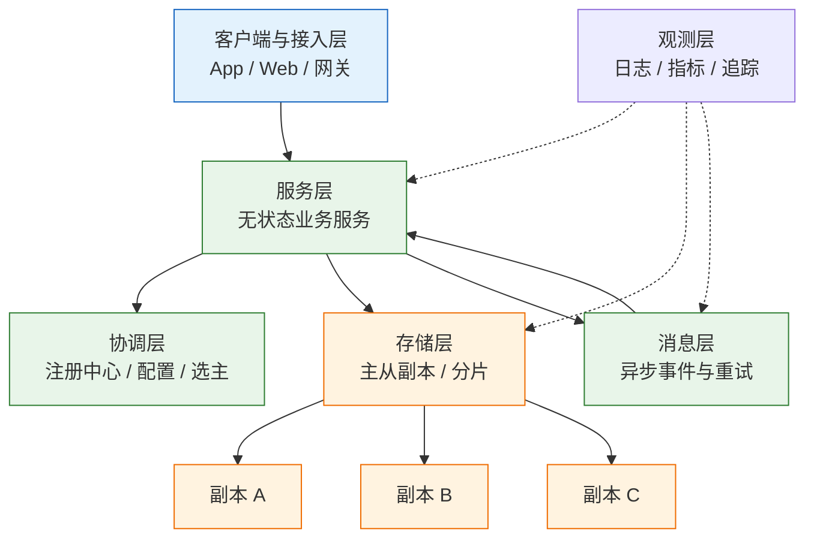
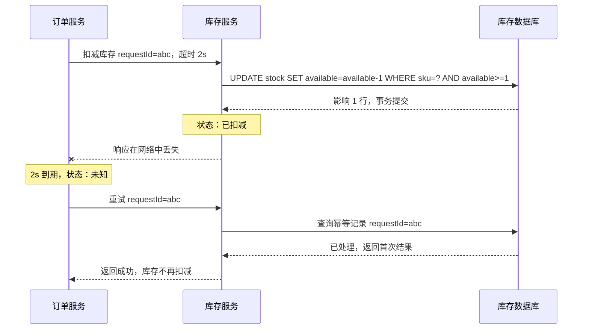
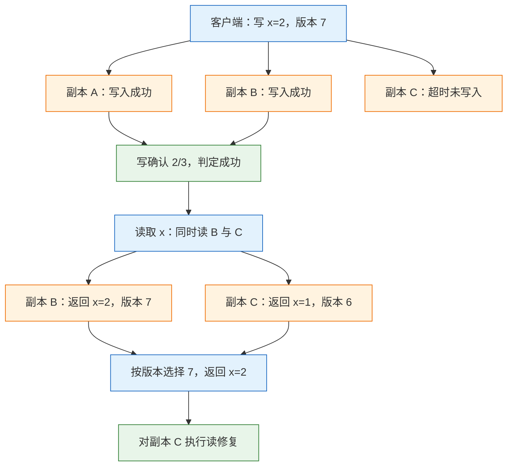
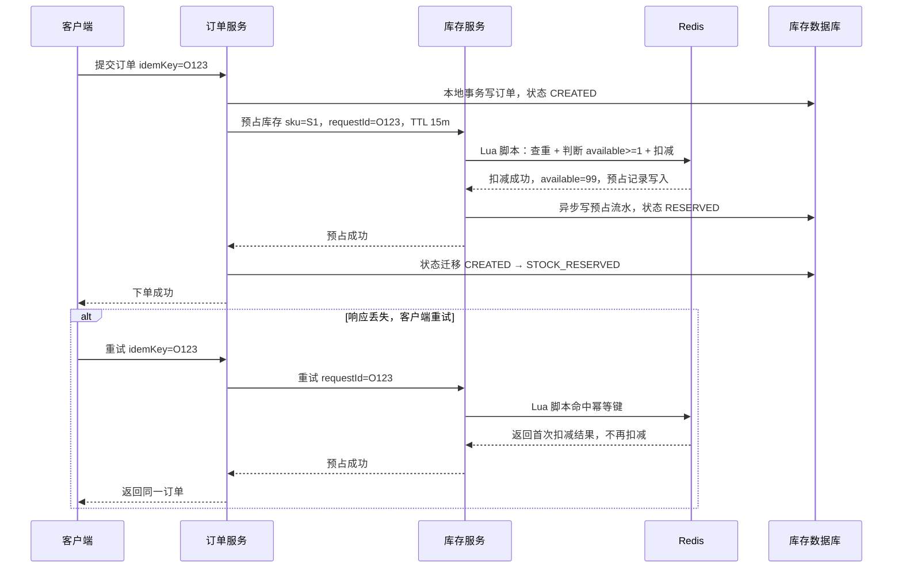

# 分布式基础与一致性模型

---

## 一、分布式系统是什么

### 1.1 核心概念

分布式系统由多台通过网络通信的计算机组成，对外表现为一个整体。计算、存储和状态分散在不同节点，每个节点只掌握局部信息，通过消息传递协作完成业务操作。

与单机系统相比，分布式系统增加的不是“更多机器”，而是三件无法消除的事实：

- **部分失败**：某个节点失败时，其他节点无法直接知道它执行到了哪一步；
- **不可靠通信**：消息可能丢失、重复、延迟、乱序，超时只代表没有等到响应；
- **无全局时钟**：物理时钟存在漂移和回拨，无法直接比较事件先后。

这三件事决定了设计方法：任何跨节点的状态变更，都必须显式处理“对方可能没收到”“对方可能已执行”“结果可能重复”三种情况。把远程调用写成和本地方法调用一样，是大多数分布式缺陷的起点。

| 维度 | 本地调用 | 远程调用 |
|---|---|---|
| 结果状态 | 成功或异常，二值 | 成功、失败、未知三态 |
| 延迟 | 纳秒到微秒 | 毫秒到秒，长尾明显 |
| 失败范围 | 进程内 | 请求、连接、节点、网络、机房 |
| 重复执行 | 不会发生 | 重试即可能重复 |
| 顺序保证 | 线程与锁 | 版本号、逻辑时钟、共识 |

### 1.2 与相邻技术的关系

集群、微服务、分布式数据库、共识系统、消息队列、缓存常被混称为“分布式”，但它们解决的问题不同，一致性责任的位置也不同。

集群解决容量与可用性扩展，只有持有副本的集群才产生一致性问题。微服务把本地事务拆成跨服务调用，分布式数据库把复制与事务收进中间件，共识系统只负责小状态，消息队列和缓存则分别引入重复投递与旧值窗口。

> **注意**：使用 etcd 并不等于整个系统强一致。etcd 只保证它自己保存的键值线性一致；业务库、缓存、消息队列各有一致性模型，不能互相替代。

### 1.3 模型与架构组成

把一次请求经过的组件纵向排开，可以得到接入、服务、协调、存储、消息、观测六层。一次请求串联的依赖越多，整体可用性越低：五个 99.9% 的依赖串联后约为 99.5%，再叠加每层三次重试，故障流量会成倍放大。架构上要减少同步串联，把非关键步骤异步化，并为每层设置独立的超时、限流和降级开关。



| 层级 | 主要职责 | 典型失败 | 可观测信号 |
|---|---|---|---|
| 接入 | 路由、鉴权、限流 | 连接耗尽、超时 | 入口 QPS、5xx、连接数 |
| 服务 | 业务编排与计算 | 线程池满、GC 停顿 | 延迟分位、错误率、线程数 |
| 协调 | 注册、配置、选主 | 会话过期、脑裂 | 租约剩余、选主次数 |
| 存储 | 持久化与复制 | 主从延迟、磁盘满 | 复制延迟、慢查询、磁盘用量 |
| 消息 | 异步投递与重试 | 堆积、重复消费 | 堆积量、消费延迟、死信数 |
| 观测 | 采集与分析 | 采样过高、丢点 | 采集成功率、存储用量 |

---

## 二、失败模型

### 2.1 网络失败与超时语义

网络失败最容易被误判。客户端看到的“失败”至少有三类，每类对应的服务端状态不同：

| 客户端看到 | 服务端真实状态 | 正确处理 |
|---|---|---|
| 成功响应 | 已执行 | 正常返回 |
| 连接拒绝、明确的 4xx | 未执行或被拒绝 | 按业务决定是否重试 |
| 超时、连接重置、响应丢失 | 未知，可能已执行 | 用幂等键重试或查询状态 |

连接重置和读超时与连接拒绝不同：请求可能已经到达，事务可能已经提交，只是响应在返回途中丢失。TCP 只保证连接内字节有序，不保证应用层请求只执行一次；负载均衡空闲超时、NAT 老化、线程池排队，都会让已执行的请求表现为超时。



时序中的状态变化拆成六步：

1. `t0` 请求发出，订单服务置为“处理中”；
2. `t1` 库存事务提交，库存减一；
3. `t2` 响应丢失；
4. `t3` 订单超时，只能置为“未知”；
5. `t4` 带同一 `requestId` 重试；
6. `t5` 命中幂等记录，返回首次结果，库存只扣一次。

> **架构红线**：任何扣款、扣库存、发券接口，超时后都不得直接判定失败并再次执行。必须先按业务幂等键查询执行结果，确认未执行后才允许重试。

### 2.2 节点失败与故障检测

节点失败分为多种类型，检测手段与后果各不相同。

| 失败类型 | 表现 | 检测方式 | 主要后果 |
|---|---|---|---|
| 崩溃停止 | 进程退出，不再响应 | 心跳、连接探测 | 请求失败，需切换 |
| 崩溃恢复 | 重启后丢失内存状态 | 启动日志、版本号 | 重复处理或状态回退 |
| 消息遗漏 | 丢请求或丢响应 | 超时、序列号缺口 | 状态未知 |
| 性能退化 | 仍响应但极慢 | 延迟分位、队列长度 | 请求堆积、误判死亡 |
| 网络分区 | 两组节点互相不可达 | 多数派探测 | 脑裂、双主 |
| 拜占庭 | 返回错误结果或伪造消息 | 多副本比对、签名 | 数据污染 |

心跳超时只能说明“没有按时收到心跳”，不能证明进程已经死亡。长时间垃圾回收、磁盘抖动、CPU 抢占都会造成假死：误判会提前切换主节点并产生双主，漏判会让请求持续打到不可用节点。健康检查要区分存活与就绪，只检查端口连通，会出现端口开着、连接池耗尽、接口全部超时的情况。

租约是常见的故障检测与主节点约束手段：主节点在租约有效期内拥有写权限，到期后必须停止服务。租约依赖时钟，进程暂停可能导致旧主在过期后仍然写入，因此需要 fencing token：每次选主分配单调递增令牌，存储端拒绝更小的令牌。

故障域是一起失效的一组组件，三副本放同一机架仍只有一个故障域。三副本跨机房按 2+1 放置，断网后多数派一侧可写；按 1.5+1.5 放置，两侧都不可写。

> **注意**：租约只能降低双主窗口，不能单独消灭双主。租约必须与单调令牌、存储端校验一起使用，否则旧主的延迟写仍可能落地。

### 2.3 时钟与顺序

分布式系统里有三种常用时间：墙上时钟、单调时钟、逻辑时钟。

墙上时钟受 NTP 校正，可能前跳或回拨，只适合记录可读时间；单调时钟只保证本机递增，适合测量耗时和租约，不能跨机比较。

逻辑时钟用计数表达因果关系。Lamport 时钟的规则是：本节点每发生一个事件计数加一；发送消息时带上计数；接收方取本地计数与消息计数的较大值再加一。它保证因果在先的事件计数更小，但计数小不代表一定因果在先。向量时钟为每个节点维护计数，能识别并发写与因果写，代价是元数据随节点数增长。

| 时钟 | 是否单调 | 能否跨节点排序 | 典型用途 |
|---|---|---|---|
| 墙上时钟 | 否，可能回拨 | 不可靠 | 日志时间、展示 |
| 单调时钟 | 是 | 不能 | 超时、耗时、租约 |
| Lamport 时钟 | 是 | 只能表达因果 | 事件编号、轻量排序 |
| 向量时钟 | 是 | 能识别并发 | 冲突检测、版本合并 |

用时间戳做“最后写入获胜”的冲突解决，会直接丢数据。两台机器时钟相差几百毫秒，后发生的写可能带更小的时间戳，被先发生的写覆盖。只有业务确认旧值可以被覆盖时才能使用这种策略，否则要保留版本向量，交给业务合并。

> **注意**：`System.currentTimeMillis()` 不能判断两个事件谁先发生，也不能单独判断分布式锁是否过期。测量耗时用 `System.nanoTime()`，业务排序用版本号或共识系统分配的单调序号。

---

## 三、一致性模型

### 3.1 一致性谱系

一致性模型是存储系统对客户端读写行为的承诺：在什么条件下，读操作会返回哪个版本的数据。它不是“好或坏”的等级，而是一组可验证的约束。

从强到弱，常见模型可以排成一条谱系：线性一致、顺序一致、因果一致、会话保证、最终一致。越靠左约束越强、协调成本越高；越靠右可用性和延迟越好，但应用要承担旧数据与冲突处理。

| 模型 | 核心承诺 | 主要代价 | 典型场景 |
|---|---|---|---|
| 线性一致 | 所有读写像单机原子对象，遵守实时顺序 | 跨区往返、分区时可能拒绝服务 | 余额、库存、锁 |
| 顺序一致 | 所有节点看到同一总顺序，但不要求实时 | 仍需全局协调 | 少数元数据场景 |
| 因果一致 | 有因果关系的写按顺序可见 | 需传播依赖元数据 | 评论、协作、消息 |
| 会话保证 | 单个会话内不倒退 | 需会话令牌或粘性路由 | 下单后查询、分页 |
| 最终一致 | 停止写入后副本最终收敛 | 存在旧值窗口与冲突 | 点赞、搜索、推荐 |

### 3.2 线性一致与顺序一致

线性一致要求每个操作在调用与返回之间的某个瞬间原子生效，并且整体顺序符合真实时间：如果一个操作在另一个操作开始之前已经返回，那么它在顺序中必须排在前者之前。

顺序一致只要求存在一个全局总顺序，并且每个客户端自己的操作顺序与该总顺序一致，不要求总顺序符合真实时间。两个客户端并发写同一个值，顺序一致可以选出任意一个顺序；线性一致必须让后开始且后返回的写生效。

| 性质 | 线性一致 | 顺序一致 |
|---|---|---|
| 遵守真实时间 | 是 | 否 |
| 保留单客户端顺序 | 是 | 是 |
| 可组合 | 是 | 否 |
| 实现成本 | 高，需要共识或主节点 | 中高，仍需全局顺序 |
| 分区时 | 少数派可能不可用 | 同样难以保证 |

实现线性一致常见路径是单主加租约、共识读索引，或让读也走多数派确认；仅本地读而不确认租约，旧主未退位时会返回旧值。

> **注意**：`R + W > N` 是交集条件，不是线性一致的充分条件。账务、库存等不能超卖的场景，要么走共识或单主强读，要么在存储层使用支持原子比较与版本校验的接口。

### 3.3 因果一致与会话保证

因果一致保留“先因后果”的可见顺序。若事件 A 因果先于事件 B，则任何节点都不能在看到 B 之后才看到 A。因果关系的来源有三类：同一客户端的程序顺序、消息发送与接收、以及传递闭包。

并发写入没有因果关系，不同副本可以按不同顺序看到它们，需要冲突合并。评论回复是典型场景：回复必须看到父评论，互不相关的回复可以乱序出现。

会话保证是更弱但更实用的一组承诺，通常按客户端会话生效：

| 保证 | 承诺 | 实现方式 |
|---|---|---|
| 读己之写 | 能读到自己刚成功的写 | 写后读主、会话令牌带版本 |
| 单调读 | 不会读到比之前更旧的版本 | 固定副本、按版本过滤 |
| 单调写 | 自己的写按发出顺序生效 | 会话粘性、序列号 |
| 写后读 | 读到某值后，后续写基于该值 | 版本依赖传递 |
| 一致前缀 | 看到的事件序列没有中间缺口 | 按分区位点等待 |

实现会话保证的关键是把“会话进度”变成可传递的元数据：写成功后拿到版本号或复制位点，读请求带上它，副本回放到该位点之前不返回。

> **注意**：读己之写只保证看到自己的写，不保证看到其他人的最新写。下单后查询订单可以用会话令牌，商品库存展示仍然可能是旧值，两者要分开承诺。

### 3.4 最终一致与收敛条件

最终一致指：如果停止新的写入，并且系统内部消息最终能够送达，那么所有副本最终会收敛到相同的值。它不规定多久收敛，也不规定收敛到哪个值。

要让“最终”真正到达，需要更新持续传播、节点恢复后能补齐、冲突解决规则确定，并有反熵或对账发现长期差异。

| 策略 | 是否自动收敛 | 数据风险 | 适用数据 |
|---|---|---|---|
| 最后写入获胜 | 是 | 并发写丢失 | 可覆盖的展示字段 |
| 版本向量 + 业务合并 | 是 | 合并逻辑复杂 | 购物车、文档 |
| CRDT | 是 | 类型受限、元数据膨胀 | 计数、集合、在线状态 |
| 人工对账 | 否，需流程 | 差异长期存在 | 资金、库存、订单 |

“最终一致”必须带可测量的窗口，例如复制延迟 P99 小于 500 毫秒、最大陈旧度不超过 5 秒；没有窗口指标就无法验收和告警。

> **注意**：最终一致不等于最终正确。若冲突解决规则会丢掉一笔扣款，系统确实收敛了，但收敛到了错误状态。收敛性解决副本一致，不解决业务正确。

### 3.5 CAP 与 PACELC

CAP 讨论网络分区发生时的一致性取舍。C 指线性一致，A 指每个未故障节点都能返回非错误响应，P 指网络可能丢弃节点之间的任意消息。分区无法被消除，所以真实选择发生在 C 与 A 之间。

| 选择 | 分区时的行为 | 代价 | 适用业务 |
|---|---|---|---|
| CP | 少数派拒绝读写，保证不返回旧值 | 部分用户不可用 | 支付、库存、配置 |
| AP | 两侧继续服务，接受副本分叉 | 可能读到旧值，需合并 | 购物车、动态、点赞 |

把 CAP 理解成“平时三选二”是常见误读。没有分区时，系统可以同时具备一致性和可用性；CAP 不讨论延迟，延迟取舍由 PACELC 补充：分区时在 A 与 C 之间选，没有分区时在 L（延迟）与 C 之间选。

跨城同步复制每次写都要等待一个跨城往返，延迟从毫秒级升到几十毫秒；异步复制延迟低，但主节点故障可能丢失尚未复制的写。

> **注意**：CAP 的 A 指“非故障节点返回非错误响应”，不指“低延迟”。一个请求等 30 秒才超时，不算可用；可用性指标要结合超时阈值定义。

---

## 四、复制与共识

### 4.1 复制拓扑

复制把同一份数据放到多个节点，目的有三个：故障时继续服务、就近读取降低延迟、分摊读流量。复制方式决定写路径、冲突处理和故障切换的复杂度。

| 拓扑 | 写路径 | 冲突与切换 | 适用 |
|---|---|---|---|
| 单主 | 只写主节点 | 无写冲突，需选主，可能丢尾部 | 大多数业务库 |
| 多主 | 任一副本可写 | 需合并冲突，切换快但可能双写 | 多地域主动写入 |
| 无主 | 客户端写多个副本 | 版本向量、读修复，无需选主 | 高可用键值存储 |

单主复制的写路径最简单，所有写由主节点排序，从节点按日志回放。同步复制等待从节点确认后返回，主节点故障时不丢已确认数据，但从节点变慢会拖慢写。异步复制立即返回，吞吐高，主节点崩溃时尚未复制的写会丢失。半同步复制等待至少一个从节点确认，在延迟和丢失窗口之间折中。

故障切换的核心指标是 RPO 与 RTO：前者是允许丢失的数据时间窗口，后者是允许的恢复时长。异步复制加自动切换通常 RPO 大于零；追求 RPO 为零必须同步复制或共识提交，代价是写延迟。

> **注意**：自动故障切换必须先确认旧主节点已停止写入，或让存储端拒绝旧主的令牌。只靠心跳超时切换，遇到旧主长时间停顿后恢复，会出现两个主节点同时写。

### 4.2 多数派读写

设副本数为 N，写成功需要 W 个副本确认，读需要 R 个副本响应。当 `R + W > N` 时，读集合与写集合至少有一个交集副本，因此读有机会看到最新写。

| 配置 | 写延迟 | 读延迟 | 风险 |
|---|---|---|---|
| W=N，R=1 | 最高 | 最低 | 任一副本故障即不可写 |
| W=2，R=2（N=3） | 中 | 中 | 多数派可用，仍有旧值窗口 |
| W=1，R=1 | 最低 | 最低 | 交集不成立，读到旧值概率高 |
| W=3，R=3 | 最高 | 最高 | 无容错余量 |

交集只是“有机会看到”，要返回最新值还需要版本比较和读修复。写成功不代表所有副本都有新值；读操作拿到不同版本时，按版本号选最新并修复旧副本。



推演中的状态变化是：写入在 A、B 提交，C 仍是旧版本；客户端按 W=2 判定成功；读请求同时到达 B、C，拿到版本 7 和版本 6；客户端返回版本 7，并触发对 C 的读修复。若修复放在返回之后异步执行，本次读仍可能先返回旧值。

> **注意**：宽松多数派在主副本不可达时把写放到其他节点，再通过提示移交迁移。它提高可用性，但读集合可能不包含实际写入的节点，`R + W > N` 的交集前提被破坏。长期离线副本靠后台反熵扫描补齐。

### 4.3 共识算法

共识算法解决多个节点对同一个值达成一致，并在少数节点故障时继续工作。Raft 把问题拆成 leader 选举、日志复制和安全性三部分，是工程上最常被实现的共识协议之一。

Raft 的基本流程如下：

1. 节点为 follower、candidate、leader 三种角色，选举超时后转为 candidate；
2. candidate 增加任期号并向其他节点拉票；
3. 获得多数派选票后成为 leader，接收写请求；
4. leader 追加本地日志并复制到 follower，多数派持久化后提交；
5. follower 在心跳中得知提交位置，按顺序应用日志。

五节点集群的多数派是 3，容忍 2 个故障；三节点多数派是 2，容忍 1 个。副本越多容错越高，写延迟和选举成本也越高。

| 用途 | 为什么需要共识 | 不适合的做法 |
|---|---|---|
| 集群元数据 | 选主与配置必须唯一 | 用普通主从库承载 |
| 分布式锁 | 锁的归属需要线性一致 | 只用 Redis 单点过期 |
| 配置中心 | 配置版本不能分叉 | 多写缓存各自生效 |
| 分片路由表 | 路由变更需全局一致 | 各节点本地缓存长期不更新 |

共识的读也需要设计：leader 本地读可能读到未提交状态，旧 leader 也可能在租约过期后返回数据。常见做法是读索引，先向多数派确认自己仍是 leader，再等待状态机应用到该读位点；另一种是租约读，租约时钟必须保守。

> **注意**：共识适合少量、关键、需要排序的状态，不适合每次下单都走一遍。共识每写一次至少需要一轮多数派往返，吞吐受网络往返和持久化限制。

---

## 五、幂等、重试与超时

### 5.1 幂等键设计

幂等指同一操作执行一次和执行多次产生相同结果。分布式系统中的“至少一次”投递是常态，幂等是把至少一次收敛为业务上“恰好一次”的唯一可行手段。

幂等键必须由客户端按业务意图生成，并在所有重试中复用。订单号、支付流水号、外部请求号都适合作为键；服务端收到请求后再生成键，等于每次重试都是新请求。

服务端处理流程通常分五步：

1. 以 `(业务类型, 幂等键)` 为唯一索引写入处理记录，状态为 `PROCESSING`；
2. 唯一索引冲突时读取已有记录，比较请求摘要；
3. 摘要一致且状态为 `SUCCESS`，直接返回首次响应；
4. 摘要一致且状态为 `PROCESSING`，返回“处理中”或让客户端稍后查询；
5. 摘要不一致，拒绝请求并告警，说明键被复用到了不同参数。

```sql
CREATE TABLE idempotency_record (
  idempotency_key VARCHAR(64) PRIMARY KEY,
  biz_type VARCHAR(32) NOT NULL,
  request_hash CHAR(64) NOT NULL,
  status VARCHAR(16) NOT NULL,          -- PROCESSING / SUCCESS / FAILED
  response_code INT,
  response_body JSON,
  created_at DATETIME(3) NOT NULL,
  expires_at DATETIME(3) NOT NULL,
  KEY idx_expires (expires_at)
);
```

| 幂等方式 | 实现 | 适用 | 局限 |
|---|---|---|---|
| 天然幂等 | 赋值、状态覆盖 | 配置、资料更新 | 不能表达增量语义 |
| 唯一键 | 订单号、流水号唯一索引 | 创建类操作 | 只能防重复插入 |
| 去重表 | 独立记录请求与响应 | 跨多表业务 | 多一次写与清理 |
| 状态机 | 只允许特定状态迁移 | 支付、订单 | 需覆盖全部状态 |

去重记录要有保留期，覆盖最大重试窗口、消息回溯窗口和对账周期。保留期太短，迟到重试会再次执行；保留期太长，表会膨胀并拖慢唯一索引。

> **架构红线**：幂等键与业务写入必须在同一个本地事务中落库。先写业务再写幂等记录，进程在两步之间崩溃会留下无法识别的重复数据。

### 5.2 重试策略

重试只对“可能成功”的错误有意义。连接拒绝、连接重置、超时、429、503 可以重试；400、401、403、404、422 通常表示请求本身有问题，重试不会改变结果。

指数退避加随机抖动是标准做法。固定间隔会让所有客户端在同一时刻再次冲击下游；没有上限的重试会把瞬时故障拖成持续故障。常见参数是初始 100 到 500 毫秒、倍增至上限 10 到 30 秒、最多 3 到 5 次，具体值按业务延迟目标确定。

重试预算限制重试流量占比：正常 1000 QPS、预算 10% 时，重试最多增加 100 QPS，超出后直接失败或降级。没有预算，下游越慢重试越多，最终形成风暴。

| 错误类型 | 是否重试 | 原因 |
|---|---|---|
| 连接拒绝 | 是，有限次 | 对端可能正在重启 |
| 读超时 | 仅幂等操作 | 对端可能已执行 |
| 429 限流 | 是，按 Retry-After | 退避后可恢复 |
| 503 不可用 | 是，有限次 | 可能是瞬时过载 |
| 400 参数错误 | 否 | 重试结果不变 |
| 401/403 | 否 | 凭证或权限问题 |

重试放大可以用层数估算。若三层调用每层都重试 3 次，最坏情况下游收到 `4 × 4 × 4 = 64` 倍请求。正确做法是只在最外层或统一网关重试，内层快速失败并上报。

> **架构红线**：资金类接口超时后禁止直接重试扣款。必须先按支付单号或渠道流水号查单，确认渠道未受理后再发起新请求；重复扣款的修复成本远高于一次查询。

### 5.3 超时预算与熔断

超时不是单个接口的参数，而是整条链路的预算。客户端给 2 秒、订单服务给库存 800 毫秒、库存给数据库 300 毫秒，剩余时间留给抖动和重试；下游超时大于上游剩余时间，重试就没有意义。

截止时间传递把剩余预算沿调用链传下去。gRPC 的 deadline、HTTP 的请求头都可以携带绝对截止时间；每跳用“剩余时间减去安全余量”作为本跳超时，而不是各跳独立配置固定值。

| 参数 | 设置原则 | 设置错误的后果 |
|---|---|---|
| 单跳超时 | 大于下游 P99.9，小于上游剩余预算 | 过短误杀，过长拖垮线程 |
| 重试次数 | 幂等操作 2 到 3 次 | 放大流量、延长尾延迟 |
| 熔断阈值 | 按错误率与最小请求数 | 过早熔断、或永不触发 |
| 隔离池 | 按依赖独立线程池或连接池 | 一个慢依赖拖垮全部接口 |

熔断器有闭合、打开、半开三个状态。错误率超过阈值且请求数达到下限时打开，直接拒绝请求；经过冷却时间进入半开，放少量探针；探针成功则闭合，失败则继续打开。熔断必须按依赖维度配置，不能全局一个开关。

> **注意**：超时时间不能只按平均值设置。平均 50 毫秒、P99 2 秒的依赖，用 200 毫秒超时会稳定误杀 1% 的请求；用 3 秒超时又会让线程长时间占用。要按分位和线程池容量一起计算。

---

## 六、完整案例：库存扣减链路

### 6.1 场景与约束

某零售系统日订单 50 万，峰值 200 TPS，SKU 约 10 万。普通商品用数据库条件更新即可；爆款单品瞬时可达 2000 QPS，所有请求竞争同一行库存，行锁排队会让 P99 超过 1 秒，并拖慢同库其他 SKU。

业务约束有三条：扣减不能超卖；下单接口在峰值时可用性优先；库存展示允许短暂旧值。由此得到分层的一致性承诺，而不是一个“强一致”口号覆盖全部链路。

| 环节 | 一致性承诺 | 实现手段 | 可接受延迟 |
|---|---|---|---|
| 库存扣减 | 不超卖 | 条件更新、Redis 原子脚本 | 毫秒级 |
| 订单创建 | 与扣减同成败 | 本地事务、状态机 | 毫秒级 |
| 库存展示 | 最终一致 | 缓存、异步回填 | 秒级 |
| 订单查询 | 读己之写 | 会话版本、写后读主 | 百毫秒级 |
| 搜索与推荐 | 最终一致 | 消息同步、离线索引 | 分钟级 |

### 6.2 正常与超时链路推演

正常链路如下：订单服务先写本地订单，再向库存服务发起预占；库存服务用 Redis Lua 原子判断并扣减，同时写预占记录；预占成功后订单进入 `STOCK_RESERVED`。



每一步的状态变化需要明确记录，否则故障时无法判断停在哪一步：

1. 订单落库为 `CREATED`，库存未占用；
2. Redis 扣减成功，可用量减一，预占状态为 `RESERVED`；
3. 预占流水异步落库，存在短暂窗口；
4. 订单迁移为 `STOCK_RESERVED`，对外可见“已占库存”；
5. 响应丢失后按同一幂等键重试，订单与库存都不重复创建；
6. 流水落库失败由对账任务补写，不能直接释放库存。

预占设置 15 分钟 TTL。超时未支付时，关单任务释放预占；释放操作也要幂等，避免关单任务与支付回调同时到达时重复释放。

### 6.3 分层一致性设计

普通 SKU 走数据库条件更新，一条语句同时完成判断与扣减：

```sql
UPDATE stock
SET available = available - 1, version = version + 1
WHERE sku_id = ? AND available >= 1;
```

影响行数为 1 表示扣减成功，为 0 表示库存不足。这种方式简单、强一致，但热点行会在行锁上排队，单行吞吐通常只有几百 TPS。

爆款走 Redis 预扣。Lua 脚本在 Redis 内原子执行，先查幂等键，再判断可用量，最后扣减并写预占记录：

```lua
-- KEYS[1] 库存键，KEYS[2] 幂等键，ARGV[1] 扣减数量，ARGV[2] 预占TTL
if redis.call('EXISTS', KEYS[2]) == 1 then
  return redis.call('GET', KEYS[2])
end
local available = tonumber(redis.call('GET', KEYS[1]) or '-1')
if available < tonumber(ARGV[1]) then
  return -1
end
redis.call('DECRBY', KEYS[1], ARGV[1])
redis.call('SET', KEYS[2], 'RESERVED', 'EX', ARGV[2])
return available - tonumber(ARGV[1])
```

库存分桶把 100 件拆成 10 个桶，请求按 SKU 加随机数路由，桶内原子扣减、跨桶汇总展示。某桶售罄而其他桶有余量时需要调配，回补逻辑更复杂。

| 方案 | 一致性 | 单点吞吐 | 主要代价 |
|---|---|---|---|
| 数据库行锁 | 强一致 | 单行数百 TPS | 热点排队、拖慢同库 |
| Redis 预扣 | 预扣强、落库最终 | 单键数万 QPS | 宕机丢预扣、需对账 |
| 库存分桶 | 桶内强一致 | 随桶数扩展 | 跨桶汇总与回补复杂 |

最终选择是混合：普通 SKU 用数据库，爆款用 Redis 预扣加分桶，展示层读缓存。扣减层不允许超卖，展示层允许短暂显示少量余量，落库层允许秒级延迟。三者承诺不同，不能用同一套重试和告警策略。

> **注意**：Redis 预扣不能替代持久化账本。Redis 故障切换可能丢失最近一段写，必须把预占流水落到数据库，并用对账任务修复差异。

### 6.4 对账与验收

对账分三层。实时层在预占成功后核对 Redis 记录与预占流水；准实时层每 5 分钟比对“Redis 已扣总量”和“数据库已售加未落库预占”；日终层全量核对库存、订单、支付与出库。

| 指标 | 定义 | 目标 | 异常动作 |
|---|---|---|---|
| 超卖数 | 已售数量大于初始库存 | 0 | 立即停售并人工核查 |
| 预占泄漏 | 已预占未释放且订单已关闭 | 小于 0.01% | 自动释放并告警 |
| 落库延迟 | Redis 扣减到流水落库 | P99 小于 1 秒 | 扩容消费者、检查数据库 |
| 对账差异率 | 差异笔数除以总笔数 | 小于 0.01% | 生成工单、按类型修复 |

对账的键要统一：订单号、SKU、预占流水号、渠道流水号必须能互相映射。只比总数不比明细，无法定位哪一笔；只比明细不比总额，无法发现系统性偏差。

“最终一致”的验收要写进 SLO：最大陈旧度、对账频率、修复时限和负责人；没有这些指标，就无法证明，也无法在复盘时界定责任。

---

## 七、常见反模式

### 7.1 反模式对照

| 反模式 | 表现 | 后果 | 纠正 |
|---|---|---|---|
| 超时即失败 | 超时后直接提示失败并重试 | 重复扣款、重复下单 | 超时视为未知，先查状态 |
| 重试无幂等 | 每次重试生成新请求号 | 下游重复执行 | 客户端固定幂等键 |
| 全链路强一致 | 所有读都走主库或共识 | 延迟高、吞吐低 | 按数据分级承诺 |
| 时间戳排序 | 用墙上时钟判断先后 | 旧写覆盖新写 | 版本号、逻辑时钟 |
| 多数派等于强一致 | 认为 `R+W>N` 不会读旧值 | 账务读到旧余额 | 共识、主节点强读、版本校验 |
| 副本同故障域 | 三副本放同一机架 | 机架故障全丢 | 跨机架、跨可用区 |
| 无界重试 | 失败后一直重试 | 重试风暴、雪崩 | 退避、预算、熔断 |
| 浅健康检查 | 只探测端口 | 流量打到不可用实例 | 就绪检查覆盖关键依赖 |
| 缓存当权威源 | 库存只存在 Redis | 故障切换丢数据 | 持久化账本加对账 |
| 只做异步不做对账 | 发完消息就认为一致 | 差异永远不收敛 | 对账、死信、人工兜底 |

---

## 八、常见故障与排查

### 8.1 故障表

| 现象 | 最可能原因 | 核查点 | 处理 |
|---|---|---|---|
| 重试后重复扣款 | 无幂等键，超时当失败 | 请求号是否变化、有无去重表 | 补幂等键与唯一索引，查单退款 |
| 故障时流量不降反升 | 无退避、无重试预算 | 各层重试次数、重试流量占比 | 加退避抖动、熔断、只留一层重试 |
| 跨区写延迟突增 | 同步复制跨城，RTT 叠加 | 复制模式、跨区 RTT | 同区强一致，跨区异步或单元化 |
| 两个节点同时为主 | 租约失效、分区后双写 | 选主日志、租约剩余、令牌 | quorum 加 fencing token |
| 读从库读到旧数据 | 复制延迟，未做会话保证 | 复制延迟、读路由 | 写后读主、版本等待、固定副本 |
| 三副本挂两台仍不可写 | 多数派配置或放置错误 | 副本分布、quorum 大小 | 调整副本数与故障域 |
| 事件顺序错乱 | 用时间戳排序或并发消费 | 事件时间、分区键、消费位点 | 按业务键分区、版本号排序 |
| 库存显示有货但下单失败 | 展示最终一致，扣减强一致 | 缓存与账本差异 | 接受展示误差，扣减层校验 |
| 健康检查通过但请求全超时 | 浅检查未覆盖依赖 | 就绪探针内容、连接池 | 就绪检查纳入关键依赖 |

### 8.2 排查顺序

1. **界定影响面**：确认开始时间、受影响接口、错误类型和地域，判断是单请求、单实例还是全局。
2. **区分三态**：把错误分成明确失败、超时未知、成功但下游异常，未知状态先查幂等记录。
3. **查依赖**：按请求路径逐跳检查延迟分位、错误率、连接池、线程池和队列，找出第一处异常。
4. **查复制与选主**：核对主从延迟、quorum、双主、租约与令牌。
5. **查重试与流量**：统计重试比例、来源和熔断状态，确认是否存在重试放大。
6. **查时钟与顺序**：核对 NTP 偏差、墙上时钟排序、事件版本是否倒退。
7. **止血与恢复**：先限流、降级、切主或关闭非关键写入，再修复数据；不了解状态时不要重放消息。
8. **复盘与加固**：补齐幂等、对账、监控和演练，缩短检测与恢复时间。

> **注意**：排障时不要先重启所有节点。重启会清空现场，让“已执行但未确认”的请求失去线索；先保留日志、幂等记录和消息位点，再决定重启范围。

> **核心结论**：分布式系统的第一课是接受部分失败、不可靠网络和缺失的全局时钟；超时是未知而非失败，一致性要按数据损失分级，最终一致必须靠幂等、重试、对账和可观测性共同兑现。
