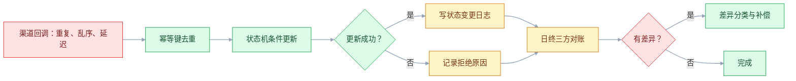
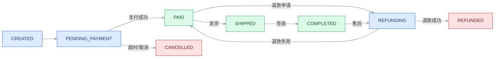

# 分布式基础与一致性模型

## 一、工程案例：支付回调把订单状态改错之后

**场景**：订单服务接了三家支付渠道。上线后发现三类问题：同一笔支付回调被重复投递，订单被重复置为“已支付”；渠道先发“支付成功”、后发“支付失败”，订单状态来回跳；用户支付成功后立刻刷新订单页，偶尔还显示“待支付”。财务每天对账，差异 3～5 笔，追查要人工翻三张表。

**目标**：不引入新中间件，先把一致性模型定清楚，交付：

- 一张订单状态机；
- 一张一致性矩阵（哪个动作强一致、哪个最终一致）；
- 一套幂等与乱序处理规则；
- 一张失败矩阵；
- 一套三方对账规则；
- 一份验收清单。

**为什么必须做**：分布式系统里，“失败”不是异常，是常态。网络会超时、消息会重复、时钟会回拨、服务会部分成功。架构要做的不是消灭失败，而是让失败可识别、可重试、可对账、可回滚。

**动手前确认**：先把最近一个月的支付回调日志、订单状态变更日志、渠道账单拉出来，按订单号对齐。没有这三份数据，后面的规则都是猜的。下面的数字是示例。



### 1.1 订单状态机

先把状态和允许的迁移写死。状态机是对抗乱序的第一道防线：不合法的迁移直接拒绝，而不是“谁最后到谁生效”。



关键规则：

1. 只有 `PENDING_PAYMENT` 可以迁到 `PAID`；`PAID` 之后再收到“支付成功”回调，直接幂等返回成功，不改状态。
2. `PAID` 不能退回 `PENDING_PAYMENT`；“支付失败”回调只在 `PENDING_PAYMENT` 生效。
3. 每次迁移写一条状态变更日志：订单号、旧状态、新状态、事件 ID、渠道流水号、发生时间、处理时间。
4. 状态更新用条件更新：`UPDATE orders SET status = 'PAID' WHERE order_id = ? AND status = 'PENDING_PAYMENT'`，受影响行数为 0 就说明状态已变或并发冲突。

### 1.2 一致性矩阵

不是所有数据都需要强一致。按业务后果分级：

| 数据/动作 | 一致性要求 | 实现 | 失败后果 |
|---|---|---|---|
| 订单状态迁移 | 强一致（单库条件更新） | 状态机 + 条件更新 | 状态错乱、重复支付 |
| 支付流水入账 | 强一致（唯一键） | 渠道流水号唯一索引 | 重复入账、对账差 |
| 订单列表/详情读 | 会话一致性（读己之写） | 支付成功后短时间读主库 | 用户看到旧状态 |
| 库存扣减 | 强一致（单库）或最终一致（预占） | 条件扣减 / 预占 + 确认 | 超卖、少卖 |
| 发货通知 | 最终一致 | 消息 + 重试 | 通知延迟 |
| 数据看板 | 最终一致 | 日批量/CDC | 看板延迟 |
| 搜索索引 | 最终一致 | CDC/消息 | 搜索结果延迟 |

这张表要和业务方一起定。把“订单状态”做成最终一致，用户会投诉；把“看板”做成强一致，成本和延迟都不划算。

### 1.3 幂等设计

幂等的本质是“同一个业务动作执行多次，结果和执行一次一样”。三层都要做：

| 层 | 做法 | 注意 |
|---|---|---|
| 入口 | 渠道流水号唯一索引 | 唯一键要包含渠道，不同渠道流水号可能重复 |
| 业务 | 状态机条件更新 | 只允许合法迁移，重复回调直接返回成功 |
| 响应 | 记录首次处理结果 | 重复请求返回同一结果，不重复执行业务 |

```sql
-- 支付流水表：渠道 + 渠道流水号唯一
CREATE UNIQUE INDEX uk_pay_channel_txn
  ON payment_record (channel_code, channel_txn_id);

-- 订单状态：条件更新，避免后到的旧事件覆盖新状态
UPDATE orders
   SET status = 'PAID', paid_at = ?
 WHERE order_id = ?
   AND status = 'PENDING_PAYMENT';
```

如果条件更新受影响行数为 0，不要立刻报错。先查当前状态：

- 已经是 `PAID`：说明重复回调，返回成功；
- 是 `CANCELLED`：说明订单已取消，记录异常并触发退款；
- 是其他状态：记录冲突，进入人工/自动核对队列。

### 1.4 乱序与版本

渠道不保证回调顺序，本地也不保证消息顺序。处理原则：

1. **不信任事件时间**：渠道的 `occurred_at` 可能回拨，不能直接拿它做“最后写入”。
2. **用状态机约束顺序**：不合法的迁移拒绝，合法的迁移才执行。
3. **用版本号做乐观锁**：订单表加 `version`，更新时 `WHERE version = ?`，冲突就重读重试。
4. **用单调递增的本地序列**：消息落库时生成 `ingest_seq`，排查时按本地接收顺序看，而不是按渠道时间看。
5. **保留原始事件**：回调原文落 `payment_event` 表，方便重放和对账。

### 1.5 三方对账

对账不是财务的独角戏，是架构的一部分。三方是：渠道账单、支付流水、订单状态。

| 差异类型 | 表现 | 处理 |
|---|---|---|
| 渠道有、本地无 | 用户已付，订单仍待支付 | 补入账，触发订单状态迁移 |
| 本地有、渠道无 | 本地显示已付，渠道无记录 | 冻结订单，人工核实，防欺诈 |
| 金额不一致 | 渠道金额与订单金额不同 | 挂起，人工核对，禁止自动发货 |
| 状态不一致 | 渠道成功、本地失败，或反之 | 以渠道账单为准，补状态/退款 |
| 重复入账 | 同一渠道流水号两条支付记录 | 唯一索引应拦截；若已发生，冲正一笔 |

对账规则要可执行：

- 每天凌晨拉渠道账单，按 `channel_txn_id` 与本地支付流水全量比对；
- 差异写入 `recon_diff` 表，带差异类型、金额、订单号、处理状态；
- 自动补偿只处理“渠道有、本地无”和“重复入账”，其余人工；
- 对账结果留 90 天，支持按订单号追溯。

### 1.6 失败矩阵

| 失败 | 系统表现 | 处理 | 用户看到 |
|---|---|---|---|
| 回调重复 | 同一流水多次到达 | 唯一键 + 状态机幂等 | 正常 |
| 回调乱序 | 先成功后失败 | 状态机拒绝非法迁移 | 正常 |
| 回调延迟 | 支付成功，订单待支付 | 主动查询 + 对账补偿 | 短时延迟 |
| 回调丢失 | 渠道成功，本地无记录 | 定时补偿任务拉渠道状态 | 延迟恢复 |
| 数据库主从延迟 | 支付后读到旧状态 | 读己之写，短时读主库 | 正常 |
| 消息重复 | 通知发两次 | 消费端幂等 | 可能重复通知，可接受 |
| 消息积压 | 状态更新延迟 | 积压告警 + 扩容消费者 | 延迟 |
| 对账差异 | 账实不符 | 差异分类 + 补偿/人工 | 可能延迟发货 |

### 1.7 验收（8 项）

1. 支付成功回调重复 100 次：订单只迁移一次，支付流水只有一条。
2. 先发成功、后发失败：订单保持 `PAID`，失败事件被记录并忽略。
3. 先发失败、后发成功：订单最终 `PAID`，不出现“失败后不能支付”。
4. 回调延迟 24 小时：补偿任务能拉回状态，差异为 0。
5. 支付成功后立刻查订单：连续 20 次读取，全部看到 `PAID`。
6. 三方对账连续 7 天：差异 0 笔；人为造 5 类差异，全部能分类。
7. 消息重复消费 100 次：通知不重复发送（或可接受重复，但内容一致）。
8. 故障演练：停掉一个渠道回调 10 分钟，恢复后自动补齐，无需人工。

### 1.8 一致性模型怎么选

| 业务场景 | 推荐模型 | 理由 |
|---|---|---|
| 支付、扣库存、账务 | 强一致/线性一致 | 错了要赔钱 |
| 订单状态 | 强一致写入 + 会话读 | 写不能错，读可短暂延迟 |
| 用户资料 | 读己之写 | 用户改完要立刻看到 |
| 商品详情 | 最终一致 + 缓存 | 延迟可接受，性能优先 |
| 搜索/推荐 | 最终一致 | 延迟分钟级可接受 |
| 数据看板 | 最终一致 | 延迟小时级可接受 |
| 跨系统通知 | 最终一致 + 幂等 | 失败可重试 |

一致性不是越高越好，而是“业务能接受的错误成本”决定。支付错一笔，成本可能是退款、投诉、罚款；看板晚十分钟，成本几乎为零。

## 二、高频问答：会卡住你的地方，也是面试最常问的

### 2.1 CAP 就是三选二

**现场**

怎么判断：拿一份系统清单，对每个组件问两句——分区发生时，是拒绝写入保一致，还是继续写入保可用？平时是否愿意用读延迟换强一致？答案写下来，比背“三选二”有用。

**要点**

- CAP 里的 P 不是可选项，网络分区一定会发生，能选的只有分区时保 C 还是保 A。
- 平时没有分区，权衡的是延迟和一致性，这一层由 PACELC 补上。
- 所以“三选二”把 P 当成了可以关掉的开关，是把模型讲错了。

**追问**

- 分区时选 C 会怎样？→ 拒绝写入，保一致，但部分请求不可用。
- 平时也要在 C 和 A 之间选吗？→ 不用，平时选的是延迟 L 还是强一致 C。
- 为什么有人说自己的系统是 CA？→ 那是在假设没有分区，单机或同机房内成立，跨网络就不成立。

### 2.2 最终一致就是“不管，最后会一致”

**现场**

怎么判断：拿这条链路问四个问题——失败消息谁重试、重试几次、死信谁处理、每天对账吗？四个里有一个没答案，就不是最终一致。

**要点**

- 最终一致是“有机制保证最终收敛”，不是“先不管，过一会儿自然就好”。
- 收敛靠重试、补偿、对账、版本、去重这几件事，缺一件就停在中间态。
- 没有这些机制，“最终一致”实际是“永远不一致”，只是错得比较晚。

**追问**

- 重试几次算够？→ 有上限并配指数退避，超限进死信，不能无限重试。
- 死信谁来处理？→ 要有人工或自动的消费入口，否则死信只是换了个地方积压。
- 对账频率怎么定？→ 至少日对账，资金类还要加实时监控。

### 2.3 消息重复是 MQ 的 bug

**现场**

怎么判断：看消费端有没有幂等键和去重表。没有的话，换什么 MQ 都会重复。

**要点**

- 绝大多数 MQ 给的是至少一次（at-least-once），重复是正常语义，不是中间件 bug。
- 网络超时、消费者重启、ack 丢失都会触发重投，这些条件在分布式里必然出现。
- 重复只能在消费端消化：幂等键、去重表、状态机。

**追问**

- 至少一次和精确一次差在哪？→ 精确一次是端到端承诺，靠“至少一次 + 幂等消费 + 事务性写入”实现。
- 去重表怎么清理？→ 定期清理，但保留窗口要大于最大重投间隔。
- 消费端没有幂等键怎么办？→ 用业务单号补一个，或用状态机把重复变成非法迁移。

### 2.4 消息必须全局有序

**现场**

怎么判断：先问哪些消息必须有序、按什么键有序（订单号还是用户 ID），只对必须的键做分区有序，其余放并发。

**要点**

- 全局有序的代价是单分区/单队列，吞吐直接受限，通常是拿吞吐换一个业务不需要的保证。
- 业务真正需要的多半是“同一业务键有序”，跨键的全局顺序没有意义。
- 分区键要稳定，不能随机，否则同一订单的消息会落到不同分区。

**追问**

- 单分区有序的代价是什么？→ 吞吐受限，还容易出现分区热点。
- 多线程消费还能保序吗？→ 能，按 key 哈希到固定线程或队列，保证同键串行。
- 分区键选错会怎样？→ 同一订单的消息分散到不同分区，顺序保证直接失效。

### 2.5 分布式锁能保证强一致

**现场**

怎么判断：问两句——锁过期后旧持有者还能继续写吗？写入有没有版本号或条件更新兜底？没有就可能双写。

**要点**

- 锁有租约、时钟、GC 暂停、网络分区，任何一项出问题锁都会提前失效。
- 锁失效时旧持有者往往还不知道，会继续写，“同一时刻只有一个线程”只是理想情况。
- 兜底要么用 fencing token，要么用数据库条件更新，把判断和写入放进一个原子操作。

**追问**

- GC 暂停为什么会让锁失效？→ 持有者暂停时间超过租约，锁被释放，恢复后它仍以为自己持锁。
- fencing token 怎么防双写？→ 每次加锁生成递增 token，写入带上 token，存储端拒绝旧 token。
- 为什么条件更新比锁可靠？→ 判断和更新在同一个原子操作里，不依赖锁服务的可用性。

### 2.6 读写分离后立刻读不到

**现场**

怎么判断：先看复制延迟指标，别先怀疑缓存。对读己之写的场景，写入后短时间内路由主库，或直接返回本地写入结果。

**要点**

- 写主库、读从库，复制延迟是架构自带的，读不到新值是正常现象，不是缓存没清。
- 判断靠复制延迟指标和“写后立刻读”的复现，不靠猜。
- 读己之写要么短时读主库，要么带版本号校验，要么把写入结果直接返回给用户。

**追问**

- 复制延迟一般多大？→ 同机房通常毫秒级，跨地域和长事务会放大到秒级。
- 单调读怎么保证？→ 会话粘到同一个副本，或记录已读版本号。
- 全部读主库行不行？→ 读写分离的收益就没了，主库压力回到原点。

### 2.7 时间戳可以排序

**现场**

怎么判断：问时钟回拨 1 秒会怎样，系统里有没有逻辑时钟、版本号或状态机兜底。

**要点**

- 机器时钟会漂移、回拨，闰秒也会捣乱，跨机器的时间戳没有全局可比性。
- 用时间戳做“最后写入胜出”，回拨时旧事件会覆盖新事件，而且很难复现。
- 顺序要靠状态机、版本号、逻辑时钟或本地接收序列，时间戳只能当参考。

**追问**

- 时钟回拨 1 秒会怎样？→ 后到的旧事件时间更大，把新状态覆盖掉。
- 逻辑时钟能给出实时顺序吗？→ 不能，只能给出偏序，因果关系之外无法比较。
- 本地接收序列能当业务顺序吗？→ 不能，它只反映本地到达顺序，用于排查和重放。

### 2.8 事务消息等于最终一致

**现场**

怎么判断：看消费端有没有幂等、重试、死信、对账。只配了事务消息，不等于一致。

**要点**

- 事务消息只保证“本地事务成功则消息可投递”，解决的是生产端的双写。
- 消费端仍可能重复、失败、乱序，这半边事务消息完全不管。
- 幂等、重试、死信、对账必须自己做，缺一项链路就断在消费侧。

**追问**

- 事务消息和普通消息差在哪？→ 多了一个本地事务状态的回查机制，保证事务提交成功才投递。
- 消息投递失败谁负责？→ 生产端回查 + 消费端重试，最后靠对账兜底。
- 只做幂等不做对账行不行？→ 幂等防重复，防不了漏单，漏单只能靠对账发现。

### 2.9 幂等就是加唯一索引

**现场**

怎么判断：问重复请求会不会重复发消息、扣库存、退款。会，就还没做到幂等。

**要点**

- 唯一索引只防重复插入，防不住“重复执行副作用”。
- 幂等要三层：入口唯一键、业务状态机、结果回放。
- 发通知、扣款、发货这类有副作用的动作必须单独设计幂等，不能指望数据库约束。

**追问**

- 唯一键该用什么？→ 渠道流水号或业务单号，不要用请求时间或随机 UUID。
- 重复请求应该返回什么？→ 返回首次处理结果，而不是报错，否则调用方会继续重试。
- 状态机怎么做幂等？→ 只有合法迁移才执行，重复回调发现已是目标状态就直接返回成功。

### 2.10 对账是财务的事，和架构无关

**现场**

怎么判断：问每笔交易有没有渠道流水号、本地流水号、状态变更日志。三样缺一，对账就会变成考古。

**要点**

- 对账是可观测性的一部分，不是财务月底的补丁。
- 系统不产生可对账的流水、不保留渠道原文、不做差异分类，问题就永远定位不到。
- 自动补偿只处理确定性差异，模糊差异必须留人工入口。

**追问**

- 哪些差异可以自动补？→ 渠道有本地无、重复入账这类确定性的。
- 哪些必须人工？→ 金额不一致、本地有渠道无，涉及资金和欺诈判断。
- 对账结果要留多久？→ 至少覆盖追溯周期，原文示例是 90 天。

## 三、核心知识

### 3.1 分布式系统的三个现实

1. **网络不可靠**：超时、丢包、重复、分区。你无法区分“对方没收到”和“对方处理了但响应丢了”。
2. **时钟不可靠**：机器时钟会漂移、回拨，跨节点没有全局单调时间。
3. **失败是部分的**：一台机器挂了，另一台可能还在跑；一个请求超时，服务可能已经成功。

架构的第一原则不是“避免失败”，而是“假设失败一定发生，设计可恢复路径”。

### 3.2 CAP 与 PACELC

CAP：一致性（C）、可用性（A）、分区容忍（P）。网络分区发生时，系统必须在 C 和 A 之间选择；P 不是可选项。

PACELC：如果分区（P），在 A 和 C 之间选；否则（E，else），在延迟（L）和一致性（C）之间选。它补齐了“平时也要权衡”的现实。

| 系统类型 | 分区时 | 平时 |
|---|---|---|
| 强一致数据库 | 选 C，拒绝写入 | 选 C，牺牲延迟 |
| 高可用缓存 | 选 A，可能读旧值 | 选 L，低延迟 |
| 最终一致系统 | 选 A，事后补偿 | 选 L，异步收敛 |

> **面试**：常问「CAP 为什么不能三选二？」答：P 不是可选项，分区时只能选 C 或 A，平时权衡的是延迟和一致性。

### 3.3 一致性模型谱系

从强到弱：

| 模型 | 保证 | 典型场景 |
|---|---|---|
| 线性一致性 | 所有操作像在单点上按实时顺序执行 | 账务、库存扣减 |
| 顺序一致性 | 所有进程看到同一总序，但不要求实时顺序 | 部分分布式存储 |
| 因果一致性 | 有因果关系的操作按顺序可见 | 社交、协作编辑 |
| 读己之写 | 自己能读到自己的写 | 用户资料、订单状态 |
| 单调读 | 不会读到比之前更旧的数据 | 会话型应用 |
| 最终一致 | 无新写入时副本最终收敛 | 搜索、看板、通知 |

注意：**线性一致性 ≠ 可串行化**。线性一致性描述单对象读写的实时顺序；可串行化描述多对象事务的隔离效果；严格可串行化才是两者兼有。很多数据库说“强一致”，实际是快照隔离或可串行化，不是线性一致。

> **面试**：常问「线性一致性和可串行化是一回事吗？」答：前者是单对象读写的实时顺序，后者是多对象事务的等价串行，严格可串行化才两者兼有。

### 3.4 ACID 与 BASE

| | ACID | BASE |
|---|---|---|
| 核心 | 原子、一致、隔离、持久 | 基本可用、软状态、最终一致 |
| 适合 | 账务、订单、库存 | 搜索、推荐、通知、看板 |
| 代价 | 锁、阻塞、吞吐下降 | 复杂度转移到补偿和对账 |
| 误区 | 以为 ACID 能跨服务 | 以为 BASE 不用管一致性 |

跨服务的“ACID”通常不存在。要么用单库事务，要么用 Saga/TCC/outbox 换最终一致。

### 3.5 复制与 quorum

主从复制：写主、读从，简单但有复制延迟和主库单点。
多主复制：写多个节点，冲突需要解决，复杂度高。
无主复制：读写多个副本，用 quorum 控制一致性。

在 Dynamo 风格的系统里，`R + W > N` 是强一致的必要条件之一，但不是充分条件：还要看读修复、sloppy quorum、失败节点的处理、并发写冲突。不要只背公式。

### 3.6 状态机与条件更新

状态机是一致性的“业务护栏”：

- 定义合法状态和迁移；
- 每次迁移用条件更新，只有当前状态符合才允许；
- 记录迁移日志，支持审计和重放；
- 非法迁移不是“覆盖”，是“拒绝 + 记录”。

条件更新比分布式锁更可靠，因为它把“判断 + 更新”放在一个原子操作里。能用条件更新解决的，不要用锁。

> **面试**：常问「为什么条件更新比分布式锁可靠？」答：判断和更新在同一个原子操作里，不依赖锁服务的租约和时钟。

### 3.7 幂等设计

幂等的四种实现：

| 方式 | 适用 | 注意 |
|---|---|---|
| 唯一键 | 创建类操作 | 键要包含业务维度，防止不同业务冲突 |
| 状态机 | 状态迁移 | 只允许合法迁移 |
| 去重表 | 消息消费 | 记录消息 ID + 处理结果，定期清理 |
| 结果回放 | 查询/回调 | 重复请求返回首次结果 |

幂等键的选择比实现更重要：用渠道流水号，不要用请求时间；用业务单号，不要用随机 UUID。

### 3.8 顺序与版本

| 方案 | 适用 | 代价 |
|---|---|---|
| 单分区有序 | 同一订单/用户 | 分区热点 |
| 版本号 | 乐观并发 | 冲突重试 |
| 逻辑时钟 | 跨节点排序 | 只能偏序，不是实时 |
| 状态机 | 业务顺序 | 需要完整状态定义 |
| 本地接收序列 | 排查与重放 | 不代表业务顺序 |

不要用机器时间戳做“最后写入胜出”。时间回拨会让旧事件覆盖新事件，而且很难复现。

### 3.9 对账设计

对账是可观测性的一部分，不是财务补丁。最小设计：

1. 每笔交易有全局唯一业务号 + 渠道流水号；
2. 保留渠道原始报文和本地处理结果；
3. 每天全量/增量比对，差异分类；
4. 自动补偿只处理确定性差异，模糊差异人工；
5. 对账结果可查询、可追溯、可重跑。

对账规则要能回答：差异是什么类型、为什么产生、谁负责、怎么补、补完怎么验证。

> **面试**：常问「最终一致怎么验收？」答：靠对账，差异能分类、能补偿、能追溯，否则只是永远不一致。

### 3.10 一致性决策表

| 问题 | 选强一致 | 选最终一致 |
|---|---|---|
| 错了要赔钱吗 | 是 | 否 |
| 用户会立刻发现吗 | 是 | 否 |
| 能否自动补偿 | 难 | 易 |
| 跨系统还是单库 | 单库 | 跨系统 |
| 流量是否极高 | 否 | 是 |

这张表不能替代业务判断，但能避免“所有东西都上强一致”或“所有东西都最终一致”的两个极端。

## 四、冷门知识汇总

- **FLP 不可能定理**：在异步网络中，只要有一个进程可能崩溃，就不存在既保证安全又保证活性的确定性共识算法。工程上用超时、随机化、leader 选举绕开，不是“违背定理”。
- **两将军问题**：在不可靠信道上，双方无法通过有限次确认达成“绝对确定”的一致。它解释了为什么“确认收到”也需要幂等和重试。
- **拜占庭将军问题**：除了崩溃，还有节点作恶/发假消息。BFT 算法（如 PBFT）解决这类问题，成本远高于崩溃容错，普通业务系统很少用。
- **Jepsen**：一个分布式系统一致性测试项目，专门验证数据库在分区、时钟漂移、进程崩溃下的真实行为。很多“强一致”宣传在 Jepsen 测试下会露馅。
- **线性一致性 vs 可串行化**：前者是单对象读写的实时顺序，后者是多对象事务的等价串行执行；严格可串行化两者兼有。面试和评审里经常被混用。
- **快照隔离的写偏斜**：两个事务各自读一组数据、各自写另一组，快照隔离下都可能提交，但结果违反业务约束。需要可串行化或显式锁。
- **混合逻辑时钟（HLC）**：把物理时钟和逻辑时钟结合，既接近实时又能保序。很多分布式数据库用它做事务时间戳。
- **向量时钟**：记录每个节点的版本，能判断因果顺序和并发冲突，但向量会随节点数增长，不适合大规模动态集群。
- **CRDT**：无冲突复制数据类型，通过数学结构保证并发更新可合并，达到强最终一致。适合计数器、集合、协作编辑，不适合“必须人工判断”的业务。
- **精确一次是营销词**：端到端精确一次通常靠“至少一次投递 + 幂等消费 + 事务性写入”实现。单独一个 MQ 不可能保证跨系统的精确一次。
- **Redis 分布式锁与 fencing token**：锁过期后旧持有者可能继续写。正确做法是每次加锁生成递增 token，写入时带上 token，存储端拒绝旧 token。
- **有界 staleness**：比“最终一致”更强的一种承诺：副本最多落后主库 N 秒或 N 个版本。对看板、搜索这类场景，比“最终”更可验收。
- **会话保证**：读己之写、单调读、单调写、写后读，是一组会话级一致性保证，通常由客户端粘性、版本号或主库路由实现，不是数据库默认能力。
- **尾延迟**：一致性协议的重试和 quorum 会放大尾延迟。P99 比平均值更能反映用户感受，容量评估要看尾延迟，不要只看均值。