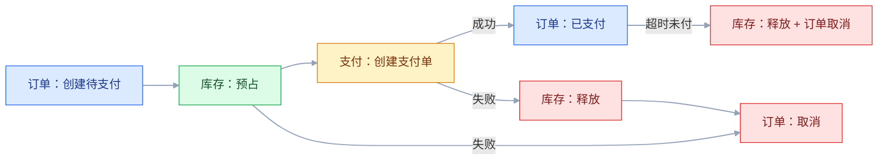
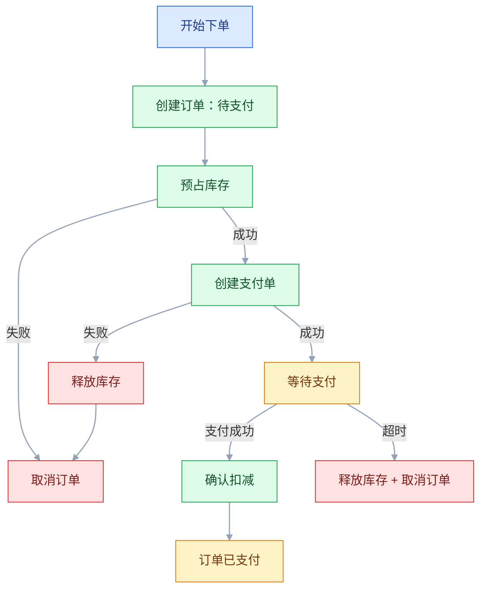

# 分布式事务与最终一致性

## 一、工程案例：下单跨三个服务，怎么保证不超卖、不重复扣款

**场景**：电商系统拆成订单、库存、支付三个服务。下单要同时：创建订单、预占库存、创建支付单。现在用同步 HTTP 串联，任何一步失败就“尽量回滚”，但没有补偿记录。大促时出现：订单创建成功、库存预占失败，用户付了钱没货；支付回调重复，用户被扣两次；库存服务超时，订单服务重试，库存扣了两次。财务每天对账差十几笔。

**目标**：不引入 2PC，先把事务边界、Saga、幂等、补偿、对账定清楚，交付：

- 一张事务边界与一致性矩阵；
- 一张 Saga 状态机；
- 一套幂等与去重规则；
- 一张补偿矩阵；
- 一套对账规则；
- 一份验收清单（8 项）。

**为什么必须做**：分布式事务不是“把本地事务放大”，而是“用业务补偿换可用性”。不理解补偿的语义，就会写出“回滚了但副作用还在”的系统。

**动手前确认**：先画三张图：调用链、数据归属、失败点。没有这三张，讨论“用 Seata 还是 TCC”没有意义。下面的数据是示例。

### 1.1 事务边界

| 步骤 | 服务 | 本地事务 | 失败后果 |
|---|---|---|---|
| 创建订单 | 订单 | 插订单、插 outbox | 无订单 |
| 预占库存 | 库存 | 扣可用、加预占、插 outbox | 少卖/超卖 |
| 创建支付单 | 支付 | 插支付单、插 outbox | 无法支付 |
| 支付回调 | 支付 | 更新支付单、插 outbox | 重复/漏单 |
| 确认扣减 | 库存 | 预占转实扣 | 库存不准 |
| 订单完成 | 订单 | 更新状态 | 状态不一致 |

每个服务只保证本地事务，跨服务用事件和补偿，不追求全局强一致。

### 1.2 一致性矩阵

| 业务 | 一致性要求 | 方案 |
|---|---|---|
| 订单创建与库存预占 | 最终一致，允许短暂“待确认” | Saga + 补偿 |
| 支付与订单状态 | 最终一致，回调幂等 | 本地消息 + 幂等 |
| 库存扣减 | 强一致（单库条件更新） | 本地事务 + 预占 |
| 财务对账 | 最终一致 | 日对账 + 差异补偿 |
| 用户看到订单 | 读己之写 | 支付后短时读主库 |

不是所有步骤都要强一致。订单可以先“待确认”，库存可以“预占”，支付可以“处理中”，最终一致即可。

### 1.3 Saga 状态机

Saga 有两种实现：

| 模式 | 特点 | 适合 |
|---|---|---|
| 编排（Orchestration） | 中心协调器驱动 | 流程复杂、需要可视化 |
| 协同（Choreography） | 服务订阅事件自行推进 | 流程简单、服务自治 |

编排容易排查，但协调器容易变成单点；协同耦合低，但流程分散、难追踪。

### 1.4 幂等

| 操作 | 幂等键 | 去重 |
|---|---|---|
| 创建订单 | 用户 + 外部请求号 | 订单表唯一索引 |
| 预占库存 | 订单号 + SKU | 预占表唯一索引 |
| 支付回调 | 渠道 + 渠道流水号 | 支付流水唯一索引 |
| 确认扣减 | 订单号 + SKU | 预占记录状态机 |
| 取消订单 | 订单号 | 状态机条件更新 |

幂等三层：入口唯一键、业务状态机、结果回放。只加唯一索引不防副作用。

### 1.5 补偿矩阵

| 正向操作 | 补偿操作 | 是否可逆 | 注意 |
|---|---|---|---|
| 创建订单 | 取消订单 | 可 | 已支付不能直接取消，要走退款 |
| 预占库存 | 释放预占 | 可 | 重复释放要幂等 |
| 创建支付单 | 关闭支付单 | 可 | 渠道可能已支付，要查单 |
| 扣减库存 | 回补库存 | 可 | 需记录原因 |
| 扣款 | 退款 | 部分可逆 | 手续费、时效 |
| 发货 | 拦截/召回 | 难 | 物流状态不可控 |

补偿不是“反向 SQL”，是“业务上可接受的逆向动作”。扣款能退，发货不一定能拦。

### 1.6 outbox 与本地消息表

outbox 解决“数据库提交了、消息没发出去”的双写问题。消费端用 inbox/去重表保证重复消费幂等。

### 1.7 对账

| 对账 | 比较 | 处理 |
|---|---|---|
| 订单 vs 库存 | 订单预占 vs 库存预占 | 差异释放/补占 |
| 支付 vs 订单 | 支付成功 vs 订单状态 | 补状态/退款 |
| 渠道 vs 支付 | 渠道账单 vs 支付流水 | 补单/冲正 |
| 库存 vs 实物 | WMS vs ERP | 盘点/调整 |

对账是最终一致的“验收器”。没有对账，最终一致就是“最终不一致”。

### 1.8 验收（8 项）

1. 下单失败：库存预占失败，订单自动取消，无脏数据。
2. 支付回调重复 100 次：只入账一次，订单状态正确。
3. 支付回调乱序：先成功后失败，最终状态正确。
4. 库存超时：订单重试不重复扣减，预占唯一。
5. 补偿失败：补偿进入重试/死信，人工可处理，不丢。
6. 对账：连续 7 天，订单/支付/库存差异为 0。
7. 故障：停掉库存服务 10 分钟，订单进入待确认，恢复后自动补偿。
8. 审计：每笔 Saga 有状态、步骤、补偿记录，可追溯。

## 二、高频问答：会卡住你的地方，也是面试最常问的

### 2.1 跨服务就用 2PC

**现场**

怎么判断：问一句——能接受协调者挂掉时资源一直被锁住吗？不能接受，就别用 2PC。

**要点**

- 2PC 是同步阻塞协议，准备阶段就锁资源，协调者一挂资源长期锁死。
- 协调者是单点，参与者越多，性能和可用性越差。
- 所以微服务高并发场景通常不用 2PC，只在少量参与者、短事务、强一致要求下考虑。

**追问**

- 阻塞具体阻塞在哪？→ 参与者在准备阶段锁住资源，一直等协调者的提交或回滚指令。
- 3PC 解决了吗？→ 降低了阻塞概率，但网络分区下仍不能保证一致。
- 不用 2PC 用什么？→ Saga、TCC、outbox，本质都是换最终一致加补偿。

### 2.2 TCC 是万能方案

**现场**

怎么判断：问业务能不能拆出 Try 阶段的资源预留。拆不出，就别硬上 TCC。

**要点**

- TCC 要写三个接口，还要处理空回滚、悬挂、幂等三个坑，业务侵入大。
- 有资源预留需求（库存、额度）时 TCC 合适，隔离性比 Saga 好。
- 简单场景用 Saga 或本地消息表更划算，别为了“标准”付三倍工作量。

**追问**

- 空回滚是什么？→ Try 没执行、Cancel 先到，Cancel 要能识别并直接返回成功。
- 悬挂是什么？→ Cancel 先到、Try 后到，Try 要检查是否已 Cancel，避免资源又被预留。
- TCC 和 Saga 的区别？→ TCC 有资源预留，Saga 没有，所以 TCC 隔离性更好但侵入更大。

### 2.3 Saga 就是回滚

**现场**

怎么判断：问扣款能不能退、发货能不能拦。不能，那就不是“回滚”，是补偿。

**要点**

- Saga 没有回滚，只有补偿；补偿是新的业务动作，不是数据库的逆向 SQL。
- 补偿可能失败、可能不可逆、可能产生新副作用（手续费、新状态）。
- 正向设计时就要想清楚补偿怎么做，发货这类不可逆的要提前设计拦截。

**追问**

- 补偿失败了怎么办？→ 重试 + 死信 + 人工 + 对账，不能假设它一定成功。
- Saga 有隔离性吗？→ 没有，靠语义锁（业务状态如“待确认”）或业务容忍。
- 什么场景不补偿而是向前恢复？→ 支付回调这类必须成功的，重试到成功为止。

### 2.4 事务消息保证精确一次

**现场**

怎么判断：看消费端有没有去重和重试。没有，就是没做完整。

**要点**

- 事务消息只保证本地事务与消息发送的原子性。
- 消费端仍可能重复、失败、乱序，这一段 MQ 不负责。
- 端到端精确一次 = 至少一次投递 + 幂等消费 + 事务性写入。

**追问**

- 事务消息怎么保证不丢？→ 本地事务和消息状态一起落库，Broker 回查未确认的消息。
- 重复从哪来？→ ack 丢失、消费者重启、超时重投。
- 只靠 MQ 能做到跨系统精确一次吗？→ 不能，跨系统必须靠幂等和对账。

### 2.5 本地消息表过时了

**现场**

怎么判断：问消息和业务是不是同一个本地事务、失败能不能重投。满足就是可用方案，别管新旧。

**要点**

- 本地消息表和 outbox 是同一类思路：业务表和消息表同事务写入，投递器负责发。
- 选型看团队和中间件，不看新旧；CDC 延迟低但对 schema 变更敏感，轮询简单但多一次扫表。
- 投递器要单实例或加锁，避免重复投递；重复投递仍可能，消费端要幂等。

**追问**

- outbox 用轮询还是 CDC？→ 轮询简单、有延迟；CDC 延迟低，但对 schema 和运维要求高。
- 投递器为什么要单实例？→ 多实例并发扫同一批消息会重复投递。
- 消息表会不会越写越大？→ 会，已发送的记录要定期归档清理。

### 2.6 补偿一定能成功

**现场**

怎么判断：看补偿失败有没有告警、死信、人工入口。没有，就是在假设补偿永不失灵。

**要点**

- 补偿会因业务规则、外部系统、时效而失败，它是普通请求，不是保底操作。
- 必须有重试、死信、人工处理、对账四件套。
- 不可逆的操作要在正向设计时就留好退路（退款、召回）。

**追问**

- 补偿一直失败怎么办？→ 进死信、告警，人工介入，同时靠对账发现差异。
- 补偿要不要幂等？→ 要，重复释放预占、重复退款都会出问题。
- 补偿有顺序要求吗？→ 有，一般按正向的逆序补偿，否则前置条件不成立。

### 2.7 最终一致就是不管

**现场**

怎么判断：问谁重试、谁补偿、谁对账。三个都有，才算最终一致。

**要点**

- 没有重试、补偿、对账，最终一致就是永远不一致。
- 收敛需要机制，不需要时间。
- 对账是最后一道验收，没有它连“有没有一致”都不知道。

**追问**

- 三个机制缺一个会怎样？→ 缺重试停在中间态，缺补偿留下脏数据，缺对账永远发现不了。
- 最终一致的效果怎么衡量？→ 看差异笔数和收敛时间，用对账数据说话。
- 消息积压算不算不一致？→ 算延迟不算错，但积压超时就会变成业务上的不一致。

### 2.8 幂等就是唯一索引

**现场**

怎么判断：问重复请求会不会重复扣款、发货、通知。会，就还没幂等。

**要点**

- 唯一索引只防重复插入，防不住重复的副作用。
- 幂等要三层：入口唯一键、业务状态机、结果回放。
- 跨系统幂等键要稳定，不用随机 ID 和时间戳。

**追问**

- 重复请求报错行不行？→ 不行，调用方会当成失败继续重试，应该返回首次结果。
- 去重表要保留多久？→ 大于最大重投窗口，之后定期清理。
- 状态机怎么防重复？→ 只允许合法迁移，重复到达时目标状态已成立就直接返回成功。

### 2.9 重试能解决超时

**现场**

怎么判断：看重试有没有上限、退避、熔断、幂等。缺一不可。

**要点**

- 超时不等于失败，对方可能已经处理完，只是响应丢了。
- 无脑重试会放大下游压力，下游本来就慢，重试直接把雪崩做实。
- 重试只针对可恢复错误，配指数退避、上限、熔断，并且请求必须幂等。

**追问**

- 哪些错误不该重试？→ 参数错误、业务拒绝这类，重试多少次都一样。
- 重试次数怎么定？→ 1～3 次，配退避和抖动，别让重试形成同步脉冲。
- 重试和补偿什么关系？→ 重试是同一个动作再来一次，补偿是换一个逆向动作。

### 2.10 对账是财务的事

**现场**

怎么判断：问每笔交易有没有渠道流水号、本地流水号、状态日志。缺一就对不上。

**要点**

- 没有业务流水、唯一键、状态日志，财务只能人工翻账。
- 对账要自动、每日、可分类、可补偿，结果可追溯、可重跑。
- 三方对齐（渠道、支付、订单）才能发现漏单、重复、金额错。

**追问**

- 对账发现差异之后谁处理？→ 确定性差异自动补偿，模糊差异进人工队列。
- 为什么是三方面不是两方？→ 渠道和本地对只能发现漏单，加上订单才能发现状态错。
- 对账能不能实时做？→ 资金类可以加实时监控，全量对账仍是批量，成本更低。

## 三、核心知识

### 3.1 本地事务与分布式事务

| | 本地事务 | 分布式事务 |
|---|---|---|
| 范围 | 单库 | 多服务/多库 |
| 保证 | ACID | 通常最终一致 |
| 实现 | 数据库 | 2PC/TCC/Saga/消息 |
| 代价 | 低 | 高 |

跨服务“强一致”通常意味着牺牲可用性和性能。大多数业务应选最终一致。

### 3.2 2PC/3PC

| 阶段 | 2PC | 3PC |
|---|---|---|
| 准备 | 协调者问所有参与者 | 增加 CanCommit |
| 提交 | 全部同意才提交 | 预提交 + 提交 |
| 问题 | 阻塞、协调者单点 | 仍不能完全解决分区 |

2PC 适合少量参与者、短事务、强一致要求；不适合高并发微服务。

> **面试**：常问「2PC 为什么在生产里很少用？」答：准备阶段就锁资源，协调者单点，挂掉后资源长期阻塞。

### 3.3 TCC

| 阶段 | 动作 | 注意 |
|---|---|---|
| Try | 预留资源 | 幂等、可空回滚 |
| Confirm | 确认使用 | 幂等 |
| Cancel | 释放预留 | 空回滚、悬挂 |

三个坑：

- 空回滚：Try 没执行，Cancel 先到；
- 悬挂：Cancel 先到，Try 后到；
- 幂等：Confirm/Cancel 重复调用。

> **面试**：常问「TCC 的空回滚和悬挂是什么？」答：Try 没执行 Cancel 先到要能空回滚，Cancel 先到 Try 后到要防悬挂。

### 3.4 Saga

Saga 把长事务拆成一系列本地事务，每个事务有补偿动作。

| 模式 | 优点 | 缺点 |
|---|---|---|
| 编排 | 流程集中、易追踪 | 协调器复杂、可能单点 |
| 协同 | 服务自治、耦合低 | 流程分散、难排查 |

Saga 不保证隔离性，需要语义锁或业务容忍。

### 3.5 本地消息表/outbox

流程：

1. 业务数据和消息记录同一本地事务；
2. 投递器轮询未发送消息；
3. 发送成功后标记；
4. 失败重试，超限进死信。

消费端用 inbox/去重表，保证重复消费不重复处理。

> **面试**：常问「本地消息表解决什么问题？」答：数据库提交了消息没发出去的双写，业务表和消息表同事务写入。

### 3.6 幂等

| 方式 | 适用 |
|---|---|
| 唯一键 | 创建类 |
| 状态机 | 状态迁移 |
| 去重表 | 消息消费 |
| 结果回放 | 查询/回调 |

幂等键要跨系统稳定，不用随机 ID、时间戳。

### 3.7 补偿

补偿设计要点：

- 补偿是业务动作，不是数据库回滚；
- 补偿要幂等、可重试、可人工；
- 补偿要有记录、原因、责任人；
- 不可逆操作要提前设计（如退款、召回）。

### 3.8 对账

| 层 | 内容 |
|---|---|
| 数据 | 数量、金额、状态 |
| 业务 | 订单、支付、库存 |
| 财务 | 渠道账单、总账 |

对账要自动、每日、可分类、可补偿。

### 3.9 方案选型

| 场景 | 推荐 |
|---|---|
| 单库多表 | 本地事务 |
| 跨服务、可补偿 | Saga |
| 跨服务、需预留 | TCC |
| 异步通知 | outbox + 幂等 |
| 强一致、短事务 | 2PC（慎用） |
| 财务对账 | 批量 + 对账 |

没有“最好的方案”，只有“业务能接受的代价”。

> **面试**：常问「跨服务事务怎么选型？」答：看能不能补偿、要不要预留资源，Saga/TCC/outbox 各有代价，2PC 慎用。

### 3.10 一致性设计清单

- 事务边界是否按服务划清；
- 每个跨服务步骤是否有补偿；
- 补偿是否幂等、可重试、可人工；
- 消息是否 outbox/inbox；
- 是否有对账；
- 是否有失败矩阵；
- 是否有演练。

## 四、冷门知识汇总

- **2PC 的阻塞**：参与者在准备阶段锁定资源，协调者挂掉后资源长期锁定。它是 2PC 在生产中少用的核心原因。
- **3PC 的局限**：增加预提交阶段，降低阻塞，但不能解决网络分区下的一致性。
- **Seata AT**：通过全局锁和 undo log 实现自动补偿，业务侵入小；但全局锁有性能开销，不适合高冲突场景。
- **TCC 空回滚**：Try 未执行、Cancel 先到，Cancel 要能识别并直接返回成功。
- **TCC 悬挂**：Cancel 先到，Try 后到；Try 要检查是否已 Cancel，避免资源被重新预留。
- **Saga 日志**：记录每个步骤的状态、请求、响应、补偿，用于恢复和排查。
- **语义锁（Semantic Lock）**：Saga 没有隔离性，用业务状态（如“待确认”）防止其他事务修改。
- **outbox 的投递语义**：至少一次；消费端必须幂等。
- **inbox 模式**：消费端记录已处理消息，防止重复消费。
- **“精确一次”是端到端承诺**：单个 MQ 的 exactly-once 只在其内部有效；跨系统靠“至少一次 + 幂等 + 对账”。
- **补偿事务（Compensating Transaction）**：不是回滚，是逆向业务动作；可能产生新费用、新状态。
- **对账的“三方”**：渠道、支付、订单；三方对齐才能发现漏单、重复、金额错。
- **TCC 与 Saga 的区别**：TCC 有资源预留，Saga 没有；TCC 隔离性更好，但侵入更大。
- **本地消息表的投递器**：要单实例/分布式锁，避免重复投递；但重复投递仍可能，消费端要幂等。
- **事务性发件箱与 CDC**：outbox 可以用轮询，也可以用 CDC 捕获；CDC 延迟低，但对 schema 变更敏感。
- **Saga 的“向前恢复”**：有些场景不补偿，而是重试直到成功（如支付回调），要区分“可补偿”和“必须成功”。