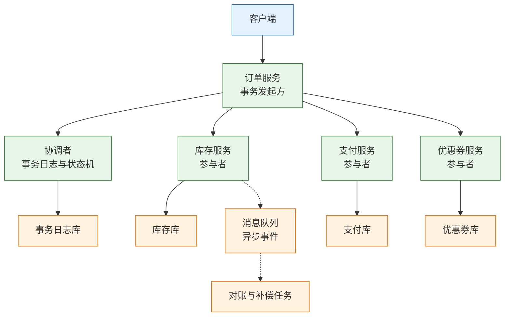
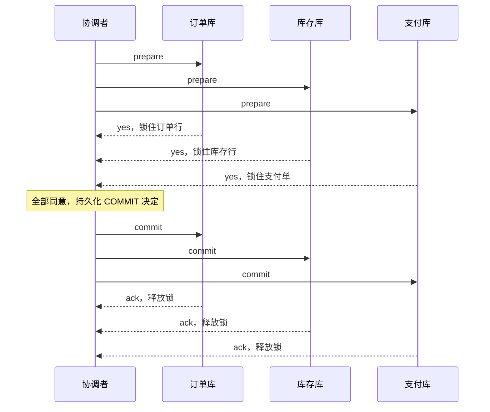
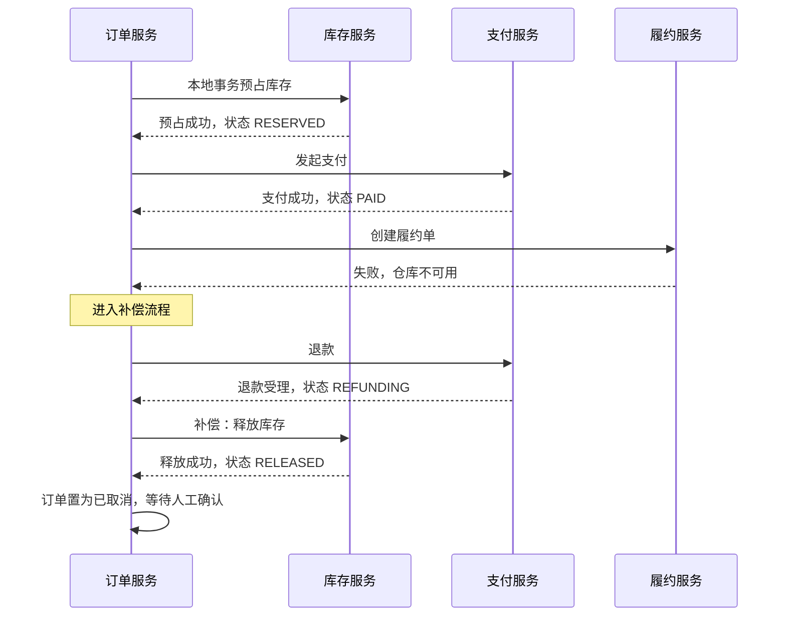
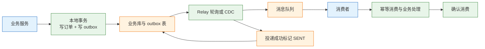

# 分布式事务与最终一致性

---

## 一、分布式事务是什么

### 1.1 核心概念

分布式事务是指一次业务操作跨越多个独立资源，并要求这些变更整体成功或整体回滚的事务。本地事务依靠单个数据库的日志、锁和恢复机制实现原子性、一致性、隔离性和持久性。应用只需声明事务边界，提交或回滚由数据库保证。

分布式事务把一次业务操作扩展到多个资源：多个数据库、多个服务、消息队列或外部支付渠道。参与者各自持有本地事务，没有一个全局日志能同时回滚所有资源，因此需要协调者、提交协议或业务补偿来保证整体结果。

| 维度 | 本地事务 | 分布式事务 |
|---|---|---|
| 资源范围 | 单个数据库连接 | 多个库、服务或外部系统 |
| 原子性来源 | 数据库日志与锁 | 提交协议或业务补偿 |
| 隔离性 | 数据库隔离级别 | 跨服务难以直接保证 |
| 失败处理 | 自动回滚 | 重试、补偿、对账 |
| 典型代价 | 低 | 延迟、复杂度、运维成本 |

“分布式事务”在工程上有两种含义。狭义指 XA 两阶段提交这类全局原子提交；广义指任何跨服务的状态一致性方案，包括 TCC、Saga、Outbox 和对账。讨论方案前必须先说明采用哪种含义，否则“支持分布式事务”只是一句无法验证的话。

> **注意**：跨库不等于必须使用分布式事务。同一数据库实例内的多表写入仍然是本地事务；只有资源管理器不同、无法共享同一个本地事务时，才需要引入全局协议或补偿。

### 1.2 与相邻技术的关系

分布式事务与本地事务、消息队列、幂等、对账、共识系统经常被混为一谈，它们处在不同层。

本地事务是基础，能放进一个库的操作不应拆成分布式事务。消息队列负责传输事件，不负责业务原子性；消息发出不代表下游成功，消费失败也不代表上游应回滚。幂等解决重复执行，对账发现最终差异，二者是最终一致的兜底，不是事务协议本身。

共识系统保证少量元数据强一致，可以作为协调者选主或事务日志的底座，但不直接承载业务事务。缓存不参与事务提交，不能作为资金或库存的权威状态。

| 技术 | 解决的问题 | 边界 |
|---|---|---|
| 本地事务 | 单资源原子提交 | 不能跨库 |
| XA / 2PC | 多资源原子提交 | 阻塞、协调者单点 |
| TCC | 资源预留与确认 | 业务侵入大 |
| Saga | 长流程补偿 | 无隔离性 |
| Outbox | 本地事务与消息一致 | 消费端仍可能重复 |
| 对账 | 发现并修复最终差异 | 事后，不是实时 |

> **注意**：引入消息队列不会自动获得分布式事务能力。生产者提交成功、消息发送失败，或消息发送成功、本地事务回滚，都会造成上下游不一致，必须用 Outbox 或事务消息补齐。

### 1.3 事务模型与架构组成

一个完整的分布式事务模型包含五类角色：发起方、协调者、参与者、资源管理器和恢复机制。发起方定义业务边界；协调者驱动提交或补偿；参与者执行本地事务；资源管理器管理数据库、消息或外部接口；恢复机制处理超时、悬挂和人工介入。



| 角色 | 职责 | 失败后的表现 |
|---|---|---|
| 发起方 | 定义业务边界与超时 | 重复发起、状态不明 |
| 协调者 | 记录全局状态、驱动提交 | 单点、悬挂事务 |
| 参与者 | 执行本地事务与预留 | 锁不释放、状态回退 |
| 资源管理器 | 持久化与恢复 | 提交结果不确定 |
| 恢复机制 | 超时回查、补偿、对账 | 差异长期不收敛 |

协调者可以是独立服务，也可以嵌入发起方。无论部署形态如何，协调者都是有状态组件：它必须在发送提交指令前把决定写入持久化日志，否则协调者崩溃后无人知道该提交还是回滚。

---

## 二、失败模型与事务边界

### 2.1 事务边界的划分

事务边界应按业务聚合划分，而不是按微服务数量划分。一个聚合内的多张表放在同一个本地事务；跨聚合的操作才考虑分布式方案。

划分步骤时先问三个问题：这一步是否必须与前后步骤同时成功；失败后能否用另一个业务动作抵消；对方系统是否支持回滚或查询。答案决定它属于原子步骤、可预留资源、可补偿步骤，还是只能对账的外部步骤。

| 步骤类型 | 例子 | 采用机制 |
|---|---|---|
| 必须原子 | 订单主表与明细 | 本地事务 |
| 可预留 | 库存、额度、优惠券 | TCC |
| 可补偿 | 创建履约单、加积分 | Saga |
| 外部不可控 | 银行扣款、物流揽收 | 回调、查单、对账 |

选择顺序是：能本地事务就不分布式；能预留就用 TCC；流程长且参与者多就用 Saga；只是写完库要通知下游就用 Outbox；对方是银行、支付或物流，就只能回调加主动查询加对账。

> **注意**：不要为了“统一架构”把同一个库的多表写入拆成多个服务。每拆一次，就多一次网络失败、一次重复执行和一套补偿逻辑。

### 2.2 部分失败与悬挂事务

分布式事务最难的状态不是成功或失败，而是“不知道”。参与者在 prepare 成功后崩溃，协调者在发出 commit 后崩溃，网络在 commit 途中断开，都会留下 in-doubt 事务：资源被锁定，最终结果未知。

| 故障点 | 当前状态 | 风险 | 处理 |
|---|---|---|---|
| prepare 前参与者崩溃 | 未预留 | 无副作用 | 协调者回滚 |
| prepare 后参与者崩溃 | 已预留、未提交 | 锁不释放 | 恢复后询问协调者 |
| 协调者发 commit 前崩溃 | 决定未持久化 | 参与者长期等待 | 恢复日志后重发 |
| commit 只到达部分参与者 | 部分提交 | 数据分叉 | 重试提交，禁止回滚 |
| 回滚指令迟到 | 分支已取消 | 空回滚、悬挂 | 事务控制表校验 |

悬挂指分支事务的请求延迟到达，在全局事务已经回滚之后才执行。空回滚指 Cancel 先于 Try 到达，参与者没有可释放的资源。两者都必须在参与者侧用事务控制表记录 `(全局事务 ID, 分支 ID)` 的状态，迟到请求先查状态再决定是否执行。

> **架构红线**：协调者必须先持久化全局决定，再向参与者发送 commit 或 rollback；参与者不得在超时后自行启发式提交，否则会留下悬挂事务。启发式提交还会让部分节点与全局决定相反，事后只能人工修复。

### 2.3 隔离性缺失

本地事务的隔离性由数据库锁和多版本控制保证。跨服务后，每个参与者只能保证自己的本地隔离，无法阻止其他事务看到中间状态。

| 异常 | 表现 | 控制手段 |
|---|---|---|
| 脏读 | 看到未确认的预占或支付中状态 | 状态机限制可见状态 |
| 丢失更新 | 两个流程同时改同一额度 | 版本号、乐观锁 |
| 写偏斜 | 两个校验各自通过、组合后越界 | 预留、语义锁 |
| 重复执行 | 同一分支被多次确认 | 幂等键、去重表 |

Saga 和 TCC 都不提供可串行化隔离。TCC 的 Try 通过冻结资源形成部分隔离；Saga 没有预留，只能靠语义锁限制状态迁移，例如 `CANCELLING` 状态禁止再次支付。语义锁不是数据库锁，必须由所有写入口遵守，绕过状态机的脚本会破坏隔离。

> **注意**：不要指望在服务层加一个“全局锁”解决隔离问题。全局锁会退化为单点，吞吐和可用性都比本地事务更差；正确方向是缩小事务边界、预留关键资源、用版本号检测冲突。

---

## 三、强一致事务方案

### 3.1 两阶段提交

两阶段提交（2PC）把提交拆成准备和提交两个阶段。协调者先询问所有参与者能否提交，全部同意后再发出提交指令；任一参与者反对或超时，协调者发出回滚。



状态变化可以分成四步：事务开始时各参与者写入 undo/redo 并加锁；prepare 成功后进入 prepared 状态，锁不释放；协调者把 commit 决定写入日志，这一刻是提交点；收到 commit 的参与者完成本地提交并释放锁。

| 阶段 | 协调者动作 | 参与者状态 | 锁状态 |
|---|---|---|---|
| 准备 | 发送 prepare | 可提交或拒绝 | 持有 |
| 决定 | 持久化 commit/rollback | 等待指令 | 持有 |
| 提交 | 发送 commit | 已提交 | 释放 |
| 回滚 | 发送 rollback | 已回滚 | 释放 |

2PC 的阻塞来自 prepared 状态：参与者在收到最终指令前不能释放锁，也不能单方面决定。协调者崩溃后，参与者只能等待恢复或人工裁决。协调者因此成为可用性单点，恢复日志和运维流程必须和协议一起设计。

> **注意**：prepare 成功不等于事务已提交。参与者不能因为等不到 commit 就自行提交，否则一旦协调者恢复并决定回滚，数据将无法一致。

### 3.2 三阶段提交

三阶段提交（3PC）在 prepare 与 commit 之间增加 pre-commit 阶段，并给每个阶段设置超时。参与者收到 pre-commit 后知道其他参与者大概率也能提交，从而减少协调者崩溃时的阻塞。

3PC 降低了部分阻塞，但没有解决网络分区下的一致性问题。分区可能把参与者分成两组，一组进入 pre-commit，另一组仍在 prepare；超时后两组可能做出不同决定。协议增加了往返次数和实现复杂度，工程上很少用于业务系统。

| 维度 | 2PC | 3PC |
|---|---|---|
| 阶段数 | 2 | 3 |
| 协调者崩溃 | 参与者可能阻塞 | 超时后可继续 |
| 网络分区 | 可能阻塞 | 仍可能分叉 |
| 额外延迟 | 两次往返 | 三次往返 |
| 工程使用 | 广泛 | 很少 |

> **注意**：3PC 不是“分区可用”的方案。它用超时减少阻塞，代价是分区时可能出现不一致；真正需要分区安全的强一致，应使用共识算法，而不是 3PC。

### 3.3 XA 的适用边界

XA 是资源管理器与事务管理器之间的标准接口，定义 `xa_start`、`xa_end`、`xa_prepare`、`xa_commit`、`xa_rollback` 等操作。数据库作为资源管理器加入全局事务，事务管理器负责协调。

XA 适合短事务、低并发、同构数据库、参与者少的场景，例如同一应用内的两个数据库写入。它不适合跨外部系统、长流程和高并发订单链路，原因有四个：

- prepare 后行锁一直持有，参与者越多、网络越慢，锁持有时间越长；
- 全局事务期间数据库连接被占用，连接池容易被长事务打满；
- 协调者故障会留下 in-doubt 事务，需要人工或恢复程序处理；
- 支付、消息队列、NoSQL 等外部系统通常不支持 XA，链路从一开始就不是真正的全局事务。

一个订单链路最初用 XA 写订单、扣库存、锁优惠券、创建支付单。大促压测时订单失败率从 0.1% 涨到 4%，数据库连接池被打满：prepare 之后库存行锁一直不释放，网络抖动时协调者等待参与者，事务悬挂几十秒；支付渠道不支持 XA，只能本地事务加回调。链路从一开始就不是真正的全局事务。

| 适用 | 不适用 |
|---|---|
| 同构关系型数据库 | 跨支付、物流等外部系统 |
| 短事务、低频操作 | 长流程、高并发下单 |
| 参与者数量少 | 数十个分支的大事务 |
| 可接受锁等待 | 要求低延迟的互联网业务 |

> **架构红线**：禁止在 XA 事务中调用 HTTP 或 RPC 外部服务。外部调用不受数据库锁保护，超时后无法回滚，只会把本地事务拖成长事务并占满连接池。

---

## 四、柔性事务方案

### 4.1 TCC 资源预留

TCC 把一次操作拆成 Try、Confirm、Cancel。Try 检查并预留资源，例如冻结一件库存或一百元额度；Confirm 确认使用预留资源；Cancel 释放预留。

TCC 比 XA 轻，因为 Try 之后不持有数据库行锁，而是用业务状态表示“已预留”。代价是业务侵入大，每个参与者都要实现三个接口，并处理空回滚、悬挂、重复和预留超时。

| 异常 | 触发场景 | 防护 |
|---|---|---|
| 空回滚 | Cancel 先到，Try 未到 | 控制表记录已取消，Try 到达时拒绝 |
| 悬挂 | Cancel 完成后迟到的 Try 到达 | Try 先查全局状态 |
| 重复确认 | Confirm 重试多次 | 按事务 ID 加分支 ID 幂等 |
| 预留超时 | Try 成功但流程卡住 | 预留设 TTL，超时自动 Cancel |
| Cancel 失败 | 网络或下游故障 | 重试、死信、告警、人工兜底 |

控制表是 TCC 幂等与防悬挂的核心：

| 字段 | 作用 | 写入时机 |
|---|---|---|
| 全局事务 ID | 关联主事务 | Try 前 |
| 分支 ID | 定位参与者分支 | Try 前 |
| 分支状态 | TRYING / CONFIRMED / CANCELLED | 每次迁移 |
| 版本号 | 防并发覆盖 | 每次迁移 |

Try 先插入或锁定记录，状态为 `TRYING`；Confirm 改为 `CONFIRMED`，Cancel 改为 `CANCELLED`。Cancel 命中不存在记录时，先插入一条 `CANCELLED` 再返回成功，这样迟到的 Try 会看到已取消，不会形成悬挂。

TCC 适合库存、账户额度、优惠券这类可以冻结的资源。不适合已经发出去的短信、已经创建的物流单，因为这些动作无法真正撤销，只能补发说明或走退货流程。

> **注意**：Confirm 和 Cancel 都必须幂等，且 Cancel 必须能处理“从未 Try 成功”的空回滚。缺少任一分支，重试就会制造负库存或重复退款。

### 4.2 Saga 与补偿

Saga 把长事务拆成一串本地事务，每一步成功就触发下一步；某一步失败，就按相反顺序执行补偿。它用补偿实现原子性，用事件或编排器推进流程。



Saga 有两种编排方式。编排由协调器按状态机调用各服务，流程集中、易追踪、易补偿，但协调器容易变成上帝服务。协同由各服务订阅事件自行决定下一步，去中心、松耦合，但流程分散、难以看清全局。订单、支付、履约这类步骤明确、补偿复杂的流程适合编排；通知、积分、报表等旁路适合协同。

| 方式 | 优点 | 缺点 | 适用 |
|---|---|---|---|
| 编排 | 流程集中、易追踪 | 协调器责任过重 | 订单、支付、履约 |
| 协同 | 去中心、松耦合 | 全局难观测 | 通知、积分、报表 |

Saga 的中间状态对外可见，必须用语义锁限制操作：订单处于 `CANCELLING` 时禁止再次支付，退款中禁止重复退款；查询接口应展示中间状态，而不是提前显示完成。语义锁和版本号只能降低冲突概率，最终仍需对账发现遗漏。

补偿不是数据库回滚，而是用另一个业务动作抵消影响：扣款对应退款，占库存对应释放库存，发短信无法撤回只能补发说明，创建物流单可能已揽收只能走退货。补偿必须幂等、可重试、可观测，失败后进入死信或人工工单。

> **架构红线**：补偿失败不得只记日志。没有被重试、告警和工单接管的补偿，会让“最终一致”永远停在中间状态。

### 4.3 本地消息表与事务消息

最常见的错误写法是先提交本地事务，再发送消息。进程在两步之间崩溃，订单已创建但消息永远丢失；反过来先发消息再提交，事务回滚后下游会看到不存在的订单。

本地消息表（Outbox）把业务写入和事件写入放在同一个本地事务：业务表和 `outbox` 表一起提交，再由独立的 relay 读取 outbox 投递到消息队列。



```sql
CREATE TABLE outbox (
  id BIGINT PRIMARY KEY AUTO_INCREMENT,
  aggregate_id VARCHAR(64) NOT NULL,
  event_type VARCHAR(64) NOT NULL,
  payload JSON NOT NULL,
  status VARCHAR(16) NOT NULL DEFAULT 'PENDING', -- PENDING / SENDING / SENT
  retry_count INT NOT NULL DEFAULT 0,
  next_retry_at DATETIME NOT NULL DEFAULT CURRENT_TIMESTAMP,
  created_at DATETIME NOT NULL DEFAULT CURRENT_TIMESTAMP,
  KEY idx_status_retry (status, next_retry_at)
);
```

relay 用 `SELECT ... FOR UPDATE SKIP LOCKED` 认领待投递记录，避免多实例重复处理。投递是至少一次，消费者必须按事件 ID 或业务键幂等。同一聚合的事件要按 `aggregate_id` 分区或排序，保证订单状态迁移有序。outbox 要定期归档，否则它自己会变成下一张大表。

relay 也会失败。认领后进程崩溃，记录会停在 `SENDING`，必须有超时回收，把超时记录改回 `PENDING` 重投。投递成功但标记失败会造成重复，消费端幂等不能省；标记成功但实际没投出去会造成丢失，所以标记只能在 broker 确认后执行。

事务消息解决同一类问题：生产者先发半消息，执行本地事务，再提交或回滚；broker 在长时间未收到决定时回查本地事务状态。它减少一张 outbox 表，但消费者仍然可能重复，跨系统仍然不是“恰好一次”。

| 维度 | Outbox | 事务消息 |
|---|---|---|
| 依赖 | 业务数据库 | 支持事务消息的中间件 |
| 延迟 | 轮询秒级，CDC 可更低 | 通常更低 |
| 实现 | 业务代码 + relay + 清理 | 半消息 + 回查接口 |
| 运维 | outbox 膨胀、relay 堆积 | 回查次数、主题治理 |
| 适用 | 已有数据库、不绑定 MQ | 已有 MQ、希望少一张表 |

> **注意**：Outbox 保证的是本地事务与消息发送最终一致，不保证消费者只处理一次。消费端幂等是方案的一部分，不是可选项。

### 4.4 方案对比与选择

| 方案 | 一致性 | 业务侵入 | 适用 |
|---|---|---|---|
| 本地事务 | 强 | 低 | 同一库或同一聚合 |
| XA / 2PC | 强，阻塞 | 低 | 短事务、同构库 |
| TCC | 较强，有预留 | 高 | 库存、额度、优惠券 |
| Saga | 最终一致 | 中 | 长流程、跨系统 |
| Outbox | 最终一致 | 低 | 写库后通知下游 |
| 对账 | 最终一致 | 低 | 外部渠道、兜底 |

吞吐上，本地事务与 Outbox 最高，TCC 次之，XA 受锁等待和两次往返限制最低。

选择顺序固定为五步：先判断能否放进一个本地事务；再看资源能否预留；然后看流程长度与参与者数量；接着看是否只是“写完库通知别人”；最后确认对方是否不可控。外部支付、银行、物流只能靠回调、主动查询和对账。

方案可以组合。订单链路常见组合是：订单与 outbox 同事务落库，库存用 TCC 预占，支付走外部渠道加回调查单，履约与积分通过事件驱动，日终统一对账。组合的关键是每一层都说明自己的承诺和失败出口，而不是叠加多个“最终一致”口号。

> **注意**：不要同时引入 TCC、Saga 和事务消息来“保险”。每套机制都有自己的状态表、重试和告警，叠加后故障路径成倍增加；选一套主机制，其余只做兜底。

---

## 五、最终一致的保障体系

### 5.1 幂等与去重

最终一致的每一步都可能被重复执行，幂等是所有补偿和重试的前提。实现方式包括业务唯一键、去重表、状态机和一次性令牌。

幂等键由客户端按业务意图生成，重试时复用；服务端以 `(业务类型, 幂等键)` 建唯一索引，记录请求摘要、处理状态和首次响应。重复请求返回首次结果，摘要不一致则拒绝并告警。

| 方式 | 实现 | 适用 | 局限 |
|---|---|---|---|
| 唯一键 | 订单号、流水号唯一索引 | 创建类操作 | 只能防重复插入 |
| 去重表 | 独立记录请求与响应 | 跨多表业务 | 多一次写与清理 |
| 状态机 | 只允许合法状态迁移 | 支付、订单 | 需覆盖全部状态 |
| 一次性令牌 | 令牌消费一次即失效 | 回调、验证 | 需存储与过期 |

去重记录要覆盖最大重试窗口、消息回溯窗口和对账周期。保留期太短，迟到请求会再次执行；太长，表会膨胀并拖慢索引。

> **注意**：幂等键必须由发起方生成并在重试中保持不变。服务端每次收到请求再生成新键，等于没有幂等。

### 5.2 重试、死信与人工兜底

重试只对可能成功的错误有意义。超时、连接重置、429、503 可以退避重试；参数错误、权限错误和业务规则拒绝不应重试。每次重试都要带原幂等键，并受最大次数、最大时长和重试预算约束。

超过重试上限的消息进入死信队列，由补偿任务或人工工单接管。死信必须有负责人、处理时限和升级路径；只把消息丢进死信队列而不消费，等于把故障藏起来。

| 失败类型 | 处理方式 | 时限 | 责任人 |
|---|---|---|---|
| 瞬时网络错误 | 退避重试 | 分钟级 | 自动恢复 |
| 下游持续不可用 | 熔断、降级、延后重试 | 小时级 | 值班 |
| 业务规则拒绝 | 转人工或取消 | 当日 | 业务 |
| 补偿失败 | 死信、工单、告警 | 24 小时内 | 履约或财务 |
| 对账差异 | 按类型自动修复或人工 | 日终后 24 小时 | 财务 |

> **架构红线**：资金类补偿失败必须进入人工工单并冻结相关订单，不能仅靠日志和告警。无人接管的补偿会让账务差异持续扩大。

> **架构红线**：扣款、扣库存、发券接口超时后不得直接判定失败并重试，必须先按幂等键或渠道流水号查询。把超时当失败是重复扣款和重复占用的主要来源，修复成本远高于一次查询。

### 5.3 对账体系

对账是最终一致的验收机制，不是架构失败的补丁。它按时间窗口比对两侧记录，发现漏单、重复、金额和状态差异，并驱动修复。

对账分三层：实时层在支付回调后主动查单，确认渠道状态；准实时层每五分钟比对本地支付单与渠道流水；日终层全量核对订单、支付、退款和结算。三层覆盖的窗口不同，不能互相替代。

| 差异类型 | 例子 | 处理 |
|---|---|---|
| 本地成功、渠道无 | 本地记成功，渠道查不到 | 冻结订单，查流水，人工确认 |
| 渠道成功、本地无 | 用户被扣款，订单未更新 | 自动补单，幂等入账 |
| 金额不一致 | 优惠或手续费口径不同 | 以渠道流水为准，生成工单 |
| 重复入账 | 同一流水记了两次 | 按流水号去重，回滚多记部分 |
| 状态不一致 | 本地已退款，渠道处理中 | 继续查询，超时转人工 |

对账的关键是口径和键。至少要对比笔数、金额、状态和时间窗口，并保存渠道原始流水。口径必须文档化：退款是否冲减当日交易、手续费是否计入、跨日交易归属哪一天。口径不一致，对账永远对不平。

---

## 六、完整案例：订单支付链路

### 6.1 链路与状态机

某零售系统日订单 50 万，峰值 200 TPS，支付回调重复率约 0.3%。链路包含创建订单、预占库存、发起支付、支付回调、创建履约单、加积分与发券。

| 步骤 | 机制 | 失败处理 |
|---|---|---|
| 创建订单 | 本地事务 + Outbox | 直接失败，返回用户 |
| 预占库存 | TCC Try，TTL 15 分钟 | 失败则订单取消 |
| 发起支付 | 调渠道，记录支付单 | 超时查单，不重复支付 |
| 支付回调 | 验签、幂等、状态机 | 重复回调返回成功 |
| 创建履约单 | 订阅支付成功事件 | 重试，超时告警 |
| 加积分发券 | 订阅事件，幂等消费 | 失败进死信 |
| 超时未支付 | 定时关单并释放库存 | 与回调竞争，状态机裁决 |

订单状态机是链路的核心：

```text
CREATED → STOCK_RESERVED → PAYING → PAID → FULFILLING → COMPLETED
   ↓            ↓             ↓        ↓
CANCELLED   CANCELLED      CLOSED   REFUNDING → REFUNDED
```

| 当前状态 | 允许迁移 | 触发条件 | 超时动作 |
|---|---|---|---|
| CREATED | STOCK_RESERVED、CANCELLED | 预占成功或失败 | 直接取消 |
| STOCK_RESERVED | PAYING、CANCELLED | 发起支付或用户取消 | 释放库存 |
| PAYING | PAID、CLOSED | 回调成功或超时 | 查单后关单 |
| PAID | FULFILLING、REFUNDING | 履约开始或退款 | 告警 |
| FULFILLING | COMPLETED、REFUNDING | 履约完成或失败 | 人工介入 |

每次迁移都带版本号，执行 `UPDATE ... WHERE status = ? AND version = ?`。影响行数为零说明状态已被其他流程修改，必须重新加载再判断，不能盲目覆盖。

### 6.2 时序推演

正常链路的每一步状态变化如下：

1. 订单服务在本地事务中写入订单，状态 `CREATED`，同时写 outbox 事件；
2. 调用库存 TCC 的 Try，冻结库存，库存状态 `RESERVED`；
3. 订单迁移为 `STOCK_RESERVED`，向支付渠道创建支付单，订单进入 `PAYING`；
4. 渠道返回支付成功，回调验签通过，支付单状态 `PAID`，订单迁移为 `PAID`；
5. outbox relay 投递 `OrderPaid`，履约服务创建履约单，订单进入 `FULFILLING`；
6. 履约完成，订单迁移为 `COMPLETED`；积分与发券消费者幂等处理事件。

| 时刻 | 订单状态 | 库存状态 | 支付状态 |
|---|---|---|---|
| t0 订单落库 | CREATED | 未占用 | 无 |
| t1 库存 Try 成功 | STOCK_RESERVED | RESERVED | 无 |
| t2 创建支付单 | PAYING | RESERVED | CREATED |
| t3 渠道回调成功 | PAID | RESERVED | PAID |
| t4 履约单创建 | FULFILLING | CONFIRMED | PAID |
| t5 履约完成 | COMPLETED | CONFIRMED | PAID |

库存的 Confirm 在支付成功后执行，把预占转为真实扣减；若履约失败进入退款，则订单转 `REFUNDING`，退款成功后库存按业务规则回补。每一步都要写清“谁触发、改哪个状态、失败谁负责”，否则故障时无法判断停点。

### 6.3 异常分支处理

支付回调与超时关单是最典型的竞争。用户在关单的同一秒完成支付，两个流程同时读取 `PAYING`，都可能尝试迁移状态。解决方式是用状态机加版本号做比较并交换，只有一个能成功；失败方重新加载状态，再决定查单、退款或忽略。

```sql
UPDATE orders
SET status = 'PAID', version = version + 1
WHERE order_no = ? AND status = 'PAYING' AND version = ?;
```

影响行数为 1 表示迁移成功，为 0 表示竞争失败。失败方不能重复执行同一条更新，而要重读订单状态，按当前状态决定返回成功、触发退款还是告警。

| 异常分支 | 竞争或原因 | 处理 |
|---|---|---|
| 回调重复 | 渠道重试通知 | 按支付单号幂等，返回成功 |
| 回调与关单并发 | 同一订单同时支付和关闭 | CAS 迁移，失败方查单 |
| 支付成功、订单未更新 | 回调丢失或事务失败 | 主动查单，补单入账 |
| 履约创建失败 | 仓库不可用 | 重试，超时退款 |
| 退款失败 | 渠道异常 | 重试、工单、冻结结算 |
| 积分重复发放 | 事件重复投递 | 按事件 ID 去重 |

超时关单不能只改本地状态。关单任务先向渠道查单：渠道已支付则补单并把订单推进到 `PAID`，渠道未支付才允许关闭并释放库存；查单本身失败时保持 `PAYING` 并延后重试，不能直接关闭。释放库存与退款都要带幂等键，避免与回调重复执行。

> **架构红线**：支付回调与超时关单必须由同一状态机裁决，禁止两个流程各自直接改订单状态。任何绕过状态机的补单脚本，都可能把已支付订单改成已关闭。

### 6.4 一致性指标

最终一致必须可量化。案例采用的验收指标是：日终差异率不高于 0.01%，最大收敛延迟不超过 5 分钟，自动修复率不低于 90%，未修复差异 24 小时内有人处理。

| 指标 | 定义 | 目标 | 异常动作 |
|---|---|---|---|
| 差异率 | 差异笔数除以总笔数 | 不高于 0.01% | 按类型生成工单 |
| 收敛延迟 | 支付成功到订单状态可见 | P99 不超过 5 分钟 | 查 relay 与消费堆积 |
| 自动修复率 | 自动修复差异除以总差异 | 不低于 90% | 补规则或转人工 |
| 未修复时长 | 差异产生到关闭 | 不超过 24 小时 | 升级负责人 |

指标要按渠道、支付方式、业务线拆分，否则总量达标会掩盖某个渠道的持续差异。对账报表要保留原始流水和修复记录，审计时能还原每一笔差异的处理过程。

---

## 七、适用边界与反模式

### 7.1 方案适用边界

| 方案 | 适用 | 不适用 |
|---|---|---|
| 本地事务 | 同库、同聚合 | 跨库、跨服务 |
| XA / 2PC | 短事务、同构库、低频 | 长流程、高并发、外部系统 |
| TCC | 可冻结、可释放的资源 | 已产生外部副作用的动作 |
| Saga | 长流程、多参与方 | 强隔离、实时性要求高 |
| Outbox | 写库后通知下游 | 需要同步返回结果 |

边界判断的核心是失败代价由谁承担。库存超卖导致履约违约，支付重复导致资金损失，积分延迟只影响体验；代价越高的环节越要靠前拦截，代价低的环节可以交给异步与对账。

### 7.2 反模式对照

| 反模式 | 表现 | 后果 | 纠正 |
|---|---|---|---|
| 事务提交后发消息 | 先 commit 再 send | 进程崩溃丢消息 | Outbox 或事务消息 |
| 先调下游再写本地 | 库存扣了订单没建 | 下游无法回滚 | 本地事务优先，下游补偿 |
| 回调不幂等 | 重复通知重复入账 | 重复退款、重复发货 | 支付单唯一键加状态机 |
| 补偿只记日志 | 失败后无人处理 | 差异永久存在 | 重试、死信、工单 |
| TCC 无控制表 | 空回滚、悬挂 | 负库存、重复释放 | 记录 Try/Cancel 状态 |
| Saga 无语义锁 | 中间状态被误操作 | 重复支付、重复取消 | 状态机限制迁移 |
| XA 跨外部调用 | 长事务等 HTTP | 连接池耗尽 | 缩短事务，改补偿 |
| 对账口径不一 | 退款、手续费归属不同 | 永远对不平 | 口径文档化，存原始流水 |
| 所有步骤强一致 | 长链路全程锁 | 吞吐低、故障面大 | 按步骤分级承诺 |
| 只做重试不做对账 | 认为重试必然成功 | 差异无人发现 | 对账加人工兜底 |

---

## 八、常见故障与排查

### 8.1 故障表

| 现象 | 最可能原因 | 核查点 | 处理 |
|---|---|---|---|
| 订单成功、库存没扣 | 消息在事务提交后发送 | outbox 是否有记录、relay 是否堆积 | 补投事件，幂等扣减 |
| 库存扣了、订单没建 | 先调下游再写本地 | 调用顺序、本地事务日志 | 释放库存或补建订单 |
| 重复退款 | 回调不幂等 | 支付单唯一键、状态迁移记录 | 按流水号去重，回滚多退 |
| 补偿完成不了 | 补偿失败只记日志 | 死信数量、工单状态 | 重试、告警、人工接管 |
| 空回滚或悬挂 | TCC 缺事务控制表 | Try/Cancel 到达顺序 | 记录状态，拒绝迟到请求 |
| Saga 中间状态被改 | 缺语义锁 | 状态机是否被绕过 | 限制迁移，加版本号 |
| XA 连接池耗尽 | 长事务、外部调用 | 事务时长、活跃连接 | 缩短事务，改 TCC/Saga |
| 对账长期不平 | 口径不一致、缺原始流水 | 对比维度、时间窗口 | 统一口径，补流水 |
| 状态机卡在 PAYING | 回调丢失或消费失败 | 渠道查单、消息堆积 | 主动查单，补单或关单 |
| 重复创建履约单 | 事件重复投递 | 消费幂等键、事件 ID | 唯一键去重，取消多余单据 |

### 8.2 排查顺序

1. **确认事务边界**：这一步属于本地事务、预留、补偿还是外部渠道，先确定它应有的承诺。
2. **定位停点**：按全局事务 ID、订单号、支付单号串起各服务日志，确认最后成功的一步。
3. **判断状态**：区分已提交、已回滚、in-doubt 和悬挂，未知状态优先查协调者日志与参与者控制表。
4. **查消息链路**：核对 outbox 状态、relay 投递、broker 堆积、消费位点和死信数量。
5. **查幂等与重复**：统计同一业务键的执行次数，确认是否有重复扣款、退款或发货。
6. **查对账差异**：按笔数、金额、状态、时间窗口定位差异类型，先冻结风险订单。
7. **止血与修复**：停止错误写入，重放可重试事件，补偿不可逆操作；不要在不了解状态时直接改库。
8. **复盘与加固**：补状态机、幂等、对账、告警和演练，确认同类差异的发现时间与修复时间。

> **注意**：排障时不要先清理 outbox 或死信。那些记录是判断“哪些消息没发出去”的唯一证据，先导出并核对位点，再决定重投范围。

> **核心结论**：能本地事务就不要分布式事务；XA 适合短事务，TCC 用预留换隔离，Saga 用补偿换吞吐但必须配语义锁；最终一致靠幂等、重试、对账和人工兜底共同兑现，缺一项都到不了“最终”。
