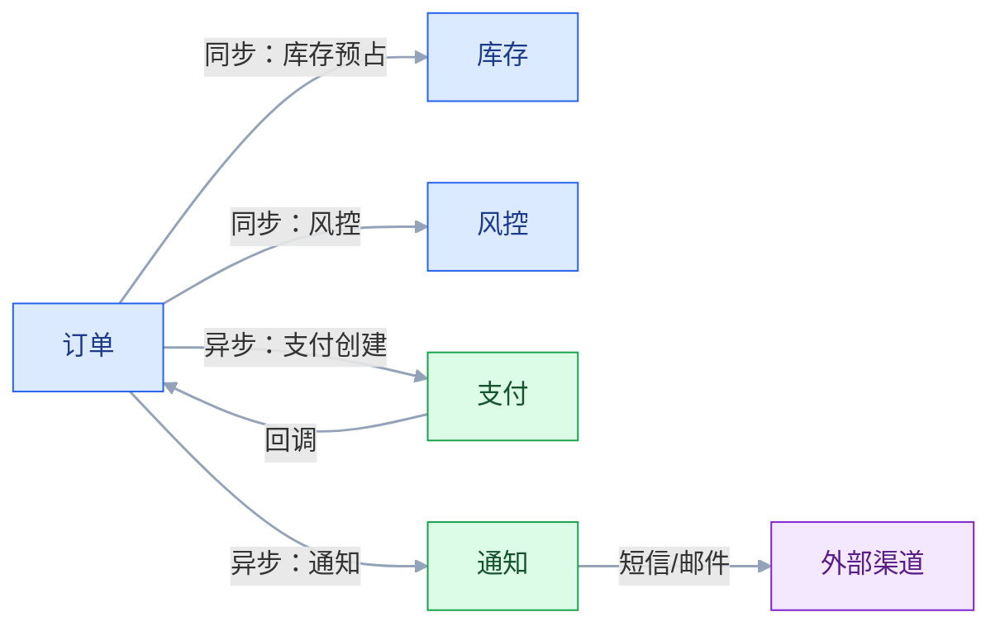

# 服务通信、消息与集成模式

## 一、工程案例：把“全部 HTTP 同步调用”改成能扛故障的通信矩阵

**场景**：一个交易平台，订单、支付、库存、通知、风控五个服务。现在所有调用都是同步 HTTP：下单要串行调库存、风控、支付创建、通知，任何一步慢，整个下单就慢；通知服务挂了，下单直接失败；支付回调重复，订单状态错乱；下游超时，上游重试三次，把下游打得更死。团队想统一换 gRPC，认为“gRPC 快，问题就解决了”。

**目标**：不盲目换协议，先按业务语义选通信方式，交付：

- 一张通信矩阵（同步/异步、协议、超时、重试）；
- 一套接口契约与版本规则；
- 一套超时、重试、熔断、舱壁策略；
- 一套消息可靠性设计（幂等、死信、积压）；
- 一张失败矩阵；
- 一份验收清单（8 项）。

**为什么必须做**：通信方式不是“技术选型”，是“业务语义 + 失败策略”的体现。把通知做成同步、把支付做成无幂等、把重试做成无限，换什么协议都会出事。

**动手前确认**：先画调用链和失败点，标出哪些调用“用户正在等”、哪些“可以晚点”。下面的数据是示例。



### 1.1 通信矩阵

| 调用 | 用户是否等待 | 一致性 | 方式 | 超时 | 重试 |
|---|---|---|---|---|---|
| 订单→库存预占 | 是 | 强一致（库存单库） | HTTP | 300 ms | 1 次，幂等 |
| 订单→风控 | 是 | 最终一致 | HTTP | 500 ms | 1 次，超时降级 |
| 订单→支付创建 | 否 | 最终一致 | 消息 | 不适用 | 消费重试 |
| 订单→通知 | 否 | 最终一致 | 消息 | 不适用 | 消费重试 |
| 支付→订单回调 | 否 | 最终一致 | 消息/HTTP | 1 s | 幂等重试 |
| 订单→BI | 否 | 最终一致 | 批量/CDC | 不适用 | 补跑 |

判断标准：用户在等、必须立刻给结果的，用同步；可以晚点、失败可补偿的，用异步。

### 1.2 协议选择

| 协议 | 适合 | 代价 |
|---|---|---|
| REST/JSON | 对外 API、简单查询 | 文本冗余、性能一般 |
| gRPC/Protobuf | 内部高频、强类型、流式 | 调试复杂、浏览器支持弱 |
| GraphQL | 前端按需聚合 | N+1、权限复杂 |
| WebSocket | 双向实时 | 连接管理、扩容 |
| SSE | 服务端单向推送 | 只支持文本、连接数 |
| 消息 | 异步、削峰、解耦 | 重复、乱序、积压 |

不要“全公司统一一个协议”。对外 REST、内部高频 gRPC、异步消息，是常见组合。

### 1.3 契约

```yaml
# 示例：库存预占请求
path: /inventory/reservations
method: POST
idempotencyKey: orderNo + sku
timeout: 300ms
retry: 1
request:
  orderNo: string
  sku: string
  quantity: int
response:
  reservationId: string
  status: RESERVED | REJECTED
errors:
  STOCK_NOT_ENOUGH: 409
  DUPLICATE: 200（返回原结果）
```

契约要写清：唯一键、超时、重试、错误码、幂等语义、版本。只写字段列表，不是契约。

### 1.4 超时与重试

| 策略 | 建议 |
|---|---|
| 超时 | 按 P99 设，不要无限 |
| 重试 | 只重试可恢复错误，指数退避 |
| 次数 | 1～3 次，禁止无限 |
| 幂等 | 重试前必须有幂等键 |
| 熔断 | 错误率超阈值，快速失败 |
| 舱壁 | 不同下游用不同线程池/连接池 |

超时不要“层层放大”：上游 3 秒、下游 5 秒，上游先超时，下游还在跑，资源浪费。

### 1.5 熔断与降级


降级不是“关功能”，是“给用户一个可接受的替代结果”：缓存旧值、默认值、排队稍后处理、提示稍后重试。

### 1.6 消息可靠性

| 环节 | 风险 | 措施 |
|---|---|---|
| 生产 | 发送失败、重复 | outbox、确认、幂等键 |
| Broker | 丢失、积压 | 持久化、副本、容量 |
| 消费 | 重复、失败、乱序 | 幂等、重试、死信、分区键 |
| 运维 | 积压、毒消息 | 监控、告警、死信处理 |

消息不是“发出去就完事”。要有生产确认、消费确认、死信、重放工具。

### 1.7 顺序

| 需求 | 方案 |
|---|---|
| 全局有序 | 单分区/单队列，吞吐受限 |
| 按业务键有序 | 按订单号/用户 ID 分区 |
| 无需有序 | 并发消费 |

大多数业务只需要“同一订单有序”，不需要全局有序。

### 1.8 可观测性

| 维度 | 内容 |
|---|---|
| 指标 | QPS、P99、错误率、重试、熔断、积压 |
| 日志 | 请求 ID、业务单号、下游、耗时、错误码 |
| 追踪 | Trace ID 贯穿生产/消费 |
| 告警 | 错误率、延迟、积压、死信 |

没有业务单号，Trace 只能看到技术调用，排查时对不上业务。

### 1.9 失败矩阵

| 失败 | 影响 | 处理 |
|---|---|---|
| 下游超时 | 上游等待 | 超时、重试、降级 |
| 下游 5xx | 请求失败 | 熔断、降级 |
| 消息重复 | 重复处理 | 幂等 |
| 消息乱序 | 状态错乱 | 状态机、分区键 |
| 消息积压 | 延迟 | 扩容、限流、降级 |
| 毒消息 | 消费卡住 | 死信、人工 |
| 契约变更 | 下游崩 | 版本、兼容期 |
| 连接池耗尽 | 全部超时 | 舱壁、限流 |

### 1.10 验收（8 项）

1. 下单链路：库存/风控超时，订单在 1 秒内返回明确结果，不无限等待。
2. 通知故障：通知服务停 30 分钟，下单不受影响，恢复后补发。
3. 重复回调：100 次重复，只处理一次，结果一致。
4. 重试：下游 50% 错误率，重试不放大到雪崩，熔断生效。
5. 积压：10 万条消息，30 分钟内消化，死信可处理。
6. 契约：新增字段不破坏旧消费者，删除字段有过渡期。
7. 可观测：任一笔失败请求 1 分钟内定位到下游和错误码。
8. 容量：通信矩阵中每个调用有超时、重试、限流配置。

## 二、高频问答：会卡住你的地方，也是面试最常问的

### 2.1 所有调用都用 REST

**现场**

怎么判断：对每个调用问三句——用户是否在等？是否高频？是否需要流式？按语义选，不按习惯选。

**要点**

- 协议选择看业务语义，不是团队习惯。
- 对外 API 用 REST，内部高频、强类型、流式用 gRPC，异步场景用消息而不是同步 REST。
- 全公司统一一个协议，往往是把异步做成了同步，故障传播链直接拉长。

**追问**

- 内部调用一定要 gRPC 吗？→ 不一定，低频简单调用 REST 更省事，gRPC 的优势在高频和强类型。
- 异步场景用 REST 会怎样？→ 上游要等下游，下游一慢就拖死上游，还得靠重试兜。
- GraphQL 适合替代 REST 吗？→ 适合前端按需聚合，不适合当内部服务间协议。

### 2.2 gRPC 一定比 REST 快

**现场**

怎么判断：压测对比，不要只看协议。瓶颈常在数据库和业务逻辑。

**要点**

- 性能取决于序列化、连接复用、网络和业务逻辑，协议只是其中一环。
- gRPC 的优势在 Protobuf 体积、HTTP/2 多路复用和强类型，简单低频调用体现不出来。
- 真正的瓶颈通常在数据库、锁和下游。

**追问**

- gRPC 什么时候优势明显？→ 内部高频调用、大 payload、流式场景。
- gRPC 的代价是什么？→ 调试复杂、浏览器支持弱、要维护 proto。
- 换成 gRPC 性能没提升，问题在哪？→ 瓶颈不在协议层，去看数据库和业务逻辑。

### 2.3 用了消息队列就可靠

**现场**

怎么判断：问生产确认了吗、消费手动 ack 吗、死信谁处理。

**要点**

- 生产、Broker、消费三个环节都可能丢消息，MQ 只提供机制，不提供保证。
- 持久化、副本、生产确认、消费手动 ack、重试、死信要配齐。
- 配齐之后语义仍是至少一次，重复要在消费端消化。

**追问**

- 生产端怎么确认？→ 同步确认或 outbox + 确认回调，别发完就不管。
- 消费端自动 ack 有什么风险？→ 消费失败也 ack，消息直接丢。
- 毒消息怎么处理？→ 重试超限进死信，否则会一直阻塞分区。

### 2.4 超时设置越长越安全

**现场**

怎么判断：看超时和 P99 的关系。超时是 P99 的好几倍，说明设置不合理。

**要点**

- 超时过长会占满线程和连接，一个慢下游能把整个上游拖死。
- 超时按 P99 加余量设，不是按最慢的一次设。
- 超时不要层层放大：上游 3 秒、下游 5 秒，上游先放弃，下游还在白跑。

**追问**

- 超时设太短会怎样？→ 正常慢请求被误杀，重试反而加重下游负担。
- 上下游超时怎么配？→ 上游必须大于下游，逐层留出余量。
- 超时之后请求还在跑吗？→ 可能在跑，所以要有幂等和取消传播。

### 2.5 重试能解决失败

**现场**

怎么判断：看是否只重试可恢复错误、有没有上限、退避、熔断。

**要点**

- 重试只对可恢复错误有意义，业务拒绝、参数错误重试多少次都一样。
- 无上限重试会把下游压力放大数倍，直接制造雪崩。
- 重试要配指数退避、抖动、上限和熔断，并且请求必须幂等。

**追问**

- 哪些错误可以重试？→ 超时、连接失败、5xx 这类瞬态错误。
- 为什么要加抖动？→ 避免所有客户端在同一时刻重试，形成脉冲。
- 熔断和重试什么关系？→ 熔断是重试的刹车，错误率超阈值就直接快速失败。

### 2.6 没有幂等也能重试

**现场**

怎么判断：看请求有没有唯一键、消费有没有去重表。

**要点**

- 创建、扣款、扣库存都有副作用，没有幂等键，重试就是重复执行。
- 唯一键要带业务维度，用业务单号而不是请求时间或随机 UUID。
- 消费端用去重表记录消息 ID 和处理结果，重复消息直接跳过。

**追问**

- 幂等键放 header 还是 body？→ header 更好，网关和中间件不用解析 body 就能取到。
- 重复请求返回什么？→ 首次结果，不是报错。
- 去重表会不会成为瓶颈？→ 会，要按消息 ID 分片并定期清理。

### 2.7 同步链越长越清晰

**现场**

怎么判断：看调用链深度和每层超时。超过 3 层就该重构。

**要点**

- 同步链会叠加延迟、放大故障，任何一层慢整个请求就慢。
- 链路上的强依赖越多，可降级空间越小。
- 能并行的并行，能异步的异步，把非核心步骤移出主链路。

**追问**

- 为什么超过 3 层就要重构？→ 每层都要留超时余量，叠加后尾延迟不可控。
- 并行化有什么代价？→ 线程和连接占用变多，要配舱壁隔离。
- 哪些步骤适合异步？→ 通知、积分、BI 这类用户不在等的。

### 2.8 服务网格能解决通信问题

**现场**

怎么判断：问幂等、死信、对账谁做。Mesh 不做这些。

**要点**

- Mesh 解决的是通信横切面：超时、重试、熔断、mTLS、观测。
- 它不解决业务幂等、契约语义、消息可靠性。
- 配置错了照样雪崩，而且故障点从代码挪到 sidecar，排查更难。

**追问**

- Mesh 的重试和代码里的重试会叠加吗？→ 会，两层都开就是双倍放大，要统一在一层。
- 上了 Mesh 还要熔断组件吗？→ 通常不用重复造，但要确认策略真的生效。
- Mesh 适合小团队吗？→ 收益在服务数量多、多语言时明显，几台机器上它是负担。

### 2.9 API 版本以后再说

**现场**

怎么判断：看接口有没有版本、兼容期、契约测试。

**要点**

- 没有版本和兼容策略，改一个字段就可能打崩下游。
- 越晚治理成本越高，因为下游数量只会变多。
- 兼容原则：加可选字段兼容，删字段要过渡期，改类型和语义发新版本。

**追问**

- 版本放 URL 还是 header？→ 都行，对外 URL 直观，对内 header 更干净，关键是团队统一。
- 怎么提前发现不兼容？→ 契约测试（Consumer-Driven Contract），上游改坏前就拦住。
- 老版本什么时候能下线？→ 看调用方清零，用网关埋点统计而不是靠问。

### 2.10 消息队列保证顺序

**现场**

怎么判断：先问需要全局有序还是按业务键有序。按业务键分区即可。

**要点**

- 只有单分区/单队列才有序，多分区并发消费不保证全局顺序。
- 大多数业务只需要同一订单/同一用户有序，按业务键分区就能满足。
- 分区键要稳定，分区数变化会让同键落点改变，要提前规划。

**追问**

- 加了分区数顺序就乱了吗？→ 同键的映射可能变，重放旧消息时顺序会错。
- 消费端多线程怎么保序？→ 按 key 哈希到固定线程，同键串行。
- 全局有序的代价是什么？→ 单分区，吞吐上不去，还有热点。

## 三、核心知识

### 3.1 同步与异步

| 维度 | 同步 | 异步 |
|---|---|---|
| 实时性 | 高 | 低到中 |
| 耦合 | 强 | 弱 |
| 故障传播 | 直接 | 缓冲 |
| 一致性 | 请求内 | 最终 |
| 复杂度 | 超时/重试/雪崩 | 重复/乱序/积压 |
| 适合 | 查询、强一致写 | 通知、削峰、状态变更 |

> **面试**：常问「什么时候该用同步、什么时候该用异步？」答：用户在等、要立刻给结果用同步；可以晚点、失败能补偿用异步。

### 3.2 协议对比

| 协议 | 数据格式 | 特点 |
|---|---|---|
| REST | JSON/XML | 简单、通用、可缓存 |
| gRPC | Protobuf | 强类型、HTTP/2、流式 |
| GraphQL | JSON | 按需查询、聚合 |
| WebSocket | 任意 | 双向、长连接 |
| SSE | 文本 | 单向推送、简单 |
| 消息 | 任意 | 异步、解耦、削峰 |

### 3.3 消息语义

| 语义 | 含义 | 实现 |
|---|---|---|
| 至多一次 | 可能丢，不重复 | 不重试 |
| 至少一次 | 不丢，可能重复 | 确认 + 重试 |
| 精确一次 | 不丢不重 | 事务 + 幂等（端到端） |

大多数系统用“至少一次 + 幂等消费”。

> **面试**：常问「精确一次真的存在吗？」答：协议层没有，端到端靠至少一次投递加幂等消费和事务性写入。

### 3.4 顺序与分区

| 需求 | 方案 |
|---|---|
| 全局有序 | 单分区，吞吐低 |
| 业务键有序 | 按订单/用户分区 |
| 无序 | 多分区并发 |

分区键要稳定，不能随机。

### 3.5 超时与重试

| 策略 | 说明 |
|---|---|
| 超时 | 按 P99 + 余量 |
| 重试 | 指数退避 + 抖动 |
| 上限 | 1～3 次 |
| 幂等 | 必须 |
| 熔断 | 错误率/慢调用比例 |
| 舱壁 | 隔离下游资源 |

### 3.6 熔断、降级、限流

| 机制 | 作用 |
|---|---|
| 熔断 | 下游故障时快速失败 |
| 降级 | 返回可接受替代结果 |
| 限流 | 保护自身和下游 |
| 舱壁 | 隔离故障域 |

四者要组合使用，不能只上一个。

> **面试**：常问「熔断、降级、限流、舱壁各管什么？」答：熔断快失败、降级给替代结果、限流保护自身、舱壁隔离故障域。

### 3.7 API 网关与 BFF

| 组件 | 作用 |
|---|---|
| API 网关 | 认证、限流、路由、日志 |
| BFF | 为前端聚合/裁剪接口 |
| Service Mesh | 服务间通信治理 |

网关不等于 BFF，BFF 不等于网关。职责混在一起，最后变成大泥球。

### 3.8 契约与版本

| 变更 | 兼容策略 |
|---|---|
| 新增可选字段 | 兼容 |
| 删除字段 | 过渡期，先停用 |
| 改类型 | 新版本 |
| 改语义 | 新版本 |
| 改错误码 | 文档 + 兼容 |

契约测试（Consumer-Driven Contract）能在上游改坏前发现不兼容。

> **面试**：常问「接口字段能直接删吗？」答：不能，要先停用再走过渡期，只有新增可选字段才兼容。

### 3.9 可观测性

| 维度 | 内容 |
|---|---|
| 指标 | QPS、P99、错误率、重试、熔断、积压 |
| 日志 | 请求 ID、业务单号、下游、耗时 |
| 追踪 | Trace ID、Span、依赖 |
| 告警 | 阈值、趋势、异常 |

### 3.10 集成模式

| 模式 | 用途 |
|---|---|
| 幂等消费者 | 重复消费 |
| 事务性发件箱 | 消息与业务同事务 |
| 死信通道 | 处理失败消息 |
| 竞争消费者 | 提高吞吐 |
| 声明检查 | 大消息外置 |
| 内容增强 | 补全数据 |
| 关联标识 | 链路追踪 |
| 背压 | 防止压垮下游 |

## 四、冷门知识汇总

- **HTTP/2 多路复用**：一个连接并发多个请求，减少连接数；gRPC 依赖它。
- **Protobuf 的兼容性**：新增字段用新编号，不要改旧编号；删除字段保留编号，避免复用。
- **REST 成熟度模型**：Richardson 的四个层级（POX、资源、HTTP 动词、HATEOAS）。大多数“REST API”只到第 2～3 层。
- **GraphQL N+1**：每个字段可能触发一次查询，需要 DataLoader 批量。不是“GraphQL 一定快”。
- **SSE 与 WebSocket**：SSE 单向、文本、自动重连；WebSocket 双向、二进制、需要自己管理心跳。
- **至少一次与精确一次**：精确一次通常是“至少一次 + 幂等”，不是协议保证。
- **毒消息**：反复消费失败的消息，必须进死信，否则阻塞队列。
- **背压（Backpressure）**：下游处理不过来时，上游要降速；没有背压，队列会无限增长。
- **熔断三态**：关闭、打开、半开；半开只放少量请求试探。
- **舱壁模式**：不同下游用不同线程池/连接池，避免一个慢下游拖垮全部。
- **API 网关与 BFF 的区别**：网关是横切入口，BFF 是前端专用聚合层。
- **服务网格**：Sidecar 代理处理流量、安全、观测；不处理业务逻辑。
- **关联标识（Correlation ID）**：跨服务传递同一个 ID，日志/追踪能串起来。
- **声明检查（Claim Check）**：大消息放对象存储，消息只带引用，避免 Broker 被大消息拖垮。
- **内容增强（Content Enricher）**：消费端补全缺失字段，注意补全失败和延迟。
- **竞争消费者**：多个消费者抢同一队列，提高吞吐，但不保证顺序。
- **“API 组合”与“CQRS”**：跨服务查询可以用 API 组合（实时聚合）或读模型（预聚合），按延迟和一致性选。