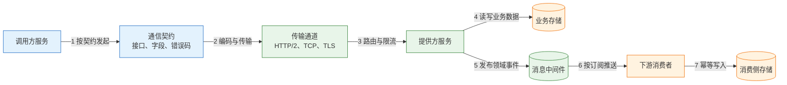
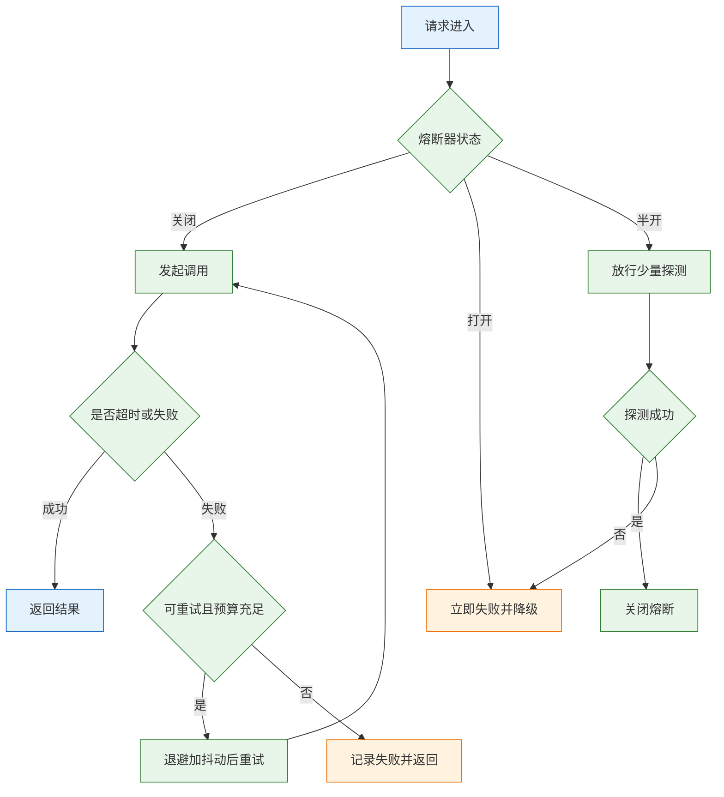
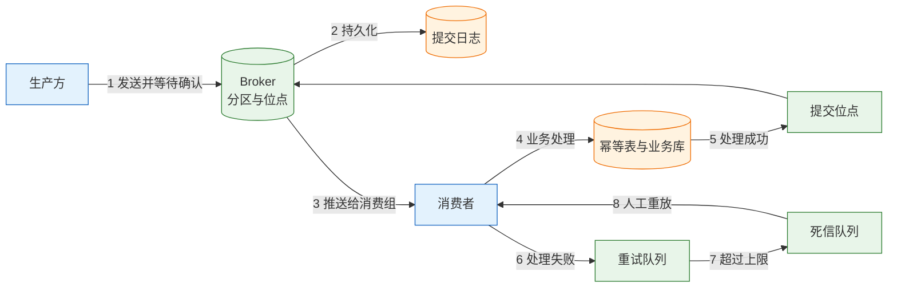
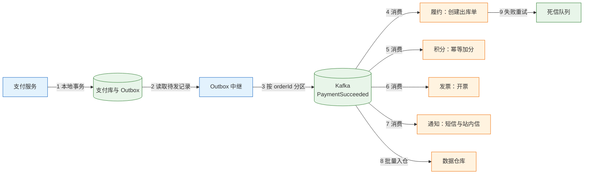

# 服务通信与消息

---

## 一、服务通信与消息是什么

服务通信（Service Communication）是两个进程为完成一次业务动作而交换数据的全过程。它包含寻址、编码、传输、排队、超时、确认与错误语义七个环节。框架可以封装其中大部分环节，但无法替使用方决定“这次调用失败之后业务应该怎样”。通信方式一旦确定，故障的传播路径、一致性的实现方式、值班时的排查入口也随之确定。

同步调用把“对方现在必须可用”写进契约，异步消息把“对方可以稍后处理”写进契约。两者的差别不在性能数字，而在失败时的行为：同步调用失败会立刻向上游扩散，异步消息失败会转化为积压、重复和延迟。

### 1.1 核心概念

描述一种通信方式，需要同时看三个耦合维度。

- **时间耦合**：调用方是否必须阻塞等待结果。同步调用在结果返回前一直占用线程、连接和超时预算；异步消息在 broker 确认接收后即可返回。
- **空间耦合**：调用方是否必须知道对方的地址与接口。直连调用依赖服务发现和接口契约；发布订阅只依赖主题名和事件格式。
- **语义耦合**：消息表达的是命令还是事件。命令要求某个接收方执行动作，事件只声明事实已经发生，允许任意多个下游各自处理。

三个维度组合出四种常见形态：同步请求-响应、异步命令、发布订阅事件、流式传输。它们不是互斥的，一个系统通常同时使用多种形态。

| 维度 | 同步请求-响应 | 异步消息 | 流式传输 |
|---|---|---|---|
| 时间耦合 | 强，等待结果 | 弱，投递即返回 | 中，连接长期保持 |
| 空间耦合 | 强，需地址与接口 | 弱，只需主题 | 强，需建立会话 |
| 失败传播 | 立即向上游扩散 | 转为积压与重试 | 连接断开后重连 |
| 一致性 | 可当场确认 | 最终一致 | 依窗口而定 |
| 典型载体 | HTTP、gRPC | Kafka、RabbitMQ | WebSocket、gRPC Stream |

通信契约不只包含字段定义，还包含超时、幂等键、错误码、重试语义和版本规则。只定义字段而不定义失败语义的契约，在联调阶段看不出问题，在故障阶段无法执行。

> **注意**：超时不等于失败。超时只说明调用方没有在预算内等到响应，被调方可能已经成功执行。把超时当作失败并直接重试，是重复扣款、重复发货的主要来源。

### 1.2 与相邻技术的关系

通信方式、传输协议、RPC 框架、消息中间件、服务网格是不同层次的概念，混用会让选型讨论失去焦点。

| 相邻技术 | 解决的问题 | 与通信的关系 |
|---|---|---|
| HTTP | 通用请求响应语义 | REST 的传输承载 |
| gRPC | 强类型 RPC 与流式传输 | 同步与流式调用的框架 |
| 消息中间件 | 存储转发、削峰、解耦 | 异步通信的基础设施 |
| 服务网格 | 连接管理、mTLS、流量策略 | 把通信治理下沉到代理层 |
| 事件驱动架构 | 用事件组织业务流程 | 异步消息之上的架构方法 |
| 分布式事务 | 跨服务的数据一致性 | 通信之上的协调与补偿 |

RPC 框架解决的是“怎样像调用本地方法一样调用远程方法”，它不改变远程调用会超时、会重复、会乱序的事实。服务网格解决的是连接级治理，它可以把重试、超时、熔断从业务代码里抽出来，但不能把同步调用变成异步解耦。消息中间件解决的是时间解耦，它不自动解决消费幂等和顺序问题。

同步不等于 HTTP，异步不等于消息队列。gRPC 的普通调用是同步请求，gRPC Stream 是流式传输；Kafka 也能通过回复主题实现请求-响应，只是为一个需要立即返回的调用引入两次排队，通常不值得。

### 1.3 模型与架构组成

一次完整的服务通信可以拆成五段：契约、通道、中介、提供方、消费方。同步链路经过前三段直达提供方，异步链路在中介处落地，再由消费方按自己的节奏取走。



- **契约层**：定义方法、字段、错误码、超时与幂等要求，是联调和契约测试的依据。
- **通道层**：负责连接建立、复用、加密与背压，连接池大小和 keepalive 参数直接影响尾延迟。
- **中介层**：同步链路里是网关与负载均衡，异步链路里是 broker，负责路由、缓冲和持久化。
- **提供方**：执行业务逻辑并写入自己的数据，同时决定是否发布事件。
- **消费方**：按自己的进度拉取或接收消息，负责幂等、重试和死信处理。

链路上每一段都有独立的失败模式。契约层出错表现为解析失败和字段缺失，通道层出错表现为连接超时和重置，中介层出错表现为积压和分区不可用，提供方出错表现为业务异常，消费方出错表现为重复和滞后。排查时必须先定位失败发生在哪一段，而不是笼统地看“接口超时”。

---

## 二、通信方式分类与选择依据

### 2.1 同步请求-响应

同步请求-响应是最直观的模型：调用方发送请求后阻塞，直到收到响应或超时。它适合必须当场知道结果的场景，例如扣减库存、校验支付密码、查询订单状态。优点是错误可以立即返回，用户能马上得到反馈；缺点是把可用性绑在一起，任何一段变慢都会占住调用方的线程。

线程占用可以用 Little 定律估算。一个接口每秒处理 200 次请求，平均耗时 200 毫秒，则同时在处理的请求约为 40 个。线程池按 40 配置没有余量，因为下游抖动时耗时上升，占用会同步上升。工程上按并发乘以 1.5 到 2 倍配置，并给线程池设置有界队列和拒绝策略。

同步链路的另一个约束是长度。每增加一跳，整体可用性就乘一次下游可用性。单跳 99.9% 时，六跳串联只剩约 99.4%，十跳只剩约 99.0%。这就是长调用链在大促时最先崩溃的原因：不是某一个服务特别差，而是串联把每个服务的小概率失败累加成了必然。

### 2.2 异步消息与事件

异步消息在调用方和提供方之间插入一个 broker。生产方把消息写入主题后即可返回，消费方按自己的速率拉取。broker 承担三件事：缓冲峰值、解耦地址、保留重放窗口。

异步模型适合三类场景：下游可以延迟完成，例如积分、开票、通知；下游有多个且互不依赖，例如支付成功后同时通知履约、财务、数据仓库；上游峰值远高于下游处理能力，需要削峰，例如秒杀写入。

异步的代价同样明确：消息可能重复、可能乱序、可能延迟，消费方必须自己实现幂等和顺序控制；链路上多了一个 broker，多了一套监控、容量和故障处理；业务从“调用成功即完成”变成“最终一致”，需要补偿和对账兜底。

### 2.3 混合通信

生产系统很少纯同步或纯异步。更常见的结构是主流程同步确认关键结果，旁路异步展开非关键动作。

下单场景中，创建订单、扣减库存、锁定优惠必须同步完成，否则无法向用户确认；发券、加积分、发短信、写数据仓库可以异步。支付场景中，支付受理同步返回，渠道回调异步到达，账务入账再异步触发通知。

一个典型的下单接口串联库存、优惠券、支付、履约、积分、短信六个下游，每个平均 50 ms，光下游就占 300 ms；短信供应商偶尔卡 3 秒，整条链路就被拖过超时线。把短信、积分、履约移出主链路后，接口耗时可以降到 80 ms 量级，但重复消费、事件乱序、积压和 Schema 不兼容会随之出现，分别对应后文的幂等、分区键、消费能力与契约演进。

| 场景 | 推荐方式 | 理由 | 失败处理 |
|---|---|---|---|
| 扣减库存 | 同步 | 需要当场判断是否成功 | 幂等键加重试 |
| 创建订单 | 同步 | 用户等待订单号 | 本地事务加唯一约束 |
| 发放积分 | 异步 | 可延迟，允许补偿 | 消费幂等加死信 |
| 发送通知 | 异步 | 供应商抖动大 | 重试加去重 |
| 数据入仓 | 异步批量 | 不要求实时 | 定时对账 |
| 支付回调 | 异步接收 | 渠道决定到达时间 | 状态机加对账 |

判断标准可以归结为两句话：这一步失败，用户能否等待；这一步失败，业务能否事后补齐。能等且能补的，不应该阻塞主流程；不能等或不能补的，必须同步确认并设计补偿。

---

## 三、同步调用链路模型

### 3.1 链路耗时构成

一次同步调用的端到端耗时由排队、计算、网络和序列化四部分组成。串行链路直接相加，并行链路取最大值。

```text
T_串行 = T_网关 + Σ(T_排队,i + T_计算,i + T_网络,i) + T_序列化
T_并行 = T_网关 + max(T_排队,i + T_计算,i + T_网络,i) + T_聚合
```

以下单链路为例：网关与序列化 50 ms，订单服务自身 100 ms，库存 200 ms，优惠券 150 ms，支付创建 400 ms，合计 900 ms，留 100 ms 余量刚好落在 1000 ms 预算内。如果三个查询互不依赖，改为并行后总耗时由 450 ms 降到约 210 ms，但瞬时并发从 1 变成 3，必须配合总超时和限流。

并行化不是无条件收益。并行调用中任何一个失败，都要定义整体失败还是降级继续；并行度越高，下游收到的瞬时压力越大，故障时的放大效应也越明显。

### 3.2 超时预算分配

超时必须有总预算，并且逐层递减。上游给 1000 ms，下游不能也设 1000 ms，否则上游已经放弃，下游还在占着线程和连接。

| 环节 | 预算 | 说明 |
|---|---:|---|
| 网关与序列化 | 50 ms | 固定开销 |
| 订单服务自身 | 100 ms | 校验、拼装 |
| 库存 RPC | 200 ms | 含一次重试 |
| 优惠券 RPC | 150 ms | 可降级 |
| 支付创建 | 400 ms | 外部渠道 |
| 余量 | 100 ms | 抖动与 GC |

超时分为连接超时和读取超时。连接超时覆盖建连与 TLS 握手，通常设为 100 到 500 ms；读取超时覆盖服务端处理，按 P99 加余量设置。gRPC 使用 deadline 而不是固定超时，deadline 随请求透传，下游剩余时间自动缩短。HTTP 客户端要分别设置 connect timeout、read timeout 和整体请求超时，只设一个总超时无法区分建连失败与服务端慢。

> **架构红线**：下游超时必须小于上游剩余预算，并随调用链透传。超时倒挂会让上游已经返回失败，下游仍在执行写操作，形成看不见的重复执行。

### 3.3 重试放大计算

重试是故障放大器。假设一次用户请求经过三层服务，每层在失败时重试两次，也就是每层最多发出三次尝试，最坏情况下底层收到 3×3×3=27 次请求。原本已经过载的下游，会在故障瞬间收到数十倍流量。

```text
单层最大尝试次数 = 1 + 重试次数
链路最大放大倍数 = Π(1 + 重试次数_i)
三层各重试两次 = 3 × 3 × 3 = 27
```

控制放大需要四条规则同时成立：

- 只在链路的一层重试，通常是最靠近用户的一层；
- 只重试幂等操作，非幂等写先查状态或携带幂等键；
- 使用指数退避加随机抖动，避免重试同步到达；
- 设置重试预算，重试流量不超过正常流量的 10%。

退避时间常用 full jitter 公式：`sleep = random(0, min(cap, base × 2^attempt))`。base 取 100 ms、cap 取 10 s 时，第三次重试的等待上限是 400 ms，实际等待在 0 到 400 ms 之间随机。随机化的作用是打散重试潮，避免所有实例在同一毫秒再次涌向下游。

熔断打开时不应重试。熔断已经判断下游不可用，继续重试只会延长故障。重试预算耗尽时也不应重试，直接把失败返回给上游，让上游决定降级。

> **架构红线**：重试只能在一层发生，并且必须带退避、随机抖动和预算上限。多层同时重试会把故障流量放大到数十倍，把局部超时演变成全局雪崩。

### 3.4 熔断与隔离参数

熔断器有三个状态：关闭时正常放行，打开时直接失败，半开时放少量探测请求。它保护的是调用方，避免下游已经不可用时继续耗尽线程和连接。

| 参数 | 典型值 | 作用 |
|---|---:|---|
| 统计窗口 | 10 s | 计算失败率的窗口 |
| 最小请求数 | 20 | 样本不足不触发 |
| 失败率阈值 | 50% | 超过则打开 |
| 打开时长 | 30 s | 期间直接失败 |
| 半开探测数 | 3 | 成功则关闭 |
| 舱壁线程数 | 并发 × 1.5 | 隔离下游 |

舱壁（Bulkhead）按依赖划分线程池或连接池。短信服务慢时，只应占满短信池，不能占满订单主流程的池。线程池大小按 `QPS × P99 耗时 × 余量系数` 估算，200 QPS、200 ms、1.5 倍余量对应 60 个线程。连接池还要受数据库最大连接数约束，应用实例数乘以单实例连接数不能超过数据库上限。

限流按接口、租户、用户三个维度设置。过载时尽早返回 429 或 503，比让所有请求一起超时更好，因为快速失败至少保留了部分容量。



---

## 四、异步消息投递模型

### 4.1 投递语义与确认

消息系统提供三种投递语义，工程上真正可落地的是“至少一次加消费幂等”。

| 语义 | 实现方式 | 风险 | 适用 |
|---|---|---|---|
| 至多一次 | 发后不管，不重试 | 可能丢失 | 可丢的监控埋点 |
| 至少一次 | 生产重试，消费成功后确认 | 可能重复 | 绝大多数业务 |
| 恰好一次 | 事务、去重、幂等组合 | 端到端难以严格成立 | 特定内部链路 |

确认时机决定消息会不会丢。自动确认在消息到达消费者时就标记完成，进程随后崩溃，消息不会重投；手动确认在处理成功后提交，崩溃会触发重投，代价是可能重复。正确顺序是业务处理成功、幂等记录落库、再确认消息。把确认放在异步线程里同样危险，主线程已经确认，异步线程失败后没有重试入口。

生产端的可靠性靠本地事务加 Outbox 保证。业务数据与待发消息写在同一个本地事务里，再由独立的中继进程读取 Outbox 并投递。这样避免“数据库写成功、消息发送失败”的不一致，也避免“消息先发、事务后回滚”的脏事件。

### 4.2 分区与顺序

多数消息系统只保证分区内有序，不保证主题全局有序。Kafka 按 partition 有序，相同 key 的消息进入同一分区；RabbitMQ 单队列有序，多消费者并发消费会打乱；RocketMQ 提供顺序消息，但吞吐会下降。

| 系统 | 顺序范围 | 关键条件 |
|---|---|---|
| Kafka | 分区内 | 相同 key 进同一分区 |
| RabbitMQ | 单队列 | 单消费者或串行处理 |
| RocketMQ | 队列内 | 顺序发送与顺序消费 |
| Pulsar | 分区内 | 按 key 路由 |

业务通常只需要“同一订单”或“同一账户”的事件有序，把订单号或账户号作为分区键即可，不必追求全局有序。全局有序意味着单分区，吞吐会被锁死在单节点。

即使分区内有序，消费者仍可能因为重试和并发处理看到旧事件。可以在事件里带聚合版本号，消费时比较 `event.version` 与当前版本，旧版本直接忽略。版本号比时间戳可靠，因为跨机器时钟无法保证单调。

### 4.3 消费进度与积压

消费进度用位点（offset）表示，滞后量等于最新位点减去已提交位点。滞后条数不能直接反映恢复时间，必须结合生产和消费速率换算成滞后时间。

```text
滞后时间 = 积压条数 / (消费速率 - 生产速率)
```

积压 20 万条，消费速率 2000 条每秒，生产速率 1500 条每秒，净消化能力 500 条每秒，追平需要 400 秒。如果消费速率降到 1500 条每秒，与生产速率相等，积压永远追不平；此时增加消费者只有在分区数足够时才有效。

消费者数量不能超过分区数。六个分区最多并行六个消费者，第七个只能空闲。要提升消费能力，先扩分区，再扩消费者，同时检查单条处理耗时是否被数据库或外部接口拖住。



---

## 五、消息契约与演进

### 5.1 命令与事件

消息先按语义分为命令和事件，命名和消费模型都不同。

| 类型 | 语义 | 命名 | 消费者数量 |
|---|---|---|---|
| 命令 | 请执行某个动作 | 祈使句，如 ReserveStock | 通常一个 |
| 事件 | 某个事实已发生 | 过去式，如 OrderPaid | 可多个 |

把命令命名为事件，会让多个下游误以为可以各自执行同一动作，造成重复扣减。把事件命名为命令，会让下游以为必须执行，失去广播语义。命名不是风格问题，它决定了消费方能否安全地增加订阅者。

### 5.2 事件信封

事件信封是消息的公共头部，业务负载放在 payload 中。信封字段要足够支撑去重、分区、追踪和版本演进。

```json
{
  "eventId": "01J8Z3K4Q9",
  "eventType": "OrderPaid",
  "eventVersion": 2,
  "occurredAt": "2026-10-28T10:15:30Z",
  "producer": "payment-service",
  "aggregateId": "ORD-20261028-001",
  "traceId": "4bf92f3577b34da6",
  "payload": {}
}
```

| 字段 | 用途 | 约束 |
|---|---|---|
| eventId | 消费去重 | 全局唯一，不可复用 |
| eventType | 路由与订阅 | 稳定，不复用旧名 |
| eventVersion | 结构演进 | 单调递增 |
| aggregateId | 分区与顺序 | 同一聚合根稳定 |
| traceId | 跨链路追踪 | 生产端生成并透传 |

事件里不要放完整对象图、大文件和敏感信息。手机号、身份证、完整地址应传 ID，由有权限的下游回查，或在生产端脱敏。事件会被多个下游长期保留，一次泄露的影响面远大于一次接口返回。

### 5.3 Schema 兼容规则

Schema 演进的目标是：新旧生产者和消费者可以同时在线，不需要停机发布。

| 变更 | 兼容性 | 做法 |
|---|---|---|
| 增加可选字段 | 向后兼容 | 消费者忽略未知字段 |
| 删除字段 | 不兼容 | 先停止使用，再删除 |
| 修改字段含义 | 不兼容 | 新增字段并双写过渡 |
| 修改字段类型 | 不兼容 | 新增字段并迁移 |
| 枚举增加取值 | 通常兼容 | 消费端有默认分支 |

Protobuf 的字段编号一旦使用就不能复用，删除字段要保留编号并标记 reserved。Avro 读取时依赖写入方 schema，新增字段必须提供默认值。JSON 没有强 schema，兼容性完全靠消费端约定，因此更需要契约测试。

破坏性变更要发布新事件类型或新版本，双写一段时间，等所有消费者迁移完成再下线旧版本。直接改字段含义是最危险的做法，消费者不会报错，只会按旧语义继续计算。

> **注意**：消费者必须忽略未知字段，不能因为多一个字段就解析失败。反过来，生产者也必须假定消费者可能滞后多个版本，不能要求所有下游同时升级。

---

## 六、消息容量与参数计算

### 6.1 分区数与消费者

分区数决定消费并行度的上限，也决定 broker 的元数据和管理开销。分区太少无法扩展，太多则增加选举、重平衡和文件句柄压力。

```text
所需分区数 = ceil(目标吞吐 × 余量系数 / 单分区吞吐)
最大有效消费者数 = 分区数
```

目标吞吐 3000 条每秒，单分区稳定处理 500 条每秒，余量系数 1.5，则分区数为 `ceil(3000 × 1.5 / 500) = 9`。消费组最多九个实例有效，第十个实例只会空闲。若单条消息处理需要 20 ms，单消费者理论吞吐为 50 条每秒，九个消费者合计 450 条每秒，远低于目标，瓶颈在消费逻辑而不是分区数。

分区键要保证热点分散。按订单号分区通常均匀，按商户号分区可能因为大商户而倾斜。分区倾斜时，个别分区先积压，增加消费者也无法分担，只能拆热点或给大 key 单独建主题。

### 6.2 存储与保留期

消息保留占用的存储由写入速率、消息大小、保留时长和副本数共同决定。

```text
存储占用 = 写入速率 × 单条大小 × 保留秒数 × 副本数
```

写入 3000 条每秒、单条 1 KB、保留 24 小时、三副本：

```text
3000 × 1024 B × 86400 s = 265,420,800,000 B ≈ 265.4 GB
265.4 GB × 3 = 796.2 GB
```

接近 800 GB 的磁盘占用只为一天的消息保留。保留七天则约 5.6 TB，还没算索引、压缩元数据和副本迁移的临时空间。消息队列不是数据库，保留期按重放需求设置，需要长期留存的数据应落对象存储或数据仓库。

压缩能显著降低存储和网络，但会消耗 CPU，并改变“单条大小”的口径。按压缩后大小估算存储、按压缩前大小估算消费解压开销，两者不能混用。

### 6.3 消费能力与批量

单消费者吞吐由批量大小、处理耗时和提交开销决定。

```text
单消费者吞吐 = 批量条数 / (处理耗时 + 提交开销)
消费组吞吐 = 单消费者吞吐 × 有效消费者数
```

批量 500 条、处理 50 ms、提交 10 ms，单消费者吞吐为 `500 / 0.06 ≈ 8333` 条每秒。批量提高到 1000 条，处理时间升到 90 ms，吞吐变为约 10000 条每秒，但单批失败的重试成本也翻倍，内存占用同步上升。

| 参数 | 示例值 | 影响 |
|---|---:|---|
| 目标吞吐 | 3000 条/s | 容量目标 |
| 单条大小 | 1 KB | 存储与带宽 |
| 保留期 | 24 h | 磁盘占用 |
| 副本数 | 3 | 可靠性与成本 |
| 分区数 | 9 | 消费并行度 |
| 批量大小 | 500 | 吞吐与重试成本 |

批量不是越大越好。批量过大会拉长单次处理时间，增加重复消费的范围，也会让内存和事务持有时间上升。批量大小应通过压测确定，并以“单批处理时间不超过消费超时的一半”为约束。

---

## 七、支付通知链路的完整改造

### 7.1 改造前链路

支付回调到达后，支付服务在同一个请求里依次完成五件事。下表是一组示例耗时，用于说明串联放大的过程。

| 步骤 | 平均耗时 | 故障影响 |
|---|---:|---|
| 创建履约单 | 150 ms | 仓库系统慢，回调超时 |
| 增加积分 | 80 ms | 积分库锁等待 |
| 开具发票 | 120 ms | 发票服务维护 |
| 发送短信 | 300 ms | 供应商抖动 |
| 写入数据仓库 | 200 ms | 分析库慢查询 |

五步合计 850 ms，P99 达到 1.2 s。支付平台回调超时为 5 s，一旦超时就重复回调，积分和发票随之重复。链路的问题不是平均耗时，而是最慢的短信供应商把整条回调拖进了超时区。

### 7.2 Outbox 与事件分发

改造把支付服务收缩到只做一件事：在本地事务中写支付单和 Outbox 记录。中继进程读取 Outbox，把 `PaymentSucceeded` 事件投递到 Kafka，各下游独立消费。



关键设计点如下：

- 支付服务只写本地库和 Outbox，回调在 30 ms 内返回，不再等待任何下游；
- 事件按 `orderId` 分区，同一订单的支付、退款、取消事件保持分区内有序；
- 积分和发票用 `eventId` 唯一索引去重，重复消费返回上次结果；
- 短信按 `eventId` 去重，允许延迟但不允许重复发送；
- 数据仓库走批量消费，不要求实时；
- 每个消费者配置重试上限和死信队列，死信可人工重放；
- 消费滞后超过 5 分钟或 1 万条触发告警。

### 7.3 结果与代价

改造后回调 P99 降到 60 ms，短信供应商故障不再影响支付受理。积分、发票、履约出现秒级延迟，业务上用“支付成功页展示处理中”覆盖这段窗口。

| 指标 | 改造前 | 改造后 |
|---|---:|---:|
| 回调 P99 | 1.2 s | 60 ms |
| 下游故障影响支付 | 是 | 否 |
| 重复处理风险 | 高 | 由幂等控制 |
| 一致性 | 同步完成 | 最终一致 |
| 运维组件 | 无 | Outbox、Kafka、死信 |

代价是新增了一套 Outbox 中继、消息集群、死信处理和对账任务。没有对账的最终一致只是“可能不一致”，因此改造必须同时上线按订单号核对支付、积分、发票状态的日对账，以及差异告警。

---

## 八、通信架构的边界条件

### 8.1 不适合异步的场景

异步不是默认更优。以下场景应保持同步：用户必须当场知道结果，例如余额校验、库存锁定；失败无法事后补偿，例如一次性券核销；业务量很小，引入 broker 的运维成本高于收益；团队没有消息运维和排障能力。

| 场景 | 选择 | 原因 |
|---|---|---|
| 余额支付校验 | 同步 | 不能先扣后补 |
| 优惠券核销 | 同步 | 重复核销无法逆转 |
| 积分发放 | 异步 | 可补偿、可去重 |
| 操作审计 | 异步 | 允许延迟 |
| 小规模内部系统 | 同步 | 运维成本更低 |

### 8.2 同步链路的长度上限

串联链路的可用性是各跳可用性的乘积。

```text
链路可用性 = Π 单跳可用性
```

单跳 99.9% 时，三跳为 99.70%，六跳为 99.40%，十跳为 99.00%。如果业务要求 99.9%，六跳串联已经无法满足，必须减少跳数、把非关键跳改为异步，或对失败跳做降级返回。

| 串联跳数 | 链路可用性 | 年停机时间约 |
|---:|---:|---:|
| 1 | 99.90% | 8.8 小时 |
| 3 | 99.70% | 26 小时 |
| 6 | 99.40% | 53 小时 |
| 10 | 99.00% | 88 小时 |

这张表解释了一个常见现象：每个服务都宣称 99.9%，整体却只有 99%。同步链路越长，越需要把“非核心步骤”移出主路径。

### 8.3 运维与组织边界

异步通信把技术复杂度转移成了运维复杂度。没有消息轨迹、死信处理、重放工具和消费滞后监控，异步链路出问题时无法定位。

| 能力 | 要求 | 缺失后果 |
|---|---|---|
| 消息轨迹 | 可按 eventId 查生产与消费 | 无法定位丢失环节 |
| 消费滞后监控 | 按主题与消费组告警 | 积压发现滞后 |
| 死信处理 | 可查看、修复、重放 | 毒消息永久阻塞 |
| 契约测试 | 发布前验证兼容性 | 下游批量解析失败 |
| 对账任务 | 按业务键核对状态 | 最终不一致无法发现 |

组织上还要明确主题的 owner、消费组的 owner 和死信的处理人。没有 owner 的主题会在人员变动后变成无人维护的黑盒，谁也不敢删，谁也不知道里面有什么。

---

## 九、常见故障与排查

### 9.1 故障对照表

| 现象 | 最可能原因 | 处理 |
|---|---|---|
| 一个下游慢导致全链路超时 | 同步串联，缺少隔离与熔断 | 异步化、舱壁、重设超时预算 |
| 故障时流量成倍上涨 | 多层重试且无退避 | 单层重试、指数退避、重试预算 |
| 上游已超时，下游仍在写 | 超时倒挂，deadline 未透传 | 逐层递减超时并透传剩余预算 |
| 消息丢失 | 自动确认、发后不管 | 手动确认、持久化、Outbox |
| 同一事件被处理多次 | 至少一次投递且无幂等 | eventId 唯一索引、状态机 |
| 同一订单事件乱序 | 多分区或多消费者并发 | 按订单号分区、版本号比较 |
| 增加消费者不提速 | 分区数不足或单条处理慢 | 扩分区、批量化、查下游耗时 |
| Schema 变更后消费失败 | 删字段、改含义、强校验 | 兼容演进、契约测试 |
| 积压导致消费端内存溢出 | 无界队列、批量过大 | 有界队列、背压、限制批量 |
| 毒消息堵住整个分区 | 无重试上限、无死信 | 重试分级、死信、人工重放 |

### 9.2 排查顺序

1. 判断故障发生在同步链路还是异步链路，先看入口错误率与消息滞后是否同时上升。
2. 同步链路按调用链逐跳看耗时，找出第一跳超过预算的位置，区分建连失败、服务端慢和网络重传。
3. 检查超时是否倒挂、重试是否在同一层叠加、熔断是否被误配置为全局关闭。
4. 异步链路先看消费滞后时间，再看分区是否倾斜、消费者数是否超过分区数。
5. 检查失败消息是否集中在某个 eventId、某个订单或某个字段，定位毒消息与契约不兼容。
6. 核对最近变更：发布、Schema 升级、分区扩容、消费者实例调整。
7. 先止损再定位：暂停非关键消费、扩大分区、切降级返回，恢复后再补对账与死信重放。

> **架构红线**：任何同步调用都必须有超时、重试上限、熔断和隔离；任何异步消费都必须有幂等、重试上限和死信。缺少任一项，故障都会从单点演变为雪崩。
