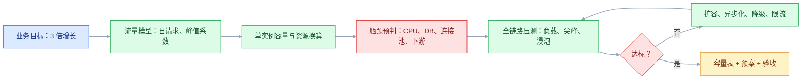

# 容量估算、性能指标与全链路压测

## 一、工程案例：把“大促能扛住”变成一张可验收的容量表

**场景**：订单系统现在日订单 30 万，峰值 1000 TPS。业务要求 6 个月后支撑 3 倍增长，大促峰值按 3000 TPS 设计。上次大促没有压测，靠临时加机器扛过去，结果数据库连接池打满，支付回调排队 20 分钟。这次要求：上线前给出容量结论，压测报告能评审，扩容和回滚有预案。

**目标**：交付一套能复算、能演练的容量方案：

- 一张容量估算表；
- 一张全链路压测计划；
- 一张瓶颈清单与扩容/降级预案；
- 一份验收清单（8 项）。

**为什么必须做**：容量不是“加机器”的同义词。真正的容量结论要回答：瓶颈在哪、需要多少资源、多大余量、什么条件下会崩、崩了怎么退。没有这些，压测报告只是一堆好看的数字。

**动手前确认**：先拿到最近 30 天的真实流量曲线、接口耗时分布、数据库 QPS/CPU/连接数、下游依赖的限流值。没有这些，压测场景会失真。下面的数字是示例。



### 1.1 先统一指标口径

| 指标 | 定义 | 常见错误 |
|---|---|---|
| QPS | 每秒请求数 | 把 QPS 当 TPS |
| TPS | 每秒完成的事务数 | 一个事务可能包含多个请求 |
| 并发数 | 同一时刻正在处理的请求数 | 把线程数当并发数 |
| RT | 请求耗时，通常看 P95/P99 | 只看平均值 |
| 错误率 | 失败请求 / 总请求 | 只统计 HTTP 5xx，漏掉业务失败 |
| 饱和度 | CPU、内存、连接池、队列的占用 | 只看 CPU，忽略连接池和队列 |
| 吞吐 | 单位时间处理的数据量 | 和 QPS 混用 |

QPS 和并发数的关系用 Little 定律：

```text
并发数 = QPS × 平均 RT（秒）
```

例子：3000 QPS × 0.3 秒 = 900 个并发请求。如果每个实例能扛 60 个并发，至少需要 15 个实例；再留 50% 余量，需要 23 个。

### 1.2 容量估算表

| 项 | 现状 | 目标（3 倍） | 计算依据 |
|---|---:|---:|---|
| 日订单 | 30 万 | 90 万 | 业务目标 |
| 每单 API 请求数 | 8 | 8 | 埋点统计 |
| 日 API 请求 | 240 万 | 720 万 | 订单 × 8 |
| 平均 QPS | 28 | 84 | 日请求 / 86400 |
| 峰值系数 | 36 | 36 | 历史峰值 / 平均 |
| 峰值 QPS | 1000 | 3000 | 平均 × 峰值系数 |
| 单实例安全容量 | 200 QPS | 200 QPS | 压测实测，P99 ≤ 300 ms |
| 实例数（含 50% 余量） | 8 | 23 | 3000 / 200 × 1.5 |
| 每实例 DB 连接池 | 20 | 20 | 配置 |
| DB 连接总数 | 160 | 460 | 23 × 20 |
| DB 最大连接 | 500 | 500 | 实例规格 |
| 连接池利用率 | 32% | 92% | 460 / 500，偏高 |

连接池 92% 是危险信号。要么把每实例连接池降到 15（345 / 500 = 69%），要么上连接池代理，要么读写分离把读压力分走。容量表的价值就是提前暴露这种“机器够了、连接不够”的问题。

### 1.3 关键路径拆解

订单创建不是一个 SQL，而是一条链路。把每次请求的写操作拆开：

| 步骤 | 每次请求操作数 | 3000 QPS 时 | 备注 |
|---|---:|---:|---|
| 订单主表 insert | 1 | 3000/s | 必须同步 |
| 订单行 insert | 2 | 6000/s | 可批量 |
| 库存扣减 update | 1 | 3000/s | 行锁热点 |
| outbox insert | 1 | 3000/s | 可与订单同事务 |
| 缓存更新 | 1 | 3000/s | 可异步 |
| **DB 写合计** | **5** | **15000/s** | 单库很难扛 |

结论：3000 TPS 的订单创建，对数据库是 15000 写/秒。单库 MySQL 在这个量级下，行锁、redo、连接池都会成为瓶颈。容量方案不能只说“加 15 个实例”，必须同时做：

- 订单行批量插入；
- 库存扣减按商品分片，热点商品单独处理；
- outbox 异步投递，减少同步链路；
- 按用户分库分表，预留扩容；
- 大促对非核心写操作降级。

### 1.4 压测类型

| 类型 | 目的 | 建议参数 |
|---|---|---|
| 冒烟压测 | 验证脚本和链路通 | 10 QPS，1 分钟 |
| 负载压测 | 验证目标容量 | 3000 QPS，30 分钟，5 分钟爬坡 |
| 尖峰压测 | 验证突发流量 | 30 秒内 0 → 3000 QPS，保持 5 分钟 |
| 压力压测 | 找拐点 | 每 5 分钟加 500 QPS，直到错误率 > 1% 或 P99 > 1 秒 |
| 浸泡压测 | 验证内存泄漏、连接泄漏 | 1500 QPS，8 小时 |
| 故障压测 | 验证降级和恢复 | 压测中停一个实例/一个从库/一个下游 |

压测不是“跑一次 3000 QPS 就完事”。尖峰和浸泡更容易暴露问题：连接池泄漏、GC 恶化、缓存击穿、日志磁盘打满。

### 1.5 压测计划

| 阶段 | 流量 | 时长 | 观察 |
|---|---:|---:|---|
| 基线 | 500 QPS | 10 分钟 | 确认脚本、数据、监控 |
| 爬坡 | 500 → 3000 QPS | 5 分钟 | 看 RT、错误率、队列 |
| 稳态 | 3000 QPS | 30 分钟 | 看 P99、CPU、DB、连接池 |
| 尖峰 | 0 → 3000 QPS | 30 秒 | 看限流、熔断、恢复 |
| 故障 | 3000 QPS + 停 1 实例 | 10 分钟 | 看摘除、重试、雪崩 |
| 恢复 | 3000 → 0 | 5 分钟 | 看队列消化、连接释放 |

压测环境要尽量接近生产：同样的实例规格、同样的数据库版本、同样的网络拓扑。测试环境只有生产 1/10 的机器，压出来的结论只能参考，不能作为容量承诺。

### 1.6 测试数据

压测数据必须覆盖真实分布，否则结果偏乐观：

| 数据 | 量级 | 分布要求 |
|---|---|---|
| 用户 | 100 万 | 1% 热点用户，其余均匀 |
| 商品 | 10 万 | 1% 热点 SKU，库存深浅不一 |
| 订单 | 1000 万 | 按时间分布，近 30 天占 30% |
| 优惠券 | 100 万 | 有效/过期/已用混合 |
| 地址 | 100 万 | 长短地址、特殊字符 |

只用 1000 个用户、100 个商品压测，缓存全命中，数据库压力会被严重低估。压测前要预热缓存，但也要测“缓存失效”场景。

### 1.7 瓶颈定位

压测时按层看：

| 层 | 指标 | 典型瓶颈 |
|---|---|---|
| 接入层 | QPS、连接数、TLS 握手 | 连接数打满、带宽、证书 |
| 应用层 | CPU、内存、GC、线程池、队列 | 线程池耗尽、锁竞争、GC 长暂停 |
| 缓存层 | 命中率、RT、连接数、热 key | 热 key、大 key、缓存击穿 |
| 数据库 | QPS、CPU、连接数、锁等待、慢查询 | 行锁、redo、连接池、全表扫描 |
| 消息 | 积压、消费延迟、重试 | 消费者不足、死信堆积 |
| 下游 | RT、错误率、限流 | 第三方限流、超时放大 |

定位顺序：先看错误率和 RT 拐点，再看应用饱和度和数据库等待，最后看下游。不要一上来就加机器。

### 1.8 扩容与降级预案

| 场景 | 预案 | 触发条件 |
|---|---|---|
| 应用 CPU > 70% | 水平扩容 | 持续 5 分钟 |
| DB CPU > 70% | 读走缓存/从库，写限流 | 持续 5 分钟 |
| 连接池 > 80% | 降连接池、加代理、限流 | 持续 1 分钟 |
| 下游超时 | 熔断、降级、异步补偿 | 错误率 > 1% |
| 消息积压 | 扩容消费者、临时跳过非核心 | 积压 > 10 万 |
| 热点商品 | 单独限流、库存预扣、排队 | 单 SKU QPS 突增 |
| 大促流量超预期 | 关闭非核心功能、静态化、CDN | 总 QPS > 设计值 120% |

预案要演练，不是写在文档里。演练时至少验证：限流是否生效、降级是否影响主流程、恢复后是否自动回补。

### 1.9 验收（8 项）

1. 3000 QPS 稳态 30 分钟：P99 ≤ 300 ms，错误率 ≤ 0.1%。
2. 尖峰 0 → 3000 QPS：30 秒内完成扩容或限流，无雪崩。
3. 停 1 个应用实例：流量 30 秒内摘除，错误率 < 0.5%。
4. DB CPU ≤ 70%，连接池利用率 ≤ 80%，无锁等待超过 1 秒。
5. 缓存命中率 ≥ 90%，热 key 无单点打满。
6. 消息积压 10 万条后，30 分钟内消化完。
7. 连续 8 小时浸泡：内存无持续增长，连接无泄漏。
8. 降级开关演练：关闭非核心功能后，订单主链路 P99 不升反降。

## 二、高频问答：会卡住你的地方，也是面试最常问的

### 2.1 QPS、TPS、并发数混着说

**现场**

用 Little 定律算：3000 QPS × 0.3 秒 = 900 并发，再看单实例能扛多少并发。

```text
并发数 = QPS × 平均 RT（秒）
```

**要点**

- QPS 是速率，并发是同时在处理的请求数，两者差一个 RT。
- 线程数不等于并发数，还受 CPU、IO、锁限制。
- 容量估算先用 Little 定律换算出并发，再除以单实例容量。

**追问**

- 3000 QPS 需要多少线程？→ 先看 RT，3000 × 0.3 = 900 并发，线程池略高于它并留余量。
- QPS 和 TPS 什么区别？→ 一个事务可能包含多个请求，别把 QPS 当 TPS。
- RT 变长会怎样？→ 同样 QPS 下并发线性上升，线程池先被打满。

### 2.2 只看平均 RT

**现场**

看 P99 和最大值。P99 是平均值的 5 倍以上，说明尾延迟有问题。

**要点**

- 平均值会被大量快请求拉低，慢请求才是投诉和超时的来源。
- 容量要看 P95/P99/P999，平均值只能看趋势。
- 多实例的 P99 不能求平均，要用直方图合并。

**追问**

- P99 和 P999 分别看什么？→ P99 看尾延迟和容量，P999 看极端慢请求。
- 两个实例 P99 是 200 和 500，合并是多少？→ 不是 350，要按直方图分桶合并。
- 为什么尾延迟重要？→ 一个请求要等最慢的那次依赖，用户感受由最慢环节决定。

### 2.3 压测环境和生产差一个数量级

**现场**

对比 CPU 型号、实例数、DB 规格、网络延迟。差两个以上，结论只能作参考。

**要点**

- 实例规格、数据库版本、网络、缓存、下游限流都不同，压出来的数字不能直接当承诺。
- 测试环境机器只有生产 1/10 时，瓶颈位置会变，压出来的是测试环境的拐点。
- 数据量和热点分布失真，比机器差异更隐蔽。

**追问**

- 没有同规格环境怎么办？→ 单机压出单实例容量再按比例外推，并在报告里写明风险。
- 哪些差异最致命？→ 数据库规格和网络延迟，它们直接改变瓶颈位置。
- 压测结论怎么写才可信？→ 写清环境差异和适用范围，别写成无条件承诺。

### 2.4 测试数据太小、太均匀

**现场**

数据量至少覆盖生产 1/10，热点比例按真实分布造，专门测热 key。

**要点**

- 数据小会全命中缓存，数据库压力被严重低估。
- 均匀分布没有热点，发现不了热 key 和行锁竞争。
- 压测前要预热缓存，但也要单独测缓存失效场景。

**追问**

- 怎么造热点数据？→ 按真实分布的百分比，比如 1% 用户承担大部分请求。
- 数据量不够是高估还是低估容量？→ 高估，看起来能扛，生产上缓存一失效就崩。
- 缓存预热了还测失效吗？→ 要，大促期间缓存失效是必答题。

### 2.5 不预热缓存

**现场**

先预热到目标命中率再测稳态，另外单独测缓存击穿场景。

**要点**

- 冷缓存会把压力全打到数据库，压出来的是“缓存未命中”的容量，不是稳态容量。
- 只测预热后的稳态也不够，大促前必须预热，否则真实流量会击穿。
- 两个场景要分开测：稳态命中率下的容量、缓存失效时的兜底能力。

**追问**

- 预热到什么程度算够？→ 到目标命中率为止，看命中率曲线而不是拍时间。
- 生产扩容后新实例是冷的怎么办？→ 加预热流量或延迟摘流，别直接打进全量。
- 冷启动容量有什么用？→ 用来设计降级和限流阈值，不是用来承诺稳态。

### 2.6 用闭环模型，忽略协调遗漏

**现场**

用开环模型或固定到达速率，对比客户端 RT 和服务端 RT，差异大说明排队在客户端。

**要点**

- 闭环模型在系统变慢时自动降低发压速率，把长尾掩盖掉。
- 协调遗漏会让 P99 被严重低估，因为慢请求没有被按计划发出。
- 开环更接近真实流量，但要控制并发上限，否则压测机自己先崩。

**追问**

- 闭环适合测什么？→ 吞吐上限，找系统的最大处理能力。
- 开环适合测什么？→ 真实延迟，尤其是尾延迟。
- 两种结论能混用吗？→ 不能，闭环的吞吐和开环的延迟是两回事。

### 2.7 只压一个接口

**现场**

按真实流量比例编排混合场景，至少覆盖下单、支付、查询、取消。

**要点**

- 真实流量是多接口混合，详情、列表、支付回调会争抢同一批资源。
- 单接口压测会把资源全给一个链路，测出来的容量偏高。
- 混合比例要按生产埋点统计，不能拍。

**追问**

- 混合场景怎么定比例？→ 按生产接口调用占比，再按大促结构调整。
- 单接口压测还有用吗？→ 有，用来定单接口容量和找拐点，不能当整体容量。
- 读写比例重要吗？→ 重要，读多写少和写多读少的瓶颈完全不同。

### 2.8 忽略下游瓶颈

**现场**

压测时看下游 RT、错误率、限流，把下游限流值写进容量表。

**要点**

- 自己的服务 CPU 才 40%，不代表容量够，下游可能先被打满。
- 超时和重试会放大下游压力，下游越慢压力越大。
- 容量表必须包含下游限流值，否则算出来的实例数是空中楼阁。

**追问**

- 下游是第三方怎么压？→ 用挡板模拟，按对方给出的限流值设计。
- 下游限流值从哪来？→ 找对方要书面值，别按自己的假设。
- 下游超时算不算容量不足？→ 算，用户拿到的是失败，不管瓶颈在谁那。

### 2.9 “加机器”解决一切

**现场**

先定位瓶颈层。只有应用层 CPU 是瓶颈时，加实例才有效。

**要点**

- 数据库、连接池、锁、下游限流都不是线性扩展的。
- 加机器可能让数据库更糟，因为连接数和并发都上去了。
- 扩容要按瓶颈选：水平扩容、垂直扩容、读写分离、分库分表、缓存、异步化各有适用面。

**追问**

- 连接池怎么算才安全？→ 实例数 × 每实例连接池 ≤ 数据库最大连接 × 0.8。
- 加到一定数量反而更慢，为什么？→ 串行争用和一致性开销，USL 描述的就是这个。
- 数据库扛不住先做什么？→ 先读写分离、加缓存、异步化，最后才是分库分表。

### 2.10 压测通过就上线，不看数据增长

**现场**

按 6/12/24 个月数据量重跑关键查询，容量表每季度更新。

**要点**

- 数据量增长会让索引变深、查询变慢、缓存命中率下降。
- 流量结构也会变，今天的长尾接口可能是明天的热点。
- 容量表是活文档，不更新比没有更危险。

**追问**

- 数据量翻倍对查询影响多大？→ 索引层级增加，磁盘 IO 和 RT 都会上升，要实测不要估。
- 什么时候必须重跑压测？→ 数据量翻倍、架构变更、大促前。
- 容量表谁维护？→ 要有明确 owner，跟发布流程绑定，否则没人更新。

## 三、核心知识

### 3.1 性能指标

| 指标 | 说明 | 用法 |
|---|---|---|
| P50 | 中位数 | 看典型体验 |
| P95 | 95% 请求低于此值 | 看大多数用户 |
| P99 | 99% 请求低于此值 | 看尾延迟、容量 |
| P999 | 千分之一 | 看极端慢请求 |
| 错误率 | 失败/总数 | 和 RT 一起看 |
| 饱和度 | 资源占用 | 判断还有多少余量 |
| 吞吐 | 单位时间处理量 | 容量规划 |

P99 不能直接平均。两个实例的 P99 分别是 200 ms 和 500 ms，合起来的 P99 不是 350 ms，要用直方图或分桶合并。

### 3.2 Little 定律

```text
L = λ × W
```

- L：系统内并发请求数；
- λ：到达速率（QPS）；
- W：平均停留时间（秒）。

用途：

- 已知 QPS 和 RT，算需要多少并发/线程；
- 已知线程池大小和 RT，算最大 QPS；
- 压测时校验“客户端并发”和“服务端在途”是否一致。

> **面试**：常问「Little 定律怎么用来算容量？」答：并发 = QPS × RT，先算出并发再除以单实例容量。

### 3.3 容量估算步骤

1. 定业务目标：订单量、用户量、增长率。
2. 定流量模型：每单请求数、读写比例、峰值系数。
3. 算峰值 QPS：日请求 × 峰值系数 / 86400。
4. 拆关键路径：每个请求的 DB 读写、缓存、消息、下游调用。
5. 测单实例容量：在目标 RT 下的安全 QPS。
6. 算资源：实例数、连接池、DB、缓存、带宽。
7. 留余量：应用 50%，DB 30%，下游按限流值。
8. 写预案：扩容、降级、限流、回滚。
9. 压测验证：稳态、尖峰、故障、浸泡。
10. 每季度复算：数据量、流量结构、成本变化。

### 3.4 峰值系数

峰值系数 = 峰值 QPS / 平均 QPS。不同业务差异很大：

| 业务 | 峰值系数 | 说明 |
|---|---:|---|
| 企业内部系统 | 3～5 | 上下班波动 |
| 电商日常 | 10～30 | 晚间高峰 |
| 大促/秒杀 | 50～300 | 定时开抢 |
| 票务/预约 | 100～1000 | 开票瞬间 |
| 社交热点 | 不可预测 | 事件驱动 |

峰值系数不能拍脑袋，要用历史数据算；没有历史数据，就按同类业务保守估，并准备弹性扩容。

> **面试**：常问「峰值系数怎么定？」答：用历史峰值除以平均 QPS，没有历史就按同类业务保守估。

### 3.5 压测类型与目标

| 类型 | 回答的问题 |
|---|---|
| 负载压测 | 目标流量下是否达标 |
| 压力压测 | 系统最大能扛多少，拐点在哪 |
| 尖峰压测 | 突发流量能否快速扩容/限流 |
| 浸泡压测 | 长时间运行是否泄漏/退化 |
| 故障压测 | 依赖故障时能否降级/恢复 |

压测报告至少包含：场景、流量模型、数据量、环境、指标曲线、瓶颈、结论、风险、建议。

### 3.6 开环与闭环

| 模型 | 特点 | 风险 |
|---|---|---|
| 闭环 | 固定用户数，收到响应后再发下一个 | 系统变慢时自动降速，掩盖长尾 |
| 开环 | 固定到达速率，不等响应 | 更接近真实流量，但需要控制并发上限 |

压测工具要支持固定到达速率（如 k6 的 `constant-arrival-rate`、wrk 的并发模型要看清）。闭环压测适合找吞吐上限，开环压测适合看真实延迟。

> **面试**：常问「闭环压测为什么会低估 P99？」答：系统变慢时它自动降速，慢请求没被按计划发出，协调遗漏把长尾漏掉。

### 3.7 瓶颈分析顺序

1. 看错误率：是超时、限流、还是业务异常。
2. 看 RT 分布：P99 从哪一层开始升高。
3. 看应用：CPU、内存、GC、线程池、队列。
4. 看数据库：QPS、CPU、连接数、锁等待、慢查询。
5. 看缓存：命中率、热 key、大 key、连接数。
6. 看消息：积压、消费延迟、死信。
7. 看下游：RT、错误率、限流。
8. 看网络：带宽、连接数、TIME_WAIT。

不要跳步。先加机器再看数据库，往往会掩盖真正的问题。

### 3.8 扩容策略

| 策略 | 适用 | 代价 |
|---|---|---|
| 水平扩容 | 无状态应用 | 需要负载均衡、会话共享 |
| 垂直扩容 | 数据库、缓存 | 有上限、成本高 |
| 读写分离 | 读多写少 | 复制延迟 |
| 分库分表 | 单库容量/写入瓶颈 | 迁移复杂、跨分片查询 |
| 缓存 | 热点读 | 一致性、击穿 |
| 异步化 | 非核心链路 | 最终一致、补偿 |
| 限流降级 | 突发流量 | 影响部分用户 |
| 静态化/CDN | 静态资源、商品页 | 动态内容不适合 |

扩容要按瓶颈选，不是按习惯选。

### 3.9 容量与成本

容量不是越大越好。每个方案都要算单位成本：

```text
单位订单成本 = (计算 + 存储 + 网络 + 中间件 + 运维) / 订单数
```

常见浪费：为峰值买全年资源、缓存命中率低、副本过多、日志全量长期保存、闲置实例。容量评审要同时看“能不能扛”和“值不值”。

### 3.10 容量评审清单

- 业务目标、增长率、峰值系数是否有依据；
- 关键路径的 DB 读写、缓存、消息、下游是否拆清；
- 单实例容量是否在目标 RT 下实测；
- 连接池、线程池、队列是否算过；
- 压测环境与生产差异是否说明；
- 尖峰、故障、浸泡是否覆盖；
- 扩容、降级、限流、回滚是否有预案；
- 数据增长 6/12/24 个月是否复算；
- 成本和单位经济性是否可接受；
- 结论是否有明确的“不达标项”和“风险”。

## 四、冷门知识汇总

- **协调遗漏（Coordinated Omission）**：压测工具在系统变慢时减少发压，导致慢请求被“漏掉”，P99 被严重低估。解决方法是开环模型或固定到达速率，并按计划发送时间计算延迟。
- **开环与闭环的选择**：闭环适合测吞吐上限，开环适合测真实延迟。两者结论不能混用。
- **USL（通用可扩展性定律）**：`C(N) = N / (1 + α(N-1) + βN(N-1))`，α 是串行争用，β 是一致性/同步开销。它解释了“加到一定数量后，再加机器反而更慢”。
- **Amdahl 定律**：加速比受串行部分限制。系统里 10% 的串行逻辑，最多只能加速 10 倍。优化前先找串行瓶颈。
- **队列论与利用率**：M/M/1 下，利用率 70% 时排队延迟约是服务时间的 2.3 倍，90% 时约 9 倍。容量不要贴着 100% 设计。
- **P99 聚合**：百分位不能求平均。多实例、多时间段合并要用直方图（如 HDR Histogram、Prometheus histogram）。
- **TCP backlog 与 TIME_WAIT**：高并发短连接会把 backlog 打满、TIME_WAIT 堆积，表现为“服务没满但连不上”。压测时要看 `ss -s`、`netstat`。
- **cgroup CPU throttling**：容器里 CPU 没到 100% 但被限流，表现为 RT 抖动。看 `container_cpu_cfs_throttled_seconds_total`。
- **JIT 预热**：Java 服务刚启动时解释执行，RT 偏高。压测前要预热，生产扩容后也要考虑预热流量。
- **缓存预热**：冷缓存会把压力打到数据库，压测结果偏悲观；但生产大促前必须预热，否则真实流量会击穿。
- **连接池数学**：应用实例数 × 每实例连接池 ≤ 数据库最大连接 × 0.8。连接池不是越大越好，过大反而增加数据库切换和锁竞争。
- **噪声邻居**：同一宿主机上的其他容器抢 CPU、内存、磁盘 IO，导致“自己没变但变慢了”。容器化环境要设 request/limit 和隔离。
- **压测即代码**：把压测脚本、数据生成、阈值、报告纳入版本控制，每次发布前自动跑冒烟和基线，避免“上次压过”的经验失效。
- **容量表是活文档**：每次大促、每次架构变更、每次数据量翻倍都要更新；不更新的容量表比没有更危险。