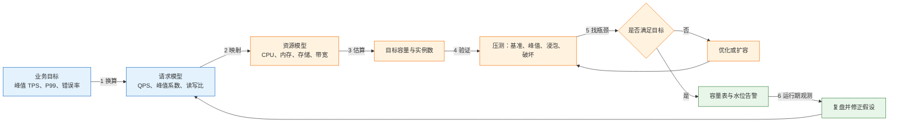
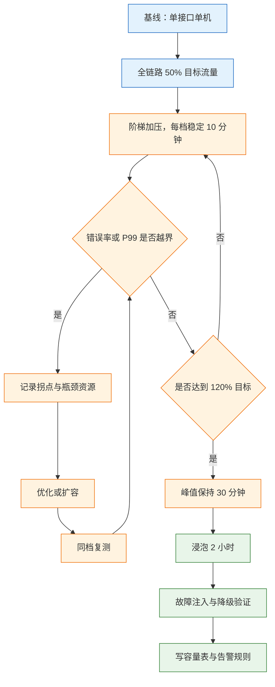
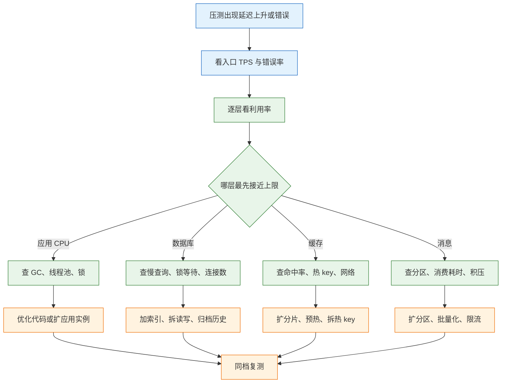

# 容量估算与压测

---

## 一、容量估算与压测是什么

容量估算与压测回答的是同一个问题的两个侧面：系统在给定业务量、数据量和故障条件下，哪个资源会先到顶，还剩多少余量。估算用模型给出方向和初始目标，压测用实测找出真实瓶颈，水位监控在运行期验证结论是否仍然成立。

一个常见误判是：压测单机 800 QPS，按 20 台推算 1.6 万 QPS，大促上线后应用 CPU 只有 40%，数据库 CPU 100%。原因通常有三类：只压了查询接口，没有压写链路；压测数据只有 10 万行，线上是 8 亿行；容量按平均值推算，没有算峰值和故障余量。

容量不是“能撑多少 QPS”一个数字。同样一套服务，在 10 万行数据和 8 亿行数据下，索引深度、锁竞争、缓存命中率完全不同；在单可用区和三可用区部署下，故障后的剩余容量也完全不同。脱离数据量、流量比例和故障场景的 QPS 数字没有决策价值。

### 1.1 核心概念

容量工作有三个产出物，缺一不可。

- **容量表**：每个资源的当前水位、单副本容量、目标峰值、故障后余量、扩容触发点和 owner。
- **压测报告**：测试条件、流量模型、阶梯结果、瓶颈位置和结论边界。
- **水位告警**：把容量表中的触发点变成可执行的监控规则，而不是停留在文档里。

三个产出物构成闭环：估算给出初始目标，压测修正模型，监控在运行期发现偏差，复盘再更新容量表。只做一次压测、不更新容量表，下一次大促仍然从零开始。

容量与性能不是同一个概念。性能关注单次请求多快，容量关注在可接受的延迟和错误率下能承载多少请求。一个接口平均 50 ms 看起来很健康，但如果有 5% 的请求耗时 5 秒，它的有效容量可能远低于平均值推算的结果。

| 概念 | 关注点 | 典型指标 |
|---|---|---|
| 性能 | 单次请求快不快 | P50、P99、GC 停顿 |
| 容量 | 能承载多少请求 | TPS、并发数、水位 |
| 弹性 | 流量变化时能否调整 | 扩容耗时、冷启动 |
| 稳定性 | 长时间运行是否退化 | 内存、句柄、积压 |

### 1.2 与相邻技术的关系

容量估算与压测处在性能工程、可观测性和弹性伸缩的交汇处，但各自解决的问题不同。

| 相邻技术 | 解决的问题 | 与容量的关系 |
|---|---|---|
| 性能测试 | 单接口或单场景的响应能力 | 提供单机基准数据 |
| 负载测试 | 目标流量下是否稳定 | 验证容量结论 |
| 压力测试 | 超过容量后的失败形态 | 找拐点与崩溃点 |
| APM 与监控 | 运行期指标采集 | 提供水位与告警 |
| 弹性伸缩 | 按指标自动增减实例 | 执行扩容决策 |
| 容量规划 | 资源与成本的长期安排 | 使用估算与压测结论 |

性能测试是手段，容量规划是目的。压测工具能测出某个配置下的吞吐，但不能替使用方决定“目标峰值取多少、故障后允许多少降级、冗余花多少钱”。弹性伸缩能自动加机器，但如果瓶颈在数据库，加应用实例只会让更多请求同时打到数据库。

监控与压测也不是替代关系。监控反映当前水位，压测回答水位升到多少会出问题。只有监控没有压测，告警阈值只能凭经验设置；只有压测没有监控，线上是否已经接近拐点无从判断。

### 1.3 容量模型组成

容量模型由四层组成：业务目标、请求模型、资源模型和验证闭环。业务目标定义峰值与延迟承诺，请求模型把业务量换算成 QPS 与并发，资源模型把 QPS 换算成 CPU、内存、存储和带宽，验证闭环用压测和监控修正前面的假设。



四层之间是假设关系，不是精确推导。请求模型里的峰值系数、资源模型里的单机容量、压测里的流量比例，任何一个假设变了，结论都要重算。容量表必须记录假设，否则半年后没人知道数字是在什么条件下得出的。

---

## 二、请求量估算模型

### 2.1 业务量到请求量

估算从业务量开始，逐层换算到 QPS。公式本身简单，难点在于每个系数的口径。

```text
日均请求数 = DAU × 人均请求次数
平均 QPS   = 日均请求数 / 86400
峰值 QPS   = 平均 QPS × 峰值系数
目标 QPS   = 峰值 QPS × 安全系数
```

以 DAU 100 万、人均 20 次请求为例：

```text
日均请求数 = 1,000,000 × 20 = 20,000,000
平均 QPS   = 20,000,000 / 86,400 ≈ 231.5
峰值 QPS   = 231.5 × 8 ≈ 1,852
目标 QPS   = 1,852 × 1.5 ≈ 2,778，取 2,800
```

人均请求次数要包含页面加载、接口调用、轮询和重试，不能只算用户主动点击。峰值系数要按业务取，不能用日均 QPS 直接规划。安全系数覆盖估算误差和扩容延迟，通常取 1.3 到 1.5；如果扩容需要小时级，系数还要放大。

### 2.2 峰值系数与时间分布

峰值系数描述峰值时段相对日均的倍数。业务形态不同，系数差异很大。

| 业务类型 | 峰值系数 | 说明 |
|---|---:|---|
| 内部后台 | 2～3 | 工作时间集中 |
| 电商日常 | 3～5 | 晚间高峰 |
| 大促活动 | 10～50 | 定时开抢 |
| 票务与预约 | 10～30 | 开售瞬间 |
| 监控与告警 | 1～2 | 流量平稳 |

峰值系数不是常数，它还会随活动形式变化。整点开抢的流量集中在数十秒内，分钟均值会严重低估瞬时压力。规划时要区分“分钟峰值”和“十秒峰值”，后者可能是前者的两到三倍。

```text
十秒峰值 QPS ≈ 分钟峰值 QPS × 瞬时集中系数
瞬时集中系数 = 峰值十秒请求数 / (分钟峰值 QPS × 10)
```

如果一分钟内 60% 的请求集中在前十秒，瞬时集中系数约为 3.6，原本 3000 QPS 的分钟峰值会变成超过 10000 QPS 的十秒峰值。队列和限流必须按十秒峰值设计，否则开抢瞬间就会被打穿。

### 2.3 请求放大系数

用户的一次操作往往触发多次后端请求。容量估算要按放大后的量计算，而不是按用户请求数计算。

```text
有效 QPS = 用户 QPS × (1 + 重试率) × 扇出系数
写入 QPS = 有效 QPS × 单请求写入次数
```

创建订单 900 QPS，重试率 10%，每个订单写订单主表、明细表、Outbox 三次：

```text
有效 QPS = 900 × 1.1 = 990
写入 QPS = 990 × 3 = 2,970
```

常见的放大来源有三类：客户端或网关重试，一次失败变成两到三次；同步调用扇出，一个页面请求聚合多个下游；异步消费扇出，一个事件被多个消费组各自处理。估算时漏掉任何一类，数据库和消息集群的容量都会低估。

> **注意**：注册用户数不能代替 DAU。注册 1000 万、活跃 50 万的业务，按注册数估算会把容量高估二十倍；反过来，把 DAU 当成同时在线人数又会低估并发。

---

## 三、并发与资源容量计算

### 3.1 Little 定律与并发

稳定系统中，同时在处理的请求数等于到达速率乘以平均停留时间。

```text
L = λ × W
L：并发请求数
λ：到达速率，单位 QPS
W：平均停留时间，单位秒
```

目标 3000 QPS、平均延迟 200 ms：

```text
L = 3000 × 0.2 = 600
```

600 是同时在处理中的请求数，不是线程数。线程池要略大于并发，因为下游抖动时停留时间会上升；按 1.5 倍配置为 900 个线程，分摊到 18 个实例，每实例 50 个。线程再多只会增加上下文切换和内存占用，不会提升吞吐。

数据库连接池按数据库能承受的并发配置，不按应用线程数配置。18 个实例、每实例 30 个连接就是 540 个连接，很多数据库在这个量级已经开始出现锁等待和上下文切换。连接池上限要用压测确定，并给慢查询留出排队空间。

### 3.2 CPU 与实例数

单机容量通常以“在目标延迟下能稳定处理的 QPS”表示，而不是 CPU 跑满时的极限 QPS。按目标水位折算实例数：

```text
实例数 = ceil(目标 QPS / (单实例容量 × 目标利用率))
```

查询服务目标 2800 QPS，单实例在 P99 达标时可处理 800 QPS，目标利用率 65%：

```text
实例数 = ceil(2800 / (800 × 0.65)) = ceil(5.38) = 6
```

写服务目标 900 QPS，单实例容量 300 QPS，同样按 65% 利用率：

```text
实例数 = ceil(900 / (300 × 0.65)) = ceil(4.62) = 5
```

算出实例数后还要加故障冗余。三可用区部署、单区故障后剩三分之二，若要求故障后仍满足目标，实例总数要按 `目标 / (2/3)` 反推，也就是 9 个而不是 6 个。冗余不是浪费，它是故障场景下的容量承诺。

也可以用 CPU 时间反推：单请求消耗 5 ms CPU，单核每秒可处理 200 个请求，8 核实例理论容量 1600 QPS，按 65% 利用率取 1040 QPS。这种方法适合计算密集型服务，不适合大量等待 I/O 的服务。

### 3.3 存储容量

存储估算要算裸数据、索引与日志放大、副本、备份和保留期。

```text
日增裸数据 = 日业务量 × 单笔行数 × 单行字节
日增实际占用 = 日增裸数据 × 放大系数
总容量 = 日增实际占用 × 保留天数 × 副本数 + 备份 + 临时空间
```

日订单 300 万、单笔 3 行、单行 1 KB、放大系数 1.8、保留 365 天、三副本：

```text
日增裸数据 = 3,000,000 × 3 × 1 KB = 9,000,000 KB ≈ 9 GB
日增实际占用 = 9 GB × 1.8 = 16.2 GB
一年数据 = 16.2 GB × 365 ≈ 5,913 GB ≈ 5.9 TB
三副本 = 5.9 TB × 3 ≈ 17.7 TB
加 30% 的备份与临时空间 ≈ 23 TB
```

放大系数 1.8 覆盖二级索引、行头、页填充和 WAL。索引越多、更新越频繁，放大越明显。备份不能按“压缩后很小”估算，恢复时需要解压、重放日志和重建索引，临时空间往往超过备份文件本身。

### 3.4 带宽与连接数

出口带宽按平均响应大小和 QPS 估算：

```text
带宽 = QPS × 平均响应字节 × 8 / 1,000,000
```

3000 QPS、平均响应 20 KB：

```text
3000 × 20,000 B × 8 = 480,000,000 bps = 480 Mbps
```

这是平均值。大促时图片、导出和批量接口会把平均响应拉高，按 P99 响应大小再算一遍，取两者较大值。跨可用区复制、备份和日志外发还会占用额外带宽，不能只算业务出口。

连接数按并发和复用率估算。短连接场景下，新建连接率接近 QPS，连接表和服务端文件句柄会成为瓶颈；长连接场景下，连接数接近并发数，还要考虑 keepalive 超时和负载均衡的空闲回收。

```text
新建连接率 = QPS × (1 - 连接复用率)
TIME_WAIT 端口占用 = 新建连接率 × TIME_WAIT 时长
```

3000 QPS、复用率 90%、TIME_WAIT 60 秒时，新建连接率为 300 每秒，端口占用约 18000 个。单机可用端口约 28000 个，看似够用，但端口还被子网五元组、NAT 和目标地址限制，实际可用更少。短连接服务必须开启连接复用，否则扩容只会加快端口耗尽。

| 资源 | 公式 | 示例结果 |
|---|---|---:|
| 并发 | QPS × 延迟 | 600 |
| 应用实例 | 目标 / (单机 × 利用率) | 6 |
| 存储 | 日增 × 天数 × 副本 | 23 TB |
| 带宽 | QPS × 响应大小 × 8 | 480 Mbps |
| 数据库连接 | 实例数 × 单实例池 | 540 |

---

## 四、压测模型与参数

### 4.1 开环与闭环

压测工具产生流量的方式直接决定结论是否可信。闭环模型固定并发用户数，上一个请求完成后才发下一个；开环模型按固定速率发请求，不等待上一个完成。

| 模型 | 控制变量 | 优点 | 缺陷 |
|---|---|---|---|
| 闭环 | 并发用户数 | 接近真实用户行为 | 服务端变慢时自动减压 |
| 开环 | 每秒请求数 | 能暴露排队与尾延迟 | 需要限速与连接管理 |

闭环模型在服务端卡顿时，压测工具也跟着等，实际发出的请求变少，P99 被系统性低估。这种现象叫协调遗漏（Coordinated Omission）：服务端已经排队几秒，工具却只记录自己等到的那一小段。

开环模型按计划速率发送，即使服务端变慢也不减压，因此能测出真实排队。代价是需要处理连接数上限、端口耗尽和工具自身成为瓶颈的问题。压测报告要注明模型、目标速率和实际发出速率，三者不一致时结论无效。

### 4.2 压测类型与参数

不同压测类型回答不同问题，不能互相替代。

| 类型 | 目的 | 时长 | 判定依据 |
|---|---|---|---|
| 基准测试 | 单接口、单机能力 | 5～10 分钟 | TPS、P99、资源曲线 |
| 峰值测试 | 目标流量下是否稳定 | 30～60 分钟 | 错误率、P99、水位 |
| 浸泡测试 | 长时间泄漏与退化 | 2～24 小时 | 内存、句柄、GC、磁盘 |
| 破坏测试 | 依赖故障时能否降级 | 按故障场景 | 熔断、重试、恢复时间 |
| 全链路测试 | 真实比例下的端到端瓶颈 | 30 分钟以上 | 端到端 P99、各层水位 |

峰值测试要覆盖目标峰值的 100% 到 120%，并在每一档稳定足够长的时间。只跑三分钟就下结论，缓存还没热、JIT 还没预热、连接池还没打满，数据不可用。浸泡测试至少两小时，重点看内存和连接是否单调上升。

破坏测试常被忽略。把 Redis 停掉、把主库切走、把消息集群压到积压，观察系统是降级还是雪崩。没有破坏测试的容量表只描述了健康状态，无法回答故障时还剩多少能力。

### 4.3 压测数据与环境

压测结论的有效性取决于环境与生产环境的接近程度。

- 数据量至少接近生产量级，索引深度、分区裁剪和锁竞争才会真实出现；
- 数据分布要接近真实，订单量长尾、商品热度幂律，均匀随机数据会高估缓存命中率；
- 缓存要分别测冷启动和热缓存，只测热缓存会低估数据库压力；
- 流量比例按真实业务混比，不能只压最快的查询接口；
- 依赖服务用同规格实例，或明确记录折算关系；
- 压测机不能成为瓶颈，网络、端口、文件句柄和 CPU 都要提前检查。

最省事的数据构造方式是用生产脱敏快照，再补合成数据填满目标量级。导入后执行统计信息收集，避免优化器按旧统计选择错误的执行计划。合成数据要保留热点，例如少数商品承担大部分访问，否则缓存和锁的表现都会失真。

压测机本身也要算容量。单台压测机在目标请求大小下可能只能发出 2000 QPS，要打到 10000 QPS 就至少需要五台，另加一台控制节点分发脚本和汇总指标。压测机 CPU 先到 80%、网络先到 60%，测出来的是工具的极限，不是被测系统的极限。分布式压测要统一时钟、统一脚本版本，并在报告中记录每台机器的实际发出速率。

### 4.4 压测执行顺序

1. 先做基线：单接口、单机、低流量，确认工具、网络、依赖和监控都正常。
2. 按真实混比做全链路，从目标流量的 50% 开始阶梯加压。
3. 每一档稳定 10 分钟，记录 P99、错误率和各层水位，不只看 TPS。
4. 找到第一个“水位陡增或错误率上升”的拐点，该资源就是当前瓶颈。
5. 优化或扩容后，从同一档复测，确认拐点向右移动。
6. 做 30 分钟峰值保持和 2 小时浸泡，观察内存、连接和 GC。
7. 注入依赖故障，验证熔断、降级和恢复是否符合预期。
8. 输出容量表，写明数据量、流量比例、环境差异和结论边界。



---

## 五、压测指标与瓶颈判定

### 5.1 指标体系

容量结论必须同时包含吞吐、延迟、错误率和资源水位。只有一个 TPS 数字的报告无法解释瓶颈，也无法指导扩容。

| 层 | 指标 | 说明 |
|---|---|---|
| 入口 | TPS、P50、P95、P99、错误率 | 成功率低于 99.9% 的容量不算容量 |
| 应用 | CPU、内存、GC 停顿、线程池队列 | CPU 超过 60% 后延迟非线性上升 |
| 数据库 | CPU、连接数、慢查询、锁等待、IOPS | 锁等待通常比 CPU 更早暴露问题 |
| 缓存 | 命中率、内存、热 key、超时 | 命中率下降会瞬间打到数据库 |
| 消息 | 生产与消费速率、积压、滞后时间 | 积压看时间，不只看条数 |
| 网络 | 带宽、连接数、重传率 | 大包与长连接场景重点 |

平均值没有决策价值。平均 50 ms 可能掩盖 5% 的 5 秒请求，而容量往往由尾延迟决定。P99 达标但 P999 已经超时，说明系统在排队边缘运行，任何抖动都会把一小部分请求推入超时区。

### 5.2 排队与利用率

利用率上升时，排队时间按 `1/(1-ρ)` 上升。ρ 是资源利用率，S 是单次服务时间，总停留时间近似为：

```text
W = S / (1 - ρ)
```

| 利用率 ρ | 停留时间倍数 | 含义 |
|---:|---:|---|
| 50% | 2 倍 | 有充足余量 |
| 70% | 3.3 倍 | 仍可控 |
| 80% | 5 倍 | 尾延迟明显上升 |
| 90% | 10 倍 | 一次抖动就超时 |
| 95% | 20 倍 | 接近崩溃 |

这就是生产系统按 60% 到 70% 水位规划的原因。它不是保守，而是用闲置容量换取延迟稳定。CPU 从 60% 涨到 90% 只增加 30 个百分点，排队时间却可能翻几倍，GC 和突发流量再叠加，系统会从“慢”直接跳到“不可用”。

### 5.3 瓶颈定位方法

定位瓶颈用 USE 方法：利用率（Utilization）、饱和度（Saturation）、错误（Errors）。先找利用率最先接近上限的资源，再看它的饱和信号。

| 资源 | 利用率 | 饱和信号 |
|---|---|---|
| CPU | 使用率 | 运行队列长度、调度延迟 |
| 内存 | 使用量 | 换页、GC 频率、OOM |
| 磁盘 | IOPS 与吞吐 | 等待队列、写放大 |
| 网络 | 带宽与包速率 | 重传、丢包、连接重置 |
| 连接池 | 活跃连接数 | 等待获取连接的时间 |
| 数据库 | CPU 与连接数 | 锁等待、慢查询、主从延迟 |

加机器之前必须先确认瓶颈资源。应用 CPU 只有 40%、数据库 CPU 100% 时，加应用实例只会让更多请求同时打到数据库，错误率反而上升。反过来说，应用 CPU 已经 80%、数据库只有 50%，扩容应用才有意义。



---

## 六、容量余量与故障场景

### 6.1 水位上限

水位上限是运行期的约束，不是压测的终点。不同资源的上限不同，因为它们的非线性程度不同。

| 资源 | 建议上限 | 原因 |
|---|---:|---|
| 应用 CPU | 60%～70% | 再高排队与 GC 影响尾延迟 |
| 数据库 CPU | 60%～70% | 写入与锁竞争非线性 |
| 连接池 | 70% | 留突发与慢查询余量 |
| 队列积压 | 50% 容量 | 留故障重试与峰值 |
| 磁盘 | 70% | 留日志、备份、快照空间 |
| 带宽 | 60% | 留重传与突发 |

水位上限要按资源分别设置，不能用一个统一的 80%。磁盘到 90% 可能触发只读，消息积压到 80% 可能已经超过恢复窗口，这些资源的“安全水位”远低于 CPU。上限也不能凭经验拍定，应从压测拐点反推：拐点出现在 80% 利用率、延迟开始陡增，实际告警阈值就要设在 65% 左右，留出发现和扩容的时间。

### 6.2 故障后剩余容量

高可用容量要按故障后的剩余能力验收，而不是按全量在线时验收。

```text
故障后容量 = 总容量 × (可用副本数 / 总副本数)
所需总容量 = 目标峰值 / (可用副本数 / 总副本数)
```

三个可用区、单区故障后剩三分之二。目标峰值 3000 TPS：

```text
故障后容量 = 总容量 × 2/3
所需总容量 = 3000 / (2/3) = 4500 TPS
```

总容量只有 3000 TPS 时，单区故障后只剩 2000 TPS，不满足目标。要么按 4500 TPS 配置，要么明确降级目标：故障时关闭推荐、评价等非核心功能，把容量让给下单主链路。

N+1 冗余是另一种算法：N 个实例承担目标流量，额外 1 个实例用于故障替换。N+1 适合实例级故障，不覆盖可用区级故障；跨区容灾要按可用区数量计算，不能简单加一台。

### 6.3 扩容触发规则

触发点要写成可执行规则，包含指标、阈值、持续时间和动作。

| 指标 | 阈值 | 持续时间 | 动作 |
|---|---:|---|---|
| 应用 CPU | 65% | 5 分钟 | 增加 20% 实例 |
| 应用 P99 | 目标值的 80% | 5 分钟 | 检查下游并扩容 |
| 数据库 CPU | 70% | 10 分钟 | 只读副本或优化查询 |
| 队列滞后 | 5 分钟 | 连续 3 次 | 扩分区或消费者 |
| 单区故障后余量 | 低于目标 120% | 每次演练 | 补冗余或更新降级预案 |

阈值要低于水位上限，给扩容留出时间。CPU 到 65% 触发，扩到 50% 左右收敛；如果等到 85% 再触发，新实例启动期间系统已经进入排队区。

### 6.4 扩容与冷启动

扩容不是瞬间生效。新实例要拉镜像、启动进程、建立连接池、预热缓存，每一步都会给后端带来新的压力。

- 扩容脚本要限速，避免几十个实例同时建连；
- 连接池设置上限和建立速率，数据库侧配合连接代理；
- 缓存逐步预热，或从共享缓存恢复，避免冷实例直接打穿数据库；
- 新实例先接少量流量，健康检查通过后再加入负载均衡；
- 缩容要优雅，先摘流量，再等待长连接排空。

> **架构红线**：扩容必须限速并预热。一次性拉起大量实例会造成数据库连接风暴和缓存击穿，把扩容动作本身变成故障源。

---

## 七、订单系统容量扩展案例

### 7.1 现状与目标

现状：日订单 300 万，峰值 1000 TPS，创建订单 P99 800 ms；8 台应用服务器，单主库，订单表 8 亿行。目标：大促 3000 TPS 持续 30 分钟，P99 不超过 300 ms，错误率不超过 0.1%。

### 7.2 流量拆解与估算

先按真实比例拆解入口流量，再换算到数据库写入。

| 流量 | 占比 | 目标 QPS | 主要资源 |
|---|---:|---:|---|
| 订单查询 | 60% | 1800 | 主库或只读副本 |
| 创建订单 | 30% | 900 | 主库写入 |
| 支付回调 | 10% | 300 | 主库写入与消息 |

创建订单每笔约 3 次数据库写，写入量为 `900 × 1.1 × 3 ≈ 2970` 次每秒。查询 1800 QPS 如果全部打主库，主库要同时承担约 4770 次每秒的读写，按当前单主库能力无法支撑。

### 7.3 阶梯压测与瓶颈

从 1000 TPS 开始阶梯加压，每档稳定 10 分钟，记录应用 CPU、数据库 CPU、P99 和错误率。下表为示例数据，用于说明判定方法，不代表任何产品的公开指标。

| 档位 TPS | 应用 CPU / 数据库 CPU | P99 | 错误率 |
|---:|---|---:|---:|
| 1000 | 35% / 55% | 780 ms | 0.02% |
| 1500 | 48% / 70% | 820 ms | 0.05% |
| 2200 | 55% / 88% | 1.6 s | 1.2% |
| 3000 | 60% / 100% | 5 s 以上 | 12% |

1000 TPS 为基线；1500 TPS 时慢查询增多；2200 TPS 出现锁等待与连接池满；3000 TPS 时主库被打满。

拐点出现在 2200 TPS 附近：应用 CPU 才 55%，数据库已经 88%，连接池满、锁等待上升。瓶颈是数据库，不是应用。此时增加应用服务器只会让更多请求同时打库。

### 7.4 优化措施与复测

按瓶颈逐项处理：

- 查询走只读副本，主库只承担写和强一致读；
- 订单表按时间归档，历史查询走冷库；
- 删除三个低选择性冗余索引，降低写放大；
- 库存预扣移到 Redis，数据库只落最终扣减；
- Outbox 改为 CDC 投递，减少一次应用写；
- 支付回调异步化，不占用下单连接。

复测结果：3000 TPS 时应用 CPU 52%，数据库 CPU 65%，P99 280 ms，错误率 0.05%，满足目标。

单可用区故障演练后，应用侧剩 12 Pod 约 3600 TPS，但主库切换到备库期间写入能力降到约 2000 TPS，整体不满足 3000 TPS。大促期间把推荐、评价等非核心功能降级，并在容量表里明确“故障时目标降为 2000 TPS”。这不是降低标准，而是把取舍写进预案。

### 7.5 容量表

| 资源 | 当前峰值 / 单副本容量 | 故障后余量 | 扩容触发 |
|---|---|---|---|
| 应用 | 3000 TPS / 18 Pod，单 Pod 300 TPS | 12 Pod 为 3600 | CPU 超过 65% 持续 5 分钟 |
| MySQL 主库 | 3000 TPS / 约 4000 TPS | 切换期写入约 2000 TPS | CPU 超过 70% 或锁等待 |
| Redis | 2 万 QPS / 单分片 5 万 QPS | 单节点故障降三分之一 | 内存超过 70% |
| Kafka | 3000 条/秒 / 3 broker | 剩三分之二吞吐 | 滞后超过 5 分钟 |

这张表比架构图更能支撑决策：每个数字都有口径，每个资源都有 owner，每个故障场景都有结论。容量表要随版本更新，不能一年只在大促前改一次。

---

## 八、容量治理的边界条件

### 8.1 估算的适用边界

估算是量级工具，不是精确预测。它的价值在于提前发现“哪个资源会先到顶”，而不是算出精确到个位的实例数。

| 场景 | 估算是否适用 | 原因 |
|---|---|---|
| 新业务初期 | 适用 | 无历史数据，先定量级 |
| 稳定期扩容 | 部分适用 | 用监控数据校准系数 |
| 大促峰值 | 需压测 | 瞬时集中度难以建模 |
| 架构大改 | 需重新压测 | 资源模型已变化 |
| 故障场景 | 需演练 | 降级行为无法只靠公式 |

估算的假设要写下来：DAU 口径、峰值系数、重试率、扇出系数、数据保留期。假设变化时结论要重算。拿去年的容量表直接复用，是最常见的容量事故来源。

### 8.2 压测结论的有效边界

压测报告必须写明结论适用的条件，否则数字会被误用。

- 数据量：多少行、索引多少、分区多少；
- 流量比例：读写比、接口混比、缓存命中率；
- 环境差异：实例规格、依赖规格、网络延迟；
- 压测模型：开环还是闭环、目标速率、实际速率；
- 判定标准：P99 上限、错误率上限、持续时间。

“最高 5000 QPS”没有意义。“在 8 亿行数据、读写比 6:4、P99 不超过 300 ms、错误率不超过 0.1% 的条件下，稳定 3000 QPS，瓶颈是数据库 CPU 65%”才是可用的结论。

报告还要保留原始时间序列，不能只留汇总表。汇总表看不出拐点前后的斜率，也看不出错误率是突然跳变还是缓慢上升。原始数据要包含每档的起止时间、实际发出速率、各层水位和错误分类，便于半年后复核结论是否仍适用。

### 8.3 冗余与成本的取舍

容量冗余有成本，取舍要显性化。多一个可用区的容量、多一倍的主库规格、多保留一个月的数据，都会进入账单。

| 冗余方式 | 收益 | 成本 | 适用 |
|---|---|---|---|
| N+1 实例 | 覆盖单实例故障 | 增加一个实例 | 无状态服务 |
| 多可用区 | 覆盖机房级故障 | 跨区流量与闲置容量 | 核心链路 |
| 主备数据库 | 覆盖主库故障 | 备库规格与复制延迟 | 写入核心 |
| 异地容灾 | 覆盖地域级灾难 | 双份资源与演练人力 | 高合规业务 |

容量规划不是追求零风险，而是让“花多少钱买多少余量”变成可讨论的决策。业务能接受故障时降级到 2000 TPS，就不必为 4500 TPS 的全量冗余付费；业务要求故障时无感，就必须承担三可用区全冗余的成本。

---

## 九、常见故障与排查

### 9.1 故障对照表

| 现象 | 最可能原因 | 处理 |
|---|---|---|
| 压测很高，线上很低 | 数据量、缓存、流量比例不同 | 用生产级数据量与真实混比复测 |
| 应用 CPU 不高但全超时 | 数据库、下游或连接池瓶颈 | 查锁等待、连接池、下游耗时 |
| P99 远高于平均 | 排队、GC、慢查询、重试 | 看 P99 曲线与单请求轨迹 |
| 加机器后更慢 | 连接风暴、缓存冷启动 | 限速扩容、连接池上限、预热 |
| 单区故障后容量不够 | 未按故障后余量规划 | 补冗余或明确降级目标 |
| 大促前未做浸泡 | 内存泄漏、连接泄漏 | 至少 2 小时浸泡测试 |
| 压测成功率不达标 | 只看 TPS，不看错误率 | 错误率超过 0.1% 的容量不算 |
| 容量报告只有一个 QPS | 缺少数据量、延迟、故障余量 | 补全容量表口径 |
| 扩容后数据库被打满 | 新实例同时建连或缓存未预热 | 分批扩容、连接代理、预热 |
| 压测结果无法复现 | 环境、数据或工具配置漂移 | 固化镜像、数据集与脚本 |

### 9.2 排查顺序

1. 先看错误率和 P99，确认是“慢”还是“错”，两者处理路径不同。
2. 逐层看应用、数据库、缓存、消息、网络的利用率，找最先到顶的资源。
3. 看连接池、线程池、锁等待和 GC，定位排队发生在哪一段。
4. 看流量比例与请求分布，确认是否存在热点 key、热点行或分区倾斜。
5. 核对最近变更：发布、索引调整、扩容、依赖规格变化。
6. 需要时先降级止损：关闭非核心功能、限流、切只读副本。
7. 最后才加机器，加完必须同档复测并更新容量表与触发规则。

> **注意**：容量结论有有效期。业务量、数据量、代码版本、依赖规格任何一项变化，旧结论都可能失效；大促前必须按当前版本重新压测。
