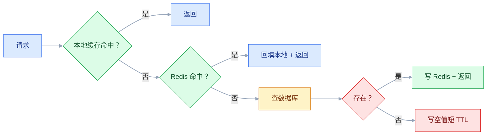

# 缓存与数据扩展

## 一、工程案例：商品详情页从 800 ms 降到 80 ms，且不被缓存击穿

**场景**：商品详情页 QPS 2 万，数据库单表 1 亿行。现在每次请求查 5 张表，P99 800 ms，大促时数据库 CPU 90%。团队加了 Redis，但出现新问题：缓存与数据库不一致，用户看到旧价格；热点商品缓存失效瞬间，数据库被打穿；大量不存在的商品 ID 请求穿透到数据库；Redis 挂了，整个详情页不可用。

**目标**：不做“加个 Redis 就完事”，交付一套可解释、可降级、可对账的缓存方案：

- 一张缓存读写流程；
- 一套缓存一致性规则；
- 一套穿透、击穿、雪崩、热 key 的防护；
- 一张多级缓存与降级方案；
- 一份验收清单（8 项）。

**为什么必须做**：缓存不是“性能补丁”，是“数据副本”。副本就有一致性、失效、容量、故障问题。只会上缓存，不会管失效，迟早被缓存反噬。

**动手前确认**：先看真实访问分布：热 key 占比、命中率、DB QPS、缓存 RT、失效频率。没有这些，缓存策略只能拍脑袋。下面的数据是示例。

### 1.1 缓存模式

| 模式 | 读 | 写 | 适合 |
|---|---|---|---|
| Cache-Aside | 先读缓存，未命中查库回填 | 先写库，再删缓存 | 大多数业务 |
| Read-Through | 缓存层负责回源 | 缓存层负责写 | 缓存中间件支持 |
| Write-Through | 读缓存 | 写缓存，缓存同步写库 | 写少读多、强一致要求 |
| Write-Behind | 读缓存 | 写缓存，异步刷库 | 写多、可容忍丢失 |

大多数业务用 Cache-Aside。它简单，但“写库 + 删缓存”不是原子的，需要处理并发。

### 1.2 一致性

| 方案 | 做法 | 问题 |
|---|---|---|
| 先删缓存再写库 | 删缓存 → 写库 | 并发读会回填旧值 |
| 先写库再删缓存 | 写库 → 删缓存 | 删除失败会留旧值 |
| 延迟双删 | 写库 → 删缓存 → 延迟再删 | 延迟时间难定 |
| 订阅 binlog | 写库 → binlog → 删缓存 | 有延迟，但可靠 |
| 版本号 | 缓存带版本，写库递增 | 读时校验版本 |

推荐“先写库、再删缓存、binlog 兜底”。删除失败要重试；缓存 TTL 是最后一道保险。

### 1.3 穿透、击穿、雪崩

| 问题 | 现象 | 方案 |
|---|---|---|
| 穿透 | 查不存在的数据，缓存不命中，打到 DB | 空值缓存、布隆过滤器、参数校验 |
| 击穿 | 热 key 过期瞬间，大量请求打到 DB | 互斥锁/单飞、逻辑过期、永不过期+异步刷新 |
| 雪崩 | 大量 key 同时过期或 Redis 挂 | TTL 随机、集群、降级、本地缓存 |

三个问题的根因不同，不要用一个方案硬套。

### 1.4 热 key

热 key 是“单个 key 的 QPS 远超其他 key”，比如爆款商品、热搜。

| 方案 | 说明 |
|---|---|
| 本地缓存 | 热点放 JVM 本地，减少 Redis 调用 |
| key 拆分 | 把一个 key 拆成多个副本，分散到不同节点 |
| 读写分离 | 热 key 走多个从节点 |
| 限流 | 保护后端，宁可排队 |
| 预热 | 大促前提前加载 |

热 key 不要只靠“加 Redis 节点”，单 key 仍然落在一个分片。

### 1.5 多级缓存

多级缓存的难点是“本地缓存怎么失效”。方案：发布订阅、版本号、短 TTL、定时刷新。没有失效机制，本地缓存会长期脏读。

### 1.6 缓存容量与淘汰

| 策略 | 说明 |
|---|---|
| LRU | 最近最少使用 |
| LFU | 最少使用频率 |
| TTL | 过期时间 |
| 最大内存 | 超过阈值淘汰 |

缓存不是越大越好。容量要按“热数据 + 余量”估，淘汰策略要匹配访问分布。

### 1.7 降级

Redis 挂了怎么办？

| 方案 | 说明 |
|---|---|
| 本地缓存兜底 | 短时间扛住读 |
| 限流 | 保护数据库 |
| 返回旧值 | 允许短时不一致 |
| 静态兜底 | 商品详情页静态化 |
| 熔断 | 快速失败，避免雪崩 |

缓存故障不是“缓存团队的事”，业务要有降级预案。

### 1.8 验收（8 项）

1. 命中率：核心页面缓存命中率 ≥ 90%，热 key ≥ 95%。
2. 一致性：写后读，1 秒内看到新值；并发写不出现旧值覆盖。
3. 穿透：随机 10 万个不存在 ID，DB QPS 不超过基线 1.5 倍。
4. 击穿：热 key 过期瞬间，DB QPS 不超过基线 2 倍。
5. 雪崩：Redis 停 1 分钟，页面可用（本地缓存/降级），恢复后自动回填。
6. 热 key：单 key 2 万 QPS，无单节点打满。
7. 容量：缓存内存 ≤ 80%，淘汰策略生效。
8. 监控：命中率、RT、内存、热 key、大 key 有告警。

## 二、高频问答：会卡住你的地方，也是面试最常问的

### 2.1 缓存就是 Redis

**现场**

怎么判断：问三句——失效怎么做、一致性怎么保、Redis 挂了怎么办。三个都没答案，就是只会装 Redis。

**要点**

- 缓存是“数据副本 + 失效策略 + 降级方案”的组合，Redis 只是其中一种实现。
- 只上 Redis 不管失效，等于给自己造了一个长期的脏读源。
- 本地缓存、CDN、浏览器缓存都算缓存，用哪层看数据特征。

**追问**

- 什么时候不该用缓存？→ 写多读少、强一致要求高、数据量小到数据库能扛。
- 缓存和数据库谁先写？→ 先写库再删缓存，别双写。
- Redis 挂了页面还能开吗？→ 看有没有本地缓存和降级，没有就是整套不可用。

### 2.2 写完库删缓存就一致了

**现场**

做并发写读测试。出现旧值，就是没处理回填竞态。

**要点**

- 并发读可能在删缓存之后回填旧值，删了也会被写回去。
- 删除失败会长期不一致，TTL 只是最后一道保险。
- 推荐“先写库、再删缓存、binlog 兜底”，删除失败要重试。

**追问**

- 延迟双删解决什么？→ 给并发读的回填留出窗口再删一次，但延迟时间难定。
- 为什么要 binlog 兜底？→ 应用侧删失败时，订阅变更再删一次，可靠性更高。
- 双写为什么不行？→ 两步不是原子的，任何一步失败都会不一致。

### 2.3 缓存穿透加布隆过滤器就完了

**现场**

问误判率多少、数据更新怎么处理。只上布隆过滤器不够。

**要点**

- 布隆过滤器有误判率，且不支持删除，数据变了要重建。
- 穿透的完整方案是空值缓存 + 布隆过滤器 + 参数校验 + 限流。
- 空值缓存要设短 TTL，否则真实数据出现后仍然读不到。

**追问**

- 布隆过滤器误判会怎样？→ 不存在的 key 被判为存在，请求还是打到数据库，但量被压得很低。
- 支持删除的替代是什么？→ 布谷鸟过滤器，但实现复杂。
- 空值缓存会不会被刷爆？→ 会，所以要短 TTL 加参数校验和限流。

### 2.4 热 key 加节点就行

**现场**

看单 key QPS 和节点分布。单节点打满就是热 key。

**要点**

- 单 key 只落一个分片，加节点不会拆分单 key。
- 热 key 要本地缓存、key 拆分、读写分离、限流、预热组合用。
- 加节点只解决“总量分摊”，不解决“单点集中”。

**追问**

- key 拆分怎么读？→ 拆成 N 个副本，读时随机选一个。
- 本地缓存不是有失效问题吗？→ 有，热 key 用短 TTL 或发布订阅，接受秒级旧值。
- 热 key 怎么提前发现？→ 采样统计单 key QPS，大促前按商品维度预判。

### 2.5 本地缓存一定更快

**现场**

问多实例怎么失效、重启怎么办。答不上来就是没设计。

**要点**

- 本地缓存没有网络开销，但失效难、内存小、进程重启就丢。
- 多实例之间的一致性要靠发布订阅、版本号或短 TTL。
- 本地缓存适合热 key 和高频只读数据，不适合当唯一副本。

**追问**

- 多实例怎么通知失效？→ 发布订阅广播，或带版本号让读方自己校验。
- 重启后缓存空了怎么办？→ 预热或延迟摘流，别让冷实例直接接全量。
- 本地缓存能存多少数据？→ 按进程内存算，通常只放最热的一小部分。

### 2.6 TTL 随机就能防雪崩

**现场**

做 Redis 宕机演练。页面不可用，就是没做降级。

**要点**

- 随机 TTL 只防“大量 key 同时过期”这一种情况。
- Redis 挂、热点集中、预热不足仍会雪崩。
- 雪崩防护是高可用 + 本地缓存 + 限流降级 + 预热，组合起来才有效。

**追问**

- Redis 主从切换期间请求怎么办？→ 本地缓存兜底 + 限流，别让请求直接压数据库。
- 预热为什么能防雪崩？→ 缓存里始终有热数据，过期也不会同时打穿。
- 限流阈值怎么定？→ 按数据库能承受的 QPS 定，不是按业务峰值定。

### 2.7 缓存数据越多越好

**现场**

看命中率/内存比。缓存大量冷数据但命中率不升，就是浪费。

**要点**

- 缓存容量有限，冷数据会挤掉热数据。
- 内存成本和淘汰开销都随数据量上升。
- 容量按“热数据 + 余量”估，淘汰策略要匹配访问分布。

**追问**

- 命中率多少算健康？→ 核心页面 90% 以上，热 key 95% 以上。
- LRU 和 LFU 怎么选？→ 访问分布稳定用 LFU，变化快用 LRU。
- 缓存内存到多少要报警？→ 80% 左右，留出淘汰和突发余量。

### 2.8 大 key 只是慢一点

**现场**

看单 key 大小和 RT。超过阈值就要拆分。

**要点**

- 大 key 会阻塞网络、增加序列化开销，拖慢整个分片。
- 删除大 key 也可能阻塞，要用异步删除。
- 大 hash/list 要按字段或分片拆成多个小 key。

**追问**

- 多大算大 key？→ 按业务定阈值，通常 string 几 KB、集合元素上千就要关注。
- 怎么发现大 key？→ 定期扫描或采样统计单 key 大小。
- 异步删除怎么用？→ Redis 的 unlink 代替 del，把释放交给后台线程。

### 2.9 缓存和数据库双写最方便

**现场**

问写库成功、写缓存失败怎么办。没有补偿就是不一致。

**要点**

- 双写不是原子操作，任何一方失败都会不一致。
- 并发写会互相覆盖，先写的可能后到。
- 推荐先写库再删缓存，删除失败重试，binlog 兜底。

**追问**

- 双写和删缓存差在哪？→ 删缓存让下次读回填，避免两份数据互相覆盖。
- 缓存写失败能重试吗？→ 能，但要幂等，还要防止旧值覆盖新值。
- 强一致场景怎么办？→ 别把缓存当读路径，或读写都走主库，缓存只做旁路。

### 2.10 缓存不需要监控

**现场**

看命中率、内存、RT、连接数、热 key、大 key 告警。

**要点**

- 缓存是透明层，但它的故障会直接变成数据库故障。
- 命中率下降、内存打满、热 key、大 key、连接数打满都会导致故障。
- 没有监控就是盲跑，出事只能靠用户投诉发现。

**追问**

- 最该先监控哪个指标？→ 命中率，它一掉数据库压力立刻上来。
- 命中率掉了怎么查？→ 看是不是 key 批量过期、数据变更频繁或缓存节点被驱逐。
- 要监控内存碎片吗？→ 要，碎片率高会让实际可用内存远低于配置。

## 三、核心知识

### 3.1 缓存的价值

缓存解决三个问题：

- 降低数据库读压力；
- 降低 RT；
- 削峰/抗热点。

代价：一致性、内存、失效、故障、运维。

> **面试**：常问「加缓存的代价是什么？」答：一致性、内存、失效、故障、运维，缓存是数据副本，不是免费的加速。

### 3.2 缓存读写模式

| 模式 | 一致性 | 性能 | 复杂度 |
|---|---|---|---|
| Cache-Aside | 中 | 高 | 低 |
| Read-Through | 中 | 高 | 中 |
| Write-Through | 高 | 中 | 中 |
| Write-Behind | 低 | 高 | 高 |

### 3.3 一致性策略

| 策略 | 适用 |
|---|---|
| 先写库再删缓存 | 大多数 |
| 延迟双删 | 并发写多 |
| binlog 订阅 | 可靠性要求高 |
| 版本号 | 读多写少、可校验 |
| TTL 兜底 | 所有方案 |

缓存一致性是“最终一致”，不是“强一致”。业务要能接受短时旧值。

> **面试**：常问「先删缓存还是先写库？」答：先写库再删缓存，配重试和 binlog 兜底，缓存一致性只能是最终一致。

### 3.4 穿透

| 方案 | 说明 |
|---|---|
| 空值缓存 | 不存在的数据缓存短 TTL |
| 布隆过滤器 | 预判是否存在 |
| 参数校验 | 非法 ID 直接拒绝 |
| 限流 | 保护数据库 |

### 3.5 击穿

| 方案 | 说明 |
|---|---|
| 互斥锁 | 只允许一个请求回源 |
| 单飞（SingleFlight） | 同 key 请求合并 |
| 逻辑过期 | 不设物理 TTL，异步刷新 |
| 永不过期 | 后台更新 |

> **面试**：常问「击穿怎么防？」答：互斥锁或单飞只放一个请求回源，或用逻辑过期先返回旧值再异步刷新。

### 3.6 雪崩

| 方案 | 说明 |
|---|---|
| TTL 随机 | 避免同时过期 |
| 高可用 | Redis 集群/哨兵 |
| 本地缓存 | 兜底 |
| 限流降级 | 保护 DB |
| 预热 | 大促前加载 |

### 3.7 热 key

| 方案 | 说明 |
|---|---|
| 本地缓存 | 减少远程调用 |
| key 拆分 | 多副本 |
| 读写分离 | 多从节点 |
| 限流 | 保护后端 |
| 预热 | 提前加载 |

> **面试**：常问「热 key 加 Redis 节点能解决吗？」答：不能，单 key 只落一个分片，要本地缓存、key 拆分或读写分离。

### 3.8 多级缓存

| 层 | 优点 | 缺点 |
|---|---|---|
| 本地 | 快 | 失效难、内存小 |
| 分布式 | 共享、容量大 | 网络开销 |
| CDN | 边缘、静态 | 动态内容不适合 |

本地缓存失效方案：发布订阅、版本号、短 TTL、定时刷新。

### 3.9 容量与淘汰

| 策略 | 适用 |
|---|---|
| LRU | 通用 |
| LFU | 热点稳定 |
| TTL | 时效数据 |
| 随机 | 简单 |

容量按“热数据 + 30% 余量”估，定期分析命中率和淘汰率。

### 3.10 监控

| 指标 | 说明 |
|---|---|
| 命中率 | 缓存效果 |
| RT | 缓存延迟 |
| 内存 | 容量 |
| 连接数 | 客户端 |
| 热 key | 单 key QPS |
| 大 key | 单 key 大小 |
| 淘汰 | 是否频繁 |

## 四、冷门知识汇总

- **布隆过滤器**：用位数组判断“可能存在/一定不存在”，有误判、不支持删除。适合穿透防护，不适合精确计数。
- **布谷鸟过滤器**：支持删除、空间效率高，但实现复杂。适合需要删除的集合判断。
- **单飞（SingleFlight）**：同一 key 的并发请求合并成一次回源，避免击穿。Go 的 `singleflight` 是典型实现。
- **逻辑过期**：缓存不设物理 TTL，值里带过期时间；读到过期时异步刷新，先返回旧值。
- **缓存预热**：大促前把热数据加载到缓存，避免冷启动打穿数据库。
- **TTL 抖动**：在基础 TTL 上加随机值，避免大量 key 同时过期。
- **热 key 拆分**：把 `hot:sku:1` 拆成 `hot:sku:1:0..N`，读时随机选一个副本。
- **大 key 拆分**：把大 hash/list 拆成多个小 key，按字段/分片读。
- **Redis 集群的 hash slot**：16384 个槽，key 按 CRC16 映射；单 key 只在一个槽，加节点不会拆单 key。
- **缓存与数据库双写**：不是原子操作，推荐“写库 + 删缓存 + binlog 兜底”。
- **缓存一致性是谱系**：强一致、读己之写、有界旧值、最终一致；业务要选一个可接受的。
- **缓存不是数据库**：不能把缓存当唯一存储；Redis 持久化不等于数据库备份。
- **CDN 缓存**：静态资源、图片、视频；动态内容要谨慎，缓存键和回源策略要设计。
- **缓存击穿与雪崩的区别**：击穿是单 key 过期，雪崩是大量 key 同时失效或缓存层故障。
- **缓存穿透与击穿的区别**：穿透是查不存在的数据，击穿是热 key 失效。
- **缓存污染**：大量冷数据进入缓存，挤掉热数据；要控制写入范围和容量。
- **缓存降级**：Redis 故障时，本地缓存/静态页/限流/旧值兜底，不是“直接挂”。