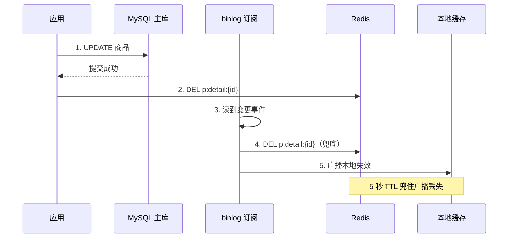

# 缓存与数据扩展

> 这篇从缓存的收益模型讲起，经过缓存读写模式、一致性策略、穿透/击穿/雪崩、热 key 与大 key、多级缓存和内存治理，最后落到读写与数据扩展的推进顺序和一次商品详情页的缓存改造案例。
>
> 学完能独立设计一套带命中率目标的缓存方案，处理一致性和热点问题，并判断读扩展到哪一层该停下来。

## 一、缓存的收益模型

缓存的作用不是“让系统变快”，而是**用内存换掉一部分到存储层的流量和延迟**。收益必须量化为两个数：命中率和回源量。不做量化，缓存只是把风险从数据库搬到了内存。

### 1.1 命中率决定回源量

设总请求量为 Q，命中率为 h，则：

```text
回源量 = Q × (1 - h)
平均 RT = h × 缓存RT + (1 - h) × 回源RT
```

以 20,000 QPS 的读接口、缓存 RT 2ms、回源 RT 25ms 为例（数字为示例）：

| 命中率 | 回源 QPS | 数据库压力 | 平均 RT |
|---:|---:|---|---:|
| 70% | 6,000 | 严重过载 | 8.9ms |
| 85% | 3,000 | 高 | 5.5ms |
| 95% | 1,000 | 中 | 3.2ms |
| 99% | 200 | 低 | 2.2ms |

命中率从 95% 掉到 90%，回源量直接翻倍。**命中率对回源量的杠杆是 1/(1-h)**：命中率越高，波动越致命。这也是为什么命中率的监控告警要比 QPS 告警更敏感。

### 1.2 缓存的成本与不适用场景

缓存引入四类成本，每一类都要在方案里回答：

| 成本 | 表现 | 对策 |
|---|---|---|
| 一致性 | 读到旧值 | 失效策略 + TTL 兜底 |
| 复杂度 | 多一层故障面 | 降级开关 + 熔断 |
| 内存 | 热数据全量放不下 | 容量规划 + 淘汰 |
| 雪崩 | 缓存故障压垮 DB | 限流 + 本地兜底 |

不适用缓存的场景必须明确排除：

- 强一致读写：账户余额、库存扣减的判定路径，缓存只能做展示加速；
- 写多读少：写入既要更新存储又要失效缓存，得不偿失；
- 一次性访问：没有复用就没有命中，冷数据只浪费内存；
- 低 QPS 且延迟不敏感：加缓存的复杂度超过收益。

> 边界：缓存的第一定律是“读得多、改得少、能容忍短暂旧值”。三条不满足任何一条，先别加缓存，先改存储或改架构。

## 二、缓存读写模式

读写模式决定一致性行为和故障面。选模式的原则：**默认 Cache-Aside，特殊场景才升级到更复杂的模式**。

### 2.1 四种模式

| 模式 | 读路径 | 写路径 | 一致性 | 适用 |
|---|---|---|---|---|
| 旁路缓存 Cache-Aside | 先查缓存，miss 回源再回填 | 先更新 DB，再删缓存 | 最终一致 | 绝大多数业务 |
| 读穿透 Read-Through | 缓存层代为回源 | 应用写 DB | 最终一致 | 组件化缓存 |
| 写穿透 Write-Through | 同 Cache-Aside | 同步写缓存和 DB | 较强 | 缓存即权威层 |
| 写后异步 Write-Behind | 同 Cache-Aside | 先写缓存，异步刷 DB | 弱 | 高写吞吐可容忍丢失 |


Write-Behind 的吞吐最高，但缓存崩溃时未刷盘的数据会丢。计数器、浏览量这类可丢数据可以用；订单、支付绝对不行。

### 2.2 为什么写路径是删除而不是更新

写操作应该**更新数据库，然后删除缓存**，而不是更新缓存。原因有两个：

- 并发写时，两个写请求的“更新缓存”顺序可能与数据库提交顺序相反，缓存里留下旧值，且永远不会自愈；
- 删除让下一次读触发回源，天然收敛到数据库的值；缓存的值永远只来自一次完整的回源读。

先删缓存再更新数据库同样错误：删除后、提交前的窗口里，并发读会把旧值回填进缓存。正确顺序是**先提交数据库，再删缓存**。这个顺序的剩余窗口（提交成功到删除完成之间）用 2.3 的策略收窄。

### 2.3 写后读的一致性窗口

读写分离场景下还有一个放大器：写主库、读从库。写请求删除缓存后立刻读，从库还没同步，读到旧值并回填，缓存里从此挂上旧值直到 TTL 过期。

| 策略 | 做法 | 边界 |
|---|---|---|
| 写后短窗强制读主 | 写后 1–3 秒内该 key 路由主库 | 牺牲少量读扩展 |
| 延迟双删 | 写后删一次，延迟 500ms–1s 再删一次 | 延迟要覆盖主从同步 |
| 订阅 binlog 失效 | 监听变更事件删缓存 | 链路长，需处理乱序 |
| 版本号比较 | 回源时带版本，旧版本不回填 | 需要存储支持版本 |

延迟双删是性价比最高的兜底：实现只要一个延迟任务，代价是删除期间的两次 miss。binlog 订阅（Canal / Debezium 类方案）覆盖面最全，还能顺带处理多写入口，但要接受秒级延迟和处理乱序的复杂度。

一个带 binlog 兜底的完整写路径如下：



第 2 步是主路径，第 4 步兜住“应用删缓存失败或多写入口漏删”，第 5 步的本地广播丢包由短 TTL 封顶。三层各管一段窗口，任何一层失效都不会造成永久不一致。

写路径的方案选择可以压成一张决策表：

| 条件 | 首选写路径 | 兜底 |
|---|---|---|
| 单写入口 | 更新 DB 后删缓存 | TTL |
| 多写入口 | binlog 订阅失效 | 短 TTL |
| 写后立即读 | 写后 1–3 秒读主库 | 延迟双删 |
| 主从延迟大 | binlog 事件带位点，延迟消费 | 版本号比较 |

> 边界：所有策略都是收窄窗口，不是消灭窗口。TTL 是唯一可靠的兜底——没有 TTL 的缓存等于把“最终一致”承诺成“永不一致”。

## 三、穿透、击穿与雪崩

三个问题的触发条件不同，对策也不同。混用对策是最常见的错误：用布隆过滤器防击穿、用随机 TTL 防穿透，都是无效的。

### 3.1 三者对照

| 问题 | 触发条件 | 典型场景 | 核心对策 |
|---|---|---|---|
| 穿透 | 查询不存在的数据 | 恶意扫描、爬虫 | 空值缓存、布隆过滤器 |
| 击穿 | 单个热 key 过期瞬间 | 秒杀商品、热搜词条 | 互斥回源、逻辑过期 |
| 雪崩 | 大量 key 同时失效 | 批量预热后集中过期 | 随机 TTL、多级缓存 |

穿透的本质是**缓存对“不存在”无话可说**：miss 之后回源，数据库也没有，缓存依然不命中，下一次请求继续回源。攻击者用一个不存在的 key 就能把数据库打满。

击穿是单个 key 的瞬时问题：过期后 1 毫秒内到达的几百个并发请求全部 miss，全部回源。数据库只多承受一次查询的量，却是几百次。

雪崩是批量问题：批量导入时统一设置 24 小时 TTL，24 小时后百万 key 在同一分钟失效，回源洪峰直接打垮数据库；或者 Redis 集群本身故障，全部流量瞬间落到数据库。

### 3.2 穿透的三层防线

第一层是参数校验：ID 格式、范围、白名单，在入口就拒绝明显非法的查询。成本最低，拦截面最大。

第二层是空值缓存：数据库确认不存在的 key，也写进缓存，值用一个约定的空对象，TTL 设短（30–60 秒）。它只覆盖同一个不存在的 key 被反复查询的情况；攻击者不断换 key 时拦不住，要配合布隆过滤器或入口限流。

第三层是布隆过滤器（Bloom Filter）：在缓存之前判断“这个 key 一定不存在”。它的容量由误判率决定：

```text
位数组大小 m = -n × ln(p) / (ln2)²
哈希函数个数 k = (m / n) × ln2
```

一亿个 key、目标误判率 1%，需要约 114 MiB（1.2 亿字节）位数组和 7 个哈希函数。误判率降到 0.1%，内存增长到约 171 MiB。

| 参数 | 取值 | 说明 |
|---|---:|---|
| key 数 n | 1 亿 | 全量业务 key |
| 误判率 p | 1% | 1% 的不存在 key 会漏到缓存 |
| 位数组 m | 约 114 MiB | 内存成本 |
| 哈希个数 k | 7 | CPU 成本 |

> 边界：布隆过滤器说“不存在”是确定的，说“存在”是概率的。它只能拦截穿透，不能拦截击穿。key 会持续新增的场景还要处理重建（计数布隆或定期全量重建），否则新 key 会被误判为不存在。

### 3.3 击穿：互斥与逻辑过期

击穿的解法是**让并发 miss 只产生一次回源**：

| 方案 | 做法 | 代价 |
|---|---|---|
| 互斥锁/单飞 | 同一 key 只放一个请求回源，其余等待或返回旧值 | 等待请求延迟上升 |
| 逻辑过期 | 值内带过期时间，过期后返回旧值并异步重建 | 返回旧值 |
| 热点永不过期 | 热 key 物理不过期，靠变更事件主动刷新 | 需要可靠的变更通知 |

单飞（singleflight）是互斥的实现形式：进程内对同一 key 的回源合并为一次调用，其余请求共享结果。逻辑过期适合“宁可旧值也不超时”的场景：缓存里存 `{value, expireAt}`，读到 `expireAt` 过了就返回旧值、异步触发重建，用户侧永远不 miss。

互斥方案要设置等待超时：数据库回源本身要 2 秒时，等 500ms 的请求应直接降级返回默认值，否则互斥把击穿变成了雪崩。

### 3.4 雪崩：随机 TTL 与兜底

雪崩的对策分三层：

- 事前：TTL 加随机抖动，`TTL = base + random(0, base × 0.2)`，把集中失效摊成一段窗口；
- 事中：回源加限流和熔断，数据库先保命；本地缓存兜底热数据；
- 底座：缓存集群本身高可用（哨兵/集群模式），故障转移时间纳入容量模型。

```text
TTL 设置示例：
商品详情 base 300s，随机 ±60s
类目树    base 3600s，随机 ±600s
配置项    base 60s，随机 ±10s
```

批量预热同样要错峰：一百万 key 分十分钟写入，TTL 起点再叠加上写入时刻的抖动。

> 边界：随机 TTL 防的是“集中失效”，防不了“缓存宕机”。防宕机只能靠集群高可用和限流降级，这两项必须进容量规划，而不是进缓存文档。

## 四、热 key 与大 key

热 key 是**流量分布问题**，大 key 是**单条数据体积问题**。两者的危害不同，处理手段也完全不同。

### 4.1 热 key 的发现

热 key 指访问频率远超均值的 key。经验判据：单 key QPS 超过集群单节点均值的 10 倍，或单 key 占节点带宽的 20% 以上。发现手段按侵入性排列：

| 手段 | 命令/方式 | 注意 |
|---|---|---|
| LFU 统计 | `redis-cli --hotkeys` | 需 `maxmemory-policy` 为 LFU |
| 大流量采样 | `MONITOR` | 只能短时用，本身有开销 |
| 客户端埋点 | 应用内 TopN 统计 | 最准确，需开发 |
| 代理层统计 | 代理/网关日志聚合 | 多一层依赖 |
| 业务预判 | 秒杀商品、热搜词条 | 上线前录入 |

```bash
redis-cli --hotkeys
# 预期输出（示例）：
# #-------- scans: 2,000 keys, hit rate 41.2%
# 1) "product:detail:10086"  hits: 18,442  age: 300s
# 2) "product:detail:10024"  hits: 12,031  age: 298s
```

### 4.2 热 key 的处理

热 key 打满单个分片时，有四条路径：

| 方案 | 做法 | 边界 |
|---|---|---|
| 本地缓存 | 实例内存缓存热 key，TTL 秒级 | 一致性窗口变长 |
| key 打散 | `key:shard:0..N-1` 写 N 份副本 | 读到旧副本，只适合可多副本读 |
| 读写分离 | 热 key 读走副本 | 副本延迟 |
| 限流预热 | 提前加载 + 入口排队 | 需要业务配合 |

打散的代价必须想清楚：N 份副本意味着 N 倍内存、N 个失效点、以及“读到旧副本”的概率随 N 上升。商品标题、图片 URL 这类可短暂旧值的数据适合打散；库存余量这种判定值不行——它需要的是本地缓存加短 TTL 加入口限流，而不是副本。

### 4.3 大 key 的发现与拆分

大 key 经验阈值：String 超过 10KB，集合类型元素超过 5,000 或总量超过 1MB。危害集中在三处：单次操作阻塞主线程（Redis 单线程处理命令）、网络传输拥塞、删除和迁移时卡顿。

```bash
redis-cli --bigkeys
# 预期输出（示例）：
# -------- summary -------
# Biggest string: "order:list:u881" 12,031 bytes
# Biggest   hash: "product:props:10086" 18,204 members

redis-cli MEMORY USAGE product:props:10086
# (integer) 184560   # 含编码开销的实际内存
```

大 key 扫描用 `--bigkeys` 做周期巡检，精确测量用 `MEMORY USAGE`，遍历用 `SCAN` 而不是 `KEYS`。删除大集合用 `UNLINK`（异步）而不是 `DEL`（同步阻塞）。

拆分方式按类型选择：

| 类型 | 拆分方式 | 示例 |
|---|---|---|
| 大 String | 分段存储 | 长文本按 4KB 分段 |
| 大 Hash | 按 field 分桶 | `props:{id}:0..9` |
| 大 List | 拆队列 + 游标 | 分页读 |
| 大 ZSet | 按分数分区间 | 排行榜分段 |

> 边界：拆分把一次操作变成多次，回源逻辑和内存总量都要重算。先确认这个 key 是否真的被完整读取——很多大 key 是“一次写入、只读头部”，把读取改成分页比拆 key 更便宜。

## 五、多级缓存

单层缓存的命中率有物理上限：本地缓存受实例内存限制，远程缓存受网络 RTT 限制。命中率要求超过 95% 时，要靠多级叠加。

### 5.1 三级结构与命中率相乘

| 层级 | 位置 | 典型 RT | 典型 TTL | 容量 |
|---|---|---:|---:|---|
| L1 本地 | 进程内 | 0.001ms | 1–10 秒 | 10⁴ keys |
| L2 远程 | Redis 集群 | 1–2ms | 5–60 分钟 | 10⁷–10⁸ |
| L3 存储 | 数据库 | 10–100ms | — | 无限 |

总命中率的计算方式是逐层相乘：

```text
总命中率 = 1 - (1 - h1) × (1 - h2)
```

本地 55% 加远程 88%，总命中率为 `1 - 0.45 × 0.12 = 94.6%`。反过来算目标也用它：要 95% 总命中率、远程只能做到 90%，本地必须做到 50%。

### 5.2 各层的分工

L1 的职责是**吃掉最热的那部分流量**：秒杀商品、热搜词条、系统配置。TTL 必须短（秒级），因为本地缓存的失效要靠广播或 TTL，一致性窗口最长。容量要设上限并按访问频率淘汰，防止被冷 key 撑爆堆内存。

L2 的职责是**承接主流读流量和挡住回源**。容量按热数据全量规划：热数据量 × 1.5 倍余量，超出的靠淘汰策略兜底。

L3 是唯一权威源。缓存层的一切设计都建立在这个前提上：任何缓存数据都可以丢弃，丢弃后系统只是变慢，不是变错。

### 5.3 本地缓存的一致性

本地缓存的最大问题是失效不收敛：广播可能丢、多实例同时收到又各自回源。工程上用“短 TTL + 广播 + 版本号”三件套：

- 广播失效（Redis pub/sub 或 MQ）：数据变更时通知所有实例删除本地 key，作为主要手段；
- 短 TTL：1–5 秒，作为广播丢失的兜底，把不一致窗口封顶；
- 版本号：本地缓存记录数据版本，变更时递增，读到旧版本不回填。

```text
本地缓存 TTL 选择（示例）：
商品标题/图片   5 秒   用户可容忍旧值
库存展示值      1 秒   展示旧值可接受，判定走 DB
个人化数据      不缓存  命中率低且易膨胀
```

> 边界：实例数乘以本地缓存容量才是真实内存成本。100 个实例各缓存 200MB，等于 20GB 总内存，而且这 20GB 无法共享、无法持久。本地缓存只放“每个实例都会被高频访问”的数据。

## 六、内存治理

Redis 的内存不是“能放多少是多少”，而是一组需要主动治理的预算。内存问题的第一现场几乎总是延迟抖动，而不是 OOM 报错。

### 6.1 maxmemory 与淘汰策略

`maxmemory` 建议设为物理内存的 70%–80%，剩余留给复制缓冲、AOF 重写、fork 时写时复制的页表开销。超过 maxmemory 后按策略淘汰：

| 策略 | 范围 | 行为 | 适用 |
|---|---|---|---|
| noeviction | 全部 | 拒绝写，返回 OOM | 缓存必须完整的场景 |
| allkeys-lru | 全部 | 淘汰最久未用 | 通用缓存 |
| volatile-lru | 有 TTL | 只淘汰有 TTL 的 | KV 混存 |
| allkeys-lfu | 全部 | 淘汰最少使用 | 有明显热度差异 |
| volatile-ttl | 有 TTL | 优先淘汰快过期的 | 希望自然过期 |

缓存场景默认 `allkeys-lru`；流量有明显热度分布（少数 key 占大头）用 `allkeys-lfu`。`noeviction` 用于“缓存也是权威数据”的极端场景，此时它已经不是缓存，需要按存储标准做持久化和容量规划。

### 6.2 过期与删除

过期 key 的删除是惰性的：访问时发现过期才删，加上后台每秒 10 次的主动采样（每次最多 20 个）。这意味着大量同时过期的 key 不会瞬间释放内存——它们先变成“逻辑过期”，内存缓慢回收。容量规划要按“过期后仍占用一段时间”估算。

同步 `DEL` 大 key 会阻塞主线程，改用 `UNLINK` 放到后台线程。批量清理用 `SCAN` 分批，每批之间 sleep，避免打满 CPU。

### 6.3 碎片与监控指标

碎片率 `mem_fragmentation_ratio = used_memory_rss / used_memory`，健康区间 1.0–1.5。超过 1.5 说明大量内存被碎片占据；低于 1.0 说明发生了 swap，是更严重的信号。

监控的五个核心指标与告警线：

| 指标 | 告警线 | 说明 |
|---|---:|---|
| 内存使用率 | 75% | 接近淘汰区间 |
| 命中率 | 低于基线 5pp | 突降说明 key 失效异常 |
| 碎片率 | >1.5 | 碎片治理 |
| 主从延迟 | >1s | 复制积压 |
| 慢查询 | >10ms | 大 key 或热 key |

命中率告警要基于自身基线而非绝对值：一个常年 99% 的服务掉到 92% 是事故，一个常年 80% 的服务到 92% 是改善。

### 6.4 持久化对容量的影响

RDB 通过 fork 子进程快照，fork 瞬间要复制页表，内存越大越慢；写时复制会让子进程内存额外增长，极端情况下翻倍。AOF 重写同理。内存预算里要给 fork 峰值留出空间，这决定了 70%–80% 上限的来源——纯缓存场景可以直接关闭持久化，用预热代替恢复。

## 七、数据扩展：读、写与迁移

缓存解决读压力，解决不了写压力和数据规模。数据扩展要按“读 → 写 → 迁移”的顺序推进，每一步用尽上一层的容量再进入下一层。

### 7.1 读扩展的阶梯

| 阶梯 | 手段 | 承载上限 | 迁入条件 |
|---|---|---|---|
| 1 | 单库 + 缓存 | 命中率可维持时无上限 | 默认 |
| 2 | 读写分离 | 读 QPS × 副本数 | 主库读压力高 |
| 3 | 分库分表 | 写 QPS 和数据量 | 写入见顶或单表超大 |

阶梯 1 的上限取决于命中率：只要命中率能维持，数据库读压力就是 `Q × (1-h)`，与业务增长解耦。因此**读扩展的第一件事永远是修缓存，不是加副本**。

读写分离把读流量导到副本，但要处理三件事：主从延迟下的读旧值（见 2.3）、写后读的路由（强制走主库的窗口）、复制延迟监控。副本数不是越多越好——每个副本都拉全量 binlog，写入压力会随副本数放大。

### 7.2 写扩展的分界

缓存对写入无能为力：每一次写都要落到存储。写入见顶的信号是主库写入 QPS 持续超过单库安全水位、binlog 写入堆积、行锁冲突频繁。此时进入分库分表，分片键选择、路由和全局 ID 属于《03-存储选型与分库分表》的范围。

从缓存视角对分库分表的约束有三条：

- 缓存 key 里通常要包含分片键，否则一次缓存 miss 无法定位分片，退化为全分片广播；
- 分片扩容会改变路由，必须让缓存 key 的分片键部分与路由规则解耦；
- 双写迁移期间，缓存失效要同时覆盖新老两个数据源，否则灰度读会拿到旧值。

### 7.3 双写迁移与对账

存量数据换存储（换库、分片化、异构迁移）的标准路径是五步，缓存全程参与：

1. **双写**：新写路径同时写新老存储，以老存储为准；
2. **存量同步**：全量搬运老数据到新存储，追平增量；
3. **对账**：定期抽样比对两边数据，差异率收敛到零；
4. **灰度读**：按流量比例把读切到新存储，先 1% 后 10% 再全量；
5. **切写**：写路径切到新存储为准，老存储降级为备份，观察一个周期后下线。

对账要按 key 分桶比对而不是全量扫描，差异要能定位到具体时间点。缓存在这个过程中的角色是“加速灰度读”，但**切流量的每一档都要清掉相关缓存**，否则灰度读读到的是上一档的旧值，对账结论全部失真。

### 7.4 扩容顺序与成本对照

| 方案 | 单位成本 | 见效速度 | 上限 | 风险 |
|---|---|---|---|---|
| 提升命中率 | 近乎零 | 快 | 命中率天花板 | 一致性窗口 |
| 加 Redis 副本/分片 | 低 | 快 | 内存总量 | 运维复杂度 |
| 加只读副本 | 中 | 中 | 主库写放大 | 复制延迟 |
| 分库分表 | 高 | 慢 | 理论无上限 | 迁移与对账 |

顺序错误最常见的形态：命中率 70% 就去分库分表。分片把一次回源变成一次路由（正常情况），但 miss 时的广播查询比分片前更贵；命中率不达标时上分片，等于用最贵的方案掩盖最便宜的问题。

## 八、方案评审与失败模式

缓存方案上线前过一遍清单，事故后回到清单看漏了哪条。

### 8.1 评审清单

1. 命中率目标是多少，怎么算出来的（回源量目标 = 峰值 QPS × (1 - h) 要低于下游水位）；
2. 每类 key 的 TTL 是多少，有没有随机抖动；
3. 写路径是否“先更新 DB 再删缓存”，是否需要延迟双删或 binlog 订阅；
4. 穿透、击穿、雪崩各自的对策是否与触发条件对应；
5. 热 key 有没有发现手段和应对预案（本地缓存或打散）；
6. 大 key 有没有巡检，删除是否用 `UNLINK`；
7. maxmemory、淘汰策略、碎片率告警是否就位；
8. 缓存故障时的降级路径是什么，限流阈值是否低于数据库拐点。

### 8.2 失败模式

- 先删缓存再更新数据库，旧值被并发读回填，不一致持续到 TTL；
- 缓存不设 TTL，靠主动失效，一次通知丢失就永久旧值；
- 用布隆过滤器防击穿、用互斥锁防穿透，对策张冠李戴；
- 空值缓存 TTL 太长，新增数据后长时间查询不到；
- 互斥回源不设等待超时，击穿变成雪崩；
- 热 key 打散用于强一致数据，读到旧副本金额出错；
- 本地缓存无容量上限，被低频 key 撑爆堆内存；
- 命中率 70% 就分库分表，最贵的方案掩盖最便宜的问题；
- 双写迁移不清缓存，灰度读读旧值，对账结论失真。

## 九、最佳实践案例

### 9.1 案例背景

电商商品详情页读服务，峰值 20,000 QPS。数据库为 8C32G 的 MySQL，读容量安全水位 4,000 QPS；现状缓存命中率 72%，回源 5,600 QPS，已超水位，慢查询频发，P99 420ms。

目标是 P99 降到 150ms 以内、数据库回源降到 2,000 QPS 以下、不停机、一个月内完成。团队 6 人，预算允许新增一套 Redis 集群，不允许更换数据库或做分库分表。

约束：商品信息变更频率中等（每小时约 2% 的商品有变更）；大促期间单商品会被访问到每秒数千次；商品下架必须尽快生效（可容忍 5 秒旧值）。

### 9.2 案例实操

第一步，把目标换算成命中率要求：

```text
回源目标 ≤ 2,000 QPS，峰值 20,000 QPS
所需总命中率 ≥ 1 - 2000/20000 = 90%
```

现状 72%，缺口 18 个百分点。先估算两层各能做到多少：L2 Redis 规划热商品全量缓存，预估命中率 88%；L1 本地必须做到 `1 - (1-0.9)/(1-0.88) = 16.7%`。设计上给本地留 50% 的目标（Top 热商品集中在秒级访问），余量足够。

第二步，设计缓存结构与 TTL：

| key | 结构 | TTL | 抖动 |
|---|---|---:|---|
| `p:detail:{id}` | Hash | 300s | ±60s |
| `p:notexist` 空值 | String | 30s | ±10s |
| 本地 L1 | 对象 | 3s | 无 |

空值缓存针对详情页 3% 的无效商品请求。TTL 300 秒配 2.3 节的 binlog 删除：商品变更事件触发删除 Redis 并广播本地失效，TTL 只作兜底。

第三步，堵三类失效路径：

- 穿透：入口校验商品 ID 格式；空值缓存 30 秒拦截无效请求；
- 击穿：秒杀商品回源用单飞合并，进程内同 key 并发回源从峰值 800 降到 1，等待上限 500ms，超时返回降级模板；
- 雪崩：TTL 全部加 20% 随机抖动；批量预热分批错峰写入。

第四步，处理已识别的热 key。用 LFU 统计一周，Top 50 商品占访问量的 31%。对这批商品：L1 本地缓存 TTL 3 秒；其中 6 个头部商品在秒杀开始前预热进本地缓存；不做 key 打散——因为商品详情允许短暂旧值但容量上单分片可承载，打散的一致性成本不划算。

第五步，内存预算与集群规划：

| 项目 | 计算 | 结果 |
|---|---|---:|
| 热商品数 | 全量 800 万，活跃 300 万 | 300 万 |
| 单商品详情 | Hash 平均 1.5KB | 1.5KB |
| 数据量 | 300万 × 1.5KB | 4.5 GB |
| 规划容量 | 数据量 × 2（碎片与增长） | 9 GB |
| 集群规格 | 3 主 3 从，每主 8GB | 24 GB |
| 规划水位 | 9GB / 18GB 可用 | 50% |

maxmemory 设 6GB/分片（总可用 18GB），策略 `allkeys-lfu`（访问热度差异明显）。关闭 RDB 与 AOF：纯缓存，故障后从数据库回源重建，避免 fork 带来的内存峰值。

第六步，做容量验证压测（开环，恒定到达率，30 分钟）：

```text
目标 20,000 QPS，结果（示例）：
p(50)=1.8ms   p(99)=130ms   错误率 0.01%
L1 命中 55.6%  L2 命中 87.9%  总命中 94.6%
数据库回源 = 20000 × 5.4% = 1,080 QPS
Redis 集群 CPU 38%，碎片率 1.12
```

第七步，做故障演练：压测中杀掉一个 Redis 主分片，自动故障转移 8 秒完成。该分片承接的约 3,000 QPS 回源，叠加正常回源 1,080 QPS，数据库瞬时约 4,100 QPS，触发回源限流 2,000 QPS，错误率短时 0.3%，本地缓存兜底热商品，P99 峰值 200ms，8 秒后恢复。结论：限流阈值 2,000（低于数据库水位 4,000）写进预案，作为缓存故障时的第二道防线。

### 9.3 案例结果

上线后大促峰值实测 21,400 QPS（示例数据）：

| 指标 | 改造前 | 大促实测 | 目标 |
|---|---:|---:|---:|
| 总命中率 | 72% | 94.6% | ≥90% |
| 数据库回源 | 5,600 QPS | 1,156 QPS | ≤2,000 |
| 数据库 CPU | 71% | 31% | — |
| P99 | 420ms | 132ms | ≤150ms |
| 错误率 | 0.4% | 0.01% | <0.1% |
| 月成本 | 6,400 元 | 13,400 元 | — |

成本上升 7,000 元/月，换来数据库 CPU 从 71% 降到 31%，为后续两个季度的业务增长腾出了空间；按原路径加只读副本（每副本约 4,000 元/月）达到同样读容量需要三副本且 P99 无法达标。

复盘四条结论：

1. 命中率目标先算再设计。90% 的要求被分解成“本地 50% + 远程 88%”，两层各自可验收，而不是笼统地“加个缓存”。
2. 对策必须和触发条件对应。本项目真正发生的是穿透（3% 无效请求）和击穿（Top 50 商品），布隆过滤器没有上——key 会持续新增且全量预判成本高，空值缓存已覆盖主要穿透面。
3. 热 key 用本地缓存而不是打散。打散的一致性和内存代价在容量可承载时不划算；本地缓存 3 秒 TTL 满足了“5 秒内生效”的下架要求。
4. 故障演练暴露了第二道防线的必要性。8 秒的故障转移窗口里，真正保住数据库的是回源限流，不是缓存本身。

失败模式同样记录在案：上线第一周发现空值缓存 TTL 30 秒过长，商品新增后最长 30 秒查不到，缩短到 10 秒并把“新增商品”事件也接入主动失效；本地缓存最初没有容量上限，被长尾商品 key 撑到 600MB/实例，加了 10,000 条 LRU 上限后稳定在 180MB。
