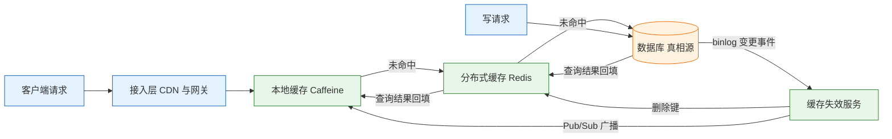
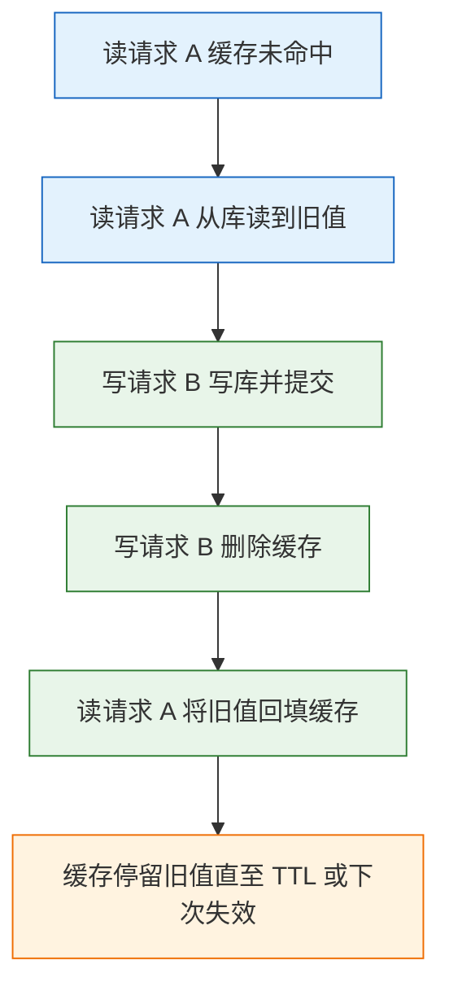
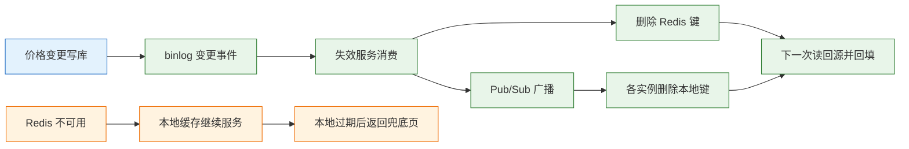

# 缓存与数据扩展

---

## 一、缓存与数据扩展是什么

### 1.1 核心概念

缓存是在真相源之前增加的一层数据副本，用内存读写替代磁盘寻址和网络往返，把重复读挡在数据库之外。数据扩展是在单库单表的容量、连接数或写入吞吐接近上限时，把数据与流量分散到多个节点的做法集合，包含读写分离、读模型、搜索索引、冷热分离与分库分表。

两者经常同时出现，但解决的问题不同。缓存压缩重复读，扩展承担数据量与写入量。缓存失效时压力会瞬间回到数据库，数据库能否接住取决于扩展做得多深。把缓存当成扩展手段，等于把容量问题推迟到缓存故障的那一刻。

缓存的本质是一笔一致性交易：用“可能读到旧值”换“更低延迟和更小数据库压力”。交易条款必须写清三件事——旧值最长多久、哪些读路径不能接受旧值、缓存整体不可用时降级成什么。条款没有写清，缓存就会从加速层变成事故源。

| 概念 | 解决的问题 | 引入的新问题 | 判断依据 |
|---|---|---|---|
| 本地缓存 | 进程内极热读 | 多实例数据不一致 | 能容忍秒级旧值 |
| 分布式缓存 | 共享读、容量与命中率 | 网络往返、集群单点 | 多实例需要同一份数据 |
| 读写分离 | 读流量分摊 | 复制延迟、读己之写 | 读多写少且能路由 |
| 冷热分离 | 在线数据量过大 | 归档链路、查询路由 | 大部分查询只看近期 |
| 分库分表 | 单库容量与写入到顶 | 跨分片查询与事务 | 单库确实无法再扩 |

### 1.2 与相邻技术的关系

缓存与 CDN、消息队列、数据库变更捕获、搜索索引都相邻，边界不清会导致职责重叠。

CDN 缓存的是 HTTP 响应，按 URL 与头部策略命中，失效靠刷新接口和 TTL；应用缓存缓存的是业务对象，按业务主键命中，失效要跟随数据变更。静态资源放 CDN，商品价格、库存、权限这类随业务变化的数据放应用缓存，两者不能互相替代。

消息队列与变更捕获（CDC）是失效链路的基础设施。写库成功后由 binlog 订阅者发出失效消息，比业务代码里手工删除更可靠，因为新增的写入口不会漏掉。消息队列在这里承担的是“可靠投递”，不是“数据同步”，消费者必须幂等。

搜索索引和读模型与缓存同属派生数据，共同点是都能从真相源重建。区别在于缓存按主键点查，索引支持多条件检索；缓存允许短暂旧值，索引通常要求秒级同步。派生数据一旦被当成真相源写入，重建能力就消失了。

| 相邻技术 | 缓存的对象 | 与缓存的关系 | 失效方式 |
|---|---|---|---|
| CDN | HTTP 响应、静态文件 | 接入层缓存，不感知业务主键 | 刷新接口、TTL |
| 消息队列 | 失效消息 | 广播删除与异步刷新通道 | 消费确认、重试 |
| CDC | 数据库变更事件 | 失效链路的触发源 | 位点续传 |
| 搜索索引 | 文档与倒排 | 同源派生，支持复杂检索 | 重建或增量同步 |

### 1.3 分层缓存架构组成

生产环境的缓存通常不是单个 Redis，而是从进程内到共享集群再到数据库的三级结构。每一级的容量、延迟、一致性都不同，职责必须分开。



| 层级 | 典型组件 | 容量约束 | 一致性窗口 |
|---|---|---|---|
| 接入层 | CDN、网关缓存 | 按节点与回源策略 | 分钟级，靠刷新 |
| 进程内 | Caffeine、Guava | 受堆内存限制，必须有界 | 秒级，靠广播与 TTL |
| 共享层 | Redis、Memcached | 受集群内存与分片数限制 | 毫秒到秒级 |
| 真相源 | MySQL、PostgreSQL | 受单库容量与写入上限 | 无旧值 |

本地缓存命中不需要网络，单机可承担极高 QPS；代价是每个实例各存一份，写后必须广播删除，广播丢失只能靠短 TTL 兜底。Redis 共享一份数据，容量和一致性更好，但多一次网络往返，且集群本身是新的故障点。数据库是唯一真相源，前两层都允许丢弃和重建。

> **注意**：本地缓存的 TTL 决定系统的最长旧值窗口，不是 Redis 的 TTL。只要本地层还在返回数据，删除 Redis 并不会让用户立刻看到新值。设计一致性指标时，要把每一层 TTL 相加后再对外承诺。

---

## 二、缓存读写模式与数据偏差

### 2.1 缓存引入后的三类偏差

缓存上线后，数据库压力下降、延迟改善，同时新增三类偏差。它们不会同时出现，但都会在流量高峰或数据变更时暴露。

一致性偏差来自写路径与失效路径的时序差。数据库已提交，缓存仍是旧值，窗口长度由失效链路和 TTL 共同决定。可用性偏差来自缓存层自身的故障：集群主节点切换、网络分区、内存淘汰，都会让命中率在短时间内跌到零。热点偏差来自流量分布：分片集群按 key 分配，单个 key 只能落在一个节点，节点规格再高也有上限。

| 偏差类型 | 触发条件 | 典型现象 | 观测指标 |
|---|---|---|---|
| 一致性 | 写后未失效、失效失败 | 改价后长时间显示旧价 | 缓存与库的差异抽样 |
| 可用性 | 集群故障、网络抖动 | 命中率骤降、数据库连接打满 | 命中率、回源 QPS |
| 热点 | 爆款商品、明星事件 | 单节点 CPU 饱和、其他节点空闲 | 节点 CPU 离散度、热 key 排行 |

### 2.2 缓存读写模式对比

模式决定谁负责加载、谁负责写入、失败时谁来兜底。选型不是选“最先进”的模式，而是选责任最清楚、故障最好定位的模式。

| 模式 | 读写路径 | 一致性 | 适用场景 |
|---|---|---|---|
| Cache-Aside | 读缓存未命中查库回填；写库后删缓存 | 短暂旧值 | 大多数读多写少业务 |
| Read-Through | 由缓存组件加载；写库后删缓存 | 同 Cache-Aside | 希望统一加载逻辑 |
| Write-Through | 读缓存；同步写缓存与库 | 较一致 | 写少读多、强一致要求 |
| Write-Behind | 读缓存；先写缓存异步刷库 | 弱，可能丢 | 计数、点赞等高写入 |
| Refresh-Ahead | 读缓存；过期前异步刷新 | 较新 | 访问可预测的热点 |

Cache-Aside 是默认选择。应用明确知道何时读、何时删，出问题能沿着代码定位；缓存组件只承担存储，不隐藏行为。Read-Through 把加载逻辑收进缓存库，减少重复代码，但要求缓存库支持加载器，跨语言栈时反而不便。

Write-Through 每次写都同步落库，写延迟由数据库决定，且会为从未被读的数据付出缓存空间。Write-Behind 先写缓存再异步刷库，写吞吐最高，但进程崩溃或缓存丢数据时，未刷盘的写永久丢失。

> **注意**：Write-Behind 的丢失窗口不是“毫秒级”，而是“从写入缓存到刷库成功”的整段时间，队列积压时会放大到分钟级。账务、库存、订单状态不能用它，即使上游声称可以补偿。

### 2.3 模式选择的判断顺序

先判断数据能否丢，再判断能否旧，最后判断写频率。能丢且写极多，才考虑 Write-Behind；不能丢但能旧，用 Cache-Aside 加短 TTL；不能旧也不能丢，读路径直接走数据库或强一致读主库，不要用缓存包装。

读多写少的商品、文章、配置适合 Cache-Aside；会话、购物车这类“读自己的写”场景，可以在写后一段时间内强制回源，避免用户刚提交就看不到结果。同一系统内不同数据可以用不同模式，但要在代码里显式标注，不能靠默认行为。

Cache-Aside 的回填还有三个细节。回填必须带过期时间，没有 TTL 的键在失效链路中断后会永久保留旧值。回填前要判断数据库结果是否为空，空结果与“键不存在”必须能区分，否则每次读都会重新回源。序列化格式要固定并带版本，字段增删时旧缓存能被识别并丢弃，而不是在反序列化时抛异常。

---

## 三、缓存与数据库的一致性

### 3.1 删除缓存与更新缓存的取舍

写路径的常见写法是“先写库，提交后删除缓存”。选择删除而不是更新，有三个原因。

并发写的更新顺序可能与写库顺序相反。两个写请求先后提交数据库，后到的更新缓存却先执行，缓存就停留在先到的值上，且没有 TTL 之外的自愈机会。更新缓存还可能写入一个从未被读过的值，占内存却不产生命中。删除让下一次读自然回填，回填值一定来自当前数据库，逻辑最短。

“先删缓存再写库”是明确的错误顺序。删完缓存、写库尚未提交的间隙，另一个读请求会把旧值回填，随后写库提交，缓存一直保持旧值直到 TTL。

### 3.2 写库与删缓存的时序竞态

即使顺序正确，仍存在一个很窄的竞态窗口。



窗口长度取决于“读请求查库到回填”的耗时，通常是几毫秒到几十毫秒。TTL 是兜底，不是修复。要缩小窗口可以提高失效可靠性，要覆盖窗口可以用延迟双删：写库后删一次，延迟数百毫秒再删一次，把竞态期间的回填清掉。延迟双删降低概率，不提供严格保证，第二次删除的延迟必须大于一次读回填的耗时。

### 3.3 一致性策略对比

| 策略 | 旧值窗口 | 实现成本 | 适用场景 |
|---|---|---|---|
| 仅设 TTL | 最长一个 TTL | 低 | 展示类、可容忍旧值 |
| 写库后删缓存 | 毫秒级，竞态下达 TTL | 低 | 大多数业务 |
| 延迟双删 | 小于单次删除，仍可能漏 | 中 | 价格、库存展示 |
| binlog 失效 | 秒级，覆盖所有写入口 | 中高 | 多实例、多写路径 |
| 版本号校验 | 读到旧版本即丢弃 | 中 | 结构复杂、字段多 |
| 强一致读主库 | 无旧值 | 高，延迟与压力上升 | 余额、下单校验 |

binlog 失效的可靠性高于业务代码删除，因为它不依赖每个写入口都记得调用。代价是链路更长：数据库提交、binlog 传输、消费者处理、删除执行，任一环节延迟都会体现在旧值窗口里。消费者必须幂等，重复删除没有副作用，但重复回填会放大数据库压力。

版本号适合“缓存值由多个字段拼装”的场景。写入时递增数据版本，缓存值携带版本，读路径比对版本，落后则丢弃并回源。它不依赖删除成功，但要求版本来源统一，否则会出现版本回退。

### 3.4 失效链路的兜底层次

生产环境的失效不是单点动作，而是四层兜底。任何一层失效，下一层仍能收敛，只是窗口变长。

| 层次 | 手段 | 覆盖的失败 | 残留窗口 |
|---|---|---|---|
| 第一层 | 业务代码写后删除 | 正常写路径 | 竞态窗口 |
| 第二层 | binlog 失效服务 | 遗漏调用、新增入口 | 秒级延迟 |
| 第三层 | 延迟双删 | 并发回填 | 亚秒级 |
| 第四层 | TTL 与版本号 | 消息丢失、服务不可用 | 一个 TTL |

> **架构红线**：不要为“删缓存”引入分布式事务。缓存是派生数据，删除失败的正确处理是重试加 TTL 兜底，把数据库事务扩展到缓存节点，会让一个可丢弃的副本决定主库的可用性。

---

## 四、缓存故障与流量防护

### 4.1 缓存穿透

查询一个不存在的键，缓存没有、数据库也没有，每次请求都回源。正常业务里这类请求占比很低，一旦被随机 ID 或爬虫放大，数据库会被不存在的查询打满。

空值缓存是最直接的防护：查不到也写入一个短 TTL 的空标记，后续请求在缓存层返回。TTL 取 30 到 60 秒，既能挡住连续攻击，也不会让新建数据长时间不可见。布隆过滤器在入口判断键是否存在，不存在直接拒绝，代价是有假阳性且标准实现不支持删除。参数校验放在最前面，ID 格式、长度、签名不合法的请求不进缓存也不进数据库。

| 手段 | 拦截位置 | 误判 | 维护成本 |
|---|---|---|---|
| 空值缓存 | 缓存层 | 无 | 低，注意 TTL |
| 布隆过滤器 | 应用入口 | 有假阳性 | 中，需重建 |
| 参数与签名校验 | 网关 | 无 | 低 |
| 回源限流 | 数据访问层 | 无 | 中 |

### 4.2 缓存击穿

单个热点键过期的一瞬间，大量请求同时未命中，同时查库，数据库在几十毫秒内被同一份数据打满。它与穿透的区别是键真实存在，与雪崩的区别是只影响一个键。

互斥回源是首选：只允许一个请求查库，其余等待或直接返回旧值。实现可以用 Redis 的 `SET key value NX PX` 抢锁，也可以用进程内的 singleflight 合并同键请求。锁必须带过期时间，持有者崩溃后锁要能自动释放，否则热点键会永久无法回源。

逻辑过期把“物理过期”改成“逻辑过期”：值里存过期时间，Redis 中不设 TTL，读到逻辑过期后异步刷新并先返回旧值。它消除了等待，代价是刷新期间持续返回旧值。永不过期加主动更新适合变更频率低、可以接受短旧值的数据。

> **架构红线**：热点键过期必须假设“所有实例同时发现过期”，互斥锁要跨实例生效，进程内锁只能减少单机并发。只做本地互斥，实例数翻倍时回源并发也翻倍，数据库仍会被打穿。

### 4.3 缓存雪崩

雪崩有两类原因：大量键在同一时间过期，或缓存集群整体不可用。前者是设计问题，后者是故障问题，处理方式不同。

TTL 加随机抖动解决集中过期：基础 TTL 加 0 到 60 秒随机值，把失效时间摊开。分级缓存解决整体故障：本地缓存顶住最初几秒，为恢复和限流争取时间。回源限流解决数据库保护：缓存不可用时限制回源并发，超出部分返回降级页或旧值。熔断在错误率超过阈值时直接切断回源，避免数据库在已经过载时继续接收请求。

需要明确的是，Redis 主从切换期间可能丢失最后一段异步复制的写。缓存本身可丢弃，这个窗口可以接受；把 Redis 当主库时，同样的窗口就是数据丢失。

雪崩防护要经过演练才算生效。演练方式是主动清空一个非核心业务的缓存命名空间，观察回源 QPS、数据库连接数、降级开关是否按预期触发。只在文档里写“支持降级”而没有实际切换过，故障当天通常会发现开关依赖的配置中心也在同一条链路上。

### 4.4 热 key 与请求分散

Redis Cluster 按槽分配键，同一个键永远落在一个节点，增加节点不能分散单键压力。爆款商品在几分钟内集中到 5000 QPS，那个节点的 CPU 先饱和，而同集群其他节点仍然空闲。

| 手段 | 作用范围 | 生效速度 | 代价 |
|---|---|---|---|
| 本地缓存 | 单实例 | 立即 | 多实例旧值 |
| 键拆分 | 单键到多键 | 需改读写逻辑 | 更新要删全部副本 |
| 读写分离 | 读流量到副本 | 需客户端支持 | 副本延迟 |
| 独立集群 | 热点与其他数据隔离 | 需迁移 | 资源与运维翻倍 |

键拆分的做法是在键名后加序号，例如 `product:123:0` 到 `product:123:7`，读请求随机选一个，写请求删除全部八个。副本数按峰值除以单节点承载能力估算，过多会放大内存和更新失败面。只在确认存在热 key 后使用，默认全量拆分会让所有键都背上更新复杂度。

---

## 五、缓存容量与内存治理

### 5.1 容量估算方法

缓存容量按“键数量 × 平均值大小 × 开销系数”估算，再留出峰值与碎片余量。

```text
有效数据量 = 键数量 × 平均值大小
实例内存   = 有效数据量 × 1.2（键、过期字典、对象头）
集群内存   = 实例内存 × 副本数 × 1.3（碎片与峰值余量）
```

1.2 覆盖键名、过期字典和对象编码的额外开销，1.3 覆盖内存碎片与写入峰值。1000 万键、平均 2 KB，有效数据约 20 GB，实例内存约 24 GB，一主一从再加 30% 余量，集群按 64 GB 规划。数字必须用真实样本抽样校准，不能直接套用。

内存使用到 90% 时，淘汰开始频繁触发，命中率下降，回源增加，数据库压力反而上升。容量规划的目标是让稳态水位停在 70% 到 80%，给峰值和故障切换留出空间。

### 5.2 淘汰策略对比

| 策略 | 淘汰范围 | 适用场景 | 风险 |
|---|---|---|---|
| noeviction | 不淘汰，写入报错 | 不允许丢数据的存储 | 写请求全部失败 |
| allkeys-lru | 全部键按最近使用 | 纯缓存 | 可能淘汰即将复用 |
| allkeys-lfu | 全部键按访问频率 | 热点稳定、长尾多 | 新键冷启动吃亏 |
| volatile-lru | 仅设了过期时间的键 | 缓存与持久数据混存 | 无 TTL 的键不被淘汰 |
| volatile-ttl | 仅设过期时间的键，先到期先淘汰 | TTL 差异明显 | 同上 |

纯缓存集群用 allkeys-lru 或 allkeys-lfu，不要让 noeviction 把写请求全部打回应用。混存持久数据的实例用 volatile 系列，并且必须保证持久数据都设置了过期时间或单独的实例，否则内存满时淘汰不到它们。

### 5.3 大 key 与内存碎片

大 key 指单个 String 超过数 MB，或集合类型元素数量达到数十万。它会阻塞单线程的命令执行，网络传输时间被拉长，删除时还可能造成延迟尖刺。治理方式是拆分结构、压缩值、只存必要字段，列表类数据按页拆成多个键。

内存碎片用 `mem_fragmentation_ratio` 观察，长期显著大于 1.5 说明分配器回收不及时，可以通过重启或开启主动碎片整理缓解。碎片率低于 1 则表示部分内存已被交换到磁盘，延迟会明显上升。

可观测性要覆盖到键级别而不是只到实例级别。集群内存使用率 70% 时，单个节点可能已经 95%，原因是大 key 或槽分布不均。节点级内存、CPU、连接数要分别看，再配合慢查询日志定位具体命令。淘汰计数持续增长而内存不降，说明写入量本身超过容量，加机器只能推迟问题，需要同时缩短 TTL 或拆分数据集。

| 指标 | 含义 | 异常动作 |
|---|---|---|
| used_memory | 已分配内存 | 接近 maxmemory 时扩容或清理 |
| mem_fragmentation_ratio | 碎片比率 | 持续偏高时整理或重启 |
| keyspace_hits / misses | 命中与未命中 | 命中率下降先查键设计与 TTL |
| evicted_keys | 淘汰计数 | 持续增长说明容量不足 |

---

## 六、数据扩展的手段与顺序

### 6.1 扩展手段对比

缓存解决重复读，不解决数据量增长和写入瓶颈。数据量、连接数、写入吞吐分别需要不同手段。

| 手段 | 解决的问题 | 代价 | 前置条件 |
|---|---|---|---|
| 索引与查询改写 | 慢查询、全表扫 | 写入放大 | 无 |
| 读写分离 | 读流量分摊 | 复制延迟 | 读多写少 |
| 读模型与宽表 | 跨服务查询 | 投影延迟、重建成本 | 有变更捕获 |
| 搜索索引 | 多条件与全文检索 | 同步延迟、集群运维 | 有重建能力 |
| 冷热分离 | 在线数据量过大 | 归档与路由复杂度 | 查询有明显时间边界 |
| 分库分表 | 单库容量与写入到顶 | 跨片查询与事务 | 单库确实到顶 |

### 6.2 扩展顺序与判断依据

顺序是索引与查询优化、归档与冷热分离、缓存、读写分离、读模型与搜索索引、分库分表。前几步成本低且可逆，分库分表一旦落地，跨片查询、事务、扩容、DDL 都会变成长期负担。

判断依据是资源水位而不是主观感受。单表行数、磁盘占用、IOPS、连接数、写入延迟，哪一个先到达阈值，就针对哪一个做扩展。查询慢而写入空闲，先优化 SQL；写入打满而磁盘还有空间，先看是否有冗余索引和长事务；连接数打满而 CPU 不高，先查连接池和慢查询占用。

### 6.3 读写分离与复制延迟

读写分离把读请求路由到副本，主库只承担写入。它提升读吞吐，同时引入复制延迟。异步复制下，副本可能落后主库数十毫秒到数秒，网络抖动或大事务会放大延迟。

读己之写是最常见的冲突：用户提交订单后立即查询列表，请求被路由到尚未同步的副本，页面显示“暂无订单”。处理方式有三种：写后一段时间内该用户的读强制走主库；把最近写入的标识带到读请求，由路由层判断；前端在写成功后直接用返回值渲染，不立即发起列表查询。

| 读场景 | 路由策略 | 可接受延迟 |
|---|---|---|
| 商品详情、文章 | 副本 | 秒级 |
| 订单列表（本人） | 写后短窗口走主库 | 无 |
| 报表与统计 | 专用副本或数仓 | 分钟级 |
| 余额与库存校验 | 主库 | 无 |

复制延迟要单独监控，不能只看主库负载。延迟突然升高通常有三个来源：副本执行大查询占用 IO、主库出现大事务、网络带宽被备份任务占满。延迟超过业务可接受窗口时，路由层应自动把该副本摘除，而不是继续分发读请求。

---

## 七、商品详情缓存完整案例

### 7.1 现状与目标

商品域有 1000 万 SKU，详情页峰值 2 万 QPS，价格每天变更约 100 次。优化前数据库 CPU 长期 90%，P99 1.2 秒。目标是 P99 不超过 100 毫秒、数据库 CPU 不超过 60%、缓存整体故障时商品域不整体不可用。

### 7.2 分层与参数设计

| 层级 | 组件 | 参数 | 作用 |
|---|---|---|---|
| L1 | Caffeine | TTL 3 秒，最大 1 万条 | 拦截极热商品 |
| L2 | Redis Cluster | 6 节点，TTL 10 分钟加随机 0～60 秒 | 共享缓存主体 |
| 回源 | 数据访问层 | 单实例并发上限 50 | 保护数据库 |
| 降级 | 静态兜底页 | 缓存不可用时启用 | 避免整体不可用 |

L1 只存热点，容量按单实例堆内存的固定比例分配，超出即按访问频率淘汰。L2 承担全量商品的读缓存，TTL 的随机部分避免大批键在同一秒失效。回源并发上限按数据库剩余连接数除以实例数估算，宁可让请求排队或走降级，也不让回源把连接池占满。

### 7.3 失效链路与降级



失效链路以 binlog 为触发源，覆盖所有写入口；业务代码的删除保留为第一层，减少消息延迟带来的旧值窗口。广播消息丢失时，本地缓存靠 3 秒 TTL 收敛，Redis 靠 10 分钟 TTL 收敛。降级路径独立于失效链路，Redis 不可用时本地缓存继续服务，本地过期后返回兜底页，不把 2 万 QPS 放到数据库。

### 7.4 结果与代价

缓存命中率 96%，数据库读 QPS 从 2 万降到 800，P99 从 1.2 秒降到 80 毫秒。价格最长旧值 3 秒，由本地 TTL 决定；下单校验价格走价格服务实时接口，不读商品缓存。

代价有四条：多了一套 binlog 消费与广播链路，运维面增加；本地缓存存在 3 秒不一致，商品详情可以接受，订单结算不能；爆款键拆分后更新要删全部副本，漏一个就出现旧价；Redis 故障时商品详情降级为兜底页，这是设计选择，不是缓存永不故障。

### 7.5 适用边界

该方案适用于读远多于写、能容忍秒级旧值、有明确降级页的场景。账务、库存扣减、权限校验不适合照搬：账务要求无旧值，库存要求强一致扣减，权限变更要求立即生效。

权限可以缓存，但必须带版本号，权限变更时递增版本，读路径比对版本后决定是否回源。库存可以缓存“可售标记”而不是准确数量，最终扣减仍在数据库完成。

> **注意**：缓存预热只解决“冷启动第一波”，不解决“缓存故障后的回源洪峰”。预热按访问排行加载前 N 个键，加载过程本身要限速，否则预热会把数据库打成故障。

---

## 八、常见故障与排查

### 8.1 故障对照表

| 现象 | 最可能原因 | 处理 |
|---|---|---|
| 改价后长时间显示旧价 | 写后未删缓存，或删除失败 | 补 binlog 失效，核对 TTL |
| 缓存一挂全站挂 | 无降级与回源限流 | 加本地缓存、熔断、并发上限 |
| 大量键同时失效 | TTL 设置成同一时刻 | TTL 加随机抖动 |
| 单节点 CPU 饱和 | 热 key，集群无法拆分单键 | 本地缓存、键拆分、独立集群 |
| 缓存中冷数据占多数 | 无上限、无 TTL、穿透写入 | 设 maxmemory 与淘汰策略 |
| 命令超时并伴随机延迟尖刺 | 大 key 阻塞单线程 | 拆分结构、压缩、异步删除 |
| 多实例显示不同数据 | 失效未广播，本地 TTL 过长 | 广播删除，缩短本地 TTL |
| 缓存重启后数据库被打满 | 集中回源，无预热与限流 | 预热热点，回源限流，灰度放量 |

### 8.2 排查顺序

1. 看命中率与回源 QPS，判断问题在缓存层还是数据库层。
2. 看热 key 与大 key 排行，确认是否单节点倾斜或命令阻塞。
3. 看失效链路：写库后是否产生变更事件，消费者是否积压，删除是否成功。
4. 看集群状态：主从延迟、槽迁移、内存水位、淘汰计数。
5. 看回源保护是否生效：并发上限、熔断状态、降级开关。
6. 最后调整 TTL 或扩容，先保证回源不打垮数据库。

> **核心结论**：缓存是一致性交易，先写清能接受多旧的读，再决定 TTL 与失效方式；写库后删缓存，TTL 兜底，变更捕获提高可靠性；缓存故障必须能降级，本地缓存、回源限流、熔断缺一不可。
