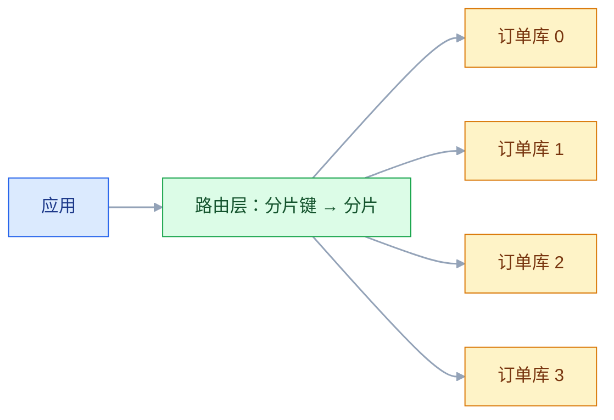
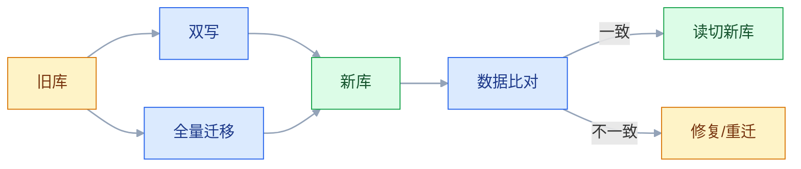

# 存储选型与分库分表

## 一、工程案例：订单库 2 TB 之后，怎么扩而不停机

**场景**：订单表 5 亿行、2 TB，单库 MySQL。现在写入 3000 TPS，查询 P99 1.2 秒，磁盘 85%，备份 6 小时。业务要求 12 个月再增长 3 倍，大促不能停机。团队想直接换 TiDB，但迁移风险高；也想按订单号分表，但历史数据怎么迁、跨分片查询怎么办、全局 ID 怎么生成，没人说清。

**目标**：不盲目换数据库，先做存储选型与分库分表方案，交付：

- 一张存储选型矩阵；
- 一套分片键与路由规则；
- 一套全局 ID 方案；
- 一张迁移与双写方案；
- 一张跨分片查询与对账规则；
- 一份验收清单（8 项）。

**为什么必须做**：分库分表不是“把表拆开”，是“把查询、事务、ID、迁移、运维全部重做一遍”。分片键选错，后面每一步都痛苦。

**动手前确认**：先看三条曲线：数据增长、QPS 增长、单表大小。再看查询模式：按用户查、按订单号查、按时间范围查，各占多少。下面的数据是示例。



### 1.1 存储选型

| 选项 | 适合 | 代价 |
|---|---|---|
| MySQL 单库 | 数据量 < 1 TB、写入 < 3000 TPS | 容量/写入有上限 |
| MySQL 分库分表 | 关系型、强事务、可控 | 跨分片查询/事务复杂 |
| TiDB/OceanBase | 水平扩展、兼容 MySQL | 运维复杂、成本高 |
| HBase | 海量稀疏、按 rowkey 查 | 不支持复杂查询 |
| MongoDB | 文档、灵活 schema | 事务/关联弱 |
| ClickHouse | 分析、列存 | 不适合高频点写 |
| PostgreSQL | 复杂查询、扩展 | 超大表仍需分片 |

选型看“读写模式 + 事务要求 + 增长曲线 + 团队能力”，不是看“谁更先进”。

### 1.2 分片键

| 分片键 | 优点 | 缺点 |
|---|---|---|
| 用户 ID | 同一用户数据聚在一起 | 大客户热点 |
| 订单号 | 均匀、查询直接 | 按用户查要带订单号 |
| 时间 | 冷热分离、归档方便 | 当前分片热点 |
| 商户 ID | 多租户隔离 | 大商户热点 |
| 哈希 | 均匀 | 范围查询难 |

订单库常用“用户 ID 分片 + 订单号基因法”，保证同一用户订单在一个分片，订单号也能定位分片。

### 1.3 路由

| 方式 | 说明 |
|---|---|
| 应用层路由 | 应用算分片，直连库 |
| 中间件路由 | ShardingSphere/MyCat 代理 |
| 数据库分区 | 单库内分区，不跨库 |

应用层路由简单可控，但升级要改应用；中间件路由透明，但多一层运维和故障点。

### 1.4 全局 ID

| 方案 | 特点 |
|---|---|
| 自增 | 单库简单，分片冲突 |
| UUID | 全局唯一，无序、占空间 |
| Snowflake | 时间有序、趋势递增，依赖时钟 |
| 号段模式 | 批量取号，性能好，依赖 DB |
| 基因法 | 把分片键编进 ID，便于路由 |

订单号建议“时间 + 分片基因 + 序列”，既唯一又能路由。

### 1.5 跨分片查询

| 场景 | 方案 |
|---|---|
| 按用户查订单 | 带用户 ID，单分片 |
| 按订单号查 | 订单号基因法，单分片 |
| 按时间范围查 | 广播到所有分片，聚合 |
| 后台多条件查 | 异构索引表/ES |
| 统计报表 | 数仓/离线聚合 |

跨分片查询不是“不能做”，是“成本高”。核心查询必须能落到单分片。

### 1.6 迁移与双写



步骤：

1. 建新库/新表；
2. 双写（旧库为准，新库异步）；
3. 全量迁移历史数据；
4. 增量追平（binlog）；
5. 数据比对；
6. 读灰度切新库；
7. 写切新库；
8. 旧库保留回滚窗口。

每一步都要可回滚。

### 1.7 扩容

| 方式 | 说明 |
|---|---|
| 翻倍扩容 | 4 → 8，重新分布 |
| 一致性哈希 | 减少迁移量 |
| 双倍分片 | 预分片，后续只拆不迁 |
| 按时间分区 | 冷热分离，归档 |

扩容最难的是“历史数据重分布”。预分片（如先分 64 片，物理 4 库）能降低未来迁移成本。

### 1.8 对账

| 对账 | 内容 |
|---|---|
| 新旧库 | 行数、主键、金额、状态 |
| 分片间 | 总数、汇总 |
| 业务 | 订单、支付、库存 |
| 索引 | 异构索引与主库 |

迁移期间每天对账，差异分类、可重跑。

### 1.9 验收（8 项）

1. 容量：单分片数据 ≤ 500 GB，磁盘 ≤ 70%。
2. 写入：3000 TPS 下 P99 ≤ 300 ms。
3. 查询：核心查询单分片命中率 ≥ 95%。
4. ID：全局唯一、趋势递增、可分片路由。
5. 迁移：双跑差异 ≤ 0.01%，可回滚。
6. 扩容：4 → 8 分片，迁移期间业务可用。
7. 对账：连续 7 天，新旧库差异为 0。
8. 故障：单分片宕机，仅影响该分片用户，其他可用。

## 二、高频问答：会卡住你的地方，也是面试最常问的

### 2.1 慢了就换数据库

**现场**

怎么判断：先拉慢查询、锁等待、磁盘使用率、QPS 四条线，定位到瓶颈再谈选型。

**要点**

- 慢的原因多半在索引、SQL、锁、归档、连接池，不在数据库引擎本身。
- 换库不解决这些问题，只是把同一批慢 SQL 搬到新库，还多背一次迁移风险。
- 只有容量或写入真的到了单库上限，换库或分片才是解。

**追问**

- 怎么区分容量问题和 SQL 问题？→ 单条 SQL 优化后仍压不住，且磁盘、写入接近上限，才是容量。
- 换成 TiDB 就不慢了吗？→ 不一定，跨分片查询和事务模型变了，写法不改照样慢。
- 什么时候该先做读写分离？→ 读多写少、压力集中在读的时候。

### 2.2 分库分表越早越好

**现场**

怎么判断：看单表大小、写入 TPS、QPS 三条线；没到阈值，先做索引优化、归档、读写分离。

**要点**

- 分片不是免费的，它把查询、事务、ID、迁移、运维全部重做一遍。
- 数据量没到瓶颈时分片，收益小于成本，还提前锁死了分片键。
- 单表 500 GB 是经验线，不是硬标准，但超过后备份、DDL、索引维护都会明显变慢。

**追问**

- 什么信号说明真该分了？→ 单表接近 500 GB、备份和 DDL 时间不可接受、写入接近单库上限。
- 先垂直拆还是先水平拆？→ 先垂直，边界清楚；水平拆解决容量。
- 分片能晚点做吗？→ 能，但要提前把分片键设计进业务，否则以后改不动。

### 2.3 分片键随便选

**现场**

怎么判断：列出 Top 10 查询，逐个看能不能带上同一个分片键；带不上的就要重选。

**要点**

- 分片键决定查询路由，选错会让核心查询全部跨分片，性能和复杂度一起爆炸。
- 均匀只是其中一个标准，还要看查询高频、事务边界、增长是否均匀。
- 分片键一旦定下，改造成本极高，等于把迁移重做一遍。

**追问**

- 按订单号哈希不是很均匀吗？→ 均匀，但按用户查订单就得广播所有分片。
- 用户 ID 分片遇到大客户热点怎么办？→ 单独隔离该客户，或对热点再拆一层。
- 能不能先用订单号，以后再换用户 ID？→ 等于重新分片，历史数据要全量重分布。

### 2.4 分片后还能随便 JOIN

**现场**

怎么判断：看慢查询里有多少跨分片；跨分片 JOIN 多的方案，要回去重设计。

**要点**

- 跨分片 JOIN 要广播或聚合，性能和一致性都差。
- 分片后查询要围绕分片键设计，不能照搬单库 SQL。
- 小表用广播表、关联表按同一分片键做 ER 分片，能避免大部分跨分片 JOIN。

**追问**

- 一定要跨分片关联怎么办？→ 广播表、字段冗余、异构索引，别实时 JOIN。
- 跨分片聚合怎么做？→ 各分片先算再合并，配限流、超时、降级。
- 跨分片事务怎么办？→ 尽量避免，用最终一致加补偿。

### 2.5 自增 ID 不能用

**现场**

怎么判断：看 ID 是否趋势递增、是否能反解分片；这两条不满足，就别急着上 UUID。

**要点**

- 分片后自增会冲突，但冲突不等于只能选 UUID。
- 号段、Snowflake、基因法都能做到全局唯一，还能保持趋势递增。
- UUID 无序，做主键会让索引页分裂、写入变慢、占空间。

**追问**

- Snowflake 最怕什么？→ 时钟回拨，要做回拨检测或换机器位。
- 号段模式的代价是什么？→ 依赖 DB，服务重启会浪费一段号。
- 订单号既要唯一又要能路由怎么做？→ 时间 + 分片基因 + 序列。

### 2.6 迁移可以停机做

**现场**

怎么落地：先算迁移时长、校验时长和回滚方案；超过停机窗口就走双写加灰度。

**要点**

- 2 TB 数据的迁移加校验很可能超过一个周末窗口。
- 停机迁移影响业务，出问题回滚也困难。
- 正确做法是双写、全量迁移、增量追平、比对、灰度切读切写，每一步可回滚。

**追问**

- 双写时以哪边为准？→ 旧库为准，新库异步追。
- 怎么判断增量追平了？→ 看 binlog 位点，再靠对账确认。
- 旧库保留多久？→ 留到新库稳定、对账连续无差异之后再下线。

### 2.7 双写很简单

**现场**

怎么判断：问三个问题——新库写失败怎么办、旧库成功新库失败怎么补、每天对账吗；没有答案就是没设计。

**要点**

- 双写有一致性、顺序、失败、补偿四类问题，不是“两边都写一遍”。
- 一侧失败会影响另一侧，处理不好就是长期静默不一致。
- 没有对账和补偿的双写，只是把不一致藏起来。

**追问**

- 同步双写还是异步双写？→ 常见是旧库同步、新库异步，先保业务。
- 什么是写偏斜？→ 两边写入顺序或成败不同，导致同一笔数据不一致。
- 怎么发现不一致？→ 按行数、主键、金额、状态做对账，差异可重跑。

### 2.8 NoSQL 一定能扩展

**现场**

怎么判断：先看查询模式，是否需要多条件、关联、事务；需要就别盲目换。

**要点**

- NoSQL 的扩展性好，但查询能力、事务、一致性模型和 MySQL 不是一回事。
- 换成 NoSQL 往往是把复杂度从数据库挪到了应用。
- 选型看读写模式、事务要求、增长曲线、团队能力，不看谁更先进。

**追问**

- HBase 适合什么场景？→ 海量稀疏数据、按 rowkey 点查。
- MongoDB 弱在哪？→ 关联和跨文档事务。
- 什么时候该选 NewSQL？→ 既要关系型又要水平扩展，且能承担运维和成本。

### 2.9 分片后不用管热点

**现场**

怎么判断：看各分片的 QPS 和 CPU 分布，有明显倾斜就是热点。

**要点**

- 哈希只解决键分布均匀，不解决访问分布均匀。
- 大客户、爆款商品、按时间集中写入，都会把单个分片打热。
- 热点要靠隔离和拆分解决，不是再加一层哈希。

**追问**

- 时间分片为什么总是当前分片最热？→ 新写入都落在最新分片。
- 大客户热点怎么处理？→ 单独分片，或对该客户再拆一层。
- 加从库能解决热点吗？→ 读热点可以，写热点不行。

### 2.10 扩容就是加机器

**现场**

怎么落地：先问重分布方案、迁移窗口、回滚点；三样都没有，先别扩。

**要点**

- 分片扩容要重分布历史数据，涉及迁移、双写、校验、切流。
- 加机器只是结果，真正的成本在数据搬迁和切流。
- 预分片（先分 64 片、物理 4 库）能让以后只拆不迁。

**追问**

- 翻倍扩容要搬多少数据？→ 大约一半。
- 一致性哈希省在哪？→ 节点增减只影响相邻数据，但要虚拟节点防倾斜。
- 预分片怎么落地？→ 逻辑分片数一次定够，物理库按需增加映射。

## 三、核心知识

### 3.1 存储选型维度

| 维度 | 问题 |
|---|---|
| 数据模型 | 关系、文档、KV、列、图 |
| 一致性 | 强一致、最终一致 |
| 事务 | 单行、多行、跨分片 |
| 查询 | 点查、范围、聚合、全文 |
| 写入 | 吞吐、批量、时序 |
| 扩展 | 垂直、水平、分片 |
| 运维 | 备份、恢复、监控、升级 |
| 成本 | 存储、计算、网络 |

### 3.2 分库分表类型

| 类型 | 说明 |
|---|---|
| 垂直分库 | 按业务拆库 |
| 垂直分表 | 冷热字段拆分 |
| 水平分库 | 按分片键拆库 |
| 水平分表 | 按分片键拆表 |

通常“垂直先做，水平后做”。垂直拆分边界清楚，水平拆分解决容量。

### 3.3 分片键选择

| 标准 | 说明 |
|---|---|
| 高基数 | 分布均匀 |
| 查询高频 | 核心查询能带 |
| 事务边界 | 同一事务数据在同一分片 |
| 增长均匀 | 避免未来热点 |
| 业务稳定 | 不会频繁变 |

分片键一旦定下，改造成本极高。

> **面试**：常问「分片键怎么选？」答：看高基数、查询高频、事务边界、增长均匀，核心查询必须能带分片键。

### 3.4 路由与基因法

基因法：把分片键的哈希基因编进订单号，查订单号时反解分片。

```text
orderId = 时间戳 + 用户ID哈希基因 + 序列
```

优点：订单号可路由；缺点：ID 生成复杂，长度增加。

### 3.5 全局 ID

| 方案 | 有序 | 性能 | 依赖 |
|---|---|---|---|
| Snowflake | 趋势递增 | 高 | 时钟 |
| 号段 | 递增 | 高 | DB |
| UUID | 无序 | 高 | 无 |
| Redis INCR | 递增 | 中 | Redis |
| 基因法 | 可路由 | 高 | 分片规则 |

> **面试**：常问「分库分表后全局 ID 怎么生成？」答：号段、Snowflake、基因法都行，关键是趋势递增且能反解分片。

### 3.6 跨分片查询

| 方案 | 适用 |
|---|---|
| 带分片键 | 核心查询 |
| 广播聚合 | 少量分片、低频 |
| 异构索引 | 多条件查询 |
| 数仓 | 报表 |
| ES | 搜索 |

跨分片查询要限流、超时、降级，不能让它拖垮核心链路。

### 3.7 迁移

| 阶段 | 动作 |
|---|---|
| 准备 | 建库、建表、校验工具 |
| 全量 | 快照迁移 |
| 增量 | binlog 追平 |
| 双写 | 新旧同时写 |
| 校验 | 行数、金额、抽样 |
| 切读 | 灰度读新库 |
| 切写 | 灰度写新库 |
| 回滚 | 旧库保留 |

> **面试**：常问「2 TB 数据怎么不停机迁移？」答：双写加全量迁移、增量追平、比对、灰度切读切写，每步可回滚。

### 3.8 扩容

| 方式 | 迁移量 |
|---|---|
| 翻倍 | 50% |
| 一致性哈希 | 1/N |
| 预分片 | 只拆不迁 |
| 按时间 | 新数据新分片 |

预分片是降低未来扩容成本的有效手段。

### 3.9 读写分离

| 模式 | 说明 |
|---|---|
| 主写从读 | 常见，注意复制延迟 |
| 强制读主 | 读己之写 |
| 多从 | 读扩展 |
| 分片 + 读写分离 | 组合 |

复制延迟会导致“写后读不到”，关键读走主库或会话粘性。

### 3.10 运维

| 项 | 内容 |
|---|---|
| 备份 | 全量 + 增量，定期恢复演练 |
| 监控 | QPS、RT、连接、磁盘、复制延迟 |
| 归档 | 冷数据归档，控制单表大小 |
| 慢查询 | 定期治理 |
| 容量 | 提前 6 个月规划 |

## 四、冷门知识汇总

- **Snowflake**：64 位 ID，时间戳 + 机器 ID + 序列；依赖时钟，时钟回拨要处理。
- **号段模式**：从 DB 批量取一段 ID，内存分配；性能好，但服务重启会浪费号段。
- **基因法**：把分片键哈希的若干位编进 ID，查询时反解分片。美团的 Leaf 有类似方案。
- **一致性哈希**：节点增减只影响相邻数据，减少迁移；但可能负载不均，需要虚拟节点。
- **范围分片**：按时间/ID 范围，范围查询快；但当前分片容易热点。
- **哈希分片**：分布均匀，范围查询难；常与基因法/异构索引配合。
- **广播表**：每个分片都存一份小表（如字典），避免跨分片 JOIN。
- **ER 分片**：关联表按同一分片键分片，保证关联数据在同一库。
- **跨分片 JOIN**：广播、字段冗余、异构索引、数仓；不要实时跨分片 JOIN。
- **NewSQL**：TiDB、OceanBase、CockroachDB，兼顾关系型和水平扩展；运维和成本高于 MySQL。
- **HBase 的 rowkey 设计**：rowkey 决定分布和查询；热点要加盐/哈希前缀。
- **resharding**：重新分片，涉及数据迁移、双写、校验、切流；是分库分表最难的部分。
- **双写的“写偏斜”**：新旧库写入顺序/失败不同，导致不一致；要版本号/对账。
- **影子表**：新旧表并行，读旧写新或双写，用于迁移验证。
- **逻辑表**：分片后对应用透明的表名，由中间件路由。
- **“分库分表不是免费的”**：跨分片查询、事务、ID、运维、迁移都要付出成本；能不分就不分。
- **单表 500 GB 的经验线**：不是硬标准，但超过后备份、DDL、索引维护都会变慢，值得评估分片。