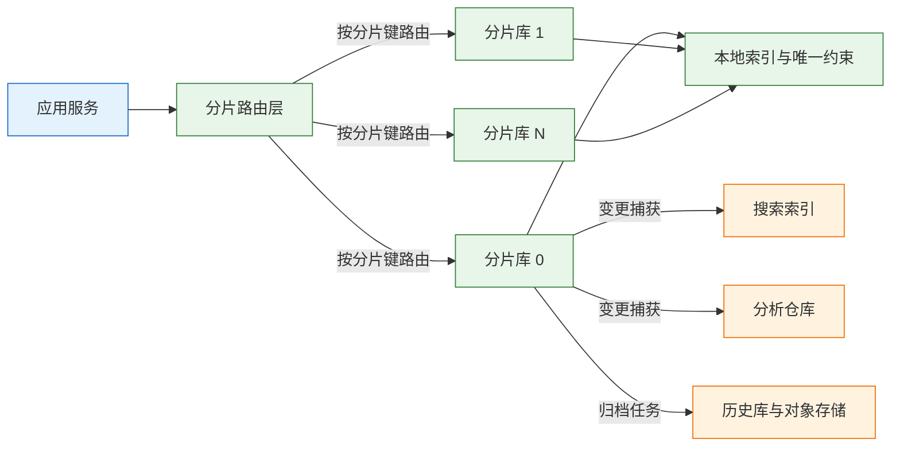
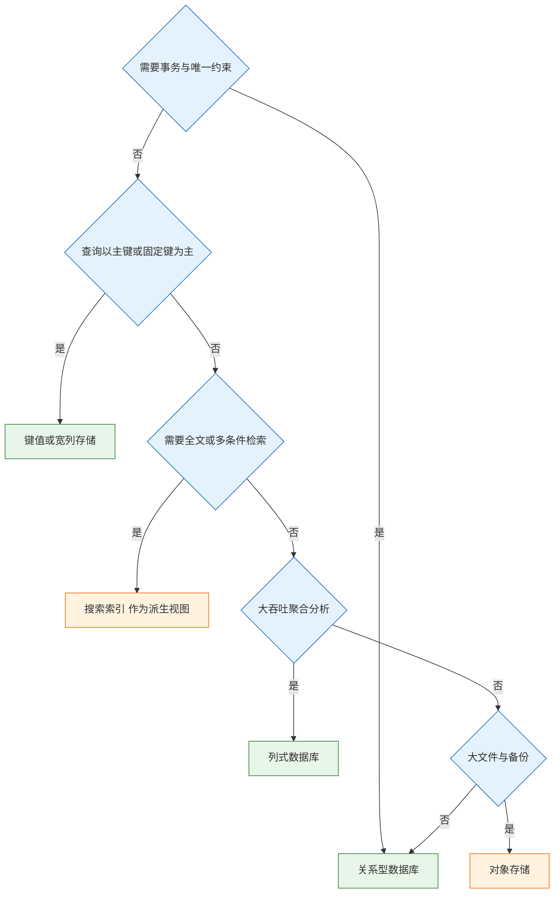
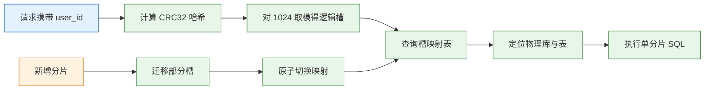
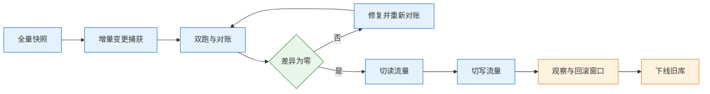

# 存储选型与分库分表

---

## 一、存储选型与分库分表是什么

### 1.1 核心概念

存储选型是按访问模式匹配存储引擎的过程：先确定读写比例、查询形态、事务要求、数据量与保留期，再从关系型、键值、宽列、列式、搜索、对象存储中选择，而不是从熟悉的产品名出发。分库分表是单库容量、连接数或写入吞吐到达上限后，把同一份逻辑数据拆分到多个物理库表的做法。

两者的关系是先后而不是并列。选型决定数据放在哪一类引擎，分片决定这一类引擎内部如何横向扩展。用错引擎，分片只能放大错误：把需要事务的账务放进宽列存储，再按用户分片，跨片转账依然没有原子性。

分片不是“表大了就切一刀”。它把单机问题换成分布式问题：跨片查询、跨片事务、全局唯一、扩容迁移、多份运维，都会成为长期成本。判断标准是单库是否真的到顶，以及前面几步低成本手段是否已经用尽。

| 概念 | 解决的问题 | 引入的代价 | 判断依据 |
|---|---|---|---|
| 存储选型 | 访问模式与引擎能力匹配 | 多套技术栈 | 事务、查询、写入形态 |
| 表分区 | 单表管理与裁剪 | 分区键限制 | 时间序列、归档 |
| 读写分离 | 读流量分摊 | 复制延迟 | 读多写少 |
| 分库分表 | 单库容量与写入上限 | 跨片查询与事务 | 单库确实到顶 |
| 冷热分离 | 在线数据量过大 | 归档与路由 | 查询集中在近期 |

### 1.2 与相邻技术的关系

分区、分片、分库、分表经常被混用，边界必须分清。

表分区是单库内的物理组织方式，逻辑上仍是一张表，由数据库负责路由。它改善管理、裁剪和批量删除，不增加写入节点，也不分散连接数。分表是把一张表拆成多张结构相同的表，分库是把数据放到多个数据库实例。只分表不分库，单库的连接数、IOPS 和写入日志仍是同一份，瓶颈不变。

读写分离解决读流量，不解决容量。主库仍然保存全量数据，写入仍然落在单点。缓存解决重复读，不解决数据量增长。搜索索引与数据仓库是派生系统，从主库或变更流构建，承担检索与分析，不能反过来当作交易真相源。

| 相邻技术 | 改变的部分 | 未改变的部分 | 常见误用 |
|---|---|---|---|
| 表分区 | 单表物理组织 | 单库容量与连接 | 当作分片使用 |
| 只分表 | 单表行数 | 单库 IOPS 与连接 | 认为已经水平扩展 |
| 读写分离 | 读并发 | 写入单点与容量 | 用它解决写入瓶颈 |
| 缓存 | 重复读压力 | 数据量与写入 | 当作存储使用 |
| 搜索索引 | 检索能力 | 事务与真相 | 当作主数据源 |

### 1.3 存储分层与分片架构组成

典型交易系统按“真相源、派生视图、归档”三层组织存储。真相源承担事务与唯一约束，派生视图承担检索与分析，归档层承担历史数据的低成本保留。



| 层次 | 组件 | 主要职责 | 一致性要求 |
|---|---|---|---|
| 接入 | 应用与路由层 | 解析分片键、拼接结果 | 强一致路由 |
| 真相源 | 分片数据库 | 事务、约束、点查 | 强一致 |
| 派生视图 | 搜索、宽表、仓库 | 多条件检索、聚合 | 秒级到分钟级 |
| 归档 | 历史库、对象存储 | 低成本保留与审计 | 最终一致 |

路由层可以是应用内嵌的分片组件，也可以是独立的中间件或代理。应用内嵌少一跳网络，但分片规则散落在各服务；中间件集中管理规则，但多一次转发且成为新的故障点。选择依据是语言栈数量与团队运维能力，不是性能数字。

> **注意**：分片后的数据库仍然是普通数据库，唯一索引、外键、事务都只在单个分片内生效。把“分了片”理解成“自动获得全局约束”，是分片项目最常见的事故来源。

---

## 二、访问模式与存储类型

### 2.1 存储类型对比

| 类型 | 代表产品 | 强项 | 弱项 |
|---|---|---|---|
| 关系型 | MySQL、PostgreSQL | 事务、JOIN、约束、生态成熟 | 单机写入与容量有上限 |
| 文档型 | MongoDB | 灵活结构、嵌套文档 | 跨文档事务与复杂 JOIN 弱 |
| 键值 | Redis | 极低延迟、原子操作 | 持久化有丢失窗口，查询弱 |
| 宽列 | Cassandra、HBase | 高写入、水平扩展 | 查询受分区键限制 |
| 列式 | ClickHouse、Doris | 大吞吐分析、压缩比高 | 不适合点更新与高频事务 |
| 搜索 | Elasticsearch | 全文、多条件、聚合 | 近实时、存储成本高 |
| 对象 | S3、OSS、MinIO | 海量、低成本、HTTP 直读 | 不适合随机低延迟更新 |

### 2.2 选型维度

选型先列硬约束，再比较软指标。硬约束不满足的方案直接淘汰，不进入打分。

| 维度 | 判断问题 | 淘汰条件 |
|---|---|---|
| 事务 | 是否需要多行原子提交与回滚 | 引擎不支持事务 |
| 约束 | 是否需要唯一、外键、检查约束 | 只有分片内唯一 |
| 查询 | 点查、范围、多条件还是全文 | 不支持核心查询形态 |
| 规模 | 数据量、写入量、保留期 | 单集群上限低于目标 |
| 团队 | 是否有人能调优与值班 | 无人能处理故障 |

软指标包括生态、托管服务成熟度、迁移成本、许可费用。它们适合加权比较，不适合一票否决；硬约束必须先过，否则上线后只能用更多组件去补。

规模要用数量级估算，不能凭当前数据量。按日增行数乘以保留天数，再乘以索引与日志放大系数，得到三到五年的容量；写入峰值按日常均值的倍数估算，并单独计算索引维护和复制带来的写入放大。估算结果与引擎的单集群上限相差不足一个数量级时，说明已经接近需要拆分的边界，选型阶段就要把扩展路径写进方案。

### 2.3 决策流程



这张图给出起点，不给出最终答案。真实系统几乎都是组合：关系型存订单与账务，键值存缓存与计数，搜索索引承担商家后台检索，列式承担报表，对象存储存附件与备份。组合的代价是同步链路与一致性问题，必须有明确的负责人和重建方案。

### 2.4 组合使用的边界

组合的底线是“只有一个真相源”。订单状态只在一处可写，其余视图都从变更流构建。搜索索引的 refresh 有延迟，更新在底层是删除加重建，不适合频繁修改的强一致字段；把它当主库，会在索引重建或集群故障时丢业务数据。

键值存储适合计数、会话、预扣与缓存。它的持久化与主从复制存在丢失窗口，内存成本也高，不能作为订单与账务的唯一记录。列式存储适合批量写入与聚合查询，点更新代价高，不适合承载在线交易的实时状态。

> **注意**：派生视图必须能全量重建。判断标准是“删掉索引后能否只靠真相源和历史变更流恢复”，做不到就说明有数据只存在于索引里，已经越过了真相源边界。

---

## 三、分片前的优化手段

### 3.1 大表瓶颈的定位

订单表 8 亿行、2 TB，查询 P99 1.8 秒。团队的第一反应是分库分表，方案已经排到 64 个分片。动手前的慢查询分析显示，70% 的耗时来自五条 SQL：按用户查列表缺少复合索引；后台按状态扫全表；报表在主库做聚合；详情查询带出大字段；深分页使用大偏移量。

对应的处理是补 `(user_id, created_at)` 复合索引、把报表移到专用副本或仓库、详情只取必要列、深分页改成游标。再加上归档两年前数据，P99 降到 300 毫秒，写入仍能撑住 2000 TPS。分片暂时不需要。

这个顺序必须固定：索引与查询改写、分区与归档、缓存与读写分离、最后才是分库分表。前面几步成本低、可回滚，分片一旦落地，跨片查询、事务、扩容与 DDL 都会变成长期负担。

### 3.2 优化手段对比

| 手段 | 解决的问题 | 代价 | 使用时机 |
|---|---|---|---|
| 索引与查询改写 | 慢查询、全表扫、深分页 | 写入放大、持续调优 | 任何时候先做 |
| 表分区 | 单表过大、按时间清理 | 分区键限制 | 时间序列与归档 |
| 冷热分离 | 历史数据占用在线库 | 归档链路与路由 | 查询集中在近期 |
| 读写分离 | 读流量大 | 复制延迟 | 读多写少 |
| 缓存 | 重复读与热点 | 一致性与故障面 | 可容忍旧值 |
| 分库分表 | 单库容量与写入到顶 | 跨片查询与事务 | 前面手段用尽 |

### 3.3 表分区与冷热分离

表分区把数据按范围、列表或哈希切成多个物理段，查询带分区键时可以只扫描相关分区。MySQL 分区表要求唯一索引包含分区键，否则无法创建；分区键选错，查询无法裁剪，反而要扫全部分区。分区主要改善管理和批量删除，不一定提升并发写入。

冷热分离把历史数据迁到历史库、对象存储或列式仓库，在线库只保留近期数据。前提是查询有明显的时间边界，例如订单列表默认只看近一年。迁移后要保留统一查询入口，否则业务代码要同时访问两套存储，路由逻辑会扩散到各个服务。

> **注意**：归档不是删除。归档表要保留主键、业务键与必要的审计字段，并记录迁移批次与校验结果。只按时间删除而不留副本，遇到审计或纠纷时无法恢复。

---

## 四、分片键与路由算法

### 4.1 分片键的选择条件

分片键决定数据分布与查询路由，选错之后所有跨维度查询都变成广播。

好的分片键满足三个条件：基数足够高，取值多到能均匀分布；查询高频命中，大多数请求都带这个条件；分布均匀，不会因为个别大客户形成热点。三个条件冲突时，优先保证查询命中率，因为广播查询的代价会随分片数线性增长。

### 4.2 候选分片键对比

| 分片键 | 优点 | 缺点 | 适用场景 |
|---|---|---|---|
| `user_id` | 用户查询天然路由，分布均匀 | 商家与运营查询跨片 | 面向消费者的订单 |
| `order_id` | 按单号查询快 | 用户列表要扫全部分片 | 详情查询为主 |
| `merchant_id` | 商家后台查询快 | 大商家形成热点 | 面向商家的订单 |
| `created_at` | 归档与范围查询方便 | 当前时间片写入集中 | 日志、流水 |

没有一种分片键能让所有查询单分片。正确做法是选最高频维度做主键，其他查询用映射表、搜索索引或仓库承担。让主键兼顾所有场景，结果是所有场景都不快。

### 4.3 路由算法与计算示例

| 算法 | 分布 | 范围查询 | 扩容代价与适用 |
|---|---|---|---|
| 取模 | 均匀 | 差 | 改模数全量重分布，分片数固定时用 |
| 范围 | 可能倾斜 | 好 | 分裂与合并，适合时间与 ID 段 |
| 一致性哈希 | 较均匀 | 差 | 只迁移相邻段，节点频繁变化时用 |
| 固定逻辑槽 | 均匀 | 取决于槽设计 | 迁移整槽，适合交易类主数据 |

固定逻辑槽是交易系统的常用选择。先划分固定数量的逻辑槽，键经哈希落到槽，槽再映射到物理库表。扩容时只迁移槽，不需要重算全部键。

以 CRC32 作为哈希函数、1024 个逻辑槽、64 个物理库、每库 16 张表为例：

```text
slot      = CRC32(user_id) % 1024
db_index  = slot % 64
table_idx = slot / 64          # 整数除法，取值 0～15
```

代入 `user_id = 10086`：CRC32 值为 1443254904，对 1024 取模得槽 632；632 % 64 = 56，落到 56 号库；632 / 64 = 9，落到该库第 9 张表。代入 `user_id = 20001`：哈希值 1192965891，槽 771，771 % 64 = 3，落到 3 号库第 12 张表。

同一个 `user_id` 永远得到同一组库表，查询带用户条件时只需一次路由。槽到库表的映射必须存成配置并支持热更新，不能把公式硬编码在业务代码里，否则扩容时每个服务都要发版。

### 4.4 逻辑槽映射与扩容路径



映射表本身要能扩展：可以存在配置中心并缓存在本地，也可以存在一张低并发的路由库。映射变更必须先双写再切换，切换后保留旧映射一段时间用于回滚。映射丢失或版本不一致时，不同实例会把同一个用户路由到不同分片，表现为“数据时有时无”，比查询变慢更难排查。

---

## 五、全局 ID 与跨分片查询

### 5.1 全局 ID 方案对比

分片后自增主键不再全局唯一，订单号、流水号需要独立生成。

| 方案 | 有序性 | 依赖 | 代价 |
|---|---|---|---|
| 自增步长 | 递增 | 各分片独立配置 | 扩容改步长麻烦 |
| Snowflake | 趋势递增 | 机器号与时钟 | 时钟回拨要处理 |
| 号段模式 | 趋势递增 | 中央库 | 多一次取号，号段浪费 |
| UUIDv4 | 无序 | 无 | 索引碎片、存储偏大 |
| UUIDv7 | 时间有序 | 无 | 存储仍大于 64 位整数 |

订单号适合 Snowflake 或号段模式：趋势递增对 B+ 树索引友好，能按时间粗略排序。Snowflake 依赖机器号分配与时钟，时钟回拨时必须等待或切换到备用位，不能直接生成。UUIDv4 随机分布，插入会频繁触发页分裂，不适合作为聚簇索引主键。

发号器是新的单点，必须按可用性要求设计。号段模式在应用内缓存一段号码，中央库不可用时还能继续发放，代价是重启浪费一段；Snowflake 无中心依赖，但机器号重复会直接产生重复 ID，分配机制要纳入发布流程。两种方案都要给订单号留出分片位和业务位，避免后续为了路由而改号段结构。

### 5.2 跨分片查询的解法

| 解法 | 做法 | 延迟 | 适用场景 |
|---|---|---|---|
| 路由 | 查询带分片键，直接定位 | 最低 | 高频主查询 |
| 二次索引 | 维护业务键到分片键的映射 | 低 | 单号查详情 |
| 搜索与宽表 | 变更捕获同步到检索系统 | 秒级 | 后台多条件列表 |
| 广播 | 所有分片查询后归并 | 随分片数增长 | 低频小数据量 |

广播只适合低频运维查询，严禁用在高频接口。分片数到 64 时，一次广播等于 64 次查询加一次归并，任何单分片抖动都会拖慢整体。

### 5.3 跨分片分页与聚合

`LIMIT 10` 在每个分片各取 10 条再归并，结果可能不对：全局第 10 条可能来自某个分片的第 11 条。正确做法是每个分片取前 N 条，归并后截取前 N 条；N 至少等于页码乘以页大小，深分页时 N 会迅速膨胀。

深分页改用游标：`WHERE id < last_id ORDER BY id DESC LIMIT 10`，每页只依赖上一页最后一条记录，代价恒定。聚合查询先在各分片局部聚合，再在归并层做二次聚合；`COUNT DISTINCT` 与中位数这类无法两阶段合并的指标，交给仓库计算。

### 5.4 唯一约束与跨分片事务

数据库唯一索引只在单个分片内生效。要全局唯一，依靠统一的 ID 生成器，或者把分片键放进唯一键，使同一业务键必然落在同一分片。跨分片的业务唯一，例如同一手机号只能注册一次，需要独立的索引表或发号服务，不能依赖数据库约束。

同一分片键的写可以在一个本地事务中完成，这是分片设计最重要的收益。跨分片的写不要使用两阶段提交：协调者、锁持有、网络分区都会把可用性拉低，且中间件支持程度不一。

> **架构红线**：跨分片事务不能用数据库的本地事务假装解决。正确路径是按业务主体聚合，让一次业务操作只写一个分片；确实跨主体的，用 Saga 或本地消息表加补偿，并保证每一步幂等。为了跨片强一致而引入两阶段提交，等于用全局可用性换局部原子性。

如果业务必须频繁跨分片强一致，先回头检查分片键是否选错。分片键选对，比事后补分布式事务便宜一个数量级。

---

## 六、分片扩容与数据迁移

### 6.1 扩容方式对比

| 方式 | 做法 | 风险 |
|---|---|---|
| 翻倍扩容 | 64 到 128，按新模重分布 | 迁移量大，需要双写校验 |
| 逻辑槽迁移 | 迁移部分槽到新库 | 映射切换必须原子 |
| 一致性哈希 | 加节点只迁移相邻段 | 范围查询难，虚拟节点需调优 |
| 新建集群双跑 | 全量与增量，切读再切写 | 成本高，但最可控 |

逻辑槽迁移适合已经采用固定槽设计的系统，一次迁移若干个槽，影响面可以按用户控制。翻倍扩容实现简单，但迁移期间新旧模数并存，任何一处遗漏都会导致数据写丢。新建集群双跑成本最高，适合分片规则要大改、或旧集群已经无法承载迁移流量的场景。

迁移流量本身要限速。全量快照会持续读旧库，增量追平会持续写新库，两边都在消耗原有容量。限速阈值按旧库剩余的 IO 余量确定，并预留业务高峰的带宽；不限速的迁移常常在第二天上午把在线业务拖慢，而迁移任务本身看起来一切正常。

### 6.2 迁移步骤



迁移期间旧库保持可写，新库通过变更流追平。切读前必须确认增量延迟在可接受范围，切写前必须确认反向同步通道可用。回滚窗口内保留双向同步，确认新库稳定后再断开。

### 6.3 对账与回滚

对账至少覆盖四类检查：行数总量、金额与状态汇总、抽样明细逐字段比对、业务规则校验。只比行数不够，行数一致而金额错位的情况并不罕见。抽样要覆盖边界值、最近写入和异常状态。

| 对账项 | 校验内容 | 频率 |
|---|---|---|
| 行数 | 分片与总量 | 每小时 |
| 汇总 | 金额、状态分布 | 每小时 |
| 抽样 | 明细字段逐项比对 | 每日 |
| 业务规则 | 状态机与金额守恒 | 每日 |

### 6.4 连接数与 DDL 成本

分片数会等比放大运维对象。64 个分片意味着 64 份连接池、监控、备份、慢查询和告警规则。应用连接总数等于单分片连接数乘以分片数，超出数据库上限时，只能减少单分片连接或引入代理层复用连接。

DDL 变更同样按分片放大。64 个分片串行执行，每个一分钟，总时长就是一小时以上；如果使用在线 DDL 工具，还要考虑每个分片的临时空间与复制延迟。变更必须分批、可暂停、可回滚，并在业务低峰执行。

分片后的备份策略要按恢复目标重新设计。单库变小使单次恢复变快，但恢复一个业务对象需要定位到具体分片，恢复流程必须能从业务键反查分片。全量恢复演练要覆盖“只恢复一个分片”和“恢复后与其余分片拼接”两种场景，后者最容易出现自增冲突或外键悬空。

> **注意**：扩容前要重新核算备份窗口。分片后单库变小，但备份任务数量增加，并行备份会争抢同一套存储带宽；串行备份则可能超出原有的备份窗口。

---

## 七、订单分库分表完整案例

### 7.1 现状与目标

订单表 8 亿行、日增 30 万、峰值写入 3000 TPS、单表 2 TB、P99 1.8 秒。查询分布为：按 `user_id` 占 80%，按 `order_id` 占 15%，按 `merchant_id` 加时间占 5%。目标是把用户查询 P99 压到 100 毫秒以内，写入能力覆盖峰值并留出余量。

### 7.2 优化阶段

补 `(user_id, created_at)` 复合索引，删除三个冗余索引，归档两年前数据到历史库，报表迁到仓库。P99 降到 300 毫秒，写入撑到 2000 TPS。写入仍低于峰值，容量也接近单库上限，进入分片阶段。

### 7.3 分片设计

按 `user_id` 分片，1024 个逻辑槽映射到 64 个物理库，每库 16 张表。8 亿行分摊到 64 个库，每库约 1250 万行，单表约 78 万行，索引深度和单表维护成本都回到可控范围。

上线按灰度推进：先迁少量用户的历史数据并开启双写，对账无差异后逐步扩大比例，最后全量切换。回退粒度是单个用户而不是整库，某个分片异常时只需把对应槽的映射切回旧库，不会阻塞全量发布。

每个分片只建本地索引，索引列必须包含常用的过滤与排序字段。分片后不再有全局唯一索引可依赖，订单号由统一发号器保证唯一，业务唯一键通过把 `user_id` 放进唯一键，使同一用户的同类记录落在同一分片内。

| 设计项 | 取值 | 依据 |
|---|---|---|
| 分片键 | `user_id` | 覆盖 80% 查询 |
| 逻辑槽 | 1024 | 便于按槽迁移 |
| 物理分片 | 64 库 × 16 表 | 单库容量与连接数约束 |
| 路由 | 槽映射表 | 支持热更新与回滚 |

路由计算沿用 4.3 的公式。以 `user_id = 8848` 为例：CRC32 值为 2911629331，对 1024 取模得槽 19；19 % 64 = 19，落到 19 号库；19 / 64 = 0，落到该库第 0 张表。查询只需一次路由，不需要广播。

### 7.4 其他查询路径

按 `order_id` 查询占 15%，处理方式是在生成订单号时嵌入分片信息，或在下单时写入 `order_id` 到 `user_id` 的映射表。嵌入方式少一次查询，但订单号规则与分片规则绑定，后续调整分片要兼容旧号；映射表灵活，代价是多一次读和一张需要同步扩展的表。

按 `merchant_id` 加时间的查询占 5%，通过变更捕获同步到搜索索引，后台查询走索引，接受 1 到 2 秒延迟。报表走仓库，不在线库做聚合。三条路径分开后，主库只承担按用户与按单号的点查。

### 7.5 结果、代价与适用边界

写入达到 3500 TPS，按用户查询 P99 90 毫秒，按单号查询 P99 60 毫秒，商家查询 P99 1.2 秒。代价是 64 份连接池、监控、备份与 DDL；跨分片事务基本不可用，下单只保证同一用户分片内的本地事务，跨服务用 Saga；在线库不再提供全局统计；扩容要迁移逻辑槽，迁移与对账至少准备两周。

该方案适用于查询维度集中、能按主体聚合写入、可以接受派生视图延迟的交易系统。查询维度分散、需要跨主体强一致的场景，应先考虑是否能把主体重新划分，而不是先上分片。

> **架构红线**：热点分片不能靠加机器解决。单个大商家或大客户的全部数据落在一个分片，节点规格再高也有上限。必须在分片键上做隔离，把大主体单独放到独立分片，或对其二级拆分并加盐，否则扩容只是把热点搬到新节点。

---

## 八、常见故障与排查

### 8.1 故障对照表

| 现象 | 最可能原因 | 处理 |
|---|---|---|
| 分片后查询更慢 | 分片键选错，查询广播全部分片 | 换高频维度，或建二次索引 |
| 某个分片持续偏热 | 大客户哈希集中 | 隔离大主体，二级拆分加盐 |
| 扩容后数据找不到 | 模数改变但未迁移或双写 | 改用逻辑槽，双跑对账 |
| 跨分片 JOIN 无法执行 | 按库拆分后仍依赖 JOIN | 冗余宽表、二次查询、仓库 |
| 主键冲突 | 各分片独立自增 | 统一发号，Snowflake 或号段 |
| 深分页越来越慢 | 大偏移量扫描 | 游标分页，限制最大页 |
| 分布式事务拖垮链路 | 跨分片强一致 | 按主体聚合，Saga 补偿 |
| 只分表不分库仍到顶 | 单库连接与 IOPS 未分散 | 分库，或先读写分离与归档 |

### 8.2 排查顺序

1. 判断瓶颈在查询还是写入：查询先看执行计划与索引，写入才考虑分片。
2. 核对单表行数、磁盘、IOPS、连接数，确认哪一项先到阈值。
3. 检查最高频查询带什么条件，确认分片键是否覆盖。
4. 检查其他查询路径是否走广播，能否用映射表、索引或仓库承接。
5. 检查分片分布，定位是否存在大主体导致的热点。
6. 核对扩容方案、对账结果与回滚通道，再决定是否继续迁移。

> **核心结论**：存储选型看访问模式，事务选关系型，检索用搜索，分析用列式，文件用对象存储；分库分表是最后手段，先索引、归档、读写分离；分片键选最高频查询维度，扩容用逻辑槽，跨片事务按主体聚合而不是两阶段提交。
