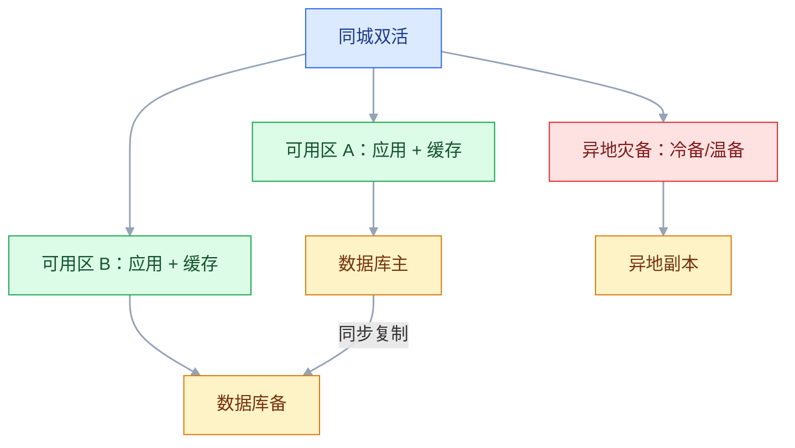
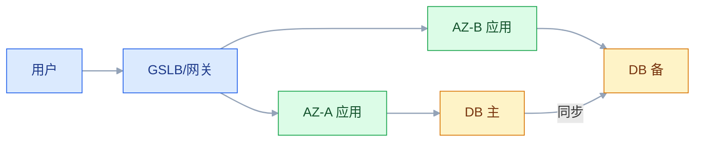

# 高可用、容灾与多地多活

## 一、工程案例：把“机房挂了怎么办”变成可演练的容灾方案

**场景**：支付系统单机房部署，数据库主从同机房。去年机房空调故障，停电 40 分钟，支付全停。业务要求：核心支付可用性 99.99%，单机房故障 5 分钟内恢复，数据丢失不超过 1 分钟。团队说“我们有备份，应该没问题”，但备份恢复要 4 小时，且从没演练过。

**目标**：不做“买两套机房”的口号，交付一套可验收的可用性与容灾方案：

- 一张可用性目标与故障域；
- 一张同城双活/异地容灾拓扑；
- 一套故障切换与回切流程；
- 一张 RTO/RPO 与数据一致性表；
- 一份演练计划；
- 一份验收清单（8 项）。

**为什么必须做**：高可用不是“多部署一套”，而是“故障发生时，流量、数据、依赖、人员都能在承诺时间内切换”。没有演练的容灾方案，等于没有。

**动手前确认**：先盘点故障域：机房、可用区、网络、数据库、DNS、证书、第三方支付。再看历史故障：哪些是单点，哪些是连锁。下面的数据是示例。

### 1.1 可用性目标

| 指标 | 目标 | 说明 |
|---|---|---|
| SLA | 99.99% | 月度不可用 ≤ 4.32 分钟 |
| RTO | ≤ 5 分钟 | 故障到恢复 |
| RPO | ≤ 1 分钟 | 允许丢的数据 |
| MTTR | ≤ 10 分钟 | 平均恢复时间 |
| 故障切换 | 自动/半自动 | 关键链路自动，复杂链路人工确认 |

99.99% 不是口号。每多一个 9，成本大约翻倍；要先算业务损失，再定目标。

### 1.2 故障域

| 故障域 | 影响 | 应对 |
|---|---|---|
| 进程 | 单实例 | 多副本、健康检查 |
| 宿主机 | 单机 | 反亲和、迁移 |
| 可用区 | 机房级 | 同城双活 |
| 地域 | 城市级 | 异地灾备 |
| 网络 | 链路 | 多线、GSLB |
| 数据库 | 主库 | 主从/多主 |
| 依赖 | 支付/短信 | 降级、多供应商 |
| 人为 | 配置/发布 | 灰度、回滚 |

高可用要按故障域设计，不是按“机器数量”设计。

### 1.3 同城双活

同城双活的关键：

- 应用无状态，会话共享；
- 数据库主备同步，切换有仲裁；
- 缓存双活或主备；
- 入口 GSLB 能摘除故障区；
- 两区容量都能扛全量。

“双活”不是“两套都跑一点流量”，是“任何一区都能接管全量”。

### 1.4 异地容灾

| 模式 | 说明 | RTO/RPO | 成本 |
|---|---|---|---|
| 备份恢复 | 定期备份，故障后恢复 | 小时级 | 低 |
| 冷备 | 异地有资源，不跑流量 | 小时级 | 中 |
| 温备 | 异地最小集群，数据同步 | 分钟级 | 中高 |
| 热备/多活 | 异地跑流量，可切换 | 秒/分钟级 | 高 |

大多数企业从“同城双活 + 异地温备”起步，不必一上来多地多活。

### 1.5 数据复制

| 方式 | RPO | 延迟 | 风险 |
|---|---|---|---|
| 同步复制 | 0 | 高 | 跨城延迟、写入阻塞 |
| 半同步 | 小 | 中 | 降级后退化 |
| 异步复制 | 秒/分钟 | 低 | 故障丢数据 |
| 多主 | 低 | 低 | 冲突解决 |

RPO=0 通常要同步复制，跨城会牺牲写入延迟。业务要选“不丢”还是“快”。

### 1.6 切换与回切

| 阶段 | 动作 | 检查 |
|---|---|---|
| 检测 | 健康检查/人工确认 | 避免误判 |
| 决策 | 切换指挥人 | 谁有权切 |
| 切流 | DNS/GSLB/网关 | 流量是否真的过去 |
| 数据 | 主备切换/提升 | 数据是否最新 |
| 验证 | 核心链路冒烟 | 支付、查询、回调 |
| 回切 | 原中心恢复后切回 | 数据反向同步 |

切换不是“点个按钮”。要有指挥、checklist、验证、回滚。

### 1.7 脑裂与仲裁

双主/多主最怕脑裂：两个节点都认为自己是主，同时写。

| 机制 | 说明 |
|---|---|
| 仲裁节点 | 第三节点投票 |
| 租约 | 主节点持租约，过期失效 |
| fencing token | 旧主写入被拒绝 |
| 多数派 | 写需要多数确认 |

没有仲裁的多主，不要用于核心账务。

### 1.8 演练

| 演练 | 频率 | 目标 |
|---|---|---|
| 单实例故障 | 月 | 自动摘除 |
| 单可用区故障 | 季 | 双活切换 |
| 数据库主备切换 | 季 | RTO/RPO |
| 异地切换 | 半年 | 容灾可用 |
| 依赖故障 | 季 | 降级 |
| 全链路演练 | 年 | 端到端 |

演练要“无脚本、随机故障”，否则只是表演。

### 1.9 验收（8 项）

1. 单实例故障：30 秒内摘除，错误率 < 0.5%。
2. 单可用区故障：5 分钟内切流，核心链路可用。
3. 数据库主备切换：RTO ≤ 5 分钟，RPO ≤ 1 分钟。
4. 异地灾备：半年一次演练，RTO/RPO 达标。
5. 脑裂：仲裁生效，旧主写入被拒绝。
6. 依赖故障：支付/短信降级，主链路不受影响。
7. 回切：原中心恢复后，数据反向同步，回切成功。
8. 文档：切换手册、联系人、checklist、演练报告齐全。

## 二、高频问答：会卡住你的地方，也是面试最常问的

### 2.1 高可用就是多部署几台

**现场**

怎么判断：画故障域，逐个看数据库、机房、DNS、依赖是不是单点；只多实例不够。

**要点**

- 多实例只解决进程级故障。
- 共享数据库、机房、网络时，故障域没隔离，照样全挂。
- 高可用要按故障域设计，不是按机器数量设计。

**追问**

- 三个实例放同一台宿主机算高可用吗？→ 不算，宿主机是同一个故障域。
- 数据库单点怎么办？→ 主从或多副本，加切换仲裁。
- 多实例之外还要什么？→ 健康检查、自动摘流，以及能接管全量的容量。

### 2.2 有备份就有容灾

**现场**

怎么判断：问恢复一次要多久、丢多少数据、演练过没有。

**要点**

- 备份解决数据恢复，容灾解决业务连续，两者都要。
- 备份恢复常是小时级，RTO 根本不达标。
- 没演练过的恢复时间都是猜的。

**追问**

- RTO 和 RPO 分别指什么？→ 多久恢复、丢多少数据。
- 备份要满足什么才算容灾？→ 恢复时间进 RTO、丢失量进 RPO，且演练过。
- 备份放哪？→ 独立于生产机房和账号，别同盘同库。

### 2.3 多活就是两套都跑流量

**现场**

怎么判断：问一区挂了另一区能不能扛全量、数据冲突怎么解。

**要点**

- 双活的定义是任何一区都能接管全量，不是各接一点流量。
- 要同时解决数据同步、冲突、路由、容量、切换五件事。
- 两套各跑 50% 容量，接管时一定崩。

**追问**

- 同城双活最难的是什么？→ 数据库主备切换和仲裁。
- 多活和双活区别在哪？→ 多活跨地域，冲突和延迟更难。
- 双活的容量怎么算？→ 每套都按 100% 日常流量预留。

### 2.4 RTO/RPO 拍脑袋定

**现场**

怎么定：先算停 1 小时损失多少、丢 1 分钟数据能不能接受，再反推目标。

**要点**

- RTO/RPO 越高越贵，每多一个 9 成本大约翻倍。
- 目标还要技术撑得住，不能只写在方案里。
- 业务损失和成本要一起算，不能都写 99.99%、RTO 0、RPO 0。

**追问**

- 99.99% 一个月允许多久不可用？→ 4.32 分钟。
- RPO=0 的代价是什么？→ 同步复制，写入延迟上升，跨城尤其明显。
- 目标定高了会怎样？→ 钱花了但架构撑不住，最后变成纸面指标。

### 2.5 切换是运维的事

**现场**

怎么判断：看切换手册里有没有业务验证、指挥人、回滚步骤。

**要点**

- 切换涉及业务验证、数据一致性、客户沟通，不是点个按钮。
- 没有业务参与，切过去也不敢用。
- 切换是流程，要有指挥、checklist、验证、回滚。

**追问**

- 谁来拍板切？→ 事先指定的指挥人，不能临时找。
- 自动切换的风险在哪？→ 误判导致双写或来回抖动。
- 核心账务建议自动还是半自动？→ 半自动，告警加人工确认。

### 2.6 云厂商会保证可用性

**现场**

怎么判断：看是否跨 AZ 部署、是否有跨区备份、是否演练过。

**要点**

- 云厂商保证的是基础设施，不保证你的架构。
- 跨 AZ、跨区、备份都要自己设计。
- 单 AZ 部署在云上依然是单点。

**追问**

- 多 AZ 就够了吗？→ 不够，还要看数据库、DNS、第三方依赖是否跨 AZ。
- SLA 赔偿能覆盖损失吗？→ 通常远不能。
- 上云后还要做容灾吗？→ 要，故障域变了但没消失。

### 2.7 多地多活一定更好

**现场**

怎么判断：问业务能不能接受跨城延迟、冲突谁解决、成本能不能承担。

**要点**

- 多活的成本、复杂度、一致性难度都远高于同城双活。
- 大多数业务同城双活加异地温备就够。
- 是否多活由业务对延迟和连续的容忍度决定，不是由技术先进性决定。

**追问**

- 多活最大的技术难点？→ 数据冲突和跨城延迟。
- 什么业务适合多活？→ 读多写少、能按用户单元化路由的。
- 大多数企业从哪起步？→ 同城双活加异地温备。

### 2.8 没有演练也能切

**现场**

怎么判断：看最近一次演练报告；没有就是没验证。

**要点**

- 真实故障有并发、误判、数据不一致，方案写得再好也会有坑。
- 演练要无脚本、随机故障，否则只是表演。
- 演练频率按故障域分层，单实例最勤，异地最稀。

**追问**

- 演练会不会影响生产？→ 要在可控范围、可回滚，先从单实例开始。
- 演练要验证什么？→ RTO/RPO、切换动作、验证清单、回滚。
- 演练报告看什么？→ 实际耗时和卡点，不是“成功”两个字。

### 2.9 脑裂不会发生

**现场**

怎么判断：问主备切换有没有仲裁、旧主写入怎么拒绝。

**要点**

- 网络分区时备节点可能被提升，旧主还在写，就会双写。
- 没有仲裁的多主，不能用于核心账务。
- 防脑裂靠仲裁节点、租约、fencing token、多数派。

**追问**

- fencing token 怎么起作用？→ 存储端拒绝旧 token 的写入。
- 仲裁节点自己挂了怎么办？→ 用多数派，不能让单点决定。
- 脑裂后发现双写怎么处理？→ 以仲裁结果为准，冲突数据人工裁决。

### 2.10 容灾只考虑机房

**现场**

怎么判断：画依赖图，逐个看 DNS、证书、支付、消息队列、配置中心的故障域。

**要点**

- 机房是最大故障域，但不是唯一。
- DNS、证书、第三方支付、消息队列、配置中心都可能是单点。
- 容灾要沿依赖链逐层看，只做机房不够。

**追问**

- DNS 切换要注意什么？→ TTL 太长切得慢，太短解析压力大。
- 第三方支付挂了怎么办？→ 多供应商加降级。
- 证书过期算不算故障？→ 算，而且是最容易被忽略的人为故障。

## 三、核心知识

### 3.1 SLA、SLO、SLI

| 概念 | 含义 |
|---|---|
| SLI | 指标，如成功率、延迟 |
| SLO | 目标，如 99.9% |
| SLA | 对外承诺，含赔偿 |

SLO 要内部可测，SLA 要对外可赔。两者不要混。

### 3.2 可用性计算

| 可用性 | 月不可用 | 年不可用 |
|---|---:|---:|
| 99% | 7.2 小时 | 3.65 天 |
| 99.9% | 43.2 分钟 | 8.76 小时 |
| 99.95% | 21.6 分钟 | 4.38 小时 |
| 99.99% | 4.32 分钟 | 52.6 分钟 |
| 99.999% | 25.9 秒 | 5.26 分钟 |

可用性是“串联相乘”：两个 99.9% 的依赖串联，整体约 99.8%。

> **面试**：常问「两个 99.9% 的服务串联，整体可用性是多少？」答：约 99.8%，依赖越多整体越低，所以要减少同步依赖、增加降级。

### 3.3 冗余

| 层 | 冗余方式 |
|---|---|
| 应用 | 多实例、无状态 |
| 数据库 | 主从、多副本 |
| 缓存 | 集群、双活 |
| 网络 | 多线、GSLB |
| 机房 | 同城双活 |
| 地域 | 异地灾备 |

冗余要“能接管”，不是“存在”。

### 3.4 故障检测

| 方式 | 说明 |
|---|---|
| 健康检查 | HTTP/TCP/业务探针 |
| 心跳 | 定期上报 |
| 监控告警 | 指标/日志 |
| 合成探测 | 模拟用户请求 |

健康检查要区分“进程活着”和“业务可用”。

### 3.5 切换

| 类型 | 说明 |
|---|---|
| 自动 | 健康检查失败自动摘除 |
| 半自动 | 告警 + 人工确认 |
| 手动 | 指挥 + checklist |

核心账务建议半自动，避免误切。

### 3.6 数据复制

| 方式 | 一致性 | RPO |
|---|---|---|
| 同步 | 强 | 0 |
| 半同步 | 较强 | 小 |
| 异步 | 最终 | 秒/分钟 |
| 多主 | 冲突 | 低 |

复制方式决定 RPO，不能既要 RPO=0 又要跨城低延迟。

> **面试**：常问「RPO=0 怎么实现？」答：同步复制，代价是写入延迟上升，跨城尤其明显。

### 3.7 容灾模式

| 模式 | RTO | 成本 |
|---|---|---|
| 备份恢复 | 小时 | 低 |
| 冷备 | 小时 | 中 |
| 温备 | 分钟 | 中高 |
| 热备 | 秒/分钟 | 高 |
| 多活 | 秒 | 最高 |

### 3.8 单元化

单元化（Cell/Unit）把用户按规则分到独立单元，每个单元有完整应用和数据。

优点：故障隔离、扩容简单、异地多活。
代价：路由、数据迁移、跨单元查询复杂。

> **面试**：常问「单元化解决什么问题？」答：按用户分单元，故障隔离、扩容简单，代价是路由和跨单元查询变复杂。

### 3.9 混沌工程

| 实验 | 目的 |
|---|---|
| 杀实例 | 验证摘除 |
| 断网 | 验证重试/超时 |
| 延迟 | 验证熔断 |
| 停依赖 | 验证降级 |
| 切主 | 验证 RTO/RPO |

混沌工程要“可控、可回滚、有假设”。

### 3.10 容量与成本

高可用要算“全量接管”的容量：双活不是两套各 50%，而是每套都能扛 100%。成本要按故障场景算，不是按日常流量算。

## 四、冷门知识汇总

- **MTBF/MTTR**：平均无故障时间、平均修复时间。可用性 ≈ MTBF / (MTBF + MTTR)。
- **RTO/RPO**：恢复时间目标、恢复点目标。RTO 是“多久恢复”，RPO 是“丢多少数据”。
- **脑裂（Split Brain）**：网络分区导致两个主同时写。解决：仲裁、租约、fencing token、多数派。
- **fencing token**：每次选主生成递增 token，存储端拒绝旧 token 的写入。
- **Pilot Light**：异地只保留最小核心（如数据库），故障时扩容。
- **Warm Standby**：异地有缩小的完整环境，故障时扩容接管。
- **Active-Active**：多地同时提供服务，需解决数据冲突和路由。
- **单元化（Cell Architecture）**：按用户分单元，故障隔离，扩容简单。
- **GSLB**：全局负载均衡，按地域/健康状态路由 DNS。
- **DNS 故障切换的 TTL**：TTL 太长切换慢，太短解析压力大；要配合客户端重试。
- **“备份不是容灾”**：备份解决数据恢复，容灾解决业务连续；两者都要。
- **“切换是流程，不是按钮”**：要有指挥、checklist、验证、回滚。
- **混沌工程**：主动注入故障，验证系统韧性；不是生产环境随便搞。
- **Game Day**：定期全链路故障演练，业务、开发、运维一起参与。
- **“多活不是免费的”**：跨城延迟、数据冲突、成本、运维复杂度都会上升。
- **“RPO=0”的代价**：同步复制会增加写入延迟，跨城尤其明显；业务要权衡。
- **“可用性串联”**：依赖越多，整体可用性越低；减少同步依赖、增加降级。