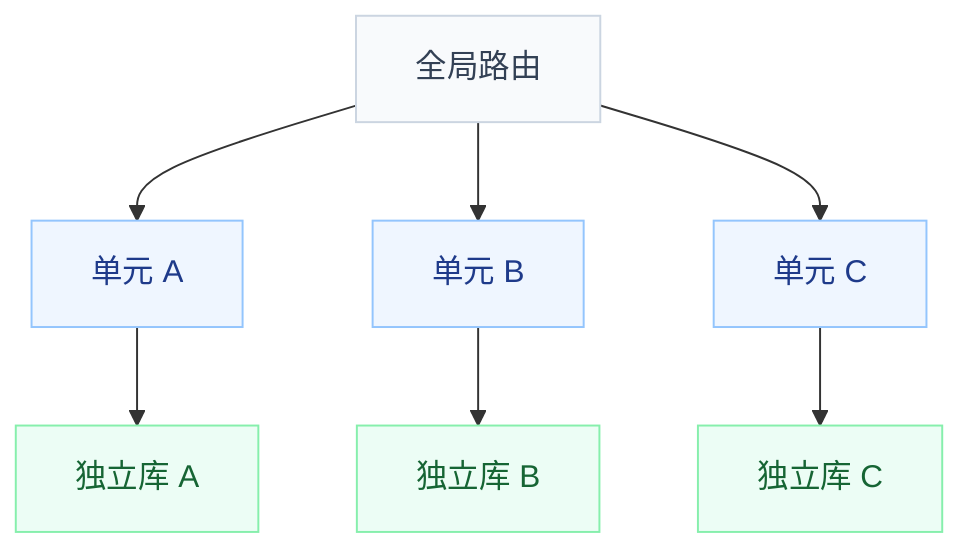

# 高可用与容灾

> 这篇从“可用性到底怎么算”讲起，经过 RTO/RPO、冗余层次、故障域与爆炸半径、脑裂与 fencing，再到限流、降级、容灾切换和演练，最后落到一次同城双活的完整决策与切换复盘。
>
> 学完能把“要高可用”翻译成可验收的 RTO/RPO 和可用率目标，能画出故障域并找到单点，能设计限流降级与切换预案，能用演练数据证明系统真的扛得住。

## 一、可用性怎么算

可用性是“在给定时间内，系统按承诺提供服务的时间比例”，不是“有没有宕机”。部分功能降级但核心链路可用，按 SLO 定义可以算可用。

### 1.1 九个九的停机时间

| 可用率 | 年停机 | 月停机 | 周停机 |
|---|---:|---:|---:|
| 99% | 3.65 天 | 7.3 小时 | 1.68 小时 |
| 99.9% | 8.76 小时 | 43.8 分钟 | 10.1 分钟 |
| 99.95% | 4.38 小时 | 21.9 分钟 | 5.05 分钟 |
| 99.99% | 52.6 分钟 | 4.38 分钟 | 1.01 分钟 |
| 99.999% | 5.26 分钟 | 26.3 秒 | 6.05 秒 |

从 99.9% 到 99.99%，年停机从 8.76 小时压到 52.6 分钟，成本通常涨一个数量级。目标要和业务损失匹配，不是越高越好。

### 1.2 串联与并联

串联依赖的可用率相乘，并联冗余的不可用率相乘：

```text
串联：A_total = A1 × A2 × ... × An
并联：A_total = 1 - (1 - A1) × (1 - A2) × ... × (1 - An)
```

三个 99.9% 的组件串联，整体是 99.7%，年停机 26 小时。两个 99.9% 的实例并联，整体是 99.9999%。

| 依赖数（各 99.9%） | 串联可用率 | 年停机 |
|---:|---:|---:|
| 1 | 99.9% | 8.76 小时 |
| 3 | 99.7% | 26.3 小时 |
| 5 | 99.5% | 43.8 小时 |
| 10 | 99.0% | 87.6 小时 |

这张表解释了一个常见现象：单看每个组件都很可靠，串起来却不达标。减少同步依赖的数量，比提高单个组件的可用率更有效。

边界：并联公式只在故障独立时成立。两个副本跑在同一台物理机、同一个机架、同一个电源上，它们不是并联，是一个节点。相关性是可用性计算里最容易被忽略的变量。

### 1.3 SLI、SLO 与错误预算

SLI 是实际测量值，SLO 是内部目标，错误预算是允许的失败额度。

| 概念 | 定义 | 示例 |
|---|---|---|
| SLI | 可测量的指标 | 过去 30 天支付接口成功率 |
| SLO | 内部目标 | 99.95% |
| 错误预算 | 1 − SLO | 0.05% ≈ 21.6 分钟/月 |
| 告警 | 预算消耗速率 | 1 小时消耗 > 20% |

错误预算的用途是决策：预算还有富余，可以继续发布新功能；预算耗尽，冻结变更，先修稳定性。没有预算概念，稳定性讨论会变成“谁嗓门大”。

边界：SLI 要按“用户可感知”定义。接口返回 200 但内容为空、返回兜底数据，都应该算失败。只统计 HTTP 状态码会漏掉最严重的那类故障。

## 二、RTO 与 RPO

RTO 决定“多久恢复”，RPO 决定“丢多少数据”。两者是容灾方案的第一约束，比“用几个机房”更能决定架构。

### 2.1 定义与四档方案

RTO（Recovery Time Objective）是从故障发生到恢复服务的目标时间；RPO（Recovery Point Objective）是能容忍丢失的数据时间窗口。

| 档位 | 典型方案 | RTO | RPO | 相对成本 |
|---|---|---|---|---|
| 备份恢复 | 离线备份 + 重建 | 数小时 | 数小时 | 1 |
| 冷备 | 停机镜像，手动启动 | 30–120 分钟 | 分钟级 | 2 |
| 温备 | 备用环境运行，数据异步复制 | 5–30 分钟 | 秒到分钟 | 4 |
| 热备/双活 | 多活运行，同步或半同步 | < 5 分钟 | 0 或秒级 | 8–15 |

成本按档位近似翻倍，而 RTO 每压一个数量级，成本涨一个数量级。把“支付不能丢数据”直接翻译成全系统 RPO=0，是最常见的过度设计。

### 2.2 按业务分级

| 业务 | RTO | RPO | 理由 |
|---|---:|---:|---|
| 支付扣款 | 5 分钟 | 0 | 丢一笔就是资损 |
| 下单 | 15 分钟 | ≤ 5 秒 | 可重试，不能重复扣 |
| 订单查询 | 30 分钟 | ≤ 5 分钟 | 短时不可用可接受 |
| 报表 | 4 小时 | ≤ 24 小时 | 离线重算即可 |

RPO 不是 0 的系统里，“丢 5 秒”意味着故障瞬间的写入可能只在主库内存里。异步复制在故障时会丢最后一段 binlog，这段数据要靠业务补偿或对账找回。

边界：RTO 的承诺要包含“检测 + 决策 + 执行 + 校验”四段。只算数据库切换的 30 秒，不算发现故障的 10 分钟，承诺就会落空。演练测出来的应当是端到端的 RTO。

### 2.3 成本曲线与断点

| RPO 目标 | 复制方式 | 跨城延迟 | 写入影响 |
|---|---|---|---|
| 小时级 | 定时备份 | 无 | 无 |
| 分钟级 | 异步复制 | 无 | 无 |
| 秒级 | 半同步（同城） | 1–3ms | 轻微 |
| 0 | 同步复制（同城） | 2–5ms | 明显 |
| 0（跨城） | 跨城同步 | 30ms+ | 不可接受 |

跨城同步复制会让每笔写入多等一个 RTT，交易系统基本无法接受。所以“异地 RPO=0”通常只能用“同城同步 + 异地异步 + 日志级补偿”逼近，而不是真的同步。

## 三、冗余的层次

冗余不是“多部署一份”，而是“故障发生时，另一份能在可接受时间内接管，并且不共享同一个故障源”。

### 3.1 从实例到地域

| 层次 | 冗余单位 | 能防的故障 | 不能防的故障 |
|---|---|---|---|
| 进程 | 多线程/多进程 | 单请求异常 | 进程崩溃 |
| 实例 | 多副本 | 单实例宕机 | 宿主机故障 |
| 可用区 | 跨 AZ 部署 | 机房级故障 | 城市级灾害 |
| 地域 | 跨 Region | 城市级灾害 | 全局性配置错误 |

每往上一层，成本和复杂度都上升，切换时间也变长。多数业务做到“跨可用区”，少数核心业务做到“跨地域”。

### 3.2 无状态与有状态

无状态服务（Stateless Service）的冗余最简单：多副本 + 负载均衡，任意副本都能处理任意请求。有状态服务（Stateful Service）的冗余要解决数据复制、选主、切换三件事。

| 组件 | 冗余方式 | 切换代价 |
|---|---|---|
| Web/API | 多副本 + LB | 秒级，无数据问题 |
| Redis | 主从 + Sentinel / Cluster | 秒级，可能丢少量写 |
| MySQL | 主从 + 半同步 + 选主 | 分钟级，需 fencing |
| Kafka | 多副本 + ISR | 秒级，依赖 acks |
| 对象存储 | 服务端多副本 | 用户无感 |

有状态组件的切换是容灾的核心难点。无状态服务挂了再起一个就行，数据库挂了要考虑谁是主、旧主是否还活着、数据有没有追上。

### 3.3 冗余不等于备份

这是最贵的认知错误：冗余防的是“设备坏”，备份防的是“数据错”。

| 事件 | 冗余能救 | 备份能救 |
|---|---|---|
| 磁盘损坏 | 是 | 是 |
| 机房断电 | 是 | 是 |
| 误删表 | 否（删除会同步） | 是 |
| 逻辑错误写脏数据 | 否（脏数据会复制） | 是 |
| 勒索软件加密 | 否（加密会同步） | 是（离线副本） |

备份要满足 3-2-1 原则：3 份副本、2 种介质、1 份异地。并且至少一份是“不可变”的，防止被误删或被加密。

```bash
# 片段：用 xtrabackup 做全量备份并校验，备份文件写入异地对象存储
xtrabackup --backup --target-dir=/backup/mysql/2026-11-13 \
  --user=backup --password=***
xtrabackup --prepare --target-dir=/backup/mysql/2026-11-13
# 校验：能启动一个临时实例并查到预期行数，才算备份有效
```

边界：备份“成功”不等于“可恢复”。只有做过恢复演练、并在目标 RTO 内完成，备份才算有效。备份监控要监控“恢复演练结果”，不是监控“文件大小”。

## 四、故障域与爆炸半径

故障域（Fault Domain）是“会一起失效的一组资源”。画清楚故障域，才能知道一次故障最多影响多少用户。

### 4.1 故障域的层级

| 层级 | 典型故障 | 影响范围 | 隔离手段 |
|---|---|---|---|
| 进程 | 崩溃、内存泄漏 | 单请求/单副本 | 重启、副本 |
| 主机 | 硬件、内核 | 单机全部实例 | 反亲和 |
| 机架 | 交换机、电源 | 整机架 | 机架感知 |
| 可用区 | 电力、网络 | 全区 | 跨 AZ 部署 |
| 地域 | 地震、光缆 | 全城 | 跨 Region |

同一层级的资源要尽量独立，跨层级的资源要显式标注为“共享风险”。Kubernetes 里两个 Pod 没有反亲和约束，可能落在同一节点，这时“多副本”只是进程级冗余。

```yaml
# 片段：用 topologySpreadConstraints 把副本打散到不同可用区
topologySpreadConstraints:
  - maxSkew: 1
    topologyKey: topology.kubernetes.io/zone
    whenUnsatisfiable: DoNotSchedule   # 排不下就不调度，避免假冗余
    labelSelector:
      matchLabels:
        app: order-api
```

`whenUnsatisfiable: ScheduleAnyway` 会让调度器在资源不足时把副本塞进同一个 AZ，可用性看起来达标，实际是单 AZ 运行。核心服务应该用 `DoNotSchedule`，宁可少副本也不要不均匀。

边界：可用区不是绝对独立。同城两个 AZ 可能共用一条光缆、一个变电站、一个上游 DNS。真正的独立要按“供电、网络、运维操作”三条分别确认，不能只看云厂商的 AZ 标签。

### 4.2 爆炸半径

爆炸半径（Blast Radius）是一次故障能波及的最大范围。控制爆炸半径的手段：

- 单元化（Cell）：把用户按 ID 哈希分到多个独立单元，每个单元自带完整依赖，一个单元故障只影响 1/N 用户。
- 舱壁（Bulkhead）：线程池、连接池、队列按业务隔离，一个慢依赖不拖垮全部。
- 分批发布：先 1% 再 10%，出问题只影响小部分。
- 配额：按租户限制资源，防止单租户打满共享池。

| 手段 | 隔离对象 | 代价 |
|---|---|---|
| 单元化 | 用户群体 | 路由复杂、跨单元数据难聚合 |
| 舱壁 | 资源池 | 资源利用率下降 |
| 分批发布 | 版本 | 发布周期变长 |
| 配额 | 租户 | 需要计量与限流 |



单元化的关键不是“分”,而是“每个单元只依赖自己单元内的资源”。如果三个单元共用一个数据库，数据库一挂三个单元一起挂，爆炸半径没有缩小。

边界：单元化适合用户维度天然可分的业务（电商、社交、SaaS）。跨单元强一致的业务（全局库存、金融总账）不适合，硬做会把一致性问题放大。

## 五、脑裂与 fencing

脑裂（Split Brain）是两个节点都认为自己是主，同时接受写入。它比单点故障更危险，因为会静默产生两份冲突数据。

### 5.1 脑裂的成因

| 成因 | 过程 | 典型场景 |
|---|---|---|
| 网络分区 | 主从失联，从库升主 | 同城专线抖动 |
| GC/长事务停顿 | 主库假死，被判定故障 | JVM Full GC 数秒 |
| 误判 | 健康检查超时过短 | 网络瞬断触发切换 |
| 人为操作 | 两边同时执行切换 | 演练与真实故障叠加 |

### 5.2 多数派与租约

防止脑裂的第一道防线是“只有拿到多数派同意才能当主”。三节点集群能容忍一个节点失联，两节点集群不能——因为无法区分“对方挂了”和“自己网络断了”。

| 集群规模 | 容忍故障节点 | 说明 |
|---|---:|---|
| 2 | 0 | 不建议用于选主 |
| 3 | 1 | 最小可用配置 |
| 5 | 2 | 跨 AZ 常用 |
| 6 | 2 | 偶数无额外收益 |

第二道防线是租约（Lease）：主的身份有期限，到期必须续租，续不上就自动退位。租约解决了“旧主不知道自己已经失联”的问题，但依赖时钟，时钟漂移会让租约失效。

### 5.3 fencing token

fencing 的核心思想是：**保护资源的一方要能拒绝旧主**，而不是指望旧主自杀。

```text
1. 每次选主产生一个单调递增的 token（epoch）
2. 主节点写数据时带上 token
3. 存储层/网关只接受 token >= 当前已知最大值的写
4. 旧主即使还活着，token 过期，写入被拒绝
```

| 层 | fencing 实现 |
|---|---|
| 数据库 | 代理层校验 epoch，旧主连接被切断 |
| 分布式锁 | 锁服务返回递增值，资源侧校验 |
| 存储 | 共享存储的保留/抢占（reserve/acquire） |
| 主机 | STONITH，直接断电旧主 |

STONITH（Shoot The Other Node In The Head）是最后的兜底：通过带外管理断电旧主。它粗暴但有效，前提是带外管理网络本身可靠。

边界：只靠“旧主检测到自己失联就停止服务”不叫 fencing，因为旧主可能没检测到（GC 停顿、网络分区下的单向可达）。fencing 必须落在被保护资源侧。

### 5.4 数据库切换的实际约束

MySQL 主从切换常见的三个坑：

- 半同步退化成异步：`rpl_semi_sync_source_timeout` 超时后自动降级，此时切换会丢数据。要监控退化次数。
- 选主选到延迟最大的副本：切换后要等副本追平日志，否则读到的数据比旧主还旧。
- 旧主恢复后重新加入：必须先确认它已被 fencing，否则会以“新主”身份接受写入。

```sql
-- 切换前确认候选副本已追平：两个 GTID 集合相等才允许提升
SELECT @@global.gtid_executed;
SHOW REPLICA STATUS\G
-- Retrieved_Gtid_Set 与 Executed_Gtid_Set 不一致时，禁止提升
```

## 六、限流与过载保护

过载不是“请求太多”，而是“请求超过了系统当前能处理的速率，并且越处理越慢”。限流的目标是让系统在过载时保持可预测，而不是追求全部成功。

### 6.1 过载为什么会雪崩

```text
流量上升 → 队列变长 → 处理超时 → 客户端重试 → 流量再上升
        → 线程池耗尽 → 健康检查失败 → 实例被摘除 → 剩余实例压力更大
```

这个循环里，重试是放大器。没有重试预算的系统，一次 10% 的失败会变成 30% 的流量。

### 6.2 限流算法

| 算法 | 特点 | 适用 |
|---|---|---|
| 固定窗口 | 实现简单，边界突刺 | 粗粒度保护 |
| 滑动窗口 | 平滑，需存储窗口 | 接口级限流 |
| 令牌桶 | 允许突发，平均速率可控 | API 网关 |
| 漏桶 | 恒定输出，削峰 | 下游保护 |
| 并发数限制 | 直接限制在途请求 | 线程池/连接池 |

并发数限制比 QPS 限流更贴近真实容量，因为系统瓶颈通常是“同时在处理的请求数”，而不是“每秒到达数”。一个请求耗时从 50ms 涨到 500ms，同样的 QPS 会让并发数涨 10 倍。

```nginx
# 片段：Nginx 按 IP 限流，10r/s，突发 20
limit_req_zone $binary_remote_addr zone=api:10m rate=10r/s;
server {
  location /api/ {
    limit_req zone=api burst=20 nodelay;
    limit_req_status 429;
    proxy_pass http://order_api;
  }
}
```

边界：网关限流只能挡住入口流量，挡不住内部服务之间的调用放大。一个页面请求扇出 20 个下游调用，入口限流 100 QPS，下游就要承受 2000 QPS。限流要按调用链逐层做。

### 6.3 重试预算与退避

重试必须有三个约束，缺一个就会变成放大器：

1. 预算：重试请求不超过总请求的 10%，用令牌桶控制。
2. 退避：指数退避加抖动，避免重试同步。
3. 幂等：重试不能产生重复副作用。

```text
第 1 次重试等待 100ms ± 随机 0–20ms
第 2 次等待 200ms ± 随机
第 3 次等待 400ms ± 随机
超过 3 次不再重试，返回降级结果
```

只对“可重试错误”重试：超时、连接失败、5xx。参数错误、鉴权失败、业务拒绝不重试。

### 6.4 超时预算

调用链上的超时要递减，不能每层都设 3 秒：

```text
入口超时 3000ms
  → 服务 A 调用 B 超时 2000ms
    → B 调用 C 超时 1000ms
      → C 查库超时 500ms
```

如果每一层都设 3 秒，最坏情况下入口等 3 秒，但下游还在继续处理，资源被占住，形成堆积。超时预算让上游先放弃，下游的取消信号要能传递下去。

边界：超时不是越长越安全。超时设得过长，故障时线程池被占满，恢复要等所有请求超时；设得过短，正常抖动也会触发重试。

### 6.5 自适应限流

固定阈值需要提前压测，且流量结构变化后失效。自适应限流根据当前延迟和并发动态调整：延迟升高就降低允许并发，延迟回落再放开。

```text
允许并发 = 基线并发 × (目标延迟 / 当前延迟)
当前延迟 > 目标延迟 × 2 → 快速收紧
当前延迟 < 目标延迟 × 0.8 → 缓慢放开
```

边界：自适应算法在“延迟指标本身失真”时会误判。依赖被限流后延迟反而下降，算法会继续放量，形成振荡。要用“成功率 + 延迟”两个信号联合判断。

## 七、降级与熔断

降级是“主动放弃非核心功能，保住核心链路”；熔断是“依赖不可用时快速失败，不再消耗资源”。

### 7.1 降级分级

| 级别 | 定义 | 例子 |
|---|---|---|
| L0 核心 | 不可降级 | 下单、支付扣款 |
| L1 可降 | 可简化或延迟 | 推荐、优惠券试算 |
| L2 可停 | 可暂时关闭 | 评论、积分展示 |
| L3 可异步 | 可延迟处理 | 短信通知、报表 |

降级决策要预先定“谁有权触发、触发后看什么指标、多久恢复”。故障发生时再讨论，会错过最佳时机。

### 7.2 兜底方式

| 方式 | 做法 | 风险 |
|---|---|---|
| 静态兜底 | 返回预置内容 | 内容可能过期 |
| 缓存兜底 | 读旧缓存 | 可能读到已删数据 |
| 默认值 | 返回空列表/默认配置 | 可能被误认为真实结果 |
| 异步补偿 | 先成功，后补 | 补不回来就是资损 |

支付金额、账户余额这类字段严禁默认值兜底。宁可报错让用户重试，也不能返回一个看起来成功的错误金额。

### 7.3 熔断的三个状态

| 状态 | 行为 | 进入条件 |
|---|---|---|
| 关闭 | 正常调用 | 初始状态 |
| 打开 | 直接失败，不调用 | 错误率/慢调用比例超阈值 |
| 半开 | 放少量请求试探 | 打开后等待一段时间 |

```yaml
# 片段：Resilience4j 熔断配置，50% 失败率触发，打开 30 秒后放 5 个请求试探
resilience4j.circuitbreaker:
  instances:
    inventory:
      slidingWindowSize: 20
      failureRateThreshold: 50
      waitDurationInOpenState: 30s
      permittedNumberOfCallsInHalfOpenState: 5
```

边界：熔断的阈值要按依赖的真实错误率设。下游本来就偶发 2% 失败，阈值设 1% 会频繁误断；阈值设 90% 又失去保护意义。

### 7.4 开关治理

降级开关是代码，要有生命周期：

- 每个开关有 owner、有默认值、有创建时间；
- 开关必须被测试覆盖，至少测“开”和“关”两条路径；
- 开关有到期时间，过期未清理的进技术债清单；
- 生产开关变更走审批，且能一键回滚。

最常见的故障不是“开关没开”，而是“开关开了但代码路径有 bug”。某次降级把返回对象置空，上游没做空判断，直接空指针，降级变成了更大的故障。

## 八、容灾架构与切换

容灾架构的选择由 RTO/RPO 和预算决定，不由“是否时髦”决定。

### 8.1 四种形态

| 形态 | 部署 | RTO | RPO | 适用 |
|---|---|---|---|---|
| 单 AZ | 一个可用区 | 小时级 | 依赖备份 | 内部系统 |
| 同城双活 | 两 AZ 同时服务 | < 5 分钟 | 0–秒级 | 核心交易 |
| 两地三中心 | 同城双活 + 异地灾备 | 15–30 分钟 | 秒–分钟 | 金融、政务 |
| 异地多活 | 多地域同时写 | < 1 分钟 | 秒级 | 超大规模 |

同城双活的性价比最高：两个 AZ 距离近，同步复制的延迟可以接受，RPO 能做到 0。异地多活的难点不在流量调度，而在“多地对同一份数据同时写”的冲突解决。

### 8.2 数据复制的三种模式

| 模式 | RPO | 写延迟 | 故障时行为 |
|---|---|---|---|
| 异步 | 秒到分钟 | 低 | 可能丢最后一段 |
| 半同步 | 0（至少一个副本收到） | +1 RTT | 不丢日志，但副本可能没应用 |
| 同步/组复制 | 0 | +1–2 RTT | 多数派确认才提交 |

MySQL 的半同步只保证“日志送达”，不保证“日志应用”。切换时如果副本还没应用完，读到的数据会回退。切换流程里必须有“等副本追平”这一步。

### 8.3 流量调度

| 手段 | 生效时间 | 粒度 | 风险 |
|---|---|---|---|
| DNS | 分钟级（受 TTL 影响） | 地域 | 缓存导致切换慢 |
| GSLB | 秒到分钟 | 地域/运营商 | 依赖探测准确性 |
| 客户端调度 | 秒级 | 实例 | 需要客户端配合 |
| 服务网格 | 秒级 | 实例/版本 | 增加一跳 |

DNS 切换慢是演练里最常见的发现：TTL 设了 600 秒，实际切换要 10 分钟。核心域名的 TTL 要降到 60 秒，并让客户端缓存尊重 TTL。

### 8.4 切换决策与步骤

切换必须是“有授权、有依据、有回切”的动作，不能靠个人判断。

| 步骤 | 动作 | 负责人 | 校验 |
|---|---|---|---|
| 1 | 确认故障范围与等级 | 值班 | 监控+日志 |
| 2 | 宣布进入切换流程 |  incident commander | 通知群 |
| 3 | 停止向故障域写入 | DBA | 写入开关 |
| 4 | 提升新主/切流 | DBA+运维 | 追平校验 |
| 5 | 验证核心链路 | 业务 | 冒烟用例 |
| 6 | 观察 30 分钟 | 全员 | SLO 指标 |
| 7 | 决定回切或保持 | IC | 数据校验 |

回切比切换更难：故障域恢复后，数据可能落后，直接切回会丢新数据。回切前要做双向对账，确认没有只在备用域写入的数据。

边界：切换不是“切流量”一个动作，中间还有“停写、追平、校验”三段。只切流量不停写，会同时产生两份写入，形成脑裂。

## 九、容灾演练

演练是唯一能证明“预案有效”的手段。没演练过的预案只是文档。

### 9.1 演练类型

| 类型 | 做法 | 能验证 | 风险 |
|---|---|---|---|
| 桌面推演 | 会议室走流程 | 职责、决策链 | 无 |
| 组件演练 | 杀 Pod、断网、慢盘 | 自愈与告警 | 低 |
| 机房演练 | 切 AZ、断专线 | 切换与数据一致性 | 中 |
| 全链路演练 | 模拟地域故障 | 端到端 RTO | 高 |

从桌面推演开始，逐级加码。直接做全链路演练，往往第一次就把生产打挂，然后团队再也不敢演。

### 9.2 演练设计

一次有效演练要有五要素：

1. 假设：明确“注入什么故障，预期系统怎么反应”。
2. 爆炸半径：限定影响的用户、实例、时间窗。
3. 观测：提前埋好指标，知道“正常”长什么样。
4. 终止条件：出现真实业务影响时立即停止。
5. 记录：时间线精确到秒，用于复盘。

```text
演练假设：AZ-A 的 MySQL 主库失联，预期 3 分钟内完成切换，
          RPO=0，订单写入成功率在 5 分钟内回到 99% 以上。
爆炸半径：仅影响 5% 灰度租户，时长不超过 30 分钟。
终止条件：错误率超过 5% 持续 2 分钟，或出现资损。
```

### 9.3 演练指标

| 指标 | 含义 | 目标（示例） |
|---|---|---|
| MTTD | 平均发现时间 | < 2 分钟 |
| 切换耗时 | 从决策到流量恢复 | < 10 分钟 |
| 数据丢失量 | 切换前后对账差异 | 0 行 |
| 误告警数 | 演练期间无关告警 | < 10 条 |
| 恢复验证耗时 | 冒烟用例跑完 | < 5 分钟 |

### 9.4 演练的常见失败

- 只演“主库挂了”，不演“主库挂了且切换失败”。后者才需要人工介入。
- 只演技术切换，不演“谁有权决策”。真实故障里，决策时间常占一半。
- 演练环境和生产不一致：副本数、监控、DNS 都不同，结论不可迁移。
- 演练后不修问题：行动项没有 owner 和截止日期，下次演练重复同样的失败。

边界：演练要能“安全地失败”。如果演练本身可能导致资损，就不是演练，是赌博。爆炸半径控制、回滚开关、值守人员三者缺一不可。

## 十、故障响应与现场手册

故障发生时，顺序比知识重要。先止损，再定位，最后复盘。

### 10.1 现象与第一条命令

| 现象 | 常见原因 | 第一条动作 |
|---|---|---|
| 全站 5xx 上升 | 入口限流误配/证书过期 | 看网关错误分布与证书有效期 |
| 某接口 P99 飙升 | 下游慢调用/连接池耗尽 | 看该接口的下游耗时分解 |
| 数据库连接满 | 慢查询/连接泄漏 | `SHOW PROCESSLIST` 找长事务 |
| 主从延迟暴涨 | 大事务/DDL/从库压力 | 看 `SHOW REPLICA STATUS` 与 binlog 事件 |
| 大量超时但 CPU 低 | 锁等待/线程池满 | 抓线程栈，看阻塞点 |
| 切换后数据回退 | 副本未追平/fencing 失效 | 立即停写，做双向对账 |

### 10.2 事故角色

| 角色 | 职责 |
|---|---|
| 指挥（IC） | 决策、协调、对外沟通 |
| 技术负责人 | 定位与执行 |
| 沟通负责人 | 同步进展，管理预期 |
| 记录员 | 时间线、动作、指标 |

一个人同时做四件事，会在关键时刻漏掉“停写”或“通知”。哪怕只有三个人，也要明确谁是指挥。

### 10.3 复盘

复盘不是追责，是找系统性缺口。结构固定为：时间线、影响面、直接原因、根因、行动项。

- 时间线精确到分钟，包含“发现、决策、执行、恢复”四段；
- 影响面用数据说话：多少用户、多少订单、多少金额；
- 根因至少问三层“为什么”，停在“某人不小心”说明没找到根因；
- 行动项有 owner、有截止日期、有验收标准，进同一张表跟踪。

## 十一、最佳实践案例

### 11.1 案例背景

一家跨境电商的订单与支付系统，部署在单可用区：K8s 集群单 AZ、MySQL 主从同机房、Redis 单集群、入口用 DNS 指向一个 SLB。SLO 承诺 99.95%，年停机预算 4.38 小时。

现状与事件：

- 三个月前机房空调故障，整区断电，系统停机 3 小时 20 分钟，损失约 460 万元（示例）；
- 数据库备份每天一次，恢复演练从未做过，实际恢复时间未知；
- 支付链路 RPO 要求为 0，订单链路可容忍 5 秒；
- 团队 6 人，有 K8s 运维经验，但没有跨 AZ 切换经验；
- 预算允许把基础设施成本提高 40%，改造窗口 4 个月。

目标：RTO ≤ 30 分钟，支付 RPO = 0，订单 RPO ≤ 5 秒，年可用率 ≥ 99.95%，并且切换动作能在 10 分钟内由值班人员独立完成。

### 11.2 案例实操

先做故障域盘点，把“看起来冗余、实际共享”的地方找出来：

| 资源 | 现状 | 共享故障源 | 结论 |
|---|---|---|---|
| K8s 节点 | 3 节点同 AZ | 同机房电源 | 单 AZ 风险 |
| MySQL | 主从同机房 | 同交换机 | 机房故障全丢 |
| Redis | 3 主 3 从同 AZ | 同机房 | 同上 |
| 入口 | 单 SLB + DNS TTL 600s | 单 SLB | 切换慢 |
| 备份 | 本地磁盘 | 同机房 | 机房故障即丢失 |

方案对比（1–5 分，5 最好，示例）：

| 选项 | RTO | RPO | 成本 | 综合 |
|---|---|---|---|---|
| A 单 AZ 加固（3 周） | 2h | 分钟级 | 1.1× | 13 |
| B 同城双活（3 个月） | 10min | 支付 0 | 1.4× | 18 |
| C 两地三中心（8 个月） | 30min | 秒级 | 2.2× | 14 |
| D 异地双活（14 个月） | 1min | 秒级 | 3.5× | 10 |

综合分包含团队可控性：团队对 A 最熟，对 B 有 K8s 经验，对 C、D 没有跨城运维经验。

选项 A 解决不了机房级故障，RTO 仍是小时级。选项 C 的异地中心在 4 个月内建不完，且团队没有跨城运维经验。选项 D 的多写冲突没有业务侧解决方案。

决策：B，同城双活，支付链路用半同步复制，订单链路异步复制 + 对账补偿；异地只做日志级备份，不承诺自动切换。

具体改造：

1. 集群跨两个 AZ，核心服务用 `DoNotSchedule` 强制打散，每 AZ 至少 2 副本。
2. MySQL 改为同城两 AZ 半同步，主库在 AZ-A，候选主在 AZ-B；引入 orchestrator 做选主，代理层校验 epoch 做 fencing。
3. Redis 改为跨 AZ 主从 + Sentinel，开启 `min-replicas-to-write` 防止异步复制丢写。
4. 入口 DNS TTL 降到 60 秒，加 GSLB 健康探测；客户端 SDK 支持按 GSLB 返回的地址重连。
5. 支付写入走半同步，订单写入异步 + 本地消息表，故障后按消息表补偿。
6. 限流降级：入口按租户配额限流，订单查询配静态兜底，推荐和评论配可停开关。

切换 runbook 的核心片段：

```text
1. IC 宣布切换，通知群发模板消息
2. DBA 停止 AZ-A 写入（应用层写开关置 false）
3. 确认 AZ-B 候选主 gtid_executed 与旧主一致
4. orchestrator 提升 AZ-B 为主，代理层 epoch +1
5. 应用写开关切到 AZ-B，观察写入成功率
6. GSLB 把流量切到 AZ-B 入口
7. 跑 12 条冒烟用例（下单、支付、退款、查询）
8. 观察 30 分钟，SLO 恢复则结束
```

演练分四次，逐级加码，每次记录指标：

| 轮次 | 注入故障 | 预期 | 实测 |
|---|---|---|---|
| 1 | 杀 1 个订单 Pod | 30 秒内重建 | 22 秒恢复 |
| 2 | 断 AZ-A 到 AZ-B 的专线 | 半同步退化为异步并告警 | 8 秒告警 |
| 3 | 主库进程 kill | 3 分钟内切换，RPO=0 | 4 分 10 秒 |
| 4 | 整 AZ 流量摘除 | 10 分钟内全量切流 | 12 分钟 |

第 3 轮演练暴露了 fencing 缺失：旧主进程被 kill 后由守护进程拉起，仍以主库身份接受写入 40 秒，与新主产生双主。修复方式是代理层校验 epoch，旧主 epoch 落后时拒绝其写入，并在带外管理侧配置 STONITH 兜底。

### 11.3 案例结果

改造后 6 个月的实测（示例）：

| 指标 | 改造前 | 改造后 | 目标 |
|---|---:|---:|---:|
| 端到端 RTO | 3h20m | 12 分钟 | ≤ 30 分钟 |
| 支付 RPO | 未知 | 0 | 0 |
| 订单 RPO | 未知 | ≤ 3 秒 | ≤ 5 秒 |
| 年可用率 | 99.62% | 99.96% | ≥ 99.95% |
| 基础设施成本 | 基线 | +38% | ≤ +40% |
| 切换决策耗时 | 无预案 | 3 分钟 | ≤ 5 分钟 |

演练与真实故障的表现差异值得记录：演练里数据库切换 4 分 10 秒，真实一次 AZ 网络抖动触发切换用了 6 分 40 秒，多出来的时间是“等副本追平”和“确认旧主已被 fencing”。这说明 RTO 承诺必须按真实故障校准，不能只用演练的最好成绩。

三个失败模式：

1. DNS TTL 600 秒导致首次切流用了 9 分钟，用户侧大量超时。降到 60 秒后，切流稳定在 90 秒内。
2. 降级开关从未测试，一次误触发把订单详情返回空对象，上游空指针，错误率反而升到 12%。此后每个开关上线前必须跑“开/关”两条集成测试。
3. 备份从未做过恢复演练，第一次真实恢复发现备份文件缺少一个表空间，恢复失败。改为每周自动恢复到一个临时实例并跑行数校验。

复盘结论：同城双活解决了机房级故障，但没有解决“城市级灾害”和“逻辑错误删库”。前者靠异地日志备份兜底，后者只能靠不可变备份和延迟副本。高可用的投入顺序应该是：先消单点，再谈多活；先做恢复演练，再谈 RTO 承诺；先能回滚，再谈自动切换。
