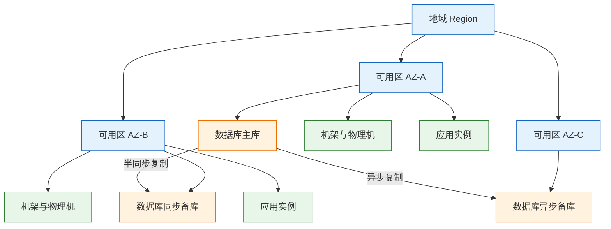
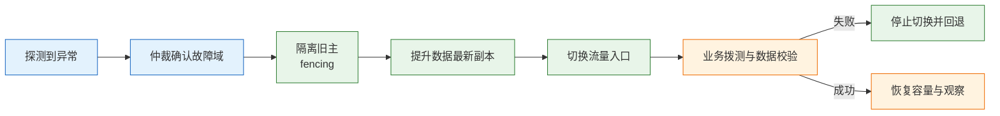
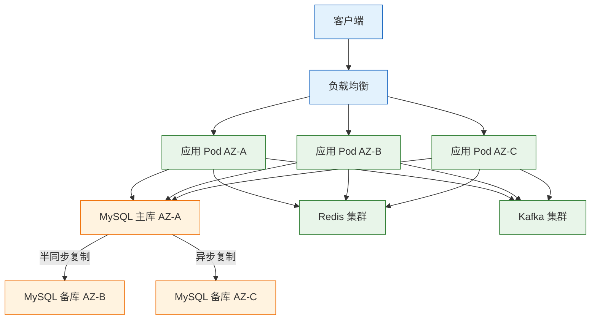

# 高可用与容灾

---

## 一、高可用与容灾是什么

### 1.1 核心概念

高可用（High Availability，HA）指系统在局部组件故障时仍能在可接受时间内恢复服务；容灾（Disaster Recovery，DR）指机房、地域等大范围灾难后重建业务并找回数据。前者压缩停机时长，后者守住数据底线。

一个反例可以说明差距。订单系统做了应用双实例、数据库主从、Redis 集群，实例和主库却都在同一可用区，切换靠人工脚本，DNS TTL 为 10 分钟。一次供电故障后业务停了 18 分钟；备份放在同地域且从未演练，恢复时缺少最近 binlog，RPO 从 5 分钟变成 6 小时。

高可用的核心对象是**冗余、检测、切换**，容灾的核心对象是**备份、异地副本、重建预案**。二者共享同一组量化指标：RTO（Recovery Time Objective，恢复时间目标）与 RPO（Recovery Point Objective，恢复点目标）。

| 概念 | 含义 | 度量方式 |
|---|---|---|
| 可用性 | 可服务时间占总时间的比例 | 成功请求数 / 总请求数，或时间口径 |
| RTO | 故障发生到业务恢复的目标时长 | 检测、决策、执行、验证之和 |
| RPO | 故障发生时允许丢失的数据时间跨度 | 最后可恢复点与故障点的差值 |
| MTTR | 平均修复时间，包含发现与验证 | 实际事故统计 |
| MTBF | 平均无故障时间 | 实际运行统计 |

高可用不解决逻辑缺陷、误删除、脏数据扩散、容量不足和发布引入的错误。这些问题的共同点是“所有副本同时出错”，冗余无法提供保护，只能依靠变更控制、数据校验、备份和灰度发布。

### 1.2 与相邻技术的关系

高可用是架构属性，不是某个产品。负载均衡、主从、Kubernetes 副本、多可用区都只是手段；把手段当目标，就会出现“副本很多、故障域只有一个”的假高可用。

| 相邻技术 | 解决的问题 | 与高可用的关系 |
|---|---|---|
| 备份 | 数据被删、被改、被加密后的找回 | 容灾的最后一道防线，不能替代 HA |
| 容量规划 | 故障后剩余容量是否够用 | 决定冗余是否真正有效 |
| 可观测性 | 故障能否被及时发现 | 缩短检测阶段，直接压缩 MTTR |
| 发布工程 | 变更是否可控、可回滚 | 多数事故来源于变更，灰度即防御 |
| 混沌工程 | 故障假设是否成立 | 用受控实验验证切换链路 |
| 多可用区部署 | 机房级故障隔离 | 高可用的基础设施前提 |

备份与高可用经常被互相替代。主从能做到秒级切换，却无法处理“误删一张表”，因为删除会同步到备库；备份能找回三天前的数据，却无法让业务五分钟内恢复。两者必须同时存在并分别验收。

### 1.3 架构组成

一套完整的高可用体系按请求路径分为五层，每层承担不同的故障域和恢复动作。

| 层级 | 高可用手段 | 主要故障域 |
|---|---|---|
| 接入层 | 多线路 DNS、全局负载均衡、健康检查 | 单线路、单入口、证书过期 |
| 应用层 | 多副本、无状态、熔断限流、优雅下线 | 单实例、单节点、发布错误 |
| 数据层 | 主备复制、多数派、分片、备份 | 单库、复制延迟、脑裂 |
| 基础设施 | 多机架、多可用区、多地域 | 机架、机房、地域 |
| 运维层 | 监控、预案、演练、容量基线 | 人员、文档、流程 |

五层各自承担不同的故障域与恢复动作，任何一层缺失，整体 RTO 都会被该层拖长。

---

## 二、可用性指标与目标体系

### 2.1 可用性量化

可用性用“几个 9”表达，但口径差异很大：99.9% 按年算为 8.76 小时，按月算为 43.8 分钟。对外承诺必须写清统计周期、请求范围和数据来源。

| 可用性 | 年停机时间 | 月停机时间（30 天） |
|---|---|---|
| 99% | 3.65 天 | 7.2 小时 |
| 99.9% | 8.76 小时 | 43.8 分钟 |
| 99.95% | 4.38 小时 | 21.9 分钟 |
| 99.99% | 52.6 分钟 | 4.38 分钟 |
| 99.999% | 5.26 分钟 | 26 秒 |

串联结构的可用性是各组件相乘。三个 99.9% 的组件串成一条链路，整体只有 99.7%；链路越长，端到端可用性越低。并联结构按 `1-(1-A)^n` 计算，两个 99% 的独立副本并联可以达到 99.99%，但前提是故障相互独立。

| 结构 | 公式 | 示例结果 |
|---|---|---|
| 串联 | A1 × A2 × … × An | 0.999³ ≈ 99.7% |
| 并联 | 1 − (1 − A)ⁿ | 1 − 0.01² = 99.99% |
| 混合 | 按链路逐段展开 | 以实际拓扑为准 |

并联公式的前提是故障独立。两个副本共享数据库、交换机或配置中心时，实际可用性接近单副本。

### 2.2 RTO 与 RPO 目标

RTO 不是“切换命令执行完”的时间，而是从故障发生到业务真正恢复的全过程，包含检测、决策、执行、验证、恢复容量五个阶段。只测脚本耗时，会把 RTO 低估一半以上。

| 阶段 | 典型动作 | 压缩手段 |
|---|---|---|
| 检测 | 监控告警、健康检查失败 | 多维度探测、缩短探测周期 |
| 决策 | 值班确认、切换审批 | 预案授权、自动判定 |
| 执行 | 摘流、提升备库、改路由 | 自动化、预演过的脚本 |
| 验证 | 核心链路拨测、数据校验 | 自动拨测、业务探针 |
| 容量 | 扩容、缓存预热、限流 | 预留余量、快速伸缩 |

RPO 由复制方式决定，不由备份频率单独决定。每天一次全量备份，RPO 最差接近 24 小时；分钟级 RPO 必须有持续日志归档或同步复制。业务说“不能丢数据”时，要翻译成具体 RPO 和可接受的写延迟。

容灾档次按 RTO、RPO 和成本划分为五档。档次越高，冗余越多、自动化越强，成本也越高。

| 档次 | 做法 | RTO | RPO | 成本 |
|---|---|---|---|---|
| 备份恢复 | 定期备份，灾难后重建 | 小时至天 | 小时至天 | 最低 |
| 冷备 | 备用环境不运行或最小运行 | 1 至数小时 | 分钟至小时 | 低 |
| 温备 | 备用环境运行，数据持续同步 | 10 至 60 分钟 | 秒至分钟 | 中 |
| 热备 | 主备实时同步，自动切换 | 秒至分钟 | 0 至秒 | 高 |
| 双活多活 | 多站点同时承载流量 | 接近 0 | 取决于复制 | 最高 |

不要直接跳到双活。双活要解决数据冲突、流量调度、脑裂和容量冗余，成本可能是单活的 2 至 3 倍。业务损失撑不起这个成本时，温备加快速恢复更划算。

### 2.3 目标分解与验收

RTO 和 RPO 要按业务能力分解，而不是给整个系统一个数字。下单、支付、查询、报表的重要度不同，统一按最高档建设浪费预算，统一按最低档建设漏掉核心链路。

下单与支付可定为 5 分钟、0 至 1 分钟，订单查询 15 分钟、5 分钟，库存同步 30 分钟、1 分钟，报表对账 4 小时、1 小时。档次差异来自业务损失，不是技术偏好。

目标还要落成 SLO 和错误预算。99.95% 的月错误预算是 21.9 分钟，故障与发布失败各消耗多少，需要有账可查。预算耗尽时冻结非必要变更。

> **注意**：RTO/RPO 是目标，不是实测值；评审写目标，演练报告写实测，两者分开记录。

---

## 三、故障模型与故障域

### 3.1 故障分类

高可用设计建立在对故障的假设之上。假设越准确，冗余越有针对性；假设错误，投入越多越危险。

| 故障类型 | 表现 | 典型对策 |
|---|---|---|
| 崩溃故障 | 进程退出、节点失联 | 副本、健康检查、自动重启 |
| 遗漏故障 | 请求或消息丢失 | 重试、确认、持久化队列 |
| 时序故障 | 响应变慢、超时 | 超时预算、隔离舱、限流 |
| 数据故障 | 静默写错、副本不一致 | 校验、对账、备份、只读副本 |
| 拜占庭故障 | 节点返回任意错误结果 | 多副本投票、审计，成本极高 |
| 相关故障 | 多副本同时失效 | 故障域隔离、异构、分批变更 |

多数系统只处理崩溃故障，假设组件会快速失败。真实事故里更常见的是灰度故障：进程活着，健康检查通过，部分请求却持续超时或报错，监控正常而用户侧已经下降。

灰度故障要求健康检查从“端口是否通”升级为“核心链路是否可用”，并配合分实例错误率、P99 和超时率。

### 3.2 故障域分层

故障域（Failure Domain）是一组会同时失效的资源。高可用的第一步不是加副本，而是把副本放到不同的故障域。

| 故障域 | 影响范围 | 隔离手段 |
|---|---|---|
| 实例 | 单进程、单容器 | 多副本、负载均衡、自动重启 |
| 节点与机架 | 单物理机、单机架 | 反亲和调度、跨机架部署 |
| 可用区 | 供电、制冷、局部网络 | 多可用区部署、跨区复制 |
| 地域 | 地震、洪水、大范围网络 | 异地备份、多地域、全局流量 |
| 供应商 | 云厂商区域故障、账号封禁 | 多云、混合云、独立账号 |

“三个副本”只有在三个故障域里才等于三个副本。三个 Pod 同节点、三个副本同可用区、主备库同阵列，都会一起失效。

### 3.3 相关性故障与隐性单点

相关性故障指多个看似独立的组件因同一原因同时失效。它比单点故障更隐蔽，因为架构图上没有单点，运行时却表现出单点行为。

常见隐性单点包括配置中心、共享数据库、统一身份、同一版本、同一 operator 和云账号配额，排查时用依赖图确认共享关系与影响面。

> **注意**：副本数量不能证明高可用，故障域数量才能。评审时逐个副本追问“它和谁共享电源、网络、配置和账号”，比看副本数有效。

---

## 四、冗余模式与容量余量

### 4.1 冗余模式

冗余模式决定故障时“谁接替、接多快、丢多少”。模式没有优劣，只有与 RTO/RPO 和成本是否匹配。

| 模式 | 说明 | RTO | RPO | 适用 |
|---|---|---|---|---|
| 主备冷 | 备机不运行，故障后启动 | 小时 | 备份点 | 非核心系统 |
| 主备热 | 备机运行，持续同步 | 秒至分钟 | 0 至秒 | 核心数据库 |
| N+1 | 多一个冗余实例 | 秒 | 0 | 应用层、无状态服务 |
| 多数派 | 写多数节点才成功 | 秒 | 0 | 元数据、配置、锁 |
| 双活 | 两个站点同时读写 | 接近 0 | 取决于同步 | 无法接受停机且能处理冲突 |
| 单元化 | 按用户分单元，故障隔离 | 分钟 | 单元内 | 超大流量、隔离爆炸半径 |

主备热的关键在“备机是否真的能接”。备机只订阅数据、不验证连接、不预加载缓存，切换后仍要冷启动。备机应定期承接只读流量或执行探活查询，确保连接池、证书、账号和参数可用。

多数派解决“谁有资格决策”，不解决“数据是否最新”。三节点容忍一个节点故障，五节点容忍两个；节点越多，写延迟和运维成本越高。

### 4.2 容量余量计算

故障后的剩余容量必须覆盖故障时的真实峰值。真实峰值往往高于日常峰值：重试、缓存回源、客户端轮询都会在故障瞬间放大流量。

计算公式可以写成：单实例 capacity × 故障后实例数 ≥ 峰值 × (1 + 安全余量)。以订单系统为例，峰值 3000 TPS，18 个实例每个承载 300 TPS，设计容量 5400 TPS。损失一个可用区后剩 12 个实例，容量 3600 TPS，相对 3000 TPS 只有 20% 余量。

| 场景 | 剩余容量 | 相对峰值 | 判断 |
|---|---|---|---|
| 18 实例损失 6 个 | 3600 TPS | +20% | 勉强达标 |
| 峰值上涨 20% 后故障 | 3600 TPS | 0% | 不达标 |
| 缓存失效回源放大 2 倍 | 等效 6000 TPS | −40% | 严重不达标 |
| 预留 24 实例损失 8 个 | 4800 TPS | +60% | 可吸收抖动 |

容量验收要按“故障后”的口径做。压测时先摘掉一个可用区的实例，再打入峰值流量，观察错误率和 P99；只压全量实例，测不出真实余量。

---

## 五、数据复制与一致性

### 5.1 复制方式

数据层最难，因为应用副本可以随意替换，数据副本却必须回答“哪一份最新”。

| 方式 | 提交条件 | RPO | 写延迟 | 风险 |
|---|---|---|---|---|
| 异步复制 | 主库本地提交即返回 | 大于 0 | 最低 | 主库故障丢最后一段日志 |
| 半同步复制 | 至少一个备库确认收到日志 | 接近 0 | 中 | 备库变慢拖慢写入，超时退化 |
| 同步复制 | 多数副本确认并应用 | 0 | 最高 | 跨区延迟、可用性下降 |
| 多数派写入 | 多数节点确认 | 0 | 高 | 需要奇数节点与仲裁 |

半同步有两个易混细节。确认“收到日志”不等于“应用日志”，备库未回放时被提升仍会丢数据；半同步通常配置超时退化，备库变慢时退回异步，此时 RPO 已从 0 变成大于 0，监控必须能看见。

异步复制不是错误，错误的是把它宣传成 RPO 0。订单支付等不能丢数据的链路，应使用半同步或同步复制并接受写延迟；日志、埋点等可丢数据，用异步换吞吐。

### 5.2 复制延迟与数据丢失窗口

复制延迟用“秒”衡量不够，真正决定 RPO 的是故障瞬间尚未回放的日志量。主库写入 10 万行后宕机，即使延迟只有 3 秒，丢失的数据也可能远超 3 秒内产生的量。

| 场景 | 可能丢失 | 控制手段 |
|---|---|---|
| 异步复制，备库延迟 5 秒 | 最近 5 秒的已提交事务 | 监控延迟、切换前追平日志 |
| 半同步退化为异步 | 退化期间的已提交事务 | 退化告警、禁止在退化时切换 |
| 备库收到未回放 | 已确认但未应用的事务 | 提升前回放至最新位点 |
| 备份缺少日志 | 上次全量之后的全部变更 | 全量加持续归档，校验恢复链 |

复制延迟要按业务链路监控。主库写入 T1、备库可见 T2，两者之差才是读请求可能看到的旧数据窗口；写后读要求高的场景，读请求应走主库或带位点等待。

> **架构红线**：以异步复制的主备库作为 RPO 0 的依据，且未监控复制延迟与退化状态，等于把数据丢失风险藏在切换脚本里。RPO 必须由复制模式和实测延迟共同证明。

### 5.3 多活的数据冲突

多活的价值是缩短 RTO，代价是把“数据只有一份”变成“数据有多个写入点”。冲突解决方式决定了多活能否成立。

| 冲突解决 | 机制 | 适用 | 代价 |
|---|---|---|---|
| 单元化 | 同一用户只落一个单元 | 订单、账户、交易 | 需要稳定的分片键 |
| 最后写入胜出 | 按时间戳覆盖 | 会话、偏好设置 | 会静默丢更新 |
| 业务规则合并 | 按库存、金额等规则裁决 | 计数、余额 | 规则复杂，需审计 |
| 禁止同记录双写 | 路由层保证单写点 | 绝大多数核心数据 | 失去真正的双活写 |

订单、支付、库存不适合最后写入胜出，一次覆盖可能让已支付订单回到待支付。可行路径是按客户或订单号做单元化，同一笔业务固定在一个单元，跨单元只做异步同步和事后对账。

> **架构红线**：双活站点同时对同一份数据执行写入，且没有冲突检测与合并规则，必然产生数据分叉。双活的前提是数据可按用户或业务键切分，或者写入只落在一个站点。

---

## 六、故障检测与自动切换

### 6.1 检测机制

检测是切换的起点。检测太慢拉长 RTO；检测太敏感会把健康节点摘掉，反而制造故障。

| 机制 | 优点 | 缺点 |
|---|---|---|
| 进程与端口探活 | 实现简单、开销低 | 无法识别灰度故障 |
| 应用健康接口 | 能反映依赖与初始化状态 | 接口实现不当会误判 |
| 心跳与租约 | 能判断节点是否持续存活 | 依赖时钟与网络质量 |
| 外部仲裁 | 避免双方各自判断 | 仲裁节点本身成为依赖 |
| 云平台状态 | 能感知机房级事件 | 粒度粗、存在延迟 |

健康检查要区分“活着”和“能服务”。进程活着但线程池耗尽、连接池泄漏、磁盘写满时，端口仍可连，请求却持续失败。健康接口应检查关键资源与核心链路，而不是返回固定字符串。

### 6.2 切换决策与执行

自动切换把“发现、决策、执行、验证”串成一条链路。链路上任何一步缺少幂等或回退，都可能在故障中制造第二次故障。

| 阶段 | 关键动作 | 失败后果 |
|---|---|---|
| 检测 | 多源探测、连续失败计数 | 误判导致无谓切换 |
| 决策 | 仲裁、优先级、人工授权 | 双方都认为自己该当主 |
| 隔离 | 关机、断网、撤销写权限 | 旧主恢复后继续写，数据分叉 |
| 提升 | 回放日志、校验位点、开放写 | 提升到落后副本，丢数据 |
| 接流 | 改 VIP、DNS、服务发现 | 客户端仍指向旧主 |
| 验证 | 核心链路拨测、对账 | 切换“成功”但业务不可用 |

切换必须幂等。同一故障触发两次脚本不能产生两个主库，脚本中断重跑不能重复提升或改路由。每次切换生成递增的 fencing token，存储层拒绝旧 token 的写入。

### 6.3 脑裂与 fencing

脑裂指网络分区后，两个节点都认为自己应该承担主角色，同时接受写入。它的破坏不在停机，而在数据分叉：分区恢复后，两份数据都“合法”，无法自动合并。

| 防护 | 原理 | 局限 |
|---|---|---|
| 多数派 quorum | 只有拿到多数票的节点才能当主 | 偶数节点、网络抖动会影响可用性 |
| 租约 lease | 主节点持有带期限的授权，过期停止写 | 依赖时钟，时钟回拨有风险 |
| fencing token | 每次选主递增编号，存储拒绝旧编号 | 需要存储层配合校验 |
| STONITH | 物理隔离旧主，关机或断网 | 云环境依赖平台能力 |

自己实现选主最容易漏掉 fencing。心跳能选出新主，却无法阻止旧主恢复后继续写；等发现时两边都已产生业务数据。能用托管数据库的自动切换（如 RDS Multi-AZ、Cloud SQL HA、Patroni 加 etcd）就用托管能力，不要在业务层手写心跳。

客户端发现新主可走 VIP、负载均衡或服务发现，DNS 仅作兜底；DNS 受 TTL 与缓存影响，不适合分钟级 RTO。切换时先摘流量、排空连接，再改指向。

---

## 七、应用层高可用设计

### 7.1 无状态与状态外置

应用实例不保存会话和本地文件，才能被随时替换。状态外置还要定义状态丢失后的行为。

| 状态类型 | 外置方式 | 失效影响 |
|---|---|---|
| 登录会话 | Redis 或数据库 | 用户重新登录 |
| 上传文件 | 对象存储 | 文件不可下载 |
| 本地缓存 | 可丢失，回源重建 | 回源压力上升 |
| 定时任务 | 分布式锁或选主 | 重复执行、数据重复 |
| 幂等记录 | 数据库唯一键 | 重复下单、重复扣款 |

本地缓存要能接受丢失。缓存全冷时数据库回源 QPS 可能翻数倍，必须在回源链路上限流和合并。定时任务在多副本下会重复执行，用分布式锁、选主或唯一键保证单实例处理，任务本身还要幂等。

### 7.2 健康检查设计

Kubernetes 把健康检查拆成三类探针，各自对应不同的失败动作。混用会让故障扩散。

| 探针 | 判断内容 | 失败动作 |
|---|---|---|
| liveness | 进程是否卡死、是否需要重启 | 重启容器 |
| readiness | 是否能接收流量 | 从服务端点摘除，不重启 |
| startup | 启动是否完成 | 启动期间暂停其他探针 |

健康检查不要做深度依赖检查。数据库慢一点，所有实例的 readiness 同时失败，全站从“慢”变成“不可用”；依赖故障应由熔断、降级和限流处理。

探针参数要匹配应用特性。启动慢的应用需要足够 startup 时间，否则会被 liveness 杀掉并形成重启循环；超时过短会误判抖动，过长则拖慢故障发现。

### 7.3 优雅下线与发布

发布和缩容时，实例要在退出前处理完在途请求。直接 `kill -9` 会丢请求，也会让上游重试放大。

| 步骤 | 动作 | 目的 |
|---|---|---|
| 1 | 从负载均衡摘除 | 停止新请求进入 |
| 2 | 等待连接排空 | 让在途请求完成 |
| 3 | 关闭线程池与连接池 | 释放数据库连接 |
| 4 | 提交或回滚本地事务 | 避免半完成状态 |
| 5 | 退出进程 | 完成下线 |

Kubernetes 中对应 `preStop` 和 `terminationGracePeriodSeconds`。`preStop` 先等待端点摘除生效，再关闭应用；宽限期要大于最长请求处理时间。

### 7.4 降级、限流与重试

故障时必须有“保什么、弃什么”的预案。降级不是临时改代码，而是提前埋好开关并演练过。

| 手段 | 作用 | 误用风险 |
|---|---|---|
| 功能降级 | 关闭推荐、报表等非核心功能 | 开关无人维护，故障时找不到 |
| 限流 | 保护核心链路不被流量打垮 | 阈值拍脑袋，正常流量被误伤 |
| 熔断 | 下游持续失败时快速返回 | 熔断后不做半开探测，永久断流 |
| 重试 | 处理瞬时失败 | 无退避、无预算，放大下游压力 |
| 幂等 | 保证重试不重复产生副作用 | 只做接口幂等，漏掉消息消费 |

重试必须有预算和退避。上游超时后立即重试会让过载的下游雪上加霜；所有调用方同时重试还会形成同步尖峰。采用指数退避加随机抖动，并限制重试请求占比。

> **运维提示**：降级开关要有 owner、默认值、生效范围和过期时间。没有过期时间的开关，半年后会变成没人敢动的隐性配置。

---

## 八、备份与容灾恢复

### 8.1 备份策略

备份的唯一验收标准是能恢复，不是“任务成功”；任务成功只证明文件写出去了。

| 要素 | 要求 | 验证方式 |
|---|---|---|
| 份数 | 至少 3 份，含 1 份异地 | 清点存储位置与副本 |
| 介质 | 至少 2 种，避免同一故障域 | 核对存储类型与账号 |
| 全量与增量 | 全量周期加持续日志归档 | 检查恢复链是否连续 |
| 加密 | 传输与静态加密，密钥分开管理 | 恢复时验证密钥可用 |
| 隔离 | 独立账号、独立地域、不可变存储 | 模拟删除权限测试 |
| 保留 | 按合规与业务定，不盲目永久保留 | 抽查最早与最新恢复点 |

3-2-1 原则是底线：3 份数据、2 种介质、1 份异地。面对勒索软件，还要保证备份不可被生产账号删除：对象存储开启不可变策略，备份账号与生产账号分离。

全量备份决定恢复起点，增量日志决定恢复精度。每日全量的 RPO 最差接近 24 小时；分钟级 RPO 必须持续归档 binlog 或 WAL，并保证归档链路可监控、可补传。

### 8.2 恢复流程

恢复不是“把备份导回去”，而是一条需要验证的链路。顺序错了，会在恢复过程中制造新的数据覆盖。

1. 宣布灾难并冻结写入，隔离故障环境，保留现场。
2. 选择恢复点，确认全量备份与日志连续。
3. 在独立环境恢复数据库，校验文件、账号与权限。
4. 校验业务不变量，例如订单总额、库存余额、流水连续性。
5. 启动应用做核心链路拨测，确认读写与下游调用正常。
6. 切换流量并观察错误率，保留回退通道。
7. 对差异做对账补偿，记录实际 RTO/RPO。

恢复演练要覆盖单表误删、整库损坏、地域不可用三类场景。只演练“恢复到一个新库”不够，还要演练“业务切到新库”的全流程，包括连接串、账号、证书、消息位点和下游白名单。

---

## 九、建设路径与演练验收

### 9.1 高可用演进阶段

高可用建设按阶段推进，每一阶段解决一个故障域，不跳级。直接上多活常见于基础监控、容量和切换脚本都没跟上的团队。

建设顺序通常是单机加固、主备、多副本、多可用区、多地域，依次解决进程、实例、节点、机房和地域故障。每阶段都要有退出标准，例如主库故障 60 秒内自动切换、复制延迟小于 1 秒、连续三次演练成功。

### 9.2 演练分级

没有演练过的切换脚本等于没有。演练按爆炸半径从小到大推进，每一级只验证一条链路。

| 级别 | 动作 | 验证目标 | 风险 |
|---|---|---|---|
| L1 | 杀掉一个应用实例 | 摘流、重启、请求不丢 | 低 |
| L2 | 停掉一个依赖 | 熔断、降级、回源限流 | 中 |
| L3 | 切断一个可用区 | 数据库切换、容量余量 | 高 |
| L4 | 从备份恢复 | 恢复链、RTO、RPO | 中高 |
| L5 | 地域切换 | 全局流量、数据同步、回切 | 很高 |

L1 和 L2 可以在生产低峰常态执行，L3 需要审批和回滚方案，L5 先在同构预发环境跑通，再到生产小流量验证。没有回滚方案的演练不是演练，是事故预演。

### 9.3 演练设计与闭环

演练要先写假设和稳态指标。例如“切断 AZ-A 后，订单写入 P99 不超过 500 毫秒，错误率不超过 0.5%，5 分钟内恢复”。没有稳态指标，就无法判断演练成功还是失败。

| 要素 | 内容 |
|---|---|
| 假设 | 某个故障域失效后，系统应保持什么状态 |
| 稳态指标 | 错误率、P99、吞吐、数据一致性 |
| 变量 | 本次只动一个组件或一个故障域 |
| 停止条件 | 错误率超阈值、数据异常、影响扩大 |
| 回滚开关 | 谁有权回滚、怎么回滚、多久生效 |
| 记录 | 实际 RTO/RPO、发现的问题、owner、截止时间 |

演练结论要回到容量表、监控项、预案和架构评审，而不是留在会议纪要里。核心系统至少每季度一次，重大架构变更、扩容、换云之后加演一次。

> **注意**：演练环境与生产在流量规模、数据分布、依赖版本上存在差异，结论要标注适用范围。

---

## 十、单可用区故障完整案例

### 10.1 系统与目标

订单系统峰值 3000 TPS，部署在三个可用区。应用 18 个 Pod，每区 6 个，单 Pod 约 300 TPS；MySQL 主库在 AZ-A，半同步备库在 AZ-B，异步备库在 AZ-C；Redis 3 主 3 从跨 AZ；Kafka 3 个 broker 跨 AZ，副本数 3。SLO 99.95%，RTO 5 分钟，RPO 1 分钟。

| 组件 | 部署 | 故障后剩余 | 设计余量 |
|---|---|---|---|
| 应用 | 3 AZ × 6 Pod | 12 Pod，3600 TPS | 20% |
| MySQL | 主 AZ-A，备 AZ-B/C | 提升 AZ-B | RPO 0 |
| Redis | 3 主 3 从跨 AZ | 部分主从切换 | 缓存可丢 |
| Kafka | 3 broker，副本 3 | 2 broker | 副本仍满足 |

### 10.2 故障过程

AZ-A 供电故障后，各组件按各自的检测与切换节奏恢复，整体耗时并不等于最慢组件的耗时，而是检测、切换、重连和验证的叠加。

| 时间 | 事件 | 影响 |
|---|---|---|
| T+0 | AZ-A 供电中断 | 6 个 Pod、MySQL 主库、部分 Redis 主节点失联 |
| T+5 秒 | 负载均衡健康检查失败 | 6 个 Pod 被摘除，流量转向 AZ-B/C |
| T+30 秒 | 数据库仲裁确认主库不可达 | 开始提升 AZ-B 半同步备库 |
| T+60 秒 | 备库完成提升，VIP 漂移 | 写入恢复，应用开始重连 |
| T+90 秒 | 应用连接池仍持有旧连接 | 部分请求报错，触发重试 |
| T+120 秒 | Redis 缓存全冷，回源放大 | 数据库 QPS 上升，P99 恶化 |
| T+5 分钟 | 限流与缓存预热生效 | 业务恢复稳定 |

### 10.3 暴露的问题与修复

演练暴露了三个问题，分别对应容量、缓存和连接池。三者都不是“切换失败”，而是切换后系统能否稳定承载。

| 问题 | 根因 | 修复 | 验收 |
|---|---|---|---|
| 容量余量仅 20% | 按日常峰值而非故障峰值算 | 保持 18 Pod 跨 3 AZ，故障后 12 Pod 承载 3600 TPS | 故障压测错误率低于 0.5% |
| 缓存全冷，回源翻 5 倍 | 无本地缓存与回源限流 | 增加本地缓存、回源限流、旧值兜底 | 数据库 CPU 峰值低于 70% |
| 切换后连接大量报错 | 连接池未处理旧连接 | 增加故障重连、退避、主动摘流 | 切换后 1 分钟内无集中报错 |

修复后第二次演练，MySQL 切换 45 秒，应用恢复 70 秒，RTO 小于 5 分钟，RPO 为 0；缓存回源被限流，数据库 CPU 峰值 70%。这些数字来自演练实测，不是架构目标。

### 10.4 案例结论

单可用区故障的可恢复性由四个变量决定：副本跨故障域、切换自动、容量按故障后计算、缓存与连接可重建。只满足前两条，系统能切过去，却可能在新主上被回源和重连打垮。

RPO 为 0 只对“半同步正常、备库已应用全部已提交事务”这一状态成立。半同步退化为异步或备库回放落后时，提升后仍会丢数据，监控必须覆盖退化与延迟。

---

## 十一、边界与成本判断

### 11.1 不宜追求高可用的情形

不是所有系统都值得建设多可用区和自动切换。可用性投入要与业务损失匹配，过度建设会把预算锁死在低频故障上。

| 场景 | 建议 | 理由 |
|---|---|---|
| 内部工具、临时系统 | 单机加备份 | 停机损失低于冗余成本 |
| 两三年内退役的系统 | 维持，只补安全补丁 | 改造没有回收期 |
| 业务规则尚不稳定的系统 | 先稳定规则，再谈多活 | 架构会被业务变化反复推翻 |
| 无值班能力的团队 | 优先托管服务 | 自动切换无人验证，反而危险 |
| 故障损失低于冗余成本 | 备份加快速重建 | 用 RTO 换成本 |

### 11.2 多活的适用边界

多活不是高可用的默认答案。它要求数据可切分、流量可调度、冲突可处理、团队可运维，四项缺一不可。

| 条件 | 判断问题 | 不满足的后果 |
|---|---|---|
| 数据可切分 | 同一用户能否固定落一个单元 | 跨单元写冲突 |
| 流量可调度 | 能否按用户或地域精确切流 | 切换后流量倾斜 |
| 冲突可处理 | 是否有确定的合并或裁决规则 | 数据分叉 |
| 容量可冗余 | 单站点能否承载全量 | 故障时容量不足 |
| 团队可运维 | 是否有 7×24 值班与演练 | 切换无人决策 |

### 11.3 成本与复杂度

高可用成本包括资源、带宽、值班人力、演练时间和复杂度。跨地域同步还会带来写延迟，直接影响用户体验和数据库吞吐。

可用性从 99.9% 提升到 99.99%，停机时间从 8.76 小时降到 52.6 分钟，投入可能翻倍；从 99.99% 到 99.999%，投入往往再翻数倍。评审时要问“多出来的 99.99% 能挽回多少损失”，而不是只问“能不能做到”。

---

## 十二、常见故障与排查

### 12.1 故障对照表

| 现象 | 最可能原因 | 处理 |
|---|---|---|
| 有备份但恢复不了 | 从未演练，备份链不完整 | 每季度恢复演练，校验全量与日志连续性 |
| 切换后数据丢失 | 异步复制，RPO 未定义 | 半同步或同步，监控退化与延迟 |
| 两个主同时写 | 脑裂，无 quorum 或 fencing | 多数派、租约、fencing token |
| 健康检查导致全站摘除 | 深度依赖检查，数据库慢全挂 | 探针分层，依赖故障走熔断降级 |
| 发布时大量 502 | 未优雅下线、无连接排空 | 摘流、drain、处理在途请求 |
| 故障时重试打垮下游 | 无退避、无熔断、无预算 | 指数退避、熔断、重试预算 |
| 备库提升后仍不可写 | 回放未完成、账号或 VIP 未切换 | 提升前追平日志，校验连接与权限 |
| 缓存切换后数据库被打挂 | 缓存全冷、回源无限流 | 本地缓存、回源限流、旧值兜底 |

### 12.2 处置顺序

1. 确认影响范围：单实例、单可用区、单地域还是全局。
2. 查看负载均衡与健康检查，确认流量是否切走。
3. 查看数据库主备状态、复制延迟和双主迹象。
4. 查看缓存与消息切换后的回源、积压和消费延迟。
5. 先止损：切流、降级、限流、扩容，恢复核心链路。
6. 再恢复副本、追平数据、清理积压，确认容量与一致性。
7. 最后复盘，记录实际 RTO/RPO 并更新预案。

> **核心结论**：高可用缩短 MTTR，容灾守住 RTO/RPO；先定数字，再选冗余档次。冗余必须跨故障域，切换必须防脑裂，备份必须能恢复；没有演练过的高可用与容灾，都只是纸面方案。
