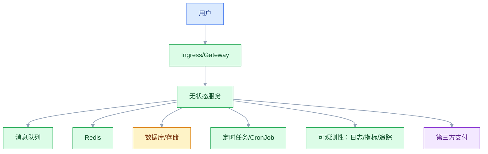

# 云原生架构

## 一、工程案例：把一个“上了容器”的系统改造成可发布、可自愈的云原生系统

**场景**：一个交易系统从虚拟机迁到容器，但问题更严重了：K8s 上部署了 40 个 Deployment，没有 owner、没有标签；应用无状态但会话存本地；配置硬编码；Pod 重启后丢数据；没有探针，Pod 挂了流量还在打；发布是滚动更新，但因为健康检查缺失，用户请求打到未就绪的 Pod；资源 limit 没设，一个内存泄漏的 Pod 拖垮整台 Node。团队说“我们已经上云原生了”，实际上只是“把 jar 包装成镜像”。

**目标**：不做“为了云原生而云原生”，交付一套以应用为中心的云原生架构：

- 一张云原生架构分层；
- 一套容器化与镜像规范；
- 一套 K8s 部署配置要点；
- 一套可观测性与自愈设计；
- 一套发布与回滚方案；
- 一份验收清单（8 项）。

**为什么必须做**：云原生不是“用 K8s”，是“让应用为云环境设计”：无状态、可弹性、可自愈、可观测。应用不改造，K8s 只会放大故障。

**动手前确认**：先盘点：应用是否有本地状态、是否有本地定时任务、是否依赖特定主机名/IP、是否有大本地磁盘。这些决定了容器化难度。下面的数据是示例。

### 1.1 云原生的分层

| 层 | 内容 | 关注 |
|---|---|---|
| 应用层 | 无状态、12 因子、弹性 | 可发布、可自愈 |
| 服务层 | 网关、服务网格、微服务 | 流量、安全、观测 |
| 编排层 | K8s、调度、扩缩 | 资源、弹性 |
| 运行时 | 容器、镜像、CRI | 一致性 |
| 基础设施 | 虚拟机、网络、存储 | 云厂商能力 |
| 可观测 | 日志、指标、追踪 | 排障、SLO |

“云原生”的核心是应用改造，不是“装在 K8s 里”。

### 1.2 12 因子检查

| 因子 | 检查 |
|---|---|
| 配置外部化 | 不在代码/镜像里存配置 |
| 无状态进程 | 会话、缓存、文件全部外置 |
| 端口绑定 | 通过端口暴露，不用特定主机名 |
| 并发模型 | 用进程/副本扩，不靠单进程 |
| 日志即事件流 | 输出 stdout，由平台收集 |
| 快速启动 | 启动要快，支持弹性 |
| 优雅退出 | 收到信号后处理完再退出 |
| 开发生产一致 | 相同镜像、相同配置结构 |

大多数“迁移到容器”失败，是因为违反第 2、5、8 条。

### 1.3 镜像规范

| 项 | 建议 |
|---|---|
| 基础镜像 | distroless/alpine，最小化 |
| 构建 | 多阶段构建，减小体积 |
| 层数 | 控制层数，优化缓存 |
| 用户 | 非 root 运行 |
| 时区 | 显式设置 |
| 健康检查 | 镜像内置或 K8s 探针 |
| 签名 | 镜像签名/扫描 |
| 版本 | 语义化标签，不要只用 latest |

镜像要“可复现”：同一次提交，任何时候构建结果一致。

### 1.4 K8s 部署要点

| 项 | 要点 |
|---|---|
| 副本 | 至少 2，反亲和分布 |
| 资源 | request/limit 必须设 |
| 探针 | liveness/readiness/startup 区分 |
| 优雅退出 | preStop + terminationGracePeriod |
| 配置 | ConfigMap/Secret，不用环境变量硬编码 |
| 安全 | 非 root、只读文件系统、NetworkPolicy |
| 标签 | 统一 app、version、owner、env |
| HPA | 基于 CPU/QPS/自定义指标 |

readiness 决定流量能不能进，liveness 决定要不要重启。两者混用会导致“启动慢被反复杀”。

### 1.5 探针设计

| 探针 | 作用 | 常见错误 |
|---|---|---|
| startup | 启动阶段保护 | 不用，导致慢启动被杀 |
| liveness | 判断是否重启 | 检查外部依赖，导致连锁重启 |
| readiness | 判断是否接流量 | 检查外部依赖，导致依赖故障时全部摘除 |

readiness 检查外部依赖会放大故障；应该检查自身是否可用，依赖故障用熔断/降级。

### 1.6 无状态化

| 状态 | 外置方式 |
|---|---|
| 会话 | Redis |
| 本地文件 | 对象存储 |
| 本地缓存 | Redis/分布式缓存 |
| 定时任务 | CronJob/分布式调度 |
| 本地数据库 | 云数据库 |
| 本地队列 | MQ |

无状态化不是“删掉所有本地写”，是“把状态搬到可共享、可恢复的地方”。

### 1.7 可观测性

| 维度 | 内容 |
|---|---|
| 日志 | 结构化、stdout、统一收集 |
| 指标 | RED（Rate/Error/Duration）、资源 |
| 追踪 | Trace ID、Span、依赖 |
| 事件 | K8s Event、发布记录 |
| SLO | 成功率、延迟、可用性 |

日志不要写本地文件，要输出 stdout；指标不要只采集 CPU，要覆盖业务。

### 1.8 发布与回滚

| 方式 | 特点 |
|---|---|
| 滚动更新 | 简单，但资源占用翻倍 |
| 蓝绿 | 快速切换，资源翻倍 |
| 金丝雀 | 小流量验证，需要流量控制 |
| 影子 | 复制流量，不影响用户 |

发布要有：健康检查、灰度、指标看板、一键回滚。

### 1.9 Serverless 与混合云

| 模式 | 适合 | 代价 |
|---|---|---|
| 容器 | 长驻服务、稳定流量 | 资源预留 |
| Serverless | 事件触发、波动大 | 冷启动、锁定 |
| 混合 | 核心常驻 + 边缘事件 | 架构复杂 |

混合云要考虑：数据在哪、延迟、网络、合规、成本。

### 1.10 验收（8 项）

1. 无状态：删掉任一 Pod，服务正常；本地状态为 0。
2. 探针：启动慢的应用不被误杀，依赖故障不导致全部摘除。
3. 资源：所有 Deployment 有 request/limit，无 OOM 拖垮节点。
4. 配置：镜像内无环境相关配置，环境差异通过 ConfigMap。
5. 发布：支持灰度 + 一键回滚，回滚 ≤ 5 分钟。
6. 可观测：日志/指标/追踪齐备，故障定位 ≤ 10 分钟。
7. 弹性：HPA 在流量翻倍时 5 分钟内扩容，缩容无抖动。
8. 安全：非 root、NetworkPolicy、镜像扫描通过。

## 二、高频问答：会卡住你的地方，也是面试最常问的

### 2.1 上 K8s 就是云原生

**现场**

怎么判断：问本地状态外置了吗、探针区分了吗、优雅退出做了吗；三个都是否，就是假云原生。

**要点**

- 云原生是让应用为云环境设计：无状态、可弹性、可自愈、可观测。
- 只把 jar 包成镜像再塞进 K8s，K8s 只是更复杂的虚拟机。
- 应用不改造，K8s 只会放大故障。

**追问**

- 上了 K8s 为什么故障更多？→ 缺探针、缺 limit、还有本地状态，编排层把问题放大。
- 云原生一定要 K8s 吗？→ 不一定，核心是应用改造。
- 改造从哪开始？→ 无状态化和优雅退出最先做。

### 2.2 liveness 和 readiness 一样

**现场**

怎么判断：看探针是否在检查外部依赖；检查依赖的，基本就是没区分。

**要点**

- liveness 决定要不要重启，readiness 决定流量能不能进来。
- 混用会导致启动慢被反复杀，或依赖故障时仍接流量。
- readiness 应检查自身，依赖故障靠熔断降级。

**追问**

- 慢启动应用加什么？→ startupProbe。
- liveness 检查数据库会怎样？→ 数据库抖一下，全部 Pod 被重启。
- readiness 失败会重启吗？→ 不会，只摘流量。

### 2.3 资源 limit 越大越好

**现场**

怎么判断：看 request/limit 是否基于实际用量；凭感觉设就是没治理。

**要点**

- limit 给太大，调度仍按 request 算，节点容易过载。
- 不给 limit，一个内存泄漏的 Pod 能拖垮整台 Node。
- request 决定调度，limit 决定上限，两个都要按真实用量设。

**追问**

- request 和 limit 有什么区别？→ 调度依据 vs 运行上限。
- limit 设小了会怎样？→ 被 OOM Kill 或 CPU 限流。
- 初始值怎么定？→ 压测加历史监控，再留余量。

### 2.4 容器里可以存文件

**现场**

怎么判断：问 Pod 重启后文件还在吗；不在，就不能存本地。

**要点**

- 容器可写层随 Pod 生命周期，重建就没了。
- 持久化要用 PVC 或对象存储。
- 本地缓存也要能丢，不能当成数据源。

**追问**

- emptyDir 和 PVC 区别？→ 前者随 Pod 生命周期，后者独立持久化。
- 日志能写本地文件吗？→ 不能，输出 stdout 交给平台收集。
- 有状态服务怎么办？→ StatefulSet 加 PVC。

### 2.5 本地定时任务没问题

**现场**

怎么判断：问扩到 5 个副本任务执行几次；5 次就是没治理。

**要点**

- 多副本会重复执行，扩缩容后任务还可能丢。
- 定时任务要外置成 CronJob 或分布式调度。
- 任务本身要幂等，调度层保证不了只跑一次。

**追问**

- K8s 的 CronJob 能保证只跑一次吗？→ 不能，仍要幂等。
- 定时任务和业务服务放一起有什么问题？→ 扩缩容跟着变，执行次数不可控。
- 分布式调度要什么？→ 选主或分片，加幂等。

### 2.6 镜像用 latest

**现场**

怎么判断：问线上跑的哪个版本、能不能回滚；答不上来就是没版本管理。

**要点**

- latest 不可复现、不可回滚、无法审计。
- 生产要用语义化版本或 digest。
- 同一次提交，任何时候构建结果要一致。

**追问**

- 固定 tag 就够了吗？→ 最好到 digest，tag 可以被覆盖。
- latest 配 pull_policy: always 行不行？→ 只适合本地开发。
- 回滚靠什么？→ 镜像版本加发布记录。

### 2.7 滚动更新最安全

**现场**

怎么判断：看发布期间错误率；升高就是 readiness 没配好。

**要点**

- 滚动更新安全的前提是有 readiness 和优雅退出。
- 没有 readiness，流量会打到未就绪的 Pod。
- 没有回滚方案，出问题只能硬扛。

**追问**

- 滚动更新为什么资源翻倍？→ 先起新 Pod 再停旧 Pod。
- 金丝雀和滚动差在哪？→ 流量比例可控。
- 回滚要多久？→ 目标 5 分钟内，靠镜像版本一键切。

### 2.8 Service Mesh 能解决所有问题

**现场**

怎么判断：问没有 Mesh 的具体问题是什么；说不清就是跟风。

**要点**

- Mesh 能统一流量、安全、观测，但会增加延迟、复杂度和运维成本。
- 小团队未必需要，先有问题再上工具。
- 上 Mesh 之前要能说清它替代了哪部分自研或手工工作。

**追问**

- Mesh 的延迟从哪来？→ 多一跳 sidecar 代理。
- 什么场景适合上？→ 多语言、服务多、需要统一治理。
- sidecar 和 sidecarless 区别？→ 每 Pod 一个代理 vs 节点级代理。

### 2.9 Serverless 一定更省

**现场**

怎么判断：按真实调用量算总账，不只看单价。

**要点**

- 高频常驻流量下，调用次数、冷启动、日志成本可能更高。
- Serverless 适合事件触发、波动大的场景。
- 省钱要看总账，不是看单次调用价格。

**追问**

- 冷启动怎么缓解？→ 预留实例、减小包体。
- Serverless 锁定在哪？→ 运行时、事件源、部署方式绑定厂商。
- 什么场景最划算？→ 低频、突发、无状态任务。

### 2.10 云原生只影响运维

**现场**

怎么判断：问开发是否参与容器化改造；没有就是运维单方面搬。

**要点**

- 无状态、优雅退出、日志、探针都要开发改。
- 开发不改，平台再强也没用。
- 云原生是研发流程的改造，不只是运维工具。

**追问**

- 开发最少要改哪几件？→ 无状态、优雅退出、stdout 日志、探针接口。
- 为什么说它是组织问题？→ 责任边界和发布流程都要变。
- 平台团队负责什么？→ 提供标准、工具和护栏，不替业务改代码。

## 三、核心知识

### 3.1 云原生的定义

云原生（Cloud Native）是“为云环境设计应用”的实践，核心是：

- 容器化；
- 微服务；
- 声明式 API；
- 不可变基础设施；
- 可观测性；
- 弹性与自愈。

CNCF 的定义更强调“技术和管理”，不只是容器。

### 3.2 12 因子

| 因子 | 要点 |
|---|---|
| 基准代码 | 一份代码，多环境部署 |
| 依赖 | 显式声明 |
| 配置 | 环境变量 |
| 后端服务 | 作为资源 |
| 构建发布运行 | 严格分离 |
| 进程 | 无状态、无共享 |
| 端口绑定 | 通过端口暴露 |
| 并发 | 进程模型扩展 |
| 易处理 | 快速启动、优雅退出 |
| 开发生产一致 | 相同镜像 |
| 日志 | 事件流 |
| 管理进程 | 一次性任务 |

### 3.3 容器

| 概念 | 说明 |
|---|---|
| 镜像 | 分层、不可变 |
| 容器 | 运行时实例 |
| namespace | 隔离 PID/网络/挂载 |
| cgroup | 限制资源 |
| OCI | 镜像/运行时标准 |

### 3.4 K8s 核心对象

| 对象 | 作用 |
|---|---|
| Pod | 最小调度单元 |
| Deployment | 无状态部署 |
| StatefulSet | 有状态部署 |
| Service | 服务发现 |
| Ingress | 入口路由 |
| ConfigMap/Secret | 配置 |
| PVC | 持久化存储 |
| HPA/VPA | 弹性伸缩 |
| Job/CronJob | 任务 |

### 3.5 探针

| 探针 | 用途 | 失败动作 |
|---|---|---|
| startup | 启动保护 | 超过阈值重启 |
| liveness | 存活 | 重启 |
| readiness | 就绪 | 摘除流量 |

> **面试**：常问「liveness 和 readiness 有什么区别？」答：一个决定重启，一个决定是否接流量，混用会导致启动被杀或故障时仍接流量。

### 3.6 弹性伸缩

| 类型 | 依据 |
|---|---|
| HPA | CPU/QPS/自定义 |
| VPA | 资源推荐/自动调整 |
| Cluster Autoscaler | 节点伸缩 |
| KEDA | 事件驱动 |

伸缩要“快扩慢缩”，避免抖动；缩容要有冷却时间。

> **面试**：常问「HPA 为什么扩得快、缩得慢？」答：扩容要保可用性，缩容要防抖动，所以缩容配冷却时间。

### 3.7 可观测性

| 支柱 | 工具 |
|---|---|
| 指标 | Prometheus |
| 日志 | Loki/ELK |
| 追踪 | Jaeger/Tempo |
| 事件 | K8s Event |

可观测性要覆盖业务指标，不只是资源指标。

### 3.8 发布策略

| 策略 | 适用 |
|---|---|
| 滚动 | 默认 |
| 蓝绿 | 快速回滚 |
| 金丝雀 | 高风险变更 |
| 影子 | 验证新逻辑 |

### 3.9 GitOps

| 实践 | 说明 |
|---|---|
| 声明式 | 所有配置进 Git |
| 版本化 | 变更可追溯 |
| 自动化 | 变更自动同步 |
| 可回滚 | Git revert 即可 |

Argo CD / Flux 是常见实现。

> **面试**：常问「GitOps 的核心是什么？」答：Git 是唯一事实来源，声明式同步，回滚就是 revert。

### 3.10 成本与治理

| 项 | 做法 |
|---|---|
| 资源请求 | 按实际用量优化 |
| 闲置 | 缩容、定时伸缩 |
| 存储 | 生命周期策略 |
| 多集群 | 按环境/团队隔离 |
| 标签 | 成本归属 |

云不是“买了就省钱”，要持续优化。

## 四、冷门知识汇总

- **12 因子**：Heroku 团队总结的云应用方法论，是云原生的思想源头之一。
- **CNCF Landscape**：云原生项目全景，包含运行时、编排、可观测、安全等类别。它容易让人“什么都想装”，要按需选。
- **distroless**：Google 的最小镜像，只含应用和运行时依赖，无 shell。安全性高，但排障要另开 debug 镜像。
- **OCI（Open Container Initiative）**：镜像格式和运行时标准，containerd/CRI-O 都遵循。
- **CRI**：Kubernetes 容器运行时接口，让 K8s 不绑定具体运行时。
- **sidecar**：与主容器共享网络/存储的辅助容器，用于日志、代理、监控。Istio 的 Envoy 就是 sidecar。
- **Operator**：用 CRD + 控制器扩展 K8s，管理有状态应用（如数据库 Operator）。
- **KEDA**：基于事件源伸缩，适合消息队列长度、Kafka lag 等指标。
- **VPA**：自动调整 Pod 资源，但修改 Pod 规格要重启，与 HPA 配合要小心。
- **PodDisruptionBudget**：限制同时不可用的 Pod 数，保护节点维护时的可用性。
- **拓扑分布约束**：控制 Pod 在不同节点/可用区分布，避免单点。
- **优雅退出**：收到 SIGTERM 后停止接流量、处理完在途请求、再退出。没有它，发布会丢请求。
- **启动探针（startupProbe）**：保护慢启动应用，避免被 liveness 误杀。
- **空目录（emptyDir）与 PVC**：emptyDir 随 Pod 生命周期，PVC 独立持久化。
- **GitOps**：以 Git 为唯一事实来源，声明式同步；Argo CD 支持漂移检测和自动回滚。
- **K8s 的“声明式”**：你说“要什么”，而不是“怎么做”；控制器负责收敛实际状态到期望状态。
- **“容器不是虚拟机”**：容器应该短生命周期、可替换、无状态；把容器当虚拟机会导致各种不适。