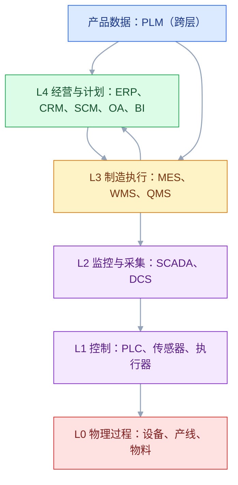
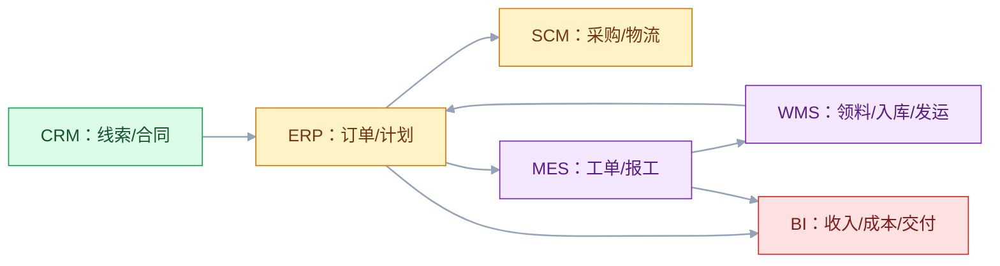

# 企业系统全景与分层

## 一、工程案例：给一家制造企业画一张能落地的系统全景图

**场景**：一家制造企业有 2 个工厂、3 个仓库，已经上了 ERP、MES、WMS、PLM、CRM、SCM、BI、OA，车间还有 SCADA。系统不少，但问题更多：销售说客户信息在 CRM，财务说客户在 ERP，仓库说库存以 WMS 为准，财务说库存以 ERP 为准；同一个物料在 PLM、ERP、MES 里编码不一样；老板问“一笔订单现在到哪了”，五个部门给出五个答案。

**目标**：不写产品选型报告，先交付一张能评审、能落地的系统全景：

- 一张分层图（按 ISA-95 和经营管理分层）；
- 一张系统 of record 表（每个核心对象谁说了算）；
- 一张端到端流程图（线索到回款）；
- 一张 12 个关键集成点清单；
- 一张失败矩阵与对账规则；
- 一份验收清单。

**为什么必须做**：企业系统的难点不是“系统多”，而是“同一件事有多个系统在管，且没人说清谁说了算”。全景图的价值不是好看，而是让每个系统知道自己管什么、不管什么、数据从哪来、失败谁负责。

**动手前确认**：先收集三样东西：现有系统的接口清单、主数据编码规则、最近三个月的跨系统故障记录。没有这三样，画出来的全景图只是产品宣传册。下面的企业数据是示例。

### 1.1 先分层，再谈集成

ISA-95（IEC 62264）是制造业常用的分层参考，常见 0～4 层：

| 层 | 名称 | 主要系统 | 管什么 |
|---|---|---|---|
| L4 | 经营与计划 | ERP、CRM、SCM、OA、BI | 财务、订单、采购、计划、客户、供应链、分析 |
| L3 | 制造执行 | MES、WMS、QMS | 工单、排产、报工、质量、仓储作业 |
| L2 | 监控与采集 | SCADA、DCS | 设备数据采集、监控、告警、远程控制 |
| L1 | 控制 | PLC、传感器、执行器 | 逻辑控制、运动控制、信号采集 |
| L0 | 物理过程 | 设备、产线、物料 | 真实世界的生产 |

PLM 不在这条主链上，它跨层：设计数据喂给 L4 的 ERP 和 L3 的 MES，变更会影响采购、生产、售后。把 PLM 硬塞进某一层，会导致“设计 BOM 到底谁维护”永远说不清。

### 1.2 九大系统各管什么

| 系统 | 一句话定位 | 核心对象 | 不负责 |
|---|---|---|---|
| OA | 横向协同与流程 | 审批、公文、门户、组织 | 业务主数据、财务账 |
| ERP | 企业经营与资源计划 | 财务、订单、采购、库存、成本、MRP | 车间执行、设备采集 |
| MES | 车间执行与追溯 | 工单、工序、报工、质量、OEE | 财务核算、跨企业采购 |
| WMS | 仓储作业与库位 | 收货、上架、拣货、盘点、发运 | 财务库存、生产排产 |
| SCADA | 设备采集与监控 | 测点、报警、趋势、远程控制 | 工单管理、质量判定 |
| PLM | 产品数据与变更 | 图纸、BOM、版本、变更、合规 | 财务成本、车间排产 |
| CRM | 客户经营 | 线索、商机、报价、合同、售后 | 财务应收、生产计划 |
| SCM | 跨企业供应链协同 | 预测、采购协同、物流、库存优化 | 车间执行、财务总账 |
| BI | 数据分析与决策 | 指标、报表、看板、OLAP | 交易录入、数据生产 |

这张表最重要的是“不负责”一列。系统边界不是由功能清单定义的，而是由“哪些事不归它管”定义的。

### 1.3 系统 of record

“系统 of record”指某个核心对象的权威数据源。一个对象只能有一个写入方，其他系统只能引用或只读。

| 核心对象 | 系统 of record | 其他系统的角色 | 常见冲突 |
|---|---|---|---|
| 客户 | CRM（商业客户） | ERP 管财务与信用，BI 只读 | CRM 和 ERP 各建一套客户编码 |
| 供应商 | SCM/SRM | ERP 管采购订单与应付 | 供应商名称、银行账号不一致 |
| 物料 | ERP（物料主数据） | PLM 管设计定义，MES 管现场使用 | 同一物料三个编码 |
| 设计 BOM | PLM | ERP/MES 只读或转制造 BOM | 设计变更未同步 |
| 制造 BOM | ERP 或 MES（按企业定） | PLM 提供设计输入 | 两边都能改，版本对不上 |
| 客户订单 | CRM（合同/意向） | ERP 管履约订单 | 合同号与订单号混用 |
| 工单 | MES | ERP 只读进度 | ERP 也建工单，重复下发 |
| 实物库存 | WMS | ERP 管财务库存，BI 只读 | 账实不符，两边都能调 |
| 财务库存 | ERP | WMS 提供实物变动 | 财务库存与实物库存长期不对账 |
| 设备 | EAM/SCADA | MES 使用设备能力 | 设备编码不统一 |
| 组织与人员 | OA/HR | 各系统同步 | 离职未及时停权 |

实操上，给每个对象写清四件事：谁创建、谁维护、谁只读、冲突怎么裁决。没有裁决规则，集成越多，数据越乱。

### 1.4 四条端到端流程

企业系统不是按模块用的，是按流程用的。至少画清四条：

| 流程 | 起点 | 终点 | 涉及系统 |
|---|---|---|---|
| 线索到回款（L2C） | 线索 | 回款 | CRM → ERP → SCM → MES → WMS → ERP |
| 采购到付款（P2P） | 需求 | 付款 | ERP → SCM/SRM → WMS → ERP |
| 计划到生产（Plan to Produce） | 需求预测 | 完工入库 | ERP/APS → MES → WMS → ERP |
| 问题到解决（Issue to Resolution） | 客户投诉 | 闭环 | CRM → QMS/MES → WMS → CRM |

每条流程都要有“业务承诺”和“失败兜底”：

- L2C：承诺交期；失败兜底是改期、拆单、部分发货。
- P2P：承诺到料；失败兜底是替代料、紧急采购、调整排产。
- Plan to Produce：承诺完工；失败兜底是加班、外协、改计划。
- Issue to Resolution：承诺闭环时间；失败兜底是升级、赔付、召回。

### 1.5 12 个关键集成点

| 编号 | 上游 → 下游 | 内容 | 频率 | 失败处理 |
|---:|---|---|---|---|
| 1 | CRM → ERP | 客户、合同、订单需求 | 准实时 | 暂存重放，人工核对 |
| 2 | CRM → SCM | 需求预测 | 日/周 | 延迟可接受，标注版本 |
| 3 | PLM → ERP | 物料、设计 BOM、变更 | 准实时 | 版本号校验，旧版本拒绝 |
| 4 | PLM → MES | 制造 BOM、工艺路线 | 准实时 | 工单冻结，等版本确认 |
| 5 | ERP → MES | 生产订单、交期、数量 | 准实时 | 重发，带幂等键 |
| 6 | MES → ERP | 完工、报工、物料消耗 | 准实时 | 汇总重报，防重复 |
| 7 | ERP → WMS | 采购入库、销售出库指令 | 准实时 | 指令重发，状态查询 |
| 8 | WMS → ERP | 收货、发货、库存变动 | 准实时 | 事务日志重放 |
| 9 | MES → WMS | 领料、退料、完工入库 | 准实时 | 按工单对账 |
| 10 | WMS → MES | 物料可用、齐套 | 准实时 | 缺料告警，降级排产 |
| 11 | ERP/SCM → BI | 财务、采购、物流数据 | 日批量 | 延迟可接受，重跑 |
| 12 | MES/SCADA → BI | 产量、质量、设备数据 | 小时/日 | 延迟可接受，补采 |

集成点不是越多越好。每增加一个实时集成点，就多一个失败点、一个对账口径、一个值班电话。能批量的不实时，能异步的不同步。

### 1.6 失败矩阵

| 失败 | 影响 | 兜底 |
|---|---|---|
| CRM 订单未到 ERP | 订单不履约 | 定时补偿 + 人工导入 |
| PLM 变更未到 MES | 按旧版生产 | 工单冻结，版本校验 |
| ERP 工单重复下发 | 重复生产 | 幂等键 + 工单去重 |
| WMS 库存未回传 ERP | 账实不符 | 日对账 + 差异冲正 |
| MES 报工丢失 | 成本、进度不准 | 报工补录 + 工时核算 |
| SCADA 数据中断 | 监控盲区 | 边缘缓存 + 补采 |
| BI 指标口径变更 | 报表不可比 | 指标版本 + 口径说明 |
| OA 审批卡住 | 业务停摆 | 超时升级 + 代理审批 |

### 1.7 验收（8 项）

1. 任一笔订单从 CRM 线索追到 ERP 回款，30 分钟内给出全链路状态。
2. 任一成品批次从 WMS 入库追到 SCADA 测点，能给出完整追溯链。
3. 12 个集成点每个都有 owner、频率、失败处理、对账规则。
4. 物料、客户、供应商三类主数据编码一致率 ≥ 99%。
5. 连续 7 天库存对账：WMS 实物与 ERP 财务库存差异为 0，差异可定位。
6. PLM 变更演练：变更单从发布到 MES 生效 ≤ 1 个工作日，旧版本工单被拦截。
7. 任一季度系统故障复盘：每个跨系统故障都能定位到具体集成点和责任系统。
8. 全景图每半年更新一次，和实际系统清单一致。

### 1.8 落地顺序

企业系统建设最容易犯的错是“先买系统，再想集成”。正确顺序：

1. 定业务能力地图和端到端流程；
2. 定系统 of record 和主数据编码；
3. 定集成点和失败处理；
4. 再选系统、谈实施；
5. 上线前做集成演练和对账；
6. 上线后每月复盘数据质量。

系统是手段，流程和数据才是目的。顺序反了，系统越多，内耗越大。

## 二、高频问答：会卡住你的地方，也是面试最常问的

### 2.1 上一套 ERP 就够了

**现场**

怎么判断：问工单在车间怎么报工、库位怎么管、设备数据怎么采；三个都靠 Excel，就是 ERP 不够。

**要点**

- ERP 强在经营计划和财务核算，弱在车间执行、设备采集、仓储作业。
- 硬用 ERP 管现场，最后会变成一堆手工报表。
- 系统边界不是由功能清单定义的，而是由“哪些事不归它管”定义的。

**追问**

- ERP 和 MES 的分界在哪？→ ERP 管计划和账，MES 管工单执行和追溯。
- ERP 里有生产模块还要 MES 吗？→ 看是否管到工序、报工、批次追溯。
- 小厂能不能只用 ERP？→ 可以，但现场数据只能靠人工补。

### 2.2 MES 就是车间报表

**现场**

怎么判断：问没有 MES 工单怎么下发、报工怎么采集、批次怎么追溯；答不上来就是没理解 MES。

**要点**

- MES 管工单执行、工序流转、质量判定、追溯、OEE。
- 报表只是输出，不是核心。
- MES 是把现场动作变成结构化数据的那一层。

**追问**

- MES 和 SCADA 什么关系？→ SCADA 采测点，MES 给测点补工单、批次上下文。
- MES 一定要上吗？→ 有追溯和精细化生产要求就需要。
- OEE 是什么？→ 可用率 × 性能 × 良率。

### 2.3 WMS 就是库存表

**现场**

怎么判断：问同一个 SKU 在三个库位，ERP 能不能告诉你拣哪个；不能就需要 WMS。

**要点**

- ERP 管财务库存和计划库存，WMS 管实物、库位、批次和作业路径。
- 两者口径不同，必须定期对账。
- 账实不符往往就是因为两边都能调。

**追问**

- 实物库存以谁为准？→ WMS；财务库存以 ERP 为准。
- 为什么两边会不一致？→ 一边有事务另一边没记账，或者都能手工调整。
- 对账怎么做？→ 日对账加差异冲正。

### 2.4 SCADA 数据直接给 ERP

**现场**

怎么判断：问这个测点属于哪个工单、哪个批次、哪个工序；答不上来，就需要 MES 做上下文转换。

**要点**

- SCADA 是秒级测点，ERP 是业务单据。
- 直接对接会把海量时序数据灌进业务库。
- 缺工单、批次、质量上下文的数据，没法用于业务判断。

**追问**

- 那测点数据放哪？→ 时序库或数据平台，不进 ERP 业务库。
- MES 在这里做什么？→ 把测点绑定到工单、工序、批次。
- IT/OT 之间要注意什么？→ 设 DMZ，别把 SCADA 直接暴露给 ERP 网络。

### 2.5 BI 就是报表，甚至包括备份

**现场**

怎么判断：问这个需求是“看数据”还是“保数据”；前者 BI，后者备份与容灾。

**要点**

- BI 是分析，包括报表、OLAP、看板和挖掘。
- 备份是运维和数据保护，不是 BI 功能。
- BI 不产生交易数据，也不负责恢复。

**追问**

- BI 的数据从哪来？→ 业务系统经数仓或 CDC 汇总。
- 为什么口径总对不上？→ 指标没版本、没 owner。
- 备份能放 BI 库吗？→ 不能，BI 库本身也需要被保护。

### 2.6 OA 就是审批

**现场**

怎么判断：问这个审批的最终业务结果写回哪个系统；写回 ERP/MES 的，OA 只是流程壳。

**要点**

- OA 是横向协同平台，承载组织、门户、公文、流程。
- 它不拥有业务主数据，但常是跨系统流程的入口。
- 审批结果要回调业务系统，流程才算闭环。

**追问**

- 组织架构以谁为准？→ HR。
- OA 能存客户主数据吗？→ 不能，客户以 CRM 为准。
- OA 挂了业务能停吗？→ 不能，关键审批要有线下应急和补录。

### 2.7 系统越多越数字化

**现场**

怎么判断：看跨系统手工录入次数、主数据一致率、端到端流程时长；不看系统数量。

**要点**

- 系统数量不等于数字化水平。
- 没有主数据和集成，系统越多孤岛越多，人工搬运越多。
- 数字化看的是流程耗时和人工搬运是否下降。

**追问**

- 怎么衡量集成做得好不好？→ 主数据一致率、端到端时长、故障可定位。
- 系统多为什么不一定是坏事？→ 边界清楚、集成薄，系统多也可控。
- 成熟度分几级？→ 孤岛、接口、集成、协同、智能。

### 2.8 集成就是写接口

**现场**

怎么判断：问重复调用会怎样、失败谁重试、每天对账吗；三个没答案，接口迟早出事。

**要点**

- 接口只解决“传”，不解决谁说了算、重复、失败、对账。
- 每多一个实时集成点，就多一个失败点和一个对账口径。
- 能批量不实时，能异步不同步。

**追问**

- 幂等怎么做？→ 用业务单号做幂等键。
- 接口失败怎么兜？→ 重试、死信、人工补偿、对账。
- 为什么 ESB 会成瓶颈？→ 所有流量过总线，它自己变成单点。

### 2.9 主数据每个系统都维护

**现场**

怎么判断：抽查 100 个物料，看 PLM、ERP、MES 编码是否一致；低于 99% 就说明主数据有问题。

**要点**

- 多处维护必然产生多套编码和冲突。
- 没有唯一权威源，集成时只能人工映射。
- 主数据要定唯一来源、统一编码、变更流程、分发对账。

**追问**

- 系统 of record 和 reference 区别？→ 权威写入源 vs 引用副本。
- 编码规则谁定？→ 业务加数据 owner，不是各系统自编。
- 主数据清洗一次就够了吗？→ 不够，要持续对账和变更通知。

### 2.10 上云就解决系统问题

**现场**

怎么判断：问上云后系统 of record 变了吗、集成点少了吗、对账更容易了吗；都没有，就只是换了机房。

**要点**

- 云解决的是基础设施弹性，不解决流程、主数据、系统边界。
- 上云后集成问题往往更明显。
- 系统问题是架构和治理问题，不是机房问题。

**追问**

- 上云对集成有什么影响？→ 网络延迟和出口成本变了，集成方式要重算。
- 什么该上云什么不该？→ 看合规、延迟、成本和耦合度。
- 上云后最容易被忽略的是什么？→ 出网流量和跨系统调用延迟。

## 三、核心知识

### 3.1 ISA-95 的价值

ISA-95 不是强制标准，而是一套分层语言。它把“经营计划”和“车间控制”分开，让企业能说清：

- 哪些数据在 L4 产生（订单、采购、财务）；
- 哪些数据在 L3 产生（工单、报工、质量）；
- 哪些数据在 L2 产生（测点、报警）；
- 哪些数据在 L1/L0 产生（设备状态、工艺参数）。

分层的意义是**确定数据 owner 和集成边界**。L2 的秒级数据不应该直接进 L4 的业务库；L4 的计划也不应该直接控制 L1 的设备。

> **面试**：常问「ISA-95 分层有什么用？」答：确定数据 owner 和集成边界，别让秒级测点直接进业务库。

### 3.2 九大系统的边界

| 系统 | 核心问题 | 关键输出 | 常见越界 |
|---|---|---|---|
| OA | 事怎么批、文怎么传 | 审批结果、公文 | 把业务数据都塞进 OA |
| ERP | 资源怎么计划、账怎么算 | 订单、采购、库存、财务 | 管车间工序、设备采集 |
| MES | 工单怎么执行、质量怎么追 | 工单进度、报工、质量记录 | 管财务、管跨企业采购 |
| WMS | 货怎么收、怎么放、怎么拣 | 库位、库存事务、发运 | 管生产排产、财务账 |
| SCADA | 设备怎么采、怎么控 | 测点、报警、趋势 | 管工单、质量判定 |
| PLM | 产品怎么定义、怎么变更 | 图纸、BOM、变更单 | 管财务成本、车间排产 |
| CRM | 客户怎么经营 | 线索、商机、合同、售后 | 管财务应收、生产计划 |
| SCM | 供应链怎么协同 | 预测、采购协同、物流 | 管车间执行、总账 |
| BI | 数据怎么看 | 指标、报表、看板 | 产生交易数据、负责备份 |

### 3.3 四条主流程的边界

| 流程 | 业务 owner | 系统 owner | 关键指标 |
|---|---|---|---|
| L2C | 销售/运营 | CRM + ERP | 交付周期、回款周期 |
| P2P | 采购 | ERP + SCM/SRM | 到料准时率、采购成本 |
| Plan to Produce | 计划/生产 | ERP/APS + MES | 计划达成率、OEE |
| Issue to Resolution | 客服/质量 | CRM + QMS/MES | 闭环时长、重复投诉率 |

流程 owner 和系统 owner 必须分开：业务 owner 对结果负责，系统 owner 对数据和功能负责。两者混在一起，出问题就会互相推。

### 3.4 集成模式

| 模式 | 适合 | 代价 |
|---|---|---|
| 点对点 API | 少量系统、实时性高 | 接口越来越多，难维护 |
| ESB/集成平台 | 多系统、协议多样 | 总线可能成为瓶颈和单点 |
| 消息队列 | 异步、削峰、事件驱动 | 重复、乱序、积压 |
| 文件/批量 | 大数据量、日终对账 | 延迟高、文件格式易错 |
| CDC | 数据库增量同步 | 对源库有压力、schema 变更敏感 |
| 数据仓库/湖 | 分析、报表 | 延迟、口径治理 |

选型原则：能批量不实时，能异步不同步，能点对点不建总线，能标准化不自定义。集成越“重”，治理成本越高。

> **面试**：常问「系统之间怎么集成？」答：能批量不实时、能异步不同步，集成越重治理成本越高。

### 3.5 主数据管理

主数据是跨系统共享、相对稳定、决定业务一致性的数据：客户、供应商、物料、BOM、组织、科目。

主数据管理四件事：

1. **唯一来源**：每个主数据只有一个系统负责创建和维护。
2. **统一编码**：编码规则全公司一致，禁止各系统自编。
3. **变更流程**：新增、修改、停用都要审批和通知下游。
4. **分发与对账**：下游订阅变更，定期比对一致率。

主数据不是“数据部门的事”，是业务规则的一部分。物料编码规则变了，采购、生产、财务全要跟着变。

> **面试**：常问「主数据怎么管？」答：唯一来源、统一编码、变更流程、分发对账，四件事缺一不可。

### 3.6 系统选型

选型不是比功能清单，而是比匹配度：

| 维度 | 问题 |
|---|---|
| 业务匹配 | 行业流程是否支持？二次开发量多大？ |
| 集成能力 | 有没有标准 API、消息、文件接口？ |
| 数据模型 | 主数据、BOM、工艺模型是否可扩展？ |
| 实施能力 | 供应商有没有同行业案例？顾问团队是否稳定？ |
| 总成本 | 许可、实施、运维、二次开发、迁移各多少？ |
| 退出成本 | 数据能否导出？接口是否标准？ |

最贵的不是软件许可，是实施和二次开发；最难的不是上线，是上线后数据能不能对平。

### 3.7 实施节奏

| 阶段 | 目标 | 退出条件 |
|---|---|---|
| 蓝图 | 业务流程、系统边界、主数据 | 业务签字，边界无争议 |
| 主数据 | 编码、清洗、导入 | 一致率 ≥ 99% |
| 集成 | 接口、对账、失败处理 | 12 个集成点跑通 |
| 试点 | 一个工厂/仓库 | 端到端流程闭环 |
| 推广 | 多工厂/仓库 | 复制模板，差异可控 |
| 运营 | 数据质量、优化 | 月度复盘，指标达标 |

不要“大爆炸”上线。先试点，再推广；先主数据，再集成；先跑通，再优化。

### 3.8 组织与治理

企业系统不是 IT 部门一家的事。最小治理结构：

- 业务 owner：对流程结果负责；
- 系统 owner：对系统功能、数据、接口负责；
- 数据 owner：对主数据编码和一致率负责；
- 架构评审：跨系统变更必须评审；
- 运维值班：跨系统故障有明确升级路径。

没有业务 owner 的系统，最后一定变成 IT 部门的“报表工具”。

### 3.9 扩展系统

九大系统是常见全景，不是全部。实际企业还会遇到：

| 系统 | 作用 | 和九大系统的关系 |
|---|---|---|
| APS | 高级排产 | 补 ERP 排产能力，喂 MES 工单 |
| QMS | 质量管理 | 与 MES、ERP、PLM 协同 |
| SRM | 供应商关系 | SCM 的供应商侧深化 |
| EAM | 设备资产 | 与 SCADA、MES 协同 |
| TMS | 运输管理 | SCM 的物流侧深化 |
| MDM | 主数据管理 | 跨系统主数据治理 |
| LIMS | 实验室管理 | 与 QMS、MES 协同 |

不要为了“凑齐”而上系统。每上一个系统，先问：它替谁解决了什么问题？和现有系统的边界在哪？

### 3.10 成熟度评估

| 等级 | 特征 |
|---|---|
| 1 孤岛 | 系统各自为政，手工导入导出 |
| 2 接口 | 关键系统有接口，但无主数据治理 |
| 3 集成 | 主数据统一，端到端流程跑通 |
| 4 协同 | 跨企业协同，计划/库存/物流联动 |
| 5 智能 | 数据驱动决策，预测与优化 |

大多数企业卡在 2～3 级。不要跳过主数据直接谈智能，否则智能建立在脏数据上。

## 四、冷门知识汇总

- **ISA-95 的五个部分**：Part 1 模型与术语，Part 2 对象模型属性，Part 3 制造运营活动模型，Part 4 制造运营管理与集成，Part 5 B2MML（Business To Manufacturing Markup Language）。B2MML 是 ISA-95 的 XML 实现，常见于 MES 与 ERP 集成。
- **Purdue 模型与 ISA-95 的区别**：Purdue 模型描述工业控制网络的层级（Level 0～5），偏网络与安全；ISA-95 描述制造运营与业务系统的功能分层。两者常一起用，但不是同一个标准。
- **IT/OT DMZ**：IT 和 OT 网络之间要设隔离区，不能把 SCADA 直接暴露给 ERP 网络。常见做法是 DMZ + 单向网关 + 数据代理。
- **OPC UA**：工业通信标准，提供信息模型、安全、跨平台通信。SCADA 采集常用 OPC UA，但 OPC UA 不等于 MES，它只解决“怎么读设备”。
- **B2MML**：基于 ISA-95 的 XML Schema，用于 ERP 与 MES 之间传递工单、物料、生产性能等。它比自定义 CSV 更标准，但也更重。
- **SAP 的集成方式**：IDoc（异步文档）、RFC/BAPI（远程调用）、OData（HTTP API）。老系统常见 IDoc，新系统多用 OData。
- **EDI**：电子数据交换，常见 EDIFACT、X12，用于订单、发票、物流。EDI 不是 API，它更像“结构化文件 + 批处理”。
- **EBOM/MBOM/SBOM**：设计 BOM、制造 BOM、销售/服务 BOM。EBOM 在 PLM，MBOM 在 ERP/MES，SBOM 在销售/售后；三者结构不同，不能直接复制。软件供应链里的 SBOM 指 Software Bill of Materials，和制造业 SBOM 不是一回事。
- **OEE**：`OEE = 可用率 × 性能 × 良率`。它是 MES 的常用指标，但 OEE 高不等于赚钱，还要看需求、库存、成本。
- **MRP、MRP II、ERP 的演进**：MRP 算物料需求，MRP II 加入产能和财务，ERP 再加入供应链、人力、客户。很多“ERP”其实只做到 MRP II。
- **System of Record 与 System of Reference**：前者是权威写入源，后者是引用副本。很多集成争论，本质是把“参考”当成了“权威”。
- **Golden Record**：主数据管理里的“黄金记录”，指经过清洗、合并、确认的唯一版本。Golden Record 不是数据库里自动长出来的，是业务规则和人工裁决的结果。
- **Data Mesh 与集中式数仓**：Data Mesh 强调按业务域拥有数据产品，适合大组织；集中式数仓强调统一口径，适合中小组织。两者不是非此即彼，很多企业是混合。
- **“单一事实来源”是目标，不是现状**：大多数企业有多个事实来源，架构的任务是明确“谁是权威、谁是副本、冲突怎么裁决”，而不是假装只有一个。
- **系统越多，集成越要“薄”**：每增加一个系统，优先用标准接口和批量文件，少写自定义点对点；集成层越薄，替换系统越容易。