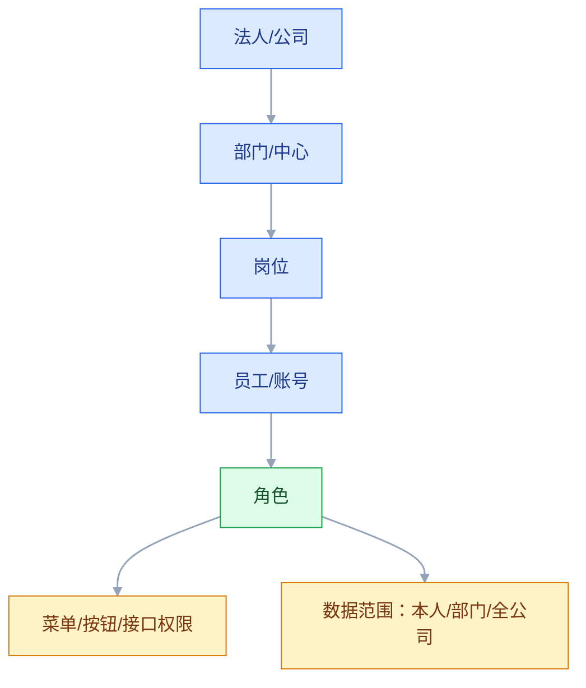
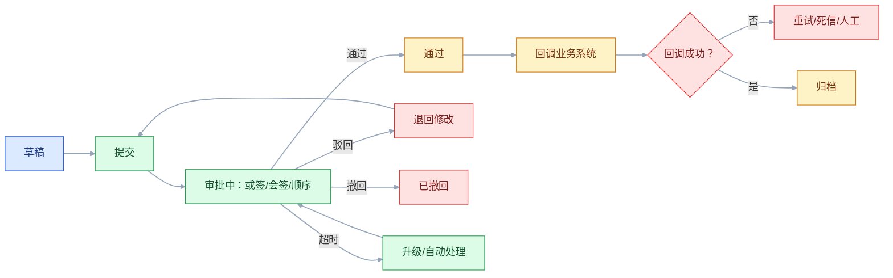

# OA 与协同办公

## 一、工程案例：把 2000 人的审批从“找人签字”变成可追溯的流程

**场景**：一家 2000 人的制造企业，OA 用了五年，主要问题是：组织架构在 OA、HR、ERP 各有一套；审批流程靠管理员在后台拖拽，改一次流程要停机；同一个采购申请，财务要审金额、法务要审合同、总经理要审超限，三个人经常并行收到待办，但谁先审、谁后审说不清；移动端只能看不能批；审批结果靠邮件通知业务系统，丢单只能人工补。

**目标**：不换 OA，先把组织、权限、流程、集成四件事理清，交付：

- 一张组织与权限模型；
- 一张流程生命周期图；
- 一套审批规则（会签、或签、转办、超时、升级）；
- 一张与 ERP、HR、CRM 的集成清单；
- 一份验收清单（8 项）。

**为什么必须做**：OA 的价值不是“把纸质签字搬到线上”，而是“让跨部门协作有规则、有记录、有追责”。组织不清、权限不清、流程没有版本，OA 就会变成“电子盖章机”，审批越快，错误越多。

**动手前确认**：先拉三样东西：HR 的组织架构、最近三个月的审批超时记录、业务系统因审批回调失败产生的工单。没有这三样，流程优化只能拍脑袋。下面的企业数据是示例。

### 1.1 OA 的边界

| OA 管 | OA 不管 |
|---|---|
| 组织、岗位、人员、账号 | 财务核算、库存数量、生产工单 |
| 审批流、公文、签章、归档 | 业务规则的全部计算 |
| 门户、待办、通知、日程 | 客户主数据、物料主数据 |
| 跨系统流程编排入口 | 交易数据的最终写入 |

OA 是“协同层”，不是“业务主数据的权威源”。组织以 HR 为准，客户以 CRM 为准，物料以 ERP 为准，OA 只做映射和流程入口。

### 1.2 组织与权限模型

| 对象 | 含义 | 权威源 |
|---|---|---|
| 法人 | 独立签约/核算主体 | HR/工商 |
| 部门 | 管理单元，可多层 | HR |
| 岗位 | 职责集合，不是人 | HR |
| 员工 | 自然人 | HR |
| 账号 | 登录身份，可一人多账号 | IAM/OA |
| 角色 | 权限集合 | OA/权限中心 |
| 数据范围 | 能看哪些数据 | 业务系统 |

权限模型分三层：

1. **功能权限**：能不能进菜单、点按钮、调接口。
2. **数据权限**：能看本人、本部门、本分公司还是全公司。
3. **字段权限**：同一张单，财务能看金额，业务不能看成本。

只做角色不做数据范围，最后一定出现“有权限的人能看到全公司工资”的问题。

### 1.3 审批规则

| 规则 | 语义 | 常见坑 |
|---|---|---|
| 或签 | 任一人同意即通过 | 两人同时同意，重复回调 |
| 会签 | 所有人同意才通过 | 一人拒绝，流程是否终止 |
| 顺序审批 | 按顺序逐级 | 中途转办，历史节点怎么算 |
| 转办 | 把待办转给他人 | 转办后原审批人还能不能撤回 |
| 加签 | 临时增加审批人 | 加签人权限是否继承 |
| 委托 | 出差期间代批 | 委托到期是否自动收回 |
| 超时 | 超时自动通过/升级 | 自动通过的风险谁承担 |
| 撤回 | 发起人撤回 | 已审批节点是否回滚 |
| 驳回 | 退回指定节点 | 驳回后修改再提交，版本怎么记 |

规则要写成配置，不要写死在代码里。但“可配置”不等于“随便配”：每个流程要有 owner、版本、生效时间、回滚版本。

### 1.4 流程生命周期

流程结束不等于事情结束。审批通过后要回调业务系统（下单、付款、入库），回调失败要有重试、死信和人工补偿。

### 1.5 表单与版本

表单不是“字段越多越好”。表单设计三原则：

1. **字段有来源**：每个字段从哪个系统来、谁维护、是否必填。
2. **校验有规则**：格式、范围、关联校验、权限校验。
3. **版本可追溯**：表单结构变更后，历史单据仍能按旧版本展示。

表单版本要解决三个问题：

- 新增字段：历史单据该字段为空还是默认值？
- 删除字段：历史数据还要不要展示？
- 修改枚举：旧值怎么映射到新值？

没有表单版本，改一次表单就会让历史单据“看起来像另一张单”。

### 1.6 集成

| 集成点 | 方向 | 内容 | 失败处理 |
|---|---|---|---|
| HR → OA | 单向 | 组织、岗位、人员、离职 | 定时同步 + 差异告警 |
| OA → 业务系统 | 单向 | 审批结果、业务单据号 | 重试 + 死信 + 人工 |
| 业务系统 → OA | 单向 | 待办、状态更新 | 幂等 + 去重 |
| OA → 门户 | 单向 | 待办、公告、日程 | 缓存 + 降级 |
| OA → 档案 | 单向 | 归档文件、签章 | 失败重试 + 对账 |
| OA ↔ IAM | 双向 | 登录、SSO、权限 | 超时降级 |

集成三原则：

- 审批结果用业务单号做幂等键，不用审批任务 ID；
- 业务系统不能依赖 OA 的可用性，OA 挂了业务要能继续；
- 所有回调要有对账，不能“发出去了就当成功”。

### 1.7 性能与可用性

OA 的流量不大，但峰值很集中：早上 9 点全员打开待办、月底集中报销、年终集中审批。容量要按“全员并发”估，不是按日活估。

| 指标 | 目标 |
|---|---|
| 待办列表 P99 | ≤ 500 ms |
| 审批提交 P99 | ≤ 800 ms |
| 登录成功率 | ≥ 99.9% |
| 审批回调成功率 | ≥ 99.9% |
| 归档可追溯 | ≥ 10 年 |

OA 挂了，业务不能停。关键审批要有“线下应急流程 + 补录”机制。

### 1.8 验收（8 项）

1. 组织同步：HR 新增/调岗/离职，OA 在 5 分钟内同步，权限自动收回。
2. 权限：随机抽 20 个用户，菜单、数据范围、字段权限与岗位一致。
3. 或签/会签：各 100 次并发审批，流程只结束一次，回调只成功一次。
4. 转办/委托/加签：各 20 次，历史记录完整，原审批人权限正确。
5. 超时：配置 24 小时超时，自动升级/通过符合规则，有审计日志。
6. 回调失败：停掉业务系统 30 分钟，恢复后自动补发，无丢单。
7. 表单版本：修改表单后，历史单据仍按旧版本展示。
8. 审计：任一笔审批能查到发起人、审批人、时间、意见、附件、回调结果。

## 二、高频问答：会卡住你的地方，也是面试最常问的

### 2.1 OA 就是审批流

**现场**

怎么判断：问组织从哪来、权限怎么控、审批结果怎么回业务；三个没答案就是只有流程。

**要点**

- OA 还包括组织、权限、门户、公文、归档、集成，流程只是协作的一种形态。
- 没有组织同步和回调，流程跑通也只是电子盖章。
- 组织以 HR 为准，客户以 CRM 为准，物料以 ERP 为准，OA 只做映射和流程入口。

**追问**

- OA 和 BPM 平台区别？→ OA 面向全员协同，BPM 更偏业务流程编排。
- 为什么组织要以 HR 为准？→ OA 只是副本，多处维护必然不一致。
- 流程跑通就上线有什么风险？→ 权限、审计、回调都没兜住。

### 2.2 审批流引擎能覆盖所有业务

**现场**

怎么判断：问这个流程有没有复杂计算、事务、外部系统交互；有就该在业务系统实现，OA 只做审批入口。

**要点**

- 审批流擅长表达“谁在什么时候批”，不擅长复杂计算和状态机。
- 硬塞会把业务逻辑打散在节点里，改一次流程就动一次代码。
- OA 只做流程壳，业务规则留在业务系统。

**追问**

- 什么该放 OA、什么不该？→ 审批入口和留痕放 OA，计算和事务留业务系统。
- 流程里能写 if-else 吗？→ 简单分支可以，复杂规则用决策表。
- 为什么流程里写业务逻辑难维护？→ 逻辑散在节点，测试和回滚都难。

### 2.3 组织架构以 OA 为准

**现场**

怎么判断：抽查 20 个离职员工，看 OA、ERP、邮箱是否都已停用；有一个没停就是同步有问题。

**要点**

- 组织权威源通常是 HR，OA、ERP、CRM 都是副本。
- 各自维护必然不一致。
- 离职同步做不好，就是安全漏洞。

**追问**

- 组织同步用什么标准？→ SCIM 2.0 比自定义接口通用。
- 调岗后历史单据怎么显示？→ 保留组织历史，按当时归属还原。
- 同步频率多高？→ 关键变更准实时，全量定时对账。

### 2.4 权限就是角色

**现场**

怎么判断：用普通员工账号尝试查同部门其他人的单据；能查到就是数据权限没做。

**要点**

- 角色只管功能，不管数据范围。
- 同一个角色，部门经理和普通员工能看到的数据不同。
- 权限要分功能、数据、字段三层。

**追问**

- RBAC 和 ABAC 怎么选？→ 功能权限用 RBAC，动态条件用 ABAC。
- 字段权限解决什么？→ 同一张单，财务看金额、业务看成本。
- 只做角色会出什么事？→ 有权限的人能看到全公司数据。

### 2.5 表单越灵活越好

**现场**

怎么判断：看字段是否有 owner、是否关联主数据、是否有版本；没有就是灵活过头。

**要点**

- 无约束的表单会变成脏数据源。
- 字段重复、口径不一，历史数据无法追溯。
- 表单可以灵活，但数据模型要有约束。

**追问**

- 表单为什么要版本？→ 改结构后历史单据还要按旧版本展示。
- 只存 JSON 有什么问题？→ 做报表和查询非常痛苦。
- 低代码表单适合什么？→ 审批、登记、台账，不适合强事务核心业务。

### 2.6 流程越短越好

**现场**

怎么判断：问这个节点控制什么风险、去掉后谁承担；答不上来才是多余节点。

**要点**

- 审批节点对应风险控制，砍掉该有的控制，风险会以事故形式回来。
- 流程优化是去掉不控风险的节点，不是一味求短。
- 关键节点要留审计痕迹。

**追问**

- 四眼原则是什么？→ 关键操作至少两人参与，发起和审批分离。
- 自动通过有风险吗？→ 有，超时自动通过等于放弃控制。
- 怎么证明节点多余？→ 说不出控制目标，且去掉后没有对应风险。

### 2.7 移动端就是 H5

**现场**

怎么判断：看移动端审批完成率和平均耗时；明显低于 PC 就是没做好。

**要点**

- 移动端的待办、审批、附件、签章、离线、推送，交互和安全要求都不同。
- 套壳体验差，用户就不用。
- 做得好不好看完成率和耗时，不看有没有 App。

**追问**

- 移动端安全要注意什么？→ 设备绑定、会话超时、敏感信息不落地。
- 离线审批能做吗？→ 能，但要处理冲突和重放。
- 为什么套壳体验差？→ 交互和页面不是按移动端设计的。

### 2.8 集成就是待办推送

**现场**

怎么判断：问 OA 挂了业务怎么办、回调丢了怎么补、重复推送怎么去重。

**要点**

- 待办推送只解决提醒，不解决状态同步、幂等、失败补偿、权限校验。
- 回调要用业务单号做幂等键，不能用审批任务 ID。
- 业务系统不能依赖 OA 的可用性。

**追问**

- 为什么不能用任务 ID 做幂等键？→ 任务 ID 每次重跑都会变。
- 回调失败怎么兜？→ 重试、死信、人工补偿、对账。
- OA 挂了业务怎么继续？→ 业务系统能独立判断审批结果，配线下应急。

### 2.9 流程变更不用版本

**现场**

怎么判断：看流程定义是否有版本号、生效时间、历史单据是否绑定旧版本。

**要点**

- 历史审批记录对应旧流程，没有版本审计时说不清当时按什么规则批的。
- 流程要有 owner、版本、生效时间、回滚版本。
- 可配置不等于随便配。

**追问**

- 流程改到一半的在途单据怎么办？→ 绑定发起时的版本跑完。
- 撤回和驳回区别？→ 发起人收回 vs 审批人退回。
- 僵尸流程怎么处理？→ 定期清理，明确 owner 和停用流程。

### 2.10 上线就算数字化

**现场**

怎么判断：上线 3 个月后看平均审批时长、超时率、线下补录次数、跨系统手工录入次数。

**要点**

- 数字化的标准是流程耗时下降、人工搬运减少、审计可追溯。
- 系统能登录只是起点，不是结果。
- 没有指标，就分不清是上线还是见效。

**追问**

- 为什么审批越快错误可能越多？→ 控制节点被砍，风险后移成事故。
- 流程挖掘能做什么？→ 从日志还原真实流程，看设计和实际的差。
- 治理最小机制是什么？→ 组织、流程、权限、集成各有 owner。

## 三、核心知识

### 3.1 OA 的定位

OA（Office Automation）是面向全员协同的办公平台，核心能力是组织、流程、门户、公文、日程、通知、归档。

它和企业业务系统的区别：

| 维度 | OA | 业务系统 |
|---|---|---|
| 服务对象 | 全员 | 特定业务角色 |
| 核心数据 | 流程、公文、待办 | 订单、库存、工单、客户 |
| 权威性 | 组织/流程的副本 | 业务主数据权威源 |
| 变更频率 | 高（组织、流程） | 中（业务规则） |
| 失败影响 | 协作效率 | 交易/账务 |

### 3.2 组织模型

组织建模要区分“管理组织”和“法人组织”：

- 法人组织：签约、核算、报税主体；
- 管理组织：部门、中心、事业部；
- 岗位：职责集合，可以一人多岗；
- 用户：登录身份，可以一人多账号；
- 角色：权限集合，不等于岗位。

组织变更要保留历史：调岗、兼岗、离职、组织合并，历史单据要能还原“当时属于哪个部门”。

> **面试**：常问「组织变更后历史单据怎么显示？」答：保留组织历史，按单据发生时的归属还原。

### 3.3 权限模型

| 模型 | 核心 | 适合 |
|---|---|---|
| RBAC | 用户 → 角色 → 权限 | 功能权限、后台管理 |
| ABAC | 属性 + 策略 | 细粒度、动态条件 |
| ReBAC | 关系图 | 文档、项目、层级授权 |
| 数据范围 | 本人/部门/分公司/全部 | 列表、报表、单据 |

实践组合：RBAC 管功能，数据范围管行，字段权限管列，ABAC 管特殊条件。四层缺一不可。

> **面试**：常问「RBAC 够用吗？」答：不够，RBAC 只管功能，还要数据范围管行、字段权限管列。

### 3.4 工作流模式

常见模式：

| 模式 | 说明 |
|---|---|
| 顺序 | 按节点依次审批 |
| 并行 | 多个分支同时进行 |
| 或签 | 任一分支通过即通过 |
| 会签 | 所有分支通过才通过 |
| 会签比例 | 达到比例即通过 |
| 退回 | 回到指定节点 |
| 转办 | 把任务转给他人 |
| 委托 | 代理人代为处理 |
| 加签 | 临时增加审批人 |
| 超时 | 自动通过/升级/提醒 |
| 子流程 | 调用另一个流程 |
| 动态节点 | 按组织/金额/类型动态生成 |

复杂流程不要用“节点堆叠”实现，优先用规则表和子流程。

### 3.5 表单引擎

表单引擎的核心不是拖拽，是数据模型：

- 字段类型、校验、默认值；
- 字段与主数据的关联；
- 表单版本；
- 权限（可见/可编辑/必填）；
- 联动规则；
- 附件与签章；
- 打印模板。

表单数据要能结构化查询，不能只存一段 JSON。只存 JSON 的表单，做报表时非常痛苦。

### 3.6 公文与归档

公文管理要关注：

- 发文、收文、签报、会议纪要；
- 编号、密级、紧急程度；
- 签章、用印、归档；
- 保管期限、销毁；
- 电子签名合规。

归档不是“存个 PDF”。要保证可检索、可追溯、不可篡改，满足审计和档案管理要求。

### 3.7 单点登录与身份

| 协议 | 用途 |
|---|---|
| SAML 2.0 | 企业 SSO，常见于传统 IdP |
| OIDC/OAuth 2.0 | 现代 SSO、移动端、API |
| CAS | 老系统 SSO |
| SCIM 2.0 | 用户/组织自动同步 |
| LDAP | 企业目录 |

SSO 要处理：账号绑定、离职停用、多租户、权限映射、会话超时。只做登录不做离职同步，是常见安全漏洞。

### 3.8 集成与回调

OA 与业务系统的集成通常是“流程 + 回调”：

1. 业务系统创建单据，推送待办到 OA；
2. OA 审批，记录意见；
3. 审批通过，回调业务系统；
4. 业务系统更新状态，返回结果；
5. 失败重试，进死信，人工处理。

回调要用业务单号做幂等键，不能用审批任务 ID；业务系统要能独立判断审批是否通过，不能只依赖 OA 推送。

> **面试**：常问「审批回调怎么保证不丢不重？」答：业务单号做幂等键，加重试、死信、人工补偿和对账。

### 3.9 性能与可用性

OA 的容量特点是“全员峰值”：

- 早上上班集中打开待办；
- 月底集中报销；
- 年终集中审批；
- 组织调整集中改权限。

容量按“全员并发 × 单用户请求数”估，不要按日活。关键流程要有降级：待办列表可缓存，审批提交不能丢，回调可异步。

### 3.10 治理

OA 治理的最小机制：

- 组织 owner：HR；
- 流程 owner：业务部门；
- 权限 owner：安全/审计；
- 集成 owner：IT；
- 流程版本：每次变更留档；
- 审批审计：可查、可导出；
- 定期清理：僵尸流程、失效账号、过期委托。

没有 owner 的流程，最后没人敢改，也没人敢停。

## 四、冷门知识汇总

- **BPMN 2.0**：业务流程建模符号，OMG 标准。它适合描述流程，不等于可直接执行的引擎配置；很多 OA 的“流程图”只是 BPMN 的子集。
- **DMN**：决策模型与符号，专门描述“规则表/决策表”。复杂审批条件用 DMN 表达，比在流程节点里写 if-else 清晰。
- **CMMN**：案例管理模型与符号，适合“步骤不固定、由人判断”的协作场景，和 BPMN 的“固定流程”互补。
- **工作流模式（Workflow Patterns）**：van der Aalst 等人总结的控制流模式，如并行拆分、同步合并、里程碑、取消区域。它是评估流程引擎能力的通用清单。
- **四眼原则（Four-Eyes Principle）**：关键操作至少两人参与，发起人和审批人不能是同一人。采购、付款、权限变更常用。
- **职责分离（SoD）**：同一个人不能同时拥有“创建供应商”和“付款”权限。OA 的权限设计要和 ERP 的 SoD 对齐。
- **SCIM 2.0**：用户/组织同步标准（RFC 7643/7644），比自定义接口更通用。离职同步做不好，往往是没上 SCIM。
- **SAML 与 OIDC 的区别**：SAML 基于 XML，企业 SSO 常见；OIDC 基于 OAuth 2.0/JWT，移动端和 API 更友好。两者都能做 SSO，选型看现有 IdP。
- **电子签名法**：电子签名、电子印章、数据电文的法律效力有明确条件，涉及合同、公文、财务凭证时要咨询法务，不要只看技术实现。
- **流程挖掘（Process Mining）**：从事件日志还原真实流程，发现“实际怎么走”和“设计怎么走”的差异。OA 的审批日志就是流程挖掘的输入。
- **RPA 与工作流的区别**：RPA 模拟人操作界面，适合没有 API 的老系统；工作流是系统内的流程编排。RPA 是补丁，不是架构。
- **低代码表单的边界**：低代码适合审批、登记、台账；不适合复杂交易、强事务、复杂权限。用低代码做核心业务，后期迁移成本很高。
- **委托与转办的区别**：委托是“代理人代为处理”，原审批人仍保留权限；转办是“任务所有权转移”，原审批人通常不再处理。两者在审计上的含义不同。
- **加签的两种方式**：前加签（在我之前审）、后加签（在我之后审）。不写清楚，流程会来回跳。
- **撤回与驳回的区别**：撤回是发起人在审批完成前收回；驳回是审批人退回修改。撤回后原审批记录是否保留，要在流程定义里写清。
- **审批回调的幂等键**：用业务单号 + 流程版本 + 节点，不要用任务 ID；任务 ID 每次重跑都会变，无法去重。
- **僵尸流程**：长期无人发起、无人维护、无人敢停的流程。治理时要定期清理，否则组织变更后会出现“找不到审批人”的死流程。