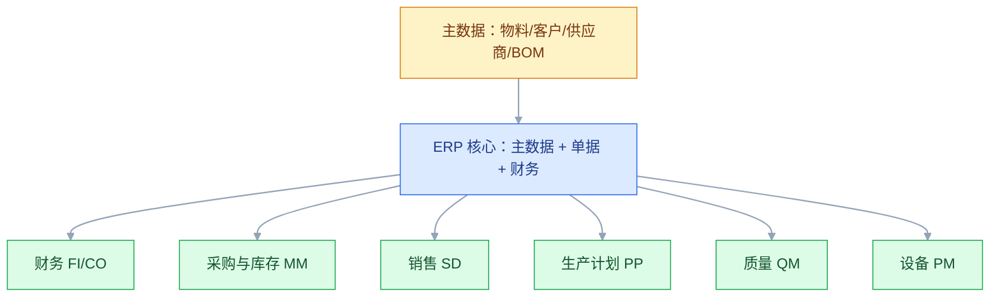
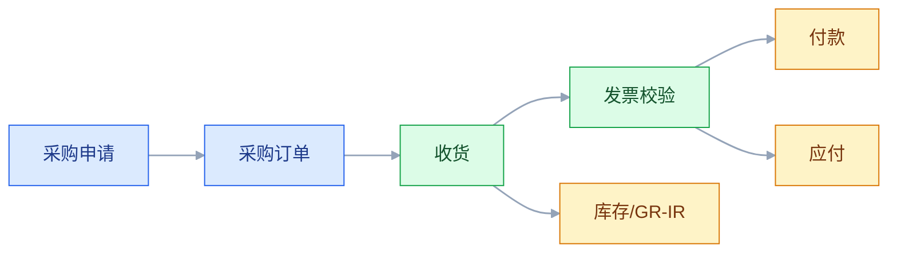
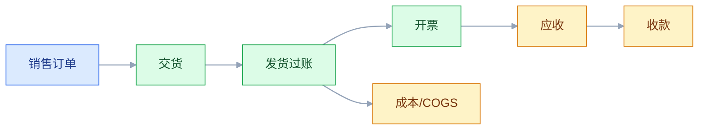

# ERP 与企业资源计划

## 一、工程案例：把 ERP 从“财务记账工具”变成经营主数据底座

**场景**：一家制造企业有两个工厂、三个仓库，ERP 已经上线三年，但只用了财务和采购模块。销售订单在 CRM，库存在 WMS，生产工单在 MES，ERP 里的库存和财务账每个月都要人工对。月结要 12 天，财务抱怨业务数据不准，业务抱怨财务流程太慢。老板要求：月结 5 天内完成，库存准确率 98%，订单到回款全链路可追。

**目标**：不换 ERP，先把 ERP 的边界、主数据、单据流和月结跑通，交付：

- 一张 ERP 模块地图；
- 一张主数据归属表；
- 一张采购到付款、销售到收款、计划到生产的单据流；
- 一张会计分录与对账规则；
- 一份月结清单；
- 一份验收清单（8 项）。

**为什么必须做**：ERP 的价值不在“能记账”，而在“用一套主数据和单据流，把采购、库存、生产、销售、财务串起来”。只上财务模块，ERP 就退化成一个昂贵的记账软件；主数据和单据流不通，月结永远靠调账。

**动手前确认**：先拉三张表：物料主数据、供应商/客户主数据、最近三个月的库存差异和月结调整分录。没有这三张表，讨论“ERP 怎么优化”都是空话。下面的企业数据是示例。



### 1.1 ERP 的边界

| ERP 管 | ERP 不管 |
|---|---|
| 财务核算、总账、应收应付 | 车间工序执行、设备采集 |
| 采购订单、库存估值、发票校验 | 仓库库位、拣货路径 |
| 销售订单、发货、开票 | 客户线索、商机跟进 |
| 生产计划、MRP、工单下达 | 工序报工、质量判定 |
| 物料主数据、BOM、工艺路线 | 设计图纸、设计变更 |
| 成本核算、月结、报表 | 商业智能、数据挖掘 |

ERP 是“经营与资源计划”的主干，不是“企业所有系统”的集合。把 ERP 当万能系统，最后会在车间和仓库层堆满手工表格。

### 1.2 模块地图

| 模块 | 核心功能 | 关键对象 | 常见问题 |
|---|---|---|---|
| FI 财务 | 总账、应收、应付、资产、税务 | 科目、凭证、客户、供应商 | 科目表设计不合理，月结靠调账 |
| CO 成本 | 成本中心、利润中心、产品成本 | 成本中心、成本要素、工单 | 成本分摊规则不清 |
| MM 采购与库存 | 采购申请、订单、收货、发票校验、库存 | 采购订单、物料、批次 | 库存估值与实际不符 |
| SD 销售 | 报价、订单、发货、开票、退货 | 销售订单、交货单、发票 | 订单状态与 WMS/MES 不同步 |
| PP 生产 | 主生产计划、MRP、工单、报工 | 计划订单、工单、BOM、工艺路线 | 工单下达了，车间没收到 |
| QM 质量 | 检验批、质量通知、退货 | 检验批、质量记录 | 质量数据与 MES 重复 |
| PM 设备 | 设备主数据、维护计划、工单 | 设备、维护工单 | 设备编码与 SCADA 不一致 |
| HR 人力 | 组织、薪酬、考勤 | 员工、岗位、组织 | 与 OA 组织不同步 |

模块不是越全越好。先把 FI、MM、SD、PP 四条主线跑通，再考虑 QM、PM、HR。

### 1.3 主数据

ERP 的主数据是“经营语言”，不是“基础资料”。主数据错了，所有单据和报表都错。

| 主数据 | 关键字段 | 谁维护 | 下游 |
|---|---|---|---|
| 物料 | 编码、描述、计量单位、物料类型、采购/生产标识 | 物料主数据组 | 采购、库存、生产、财务 |
| 客户 | 编码、名称、税号、信用额度、付款条件 | 客户主数据组 | 销售、财务、CRM |
| 供应商 | 编码、名称、税号、银行账号、付款条件 | 供应商主数据组 | 采购、财务、SCM |
| BOM | 父项、子项、用量、损耗、有效期 | 工艺/工程 | 生产、采购、成本 |
| 工艺路线 | 工序、工作中心、工时、顺序 | 工艺 | 生产、成本 |
| 成本中心 | 编码、负责人、预算 | 财务 | 费用归集、分摊 |
| 科目 | 科目号、名称、类型、余额方向 | 财务 | 所有凭证 |

主数据三条铁律：

1. **一个对象一个编码**：物料、客户、供应商不能各系统自编。
2. **一个字段一个 owner**：信用额度归财务，付款条件归财务，销售价格归销售。
3. **变更必须走流程**：新增、修改、停用都要审批，并通知下游。

### 1.4 单据流与会计分录

采购到付款（P2P）：



销售到收款（O2C）：



简化分录（示例，实际按企业会计政策）：

| 业务 | 借方 | 贷方 |
|---|---|---|
| 采购收货 | 库存 | GR/IR 暂估 |
| 发票校验 | GR/IR 暂估、进项税 | 应付账款 |
| 付款 | 应付账款 | 银行存款 |
| 销售发货 | 主营业务成本 | 库存 |
| 销售开票 | 应收账款 | 主营业务收入、销项税 |
| 收款 | 银行存款 | 应收账款 |

单据流的核心不是“状态变绿”，而是“每一步都有会计后果”。业务动作和财务凭证必须一一对应，否则月结一定对不上。

### 1.5 MRP

MRP（物料需求计划）解决“什么时候买/生产多少”。输入：

- 销售订单、预测、安全库存；
- 现有库存、在途采购、在制工单；
- BOM、工艺路线、提前期、批量规则。

计算逻辑：

```text
净需求 = 毛需求 - 现有库存 - 已下达/在途 + 安全库存
```

输出：采购申请、计划订单、生产工单建议。

MRP 最容易出问题的三个地方：

1. **BOM 不准**：用量、损耗、替代料错，算出来的需求一定错。
2. **库存不准**：账实不符，MRP 就是在错误的基础上算。
3. **提前期不准**：采购提前期、生产提前期拍脑袋，计划永远赶不上变化。

MRP 不是“跑一下就有结果”，它是主数据质量的放大器。主数据越准，MRP 越可信。

### 1.6 库存与成本

| 估值方法 | 适用 | 特点 |
|---|---|---|
| 标准成本 | 制造企业、成本稳定 | 差异单独核算，便于分析 |
| 移动平均 | 采购价格波动大 | 每次收货重算单价 |
| FIFO | 批次/保质期管理 | 按层计价，核算复杂 |
| 批次/序列号 | 追溯要求高 | 必须与 WMS/MES 对齐 |

库存有三个口径，必须分开：

- **实物库存**：WMS 的库位、批次、数量；
- **财务库存**：ERP 的库存科目金额；
- **计划库存**：MRP 可用量，扣除了预留和在途。

三个口径每天/每月对账。只对数量不对金额，或只对金额不对批次，都会留下差异。

### 1.7 月结

月结不是财务月末加班，是平时数据质量的体检。最小清单：

| 步骤 | 内容 | 前置条件 |
|---|---|---|
| 1 | 采购收货、发票校验截止 | 所有 GR/IR 已处理 |
| 2 | 销售发货、开票截止 | 所有交货已过账 |
| 3 | 库存盘点与差异处理 | WMS 实物与 ERP 对齐 |
| 4 | 在制工单结算 | 工单报工、领料完整 |
| 5 | 费用归集与分摊 | 成本中心、分摊规则 |
| 6 | 外币评估 | 汇率、未清项 |
| 7 | 应收应付账龄 | 对账、坏账准备 |
| 8 | 出具报表 | 总账平衡、明细核对 |

月结时间长的根因通常不是财务慢，而是业务单据不完整：收货没录、发票没校验、工单没报工、库存没盘点。ERP 只是把这些缺口暴露出来。

### 1.8 多组织与本地化

| 组织单元 | 含义 | 影响 |
|---|---|---|
| 公司代码 | 独立法人/账套 | 财务报表、税务 |
| 工厂 | 生产/库存地点 | MRP、成本、产能 |
| 库存地点 | 仓库/库区 | 库存管理 |
| 采购组织 | 采购谈判主体 | 采购价格、合同 |
| 销售组织 | 销售主体 | 定价、信用、发票 |

多组织设计要先定“法人边界”和“管理边界”。法人边界影响报表和税务，管理边界影响计划和考核。两者混在一起，后面很难拆。

本地化要关注：税制、发票、会计准则、语言、货币、日期格式、地址格式。不要在代码里硬编码中国税制，国际化时会被迫重写。

### 1.9 配置与二次开发

| 类型 | 例子 | 升级影响 |
|---|---|---|
| 配置 | 组织架构、科目表、定价、税率、审批流 | 小，随版本升级 |
| 增强 | 用户出口、BAdI、表单 | 中，需要回归 |
| 二次开发 | 自定义表、改标准逻辑、硬编码 | 大，升级困难 |
| 旁路扩展 | 独立服务、API、事件 | 小，推荐 |

原则：**能配置不开发，能旁路不改核心**。核心改得越多，升级越难；升级越难，越不敢升级；最后系统停在旧版本，成为技术债。

### 1.10 集成边界

| 相邻系统 | ERP 的角色 | 边界 |
|---|---|---|
| CRM | 订单、合同、应收 | 客户/商机归 CRM，订单履约归 ERP |
| PLM | 物料、制造 BOM、成本 BOM | 设计 BOM 归 PLM |
| MES | 生产订单、完工、报工 | 工序执行归 MES |
| WMS | 入库/出库指令、库存变动 | 实物库存归 WMS |
| SCM | 采购订单、供应商协同 | 跨企业协同归 SCM |
| BI | 财务、订单、库存数据 | BI 只读，不写回 |

ERP 是“交易与账务的中心”，不是“所有数据的中心”。把 ERP 当集成总线，最后会变成又慢又难改的单点。

### 1.11 验收（8 项）

1. 主数据：物料、客户、供应商编码一致率 ≥ 99%，差异可定位。
2. 采购到付款：采购订单 → 收货 → 发票校验 → 付款全流程闭环，三单匹配率 ≥ 98%。
3. 销售到收款：销售订单 → 发货 → 开票 → 收款全流程闭环，应收差异为 0。
4. 库存：连续 7 天，ERP 财务库存与 WMS 实物库存差异为 0。
5. 月结：月结天数 ≤ 5 天，调整分录有原因、有审批、可追溯。
6. MRP：连续 3 次运行，例外可控，计划员确认率 100%。
7. 集成：CRM/PLM/MES/WMS 关键接口连续 7 天无丢单，失败可补偿。
8. 权限与审计：关键岗位职责分离，任一笔凭证可追到单据、操作人、审批记录。

## 二、高频问答：会卡住你的地方，也是面试最常问的

### 2.1 ERP 就是一个大数据库

**现场**

怎么判断：拿一笔已发生的业务，问它落在哪些单据、哪些分录、哪些主数据上；再反着从一张凭证回查单据号和操作人。答不上来或查不回去，就是只把它当数据库。

**要点**

- ERP 的核心是流程、规则、主数据和会计逻辑，表只是载体。
- 只建表不建规则，数据再多也不能用，业务动作和财务凭证对不上。
- 判断标准是每个业务动作都有会计后果和责任人，而不是数据有没有存进去。

**追问**

- 什么样的系统只是“大数据库”？→ 能录单、能存数，但倒查不到单据流和责任人的那一类。
- 只建表会先在哪里出问题？→ 月结，差异只能靠调账抹平。
- 主数据在其中的角色是什么？→ 它是“经营语言”，主数据错了，所有单据和报表都错。

### 2.2 ERP 能管一切

**现场**

先看车间和仓库还在不在用 Excel，再看工序报工、库位拣货、设备采集这些动作发生在哪个系统里。

**要点**

- ERP 强在经营计划和财务核算，弱在车间执行、仓储作业、设备采集。
- 越界使用的直接表现是执行层堆满手工补录。
- 边界是：计划与账务归 ERP，执行动作归 MES/WMS。

**追问**

- 那 ERP 里的生产工单算什么？→ 计划和下达，工序执行和报工在 MES。
- 越界之后会怎样？→ 车间和仓库用表格补录，账实越走越远。
- 为什么 ERP 不做设备采集？→ 那是秒级测点，业务系统接不住也消化不了。

### 2.3 库存以 ERP 为准

**现场**

先分清问的是哪个口径：这个数量是“账上多少钱”还是“货架上几件”。前者查 ERP，后者查 WMS，再把两边对一次差异。

**要点**

- ERP 的库存是财务/计划口径，WMS 的库存是实物/库位口径。
- 两个口径必须每天对账，不能简单说谁为准。
- 三个口径要分开：实物、财务、计划（可用量还要扣预留和在途）。

**追问**

- 盘点结果以哪个为准？→ 数量以 WMS 的实物为准，金额以 ERP 为准，差异走调整并记录原因。
- 只对数量不对金额会怎样？→ 数量平了，账上金额还是错的。
- 计划库存为什么要单独算？→ MRP 用的是可用量，扣掉预留和在途才准。

### 2.4 上 ERP 就是上财务

**现场**

查采购订单、销售订单、生产工单是否都在 ERP 里闭环，能不能从订单一路走到凭证。

**要点**

- ERP 的主干是采购、库存、销售、生产、财务的集成，只上财务等于只用了总账。
- 判断标准是财务是否与业务单据实时集成，不是软件名字。
- 只上财务的形态，业务数据还在外部系统，月结只能靠人工对。

**追问**

- 怎么一眼看出是“财务版 ERP”？→ 采购订单、销售订单不在系统里闭环。
- 很多企业号称上了 ERP，实际到哪一代？→ 只到 MRP II，财务和业务单据还没打通。
- 先上哪个模块？→ 先跑通 FI、MM、SD、PP 四条主线，再考虑 QM、PM、HR。

### 2.5 二次开发越多越贴合

**现场**

统计自定义表、用户出口、改标准逻辑的数量，超过阈值就要做一次“清理核心”评估。

**要点**

- 改核心会破坏升级路径，增加回归成本。
- 业务一变，改过的代码又成了新包袱；越不敢升级，系统越停在旧版本。
- 原则是能配置不开发、能旁路不改核心。

**追问**

- 旁路扩展怎么做？→ 独立服务、API、事件，不碰标准逻辑。
- 增强和二次开发差在哪？→ 用户出口、BAdI 升级要回归；改标准代码升级要重写。
- 定制多了最终代价是什么？→ 系统停在旧版本，变成技术债。

### 2.6 月结不平就调账

**现场**

每笔调整分录追问三件事：差异从哪来、下个月还会不会发生、能不能从源头修。

**要点**

- 调账只是把差异藏起来，不解决差异怎么产生。
- 根因通常是收货未录、发票未校验、工单未结算、库存未盘点。
- 月结时间长不是财务慢，是业务单据不完整，ERP 只是把缺口暴露出来。

**追问**

- 怎么把月结从 12 天压到 5 天？→ 把对账做成每天跑差异，不要等到月末。
- GR/IR 月末余额怎么解释？→ 货到票未到，发票校验后冲销。
- 调整分录要留什么？→ 原因、审批、可追溯，缺一个下个月还会再来。

### 2.7 物料编码随便定

**现场**

抽查 100 个物料，看编码是否有含义、是否重复、是否和 PLM/MES 一致。

**要点**

- 编码规则影响分类、查询、报表、集成，规则一乱后面很难治理。
- 一个对象一个编码，各系统不能自编。
- 编码要无含义、稳定、唯一；把分类、颜色、尺寸编进去，一变就要改码。

**追问**

- 一个物料在两个系统编码不同怎么办？→ 先治理主数据，一个对象一个编码，再谈集成。
- 谁维护物料主数据？→ 物料主数据组，不是各业务部门各建一套。
- 编码能改吗？→ 新增、修改、停用都要审批并通知下游，不能随手改。

### 2.8 ERP 慢就换数据库

**现场**

先看慢查询、锁等待、表增长、报表逻辑，定位到具体 SQL 再谈优化。

**要点**

- 慢可能是数据模型、索引、报表 SQL、锁竞争、归档策略，换数据库往往不解决。
- 报表 SQL 和表增长是最常见的两个来源。
- 定位不到具体 SQL 之前，不要动基础设施。

**追问**

- 换数据库为什么常常没用？→ 慢的是 SQL 和数据模型，不是引擎。
- 归档能解决什么？→ 历史数据表持续增长带来的扫描和索引成本。
- 加索引就够了吗？→ 报表逻辑不改，索引只是把问题往后推。

### 2.9 云 ERP 就是 SaaS

**现场**

问四件事：多租户共享还是单租户、升级谁负责、数据能否导出、集成方式是什么。

**要点**

- 云 ERP 可能是托管单租户、私有云、IaaS 部署，不等于多租户 SaaS。
- 差别在升级责任、扩展方式、数据归属。
- 只有订阅制、多租户共享、统一升级的才是 SaaS。

**追问**

- 单租户托管有什么代价？→ 升级要自己安排，扩展受单套实例限制。
- 数据归属为什么要先问？→ 换供应商时导不出来就被锁死。
- 云 ERP 的定制受限体现在哪？→ 核心不能随便改，差异化只能放旁路。

### 2.10 ERP 上线就成功

**现场**

上线 3 个月后看四个指标：库存准确率、月结天数、订单履约周期、手工报表数量。

**要点**

- 成功标准是数据准、流程通、月结快、用户愿意用，不是能登录能录单。
- 上线只是开始，数据质量和流程执行要在运行中才暴露。
- 四个指标不改善，就是项目没做成。

**追问**

- 为什么用月结天数当指标？→ 它同时反映单据完整性和数据质量。
- 上线后最常见的回退是什么？→ 用户绕开系统用 Excel，手工报表数量回升。
- 验收为什么强调连续多天？→ 单日达标可能是补录出来的，连续才说明流程稳了。

## 三、核心知识

### 3.1 ERP 的定义

ERP（Enterprise Resource Planning）是以财务为核心、以主数据为基础、以单据流为纽带，把采购、库存、生产、销售、财务等资源计划活动集成起来的信息系统。

三个关键词：

- **集成**：不是多个模块拼在一起，而是共享主数据和单据流。
- **计划**：MRP、产能、预算、资金计划。
- **核算**：每笔业务都有会计后果。

### 3.2 ERP 的演进

| 阶段 | 核心 | 局限 |
|---|---|---|
| MRP | 物料需求 | 只管物料，不管产能和财务 |
| MRP II | 物料 + 产能 + 财务 | 主要面向制造 |
| ERP | 供应链、人力、客户、财务 | 实施重、周期长 |
| 云 ERP | 订阅、弹性、开放 API | 数据归属、集成、定制受限 |
| 智能 ERP | 预测、自动化、AI 辅助 | 依赖数据质量 |

很多企业号称上了 ERP，实际只到 MRP II；判断标准是“财务是否与业务单据实时集成”，不是软件名字。

> **面试**：常问「ERP 和 MRP II 怎么区分？」答：看财务是否与业务单据实时集成，不是看软件名字。

### 3.3 主数据治理

主数据治理的四个动作：

1. **标准化**：编码规则、字段规范、计量单位。
2. **清洗**：去重、补全、统一格式。
3. **治理**：owner、审批、变更通知。
4. **分发**：接口/消息/批量同步，定期对账。

主数据不是一次性项目，是持续运营。没有 owner 的主数据，三个月就会重新变脏。

### 3.4 单据流设计

单据流设计的核心是“状态 + 会计后果 + 责任”：

| 单据 | 关键状态 | 会计后果 | 责任人 |
|---|---|---|---|
| 采购申请 | 创建、审批、转订单、关闭 | 无 | 需求部门 |
| 采购订单 | 创建、审批、收货、关闭 | 收货时暂估 | 采购 |
| 收货 | 待检、合格、退货 | 库存/GR-IR | 仓库/质检 |
| 发票 | 待校验、已校验、付款 | 应付/进项税 | 财务 |
| 销售订单 | 创建、信用检查、发货、开票、关闭 | 发货成本、开票收入 | 销售/财务 |
| 生产工单 | 创建、下达、报工、完工、结算 | 在制/成本差异 | 生产/财务 |

状态不是越多越好，但每个状态都要有业务含义和责任人。没有责任人的状态，最后没人推进。

### 3.5 MRP 的关键参数

| 参数 | 作用 | 常见错误 |
|---|---|---|
| 提前期 | 采购/生产周期 | 拍脑袋，不更新 |
| 安全库存 | 应对波动 | 一刀切，所有物料一样 |
| 批量规则 | 订货批量 | 只看单价，不看库存成本 |
| 损耗率 | 生产损耗 | 长期不校准 |
| 替代料 | 缺料替代 | 没有优先级和审批 |
| 低层码 | BOM 层级计算顺序 | 手工维护，容易错 |

MRP 的输出不是“命令”，是“建议”。计划员要结合产能、供应商、库存、业务优先级调整，不能盲目执行。

> **面试**：常问「MRP 跑出来的结果能直接执行吗？」答：输出是建议不是命令，还要结合产能、供应商、库存和优先级调整。

### 3.6 成本核算

| 成本类型 | 内容 |
|---|---|
| 直接材料 | BOM 用量 × 材料单价 |
| 直接人工 | 工时 × 人工费率 |
| 制造费用 | 设备折旧、能源、间接人工 |
| 质量成本 | 返工、报废、索赔 |
| 物流成本 | 运输、仓储、关税 |

标准成本 vs 实际成本的差异要分析：价格差异、用量差异、效率差异。差异不分析，成本核算就只是“算个总数”。

### 3.7 月结与对账

月结的本质是“把业务事实和财务记录对齐”。对账顺序：

1. 采购：GR/IR、发票、应付；
2. 销售：发货、开票、应收；
3. 库存：实物、财务、计划三口径；
4. 生产：工单、领料、报工、在制；
5. 费用：成本中心、分摊；
6. 总账：明细账、总账、报表。

对账要自动化：每天跑差异，不要等到月末。月末才发现差异，只能调账。

> **面试**：常问「为什么月结要拖十几天？」答：根因多在业务单据不完整，财务只是最后暴露缺口的一环。

### 3.8 多组织与多币种

| 维度 | 设计问题 |
|---|---|
| 法人 | 一个公司代码还是多个？ |
| 工厂 | 一个工厂多个库，还是多个工厂？ |
| 采购 | 集中采购还是分散采购？ |
| 销售 | 多销售组织如何定价、信用？ |
| 币种 | 本位币、外币、汇率类型 |
| 税 | 不同国家/地区税制 |
| 会计 | 本地准则 vs 集团准则 |

多组织设计没有标准答案，取决于法律实体、管理考核、税务和供应链。定错了，后面改组织比改代码贵十倍。

### 3.9 配置、增强、扩展

| 方式 | 改动位置 | 升级风险 | 建议 |
|---|---|---|---|
| 配置 | 系统参数、组织、规则 | 低 | 优先 |
| 增强 | 用户出口、BAdI、表单 | 中 | 可控使用 |
| 修改 | 标准代码 | 高 | 尽量避免 |
| 旁路 | 独立服务、API、事件 | 低 | 推荐 |

“Clean Core”原则：核心保持标准，差异化能力放到旁路扩展。这样升级时不用重写一遍。

### 3.10 ERP 的架构位置

ERP 是企业架构中的“交易与账务主干”：

- 上游接 CRM、PLM、SCM；
- 下游接 MES、WMS；
- 旁路接 BI、OA、税务、银行。

它不应该承担实时设备采集、复杂排产、仓库作业、客户营销。把这些职责留给专业系统，ERP 只保留“订单、库存、财务、计划”的主数据与单据。

## 四、冷门知识汇总

- **低层码（Low-Level Code）**：MRP 按 BOM 层级从低到高计算，低层码决定物料的计算顺序，避免同一物料被重复计算。手工维护低层码很容易出错。
- **虚拟件（Phantom BOM）**：不实际库存、只用于 BOM 展开的装配件。它可以简化 BOM 结构，但会让库存和成本核算变得不直观。
- **倒冲（Backflush）**：工单完工时按 BOM 自动扣减 Component，不需要逐笔领料。适合流程稳定、损耗可控的场景；BOM 不准时会直接造成库存差异。
- **标准成本差异**：价格差异、用量差异、效率差异要分开分析。只用一个“成本差异”科目，等于把问题混在一起。
- **GR/IR 暂估**：收货先记“货到票未到”，发票校验后冲销。月末 GR/IR 余额要能解释，否则应付和库存都不准。
- **三单匹配（Three-Way Match）**：采购订单、收货单、发票三者匹配后才付款。它是防舞弊和防重复付款的基本控制。
- **单据分割（Document Splitting）**：一张凭证按利润中心/段拆分成多行，用于分部报表。设计不好会导致对账复杂。
- **平行分类账**：同一笔业务按不同会计准则（本地/集团/税务）记多套账。常见于跨国企业，配置复杂。
- **内部交易与转移定价**：集团内公司之间买卖要定价、开票、抵消。定价不合理会被税务挑战，抵消不干净会虚增集团收入。
- **催款（Dunning）**：按账龄和规则自动发催款函。它是应收管理的一部分，不是简单的“发邮件”。
- **财务年度变式**：不是所有企业都用 1 月 1 日到 12 月 31 日；零售、制造、集团可能用不同的会计年度，配置时要先定。
- **SAP 组织单元**：公司代码、工厂、库存地点、采购组织、销售组织、利润中心、成本中心，各自解决不同问题。把它们混成一个“组织”，后面报表一定对不上。
- **IDoc/BAPI/OData**：IDoc 是异步文档，BAPI 是远程函数，OData 是 HTTP API。老系统集成常见 IDoc，新系统优先 OData。
- **Clean Core**：SAP 提出的原则，核心保持标准，扩展放到旁路（如 BTP）。它不是“不定制”，而是“定制不污染核心”。
- **ERP 不是数据中台**：ERP 的数据是交易明细，适合做账和报表，不适合做跨系统分析。把 ERP 当数据中台，会把分析压力压回交易库。
- **ERP 的“成功”定义**：不是上线，而是“月结天数、库存准确率、订单履约周期、手工报表数量”四项指标持续改善。