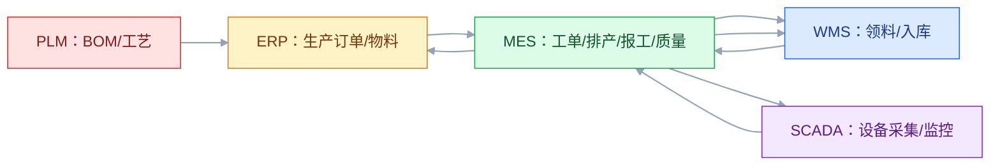
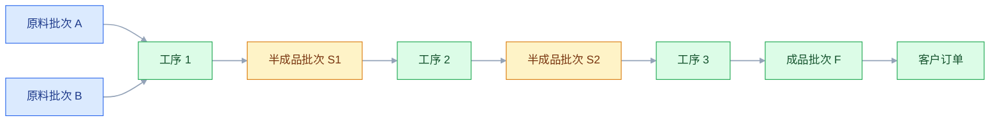

# MES 与 SCADA

## 一、工程案例：把车间“黑盒”变成可追溯的执行链

**场景**：一家离散制造工厂，两个车间，两条产线。现在 ERP 下发生产订单，车间用纸质工单排产，产量靠班后手工填报，质量数据记在检验单上，设备数据在 SCADA 上看但没人导出。问题是：订单进度只能打电话问；物料领用靠估算，月底盘点差一大截；质量问题只能查到批次，查不到工序和设备；大客户要求批次追溯，只能翻三个月纸质记录。

**目标**：不换 ERP，先把 MES 和 SCADA 的边界、采集、追溯、集成定清楚，交付：

- 一张 MES 功能地图；
- 一张 SCADA 到 MES 的数据流；
- 一套批次追溯链设计；
- 一张 MES 与 ERP/WMS/PLM 的集成清单；
- 一份失败矩阵；
- 一份验收清单（8 项）。

**为什么必须做**：MES 是“计划的最后一公里”，SCADA 是“现场的第一手数据”。没有 MES，ERP 的计划落不到工位；没有 SCADA，MES 的执行状态靠人工录入，数据滞后且不可信。两者的边界划不清，就会出现“SCADA 直接写 ERP”的灾难。

**动手前确认**：先摸清三件事：车间的网络拓扑（哪些设备能联网）、现有 PLC 型号和通信协议、纸质工单和检验单的实际字段。没有这三样，方案会变成空中楼阁。下面的企业数据是示例。



### 1.1 MES 的边界

| MES 管 | MES 不管 |
|---|---|
| 工单下达、派工、执行跟踪 | 主生产计划、MRP 计算 |
| 工序流转、报工、工时 | 财务核算、成本结算 |
| 质量检验、不合格品处理 | 质量标准文件（可存 QMS） |
| 物料领用、消耗、在制跟踪 | 库存账务 |
| 设备状态、OEE、点检保养 | 设备台账 |
| 批次/序列号追溯 | 产品设计、BOM 编制 |
| 数据采集、看板、预警 | 经营分析报表 |

MES 是“执行与追溯”系统，不是“计划系统”也不是“财务系统”。ERP 说“该做什么”，MES 管“怎么做、做了多少、质量如何”。

### 1.2 功能地图

| 模块 | 核心功能 | 关键对象 | 常见问题 |
|---|---|---|---|
| 生产建模 | 产品、工序、工艺路线、资源、工时 | 工序、工作中心、资源 | 和 PLM 的工艺不同步 |
| 工单管理 | 工单创建、派工、执行、关闭 | 工单、工序、报工 | ERP 和 MES 双建工单 |
| 排产 | 有限排产、优先级、换型 | 排产结果、换型记录 | 排产结果没有反馈 |
| 执行 | 开工、暂停、报工、完工 | 报工记录、异常 | 报工靠人工，滞后 |
| 质量 | 首检、巡检、完工检、不合格品 | 检验批、缺陷、处置 | 质量数据与批次脱节 |
| 物料 | 领料、退料、补料、消耗 | 领料单、消耗记录 | 估算消耗，账实不符 |
| 设备 | 状态、点检、保养、OEE | 设备状态、保养计划 | 与 SCADA 数据重复 |
| 追溯 | 批次、序列号、正向/反向追溯 | 批次关系、工序记录 | 只查到批次不到工序 |

不要一次全上。先做“工单 + 报工 + 追溯”三件套，再补排产、质量、设备。

### 1.3 SCADA 到 MES 的数据流

SCADA 是 L2 层，负责设备级采集和控制；MES 是 L3 层，负责业务语义。两者之间的转换是关键：


转换规则：

| SCADA 侧 | MES 侧 | 转换 |
|---|---|---|
| 设备运行状态 | 设备 OEE 三要素 | 运行/待机/故障 → 时间开动率、性能、良率 |
| 计数脉冲 | 完工数量 | 脉冲数 ÷ 单件脉冲 = 产量 |
| 温度/压力/速度 | 工艺参数 | 按工序和批次归集 |
| 报警 | 异常事件 | 关联工单、工序、批次 |
| 停机代码 | 停机原因 | 映射到停机分类 |

秒级数据不要直接进 MES 业务库。用边缘侧做聚合，MES 存“事件”和“批次结果”，原始时序数据存时序库或数仓。

### 1.4 批次追溯链

追溯是 MES 的核心价值。批次追溯链要能回答：

- 这批产品用了哪些原料、哪些设备、哪道工序、哪个班次、哪些人；
- 质量异常时，影响哪些批次、哪些客户订单；
- 客户投诉时，能否正向/反向追溯。



追溯的数据要求：

| 层级 | 记录 | 用途 |
|---|---|---|
| 批次 | 原料批次、成品批次、关联关系 | 追溯主链 |
| 工序 | 工序、设备、操作人、时间、参数 | 追溯到底 |
| 物料 | 领料、消耗、退料 | 物料账 |
| 质量 | 检验结果、缺陷、处置 | 质量分析 |
| 设备 | 设备状态、参数、报警 | 原因分析 |

追溯链断开的地方，就是数据质量问题。每周抽查 10 个批次做“从成品追到原料”演练。

### 1.5 与 ERP/WMS/PLM 集成

| 集成点 | 上游 | 下游 | 内容 | 失败处理 |
|---|---|---|---|---|
| 生产订单 | ERP | MES | 工单、BOM、数量、交期 | 重发，幂等键工单号 |
| BOM/工艺 | PLM | ERP/MES | 设计 BOM、工艺路线、变更 | 版本校验，旧版本拒绝 |
| 物料配送 | MES | WMS | 领料请求、配送指令 | 重试，缺料告警 |
| 领料确认 | WMS | MES | 发料、批次、数量 | 对账，差异冲正 |
| 完工报工 | MES | ERP | 完工数量、工时、物料消耗 | 汇总重报，防重复 |
| 入库 | WMS | MES/ERP | 成品批次、数量、库位 | 事务重放 |
| 质量 | MES | QMS/ERP | 检验结果、不合格品 | 补录，人工确认 |
| 设备数据 | SCADA | MES | 事件、状态、参数 | 边缘缓存，补采 |

集成原则：**ERP 下发计划，MES 回传执行；MES 不直接改 ERP 的业务规则；SCADA 不直接写 ERP**。SCADA 到 MES 是“数据”，MES 到 ERP 是“业务事件”。

### 1.6 质量与不合格品

质量数据要“当场采集”，不能事后补录。三个时机：

1. **首检**：开工前确认设备、物料、参数；
2. **巡检**：过程中抽样，发现趋势偏离；
3. **完工检**：批次结束判定合格与否。

不合格品处理要有明确流程：

| 步骤 | 动作 | 责任 | 记录 |
|---|---|---|---|
| 发现 | 检验判定不合格 | 质检 | 检验记录、缺陷代码 |
| 隔离 | 贴标识、移入不合格区 | 仓库/车间 | 隔离单、批次 |
| 分类 | 返工、让步接收、报废、退货 | 质量/工艺 | 缺陷分类 |
| 处置 | 返工/特采/报废/退料 | 责任部门 | 处置单、审批 |
| 验证 | 返工后复检 | 质检 | 复检记录 |
| 关闭 | 放行或核销 | 质量 | 关闭记录 |

让步接收（特采）必须有审批和责任记录，不能默认放行。

### 1.7 常见模式对比

| 模式 | 适合 | 前提 |
|---|---|---|
| 自动报工 | 连续生产、有自动计数 | 设备可联网、计数可靠 |
| 扫码报工 | 离散、多工序、批次管理 | 有终端、工单条码化 |
| 人工报工 | 临时、小批量 | 有复核，延迟可接受 |
| 混合报工 | 多品种、多产线 | 按工序配置 |

报工方式影响数据可信度。能自动的不人工，能扫码的不填表；但自动采集要有校准和异常告警，脉冲丢一次就会差一批货。

### 1.8 失败矩阵

| 失败 | 影响 | 兜底 |
|---|---|---|
| SCADA 网络中断 | 采集盲区 | 边缘缓存，恢复后补采 |
| 脉冲丢失 | 产量统计错误 | 班后人工核对，校准阈值 |
| 工单重复下发 | 重复生产 | 工单号幂等，状态机校验 |
| BOM 版本不一致 | 用错物料 | 版本校验，工单冻结 |
| 报工丢失 | 进度、成本不准 | 定时补偿，班后汇总 |
| 领料未确认 | 物料账不平 | 日对账，差异冲正 |
| 设备报警未处理 | 批量质量事故 | 升级机制，停机规则 |
| 追溯链断裂 | 无法追溯 | 周抽查，缺口补录 |

### 1.9 验收（8 项）

1. 工单下发：ERP 到 MES 延迟 ≤ 1 分钟，重复下发不重复开工。
2. 报工：连续 7 天，报工数据与 SCADA 产量差异 ≤ 0.5%。
3. 追溯：抽 10 个成品批次，30 分钟内追到原料批次、工序、设备、操作人。
4. 物料：连续 7 天，MES 领料与 WMS 发料差异为 0。
5. 质量：不合格品 100% 有隔离、分类、处置、审批记录。
6. OEE：连续 30 天，MES 与 SCADA 计算的 OEE 差异 ≤ 2%。
7. 故障：SCADA 断网 2 小时，恢复后数据补齐，无丢失。
8. 集成：停掉 MES 1 小时，ERP 有降级方案，恢复后自动补传。

## 二、高频问答：会卡住你的地方，也是面试最常问的

### 2.1 MES 就是电子工单

**现场**

问三个问题：没有 MES 怎么知道工序进度、物料消耗、质量状况？再看纸质工单上的字段能不能支撑追溯。

**要点**

- MES 的核心是执行跟踪、数据采集、质量、追溯，电子工单只是入口。
- 只把工单搬到屏幕上，数据还是人工补录，进度和质量依旧滞后。
- 判断标准是数据从哪来、能不能追到工序和设备。

**追问**

- 电子工单和 MES 差在哪？→ 前者只记录任务，后者记录执行、消耗、质量并支撑追溯。
- 先上哪些模块？→ 工单、报工、追溯三件套，再补排产、质量、设备。
- 为什么不能一次全上？→ 基础数据没跑通，后面的排产和优化都是空谈。

### 2.2 SCADA 数据直接给 ERP

**现场**

问一句：这个测点属于哪个工单、哪个批次？答不上来，就说明缺 MES 这层上下文转换。

**要点**

- SCADA 是秒级测点，ERP 是业务单据，直连会把时序数据灌进业务库。
- 直连缺少工单、批次、工序上下文，数据没法核算。
- 正确路径是 SCADA 到 MES 做上下文注入，MES 再向 ERP 发业务事件。

**追问**

- 秒级数据能直接进 MES 库吗？→ 不能，边缘先聚合，MES 只存事件和批次结果，原始时序进时序库或数仓。
- 为什么说 SCADA 到 MES 是“数据”、MES 到 ERP 是“业务事件”？→ 前者没有业务语义，后者能核算。
- 那 OEE 在哪算？→ MES 侧按工单和班次算，SCADA 只提供状态和计数。

### 2.3 排产让 MES 做

**现场**

问清三件事谁算：物料到货、产能平衡、订单优先级。这三件在 ERP/APS，MES 只做车间执行层排产。

**要点**

- MES 排产是车间级有限排产，主计划和物料需求在 ERP/APS。
- 让 MES 做主计划，会和 ERP 打架，两边计划都对不上。
- 边界是：ERP 说该做什么，MES 说车间怎么排、排给谁。

**追问**

- APS 和 MES 排产怎么分工？→ APS 算全局产能和交期，MES 在车间内做有限排产和换型。
- 排产结果要不要反馈？→ 要，排产结果没有反馈是最常见的落地问题。
- 为什么排产总是不准？→ 建模数据（工时、换型、资源）不准，算得再快也没用。

### 2.4 报工靠人工录入

**现场**

看两个数：报工延迟和差异率。延迟超过 1 小时、差异超过 1%，就该上自动或扫码采集。

**要点**

- 人工报工滞后、易错、可篡改。
- 产量和质量数据不及时，追溯链就断在第一步。
- 能自动的不人工，能扫码的不填表；但自动采集要有校准和异常告警。

**追问**

- 自动采集最怕什么？→ 脉冲丢一次就差一批货，要有校准和班后核对。
- 扫码报工适合什么场景？→ 离散、多工序、批次管理。
- 报工丢了怎么补？→ 定时补偿加班后汇总，别指望人工回忆。

### 2.5 追溯只到批次

**现场**

抽一个批次做“反向追因演练”，追不到工序、设备、参数、操作人，追溯链就是断的。

**要点**

- 客户投诉和内部质量分析需要工序、设备、参数、操作人。
- 只到批次只能定位“哪一批”，无法定位根因。
- 追溯模型的关键是关系表：批次关系、工序记录、设备记录、人员记录、发货记录。

**追问**

- 正向和反向追溯分别回答什么？→ 原料出问题影响哪些成品，成品出问题用了哪些原料。
- 追溯链怎么保持不断？→ 每周抽 10 个批次演练，发现缺口就补录。
- 只有单表没有关系表会怎样？→ 追溯只能靠人翻记录。

### 2.6 OEE 高就代表效率高

**现场**

把 OEE 和准时交付率、库存周转、不良率放在一起看，只看一个数一定误判。

**要点**

- OEE 是设备利用率指标，不等于交付，也不等于赚钱。
- 库存积压、不良品、换型损失都会被 OEE 掩盖。
- OEE 100% 但生产的是没人要的产品，是更大的浪费。

**追问**

- OEE 三个要素对应哪些损失？→ 可用率对停机换型，性能对降速空转，良率对不良返工。
- 世界级 85% 能直接套吗？→ 不能，流程工业和离散制造不可直接比较。
- 那该看什么？→ 结合订单需求、库存、质量成本一起看。

### 2.7 MES 与 WMS 都要管库存

**现场**

抽查一次“完工入库”，看 MES、WMS、ERP 三边是否只记一次账。

**要点**

- MES 管在制和线边，WMS 管库位实物，重复记账就账实不符。
- 线边仓、在制、成品交接点是重复记账的高发区。
- 判断口径是谁写谁读：同一个数据只能有一个权威源。

**追问**

- 线边仓算谁的库存？→ 实物在 WMS，消耗和在制在 MES，交接点必须对账。
- 两个系统都能写会怎样？→ 一定打架，先定权威源，另一个只读。
- 完工入库以哪边为准？→ 批次和数量以 WMS 收货为准，报工以 MES 为准。

### 2.8 设备数据采得越多越好

**现场**

按“哪个点位用于哪个决策”筛一遍，回答不了的点位先不采。

**要点**

- 大部分点位没有业务含义。
- 全采会压垮网络和存储，真正有用的数据反而被淹没。
- 采集方案按需选型，老设备加边缘网关比换 PLC 便宜得多。

**追问**

- 采集频率怎么定？→ 看决策需要，OEE 用状态和计数，工艺参数按工序和批次归集。
- 断网了怎么办？→ 边缘缓存，恢复后补采。
- 老设备一定要换 PLC 吗？→ 不必，加边缘网关能覆盖多协议，成本低得多。

### 2.9 MES 上线就能追溯

**现场**

上线后做月度追溯演练，连续三个月都有断点，说明数据模型或采集有缺口。

**要点**

- 追溯依赖物料批次、工序记录、设备数据、质量记录的完整关联，少一环就断。
- 系统上线只解决数据存在哪，不解决录不录、录得准不准。
- 追溯完整率要作为指标抽查，不是等客诉才发现。

**追问**

- 断点一般出在哪？→ 领料未扫码、报工补录、批次混放。
- 怎么补？→ 周抽查加缺口补录，同时回头修数据模型。
- 为什么追溯要“当场采集”？→ 事后补录的数据不可信，时间、人、参数都对不上。

### 2.10 MES 替代不了管理

**现场**

看三个执行率：报工及时率、异常关闭率、标准遵循率。

**要点**

- MES 只是工具，报工不及时、异常不处理、标准不执行，系统只会把混乱数字化。
- 项目最大的风险不是技术，是人。
- 对策是采集尽量自动化、报表替代手工、关键指标和绩效挂钩。

**追问**

- 工人不愿多录数据怎么办？→ 减少录入，让他觉得省事，而不是只靠考核。
- 系统上了指标还是不动？→ 说明执行率没进考核，先把指标和绩效挂钩。
- 管理层只看产量怎么办？→ 把数据质量指标一起摆到同一张报表上。

## 三、核心知识

### 3.1 MES 的定位

MES（Manufacturing Execution System）位于 ISA-95 的 L3 层，连接 ERP（L4）和 SCADA/PLC（L1/L2）。

| 层 | 系统 | 职责 |
|---|---|---|
| L4 | ERP/APS | 计划、订单、财务、MRP |
| L3 | MES | 执行、调度、报工、质量、追溯 |
| L2 | SCADA/DCS | 采集、监控、报警、控制 |
| L1 | PLC/传感器 | 逻辑控制、信号采集 |
| L0 | 设备 | 物理过程 |

MES 的核心问题：**把计划翻译成现场动作，把现场动作翻译成可核算的业务事件**。

> **面试**：常问「MES 在 ISA-95 里处于哪一层？」答：L3，上接 ERP 的 L4，下接 SCADA/PLC 的 L2/L1。

### 3.2 核心对象

| 对象 | 关键字段 | 关系 |
|---|---|---|
| 工单 | 工单号、产品、数量、交期、状态 | 由 ERP 生产订单驱动 |
| 工序 | 工序号、名称、工作中心、工时 | 工单的组成部分 |
| 报工 | 工单、工序、数量、工时、状态 | 执行记录 |
| 批次 | 批次号、原料批次、成品批次、关联 | 追溯主链 |
| 物料 | 领料、消耗、退料 | 与 WMS 联动 |
| 质量 | 检验批、缺陷、处置 | 关联工序和批次 |
| 设备 | 状态、参数、OEE | 与 SCADA 联动 |

对象关系不能乱。一个工单多个工序，一个工序多次报工，一个批次跨多个工序，一个设备服务多个工作中心。

### 3.3 SCADA 的数据模型

SCADA 侧是“测点”：

| 元素 | 说明 |
|---|---|
| 设备 | PLC、DCS 控制器 |
| 标签/点位 | 温度、压力、转速、状态 |
| 采样周期 | 100ms～1s |
| 报警 | 阈值、死区、级别 |
| 控制指令 | 启停、设定值 |

MES 侧是“业务对象”：

| 元素 | 说明 |
|---|---|
| 工单/工序 | 业务上下文 |
| 事件 | 开工、暂停、完工、异常 |
| 聚合 | 分钟/小时/班次产量 |
| 追溯 | 批次、设备、参数、人 |

从 SCADA 到 MES 不是“抄表”，是**上下文注入**：把没有业务含义的测点，变成有工单、有批次、有工序、有人的业务事件。

### 3.4 OEE

```text
OEE = 可用率 × 性能 × 良率

可用率 = 实际运行时间 / 计划运行时间
性能 = (理论产量 × 生产数量) / 实际运行时间 的倒数
良率 = 良品数 / 总产量
```

OEE 的三个要素对应三类损失：

| 损失 | OEE 要素 |
|---|---|
| 停机、故障、换型 | 可用率 |
| 速度降低、空转 | 性能 |
| 不良品、返工 | 良率 |

OEE 高不等于赚钱：要结合订单需求、库存、质量成本看。OEE 100% 但生产的是没人要的产品，是更大的浪费。

> **面试**：常问「OEE 怎么算，三个要素分别对应什么损失？」答：可用率 × 性能 × 良率，分别对应停机换型、降速空转、不良返工。

### 3.5 追溯设计

追溯设计要“先定义问题，再建模型”：

| 追溯需求 | 需要的数据 |
|---|---|
| 原料出了问题，影响哪些成品 | 原料批次 → 成品批次 |
| 成品出了问题，用了哪些原料 | 成品批次 → 原料批次 |
| 哪个工序出的问题 | 工序 + 设备 + 参数 + 操作人 |
| 哪个批次发给了哪个客户 | 成品批次 → 发货记录 → 客户 |
| 质量问题集中出现在哪个班次 | 班次 + 人员 + 工序 |

追溯模型的关键是“关系表”：批次关系、工序记录、设备记录、人员记录、发货记录。没有关系表，只有单表，追溯就只能靠人翻。

### 3.6 数据采集方式

| 方式 | 精度 | 延迟 | 适合 |
|---|---|---|---|
| PLC 直接采集 | 高 | 秒级 | 设备可编程 |
| 边缘网关 | 中 | 秒级 | 老旧设备、多协议 |
| 传感器 | 中 | 秒级 | 无控制信号的设备 |
| 扫码/RFID | 高 | 实时 | 离散、批次、人员 |
| 视觉 | 高 | 实时 | 计数、外观检测 |
| 人工 | 低 | 分钟级 | 临时、补充 |

采集方案要“按需选型”，不是“越高级越好”。老设备加边缘网关，比换 PLC 便宜得多。

### 3.7 MES 与 ERP/WMS 的边界

| 数据 | 权威源 | 副本 |
|---|---|---|
| 生产订单 | ERP | MES |
| 工单 | MES | ERP（只读进度） |
| BOM/工艺 | PLM | ERP/MES |
| 物料库存 | WMS/ERP | MES |
| 在制数量 | MES | ERP |
| 完工报工 | MES | ERP |
| 设备数据 | SCADA | MES |
| 质量记录 | MES/QMS | ERP/BI |

边界清不清，看“同一个数据谁写、谁读”。两个系统都能写，最后一定打架。

> **面试**：常问「MES 和 WMS 都记库存，会不会重复记账？」答：先定权威源，在制记 MES、实物记 WMS，交接点对账。

### 3.8 实施路径

| 阶段 | 目标 | 退出条件 |
|---|---|---|
| 建模 | 产品、工序、资源、工时 | 与 PLM/ERP 一致 |
| 工单 | 下发、执行、报工 | 报工及时率 ≥ 95% |
| 追溯 | 批次、工序、物料关联 | 追溯演练通过 |
| 质量 | 首检、巡检、完工检 | 质量数据完整 |
| 设备 | 状态、OEE、报警 | 与 SCADA 对齐 |
| 排产 | 车间有限排产 | 换型、优先级合理 |
| 优化 | 数据驱动改善 | 指标持续改善 |

先跑通“工单 + 报工 + 追溯”，再谈高级功能。没有基础数据，排产和优化都是空谈。

### 3.9 人员与组织

MES 项目的最大风险不是技术，是人：

- 车间工人不愿意多录数据；
- 班组长用惯了 Excel；
- 工艺和 IT 对工序定义不一致；
- 管理层只看产量不看数据质量。

对策：

- 采集尽量自动化，减少录入；
- 报表替代手工，让工人觉得“省事”；
- 关键指标和绩效挂钩；
- 培训和奖励并行，不是只考核。

### 3.10 指标

| 指标 | 说明 |
|---|---|
| 报工及时率 | 报工时间与工序完成时间的差 |
| 数据准确率 | MES 与 WMS/ERP 对账差异 |
| 追溯完整率 | 抽查批次的追溯通过率 |
| OEE | 设备综合效率 |
| 准时交付率 | 工单按交期完成比例 |
| 不良率 | 不良品 / 总产量 |
| 异常关闭率 | 异常在 SLA 内关闭比例 |

指标要少而精，每个都要有 owner 和阈值。

## 四、冷门知识汇总

- **ISA-95 Part 3 定义了制造运营活动模型**：生产、质量、维护、库存四大域，每域有活动、资源和能力。它是 MES 与 ERP 功能划分的理论依据。
- **B2MML**：ISA-95 的 XML Schema 实现，用于 ERP 与 MES 之间传递工单、物料、生产性能。比自定义 CSV 标准，但更重。
- **MESA-11 模型**：MESA International 提出的 MES 功能参考模型，把 MES 分为 11 个功能域（资源分配、文档、数据采集、质量管理、维护、绩效分析、运营调度、详细排产、跟踪、物料管理、劳动管理）。
- **MESA 的 MES 成熟度模型**：描述 MES 从“纸笔”到“自适应制造”的演进，可作为选型和实施路径参考。
- **eCl@ss / IEC 61360**：产品分类与描述标准，用于 PLM/ERP/MES 之间的物料主数据一致。
- **MTConnect**：机床和制造设备的通信标准（基于 HTTP/XML），把设备数据以标准化方式暴露。它解决“怎么读”，不解决“怎么用”。
- **OPC UA**：工业通信标准，提供信息模型、安全、跨平台。OPC UA 常用在 SCADA 与 MES 之间，但它只传输数据，不带业务语义。
- **SPC（统计过程控制）**：用控制图判断工序是否受控。关键工序要做 SPC，而不是只看合格/不合格。
- **Cp/Cpk**：过程能力指数，衡量工序能否稳定落在规格内。Cpk 低说明工序本身有系统性问题，不是工人不小心。
- **FIFO / LIFO 在制管理**：在制品的流动方式影响追溯和 WIP；混流生产时 FIFO 最难，需要扫码和批次控制。
- **Just-in-Sequence（JIS）**：按整车装配顺序供货，比 JIT 更严；需要 MES、WMS、SCM 高度协同。
- **Andon（安灯）**：现场异常可视化机制。MES 的看板和 Andon 不是一回事，Andon 强调“立刻响应”。
- **单件流（One Piece Flow）**：减少在制、缩短周期，但要求工序平衡和质量稳定；盲目上单件流会让换型成本上升。
- **OEE 的世界级水平 85%**：这是一个广泛流传的参考值，但不是所有行业都适用；流程工业和离散制造的 OEE 不可直接比较。
- **MES 的“三不原则”**：不接不合格物料、不传不合格半成品、不出不合格成品。这是 MES 质量控制的落地说法。
- **Andon 与 OEE 的关系**：Andon 响应时间越长，可用率越低；把 Andon 响应时间作为管理指标，比只看 OEE 数字更能推动改善。
- **数字孪生的分层**：设备级（SCADA）、产线级（MES）、工厂级（MES+ERP）、供应链级（SCM）。很多“数字孪生”项目只做到可视化，没有反向控制能力。
- **MES 与 QMS 的分界**：MES 管过程质量数据采集，QMS 管质量标准、不合格品、供应商质量、客诉。很多企业把两者合并，结果质量标准散落在各个工单里。