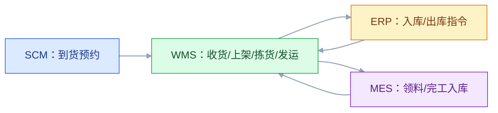
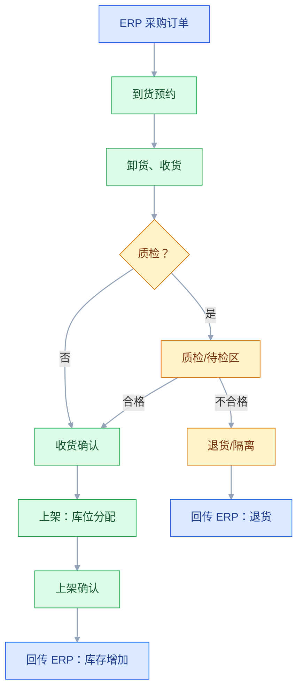
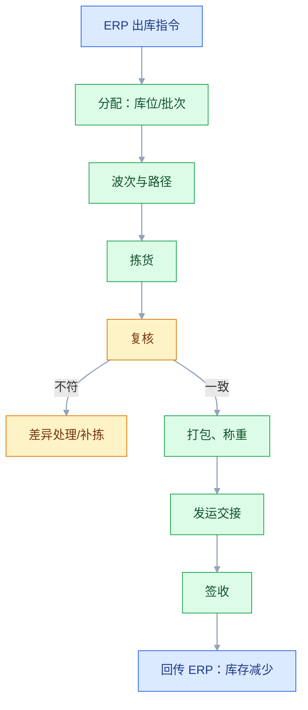

# WMS 与仓储管理

## 一、工程案例：把三个仓库的账从“月月差”变成“日日平”

**场景**：一家企业有三个仓库（原材料仓、半成品仓、成品仓），现在用一套 ERP 管库存，仓库用 Excel 记录收发。问题是：同一个 SKU 放三个库位，系统只记总量不记库位；拣货靠老员工记忆；盘点一个月一次，差异一堆，查不出原因；发错货每月三五单；大促时出入库单据集中涌入，ERP 过账延迟，库存数字根本不准。老板要求：库存准确率 98%，发错货率低于 0.1%，日结能平。

**目标**：不换 ERP，先把 WMS 的库位、作业、批次、对账模型定清楚，交付：

- 一张 WMS 功能地图；
- 一套库位与批次编码规则；
- 一张入库/出库作业流程；
- 一套与 ERP、MES、SCM、BI 的集成清单；
- 一套对账规则；
- 一份验收清单（8 项）。

**为什么必须做**：ERP 的库存是“财务与计划口径”，WMS 的库存是“实物与库位口径”。两者口径不同，不对账就一定差。WMS 的价值不是“记库存数量”，而是“让实物、单据、账务三者在每一天对上”。

**动手前确认**：先盘三样东西：现有库位和 SKU 分布、最近三个月的盘点差异、发错货记录。没有这些，WMS 上线只会把混乱搬进系统。下面的企业数据是示例。



### 1.1 WMS 的边界

| WMS 管 | WMS 不管 |
|---|---|
| 库位、库区、库容 | 库存估值、财务核算 |
| 收货、质检、上架 | 采购订单创建 |
| 拣货、复核、打包 | 销售订单创建 |
| 盘点、移库、调整 | 主生产计划 |
| 批次、序列号、效期 | 物料主数据定义 |
| 波次、路径、作业调度 | MRP 计算 |
| 发运、签收、交接 | 承运商合同 |

WMS 是“执行与实物管理系统”，不是“库存账系统”。ERP 管账和计划，WMS 管货和动作。

### 1.2 功能地图

| 模块 | 核心功能 | 关键对象 | 常见问题 |
|---|---|---|---|
| 基础数据 | 库区、库位、包装、容器 | 库位、SKU、容器 | 库位编码混乱 |
| 收货 | 到货预约、收货、质检、上架 | 收货单、上架任务 | 收货未上架，实物找不到 |
| 上架 | 库位分配、上架确认 | 上架记录 | 随机上架无规则 |
| 拣货 | 波次、路径、拣货、复核 | 拣货任务、波次 | 路径不合理，拣货慢 |
| 发运 | 打包、称重、交接、签收 | 发运单、箱单 | 发错货、漏发 |
| 盘点 | 循环盘点、动碰盘点、全盘 | 盘点单、差异 | 月盘一次，差异积压 |
| 库存控制 | 移库、调整、冻结、释放 | 调整单、冻结单 | 调整无审批 |
| 批次 | 批次、序列号、效期、先进先出 | 批次记录 | 批次混放，无法追溯 |
| 波次与路径 | 订单分组、路径优化 | 波次、路径 | 无波次，作业效率低 |

先上“库位 + 收货上架 + 拣货发运 + 盘点对账”，再补波次、路径、自动化。

### 1.3 库位与批次编码

库位编码要“有结构、可读、可扩展”：

```text
仓库-库区-巷道-排-层-位
A-01-03-02-B-05
```

批次编码规则要能表达：日期、产线、序列、来源。示例：

```text
YYMMDD + 产线 + 序号
260122-A-001
```

| 对象 | 编码要素 | 用途 |
|---|---|---|
| 库位 | 仓库、库区、巷道、排、层、位 | 定位、路径、库容 |
| 托盘/容器 | 类型、编号 | 搬运、追踪 |
| 批次 | 日期、产线、序号 | 追溯、效期、先进先出 |
| 序列号 | 唯一 | 单件追溯 |
| 作业单 | 类型、日期、序号 | 任务、对账 |

编码规则一旦定下，不要随意改。改规则要留映射表，否则历史数据全部失效。

### 1.4 入库流程



关键控制点：

- **到货预约**：避免车辆集中到达，减少收货排队；
- **收货与上架分离**：收货确认的是“货到了”，上架确认的是“货有位置”；
- **上架规则**：按 SKU 属性、库容、周转率分配库位；
- **回传时机**：收货后回传 ERP，还是上架后回传，要按企业库存口径定死。

### 1.5 出库流程



关键控制点：

- **分配规则**：先进先出、效期优先、库位就近、整箱优先；
- **复核**：扫码或称重复核，减少发错货；
- **发运**：箱单、交接单、承运商签收；
- **回传**：发货后回传 ERP，不要等签收；签收状态单独回传。

### 1.6 与 ERP、MES、SCM、BI 集成

| 集成点 | 上游 | 下游 | 内容 | 失败处理 |
|---|---|---|---|---|
| 采购入库 | ERP | WMS | 采购订单、到货通知 | 重发，幂等键订单号 |
| 收货/上架 | WMS | ERP | 收货、上架、库存增加 | 对账，差异冲正 |
| 销售出库 | ERP | WMS | 销售订单、出库指令 | 重发，幂等键订单号 |
| 发货 | WMS | ERP | 发货、库存减少 | 事务重放 |
| 生产领料 | MES | WMS | 领料、配送 | 缺料告警 |
| 完工入库 | MES | WMS | 成品、批次、数量 | 对账，差异冲正 |
| 到货预约 | SCM | WMS | 预约、ASN | 延迟可接受 |
| 物流 | SCM/WMS | 承运商 | 发运、签收 | 延迟可接受 |
| BI | WMS/ERP | BI | 库存、周转、差异 | 日批量 |

原则：**ERP 说“该进该出多少”，WMS 说“实际进出多少、放在哪”**。两者通过“业务单号 + 批次”对账，不通过“直接改表”同步。

### 1.7 对账

对账是 WMS 的生命线。三个口径：

| 口径 | 含义 | 系统 |
|---|---|---|
| 实物库存 | 货架上实际有多少 | WMS |
| 财务库存 | 账上有多少、值多少钱 | ERP |
| 计划库存 | 可用量、预留、在途 | ERP/MRP |

对账规则：

1. **每日对账**：WMS 的当日收发汇总 vs ERP 的当日收发凭证；
2. **差异分类**：单据未回传、重复回传、数量不符、批次不符、库位调整未同步；
3. **自动冲正**：只处理确定性差异（重复回传、漏单），模糊差异人工；
4. **盘点**：循环盘点 + 动碰盘点，替代月盘；
5. **调整审批**：库存调整必须审批，且记录原因。

| 差异类型 | 原因 | 处理 |
|---|---|---|
| WMS 有、ERP 无 | 回传丢失 | 自动补单 |
| ERP 有、WMS 无 | 重复回传 | 冲正 |
| 数量不符 | 收发货误差 | 盘点确认 |
| 批次不符 | 批次混放 | 冻结、复盘 |
| 库位差异 | 移库未同步 | 同步规则修正 |

### 1.8 盘点

盘点不是“月盘一次找差异”，而是“持续验证准确性”。

| 方式 | 频率 | 适用 |
|---|---|---|
| 动碰盘点 | 每次出入库后 | 高频 SKU |
| 循环盘点 | 按计划轮询 | 全部 SKU |
| 全盘 | 年度/季度 | 低值、静态 |
| 盲盘 | 随机抽查 | 发现系统性错误 |

盘点差异要分析原因，不是“调平就好”。差异集中在某类 SKU、某个库区、某个班次，说明规则或流程有问题。

### 1.9 验收（8 项）

1. 库位：100% 库位有编码、有库容、有归属，系统可查。
2. 收货上架：连续 7 天，WMS 收货与 ERP 入库凭证一致，差异为 0。
3. 发错货：连续 30 天，发错货率 ≤ 0.1%，每单可定位到作业人和复核环节。
4. 日结：连续 30 天，WMS 实物与 ERP 财务库存差异为 0，差异可定位。
5. 批次：抽 20 个批次，正向/反向追溯完整，先进先出执行率 100%。
6. 盘点：循环盘点覆盖率 ≥ 90%，盘点差异率 ≤ 0.5%。
7. 集成：停掉 ERP 1 小时，WMS 有降级方案，恢复后自动补传。
8. 效率：拣货路径优化后，人均拣货行数提升 ≥ 30%。

## 二、高频问答：会卡住你的地方，也是面试最常问的

### 2.1 WMS 就是库存表

**现场**

问一句：同一个 SKU 在三个库位，ERP 能告诉你拣哪个吗？

**要点**

- ERP 记“账”，WMS 记“货在哪、怎么动、谁动的”。
- 库位、批次、作业、路径才是 WMS 的核心。
- 库存记录的主键是 SKU + 批次 + 库位 + 状态，不是 SKU + 仓库。

**追问**

- ERP 库存模块和 WMS 怎么分工？→ ERP 管账和计划，WMS 管货和动作。
- 没有库位和批次的库存表能做什么？→ 只能看总量，做不了先进先出和追溯。
- WMS 是不是把 ERP 的库存模块重做一遍？→ 不是，粒度从 SKU+库位组细化到批次+库位+容器。

### 2.2 收货就等于入库

**现场**

看系统是否区分“已收未上”“待检”“可用”三种状态，只有一种就是没分清。

**要点**

- 收货是“货到了”，上架是“货有位置”。
- 未上架的货在待检区或暂存区，不应计入可用库存。
- 回传时机要按企业库存口径定死：收货后回传还是上架后回传。

**追问**

- 回传早了会怎样？→ 账上可用但拣不到货，MRP 会算错可用量。
- 待检区算不算可用库存？→ 不算，ERP 和 WMS 的口径必须一致。
- 为什么要做到货预约？→ 避免车辆集中到达，减少收货排队。

### 2.3 盘点差异直接调平

**现场**

看调整单有没有原因分类和审批，没有就是在用调平掩盖问题。

**要点**

- 调平只解决数字，不解决原因，差异会重复出现。
- 差异集中在某类 SKU、某个库区、某个班次，说明规则或流程有问题。
- 库存调整必须审批，并记录原因。

**追问**

- 差异要多久清一次？→ 当日提交、当日确认原因、当周完成审批。
- 为什么月盘救不了准确率？→ 准确率来自每次动作都对，事后纠正只能改数字。
- 自动冲正能处理哪些差异？→ 只处理确定性差异，比如重复回传、漏单，模糊差异留给人工。

### 2.4 批次管理就是记个号

**现场**

抽一个批次做正向追溯，追不到工序或原料批次，就是只有号没有管理。

**要点**

- 批次号要能关联原料、生产、质量、发货。
- 随便编号会让追溯链在第一跳就断。
- 批次状态、效期、冻结与释放都要能管。

**追问**

- FIFO 和 FEFO 怎么选？→ 食品、药品、化工必须 FEFO，普通物料可用 FIFO。
- 冻结要冻到什么粒度？→ 精确到批次和库位，不能整 SKU 冻结。
- 过期批次怎么处理？→ 自动冻结，不能进入可用库存。

### 2.5 先进先出靠人记

**现场**

抽查出库记录，看系统分配的批次是否严格按日期，靠人选批次就是没做。

**要点**

- 人工判断在多库位、多批次时必然出错。
- 先进先出要靠系统分配规则强制执行。
- 分配规则还要一起考虑效期优先、库位就近、整箱优先。

**追问**

- 双深位货架还能 FIFO 吗？→ 能但难，要靠 WMS 严格控制批次和存取顺序。
- 分配规则和拣货路径冲突怎么办？→ 一起设计，别只优化单点。
- 随机库位有什么风险？→ 提效但库位记录不准时会“系统说在 A、实际在 B”，必须配扫码上架和动碰盘点。

### 2.6 波次就是批量拣货

**现场**

看波次是否考虑路径、容器容量、分拣复杂度，没有就是简单合并。

**要点**

- 波次的核心是按路径、容量、时效、承运商分组。
- 目的是减少行走和二次分拣，不是把订单堆一起。
- 单纯合并订单可能反而更难分货。

**追问**

- 波次和批次是一回事吗？→ 不是，波次是一组作业任务，批次是同一批货。
- 播种式和摘果式怎么选？→ 多单同品先拣后分用播种，按单拣完即发用摘果。
- 拣货效率靠什么提升？→ 少走路、少分拣、少出错，路径优化和复核比催人跑得快有效。

### 2.7 WMS 可以直接连数据库

**现场**

看有没有 API、消息或文件契约；直连数据库的集成，故障时几乎无法定位。

**要点**

- 直连数据库绕过业务校验和事务，schema 一变就崩。
- 出了问题无法对账，也无法追责。
- 指令类走 API + 幂等键，回传类走消息 + 对账。

**追问**

- 直连数据库最典型的故障是什么？→ 对方改表结构，这边静默写错或直接崩。
- 幂等键用什么？→ 业务单号，重发不重复记账。
- 大批量数据怎么同步？→ BI 类走批量文件或 CDC，别压业务库。

### 2.8 自动化设备先上

**现场**

看库位准确率、SKU 标准化率、作业流程是否稳定，不达标先补基础。

**要点**

- 自动化依赖清晰的库位、批次、包装、流程。
- 基础数据混乱时上自动化，等于把混乱自动化。
- 实施顺序是先基础数据，再收货上架、拣货发运、盘点对账，最后自动化。

**追问**

- 什么信号说明还不能上 AGV？→ 库位记录不准、SKU 包装不统一。
- 上了自动化准确率会自己变好吗？→ 不会，乱的数据进去还是乱的结果。
- 自动分拣适合什么场景？→ 高周转、SKU 规则、包装统一的仓库。

### 2.9 库存准确率靠盘点保证

**现场**

看收发差异率和调整率，这两个高说明作业环节有问题，盘点救不了。

**要点**

- 准确率来自“每次动作都准确”，不是“事后纠正”。
- 不解决收发环节的误差，盘多少次都差。
- 盘点的作用是发现系统性错误，不是把数字调平。

**追问**

- 盲盘比明盘强在哪？→ 盘点员看不到系统数量，能发现照着系统填的问题。
- 循环盘点覆盖率要做到多少？→ 验收口径是不低于 90%。
- 动碰盘点为什么比固定周期盘更及时？→ 有出入库动作就盘，问题当场暴露。

### 2.10 WMS 上线就能降本

**现场**

只看四个指标：准确率、发错货率、拣货效率、盘点差异率，不要一上来只考核成本。

**要点**

- WMS 先提升准确率和可追溯性，降本是准确率提升后的结果。
- 短期内可能因为流程规范而增加工作量。
- 用成本指标压项目，一线就会绕开系统。

**追问**

- 降本什么时候才出现？→ 准确率和作业效率稳定之后。
- 怎么证明有效？→ 用同一套指标做上线前后对比。
- 为什么先做日结？→ 做不到日结，月结一定差，而且差到查不清。

## 三、核心知识

### 3.1 WMS 的定位

WMS（Warehouse Management System）管理“实物在库内的完整生命周期”：收货、质检、上架、存储、拣货、复核、打包、发运、盘点、调整。

它和 ERP 库存模块的区别：

| 维度 | ERP 库存 | WMS |
|---|---|---|
| 视角 | 财务/计划 | 实物/作业 |
| 粒度 | SKU + 库位组 | SKU + 批次 + 库位 + 容器 |
| 动作 | 入库/出库过账 | 收货、上架、拣货、复核、盘点 |
| 目标 | 账实相符 | 作业高效、实物可控 |

> **面试**：常问「WMS 和 ERP 库存模块有什么区别？」答：ERP 记财务和计划口径，WMS 记实物、批次、库位和作业动作。

### 3.2 核心对象

| 对象 | 关键字段 |
|---|---|
| 库位 | 仓库、库区、巷道、排、层、位、库容、类型 |
| SKU | 编码、名称、包装、单位、效期规则 |
| 库存记录 | SKU、批次、库位、数量、状态（可用/冻结/待检） |
| 收货单 | 采购订单、行、数量、批次、容器 |
| 上架任务 | 收货单、目标库位、数量 |
| 拣货任务 | 出库单、库位、批次、数量、路径 |
| 盘点单 | 范围、方式、快照数量、实盘数量、差异 |
| 调整单 | 类型、数量、原因、审批人 |

库存记录的主键是“SKU + 批次 + 库位 + 状态”，不是“SKU + 仓库”。没有批次和库位的库存表，做不了先进先出和追溯。

### 3.3 库位管理

库位管理三要素：

1. **库位属性**：普通、冷藏、危险品、大件、暂存、待检、拣货位、存储位；
2. **库容规则**：体积、重量、件数、混放规则；
3. **分配策略**：固定库位、随机库位、按周转率分区。

常见分区：

| 区域 | 用途 |
|---|---|
| 收货暂存区 | 卸货、清点 |
| 待检区 | 等待质检 |
| 合格存储区 | 长期存放 |
| 拣货区 | 高频 SKU、靠近发货口 |
| 集货区 | 已拣待发 |
| 退货区 | 待处理退货 |
| 不合格区 | 隔离 |

### 3.4 上架策略

| 策略 | 说明 |
|---|---|
| 固定库位 | SKU 固定位置，易管理但库容浪费 |
| 随机库位 | 就近可用，库容利用率高 |
| 按周转率 | 高频靠近发货口 |
| 按相容性 | 化学品、食品不能混放 |
| 按批次/效期 | 同 SKU 多批次分区 |
| 按重量/体积 | 重货在下、大件专区 |

上架策略要和盘点、拣货路径一起设计，不能只优化单点。

### 3.5 拣货策略

| 策略 | 适用 |
|---|---|
| 按单拣货 | 订单少、紧急单 |
| 波次拣货 | 订单多、批量发货 |
| 分区拣货 | 仓库大、SKU 分区明显 |
| 播种式 | 多单同品，先拣后分 |
| 摘果式 | 按单拣完即发 |
| 路径优化 | 减少行走距离 |

拣货效率的核心是“少走路、少分拣、少出错”。路径优化和复核机制比“让仓管员跑快点”有效得多。

### 3.6 批次与效期

批次管理要支持：

- 批次号生成规则；
- 批次状态（可用、冻结、待检、过期）；
- 效期预警（临期、过期）；
- 先进先出、先到期先出；
- 序列号单件追溯；
- 批次冻结与释放（质量问题召回）。

效期管理要和质检联动：不合格批次不能进入可用库存，过期批次自动冻结。

> **面试**：常问「FIFO 和 FEFO 有什么区别？」答：一个按入库先后，一个按到期先后，效期敏感物料必须 FEFO。

### 3.7 盘点

| 方式 | 说明 |
|---|---|
| 循环盘点 | 按计划每天盘一部分 |
| 动碰盘点 | 有出入库动作就盘 |
| 全盘 | 停止作业全面盘点 |
| 盲盘 | 不告诉系统数量，防止按数填 |
| 明盘 | 带系统数量盘点，快但易失真 |

盘点差异要“当日清”：差异单当日提交，原因当日确认，审批当周完成。差异积压到月底，就永远查不清。

> **面试**：常问「盘点差异能直接调平吗？」答：不能，调平只改数字，原因是流程漏洞会重复出现。

### 3.8 集成架构

WMS 是“实物执行层”，上下游都很多：

- 上游：ERP（出入库指令）、SCM（到货预约、物流）、MES（领料、完工入库）；
- 下游：ERP（收发回传）、BI（库存、周转、差异）；
- 外部：承运商、客户。

集成原则：

- 指令类（ERP→WMS）走 API + 幂等键；
- 回传类（WMS→ERP）走消息 + 对账；
- 大批量（BI）走批量文件/CDC；
- 异常类走死信 + 人工。

### 3.9 绩效指标

| 指标 | 说明 |
|---|---|
| 库存准确率 | 盘点一致 / 总盘点 |
| 收发货及时率 | 按时完成 / 总任务 |
| 拣货效率 | 行/小时、单/小时 |
| 发错货率 | 错误单 / 总发货单 |
| 盘点差异率 | 差异数 / 总数 |
| 库容利用率 | 已用库容 / 总库容 |
| 平均在库时长 | SKU 从入库到出库 |

指标要分层：仓管员看效率，主管看准确率和差异，管理层看周转和成本。

### 3.10 实施路径

| 阶段 | 目标 | 退出条件 |
|---|---|---|
| 基础数据 | 库区、库位、SKU、包装 | 100% 有编码 |
| 收货上架 | 收货、上架、回传 | 日结差异为 0 |
| 拣货发运 | 拣货、复核、发运 | 发错货率 ≤ 0.1% |
| 盘点对账 | 循环盘点、差异分析 | 准确率 ≥ 98% |
| 批次追溯 | 批次、效期、先进先出 | 追溯演练通过 |
| 波次路径 | 波次、路径优化 | 效率提升 ≥ 30% |
| 自动化 | AGV、分拣、立体库 | 基础稳定后再上 |

基础数据没做好，不要上自动化。

## 四、冷门知识汇总

- **ABC 分类法**：按周转率把 SKU 分为 A（高频）、B（中频）、C（低频），A 类靠近发货口，C 类放高层。它是库位规划和盘点频率的基础。
- **FIFO、FEFO、LIFO**：先进先出、先到期先出、后进先出。食品、药品、化工必须 FEFO；普通物料可用 FIFO。
- **动碰盘点（Cycle Count）**：对发生出入库的库位即时盘点，比固定周期盘点更能及时发现问题。
- **盲盘（Blind Count）**：盘点员看不到系统数量，防止“照着系统填”。它是发现系统性错误的利器。
- **双深位/贯通式货架**：同一个巷道两排货位，靠叉车纵深存取，库容高但先进先出难，需要 WMS 严格控制批次。
- **越库（Cross-Docking）**：收货后不存储，直接分拣发货，适合高周转、预分配订单。它要求 ASN（提前发货通知）准确。
- **ASN（Advanced Shipping Notice）**：供应商提前发送的发货明细，让仓库能预约和预分配。没有 ASN，收货就只能靠人工清点。
- **箱单（Packing List）**：发货时的装箱明细，客户据此收货；箱单和实物不符是客诉高发点。
- **随机库位的“账实分离”风险**：随机上架提效，但库位记录不准时会“系统说在 A，实际在 B”。必须配合扫码上架和动碰盘点。
- **RFID 与条码**：RFID 适合托盘级、集装箱级批量读取；条码适合单件、低成本。选型看读取距离、成本、环境。
- **波次（Wave）与批次（Batch）**：波次是“同时处理的一组作业任务”，批次是“同一批货”。两者常被混用，但对账时分不清会出问题。
- **暂存区与待检区的会计口径**：已收未检的货算不算可用库存？ERP 和 WMS 口径要一致，否则 MRP 会算错可用量。
- **冻结与释放**：质量问题时冻结批次，避免误发；冻结范围要精确到批次和库位，不能整 SKU 冻结。
- **逆向物流（RMA）**：退货、换货、返修、报废的处理流程。逆向物流的库存状态最复杂，WMS 必须有专门的退货区和不合格区。
- **库位利用率与拣货效率的权衡**：库容压满会提高利用率，但会阻塞路径、增加找货时间。目标是“可用性最优”，不是“库容最大”。
- **WMS 的“三账合一”**：实物账、单据账、财务账每日对齐。做不到日结，月结一定差，而且差到查不清。