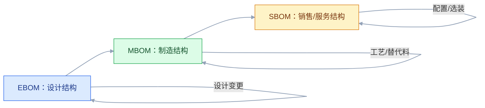
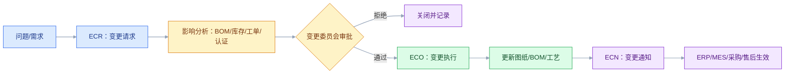

# PLM 与产品数据

## 一、工程案例：把“设计改了，车间不知道”变成可追溯的变更链

**场景**：一家装备制造企业，两条产品线，约 5000 个物料。研发用 CAD 画图，图纸存在共享盘，BOM 用 Excel 维护；ERP 里有另一套物料和 BOM；MES 的工艺路线又是工艺部单独维护。问题是：设计变更后，采购已经按旧 BOM 下了单，车间还在按旧工艺生产；同一个零件在 PLM、ERP、MES 有三个编码；客户要求提供“当时交付版本”的图纸和 BOM，翻了三天才找齐。

**目标**：不换 CAD，先把产品数据、BOM、变更、集成四件事理清，交付：

- 一张产品生命周期与数据流；
- 一套物料/图纸/BOM 编码规则；
- 一张 EBOM→MBOM→SBOM 转换表；
- 一套变更流程（ECR/ECO/ECN）与生效规则；
- 一张与 ERP、MES、SCM、QMS 的集成清单；
- 一份验收清单（8 项）。

**为什么必须做**：PLM 的价值不是“存图纸”，而是“让产品定义在全生命周期内只有一个可信版本，并且变更可追溯”。图纸存得再整齐，BOM 和变更不通，车间还是会用错版本。

**动手前确认**：先拉三样东西：现有物料编码规则、最近 12 个月的变更单、ERP/MES 的 BOM 差异清单。没有这三样，PLM 上线只会多一个“图文档系统”。下面的企业数据是示例。


### 1.1 PLM 的边界

| PLM 管 | PLM 不管 |
|---|---|
| 产品结构、图纸、CAD 文档 | 财务成本核算 |
| 设计 BOM（EBOM） | 车间工单执行 |
| 变更请求、变更单、版本 | 采购订单与库存 |
| 配置管理、基线 | 客户商机与合同 |
| 合规文档（RoHS/REACH） | 供应商绩效 |
| 工艺路线（可与工艺系统分工） | 生产排产 |

PLM 是“产品定义的权威源”，不是“研发部门的网盘”。它管的是产品数据，不是所有文档。

### 1.2 产品数据模型

| 对象 | 关键字段 | 说明 |
|---|---|---|
| 物料/零件 | 编码、名称、版本、状态 | 设计视角的零件 |
| 图纸/CAD | 图号、版本、格式、关联零件 | 文档与零件多对多 |
| BOM | 父项、子项、用量、单位、损耗 | 产品结构 |
| 工艺路线 | 工序、工作中心、工时 | 与 MBOM 关联 |
| 变更单 | 变更原因、影响范围、生效时间 | ECR/ECO/ECN |
| 配置基线 | 版本组合、生效范围 | 交付/审计依据 |
| 合规文档 | 材质、声明、证书 | RoHS/REACH |

产品数据的关键是“关系”：零件与图纸、零件与 BOM、BOM 与工艺、变更与版本。只存文件不存关系，PLM 就退化成网盘。

### 1.3 编码规则

| 对象 | 编码建议 | 注意 |
|---|---|---|
| 物料 | 分类码 + 流水码 | 不要用“图号”当物料码 |
| 图纸 | 产品/部件 + 流水 + 版本 | 图号和物料号可关联，但不要混用 |
| BOM | 父项物料 + 版本 | BOM 版本随父项变更 |
| 变更单 | 年份 + 流水 | 全公司唯一 |
| 工艺 | 物料 + 路线版本 | 与 MBOM 对齐 |

编码要“无含义、稳定、唯一”。把分类、颜色、尺寸都编进物料码，后期一变就要改编码，历史数据全部受影响。

### 1.4 BOM 的三种形态



| BOM | 视角 | 谁维护 | 用途 |
|---|---|---|---|
| EBOM | 设计 | 研发 | 产品结构、设计变更 |
| MBOM | 制造 | 工艺/制造 | 工单、领料、装配 |
| SBOM | 销售/服务 | 销售/服务 | 配置、报价、备件 |

三种 BOM 不是“复制粘贴”，是“转换”：

- EBOM 到 MBOM：加虚拟件、工艺拆分、替代料、损耗、工装；
- MBOM 到 SBOM：按销售配置、选装包、服务备件重组；
- 任何转换都要有映射表和版本，不能手工维护三套。

注意：软件供应链里的 SBOM 指 Software Bill of Materials，和制造业的销售/服务 BOM 不是一回事，沟通时要说明语境。

### 1.5 版本与修订

| 概念 | 含义 | 示例 |
|---|---|---|
| 版本（Version） | 设计迭代，未发布 | V1、V2、V3 |
| 修订（Revision） | 已发布后的正式变更 | A、B、C |
| 状态 | 设计中、审核中、已发布、已冻结、已废弃 | 状态机 |
| 基线 | 一组版本的快照 | 交付基线、生产基线 |

规则：

- 未发布的版本可以覆盖，已发布的修订不能改，只能出新修订；
- 生产工单绑定“生产基线”，不能随设计最新版自动漂移；
- 客户交付绑定“交付基线”，售后按基线查图纸和 BOM；
- 变更生效要有生效日期/生效批次，不能“今天改完今天就生效”。

### 1.6 变更流程



变更流程的关键不是“审批”，是“影响分析”：

| 影响维度 | 要查什么 |
|---|---|
| 设计 | 哪些图纸、BOM、零件受影响 |
| 制造 | 哪些工单、工艺、工装受影响 |
| 采购 | 哪些在途订单、库存、供应商受影响 |
| 质量 | 是否需要重新认证、检验 |
| 合规 | 是否影响 RoHS/REACH/认证 |
| 售后 | 已交付产品是否需要召回/升级 |
| 成本 | 成本变化、返工/报废 |

没有影响分析的变更，审批只是签字。

### 1.7 与 ERP/MES/SCM/QMS 集成

| 集成点 | 上游 | 下游 | 内容 | 失败处理 |
|---|---|---|---|---|
| 物料主数据 | PLM | ERP | 物料编码、属性、状态 | 版本校验，冲突人工 |
| 设计 BOM | PLM | ERP | EBOM、变更 | 只读同步，ERP 转 MBOM |
| 制造 BOM | PLM/工艺 | ERP/MES | MBOM、替代料、损耗 | 版本绑定工单 |
| 工艺路线 | PLM/工艺 | MES | 工序、工时、工作中心 | 工单冻结，等版本 |
| 变更单 | PLM | ERP/MES/SCM | 变更范围、生效时间 | 逐系统确认，失败重试 |
| 合规文档 | PLM | QMS/客户 | 材质、证书 | 缺失阻断发货 |
| 售后 BOM | PLM | CRM/服务 | 交付基线、备件 | 按序列号查询 |

原则：**PLM 管设计定义，ERP 管制造与成本，MES 管执行，CRM 管交付与服务**。下游不能反向改 PLM 的设计数据。

### 1.8 配置管理

配置管理解决“同一产品多种配置”：

| 概念 | 说明 |
|---|---|
| 配置项 | 可独立标识的产品/部件 |
| 配置基线 | 一组配置项的固定版本 |
| 变型 | 同一产品平台的不同配置 |
| 150% BOM | 包含所有可选件的超级 BOM |
| 配置规则 | 选装约束、互斥、必选 |
| 序列号 | 单台产品的唯一标识 |

按订单配置（CTO）企业，必须有“配置规则 + 150% BOM + 选配校验”，否则销售报错价、车间装错件。

### 1.9 合规与数字主线

| 要求 | 数据 |
|---|---|
| RoHS/REACH | 材质声明、供应商声明 |
| 冲突矿产 | 来源、冶炼厂 |
| 认证 | 证书、有效期 |
| 追溯 | 批次/序列号到图纸/BOM |
| 数字主线 | 设计-制造-服务数据链 |

数字主线（Digital Thread）不是“上一个系统”，而是“产品全生命周期的数据能按同一标识串起来”。没有统一编码和版本，数字主线就是概念。

### 1.10 验收（8 项）

1. 物料：PLM、ERP、MES 编码一致率 ≥ 99%，差异可定位。
2. BOM：EBOM→MBOM 转换规则覆盖 100% 产品，手工维护为 0。
3. 变更：变更单从提出到生效 ≤ 10 个工作日，影响分析完整。
4. 版本：生产工单绑定基线，设计新版发布不影响在制工单。
5. 追溯：任一台交付产品 30 分钟内查到图纸、BOM、批次、变更记录。
6. 合规：RoHS/REACH 文档缺失的产品 100% 阻断发货。
7. 集成：PLM 停 2 小时，ERP/MES 不影响在制生产，恢复后补传。
8. 审计：变更委员会记录、审批、生效范围完整可查。

## 二、高频问答：会卡住你的地方，也是面试最常问的

### 2.1 PLM 就是图文档管理

**现场**

问三个问题：BOM 在哪管、变更怎么影响 ERP/MES、配置基线怎么定。三个都没答案，就是网盘。

**要点**

- PLM 的核心是产品结构、BOM、变更、配置，图文档只是载体。
- 只存文件不存关系，PLM 就退化成网盘。
- 判断标准是 BOM 在哪管、变更能不能传到 ERP/MES，不是图纸能不能查。

**追问**

- PDM 和 PLM 差在哪？→ 一个管设计数据和文档，一个管全生命周期的 BOM、变更、配置、合规。
- PLM 的权威边界在哪？→ 产品定义归 PLM，制造与成本归 ERP，执行归 MES。
- 为什么图文档不是核心？→ 图纸只是零件的一种表达，关系才是可追溯的基础。

### 2.2 BOM 就是一张表

**现场**

问：替代料、虚拟件、损耗、版本、生效批次怎么表达？表达不了就是表结构不够。

**要点**

- BOM 关联版本、工艺、替代料、损耗、生效范围，单表表达不了这些关系。
- 产品结构是“随时间变化的图”，要能查某个时间点、某个批次的结构。
- 光有父子关系不够，还要有生效性，否则变更会波及所有在制和在库。

**追问**

- 虚拟件为什么要单独表达？→ 不库存、不单独生产，只在展开时存在，会影响成本和 MRP。
- 替代料要定义什么？→ 优先级、转换比例、生效范围。
- BOM 准确率怎么算？→ 抽查 BOM 行，比 PLM、ERP、MES 三边的用量、版本、替代料是否一致。

### 2.3 EBOM 和 MBOM 一样

**现场**

看车间是否手工改 BOM，经常改说明 EBOM 不能直接用于制造。

**要点**

- EBOM 按设计结构，MBOM 按制造结构，两者视角不同。
- 差异在工艺拆分、虚拟件、替代料、损耗、工装。
- 两者是转换关系，要有映射表和版本，不能手工维护两套。

**追问**

- 转换怎么校验？→ 数量守恒、单位一致、版本匹配、替代料合法。
- 三套 BOM 谁维护？→ EBOM 研发，MBOM 工艺/制造，SBOM 销售/服务。
- 设计 BOM 直接下车间会怎样？→ 采购按设计结构下单，车间装不上或用错件。

### 2.4 变更就是改图纸

**现场**

看变更单是否包含影响分析、生效时间、受影响工单和订单，没有就是“改图通知”。

**要点**

- 变更会影响在途采购、在制工单、库存、认证、售后。
- 没有影响分析和生效规则，必然用错版本。
- 变更流程的关键不是审批，是影响分析。

**追问**

- 影响分析要查哪几个维度？→ 设计、制造、采购、质量、合规、售后、成本。
- ECR、ECO、ECN 分别是什么？→ 请求、执行指令、通知，合成一个就会审批和执行混在一起。
- 没有生效性会怎样？→ 一发布就影响所有在制和在库，造成混乱。

### 2.5 版本越多越乱，干脆不版本

**现场**

问：客户要三年前的交付版本，能查到吗？查不到就是没有版本管理。

**要点**

- 已交付产品、在制工单、认证样机必须绑定历史版本。
- 只用最新版会导致追溯断裂。
- 未发布的版本可以覆盖，已发布的修订不能改，只能出新修订。

**追问**

- 版本和修订怎么区分？→ 版本是未发布的设计迭代，修订是发布后的正式变更。
- 生产工单该绑哪个版本？→ 绑创建时的生产基线，不随设计最新版漂移。
- 客户交付看哪个基线？→ 交付基线，售后按它查图纸和 BOM。

### 2.6 PLM 是研发部门的事

**现场**

看 PLM 项目组有没有工艺、采购、质量、售后代表，没有就是研发自嗨。

**要点**

- BOM 要下到 ERP/MES，变更要影响采购和售后。
- 没有下游参与，PLM 数据一定不可用。
- 变更委员会要包含研发、工艺、采购、质量、财务、售后。

**追问**

- 下游能反向改 PLM 吗？→ 不能，设计定义的权威源在 PLM。
- 为什么变更要跨部门审批？→ 采购和售后会被动救火，只有研发单方面推动。
- PLM 数据和 ERP 冲突怎么办？→ 指定一个权威源，另一个只读或转制。

### 2.7 物料编码研发自己定

**现场**

看编码规则是否经主数据委员会审批，没有就是部门标准。

**要点**

- 物料编码是全公司主数据，采购、库存、财务、售后都在用。
- 研发单方面定会导致重复和冲突。
- 编码要无含义、稳定、唯一，不要用图号当物料码。

**追问**

- 图号和物料号什么关系？→ 可以关联，但不能混用，图号带版本。
- 编码里能放分类信息吗？→ 不建议，分类一变就要改码，历史数据全受影响。
- 编码规则以后能改吗？→ 改要留映射表，否则历史数据全部失效。

### 2.8 3D 模型越大越好

**现场**

看 PLM 是否支持轻量化格式（如 JT）、按用途分级，全部原格式就是没治理。

**要点**

- 大模型影响加载、审批、协作。
- 不同用途需要不同轻量化级别。
- JT 只做轻量化查看，不替代原始 CAD。

**追问**

- 评审用哪种格式？→ 轻量化格式，大装配才打得开。
- 原始 CAD 还要留吗？→ 要，设计和制造的依据在原始模型。
- 轻量化会不会丢信息？→ 会，几何精度和 PMI 都可能简化，所以不能拿它当设计源。

### 2.9 PLM 上云就协同

**现场**

问：外部用户能看哪些数据、改了什么怎么审、冲突怎么合。答不上来就是没协同。

**要点**

- 协同需要权限、数据隔离、格式兼容、流程约定。
- 上云只解决访问，不解决协作规则。
- 对外协同先定边界：看什么、改什么、谁来批。

**追问**

- 外部供应商能直接改 BOM 吗？→ 不能，最多提变更请求，走 ECR。
- 上云还要考虑什么？→ 数据归属和格式兼容。
- 协同冲突怎么合？→ 按约定的流程和版本规则，不能靠人工覆盖。

### 2.10 上线就算研发数字化

**现场**

看 BOM 准确率、变更周期、设计返工率、手工转录次数，这些不改善就是只上了网盘。

**要点**

- 数字化的标准是 BOM 准确、变更可控、设计到制造贯通。
- 能查图不等于数字化。
- 先治理数据再上系统，数据没治理，PLM 只是把脏数据搬个地方。

**追问**

- 数字主线靠什么串起来？→ 同一套标识：物料号、序列号、批次号、变更单号。
- 为什么标识不统一主线就断？→ 每一段各用各的号，串不起来。
- 数字孪生和数字主线什么关系？→ 孪生是虚拟副本，主线是数据链，没主线孪生只是模型展示。

## 三、核心知识

### 3.1 PLM 的定位

PLM（Product Lifecycle Management）管理产品从概念、设计、工艺、制造、服务到退市的全生命周期数据与流程。

核心能力：

- 产品数据管理（PDM）：图纸、CAD、文档、版本；
- 产品结构管理：BOM、配置、基线；
- 变更管理：ECR/ECO/ECN；
- 工艺管理：工艺路线、工时、工装；
- 合规管理：材质、认证、环保；
- 协同：研发、工艺、采购、制造、供应商。

### 3.2 PDM 与 PLM 的区别

| | PDM | PLM |
|---|---|---|
| 范围 | 设计数据与文档 | 全生命周期 |
| 核心 | 图文档、版本、权限 | BOM、变更、配置、合规 |
| 用户 | 研发 | 研发、工艺、采购、制造、售后 |
| 价值 | 管好图纸 | 管好产品定义 |

PDM 是 PLM 的子集。只上 PDM，能解决“图纸乱”，解决不了“BOM 和变更乱”。

> **面试**：常问「PDM 和 PLM 有什么区别？」答：PDM 管设计数据和文档，PLM 再加 BOM、变更、配置和合规，覆盖全生命周期。

### 3.3 产品结构

产品结构是“父子关系 + 数量 + 单位 + 版本 + 生效范围”。

| 关系 | 说明 |
|---|---|
| 父子 | 产品由部件组成 |
| 数量 | 单位用量 |
| 单位 | 件、米、千克 |
| 版本 | 父子都可能有版本 |
| 替代 | 可选替代料、优先级 |
| 虚拟件 | 不库存、只用于结构 |
| 生效 | 日期、批次、序列号 |

产品结构不是静态表，是“随时间变化的图”。查询要支持“某个时间点/某个批次”的结构。

### 3.4 BOM 转换

| 转换 | 增加/修改 | 负责 |
|---|---|---|
| EBOM→MBOM | 工艺拆分、虚拟件、替代料、损耗、工装 | 工艺 |
| MBOM→SBOM | 销售配置、选装包、服务备件 | 销售/服务 |
| EBOM→成本 BOM | 材料成本、工时、费用 | 财务/成本 |
| EBOM→采购 BOM | 采购件、外协件 | 采购 |

转换要有规则表和校验：数量守恒、单位一致、版本匹配、替代料合法。

> **面试**：常问「EBOM 转 MBOM 要增加什么？」答：工艺拆分、虚拟件、替代料、损耗、工装，并要有映射表和版本。

### 3.5 变更管理

| 阶段 | 产物 | 关键 |
|---|---|---|
| 变更请求 ECR | 问题、建议、优先级 | 说清“为什么改” |
| 变更执行 ECO | 变更方案、影响分析、执行计划 | 说清“改什么、影响谁” |
| 变更通知 ECN | 通知、生效时间、执行确认 | 说清“什么时候生效” |

变更委员会（CCB）负责审批跨部门变更。委员会要有研发、工艺、采购、质量、财务、售后的代表。

### 3.6 配置管理

配置管理的四个基线：

| 基线 | 时点 | 用途 |
|---|---|---|
| 设计基线 | 设计冻结 | 设计评审 |
| 生产基线 | 工艺冻结 | 量产 |
| 交付基线 | 出厂 | 客户交付、售后 |
| 服务基线 | 维护版本 | 备件、升级 |

基线是“快照”，不是“最新版”。没有基线，就无法回答“这台设备出厂时是什么配置”。

> **面试**：常问「配置基线是最新版本吗？」答：不是，基线是约定的快照，用于交付、审计和售后。

### 3.7 与 ERP/MES 的边界

| 数据 | 权威源 | 下游 |
|---|---|---|
| 设计 BOM | PLM | ERP/MES |
| 制造 BOM | ERP/工艺 | MES |
| 物料主数据 | ERP（或 MDM） | PLM/MES |
| 工艺路线 | PLM/工艺 | MES |
| 变更单 | PLM | ERP/MES/SCM |
| 工单 | MES | ERP |
| 成本 | ERP | BI |

最常见冲突：PLM 和 ERP 都能改 BOM。解决方式只有一个：指定一个权威源，另一个只读或转制。

### 3.8 数字主线

数字主线要串起：

```text
需求 → 设计 → 工艺 → 采购 → 制造 → 质量 → 交付 → 服务
```

每一段用同一套标识：物料号、序列号、批次号、变更单号。标识不统一，数字主线就是断的。

### 3.9 合规

| 法规/标准 | 关注 |
|---|---|
| RoHS | 有害物质限制 |
| REACH | 化学品注册、评估、授权 |
| 冲突矿产 | 来源合规 |
| CE/UL | 产品安全认证 |
| 电池法规 | 碳足迹、回收 |

合规文档要“随产品走”：设计选材、采购声明、制造记录、交付证书，缺一环就可能被扣货。

### 3.10 实施路径

| 阶段 | 目标 | 退出条件 |
|---|---|---|
| 数据治理 | 编码、图纸、物料 | 一致率 ≥ 99% |
| PDM | 图文档、版本、权限 | 研发全部上线 |
| BOM | EBOM、转换规则 | BOM 准确率 ≥ 99% |
| 变更 | ECR/ECO/ECN | 变更周期 ≤ 10 天 |
| 集成 | ERP/MES/SCM | 变更自动下发 |
| 合规 | 材质、认证 | 缺失阻断发货 |
| 配置 | 基线、变型 | 按序列号追溯 |

先治理数据，再上系统。数据没治理，PLM 只是把脏数据搬个地方。

## 四、冷门知识汇总

- **STEP（ISO 10303）**：产品模型数据交换标准，常用于 CAD 之间的几何与产品结构交换。STEP AP242 支持 PMI（产品制造信息）。
- **JT（ISO 14306）**：轻量化 3D 可视化格式，适合大装配、评审、售后手册。它不替代原始 CAD，只做轻量化查看。
- **PLM XML**：PLM 系统之间交换产品结构、变更、文档的 XML 格式，常用于 PLM-ERP 集成。
- **ISO 10303-44**：产品结构配置标准，定义 BOM 的通用表达。跨企业交换 BOM 时，比自定义 Excel 可靠。
- **ECR/ECO/ECN 的区别**：ECR 是请求，ECO 是执行指令，ECN 是通知。很多企业把三者合并成一个“变更单”，导致审批和执行混在一起。
- **生效性（Effectivity）**：变更按日期、批次、序列号生效。没有生效性，变更一发布就会影响所有在制和在库，造成混乱。
- **配置基线（Configuration Baseline）**：一组配置项的固定版本，用于交付、审计、售后。基线不是“最新版”，而是“约定版本”。
- **150% BOM**：包含所有可选配置的超级 BOM，通过配置规则裁剪出具体订单 BOM。CTO 企业常用。
- **虚拟件（Phantom）**：不库存、不单独生产，只在 BOM 展开时存在的装配件。它简化结构，但会影响成本和 MRP。
- **替代料（Alternate Item）**：允许用另一个物料替代，需定义优先级、转换比例、生效范围。替代料滥用会导致质量与成本失控。
- **As-Designed / As-Built / As-Maintained**：设计状态、制造状态、维护状态。三者可能不同，售后必须能查“实际交付是什么”。
- **数字孪生与数字主线**：数字孪生是“虚拟副本”，数字主线是“数据链”。没有主线，孪生只是三维模型展示。
- **RoHS/REACH 的数据来源**：主要靠供应商声明（IPC-1752A 等格式）。没有供应商声明，合规就是空谈。
- **IPC-1752A**：电子行业物料声明标准，用于传递 RoHS/REACH 等合规数据。制造业跨行业也可借鉴其数据结构。
- **变更委员会（CCB）**：跨部门审批变更的机制。没有 CCB，变更会被研发或工艺单方面推动，采购和售后只能被动救火。
- **BOM 准确率的计算**：抽查 BOM 行，比较 PLM、ERP、MES 三边的一致性。只算“有没有 BOM”没意义，要算“用量、版本、替代料”是否一致。
- **“最新版”陷阱**：生产工单如果实时取最新 BOM，设计一改，在制工单就会自动变；必须绑定工单创建时的基线版本。