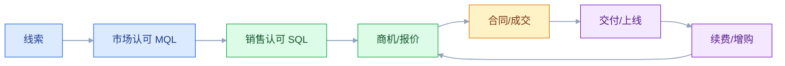

# CRM 与客户运营

## 一、工程案例：把“销售的个人 Excel”变成公司的客户资产

**场景**：一家 B2B 设备制造商，30 个销售，每月 2000 条线索，成交周期约 60 天。CRM 上线两年，实际只当通讯录用：线索在销售个人 Excel，商机阶段凭感觉填，报价用邮件，合同在 ERP，售后在客服系统。问题是：销售离职，客户跟着走；老板问下季度能签多少，每个销售报的数字都不一样；同一个客户在 CRM、ERP、售后有三套编码；市场部投了 50 万广告，说不清带来多少成交。

**目标**：不换 CRM，先把客户生命周期、销售流程、数据模型、集成和指标定清楚，交付：

- 一张客户生命周期与漏斗；
- 一套商机阶段与赢率规则；
- 一张客户 360 数据模型；
- 一张与 ERP、SCM、BI、客服的集成清单；
- 一套销售指标；
- 一份验收清单（8 项）。

**为什么必须做**：CRM 的价值不是“记客户电话”，而是“把客户交互变成可分析、可复用、可交接的公司资产”。没有统一阶段和数据口径，销售预测就是拍脑袋，客户交接就是重新开始。

**动手前确认**：先拉三样东西：最近 12 个月的线索来源与成交记录、销售阶段的实际停留时间、客户在 CRM/ERP/售后的编码对照。没有这三样，CRM 优化只能改界面。下面的企业数据是示例。

### 1.1 CRM 的边界

| CRM 管 | CRM 不管 |
|---|---|
| 线索、商机、报价、合同意向 | 财务应收、总账 |
| 客户联系人、交互记录 | 生产计划、库存 |
| 销售漏斗、预测 | 采购、供应链 |
| 售后服务、工单 | 车间执行 |
| 客户 360、分群 | 数据仓库建模 |

CRM 是“客户经营系统”，不是“订单履约系统”。合同签订后，订单和应收要落到 ERP；CRM 保留客户视角，不替代 ERP 的交易与账务。

### 1.2 客户生命周期

| 阶段 | 目标 | 关键动作 | 指标 |
|---|---|---|---|
| 线索 | 获取潜在客户 | 投放、活动、转介绍 | 线索量、获客成本 |
| MQL | 市场认可 | 内容、表单、评分 | MQL 转化率 |
| SQL | 销售认可 | 资格判断、需求确认 | SQL 转化率 |
| 商机 | 推进成交 | 方案、报价、谈判 | 赢率、周期 |
| 成交 | 签约 | 合同、付款条件 | 客单价、签约周期 |
| 交付 | 上线/交付 | 实施、培训 | 交付周期、满意度 |
| 续费/增购 | 留存与扩展 | 客户成功、增购 | 续费率、NRR |
| 流失 | 挽回/复盘 | 流失原因、召回 | 流失率 |

B2B 和 B2C 的 CRM 差异很大：

| 维度 | B2B | B2C |
|---|---|---|
| 客户 | 企业 + 联系人 | 个人 |
| 周期 | 长，多角色 | 短，冲动/复购 |
| 数据量 | 小，字段多 | 大，行为多 |
| 核心 | 商机、合同、关系 | 分群、自动化、复购 |
| 指标 | 赢率、客单价、续费 | 转化率、复购、LTV |

不要把 B2C 的“自动化营销”直接套到 B2B，也不要用 B2B 的“商机阶段”管 B2C。

### 1.3 商机阶段与赢率

阶段不是越多越好。B2B 常见 5～7 个阶段：

| 阶段 | 进入条件 | 赢率（示例） |
|---|---|---:|
| 初步接触 | 有明确需求和预算 | 10% |
| 需求确认 | 痛点、方案方向确认 | 25% |
| 方案报价 | 方案/报价已提交 | 50% |
| 商务谈判 | 进入合同/价格谈判 | 75% |
| 赢单 | 合同签订 | 100% |
| 输单 | 明确输单原因 | 0% |

赢率要按历史数据校准，不能拍脑袋。每个阶段要有“退出条件”，否则销售会把所有商机都放在“谈判中”。

### 1.4 客户 360

客户 360 不是“一个页面展示所有字段”，是“围绕客户的关键事实”：

| 维度 | 内容 | 来源 |
|---|---|---|
| 基本信息 | 名称、行业、规模、地区 | CRM |
| 联系人 | 角色、决策链、影响力 | CRM |
| 交互 | 电话、邮件、会议、工单 | CRM/客服 |
| 交易 | 合同、订单、回款 | ERP |
| 交付 | 项目、上线、验收 | 交付系统 |
| 服务 | 工单、投诉、满意度 | 客服 |
| 风险 | 逾期、流失预警 | CRM/BI |

客户 360 的前提是“统一客户 ID”。CRM、ERP、售后各自一套编码，360 就是拼图。

### 1.5 线索与评分

线索评分（Lead Scoring）用两个维度：

- ** fit**：客户匹配度（行业、规模、区域、预算）；
- ** intent**：购买意向（访问页面、下载资料、咨询、试用）。

| 评分 | 处理 |
|---|---|
| 高 fit + 高 intent | 直接转销售 |
| 高 fit + 低 intent | 市场培育 |
| 低 fit + 高 intent | 销售筛选 |
| 低 fit + 低 intent | 自动化培育/放弃 |

评分模型要定期校准：看“高分线索的成交率”是否真的高于低分。不校准的评分只是给销售添乱。

### 1.6 销售预测

预测不是“销售报个数”，要分层：

| 层级 | 方法 |
|---|---|
| 商机级 | 阶段赢率 × 金额 |
| 销售级 | 商机汇总 + 判断 |
| 区域级 | 汇总 + 历史偏差 |
| 公司级 | 区域汇总 + 市场/产能约束 |

预测准确率用“预测 vs 实际”的偏差衡量。连续偏差大的销售/区域，要复盘商机质量和阶段推进，而不是改预测数字。

### 1.7 与 ERP、SCM、BI、客服集成

| 集成点 | 上游 | 下游 | 内容 | 失败处理 |
|---|---|---|---|---|
| 客户主数据 | CRM | ERP/客服 | 客户、联系人、地址 | 冲突人工裁决 |
| 合同/订单 | CRM | ERP | 合同、订单需求 | 幂等键合同号 |
| 信用/应收 | ERP | CRM | 信用额度、回款 | 延迟可接受 |
| 库存/交期 | ERP/SCM | CRM | 可用量、承诺交期 | 缓存 + 降级 |
| 服务工单 | 客服 | CRM | 工单、投诉、满意度 | 延迟可接受 |
| 客户 360 | CRM/ERP/客服 | BI | 客户、交易、服务 | 日批量 |
| 营销自动化 | 营销平台 | CRM | 线索、行为 | 去重 + 评分 |

原则：**客户和商机以 CRM 为准，合同/订单/应收以 ERP 为准，服务工单以客服系统为准**。CRM 可以展示交易数据，但不直接改写 ERP。

### 1.8 指标

| 指标 | 公式/说明 |
|---|---|
| 线索转化率 | 成交数 / 线索数 |
| MQL→SQL 转化率 | SQL 数 / MQL 数 |
| 商机赢率 | 赢单数 / 关闭商机数 |
| 销售周期 | 成交时间 - 线索创建时间 |
| 客单价 | 合同金额 / 成交客户数 |
| CAC | 销售与市场费用 / 新增客户数 |
| LTV | 客户生命周期价值 |
| NRR | 净收入留存率 |
| 流失率 | 流失客户 / 期初客户 |

指标要能下钻到渠道、行业、区域、销售，否则无法指导行动。

### 1.9 数据质量

CRM 数据质量差是通病，根因通常不是“销售懒”，是“填了没用”：

- 字段太多，必填太多；
- 填了不影响任何流程；
- 没有校验和去重；
- 没有回报（看不到客户 360、拿不到支持）。

治理方法：

1. 必填字段最小化；
2. 关键字段自动带出（工商信息、地区、行业）；
3. 重复客户自动合并；
4. 数据质量纳入销售流程，但不搞“填错罚款”；
5. 让销售看到“填了能帮他成交”。

### 1.10 验收（8 项）

1. 客户唯一：CRM、ERP、客服三套客户编码映射率 100%，重复客户 ≤ 0.5%。
2. 商机阶段：阶段退出条件明确，随机抽 20 个商机，阶段与证据一致。
3. 预测：连续 3 个月，预测偏差 ≤ 20%，偏差有复盘。
4. 客户 360：任选一个客户，1 分钟内看到基本信息、联系人、交易、工单、回款。
5. 交接：销售离职，客户和商机 100% 留在公司，交接记录完整。
6. 线索：线索来源、评分、转化可追溯，市场费用能算到成交。
7. 集成：CRM 停 1 小时，订单/交付不受影响，恢复后补传。
8. 隐私：客户授权、退订、删除请求可执行，审计可查。

## 二、高频问答：会卡住你的地方，也是面试最常问的

### 2.1 CRM 就是客户通讯录

**现场**

要判断一套 CRM 是不是通讯录，先问三个问题：商机阶段怎么推进？预测怎么算？销售离职客户怎么交接？三个问题都答不上来，它就只是通讯录。

**要点**

- CRM 的核心是生命周期、商机推进、客户 360 和预测，通讯录只是最底层的基础数据。
- 客户信息只有进入流程，也就是有阶段、有证据、有预测，才会变成可分析、可复用、可交接的公司资产。
- 判断标准不是字段多少，而是能不能回答“这个客户到哪一步了、下季度能签多少、换个人还能不能接上”。

**追问**

- 通讯录和 CRM 差在哪一步？→ 差在流程和口径，不在字段数量。
- 字段越多越像 CRM 吗？→ 相反，字段太多销售越不想填，数据质量更差。
- 只做客户 360 不做流程算 CRM 吗？→ 只是分析型的一部分，缺商机推进和预测，仍不完整。

### 2.2 CRM 能管订单

**现场**

看订单最终写在哪：CRM 和 ERP 都能建单，就是双头管理；只有一处能建、另一处只读，边界才算清楚。

**要点**

- CRM 不该管订单履约，订单涉及库存、信用、生产、财务，这些能力都在 ERP。
- CRM 硬管订单的结果一定是两套订单，之后靠人工对账。
- 正确分工是客户和商机以 CRM 为准，合同、订单、应收以 ERP 为准，CRM 只展示不写回。

**追问**

- 合同签了在 CRM 里点一下下单不行吗？→ 那只是发起，真正的订单号和履约状态要由 ERP 生成。
- CRM 展示 ERP 订单会不会有延迟？→ 会，集成按延迟可接受来设计，不追求强一致。
- 客户 360 里的交易数据从哪来？→ ERP，按客户 ID 关联，只读。

### 2.3 销售漏斗就是几个阶段

**现场**

随机抽 20 个商机，逐个对阶段证据：需求确认有没有需求记录，方案报价有没有报价单，商务谈判有没有谈判记录。阶段和证据对不上，漏斗就是彩色看板。

**要点**

- 阶段要有进入条件、退出条件、证据和赢率，缺一样就退化成看板。
- 赢率要按历史成交数据校准，不能拍脑袋。
- 没有退出条件，销售会把所有商机都堆在“谈判中”，预测必然虚高。

**追问**

- 阶段是不是越多越好？→ 不是，B2B 常见 5～7 个，多了销售填不动。
- 赢率怎么校准？→ 按历史各阶段的实际成交比例反推。
- 阶段能不能让销售自己拖？→ 可以操作，但要有证据和评审约束。

### 2.4 客户去重靠人工

**现场**

抽查 100 个客户看重复率，超过 1% 就要做去重和主数据治理；再查 CRM、ERP、客服三套客户编码的映射率。

**要点**

- 客户重名是常态，靠销售人工判断必然漏，换个人标准又变。
- 没有统一客户 ID 和去重规则，客户 360、预测、提成都会算错。
- 去重要有规则，按名称、税号、地址、联系人匹配并自动合并，人工只处理模糊冲突。

**追问**

- 统一 ID 用自增主键行不行？→ 不行，跨系统要用稳定业务键，自增 ID 各系统对不上。
- 重复客户合并后历史单据怎么办？→ 挂到保留的主记录上，编码做映射保留可追溯。
- 三套编码映射率要求多少？→ 验收要求 100%，重复客户 ≤ 0.5%。

### 2.5 线索越多越好

**现场**

看三个数：MQL→SQL 转化率、单条线索成本、单客获取成本。只看线索量会自欺。

**要点**

- 低质量线索消耗销售时间，拉低整体转化率，数量上去成交不一定上去。
- 该看的是有效线索和成交成本，不是线索总量。
- 线索评分用 fit 匹配度和 intent 意向两个维度，高 fit 高 intent 才直接转销售。

**追问**

- 线索评分怎么证明有效？→ 看高分线索的成交率是否真的高于低分，不达标就重新校准。
- 市场部只考核线索量会怎样？→ 会刷量，MQL→SQL 转化率崩塌。
- 低 fit 高 intent 怎么处理？→ 交销售筛选，不直接进漏斗。

### 2.6 客户画像就是打标签

**现场**

拿一个标签问：它对应什么动作，分层、定价、触达还是服务策略？没有动作的标签就是装饰。

**要点**

- 画像的价值在指导动作，不在标签数量。
- 分群要能落地：高价值客户配客户成功，流失预警客户去触达，低价值客户走自助。
- 标签墙的问题是没人维护也没人用，半年后全是过期数据。

**追问**

- 分群常用哪些维度？→ RFM、价值分层、行业、生命周期、健康度。
- 健康度和画像是什么关系？→ 健康度是用于续费预警的画像，必须能触发动作。
- 标签要不要人工维护？→ 能自动带出的就别让人填。

### 2.7 CRM 上线销售就会用

**现场**

看三个数：周活、商机更新率、关键字段完整率。低于 50% 就是没用起来。

**要点**

- 销售不用通常不是不会，而是“填了没用、麻烦、被监控”。
- 培训解决的是不会，不解决不愿；没有价值回报，培训再多也没用。
- 治理方向是减少必填、关键字段自动带出、让销售看到填了能帮他成交。

**追问**

- 字段完整率低就罚钱行不行？→ 不搞填错罚款，会催生假数据。
- 怎么让销售愿意填？→ 填了能拿到客户 360、支持和提成依据。
- 上线多久能判断成败？→ 看周活和商机更新率的趋势，不看上线当天的登录数。

### 2.8 客户数据是销售的个人资产

**现场**

看离职交接流程：客户、商机、合同、沟通记录、待办是否完整留下。只交客户名单不交上下文，接手的人等于重新开发。

**要点**

- 客户关系可以个人维护，客户数据必须是公司资产。
- 数据留在个人手里，销售一离职客户就跟着走，公司没有任何抓手。
- 交接要一次交全，客户、商机、合同、沟通记录、待办缺一不可。

**追问**

- 强制上交会不会让销售抵触？→ 会，所以要先让 CRM 对销售有用，再谈归属。
- 交接记录要包含什么？→ 上下文，不只是名单。
- 验收怎么定？→ 销售离职后客户和商机 100% 留在公司，交接记录完整。

### 2.9 售后就是客服

**现场**

看客户 360 里有没有服务工单和满意度；没有就是生命周期的断点。

**要点**

- 售后是客户生命周期的一段，工单、投诉、满意度直接影响续费和增购。
- 客服系统是工单的权威源，CRM 只做客户视角的汇总展示。
- 断了这一段，续费就只能靠到期提醒，属于被动等待。

**追问**

- CRM 和客服系统谁为准？→ 服务工单以客服系统为准。
- 工单数据进 CRM 做什么？→ 支撑客户 360、健康度和续费预警。
- 满意度低要紧吗？→ 它是流失和续费风险的先行指标。

### 2.10 续费是客服的事

**现场**

看续费率、NRR、客户健康度三项。没有客户成功动作，续费就是被动等客户决定。

**要点**

- 续费依赖客户成功、价值证明和增购机会，不是到期提醒。
- 只靠客服到期提醒，续费率一定低。
- 客户成功是主动经营客户价值，客服是被动解决问题。

**追问**

- NRR 高是不是就没问题？→ 不一定，增购可能掩盖了流失。
- 客户成功看什么指标？→ 活跃度、健康度、续费、NRR。
- 续费该谁负责？→ 客户成功主导，销售负责增购。

## 三、核心知识

### 3.1 CRM 的定位

CRM（Customer Relationship Management）管理客户从线索到忠诚的全生命周期，核心是“客户数据 + 销售流程 + 服务协同”。

三个层次：

| 层次 | 内容 |
|---|---|
| 操作型 | 线索、商机、合同、工单 |
| 分析型 | 客户分群、预测、流失 |
| 协同型 | 市场、销售、服务、渠道 |

### 3.2 客户数据模型

| 对象 | 关键字段 | 关系 |
|---|---|---|
| 客户/账户 | 客户 ID、名称、行业、规模、地区 | 一个客户多个联系人 |
| 联系人 | 姓名、职位、角色、影响力 | 属于客户 |
| 线索 | 来源、评分、状态 | 可转客户/商机 |
| 商机 | 阶段、金额、赢率、预计成交日 | 属于客户 |
| 报价 | 版本、价格、折扣、有效期 | 属于商机 |
| 合同 | 合同号、金额、付款条件 | 关联订单 |
| 工单 | 类型、优先级、SLA、满意度 | 属于客户 |

客户 ID 是全链路主键。CRM、ERP、客服、BI 都用它，才能做 360。

> **面试**：常问「为什么客户 ID 是全链路主键？」答：CRM、ERP、客服、BI 都靠它关联，没有统一 ID 就只能人工拼 360。

### 3.3 销售流程

| 阶段 | 关键动作 | 输出 |
|---|---|---|
| 线索获取 | 投放、活动、转介绍 | 线索 |
| 资格判断 | 需求、预算、决策链、时间 | SQL |
| 需求确认 | 痛点、方案方向 | 需求文档 |
| 方案报价 | 方案、报价、评审 | 报价单 |
| 商务谈判 | 价格、合同条款 | 合同草稿 |
| 成交 | 签约、付款条件 | 合同 |
| 交付 | 实施、验收 | 验收单 |
| 续费 | 客户成功、增购 | 续费合同 |

阶段不是“销售自己填”，要有证据和评审。

### 3.4 客户分群

| 方法 | 维度 | 用途 |
|---|---|---|
| RFM | 最近购买、频率、金额 | 复购、流失 |
| 价值分层 | 高/中/低价值 | 资源分配 |
| 行业 | 行业、规模 | 方案、案例 |
| 生命周期 | 新客、成长期、成熟、流失 | 运营策略 |
| 健康度 | 使用、工单、满意度 | 续费预警 |

分群要能落到动作：高价值客户配客户成功，流失预警客户触达，低价值客户自助。

### 3.5 销售预测

预测的三种方法：

| 方法 | 说明 |
|---|---|
| 商机加权 | 金额 × 阶段赢率 |
| 历史趋势 | 同期、增长率 |
| 销售判断 | 销售主观修正 |

最好的做法是“加权 + 判断 + 偏差复盘”。只让销售报数，预测会变成政治数字。

### 3.6 客户 360

客户 360 的数据来源：

- CRM：客户、联系人、商机、交互；
- ERP：合同、订单、回款、信用；
- 客服：工单、投诉、满意度；
- 交付：项目、上线、验收；
- BI：分群、流失预警。

360 的难点不是技术，是“客户 ID 统一”和“数据权限”。没有统一 ID，只能人工拼；没有权限，销售能看到不该看的数据。

> **面试**：常问「客户 360 难在哪？」答：技术不难，难在统一客户 ID 和数据权限。

### 3.7 服务与客户成功

| 阶段 | 目标 | 指标 |
|---|---|---|
| 售后支持 | 解决问题 | 首次响应、解决时长、满意度 |
| 客户成功 | 让客户用好 | 活跃度、健康度、续费 |
| 增购 | 扩大价值 | 增购率、NRR |
| 流失挽回 | 降低流失 | 流失率、召回率 |

客户成功不是“客服升级版”，是“主动经营客户价值”。只等客户投诉，续费一定被动。

### 3.8 集成

| 系统 | 关系 |
|---|---|
| ERP | 合同、订单、应收、信用 |
| SCM | 库存、交期 |
| 客服 | 工单、投诉 |
| 营销自动化 | 线索、行为 |
| BI | 客户分析、预测 |
| OA | 合同审批、折扣审批 |

CRM 是“客户视角”，ERP 是“交易视角”。两者通过客户 ID、合同号、订单号关联，不共享写权限。

> **面试**：常问「CRM 和 ERP 的写权限怎么划？」答：按事实归属划，客户和商机 CRM 写，合同、订单、应收 ERP 写，两边只读关联。

### 3.9 指标

| 指标 | 说明 |
|---|---|
| 线索转化率 | 成交 / 线索 |
| MQL/SQL 转化 | 各阶段转化 |
| 赢率 | 赢单 / 关闭商机 |
| 销售周期 | 从线索到成交 |
| CAC | 获客成本 |
| LTV | 客户终身价值 |
| CAC 回收期 | CAC / 月毛利 |
| NRR | 净收入留存 |
| 流失率 | 客户/收入流失 |

指标要避免“虚荣指标”：线索数、页面访问、活动人数，不等于收入。

### 3.10 数据隐私

| 要求 | 动作 |
|---|---|
| 授权 | 收集前告知、同意 |
| 最小化 | 只收集必要字段 |
| 用途限制 | 不超范围使用 |
| 删除 | 支持删除/匿名化 |
| 审计 | 谁在何时访问/导出 |
| 跨境 | 遵守数据出境规定 |

客户数据是资产，也是责任。销售为了方便导出 Excel，可能造成泄露；权限和审计要跟上。

## 四、冷门知识汇总

- **RFM 模型**：Recency（最近购买）、Frequency（频率）、Monetary（金额）。它比“客户价值”这种模糊概念更容易落地。
- **CAC 回收期**：`CAC / 月毛利`，衡量获客成本多久能收回。SaaS 常用 12 个月以内作为健康参考，但不是绝对标准。
- **LTV/CAC**：客户终身价值与获客成本之比。大于 3 常被视为健康，但不同行业差异很大，不能生搬。
- **NRR/GRR**：净收入留存率、毛收入留存率。NRR 包含增购，GRR 不包含；NRR 高不代表客户不流失，可能只是增购掩盖了流失。
- **销售速度（Sales Velocity）**：`商机数 × 赢率 × 客单价 / 销售周期`。它把“多、赢、大、快”放在一个公式里，比单看赢率更全面。
- **管道覆盖（Pipeline Coverage）**：`管道金额 / 目标金额`。常见参考 3～4 倍，但取决于赢率和周期。
- **归因模型**：首次触点、末次触点、线性、时间衰减、数据驱动。归因决定市场预算怎么分，没有绝对正确，只有“适合当前决策”。
- **队列分析（Cohort）**：按获客月份分组看留存/收入，能区分“整体增长”与“新客质量下降”。
- **客户健康度（Health Score）**：用使用频率、工单、满意度、付款、续费意愿等加权。它是续费预警，不是装饰分数。
- **流失定义的差异**：logo churn（客户数）、revenue churn（收入）、gross/net churn（是否含增购）。不同定义会得出不同结论，报表必须标注口径。
- **“单一客户视图”是目标**：大多数企业有多个客户源，CRM 只是其中一个。统一 ID + 主数据治理，比买一个“360 平台”更重要。
- **CRM 不是数据库**：CRM 的价值在流程和行动，不在字段数量。字段越多，销售越不想填。
- **线索评分不是越复杂越好**：可解释、可校准的简单模型，比黑盒模型更容易被销售接受。
- **客户成功与客服的区别**：客服是“被动解决问题”，客户成功是“主动帮助客户达成目标”。前者看工单，后者看续费和价值。
- **隐私合规**：中国《个人信息保护法》、欧盟 GDPR 都强调告知、同意、最小化、删除权。CRM 的字段设计和导出权限要提前考虑。
- **销售离职交接**：客户、商机、合同、沟通记录、待办要一次性交接；只交客户名单，不交上下文，接手的人等于重新开发。
- **B2B 决策链**：使用者、技术评估者、采购、财务、决策者，角色不同，CRM 要记录“谁影响谁”，不能只存一个联系人。