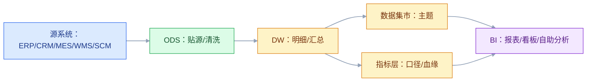

# BI 与数据平台

## 一、工程案例：把“五个部门五个数字”变成一套可解释的指标

**场景**：一家制造企业有 ERP、CRM、MES、WMS、SCM 五套业务系统。老板每周开会，销售说本月收入 8000 万，财务说 7600 万，运营说出货 8200 万；同一个“库存周转天数”，财务、供应链、仓库算出来三个数。BI 工具买了两套，报表 300 张，业务还是用 Excel。问题是：指标口径没有 owner，数据同步靠手工导出，报表慢了就换引擎，数据质量没人管。

**目标**：不追求“大而全的数据中台”，先交付一套能解释、能对账、能复用的指标与数据平台：

- 一张数据架构分层图；
- 一套指标口径字典；
- 一张数据质量规则；
- 一张权限与安全清单；
- 一套报表/看板分层；
- 一份验收清单（8 项）。

**为什么必须做**：BI 的价值不是“把数据画成图”，而是“让同一个问题在不同部门得到同一个答案，并且能追溯到源系统”。没有指标治理，BI 只是把口径冲突可视化。

**动手前确认**：先拉三样东西：现有报表清单、指标口径争议记录、源系统数据字典。没有这三样，建数仓只会把混乱复制一遍。下面的企业数据是示例。

### 1.1 BI 与数据平台的边界

| 层 | 负责 | 不负责 |
|---|---|---|
| 源系统 | 交易录入、业务规则 | 跨系统分析 |
| ODS | 贴源、清洗、去重 | 业务指标定义 |
| 数仓/湖 | 集成、建模、历史 | 业务决策 |
| 指标层 | 口径、计算、血缘 | 交易写入 |
| BI | 展示、交互、预警 | 数据生产 |
| 数据治理 | 标准、质量、权限 | 业务运营 |

BI 是“消费端”，不是“生产端”。把 BI 当数据生产工具，最后会出现“报表里的数改不了、源系统的数对不上”。

### 1.2 数据架构分层

| 层 | 内容 | 保留周期 |
|---|---|---|
| ODS | 贴源数据、增量/全量 | 30～90 天 |
| DWD | 明细事实、维度 | 1～3 年 |
| DWS | 汇总宽表 | 3～5 年 |
| ADS | 应用数据集市 | 按需 |
| 指标层 | 指标定义、计算逻辑 | 长期 |

分层不是越多越好。小团队用“ODS + DWD + ADS”三层就够；大企业才需要 DWS 和指标层独立。

### 1.3 指标体系

指标要分层：

| 层级 | 例子 | 负责人 |
|---|---|---|
| 北极星 | 收入、毛利、现金流 | 管理层 |
| 一级指标 | 订单量、客单价、交付周期 | 业务负责人 |
| 二级指标 | 线索转化率、库存周转、OEE | 部门 |
| 操作指标 | 报工及时率、拣货效率 | 班组 |

每个指标必须有：

- 业务定义；
- 计算公式；
- 数据来源；
- 统计粒度；
- 时间口径；
- owner；
- 版本。

没有 owner 的指标，口径一定会变。

### 1.4 指标口径字典

| 字段 | 示例 |
|---|---|
| 指标名 | 月度收入 |
| 业务定义 | 已开票、已确认的销售收入 |
| 公式 | Σ 发票金额（不含税） |
| 来源 | ERP 发票表 |
| 粒度 | 公司/事业部/产品 |
| 时间 | 自然月，按开票日期 |
| 排除 | 退货、作废、内部交易 |
| Owner | 财务 BP |
| 版本 | v1.2，2026-10-01 生效 |

口径字典要进版本库，和报表一起评审。只写在 PPT 里的口径，三个月就会失传。

### 1.5 数据建模

| 模型 | 适合 | 特点 |
|---|---|---|
| 星型模型 | BI 分析 | 事实表 + 维度表，简单快 |
| 雪花模型 | 维度复杂 | 维度规范化，查询多 join |
| 宽表 | 固定报表 | 查询快，灵活性差 |
| Data Vault | 企业级、频繁变化 | 可审计、可扩展，复杂 |
|  lakehouse | 半结构化 + 分析 | 统一批流、开放格式 |

小团队优先星型模型 + 宽表，不要一上来 Data Vault。模型是为查询和治理服务，不是为“先进”服务。

### 1.6 ETL/ELT 与 CDC

| 方式 | 适合 | 注意 |
|---|---|---|
| 批量抽取 | 日/小时级 | 窗口、幂等、补数 |
| CDC | 准实时 | schema 变更、顺序、删除 |
| API | 小数据量、SaaS | 限流、分页、增量 |
| 文件 | 财务、外部 | 格式、校验、对账 |
| 消息 | 事件驱动 | 重复、乱序、积压 |

原则：**能批量不实时，能 CDC 不双写，能标准接口不自定义**。实时链路要有幂等、重试、死信、对账。

### 1.7 数据质量

| 维度 | 规则 | 例子 |
|---|---|---|
| 完整性 | 必填不为空 | 订单客户 ID 非空 |
| 唯一性 | 主键不重复 | 订单号唯一 |
| 有效性 | 枚举/格式/范围 | 状态在枚举内 |
| 一致性 | 跨表/跨系统一致 | 订单金额 = 明细汇总 |
| 及时性 | 在 SLA 内到达 | 每日 8 点前完成 |
| 准确性 | 与源/实物一致 | 库存对账 |

质量规则要进调度：每天跑、失败告警、趋势看板。数据质量不是“上线前清洗一次”，是持续运营。

### 1.8 权限与安全

| 维度 | 要求 |
|---|---|
| 认证 | SSO、MFA |
| 授权 | 按角色/部门/数据域 |
| 行级权限 | 只能看本区域/本部门 |
| 列级权限 | 手机、身份证、薪资脱敏 |
| 审计 | 谁查了什么、导出了什么 |
| 脱敏 | 静态/动态脱敏 |
| 合规 | 个人信息、跨境数据 |

BI 的权限比业务系统更敏感：一个看板可能汇总全公司数据，权限配错就是泄露。

### 1.9 报表与自助分析

| 类型 | 用户 | 特点 |
|---|---|---|
| 固定报表 | 管理层、财务 | 口径固定、定时推送 |
| 看板 | 业务监控 | 实时/准实时、告警 |
| 自助分析 | 分析师 | 灵活、需要治理 |
| 探索式 | 数据科学 | 大宽表、SQL/Notebook |

报表要分层，不要 300 张平铺。按“主题域 + 角色 + 频率”组织，定期清理僵尸报表。

### 1.10 验收（8 项）

1. 指标：核心 20 个指标有口径字典、owner、版本，跨部门认可。
2. 对账：收入、库存、订单三个核心指标与源系统差异 ≤ 0.1%。
3. 及时性：核心报表每日 8 点前完成，延迟有告警。
4. 质量：核心表 6 类质量规则每日跑，异常当日处理。
5. 血缘：任一指标能追到源表、字段、计算逻辑。
6. 权限：行级/列级权限抽查 20 个用户，无越权。
7. 使用：核心看板周活 ≥ 80%，僵尸报表清理 ≥ 30%。
8. 成本：查询成本、存储成本有监控，季度优化。

## 二、高频问答：会卡住你的地方，也是面试最常问的

### 2.1 BI 就是报表

**现场**

问三个问题：指标谁定义？口径怎么对？异常怎么预警？三个问题没答案，它就是报表工具。

**要点**

- BI 包含报表、OLAP、看板、自助分析、预警和数据挖掘，核心是“指标 + 口径 + 决策”。
- 报表只是 BI 的一种消费形态，把 BI 当报表就把治理和决策的部分丢了。
- BI 不产生交易数据，它的价值等于数据可信 × 口径一致 × 行动闭环。

**追问**

- BI 和报表工具的区别在哪？→ 有没有指标口径和治理，不在图表多少。
- BI 要做数据生产吗？→ 不做，它是消费端。
- 看板多就说明 BI 成熟吗？→ 不是，看板疲劳比没有看板更糟。

### 2.2 数据中台就是买套软件

**现场**

问四件事：指标 owner 是谁？主数据统一了吗？数据质量谁负责？冲突谁裁决？答不上来就是买了个工具。

**要点**

- 中台是“数据 + 标准 + 组织 + 流程”，软件只是载体。
- 没有治理，中台只是又一个孤岛，而且是更贵的孤岛。
- 买软件不改变口径归属，也不自动产生 owner。

**追问**

- 中台能解决口径冲突吗？→ 不能，口径要有 owner 和评审机制。
- 没有中台能不能做好 BI？→ 能，先把指标和口径做起来。
- 中台项目失败通常因为什么？→ 组织没配套，只建了平台。

### 2.3 指标口径不重要

**现场**

查同一个指标有没有多个版本；有，就是口径没治理。

**要点**

- 口径不统一，报表越多会议越吵。
- 后改口径，历史数据全部不可比。
- 口径要写成字典进版本库，带 owner 和版本，和报表一起评审。

**追问**

- 口径写在哪？→ 指标字典，进版本库，和报表一起评审。
- 只写在 PPT 里会怎样？→ 三个月就失传。
- 口径变了历史报表怎么办？→ 版本化并标注生效日期，别直接改旧数。

### 2.4 数仓建模就是建表

**现场**

问三件事：事实和维度怎么分？历史怎么留？指标怎么算？答不上来就是搬表。

**要点**

- 数仓要解决集成、历史、口径、性能，只搬表会得到一堆难以维护的宽表。
- 模型是为查询和治理服务的，不是为“先进”服务的。
- 小团队优先星型模型加宽表，不要一上来就 Data Vault。

**追问**

- 星型和雪花怎么选？→ 分析优先星型，维度复杂才用雪花。
- 什么时候用 Data Vault？→ 企业级、频繁变化、要可审计，小团队别上。
- 宽表的代价是什么？→ 查询快，但灵活性差。

### 2.5 实时数仓一定比离线好

**现场**

问一句：延迟 1 小时会损失什么？答不上来就用离线或微批。

**要点**

- 实时链路成本和复杂度都高，要处理重复、乱序、积压和对账。
- 很多决策按天或按小时就够，离线更稳更便宜。
- 原则是能批量不实时，实时只留给延迟直接造成损失的场景。

**追问**

- 实时贵在哪？→ 组件多，幂等、重试、死信、对账、运维都要额外做。
- 什么场景必须实时？→ 监控告警、风控这类延迟即损失的。
- 微批算什么？→ 折中方案，延迟分钟级，复杂度低于纯流。

### 2.6 数据越多越好

**现场**

拿一张表问：谁用？用在哪个指标？没人用就是成本。

**要点**

- 无治理的数据会变成数据沼泽，存储、质量、权限、成本一起失控。
- 保留周期要按层定，不是所有数据都永久存。
- 湖仓也不免治理，开放格式不等于自动可用。

**追问**

- 数据沼泽怎么来的？→ 只进不出，没有 owner 和口径。
- 保留周期怎么定？→ 按层，ODS 30～90 天，DWD 1～3 年。
- 冷数据怎么办？→ 归档，别和热数据放同一个成本池。

### 2.7 报表慢就换引擎

**现场**

先看执行计划、扫描量、分区和数据倾斜，再谈换引擎。

**要点**

- 慢的原因多在模型、分区、数据倾斜、查询写法和并发，换引擎往往不解决。
- 先优化模型和 SQL，换引擎是最后手段，还要付迁移和验证成本。
- 判断依据是执行计划和扫描量，不是体感。

**追问**

- 扫描量大怎么优化？→ 分区、列存、裁剪。
- join 慢呢？→ 宽表、预聚合、广播。
- 数据倾斜呢？→ 打散 key、两阶段聚合。

### 2.8 数据质量是数据团队的事

**现场**

追质量问题的根因：是源系统必填、流程还是权限。只改数仓就是治标。

**要点**

- 数据质量源头在业务系统，业务录入不规范，数据团队只能在下游擦屁股。
- 质量治理要走到根因分析和修复源系统，只做规则和告警问题会重复。
- 质量规则要进调度，每天跑、失败告警、看趋势。

**追问**

- 六个质量维度是什么？→ 完整性、唯一性、有效性、一致性、及时性、准确性。
- 只做定义、调度、告警会怎样？→ 问题照样复发，闭环缺了后三步。
- 质量规则放在哪跑？→ 调度里，和 ETL 一起。

### 2.9 上云就解决数据问题

**现场**

问三句：上云后口径统一了吗？质量提升了吗？成本可控吗？

**要点**

- 云解决基础设施，不解决指标、质量和权限。
- 上云后成本可能更高，弹性不等于省钱。
- 云不替代数仓建模和治理，只是换了机房。

**追问**

- 上云成本反而高的原因？→ 存算不分离、查询不控、历史数据全量留。
- 云上怎么控成本？→ 存储分层、查询配额、季度优化。
- 上云能替代数仓建模吗？→ 不能，云只是基础设施。

### 2.10 AI 能自动分析

**现场**

问：AI 用的是哪个指标口径？结果能追溯吗？答不上来就是演示。

**要点**

- AI 依赖语义层、指标口径和数据质量。
- 底层数据不可信，AI 只会更快地给出错误答案。
- 自然语言查询和自动洞察不是绕过治理的捷径。

**追问**

- AI BI 的前提是什么？→ 语义层加可信数据。
- 为什么演示好上线差？→ 演示用干净数据，生产数据没治理。
- 分析师会被替代吗？→ 取数会被替代，定义指标和解释原因不会。

## 三、核心知识

### 3.1 BI 的定位

BI（Business Intelligence）是“用数据支持决策”的方法、工具和流程，包含报表、OLAP、看板、自助分析、预警、数据挖掘。

它不产生交易数据，只消费数据。BI 的价值 = 数据可信 × 口径一致 × 行动闭环。

### 3.2 数据平台分层

| 层 | 作用 |
|---|---|
| 数据源 | 业务系统、日志、外部数据 |
| 集成 | 抽取、CDC、消息、文件 |
| ODS | 贴源、清洗、去重 |
| 数仓/湖 | 明细、汇总、历史 |
| 指标/语义层 | 口径、计算、血缘 |
| BI/应用 | 报表、看板、自助、预警 |
| 治理 | 标准、质量、权限、成本 |

### 3.3 维度建模

| 概念 | 说明 |
|---|---|
| 事实表 | 业务度量，如订单金额、数量 |
| 维度表 | 分析角度，如时间、产品、客户 |
| 星型 | 事实 + 维度，简单 |
| 雪花 | 维度再规范化，复杂 |
| 缓慢变化维 | SCD1 覆盖、SCD2 加版本、SCD3 加列 |

事实表三种类型：

- 事务事实：每笔业务一行；
- 周期快照：每天/每月一行；
- 累积快照：流程多个阶段一行。

> **面试**：常问「事实表有哪几种，累积快照适合什么？」答：事务、周期快照、累积快照，累积快照适合订单履约这类多阶段流程。

### 3.4 指标体系

指标分层：北极星 → 一级 → 二级 → 操作。

指标要素：名称、定义、公式、来源、粒度、时间、排除项、owner、版本。

指标关系：派生、复合、比率、同比/环比。指标不能孤立看，要能拆解。

### 3.5 数据质量

六个维度：完整性、唯一性、有效性、一致性、及时性、准确性。

质量治理闭环：

1. 定义规则；
2. 调度检查；
3. 异常告警；
4. 根因分析；
5. 修复源系统；
6. 回归验证。

只做 1～3，不做 4～6，质量问题会重复。

> **面试**：常问「数据质量治理最容易漏哪一步？」答：漏在根因分析和修复源系统，只做规则、调度、告警，问题会反复出现。

### 3.6 数据治理

| 领域 | 内容 |
|---|---|
| 标准 | 命名、编码、指标、口径 |
| 质量 | 规则、监控、整改 |
| 安全 | 分类分级、权限、脱敏、审计 |
| 血缘 | 表/字段/指标链路 |
| 生命周期 | 保留、归档、删除 |
| 成本 | 存储、计算、查询 |

治理要有 owner 和流程，不是“数据团队一个人扛”。

### 3.7 数据安全

| 级别 | 数据 | 措施 |
|---|---|---|
| 公开 | 产品目录 | 无 |
| 内部 | 订单、库存 | 登录 + 部门权限 |
| 敏感 | 客户、价格 | 行级/列级权限、脱敏 |
| 高敏 | 身份证、银行、薪资 | 加密、审计、最小权限 |

权限要“默认拒绝”，不是“默认开放再收”。

### 3.8 BI 工具选型

| 类型 | 适合 |
|---|---|
| 固定报表 | 财务、监管 |
| 敏捷 BI | 业务自助 |
| OLAP | 多维分析 |
| Notebook | 数据科学 |
| 大屏 | 监控中心 |

选型看：数据源、权限、性能、移动端、嵌入、成本、运维。不要只看图表漂亮。

### 3.9 性能优化

| 问题 | 优化 |
|---|---|
| 扫描量大 | 分区、列存、裁剪 |
| join 慢 | 宽表、预聚合、广播 |
| 数据倾斜 | 打散 key、两阶段聚合 |
| 并发高 | 缓存、物化视图、队列 |
| 查询复杂 | 语义层、限制、引导 |

先看执行计划和扫描量，再谈换引擎。

> **面试**：常问「报表慢是不是该换引擎？」答：先看执行计划、扫描量、分区和倾斜，多数慢在模型和 SQL，换引擎往往不解决。

### 3.10 数据文化

BI 成功不只靠技术，还靠：

- 管理层用数据决策；
- 指标有 owner；
- 报表能行动；
- 数据问题能反馈；
- 不惩罚“报坏消息”。

如果报表只用于考核、不用于改进，数据质量永远上不去。

## 四、冷门知识汇总

- **Kimball 与 Inmon**：Kimball 主张自下而上、维度建模、数据集市；Inmon 主张自上而下、企业级数仓、规范化。现代实践多是混合。
- **Data Vault 2.0**：Hub（业务键）、Link（关系）、Satellite（属性）三层，强调可审计、可扩展、并行加载。适合大型、频繁变化的企业数仓。
- **Lakehouse**：湖仓一体，用开放表格式（Delta Lake、Iceberg、Hudi）在数据湖上提供事务、schema 演进、时间旅行。
- **OLAP 与 OLTP**：OLTP 面向交易，行存、短事务；OLAP 面向分析，列存、大扫描。不要用 OLTP 库跑大报表。
- **MPP**：大规模并行处理，把查询拆到多节点。适合大宽表聚合，不适合高并发小查询。
- **SCD（缓慢变化维）**：SCD1 覆盖、SCD2 加版本行、SCD3 加历史列。客户地址、产品分类常用 SCD2。
- **事实表类型**：事务事实、周期快照、累积快照。累积快照适合订单履约这类多阶段流程。
- **数据血缘（Lineage）**：表/字段/指标之间的依赖关系。没有血缘，改一个字段不知道会影响哪些报表。
- **数据契约（Data Contract）**：源系统对下游承诺 schema、语义、质量、SLA。它比“数据字典”更有约束力。
- **Data Mesh**：按业务域组织数据产品，强调 domain ownership、data as a product、self-serve platform、federated governance。适合大组织，不是万能药。
- **语义层/指标层**：把指标定义从报表 SQL 中抽出来，统一计算和权限。它是“口径一致”的技术抓手。
- **报表蔓延（Report Sprawl）**：报表数量失控、重复建设、无人维护。治理方法是按主题域归并、定期清理、指标复用。
- **看板疲劳（Dashboard Fatigue）**：看板太多，没人看。解决方法是“少而关键 + 异常预警 + 行动闭环”。
- **Goodhart 定律**：指标一旦成为考核目标，就会被操纵。BI 要同时看过程和结果，避免单指标驱动。
- **数据沼泽（Data Swamp）**：数据湖没有治理，变成“什么都有、什么都找不到”。湖仓不是免治理。
- **“单一事实来源”是目标**：大多数企业有多个源，关键是明确权威源、口径、冲突裁决，不是假装只有一个。
- **AI 与 BI**：自然语言查询、自动洞察、异常检测都依赖语义层和数据质量。没有治理的 AI BI，只会更快地产生错误结论。