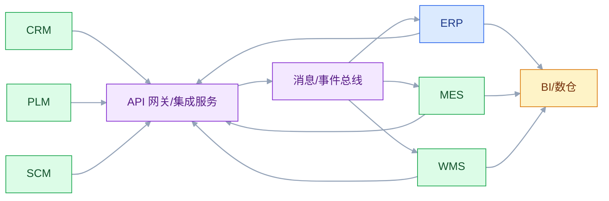

# 企业集成与主数据

## 一、工程案例：把 12 个集成点从“能调通”做成“能对账”

**场景**：一家制造企业有 ERP、CRM、PLM、MES、WMS、SCM、BI、OA 八套系统。集成方式是历史遗留的点对点接口：有的走 HTTP，有的走定时文件，有的直接连数据库。现在的问题：物料在 PLM、ERP、MES 有三套编码；客户在 CRM 和 ERP 各建一套；WMS 出库后 ERP 库存偶尔不扣；PLM 变更了 BOM，MES 还在按旧版生产；接口报错没人知道，等业务投诉才发现。

**目标**：不重写所有系统，先把集成架构和主数据治理起来，交付：

- 一张集成拓扑图；
- 一张主数据归属与分发规则；
- 一套接口契约规范；
- 一张失败矩阵与重试/死信策略；
- 一套对账规则；
- 一份切换与回滚方案；
- 一份验收清单（8 项）。

**为什么必须做**：集成的难点不是“把数据传过去”，而是“传过去之后，双方对同一个事实的理解一致，且失败可发现、可补偿”。只写接口不做治理，系统越多，人工对账越多。

**动手前确认**：先盘点现有接口：谁调谁、传什么、频率、失败怎么处理、有没有对账。没有清单，先补清单，不要先选中间件。下面的企业数据是示例。



### 1.1 先盘点，再选型

| 集成点 | 现有方式 | 频率 | 数据量 | 失败处理 | 对账 |
|---|---|---|---|---|---|
| CRM → ERP 订单 | HTTP 同步 | 实时 | 小 | 无重试 | 无 |
| PLM → ERP 物料 | 定时文件 | 每日 | 中 | 人工重导 | 无 |
| PLM → MES BOM | 直连数据库 | 实时 | 小 | 无 | 无 |
| ERP → MES 工单 | HTTP 同步 | 实时 | 小 | 手工补发 | 无 |
| MES → ERP 报工 | 定时文件 | 每小时 | 中 | 人工核对 | 有 |
| ERP → WMS 出入库 | HTTP 同步 | 实时 | 小 | 无重试 | 无 |
| WMS → ERP 库存 | 直连数据库 | 实时 | 大 | 无 | 月度 |
| MES → WMS 领料 | HTTP 同步 | 实时 | 小 | 无 | 无 |
| ERP/SCM → BI | 定时抽取 | 每日 | 大 | 重跑 | 有 |
| MES/SCADA → BI | 定时抽取 | 每小时 | 大 | 重跑 | 部分 |

盘点会暴露三个问题：同步调用没有重试、直连数据库没有契约、大部分集成点没有对账。先解决这三类，再谈“中台”“总线”。

### 1.2 集成拓扑

推荐“薄网关 + 消息 + 批量”的组合，而不是所有流量都走 ESB：

| 场景 | 方式 | 理由 |
|---|---|---|
| 主数据分发 | API + 消息 | 变更少、要求可靠、下游多 |
| 订单/工单 | API + outbox | 实时、需要幂等和可追踪 |
| 库存变动 | 消息 + 日对账 | 高频、允许短暂延迟 |
| 财务/BI | 批量文件/CDC | 数据量大、允许延迟 |
| 遗留系统 | 文件/数据库视图 + 防腐层 | 改造成本低，先隔离 |
| 跨企业 | EDI/API | 标准格式、合作方约定 |

ESB 不是不能用，而是不要把 ESB 当成“所有逻辑都写进去”的地方。总线负责路由、转换、监控；业务规则留在系统里。

### 1.3 主数据归属

| 主数据 | 权威源 | 分发方式 | 下游只读 | 冲突裁决 |
|---|---|---|---|---|
| 物料 | ERP | API + 消息 | PLM、MES、WMS | 以 ERP 编码为准，PLM 设计编码做映射 |
| 客户 | CRM | API + 消息 | ERP、BI | 商业客户以 CRM 为准，财务信用以 ERP 为准 |
| 供应商 | SCM/SRM | API + 消息 | ERP、BI | 以 SCM 为准，银行账号由财务复核 |
| 设计 BOM | PLM | API + 消息 | ERP、MES | 版本号大者为准，变更单驱动 |
| 制造 BOM | ERP | API + 消息 | MES | 以 ERP 生效版本为准 |
| 工艺路线 | PLM/ERP | API + 消息 | MES | 工艺 owner 裁决 |
| 组织/人员 | OA/HR | API + 消息 | 所有系统 | 以 HR 为准，OA 做权限映射 |
| 科目 | ERP | 批量 | BI、预算 | 以财务科目表为准 |

主数据不是“同步一次就完事”，要定义：

- 谁创建、谁修改、谁停用；
- 变更审批流；
- 分发频率和失败重试；
- 下游不一致时的裁决规则；
- 定期一致率对账。

### 1.4 接口契约

接口契约不是“字段列表”，是双方对语义、格式、失败、版本的约定。

```yaml
# 示例：物料主数据变更事件
event: material.master.updated
version: 1.0
key: materialCode
occurredAt: 2026-10-22T10:00:00+08:00
payload:
  materialCode: "M-10001"
  name: "不锈钢法兰"
  baseUnit: "PCS"
  materialType: "RAW"
  status: "ACTIVE"
  version: 7
  changedFields: ["name", "status"]
```

契约要写清：

| 项 | 要求 |
|---|---|
| 唯一键 | 业务键 + 版本，不用自增 ID 做跨系统键 |
| 语义 | 每个字段的含义、单位、枚举、空值规则 |
| 版本 | 向后兼容，新增字段可选，删除字段要过渡期 |
| 幂等 | 消费端按唯一键去重 |
| 顺序 | 是否需要按业务键有序，明确分区键 |
| 失败 | 超时、重试、死信、人工补偿 |
| 安全 | 认证、授权、脱敏、审计 |

“接口文档”不等于“契约”。文档可以过期，契约要进版本库、进 CI、进契约测试。

### 1.5 同步与异步

| 维度 | 同步 | 异步 |
|---|---|---|
| 实时性 | 高 | 低到中 |
| 耦合 | 强，下游故障会拖垮上游 | 弱，下游故障可缓冲 |
| 一致性 | 容易做请求内一致 | 最终一致，需要补偿 |
| 复杂度 | 超时、重试、雪崩 | 重复、乱序、积压、死信 |
| 适合 | 查询、强一致写入 | 通知、库存、报工、对账 |

原则：**主链路同步，旁路异步；强一致同步，最终一致异步**。不要为了“解耦”把主链路全异步，用户等不起；也不要为了“简单”把旁路全同步，故障会放大。

### 1.6 幂等、重试、死信

| 机制 | 做法 | 注意 |
|---|---|---|
| 幂等键 | 业务唯一键 + 去重表 | 键要跨系统稳定 |
| 重试 | 指数退避 + 最大次数 | 只重试可恢复错误 |
| 死信 | 超过次数进死信队列 | 有人处理、有告警 |
| 顺序 | 按业务键分区 | 不要依赖全局顺序 |
| 补偿 | 正向重试失败后反向冲正 | 补偿也要幂等 |
| 对账 | 日终全量/增量比对 | 差异可分类、可重跑 |

重试不是“多试几次”。重试前要判断：这个错误是网络超时、下游限流、还是业务拒绝？业务拒绝重试一万次也没用，只会放大故障。

### 1.7 对账

对账是集成的“验收器”。最小对账设计：

1. 每个集成点有业务唯一键和版本号；
2. 上游记录“已发送”，下游记录“已处理”；
3. 每天按业务键比对数量、金额、状态；
4. 差异分类：上游有下游无、下游有上游无、状态不一致、金额不一致；
5. 自动补偿只处理确定性差异，模糊差异人工；
6. 对账结果可查询、可重跑、可追溯。

| 集成点 | 对账维度 | 频率 |
|---|---|---|
| CRM → ERP 订单 | 订单号、金额、客户 | 每日 |
| PLM → ERP 物料 | 物料编码、版本、状态 | 每日 |
| ERP → MES 工单 | 工单号、数量、交期 | 每日 |
| MES → ERP 报工 | 工单号、完工数、工时 | 每日 |
| WMS → ERP 库存 | 物料、批次、数量、金额 | 每日 |
| ERP/SCM → BI | 行数、金额、指标 | 每日 |

没有对账的集成，等于没有验收。

### 1.8 切换与回滚

集成改造不能“一刀切”。推荐四步：

| 阶段 | 做法 | 退出条件 |
|---|---|---|
| 双跑 | 新旧接口同时跑，只读对比 | 差异率 < 0.1% |
| 灰度 | 按业务/租户切 5% 流量 | 错误率、延迟达标 |
| 切流 | 逐步放大到 100% | 连续 3 天稳定 |
| 回滚 | 保留旧接口和开关 | 10 分钟内可切回 |

切换前要准备：回滚开关、数据补偿脚本、对账基线、值班表。没有回滚方案的集成改造，不建议上线。

### 1.9 验收（8 项）

1. 12 个集成点每个都有 owner、契约、频率、失败处理、对账规则。
2. 主数据编码一致率 ≥ 99%，差异可定位到源系统。
3. 重复调用 100 次：下游只处理一次，结果一致。
4. 下游宕机 30 分钟：消息不丢，恢复后自动补投。
5. 顺序错乱 100 次：状态机拒绝非法迁移，最终状态正确。
6. 连续 7 天对账：差异为 0；人为造 5 类差异，全部能分类。
7. 灰度切换：5% → 50% → 100%，每步可回滚。
8. 故障演练：停掉一个集成点，业务有降级方案，恢复后自动补齐。

## 二、高频问答：会卡住你的地方，也是面试最常问的

### 2.1 集成就是写接口

**现场**

问三个问题：重复调用会怎样？下游挂了消息丢不丢？每天对账吗？三个问题没答案就是没集成。

**要点**

- 接口只解决传输，不解决语义、幂等、顺序、失败和对账。
- 接口越多，隐性契约越多，坏一处要靠人工发现。
- 没有对账的集成，等于没有验收。

**追问**

- 最少要做到哪几件事？→ 契约、幂等、失败处理、对账。
- 为什么接口越多越难维护？→ 隐性契约散落在各个系统的代码里。
- 同步接口超时怎么处理？→ 设超时、重试、熔断，别让下游拖垮上游。

### 2.2 ESB 过时了，全部换成微服务

**现场**

先看现有系统里有多少 SOAP、文件和 IDoc。如果大量是遗留协议，就保留集成层做协议转换，再把业务逻辑逐步下沉。

**要点**

- ESB 的问题是“把业务逻辑塞进总线”，不是总线本身。
- 企业多协议、多遗留系统时，集成平台仍然有价值。
- 总线负责路由、转换、监控，业务规则留在系统里。

**追问**

- 什么情况下可以直接去掉 ESB？→ 协议统一、系统少、业务逻辑已下沉。
- 保留集成层会不会成瓶颈？→ 会，所以只做路由和转换，别做编排和业务。
- 微服务能替代 ESB 吗？→ 解决接入和解耦，不解决多协议遗留系统的转换。

### 2.3 消息队列保证不丢

**现场**

问四件事：生产者确认了吗？消费者手动 ack 吗？Broker 持久化吗？死信谁处理？

**要点**

- 消息可能丢在生产者、Broker、消费者任一环节。
- 持久化、确认、重试、死信都要配齐，缺一环就漏。
- 端到端还要靠对账兜底，不丢消息不等于不丢业务。

**追问**

- 三个环节各怎么防？→ 生产确认、Broker 持久化、消费手动 ack。
- 配齐了就不会丢吗？→ 不丢消息不等于不丢业务，仍要对账。
- 重复投递怎么处理？→ 消费端按唯一键幂等去重。

### 2.4 主数据每个系统都能维护

**现场**

抽查 100 条物料或客户，看编码、名称、状态是否一致；低于 99% 就要做主数据治理。

**要点**

- 多处写入必然产生冲突，没有权威源，集成只能做字段映射，冲突永远解决不完。
- 主数据要定义谁创建、谁修改、谁停用，以及变更审批流。
- 下游只读，不一致时按事先定好的规则裁决。

**追问**

- 权威源怎么定？→ 按业务归属，客户 CRM、物料 ERP、供应商 SCM、人员 HR。
- 冲突怎么裁决？→ 写成规则，比如物料以 ERP 编码为准，PLM 设计编码做映射。
- 同步一次就够吗？→ 不够，还要分发重试和定期一致率对账。

### 2.5 接口文档就是契约

**现场**

看契约是否进版本库、有没有 Schema、有没有消费者驱动的契约测试。

**要点**

- 文档会过期，字段语义、空值、枚举、版本兼容没人强制。
- 契约是双方对语义、格式、失败和版本的约定，不只是字段列表。
- 契约要进版本库、进 CI、进契约测试，否则约束不了任何人。

**追问**

- 契约最少包含什么？→ 唯一键、语义、版本、失败、安全。
- 消费者驱动契约测试解决什么？→ 在上游改坏之前发现不兼容。
- 版本怎么兼容？→ 新增字段可选，删除字段留过渡期。

### 2.6 实时一定比批量好

**现场**

问一句：业务真的需要秒级吗？延迟 1 小时会损失什么？答不上来就用批量。

**要点**

- 实时增加耦合、失败面和运维成本，实时链路还要处理重复、乱序和积压。
- 财务、BI、对账这类场景批量更稳、更便宜。
- 原则是主链路同步、旁路异步，强一致同步、最终一致异步。

**追问**

- 实时的主要代价？→ 重复、乱序、积压、死信都要额外处理。
- 批量怎么保证及时？→ 定 SLA，按小时或按日调度，失败可重跑。
- 混合怎么做？→ 关键事件实时，分析和对账走批量。

### 2.7 重复调用没关系，反正结果一样

**现场**

看消费端有没有幂等键、去重表、状态机；没有就是有副作用。

**要点**

- 创建、扣款、发通知、扣库存都有副作用，重复调用会重复入账、重复发货。
- 幂等要靠唯一键、去重和状态机三层一起做。
- 查询天然幂等，写入不是，不能一概而论。

**追问**

- 幂等键怎么选？→ 业务唯一键，跨系统稳定，不用自增 ID。
- 加了唯一索引就够吗？→ 不够，通知、扣款这些副作用也要防重。
- 消息重复投递怎么办？→ 消费端按消息 ID 或业务键去重。

### 2.8 失败重试就行

**现场**

看重试策略：是否只重试可恢复错误、有没有上限、有没有退避、有没有死信。

**要点**

- 业务拒绝、参数错误、权限不足，重试一万次也不会成功。
- 无上限重试会放大故障、打满下游。
- 重试要分类：超时、5xx、限流可重试，400、401/403 和业务拒绝不重试。

**追问**

- 哪些错误该重试？→ 网络超时、下游 5xx、429 限流。
- 重试次数怎么定？→ 指数退避加最大次数，配合熔断。
- 死信队列建了没人看会怎样？→ 等于把问题藏起来。

### 2.9 数据同步就是 CDC

**现场**

问：业务事件和表变更是一一对应吗？删除怎么处理？schema 变更怎么兼容？

**要点**

- CDC 只同步表变更，不同步业务语义。
- 跨表事务、删除、schema 变更和顺序都要单独处理。
- CDC 适合数据同步和数仓，不适合直接当业务事件总线。

**追问**

- 为什么表变更不等于业务事件？→ 一次业务动作可能改多张表，语义在应用层。
- 删除怎么同步？→ 逻辑删除标记，或捕获 delete 事件单独处理。
- schema 变更怎么防崩？→ schema 注册、兼容策略和回放能力。

### 2.10 上中台就解决集成

**现场**

问：数据从哪来、谁负责、冲突怎么裁决、下游怎么订阅？答不上来就是又一个孤岛。

**要点**

- 中台解决共享能力和数据的复用，不解决主数据归属、接口契约和失败补偿。
- 没有治理，中台只是多一个系统，多一套要对账的数据。
- 集成的地基仍是清单、契约和对账，换什么平台都绕不开。

**追问**

- 中台和 ESB 什么关系？→ 中台偏共享能力，ESB 偏协议路由转换，都不能替代治理。
- 先建中台还是先治理集成？→ 先盘点和对账，否则只是把混乱搬进中台。
- 中台的数据权威源在哪？→ 仍在源系统，中台不自动成为权威。

## 三、核心知识

### 3.1 集成风格

| 风格 | 特点 | 适合 | 代价 |
|---|---|---|---|
| 点对点 | 两个系统直连 | 少量系统、简单场景 | 接口爆炸、难维护 |
| 中心辐射 | 通过集成层转发 | 多系统、协议多样 | 集成层可能成瓶颈 |
| ESB | 路由、转换、编排 | 企业遗留系统 | 重、单点、治理复杂 |
| API 网关 | 统一入口、认证、限流 | 对外 API、微服务 | 只解决接入层 |
| 消息/事件 | 异步、解耦、削峰 | 通知、库存、报工 | 重复、乱序、积压 |
| CDC | 数据库变更捕获 | 数据同步、数仓 | schema 变更、顺序 |
| 文件/批量 | 定时传输 | 财务、BI、对账 | 延迟、格式错误 |
| 数据虚拟化 | 联邦查询 | 报表、跨库查询 | 性能、一致性 |

没有“最好的风格”，只有“当前约束下最合适的组合”。

### 3.2 同步与异步的选择

| 问题 | 同步 | 异步 |
|---|---|---|
| 用户是否在等结果 | 是 | 否 |
| 下游故障是否能让上游失败 | 可以接受 | 不能接受 |
| 是否需要强一致 | 是 | 否 |
| 流量是否突发 | 否 | 是 |
| 是否有补偿机制 | 不需要 | 必须有 |

主链路（下单、支付）通常同步 + 本地事务 + outbox；旁路（通知、积分、报表）异步 + 重试 + 对账。

### 3.3 契约设计

契约的五个要素：

1. **唯一键**：跨系统稳定，不用自增 ID。
2. **语义**：字段含义、单位、枚举、空值。
3. **版本**：向后兼容，新增可选，删除过渡。
4. **失败**：错误码、重试语义、死信。
5. **安全**：认证、授权、脱敏、审计。

契约要进版本库，配 Schema 校验和契约测试。消费者驱动的契约测试（Consumer-Driven Contract）能在上游改坏之前发现不兼容。

> **面试**：常问「接口文档和契约的区别是什么？」答：文档会过期，契约是可执行的语义、版本和失败约定，要进版本库和契约测试。

### 3.4 幂等与去重

| 场景 | 幂等键 | 去重位置 |
|---|---|---|
| 创建订单 | 客户 + 外部单号 | 订单表唯一索引 |
| 支付回调 | 渠道 + 渠道流水号 | 支付流水唯一索引 |
| 库存变动 | 业务单号 + 行号 + 类型 | 库存事务表 |
| 消息消费 | 消息 ID / 业务键 | 消费去重表 |
| 文件导入 | 文件指纹 + 行号 | 导入批次表 |

幂等不是“加唯一索引”就完事，还要保证副作用（发通知、扣款、发货）不重复。幂等键 + 状态机 + 结果回放，三层一起做。

> **面试**：常问「加了唯一索引就算幂等吗？」答：不算，还要保证通知、扣款、发货这些副作用不重复，幂等键、状态机、结果回放要一起做。

### 3.5 重试与死信

| 错误类型 | 是否重试 | 处理 |
|---|---|---|
| 网络超时 | 是 | 指数退避，最多 N 次 |
| 下游 5xx | 是 | 退避 + 熔断 |
| 下游 429 限流 | 是 | 按 Retry-After 退避 |
| 参数错误 400 | 否 | 进死信/人工 |
| 权限 401/403 | 否 | 告警，修配置 |
| 业务拒绝 | 否 | 记录原因，人工 |
| 消息格式错 | 否 | 死信，修数据 |

死信队列要有人看、有告警、有重放工具。只建死信不处理，等于把问题藏起来。

### 3.6 主数据管理

MDM 的四种模式：

| 模式 | 做法 | 适合 |
|---|---|---|
| 注册表 | 只存索引，不存主数据 | 多源、弱管控 |
| 合并式 | 从各源合并黄金记录 | 分析、报表 |
| 共存式 | MDM 与源系统双向同步 | 过渡期 |
| 集中式 | MDM 是唯一写入源 | 强管控 |

主数据治理的四个动作：标准化、清洗、治理、分发。没有 owner 的主数据，技术手段救不了。

> **面试**：常问「MDM 有哪几种模式？」答：注册表、合并式、共存式、集中式，按管控强度和多源情况选。

### 3.7 数据质量

| 维度 | 检查 |
|---|---|
| 完整性 | 必填字段是否为空 |
| 唯一性 | 编码是否重复 |
| 一致性 | 跨系统同名字段是否一致 |
| 有效性 | 枚举、格式、范围是否合法 |
| 及时性 | 变更是否在 SLA 内同步 |
| 准确性 | 与源头/实物是否一致 |

数据质量要进监控：每日跑规则，异常告警，趋势看板。不要等业务投诉才发现。

### 3.8 安全与可观测性

| 维度 | 要求 |
|---|---|
| 认证 | mTLS、OAuth2、API Key |
| 授权 | 按系统/接口/数据范围 |
| 脱敏 | 手机、身份证、银行账号 |
| 审计 | 谁在什么时候调了什么 |
| 追踪 | Trace ID 贯穿上下游 |
| 指标 | 成功率、延迟、积压、死信 |
| 告警 | 错误率、延迟、积压阈值 |

集成链路要能回答：这笔数据从哪来、到哪去、卡在哪、为什么失败。

### 3.9 切换与回滚

| 阶段 | 关键动作 |
|---|---|
| 双跑 | 新旧并行，只读对比 |
| 灰度 | 按租户/业务/流量切 |
| 切流 | 逐步放大，观察指标 |
| 回滚 | 开关 + 旧接口 + 数据补偿 |
| 收尾 | 下线旧接口，清理临时表 |

切换前要准备对账基线、补偿脚本、回滚演练。没有回滚的切换，是赌博。

### 3.10 治理

集成治理的最小机制：

- 接口清单：谁调谁、传什么、频率、owner；
- 契约库：Schema、版本、示例；
- 主数据清单：权威源、分发、对账；
- 集成评审：新增/变更接口必须评审；
- 运行监控：成功率、延迟、积压、死信；
- 月度对账：差异、原因、行动项。

治理不是审批，是让集成可发现、可追踪、可恢复。

## 四、冷门知识汇总

- **企业集成模式（EIP）**：Gregor Hohpe 等人总结的模式语言，包括消息通道、路由、转换、聚合、拆分、死信、幂等消费者、事务性发件箱等。它不是某个中间件的功能，而是集成设计的通用词汇。
- **事务性发件箱（Transactional Outbox）**：业务数据和“待发送消息”写在同一个本地事务里，再由独立进程投递。它解决“数据库提交了、消息没发出去”的双写问题。
- **双写（Dual Write）反模式**：同时写数据库和消息队列，两个写操作不在一个事务里，任何一方失败都会不一致。优先用 outbox 或 CDC。
- **CDC 的 schema 变更**：源表加字段、改类型、删字段，CDC 下游可能直接崩。需要 schema 注册、兼容策略和回放能力。
- **B2MML**：基于 ISA-95 的 XML Schema，用于 ERP 与 MES 之间传递工单、物料、生产性能。比自定义 CSV 标准，但更重。
- **IDoc**：SAP 的异步集成文档格式，常见于 ERP 与外部系统。它自带状态和重试，但排查需要看 IDoc 状态和日志。
- **EDI**：电子数据交换，常见 EDIFACT、X12，用于订单、发票、物流。它不是 API，更像“结构化文件 + 批处理 + 合作伙伴约定”。
- **OData**：基于 HTTP 的查询协议，SAP 新系统常用。它适合标准查询，不适合复杂事务。
- **Master Data 与 Reference Data**：主数据是客户、物料、供应商等业务实体；参考数据是币种、国家、税率等代码表。两者治理方式不同，不要混为一谈。
- **Golden Record**：经过清洗、合并、裁决后的唯一主数据版本。它不是自动生成的，需要业务规则和人工裁决。
- **数据契约（Data Contract）**：把数据的 Schema、语义、质量、SLA、owner 写成可执行的契约。它比“接口文档”更强调责任和可验证性。
- **幂等消费者（Idempotent Consumer）**：EIP 中的模式，消费端按消息唯一键去重，保证重复投递不产生重复副作用。
- **竞争消费者（Competing Consumers）**：多个消费者竞争同一队列，提高吞吐，但不保证顺序。需要顺序时按业务键分区。
- **声明检查（Claim Check）**：消息只带引用，大数据放对象存储，消费端按引用取。避免大消息拖垮 Broker。
- **内容增强（Content Enricher）**：消费端收到的事件字段不全，调用其他服务补全。要注意补全失败和延迟。
- **关联标识（Correlation Identifier）**：跨系统链路用同一个业务号/Trace ID 关联，排查时能串起来。
- **“精确一次”是端到端承诺**：单个 MQ 的 exactly-once 只在其内部有效；跨系统要靠“至少一次 + 幂等 + 对账”实现业务上的等效一次。