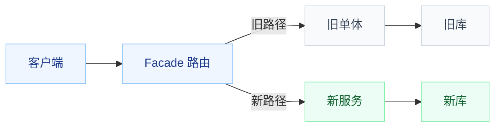

# 演进与治理

> 这篇从“什么样的系统能渐进演进”讲起，经过遗留系统盘点与排序、绞杀者模式、分支抽象与双写、灰度切流、数据演进与多租户改造、技术债度量，最后落到适应度函数、治理机制和一次单体拆分的完整决策与复盘。
>
> 学完能判断一个老系统该修、该拆还是该重写，能设计带退出条件的绞杀者切流计划，能度量并治理技术债，能用自动化规则守住架构边界。

## 一、演进的对象与接缝

演进不是重写。重写把已知需求重做一遍，风险集中在上线那一刻；演进把变化切成可回滚的小步，风险分散在每一步。

能演进的前提是系统里有“接缝”（Seam）：一个可以在不改内部实现的前提下替换行为的位置。常见的接缝有三类：

| 接缝类型 | 例子 | 可替换什么 |
|---|---|---|
| 请求入口 | 网关、反向代理、Facade | 整个服务的实现 |
| 接口抽象 | 仓储接口、消息主题 | 数据源、下游实现 |
| 数据边界 | 表、schema、CDC 流 | 存储与归属 |

没有接缝的系统，任何改动都要伸进核心代码，第一步就退化成重写。

### 1.1 三类演进任务

| 任务 | 变化的东西 | 主要风险 |
|---|---|---|
| 结构演进 | 单体拆服务、模块边界 | 分布式事务、链路变长 |
| 数据演进 | 分库、换存储、加租户维度 | 一致性、迁移时长 |
| 技术栈演进 | 框架升级、运行时替换 | 兼容性、回归范围 |

三类任务的共同点：都要在“旧的和新的同时存在”一段时间。这段共存期的设计质量，决定演进的成败。

### 1.2 判断该修、该拆还是该重写

| 信号 | 倾向 | 理由 |
|---|---|---|
| 核心逻辑清晰，只是部署耦合 | 拆 | 有可识别边界 |
| 大量死代码、无测试、无文档 | 重写 | 演进成本高于重建 |
| 业务规则频繁变化且无人理解 | 先补测试再拆 | 没有回归网不能动 |
| 第三方产品已停止维护 | 替换 | 演进没有意义 |

重写的判据不是“代码丑”，而是“可理解性和可测试性已经低于重建成本”。代码丑但测试齐全的系统，拆比写更快。

边界：重写适合边界清楚、体量可控的模块（一个报表、一个通知服务）。核心交易系统整体重写，失败率极高，因为旧系统里沉淀了大量没人写下来的隐性规则。

## 二、遗留系统评估与改造排序

改造顺序错了，会把最有价值的六个月花在最不重要的模块上。

### 2.1 盘点清单

改造前必须有一份可核对的清单：

| 类别 | 要记录的内容 |
|---|---|
| 服务 | 进程、端口、部署方式、owner |
| 数据 | 库表、数据量、写入方、读取方 |
| 任务 | 定时任务、批处理、补偿作业 |
| 接口 | 对外 API、对内 RPC、消息主题 |
| 配置 | 开关、环境变量、外部依赖 |

清单要落到仓库里，随代码更新，不能是一次性的 Excel。

### 2.2 依赖与变更热度

评估两个维度：变更频率和故障影响。高频变更且高影响的模块优先改造，因为它的“利息”最高。

```sql
-- 片段：从发布系统导出近 90 天各模块的变更次数，作为热度依据
SELECT module, COUNT(*) AS releases, SUM(rollback) AS rollbacks
FROM deploy_record
WHERE deployed_at >= NOW() - INTERVAL 90 DAY
GROUP BY module
ORDER BY releases DESC;
```

| 模块 | 90 天发布 | 回滚 | 关联故障 | 优先级 |
|---|---:|---:|---:|---|
| 订单 | 34 | 6 | 9 | 高 |
| 库存 | 12 | 1 | 2 | 中 |
| 报表 | 3 | 0 | 0 | 低 |

### 2.3 改造候选排序

用“价值 ÷ 成本”排序，而不是按“最烂优先”：

- 价值：变更频率、故障损失、能否解锁后续改造；
- 成本：依赖数量、测试覆盖、数据耦合程度。

边界：第一个改造对象必须是“边界清晰、能独立验证”的模块。从最乱的模块开始，团队会在前三个月耗尽耐心，项目死在第 4 个月。

## 三、绞杀者模式

绞杀者模式（Strangler Fig Pattern）是在旧系统前放一层路由，把流量一点点切到新实现，旧系统逐渐缩小，最后退役。

### 3.1 结构



Facade 只做三件事：识别请求归属、转发、记录切流比例。它不应该承载业务逻辑，否则会变成新的单体。

### 3.2 切流维度

| 维度 | 粒度 | 适用 |
|---|---|---|
| URL/接口 | 接口级 | 按功能剥离 |
| 租户 | 租户级 | SaaS，先切小客户 |
| 用户 ID 哈希 | 用户级 | C 端，保证同一用户一致 |
| 百分比 | 随机 | 无状态服务 |
| 读写分离 | 操作级 | 先切读，再切写 |

切流维度的选择原则：**同一业务实体在切换期间不能同时被新旧两套逻辑处理**。按用户哈希切可以保证一个用户的订单始终由一边处理；按百分比随机切会让同一用户两次请求落到不同实现，产生状态不一致。

### 3.3 切片顺序

正确的顺序是“边缘到核心、读到写、低风险到高风险”：

```text
1. 只读查询（报表、列表、详情）
2. 非核心写（评论、收藏、通知）
3. 核心写（下单、支付）
4. 旧系统降为只读
5. 旧系统下线
```

| 阶段 | 切流对象 | 退出条件 |
|---|---|---|
| 1 | 只读接口 5% | 错误率与 P99 不劣化 |
| 2 | 只读接口 100% | 连续 3 天无新增缺陷 |
| 3 | 非核心写 10% | 对账差异为 0 |
| 4 | 核心写 1% | 双写稳定、补偿积压为 0 |
| 5 | 核心写 100% | 旧库只读、回滚窗口到期 |
| 6 | 下线旧代码 | 无调用、无定时任务、备份完成 |

每一步的退出条件必须是可测量的，不能写“观察一段时间”。

边界：绞杀者需要“可路由的边界”。如果新旧实现共享同一个数据库、同一批表，切流只能切计算不能切数据，最终会卡在数据归属上。数据边界要提前规划，否则走到第 4 步就停住。

### 3.4 旧系统退役

退役比上线更容易被忽略。检查四件事：

- 流量：入口日志确认没有请求再打到旧接口；
- 任务：旧系统的定时任务、补偿作业全部停掉或迁移；
- 数据：旧库进入只读并保留备份，按合规期保存；
- 代码：删除旧模块，避免有人再改。

```bash
# 片段：确认旧接口连续 14 天零调用后再下线
grep -c '"upstream":"legacy-order"' /var/log/gateway/access.log
# 输出 0 才可以进入下线评审
```

## 四、分支抽象与双写

绞杀者解决“请求走哪边”，分支抽象解决“代码怎么同时支持两边”。

### 4.1 Branch by Abstraction

先在调用方和实现之间插一个接口，新旧两套实现都实现它，用开关选择：

```java
// 片段：抽象接口 + 开关选择实现，调用方不感知底层是新库还是旧库
public interface OrderRepository {
    Order findById(long id);
    void save(Order order);
}

// 旧实现保持原样，新实现走新库；开关由配置中心下发
OrderRepository repo = flag.isOn("order.repo.v2")
        ? new OrderRepositoryV2(dataSourceV2)
        : new OrderRepositoryV1(dataSourceV1);
```

关键点是“先抽象、再替换、后删除”。抽象层要薄，只做转发和适配，不在这里加业务规则。

### 4.2 Expand-Contract

数据库 schema 的演进用“扩展—收缩”三步，任何一步都可回滚：

| 步骤 | 动作 | 兼容性 |
|---|---|---|
| Expand | 加新字段/新表，双写 | 新旧代码都能跑 |
| Migrate | 回填历史数据，切读新字段 | 新旧数据并存 |
| Contract | 停止写旧字段，删除旧字段 | 只在新代码稳定后 |

```sql
-- Expand：加可空列，旧代码插入不受影响
ALTER TABLE orders ADD COLUMN tenant_id BIGINT NULL, ALGORITHM=INSTANT;
-- Migrate：分批回填，避免长事务
UPDATE orders SET tenant_id = 1 WHERE tenant_id IS NULL AND id BETWEEN ? AND ?;
-- Contract：确认无读取后删除，删除前先做一次全量校验
ALTER TABLE orders DROP COLUMN legacy_tenant_code;
```

边界：`ALTER TABLE ... ALGORITHM=INSTANT` 只对“加列到末尾”等少数操作有效，加索引、改类型仍可能锁表或重建。执行前用 `pt-online-schema-change` 或 `gh-ost` 在影子表验证。

### 4.3 双写的三种实现

| 方式 | 原理 | 优点 | 缺点 |
|---|---|---|---|
| 应用双写 | 业务代码写两处 | 可控、可加逻辑 | 侵入代码，易漏 |
| CDC 同步 | 订阅 binlog 转发 | 不改业务代码 | 有延迟，DDL 敏感 |
| 触发器 | 数据库触发器写另一处 | 实时 | 难维护，性能差 |

应用双写最常用，但要解决四个问题：

1. 顺序：先写旧库，成功后再写新库，旧库是权威。
2. 失败：新库失败不影响业务返回，写入补偿表异步重试。
3. 幂等：补偿重放用业务主键覆盖，不追加。
4. 对账：每天比对行数与摘要，差异进修复队列。

```text
写旧库成功
  → 写新库
     成功：结束
     失败：写补偿表（含主键、重试次数、下次重试时间）
  → 补偿任务每 30 秒扫一次，指数退避，超过 10 次进人工队列
```

CDC 同步适合“新库只读”或“新库是派生索引”的场景，因为它不改写路径。但 CDC 对 DDL 敏感，迁移窗口内要冻结 DDL。

边界：双写是过渡态，必须有结束日期和删除旧写的计划。长期双写的系统会出现“两边都能写、两边都不准”，比单写更难维护。

### 4.4 双写的一致性边界

双写无法做到强一致，只能做到“最终一致 + 可对账”。能接受的前提：

- 业务能容忍短暂的新旧不一致（秒到分钟）；
- 有权威源，冲突时以权威源为准；
- 有对账和修复能力。

不能接受的前提：跨库唯一约束、跨库事务、强实时读。这些场景应该先合并数据归属，再做演进。

## 五、灰度发布与流量治理

灰度不是“先发一台”，而是“用一小部分真实流量验证假设，并在指标恶化时自动停止”。

### 5.1 灰度维度

| 维度 | 适合验证 | 风险 |
|---|---|---|
| 按比例 | 通用缺陷、性能 | 样本可能不代表整体 |
| 按用户 | 交互类变更 | 需要用户分桶稳定 |
| 按租户 | SaaS 多租户 | 大租户影响面大 |
| 按地域 | 网络、区域依赖 | 地域差异掩盖问题 |
| 按设备 | 客户端兼容 | 需要客户端埋点 |

分桶要用稳定哈希（如 `hash(user_id) % 100`），不要用随机数。随机分桶会让同一用户在两次请求中看到不同版本，产生难以复现的 bug。

### 5.2 指标门禁

灰度能否继续，由指标决定，不由发布时间决定：

| 指标 | 阈值（示例） | 动作 |
|---|---|---|
| 错误率 | 比基线高 0.5 个百分点 | 暂停 |
| P99 | 比基线高 30% | 暂停 |
| 业务转化 | 下降 2% | 回滚 |
| 日志异常数 | 新增异常类型 | 人工确认 |

```yaml
# 片段：Argo Rollouts 金丝雀，按指标自动推进或回滚
apiVersion: argoproj.io/v1alpha1
kind: Rollout
spec:
  strategy:
    canary:
      steps:
        - setWeight: 5
        - pause: { duration: 10m }
        - analysis:
            templates: [{ templateName: error-rate }]
        - setWeight: 30
        - pause: { duration: 20m }
        - setWeight: 100
```

### 5.3 三种回滚

回滚不是一件事，是三件不同的事：

| 回滚类型 | 手段 | 生效时间 | 能否回滚数据 |
|---|---|---|---|
| 镜像回滚 | 切回上一个版本 | 分钟 | 否 |
| 开关回滚 | 关闭新功能开关 | 秒 | 否 |
| 数据回滚 | 反向迁移/补偿 | 小时 | 是，但可能丢新数据 |

发布前要明确“这次变更需要哪一种回滚”，并演练对应脚本。只准备镜像回滚，遇到 schema 变更就回不去。

### 5.4 双版本兼容

灰度期间新旧版本同时在线，必须遵守三条兼容规则：

- 新版本写的接口响应，旧版本客户端能解析（只加字段，不删不改语义）；
- 新版本写的数据库字段，旧版本代码能忽略（可空、有默认值）；
- 新版本发的消息，旧版本消费者能跳过未知字段。

破坏兼容的变更要分两次发布：先让所有消费者兼容新格式，再让生产者发新格式。

## 六、数据演进与多租户 SaaS

多租户改造是数据演进里最常见也最容易低估的一类：它要求每一条查询都带上租户维度，漏一条就是数据泄漏。

### 6.1 三种隔离模型

| 模型 | 隔离级别 | 成本 | 适用 |
|---|---|---|---|
| 共享库共享表 | 行级（tenant_id） | 最低 | 大量小租户 |
| 独立 schema | schema 级 | 中 | 中等租户 |
| 独立库/实例 | 实例级 | 最高 | 大客户、强合规 |

| 维度 | 共享表 | 独立 schema | 独立库 |
|---|---|---|---|
| 噪声邻居 | 严重 | 中 | 无 |
| 跨租户聚合 | 容易 | 需跨 schema | 需汇总 |
| 单租户恢复 | 难 | 较易 | 容易 |
| 运维复杂度 | 低 | 中 | 高 |

### 6.2 共享表的硬约束

共享表必须有 `tenant_id`，且它要出现在每个联合索引的第一列：

```sql
-- 正确：tenant_id 在联合索引首列，查询能走索引且天然隔离
CREATE INDEX idx_order_tenant_status ON orders (tenant_id, status, created_at);
SELECT * FROM orders WHERE tenant_id = ? AND status = 'PAID' ORDER BY created_at DESC LIMIT 20;

-- 错误：只按 status 查，跨租户扫描，既慢又可能泄漏
SELECT * FROM orders WHERE status = 'PAID' LIMIT 20;
```

应用层要有统一的租户上下文（Tenant Context），在数据访问层自动注入 `tenant_id`，而不是靠每个开发者记得加。MyBatis 的拦截器、JPA 的 `@Filter`、Postgres 的行级安全（Row Level Security）都能做这件事。

```text
租户上下文传递链：
网关解析 token → 写入请求头 X-Tenant-Id → 服务间透传 → 数据层拦截器注入 WHERE
```

边界：行级安全不能防止“写错 tenant_id”。插入时 `tenant_id` 必须来自上下文，不能来自请求体。否则攻击者改一个字段就能把数据写进别人租户。

### 6.3 混合模型与租户上浮

大多数 SaaS 最终会走混合：小租户共享池，大客户独立库。

| 租户规模 | 模型 | 理由 |
|---|---|---|
| < 10 万行 | 共享表 | 成本最低 |
| 10 万–1 亿行 | 独立 schema | 隔离噪声 |
| > 1 亿行或强合规 | 独立库 | 恢复与合规 |

“租户上浮”要能在线完成：先给大租户建独立库，双写一段时间，再切读，最后停共享表写入。这条路径和第四章的双写一致。

### 6.4 按租户的配额与限流

多租户系统必须有租户级配额，否则一个租户的大批量导入会拖垮所有租户：

- 请求速率按租户限制，大租户可单独配置；
- 批量任务进入独立队列，按租户公平调度；
- 存储用量按租户计量，超限告警而不是直接拒绝。

边界：配额要能动态调整，且调整要审计。按租户限流误伤大客户的代价，往往比多花点资源更高。

## 七、技术债的度量与治理

技术债不是“代码写得不好”，而是“为了短期交付做出的、未来要付利息的决策”。没有利息估算的债务清单，只是抱怨清单。

### 7.1 债务分类

| 类型 | 表现 | 利息 |
|---|---|---|
| 代码债 | 重复、超长函数、魔法值 | 改动慢、缺陷多 |
| 架构债 | 循环依赖、跨层调用 | 无法独立部署 |
| 测试债 | 无回归、用例脆弱 | 不敢改 |
| 依赖债 | 版本落后、已停止维护 | 安全漏洞、升级困难 |
| 数据债 | 无主数据、口径不一 | 报表不可信 |

### 7.2 可度量指标

| 指标 | 采集方式 | 用途 |
|---|---|---|
| 变更前置时间 | 提交到上线 | 衡量交付效率 |
| 变更失败率 | 回滚/故障次数 ÷ 发布次数 | 衡量质量 |
| 平均恢复时间 | 故障到恢复 | 衡量可运维性 |
| 重复代码率 | SonarQube 等工具 | 定位重构候选 |
| 过期依赖数 | 依赖扫描 | 安全与升级 |

指标用于排序，不用于考核个人。把复杂度挂到人头，会让人把代码拆得更碎来规避指标。

### 7.3 债务登记表

每条债务都要有本金、利息、owner 和到期时间：

| 条目 | 利息（可量化） | 本金（修复成本） | Owner | 到期 |
|---|---|---|---|---|
| 订单查询走全表扫 | 每月 12 次超时告警 | 3 人日 | 张 | 2026-12 |
| 支付回调无幂等 | 每月 2 笔重复入账 | 5 人日 | 李 | 2026-12 |
| 旧框架无安全补丁 | 高危漏洞 3 个 | 20 人日 | 王 | 2027-03 |

“利息”要尽量量化成钱、工时或故障次数。写“影响可维护性”的条目，永远排不上优先级。

### 7.4 还债预算与节奏

| 机制 | 做法 | 适用 |
|---|---|---|
| 固定比例 | 每迭代 20% 容量还债 | 债务稳定增长 |
| 专项窗口 | 每季度 1 周只还债 | 债务集中 |
| 随改随还 | 童子军规则，改到哪清到哪 | 局部债务 |
| 冻结期 | 债务导致事故后暂停需求 | 危机模式 |

边界：还债不能变成“没有交付的重构”。每个还债项要有可验证的结果：告警减少、构建变快、发布频率提高。没有结果的还债，下一次预算就批不下来。

## 八、适应度函数与架构守护

适应度函数（Fitness Function）是对架构特征的自动化检验。它把“架构约束”从文档里的约定，变成 CI 里会失败的检查。

### 8.1 四类适应度函数

| 类型 | 检验什么 | 实现 |
|---|---|---|
| 结构 | 依赖方向、分层 | ArchUnit、dependency-cruiser |
| 演进 | 变更影响范围 | 变更影响分析、契约测试 |
| 运行 | 延迟、错误率、SLO | 监控告警、混沌实验 |
| 安全 | 依赖漏洞、权限 | 依赖扫描、策略引擎 |

### 8.2 结构规则

```java
// 片段：ArchUnit 守住分层，domain 不允许依赖 infrastructure
@ArchTest
static final ArchRule domain_should_not_depend_on_infra =
    noClasses().that().resideInAPackage("..domain..")
        .should().dependOnClassesThat().resideInAPackage("..infrastructure..");

@ArchTest
static final ArchRule services_should_not_cycle =
    slices().matching("com.example.(*)..").should().beFreeOfCycles();
```

规则要在 CI 里跑，失败即阻断合并。只在本地跑的规则，一周后就会被绕过。

### 8.3 契约与策略检查

```rego
# 片段：用 conftest 校验 K8s 清单，禁止无资源限制的 Pod
package main
deny[msg] {
  input.kind == "Deployment"
  not input.spec.template.spec.containers[_].resources.limits
  msg := "container must declare resource limits"
}
```

```bash
conftest test deploy/order-api.yaml
# 预期输出：1 test, 1 failure，缺 limits 时退出码非 0
```

### 8.4 门禁分级

| 级别 | 行为 | 适用规则 |
|---|---|---|
| 提示 | 只在 PR 评论 | 新规则试点 |
| 警告 | 允许合并但记录 | 历史债务多的模块 |
| 阻断 | 禁止合并 | 安全、分层、许可证 |

边界：规则过多会让开发者想办法绕过（加 `@SuppressWarnings`、拆包逃避匹配）。规则要少而硬，每条规则有 owner 和例外流程。

## 九、治理机制与组织

治理不是审批。审批只增加等待时间，不改变系统质量；治理是让正确的做法成为默认路径。

### 9.1 三类机制

| 机制 | 解决什么 | 产物 |
|---|---|---|
| ADR | 为什么这样选 | 决策记录 |
| RFC | 大改动前的共识 | 设计文档与评审结论 |
| 例外流程 | 规则不适用的场景 | 带期限的豁免 |

ADR 记录决策和后果，RFC 征集意见，例外流程处理“这次必须破例”。三者都不应该变成盖章流程。

### 9.2 平台团队与黄金路径

平台团队（Platform Team）的职责是把“正确做法”做成自助服务：新服务模板、CI 流水线、可观测性默认接入、发布与回滚工具。

黄金路径（Golden Path）是一条“默认就能通过所有治理检查”的路径。开发者走默认路径不需要理解每条规则，只有偏离时才需要申请例外。

| 治理方式 | 开发者成本 | 一致性 |
|---|---|---|
| 文档要求 | 高（要读要记） | 低 |
| 评审把关 | 中（要等人） | 中 |
| 平台默认 | 低（默认就对） | 高 |

### 9.3 DORA 指标

| 指标 | 含义 | 用途 |
|---|---|---|
| 部署频率 | 多久发布一次 | 衡量交付能力 |
| 变更前置时间 | 提交到上线 | 衡量流程效率 |
| 变更失败率 | 回滚或故障占比 | 衡量质量 |
| 恢复时间 | 故障到恢复 | 衡量可运维性 |

四个指标要一起看。只追求部署频率会牺牲稳定性，只追求恢复时间会让团队不敢发布。

边界：指标用于改进系统，不用于排名团队。排名会导致数据造假和跨团队推诿。

## 十、失败模式与检查清单

### 10.1 现象与处置

| 现象 | 最常见原因 | 第一条动作 |
|---|---|---|
| 改造半年无交付 | 第一个模块选得太乱 | 换边界清晰的模块重启动 |
| 切流后数据不一致 | 新旧共享库、双写漏写 | 停扩量，先对账 |
| 灰度没发现问题，全量出事 | 灰度样本不具代表性 | 检查分桶与流量结构 |
| 旧系统迟迟下不了线 | 定时任务和暗调用未迁 | 全量扫入口日志与任务清单 |
| 债务越还越多 | 只修点不改结构 | 按利息排序，先修高息项 |
| 架构规则被绕过 | 规则太多或没有例外流程 | 收敛到 5 条硬规则 |

### 10.2 改造前检查清单

- [ ] 每个模块有 owner、有依赖清单、有调用方清单；
- [ ] 第一个改造模块边界清晰、可独立验证；
- [ ] 绞杀者的切流维度和退出条件写进变更单；
- [ ] 双写有补偿表、对账、结束日期；
- [ ] 灰度有稳定分桶和指标门禁；
- [ ] 回滚覆盖镜像、开关、数据三种；
- [ ] 多租户查询全部带 `tenant_id`，且有自动化检查；
- [ ] 技术债登记表有量化利息和 owner；
- [ ] 适应度函数在 CI 中阻断，且有例外流程；
- [ ] 旧系统退役前确认零流量、零任务、有备份。

## 十一、最佳实践案例

### 11.1 案例背景

一家经营了 12 年的 B2B 批发平台，核心是一个 Java 单体：订单、库存、结算、商品、用户共 5 个模块打在一个 WAR 里，代码 78 万行，数据库一个 MySQL 实例、320 张表。4 个团队共 30 人维护，发布每月一次，一次发布要停机 40 分钟。

现状数据（示例，来自内部度量）：

| 指标 | 数值 |
|---|---|
| 发布频率 | 12 次/年 |
| 变更失败率 | 28% |
| 平均恢复时间 | 4 小时 |
| 订单接口 P99 | 650ms |
| 单元测试覆盖率 | 11% |

约束：不能停机；6 个月内必须让订单模块独立发布；预算只够 8 人月；团队没有微服务治理经验；结算模块有合规审计要求，不能先动。

目标是发布频率提到每周一次、变更失败率降到 10% 以下、订单 P99 降到 300ms 以内，且改造期间订单错误率不上升。

### 11.2 案例实操

第一步做模块盘点与排序。用“变更热度 × 故障影响 ÷ 依赖数”排序，而不是按代码烂的程度：

| 模块 | 90 天发布 | 关联故障 | 依赖数 | 排序 |
|---|---:|---:|---:|---:|
| 订单 | 34 | 9 | 3 | 1 |
| 库存 | 12 | 2 | 5 | 2 |
| 商品 | 8 | 1 | 2 | 3 |
| 结算 | 5 | 1 | 7 | 暂缓 |

结算依赖最多且有合规要求，放到最后。订单变更最频繁、故障最多、依赖最少，作为第一个切片。

方案对比（1–5 分，5 最好，示例）：

| 选项 | 6 个月可达 | 停机风险 | 长期收益 | 综合 |
|---|---|---|---|---|
| A 整体重写 | 1 | 1 | 5 | 8 |
| B 绞杀者按模块剥离 | 4 | 4 | 5 | 17 |
| C 只做容器化 | 5 | 5 | 1 | 16 |
| D 采购 SaaS 替换 | 2 | 3 | 3 | 10 |

综合分包含团队可控性：团队对自己写的代码最熟，对采购产品的实施没有经验。

选项 C 最快，但单体还是单体，发布仍要一起停。选项 A 在 6 个月内不可能完成，且无法回滚。选项 D 的业务定制太重，替换成本高于改造。

决策：B，绞杀者剥离订单模块，先读后写、先小租户后全量，数据库用“共享库 + 独立 schema”过渡，最终订单独立库。

6 个月计划与退出条件：

| 月份 | 目标 | 退出条件 |
|---|---|---|
| 1 | Facade 路由 + 订单只读接口迁移 | 只读流量 5% 且 P99 不劣化 |
| 2 | 只读 100%，建立对账 | 连续 3 天差异为 0 |
| 3 | 分支抽象 + 订单写双写 | 双写成功率 99.99% |
| 4 | 写切 1% 租户 | 对账差异 < 0.001% |
| 5 | 写切 50%，旧库降为只读 | 回滚演练通过 |
| 6 | 写 100%，旧订单代码删除 | 零调用、零定时任务 |

关键实现：

- Facade 用 Spring Cloud Gateway，按 `tenant_id` 哈希切流，同一租户始终走同一边；
- 订单服务用分支抽象，`OrderRepository` 接口下挂 V1（旧库）和 V2（新库）两个实现，开关放配置中心；
- 双写先旧后新，新库失败写补偿表，30 秒轮询重试，超过 10 次进人工队列；
- 新库按 `tenant_id` 分 schema，先迁 20 个小租户；
- 灰度门禁：错误率比基线高 0.5 个百分点或 P99 高 30% 自动回滚；
- 技术债登记 37 条，按利息排序，前 12 条在改造中顺手清掉。

适应度函数先上三条，防止改造期间架构继续腐化：

```java
// 片段：禁止新代码从 order 包直接访问 inventory 的 DAO
@ArchTest
static final ArchRule order_must_not_touch_inventory_dao =
    noClasses().that().resideInAPackage("..order..")
        .should().accessClassesThat().resideInAPackage("..inventory.dao..");
```

另外两条是“禁止循环依赖”和“新接口必须有契约测试”。三条都在 CI 阻断。

第 3 个月出过一次事故：双写补偿任务因为一条主键超长记录反复失败，积压 1.2 万条，导致新库缺 0.02% 的订单。对账发现后按主键整行覆盖修复，并给补偿任务加了“单条失败隔离 + 死信队列”。

### 11.3 案例结果

改造 6 个月后的实测（示例）：

| 指标 | 改造前 | 改造后 | 目标 |
|---|---:|---:|---:|
| 发布频率 | 12 次/年 | 48 次/年 | 每周一次 |
| 变更失败率 | 28% | 9% | < 10% |
| 平均恢复时间 | 4 小时 | 45 分钟 | < 1 小时 |
| 订单 P99 | 650ms | 240ms | < 300ms |
| 停机发布 | 每次 40 分钟 | 0 | 0 |
| 单元测试覆盖率 | 11% | 34% | 无硬指标 |

改造期间订单错误率没有上升，切写灰度用了 9 周，回滚开关触发 2 次（都是指标门禁自动触发），每次在 3 分钟内恢复。旧订单代码在第 7 个月删除，删除前确认了 14 天零调用、定时任务全部迁移。

技术债方面，37 条登记项完成 12 条，剩余 25 条按季度盘点。适应度函数从 3 条增加到 6 条，其中 1 条因历史代码无法通过，改为警告级别并挂了到期时间。

三个失败模式：

1. 第 1 个月想同时迁库存，导致 Facade 路由规则复杂到无法测试。收敛到只迁订单后，进度反而快了。
2. 灰度按百分比随机分桶，同一租户两次请求落到不同实现，出现“下单成功但列表查不到”。改成按租户哈希后问题消失。
3. 双写没有设结束日期，第 5 个月仍在双写，旧库压力反而上升。补了“切写完成后 30 天停双写”的硬约束。

复盘结论：单体拆分的成败不在技术选型，而在“第一个切片选得对不对”和“每一步有没有可测量的退出条件”。绞杀者模式本身不复杂，复杂的是让旧系统在共存期保持可运行、可对账、可回滚。
