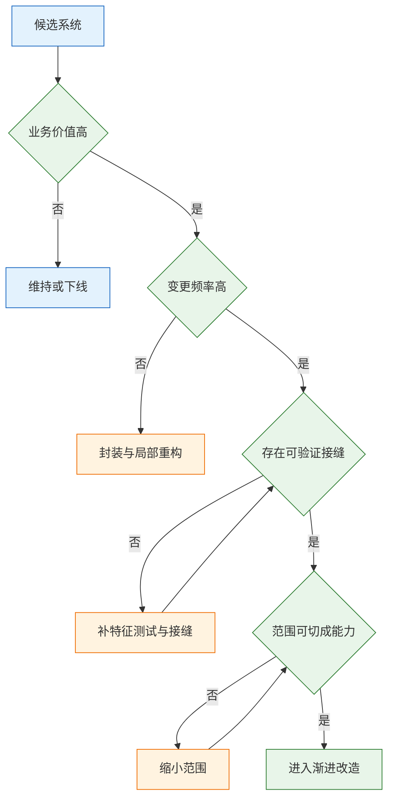
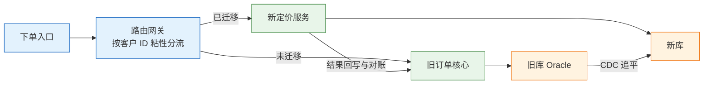
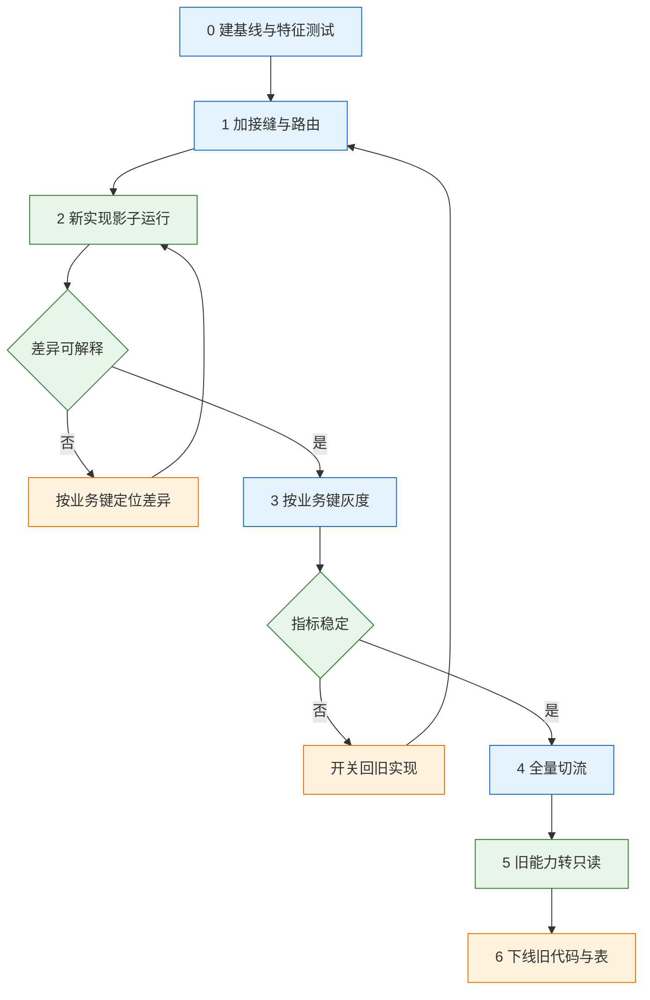

# 遗留系统改造

> 遗留系统的判定标准不是代码年龄，而是变更成本。一个系统仍在产生收入、承载合规、支撑核心交付，却没人敢改、改完无法证明没改坏，它就是遗留系统。改造的目标不是换技术栈，而是在业务不停的前提下，把变更成本降下来。

---

## 一、遗留系统改造是什么

### 1.1 核心概念

遗留系统（Legacy System）指仍在承载核心业务、但修改成本已高于继续演进收益的系统。典型形态是业务不能停、规则说不清、改动无法验证。技术栈陈旧只是表象，真正构成遗留的是：业务规则沉淀在代码、存储过程、定时任务和少数人的经验里；没有可执行基线；改动影响面无法预测。

遗留系统改造以不中断业务为前提，把整体替换拆成可独立验收的能力切换，通过接缝、路由、双轨与回滚，把一次高风险上线分解为多次低风险变更。它追求变更周期缩短、失败率下降、隐性规则显性化；换语言、换框架、上云只是手段。

改造的最小单位是能力，不是代码目录。能力有输入、输出、副作用和验收标准，可单独切走与回滚；模块只有代码归属，切走一半往往无法运行。判断改造是否成立看三条：旧能力能否单独下线、规则是否有可执行基线、出问题能否在分钟级退回。

| 概念 | 含义 | 判断依据 |
|---|---|---|
| 遗留系统 | 高变更成本的核心系统 | 改一条规则需跨团队长排期 |
| 重写 | 另建系统整体替换 | 新旧不并行，一次切换 |
| 重构 | 不改外部行为，改内部结构 | 契约与输出保持不变 |
| 改造 | 按能力逐步替换归属 | 有接缝、双轨和回滚 |
| 绞杀者模式 | 新实现沿接缝包围旧实现 | 旧能力可逐项下线 |
| 防腐层 | 隔离新旧模型的转换层 | 旧模型不进入新领域 |

> **注意**：把重写当成改造，是最常见的起点错误。重写要求一次说清全部规则，而遗留系统最缺的恰恰是规则；新系统只覆盖部分场景时，新旧两套长期并行，订单号、客户号、状态机各有一套，维护成本更高。

### 1.2 与相邻技术的关系

改造常被混同于重构、迁移或微服务拆分。重构不改外部行为，迁移不换能力归属，微服务拆分不自动带来可验证性；改造改变的是能力归属和切换方式。

上云不等于改造。应用原样入容器、数据库原样上云，存储过程和共享表仍在，变更成本未降。拆微服务也不等于改造；按表拆服务而不重划事务与数据归属，得到分布式单体，故障面更大。

改造必须同时具备三种能力：切、验、退。切是按业务键把流量引到新实现；验是用基线证明新旧一致；退是能在分钟级回到旧实现且数据可收口。缺一项，改造都会退化成不可控的发布。

| 相邻实践 | 提供的能力 | 不提供的能力 |
|---|---|---|
| 重构 | 改善内部结构 | 改变能力归属 |
| 平台迁移 | 更换运行环境 | 降低规则耦合 |
| 微服务拆分 | 独立部署与伸缩 | 自动获得可验证性 |
| 领域驱动设计 | 边界划分语言 | 迁移与回滚机制 |
| 可观测性 | 发现差异与故障 | 替代验收基线 |

### 1.3 判断框架

改造立项前先过三道门：值不值得改、能不能验证、范围能不能切。三道门全过才进入实施；任何一道不过，先补前置条件，不要用开发进度掩盖判断缺失。



| 判断维度 | 通过标准 | 不通过时的动作 |
|---|---|---|
| 业务连续性 | 可接受短停或双轨运行 | 先做读写分离与只读副本 |
| 可验证性 | 有基线、可回放、可比对 | 补特征测试与流量录制 |
| 可切分性 | 能力边界清楚、依赖可枚举 | 先做依赖扫描与数据盘点 |
| 组织条件 | 有稳定 owner 与预算 | 不立项，先定责任 |
| 退出条件 | 旧系统有明确下线日 | 重设目标与验收物 |

判断框架的价值在于提前否掉不成立的项目。连“改完怎么算对”都说不清的系统，应先做知识梳理和特征测试；规则可验证、能力可切分、业务愿配合灰度的老系统，就具备改造条件。

---

## 二、改造价值判断

### 2.1 价值与变更频率矩阵

不是所有老系统都值得动。用业务价值和变更频率两个维度先分层，避免把预算平均撒在所有系统上。

| 业务价值 | 变更频率 | 建议策略 | 主要代价 |
|---|---|---|---|
| 高 | 高 | 绞杀者改造，优先投入 | 双轨、路由、数据迁移 |
| 高 | 低 | 封装加局部重构 | 保持稳定，补监控文档 |
| 低 | 高 | 替换或下线 | 迁移成本可能高于新建 |
| 低 | 低 | 维持，只打安全补丁 | 接受腐化与知识流失 |

高价值指直接产生收入、承担合规或支撑核心交付；高变更指每月都有业务需求。两个都高才值得完整改造。低价值低变更的系统强行改造，只是把预算换成技术人员的成就感，业务指标不会变化。

矩阵要按能力细化。同一个订单系统里，定价可能高频高价值，历史查询可能低频低价值；把整个系统当成一个格子，会把低价值部分拖进改造范围。

> **注意**：用“技术债数量”“代码坏味道”立项，会把改造变成无止境的平台工程。技术债是症状，业务指标才是立项依据；症状可以解释紧迫性，但不能证明收益。

### 2.2 业务指标基线

改造的理由要写成业务指标。指标既是立项依据，也是验收依据；没有基线，改造完无法证明变好，也无法判断何时停止。

| 指标 | 口径 | 改造后的目标 |
|---|---|---|
| 需求周期 | 提出到上线的自然日 | 缩短一半以上 |
| 变更失败率 | 需回滚或热修的比例 | 逐季下降 |
| 年停服时长 | 计划内加计划外停机 | 降到可接受窗口 |
| 单次回归成本 | 人日与回归轮次 | 由自动化替代人工 |
| 关键岗位依赖 | 能解释核心规则的人数 | 从个人转为团队 |
| 合规缺口 | 审计与扫描未项 | 清零或闭环 |

基线提前四到八周采集，覆盖完整业务周期，避开大促和结账日，来源包括发布记录、工单、监控和财务对账差异。指标要能追溯到具体单据或发布，不能只给平均值。

改造过程中按同一口径复测；若需求周期未降、回滚次数未减，说明只换了实现，应暂停扩张范围，补齐接缝与基线。

### 2.3 范围与责任边界

改造失败的项目，多数不是技术做不出来，而是范围没有边界，越做越大。范围表要先签字，明确本次动什么、不动什么、谁负责。

| 范围 | 负责方 | 本次处理 |
|---|---|---|
| 订单入口与页面 | 订单团队 | 换新入口，旧页面保留只读 |
| 定价与折扣规则 | 业务加订单团队 | 先抽规则，再替换计算 |
| 库存预占 | 仓储团队 | 不动，只加防腐层调用 |
| 财务结算与总账 | 财务系统团队 | 不动，保证凭证格式不变 |
| 历史订单查询 | 数据团队 | 建只读视图，不迁全量 |
| 批处理与对账 | 运维加财务 | 保留旧作业，逐步替换 |

范围之外还要写“不改造的情形”：系统两三年内被淘汰；商业产品覆盖八成需求且退出成本可接受；规则没人说得清；组织没有稳定 owner。出现这四种情况，正确动作是维持、替换或整理，而不是启动改造。

---

## 三、系统能力拆分

### 3.1 从模块到能力

模块按代码目录分，能力按业务结果分。改造要切能力，因为能力有明确的输入、输出和验收标准，能单独定义“切成功了没有”。

以订单系统为例，能力至少包括下单、定价、信用检查、库存预占、履约分配、开票、收款核销、对账。每个能力要回答：谁在何时传入什么、产生什么结果和副作用、读写哪些数据、依赖哪些调用。

| 能力 | 输入 | 输出 | 主要依赖 |
|---|---|---|---|
| 下单 | 客户、商品、数量、价格 | 订单号与待支付状态 | 定价、信用、库存 |
| 定价 | 客户、商品、数量、时点 | 单价、折扣、应收金额 | 价格表、规则库 |
| 信用检查 | 客户、应收金额 | 通过、限额或拒绝 | 客户主数据 |
| 库存预占 | 商品、数量、仓 | 预占结果与失效时间 | 仓储服务 |
| 履约分配 | 订单、仓、运力 | 履约单与预计时效 | 仓储、物流 |
| 开票 | 订单、抬头、税率 | 发票号与凭证 | 财务系统 |
| 收款核销 | 收款流水、订单 | 核销状态与余额 | 支付、总账 |
| 对账 | 订单、流水、凭证 | 差异单与结论 | 全部上游 |

拆到这一层，改造范围就能按行选择。定价是纯计算，输入输出清楚，错了可以重算，适合先做；库存预占有强一致要求和外部副作用，适合后做；对账依赖全部上游，通常最后做。

### 3.2 能力档案

能力清单只是目录，真正指导实施的是能力档案。档案要记录入口、规则、数据、依赖和验收方式，缺一项就会在切换时暴露盲区。

| 字段 | 作用 | 采集方式 |
|---|---|---|
| 入口 | 页面、API、消息、文件、库直连 | 网关日志、调用链、流量 |
| 输入 | 谁在什么时点传什么 | 报文抽样、表变更记录 |
| 输出 | 业务结果与副作用 | 状态机、下游订阅、凭证 |
| 规则 | 折扣、税率、优先级、边界 | 代码考古、存储过程、访谈 |
| 数据 | 读写哪些表、是否共享 | 数据血缘、SQL 审计 |
| 依赖 | 同步调用、消息、批处理 | 调用链、作业依赖图 |
| 变更频率 | 决定先做哪个 | 需求单、发布记录 |
| 可独立度 | 能否单独切走 | 事务边界与共享表分析 |
| 验收基线 | 怎样算结果一致 | 特征测试、生产回放 |

档案里最容易被低估的是“数据”和“依赖”。页面和 API 好找，难找的是财务每月跑的存储过程、数据库链路直连的报表、文件服务器上的对账脚本、下游直接读旧库的表。这些依赖不进入档案，切换时就会以“下游突然报错”的形式出现。

> **注意**：共享表是改造中最硬的约束。两个能力读写同一张表时，谁先切走都可能破坏对方的事务语义；先建只读视图或同步表降低读依赖，再谈写路径归属。

### 3.3 排序与优先级

优先做“高频变更、依赖少、结果可验证、失败可重算”的能力。四项同时满足的能力，通常能在数周内完成一次完整切换，为后续建立模板。

| 能力 | 变更频率 | 依赖度 | 建议顺序 |
|---|---|---|---|
| 定价与折扣 | 高 | 低，纯计算 | 第一 |
| 下单入口 | 高 | 中，依赖定价与库存 | 第二 |
| 历史查询 | 低 | 低，只读 | 可并行 |
| 库存预占 | 中 | 高，强一致 | 第三 |
| 开票与结算 | 低 | 高，外部凭证 | 第四 |
| 对账批处理 | 低 | 最高，依赖全部 | 最后 |

排序还要看组织准备度。业务方愿配合灰度、客服能解释新旧差异、财务接受差异单，这些条件比技术难度更能决定成败；若业务方要求一次全切、不能有差异，应先做基线和小流量试点。

> **注意**：先做“最容易演示”的模块，而不是“最容易验证”的模块，会把改造变成展示项目。演示只需要页面能打开，验证需要结果可比对；前者不能证明规则没丢。

---

## 四、接缝识别与路由设计

### 4.1 接缝类型与构造

接缝是“不改内部实现就能替换行为”的位置。找不到接缝，就先造一个。接缝必须落到具体的入口、视图、适配器、事件或开关上。

| 接缝 | 构造方式 | 主要风险 |
|---|---|---|
| 入口接缝 | 旧系统前加网关或反向代理 | 路由键不稳定，流量漂移 |
| 数据接缝 | 旧库上建只读视图或同步表 | 视图被误写，性能回退 |
| 依赖接缝 | 调用方加适配器与防腐层 | 超时重试策略不一致 |
| 流程接缝 | 定时任务改为可触发事件 | 重复触发与顺序错乱 |
| 配置接缝 | 开关选择新旧实现 | 开关无 owner、无期限 |

数据接缝最常用。给旧库建只读视图，让新系统先读旧数据，不改旧表结构：

```sql
-- 只读视图：屏蔽旧表的物理结构，稳定字段名
CREATE OR REPLACE VIEW order_read_v AS
SELECT order_no,
       customer_id,
       status,
       total_amount,
       updated_at
FROM legacy_order
WHERE deleted_flag = 0;
```

视图只解决读。写路径要经过适配器或 API，不能直接写旧表；直接写旧表等于把旧 schema 变成新系统的隐含契约，后续无法独立演进。

开关接缝要带 owner 和过期时间，否则半年后没人敢删：

```yaml
flags:
  pricing_engine:
    enabled: true
    rollout:
      mode: business_key
      key: customer_id
      buckets: [0, 499]
    fallback: legacy
    owner: pricing-team
    expires_at: 2026-12-31
```

配置表示按客户 ID 取模落桶，前 5% 走新定价，其余回旧实现；桶边界必须可查询、可复现，不能依赖随机数。

### 4.2 路由键与粘性

路由键决定一笔业务走新侧还是旧侧。键选错，后面所有对账和回滚都会失效。

| 路由键 | 适用场景 | 主要风险 |
|---|---|---|
| 客户 ID | 客户维度功能迁移 | 大客户跨类目时归属难定 |
| 订单号哈希 | 订单维度切写 | 同一客户跨订单体验割裂 |
| 租户 ID | 多租户系统整体切换 | 租户内子业务无法分批 |
| 区域或渠道 | 按市场逐步放量 | 跨区业务落在两侧 |

同一个客户、同一笔订单必须始终走同一侧，否则会出现“下单在新系统、查单在旧系统”的割裂。读和写也要用同一个键；只给写路径做路由、读路径仍查旧库，会看到状态延迟，客服无法解释。

> **架构红线**：禁止按随机百分比对同一客户或同一订单分流。随机分流会让同一笔业务在两侧各生成一套状态，双写时冲突无法自动判定，只能人工合并；一旦合并错，订单金额和库存都会被污染。

路由规则要有版本号，调整桶边界时记录规则版本与生效时间，否则无法还原“这笔单当时为什么走新侧”；路由表要持久化，不能只存在网关内存。

### 4.3 路由可观测性

接缝必须可观测：每次走旧路还是新路，要能按业务单号查出来。否则出了问题，连“这笔单走的哪条路”都说不清。

| 观测项 | 落点 | 用途 |
|---|---|---|
| 路由决策 | 网关访问日志 | 判断走新还是走旧 |
| 业务键 | 日志字段与调用链标签 | 按单号或客户回溯 |
| 规则版本 | 路由配置快照 | 还原当时的分流规则 |
| 结果差异 | 比对任务与差异单 | 定位规则或数据问题 |



日志至少包含 trace_id、业务单号、route、route_key、rule_version 五个字段。排障先按单号查路由，再比对两侧输入和结果，比翻几十个服务日志快得多。

---

## 五、渐进式改造路径

### 5.1 阶段划分

改造不是“立项、开发、上线”一条直线，而是一串可独立验收的小切换。每个能力都走同一套动作，但可以停在任意一步。

| 阶段 | 动作 | 退出条件 |
|---|---|---|
| 0 基线 | 补特征测试、录制生产流量 | 关键场景可回放比对 |
| 1 接缝 | 加网关、视图、适配器、开关 | 新旧可同时在线 |
| 2 影子 | 新实现接收流量但不对外返回 | 差异可解释、可归类 |
| 3 灰度 | 按业务键小流量切读或切写 | 指标稳定、差异清零 |
| 4 全量 | 全部目标业务走新侧 | 旧侧无新增写入 |
| 5 只读 | 旧能力停止写入，保留查询 | 一个完整账期无回滚 |
| 6 下线 | 删代码、删表、回收资源 | 依赖扫描无残留 |



停在影子运行也是有效交付，因为它产出差异清单和回归基线。最怕阶段 2 没做完就全量，等于跳过唯一能证明规则一致的环节。

### 5.2 节奏与交付

改造的时间大头不在写新逻辑，而在验证和收尾。以一个六周的单能力切换为例，具体数字按团队规模调整。

| 周次 | 工作 | 产出 |
|---|---|---|
| 第 1 周 | 补特征测试与指标基线 | 可回放的验收集 |
| 第 2 周 | 加路由、跑影子流量 | 差异清单与分类 |
| 第 3 周 | 修差异、补边界规则 | 差异收敛到零 |
| 第 4 周 | 百分之五客户灰度 | 灰度报告与告警 |
| 第 5 周 | 扩到一半客户 | 容量与延迟数据 |
| 第 6 周 | 全量并观察 | 切换记录与回滚演练 |

真正写新逻辑的时间通常只占三分之一，剩下都在补测试、跑比对、修边界和做演练。压缩验证时间赶上线日期，等于把风险留到全量之后。

### 5.3 切换纪律

切换当天的纪律比方案本身更重要。以下约束不能省，每一条都对应一类真实事故。

| 约束 | 原因 | 违反后果 |
|---|---|---|
| 一次只切一个能力 | 出问题能定位责任方 | 定价与库存同切，无法归因 |
| 先切读再切写 | 读可回滚，写有副作用 | 写坏了要冲正，成本更高 |
| 按业务键路由 | 同一业务必须同侧 | 新旧状态分叉，客服难解释 |
| 旧侧保留可写 | 回滚后仍能接单 | 回滚成功但业务停摆 |
| 开关有 owner 和期限 | 防止永久双轨 | 两套逻辑长期并存 |
| 窗口内不改 schema | 减少变量 | 结构变更与切流互相掩盖 |

窗口内只做连接切换、开关调整和验证，不发布新版本、不改表结构、不跑批量任务；校验脚本、回滚脚本、比对任务都要提前演练。

---

## 六、双轨期数据一致性

### 6.1 同步方式对比

新旧系统同时存在时，数据一致性比接口连通更难。四种常见做法各有适用边界。

| 做法 | 适用场景 | 主要风险 |
|---|---|---|
| 双写 | 短窗口过渡、写入量小 | 一侧失败即不一致，补偿复杂 |
| CDC 订阅 | 旧库为主、新侧只读 | 源库压力、schema 变更敏感 |
| 事务外盒 | 新侧为主、需可靠发事件 | 要改写入路径，旧系统未必支持 |
| 批量同步 | 时效要求低、可重跑 | 延迟高，冲突难处理 |

优先级是：能 CDC 不双写，能异步不同步，能重算不补偿。CDC 读数据库日志追平变更，对业务代码侵入小；事务外盒把业务写入和事件写入放在同一本地事务，解决“写库成功、发消息失败”；批量同步适合对账和离线报表，不适合在线查询。

> **架构红线**：双写没有跨库事务保障，一侧成功、一侧失败时，两侧单据状态直接分叉。双写只能用于短窗口过渡，每次写入必须留痕、可重放、可对账；窗口一旦按周延长，补偿成本会按天增长，最终只能停写人工合并。

双写还要防重入：重试造成的重复写入靠业务幂等键去重，不能用自增主键；幂等键直接用业务单号，两侧建唯一约束。

### 6.2 对账口径

行数一致不代表业务一致。对账至少要覆盖四层，从粗到细逐层收敛。

| 层级 | 校验内容 | 通过标准 |
|---|---|---|
| 总量 | 订单数、金额合计、库存数量 | 完全相等或差异可解释 |
| 状态分布 | 待支付、已支付、已发货各多少 | 分布一致 |
| 业务不变量 | 行金额之和等于订单总额 | 无违反 |
| 抽样 | 按业务键抽千笔逐字段比对 | 差异分类到输入、规则、数据 |

```sql
-- 核对订单总额与订单行金额之和，输出差异单
SELECT o.order_no,
       o.total_amount,
       SUM(l.amount) AS line_sum
FROM orders o
JOIN order_line l ON l.order_no = o.order_no
WHERE o.biz_date = DATE '2026-10-28'
GROUP BY o.order_no, o.total_amount
HAVING o.total_amount <> SUM(l.amount);
```

对账结果要落到具体单据，而不是只报“差异率百分之零点三”；定位不到单据的差异等于没对。差异分类固定为输入、规则、时区或精度、数据同步丢失四类，分别交不同的人处理。

对账任务要可重跑、可续跑并留档；切流准入条件是差异清零且连续若干业务日稳定，而不是拍脑袋的差异率阈值。

### 6.3 迁移顺序与 schema 演进

数据迁移的顺序固定，不能因为赶窗口而调换。

| 步骤 | 动作 | 检查点 |
|---|---|---|
| 1 | 全量快照，记录起点时间 | 快照一致性与校验和 |
| 2 | 增量追平，记录位点 | 追平延迟与位点可续 |
| 3 | 校验总量与不变量 | 差异单清零 |
| 4 | 短暂停写，切读 | 读流量全部走新侧 |
| 5 | 观察后切写 | 新侧可写、旧侧留痕 |
| 6 | 旧库保留一个账期 | 回滚窗口内保持可写 |

Schema 变更用扩展—收缩：先加新列并双写，再迁数据，再切读，最后删旧列。不要在切换当晚同时改表结构和迁数据，否则出问题时无法判断是结构、数据还是路由导致。

> **架构红线**：切写前必须确认增量已追平且旧库仍保留可写入能力。若先停旧库再切新库，追平窗口内的变更会直接丢失；这类丢失通常无法从新库反推，只能回备份，损失按小时计。

旧库转只读要晚于最后一个回滚窗口。转只读前做全量备份并记录业务位点；备份不是回滚方案的全部，但没有备份就没有兜底。

---

## 七、回滚设计

### 7.1 回滚层级

回滚不是一句“切回去”。它分四层，成本和影响依次上升，设计时要把四层都准备好。

| 层级 | 动作 | 目标时间 | 前提 |
|---|---|---|---|
| L1 | 功能开关回旧实现 | 分钟级 | 新旧代码同时在线 |
| L2 | 路由切回旧系统 | 分钟级 | 旧系统仍可写 |
| L3 | 新侧数据补偿或冲正 | 小时级 | 有写入日志与幂等键 |
| L4 | 恢复数据库备份 | 小时到天级 | 备份可用、损失可接受 |

L1 最快，只适用于新旧实现共用同一份数据。L2 要求旧系统切换后仍可写，很多项目为“干净”提前降为只读，等于自断退路。L3 处理新侧已产生的写入，必须有幂等键和冲正接口。L4 是最后兜底，代价是丢失备份点之后的数据。

回滚能力要在切换前具备。开关、路由、补偿接口、备份恢复脚本缺一项，回滚层级就会断档。

### 7.2 触发条件与演练

回滚要写具体阈值，不写“视情况”。阈值分技术指标和业务指标两类，任一触发即可执行，不需要层层开会。

| 指标 | 阈值示例 | 动作 |
|---|---|---|
| 接口错误率 | 连续五分钟高于百分之一 | 关开关回旧实现 |
| 结果差异率 | 单日差异单超过千分之五 | 停止扩量并定位 |
| P99 延迟 | 高于旧侧两倍 | 回滚或限流 |
| 业务不变量 | 出现金额或库存为负 | 立即停写并冲正 |
| 客服工单 | 同一问题集中出现 | 回滚并取证 |

设计时要回答四个问题：触发条件、谁有权按、数据怎么办、下游怎么办。值班能直接切的不要等审批，审批链越长回滚越慢。新侧已写的单旧系统不认识，要么双写留痕，要么冲正，要么人工补录；已发的消息、发票和客户通知无法撤回，只能补偿。

上线前至少做一次回滚演练，记录实际耗时和失败点。演练要包含数据补偿，不只是切开关。没演练过的回滚方案，只能算愿望。

> **注意**：回滚演练不要在业务高峰做，也不要用生产数据直接试冲正。用影子库或脱敏数据演练流程，用生产只读副本验证查询，两者结合才能既真实又安全。

---

## 八、完整案例：订单系统改造

### 8.1 现状与失败经过

一家做工业阀门的公司，订单系统运行了 12 年：2 台应用服务器、1 个 Oracle 库、约 200 万行 Java 代码，外加 400 多个存储过程。销售想改一条折扣规则，排期 6 周、回归 3 周，上线当晚 8 个人盯着。公司随后立项重写，做了 9 个月，新系统只覆盖了下单，旧系统还在跑，两边订单号对不上，项目暂停。

失败点不在技术选型，而在改造方式。重写把范围定成整个系统，却没有先定义业务主键、能力边界和验收基线；新旧各自生成订单号且缺少映射表，同一笔业务在两侧无法对应；旧系统仍承接全部生产流量，双轨没有路由和回滚设计。

| 失败点 | 直接原因 | 应有做法 |
|---|---|---|
| 范围过大 | 以整个系统为交付单位 | 按能力清单逐项交付 |
| 主键分裂 | 新旧各生成一套订单号 | 业务单号全局唯一并建映射 |
| 无双轨设计 | 新系统直接接入部分流量 | 网关路由加影子比对 |
| 规则未显性化 | 折扣逻辑只在存储过程里 | 先抽规则与特征测试 |
| 无退出条件 | 没有旧系统下线标准 | 每期定义可验收的旧能力 |

### 8.2 能力与范围重划

按能力重划后，第一期只做定价，不碰下单入口。定价是纯计算，输入是客户、商品、数量、时点和币种，输出是单价、折扣率和应收金额；结果可以重算，错了不影响库存和账务。

| 能力 | 处理方式 | 验收物 |
|---|---|---|
| 定价与折扣 | 抽规则，新服务影子计算 | 逐单差异清单 |
| 下单入口 | 网关按客户路由 | 路由日志与灰度报告 |
| 库存预占 | 不动，加防腐层调用 | 超时与重试配置 |
| 财务结算 | 不动，保持凭证格式 | 凭证抽样比对 |
| 历史查询 | 建只读视图 | 查询结果比对 |
| 批处理对账 | 保留旧作业，逐步替换 | 每日对账差异单 |

范围表由业务、财务、仓储、运维共同签字，把“这次不动什么”变成可追责的承诺，防止实施中加需求。

### 8.3 接缝与迁移设计

第一道接缝放在定价调用点：旧核心调用定价时先经过适配器，按客户 ID 决定走旧存储过程还是新定价服务。新服务影子运行时只记录不返回，由比对任务逐单比较折扣率和金额。

第二道接缝放在订单号：建立全局映射表，业务单号作为幂等键，新旧两侧各自的主键只作为内部标识。

```sql
CREATE TABLE order_key_map (
  order_no      VARCHAR2(32) PRIMARY KEY,
  legacy_id     NUMBER(19),
  new_id        VARCHAR2(40),
  route_version NUMBER(4) NOT NULL,
  created_at    TIMESTAMP DEFAULT SYSTIMESTAMP NOT NULL
);
```

迁移顺序是：新定价读旧库只读视图并跑影子比对；差异清零后按客户灰度切读；读稳定后切写，新结果经适配器回写旧核心；旧核心保留可写直到一个完整账期结束。全程以业务单号对账，不以自增主键对账。

数据同步以旧库为主，CDC 追平到新侧读模型；新侧只写自己的定价结果表，不直接写旧库业务表。对账按日跑总量、状态分布、金额不变量和抽样四层，差异单落到订单号。

### 8.4 复盘与固化

项目暂停留下三项结论：业务单号必须全局唯一；改造单位必须是能力；旧系统在回滚窗口内必须保持可写。重启时先把这三条写进设计约束，再谈技术栈。

重启顺序是：补特征测试与基线；建订单号映射与路由；定价影子运行；按客户灰度；切读、切写；旧定价转只读；一个账期后下线旧存储过程。每期六到八周，都有差异单与回滚演练记录。

> **注意**：该案例没有留下可引用的改造收益数据，重写阶段也没有完成全量切换。任何“性能提升多少倍”“成本下降多少”的说法都需要重新采集基线后复测，不能沿用立项材料或厂商口径。

---

## 九、常见失败模式与排查

### 9.1 失败模式判断表

| 现象 | 最可能原因 | 处理 |
|---|---|---|
| 新旧订单号对不上 | 未定业务主键，各生成一套 | 建映射表，以业务单号幂等 |
| 双跑差异越跑越大 | 输入、时区、金额精度不同 | 固定输入快照，统一舍入 |
| 切流后客户查不到订单 | 路由不固定，读写不同侧 | 按客户粘性路由，短期双读 |
| 同一订单两侧状态不同 | 双写失败或路由漂移 | 停写、对账、以旧侧为准 |
| 旧系统改一处崩三处 | 数据库被多方直连 | 建只读视图，逐步收口 |
| 回滚后数据乱了 | 新库写入无补偿方案 | 停写、冲正、按旧库重建 |
| 上线后旧报表全空 | 报表直连旧库旧表 | 建兼容视图或迁数仓 |
| 新系统性能更差 | 照搬旧模型又加一层调用 | 先读写分离与索引，再拆分 |
| 改造多年未上线 | 范围是“整个系统” | 改能力清单，每期交付一个 |

最容易被低估的是隐蔽依赖。页面和 API 好找，难找的是财务每月跑的存储过程、数据库链路直连的报表、文件服务器上的对账脚本、下游直接读旧库的表。改造前做一次全量依赖扫描，比写代码更重要。

### 9.2 处置顺序

1. 确认这笔业务走的是哪条路，按业务单号查路由日志和规则版本。
2. 比对两侧输入快照，排除时区、币种、精度和参数差异。
3. 比对规则版本与计算结果，确认是规则缺失还是实现错误。
4. 查数据落库与主键映射，确认是否双写失败或同步丢单。
5. 查下游副作用，包括消息、发票、库存和客户通知，能补偿的先补偿。
6. 止血后再修复：关开关、切路由、转只读，顺序按影响面从小到大。
7. 故障结束后补基线、补测试、补对账规则，防止同类问题复发。

排障不要一上来就怀疑新代码。多数差异来自输入、规则版本或数据未追平，而不是新实现写错；先定位业务键，再定位输入、规则，最后看代码。

### 9.3 治理机制

改造不是一次性项目，交付后要有机制防止新系统重新腐化。

| 机制 | 频率 | 产出 |
|---|---|---|
| 能力台账 | 每季度 | 能力归属、owner、下线状态 |
| 差异对账 | 每日或每批次 | 差异单与闭环记录 |
| 开关清理 | 每月 | 过期开关清单与删除 |
| 回滚演练 | 每次切流前 | 实际耗时与失败点 |
| 依赖扫描 | 每半年 | 直连、批处理、报表清单 |

治理的关键是把“改造完成”定义为旧系统下线、新系统有 owner、有 SLO、有技术债预算。只上线新系统，旧系统仍在写、开关仍在跑、映射表仍在用，就只是把遗留系统换了一个技术栈。

> **核心结论**：遗留系统改造是变更管理，不是技术选型。先判断值不值得改，再把系统拆成可验收的能力，沿接缝按业务键渐进切换，用双轨对账证明一致，用分层回滚兜住失败；最后以下线旧系统、建立长期 owner 作为终点。
