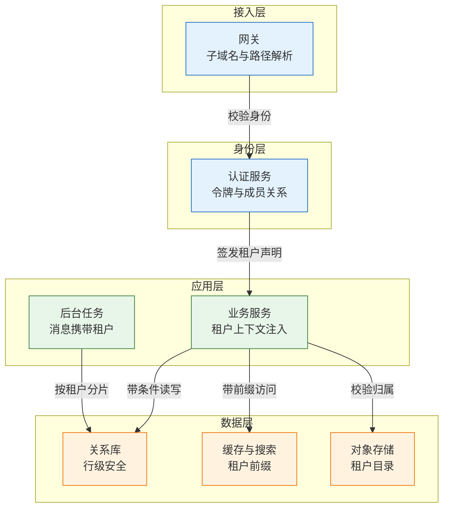
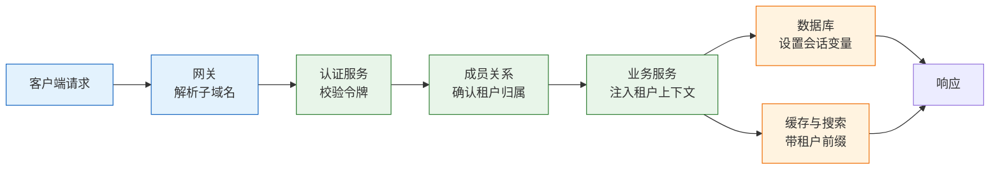

# 多租户与 SaaS 架构

---

## 一、多租户架构是什么

### 1.1 核心概念

多租户（Multi-tenancy）指同一套软件实例同时服务多个相互独立的客户组织，并在数据、配置、权限和计费上维持明确边界。租户（Tenant）是计费、隔离与数据归属的最小单位，它既不是登录用户，也不必然等于公司法人：一个集团可以是计费租户，下属公司是子租户；一个用户也可以同时属于多家租户。

SaaS（Software as a Service）是交付形态，多租户是实现方式。SaaS 可以用单租户部署完成，多租户也可以用于企业内部平台。判断一套系统是否多租户，看三个事实：代码与运行资源是否被多个客户共享；客户数据是否落在同一存储边界内；故障、配额与赔偿是否按客户分别计算。

多租户解决的问题是边际成本。第 100 个客户的开通不应再需要一套服务器、一次部署和一次数据库初始化；版本只维护一条主线；计量、限额、功能开关可以按合同组合。它不解决的问题是客户定制：租户越共享，个性化越需要配置化和扩展点，而不是分支代码。

| 概念 | 含义 | 判断依据 |
|---|---|---|
| 租户 | 计费与数据归属边界 | 合同主体、账单抬头 |
| 用户 | 登录主体 | 身份凭证 |
| 工作区 | 租户内协作单元 | 组织架构 |
| 席位 | 计费单位 | 活跃账号数 |
| 环境 | 生产、测试、沙箱 | 数据是否隔离 |

> **注意**：把每个注册用户当成一个租户，会让团队协作、共享空间、统一账单全部失效。租户边界应由合同和计费确定，再由产品模型映射，不能由注册表单顺手决定。

集团客户要区分计费边界与数据边界。一个集团可以是一个计费租户，下属公司是子租户，数据按子租户分级可见；此时 `tenant_id` 只表达计费归属，数据权限还要靠组织树和授权模型表达。把两者压成同一个字段，跨子公司查询就会绕过权限。

### 1.2 与相邻技术的关系

多租户经常被误认为某个中间件能力。实际上它是身份、数据、部署、计费四层约束的组合，相邻技术各自只覆盖一部分。

虚拟化与容器提供资源隔离，决定租户能否独立占有一份运行环境；数据库的 schema、行级安全和连接池决定数据能否共享存储而互不可见；IAM 与 SSO 决定身份如何跨租户切换；计量与订阅系统决定用量如何归集。任何一层缺失，多租户都会退化成"共享数据库加一个字段"。

与微服务的关系同样需要澄清。多租户不是微服务的前提，微服务也不是多租户的必需。单体应用只要在数据访问层强制租户过滤，同样可以服务大量租户；拆成几十个服务但每个服务各自拼接 tenant_id，反而扩大了越权面。

| 相邻技术 | 提供的能力 | 不提供的能力 |
|---|---|---|
| 容器与虚拟化 | 运行资源隔离 | 数据行级隔离 |
| 数据库行级安全 | 行级访问控制 | 身份与计费 |
| IAM 与 SSO | 身份与成员关系 | 数据归属 |
| 计量计费 | 用量归集 | 隔离与审计 |

### 1.3 模型与架构组成

一套多租户系统可以纵向分成四段：接入与租户识别、身份与成员校验、业务处理、数据与派生存储。租户上下文贯穿四段，任何一段丢失上下文，后面的隔离都不可靠。



| 层 | 核心职责 | 失效后果 |
|---|---|---|
| 接入 | 解析租户来源 | 租户错位 |
| 身份 | 校验成员关系 | 越权访问 |
| 应用 | 传递并固化上下文 | 查询漏条件 |
| 数据 | 强制执行隔离 | 跨租户泄露 |

构成里最容易被忽略的是后台任务。消息消费者、定时任务、报表生成、数据同步都没有登录会话，租户上下文只能来自消息体或任务参数。把它们当作普通内部调用，是共享表模式最常见的泄露入口。

---

## 二、租户模型与隔离边界

### 2.1 租户实体与字段设计

租户表不是只存名称和状态。它要承载路由、计费、合规和生命周期四类信息，字段设计决定了后续能否按客户分层。

| 字段组 | 示例字段 | 用途 |
|---|---|---|
| 标识 | tenant_id、code、域名 | 路由与展示 |
| 隔离 | 部署形态、区域、库名 | 决定数据落点 |
| 计费 | 套餐、席位上限、额度 | 限额与账单 |
| 生命周期 | 状态、保留期、删除时间 | 开通与退出 |

tenant_id 建议使用全局唯一且不可枚举的值，UUIDv7 或雪花 ID 都可，避免自增整数暴露客户数量与签约顺序。对外展示用短码或子域名，内部关联一律用 tenant_id，两者不要混用。

租户状态至少要有试用、正常、欠费冻结、主动注销、待删除五个值。状态不是展示字段，而是所有写入路径的前置条件：冻结租户的写请求应在服务入口被拒绝，而不是等到数据库报错。

> **注意**：租户表里不要放"当前用户""当前角色"这类会话字段。租户是长期实体，会话是短期状态，混在一张表里会导致并发登录互相覆盖。

### 2.2 平台与租户责任边界

多租户合同里最常争议的不是功能，而是谁负责什么。责任边界要写成表，并进入产品文档和 SLA。

| 范围 | 平台负责 | 租户负责 |
|---|---|---|
| 身份 | 登录、多因素认证、会话、租户切换 | 邀请成员、分配角色 |
| 数据 | 存储隔离、备份、加密、审计 | 录入、导入、导出、删除 |
| 配置 | 默认值、版本、灰度 | 业务参数、流程、字段扩展 |
| 合规 | 区域、留存策略、审计日志 | 自身业务合规责任 |

边界清晰带来的直接收益是排障速度。客户报"数据不对"时，先按表判断是平台隔离问题、租户配置问题，还是租户自己的导入错误，而不是从网关一路查到磁盘。

责任表还有一个作用：约束销售承诺。客户最常问的不是"用什么数据库"，而是"数据会不会被拿去分析或共享"。边界写不清，销售只能靠口头保证，工程只能靠临时补丁。

### 2.3 租户上下文来源

租户上下文必须从可信身份推导。可用的来源有三类：子域名、路径前缀、令牌声明。三者选一个作为主来源，其余只做一致性校验。

| 来源 | 优点 | 风险 |
|---|---|---|
| 子域名 | 隔离直观、便于 CDN | 泛解析配置错误 |
| 路径前缀 | 实现简单 | 易被改写 |
| 令牌声明 | 与身份绑定 | 成员变更后过期 |

推荐做法是子域名或路径确定"请求意图"，令牌声明确定"调用者权限"，服务端成员关系表做最终裁决。三者冲突时拒绝请求，不做"以某个请求头为准"的兜底。兜底逻辑一旦存在，攻击者只需要找到优先级最高的那个来源。

> **架构红线**：禁止从请求体、自定义请求头或 URL 查询参数直接读取 tenant_id 并用于数据查询。这些值由客户端控制，等于把租户边界交给调用方。

---

## 三、租户隔离模式对比

### 3.1 三种隔离形态

数据放置只有三种基本形态，其他方案都是它们的组合。

| 形态 | 数据放置 | 成本 | 故障影响 |
|---|---|---|---|
| 独立库 | 一租户一库或一实例 | 最高 | 只影响单租户 |
| 独立 schema | 共享实例，一租户一 schema | 中 | 实例故障影响多租户 |
| 共享表 | 同表加 tenant_id | 最低 | 慢查询影响全部 |

独立库的隔离最彻底，备份、恢复、迁移、加密都可以按租户单独处理，缺点是实例数量随客户增长，升级要逐套执行，跨租户统计要额外抽取。独立 schema 在中间：连接数、备份粒度、权限控制都比共享表清晰，但实例仍是单点。

共享表把成本压到最低，代价是纪律要求最高。任何一条漏掉租户条件的 SQL、任何一个没带前缀的缓存键，都是跨租户泄露。它适合长尾小客户和自助注册，不适合承载强合规客户。

### 3.2 混合分层策略

现实中的多租户很少是纯模型。按客户价值与合规要求分层，是更常见的做法。

| 客户层 | 隔离形态 | 升级策略 |
|---|---|---|
| 免费与长尾 | 共享表，按租户限流 | 随主版本统一升级 |
| 标准客户 | 共享表，独立保留策略 | 统一升级，可预约窗口 |
| 大客户 | 独立 schema 或实例 | 单独窗口，提前通知 |
| 合规客户 | 独立部署，代码同源 | 合同约定版本 |

分层的关键是"代码一套、部署多形态"。如果大客户独立部署后走了单独分支，半年内就会出现无法合并的定制，升级成本重新回到单租户时代。

> **注意**：分层不是永久标签。客户降级时要设计数据迁回共享池的路径，否则独立实例只增不减，成本结构会逐年恶化。

### 3.3 隔离模式选择依据

选择隔离形态时，先看硬约束，再看成本。

| 维度 | 判断问题 | 倾向 |
|---|---|---|
| 合规 | 是否要求数据物理隔离 | 独立库或独立部署 |
| 规模 | 租户数量与单租户数据量 | 数量大选共享 |
| 变更 | 是否需要独立升级窗口 | 独立 schema |
| 团队 | 是否具备多实例运维能力 | 能力弱选共享 |

一个常见误区是把"大客户"直接等同于"独立库"。真正的判断依据是合同里的数据驻留、加密密钥、审计和恢复目标；没有这些要求时，独立 schema 加独立备份往往已经足够，成本却低一个量级。

---

## 四、数据层隔离机制

### 4.1 主键与约束设计

共享表模式下，数据库本身要承担一部分隔离责任，不能只靠应用层自觉。

主键使用全局唯一 ID，不用自增整数。自增 ID 会暴露租户的业务量级和签约顺序，也让跨租户数据合并时的冲突处理变复杂。UUIDv7 兼具时间有序和全局唯一，适合作为业务主键。

唯一约束必须带租户维度。`UNIQUE (email)` 会让第二个租户无法邀请同一邮箱的用户；正确写法是 `UNIQUE (tenant_id, email)`。外键同理，能带 tenant_id 就带上，用复合外键阻止跨租户关联。

| 对象 | 错误写法 | 正确写法 |
|---|---|---|
| 主键 | 自增整数 | UUIDv7 |
| 唯一约束 | `UNIQUE(email)` | `UNIQUE(tenant_id,email)` |
| 外键 | 单列引用 | 复合外键带租户 |
| 索引 | 单列 tenant_id | `(tenant_id, 业务列)` |

索引要把 tenant_id 放在前导列。共享表里几乎所有查询都带租户条件，单列索引会让优化器在大表上走错路径。

### 4.2 行级安全策略

PostgreSQL 的行级安全（Row Level Security，RLS）可以把租户过滤下沉到数据库，应用漏写条件时仍然返回空结果，而不是返回全部数据。

```sql
-- 启用并强制行级安全，表 owner 也受约束
ALTER TABLE device ENABLE ROW LEVEL SECURITY;
ALTER TABLE device FORCE ROW LEVEL SECURITY;

-- 读写都校验会话中的租户变量
CREATE POLICY device_tenant_isolation ON device
  USING (tenant_id = current_setting('app.tenant_id', true)::uuid)
  WITH CHECK (tenant_id = current_setting('app.tenant_id', true)::uuid);
```

策略写好后，每个请求进入事务时设置变量：

```sql
-- 事务内设置，提交后自动失效
BEGIN;
SET LOCAL app.tenant_id = '0192f3a4-0000-7000-8000-000000000001';
SELECT id, name FROM device;
COMMIT;
```

两个细节决定 RLS 是否真的生效。第一，表 owner 默认绕过策略，必须 `FORCE ROW LEVEL SECURITY`。第二，使用 PgBouncer 事务级连接池时，会话变量会跨请求复用，必须用 `SET LOCAL` 而不是 `SET`，并确保变量在事务开始时一定被赋值；漏赋值时 `current_setting(..., true)` 返回空，策略应配合 `COALESCE` 或直接拒绝。

> **架构红线**：RLS 是兜底，不是替代。应用层仍需显式带租户条件，否则一旦换成不支持 RLS 的数据库、或某张表忘记启用策略，泄露会直接发生。

RLS 的代价是每个查询都会附加谓词，执行计划必须能用到 `(tenant_id, ...)` 复合索引，否则大表会出现全表扫描。上线前用 `EXPLAIN` 核对典型查询，确认过滤条件进入索引；策略里避免调用不稳定函数，也不要写跨表子查询，否则每行都会触发一次额外查找。

### 4.3 缓存、搜索与对象存储

派生存储往往比主库更容易泄露，因为它们不共享同一套权限模型。

| 存储 | 隔离手段 | 常见漏洞 |
|---|---|---|
| 缓存 | 键前缀含 tenant_id | 键拼接遗漏 |
| 搜索 | 文档字段加强制过滤 | 查询未强制过滤 |
| 对象存储 | 租户目录前缀 | 签名地址未校验归属 |
| CDN | 缓存键含租户维度 | 页面缓存串租户 |

缓存键建议统一由封装层生成，业务代码不直接拼字符串。搜索索引把 tenant_id 设为必填字段，查询构造器默认注入过滤条件，而不是依赖调用方传入。对象存储的签名地址在签发时校验对象归属，下载时再次校验，避免链接被转发后越权。

### 4.4 后台任务与批处理

后台任务没有登录会话，租户上下文必须显式携带。

| 任务类型 | 上下文来源 | 失败处理 |
|---|---|---|
| 消息消费 | 消息体 tenant_id | 单条重试，进死信 |
| 定时任务 | 分片键含租户 | 记录位点，可重入 |
| 批量导入 | 批次绑定租户 | 按行报告错误 |
| 报表生成 | 任务参数带租户 | 超时隔离，不拖全局 |

批处理要按租户分片，单个租户失败不影响其他租户，也便于限流。大表加索引走在线 DDL，回填任务记录每个租户的处理位点，支持中断续跑。把全量租户放在一个长事务里，是共享表模式下一次锁等待拖垮全站的典型原因。

---

## 五、租户上下文传递链路

### 5.1 一次请求的完整路径



链路上有三个必须拒绝请求的节点：子域名解析不到租户、令牌里的租户与成员关系不符、服务端未拿到租户上下文。拒绝要返回统一错误码，不暴露"该租户存在但无权访问"这类信息。

### 5.2 上下文对象设计

租户上下文不是单个字符串，而是一个不可变对象，至少包含租户标识、用户标识、角色、请求来源和校验时间。

| 字段 | 作用 | 是否可来自客户端 |
|---|---|---|
| tenant_id | 数据过滤 | 否 |
| subject_id | 操作审计 | 否 |
| roles | 权限判断 | 否 |
| source | 区分前台与后台 | 是，仅记录 |

上下文在入口构造一次，向下传递时只读。禁止在业务层修改 tenant_id，也禁止把它放进可被序列化回传的响应对象。跨服务调用时用签名令牌携带，接收方重新校验，不信任调用方自报。

> **注意**：用户被移出租户后，旧令牌里的租户声明仍然有效。高敏操作要回查成员关系，或签发短时效的租户级令牌，把过期窗口压到可接受范围。

### 5.3 管理后台的例外通道

跨租户查询是运营和客服的真实需求，但它不能混在业务 API 里。

| 通道 | 权限 | 审计 |
|---|---|---|
| 业务 API | 单租户成员 | 常规日志 |
| 运营后台 | 平台角色加工单 | 全量记录 |
| 数据导出 | 双人审批 | 导出内容留痕 |

例外通道要有独立的服务入口、独立的权限模型和独立的审计落库。查询语句允许不带租户条件，但必须记录操作人、目标租户、查询语句和返回行数。把"管理员可以跨租户"做成业务 API 的一个布尔参数，等同于给所有越权留后门。

---

## 六、租户生命周期管理

### 6.1 生命周期阶段

多租户的难点不在查询，而在一个租户从开通到删除都能闭环。

| 阶段 | 关键动作 | 失败后果 |
|---|---|---|
| 开通 | 建租户、初始化配置、分配区域 | 半开通，登录空白 |
| 订阅 | 绑定套餐、额度、试用期 | 功能与合同不符 |
| 计量 | 记录席位、调用量、存储量 | 账单争议 |
| 变更 | 升降配、加区域、换域名 | 数据错位、重复计费 |
| 冻结 | 欠费或违规时限制写入 | 误冻结导致停摆 |
| 导出 | 全量数据、附件、审计日志 | 客户无法迁移 |
| 删除 | 软删、保留期、硬删或密钥销毁 | 合规风险 |

开通是最容易做成半成品的阶段。建租户、初始化默认角色、创建对象存储目录、写入搜索索引、配置域名，这些步骤跨多个服务，必须用编排加补偿：每一步幂等，失败可重试，整体状态可查询。只靠一个事务包住数据库写入，跨服务的半初始化仍然会发生。

### 6.2 计量口径

计费争议几乎都来自口径不清，而不是算错。

| 计费方式 | 口径定义 | 争议点 |
|---|---|---|
| 席位 | 周期内有登录的用户 | 离职未删号 |
| 调用量 | 成功且计费的请求 | 重试是否计数 |
| 存储 | 压缩前还是压缩后 | 备份是否计入 |

口径要写进合同附件，并在账单里展示明细。计量事件需要去重键，补报和重放要能识别；月度对账保留原始事件，避免只存聚合值导致无法解释差异。

### 6.3 导出与删除

导出能力是续约的隐形条件。客户要离开时拿不走数据，合同谈判就会变成扣款。

导出范围至少包含业务数据、附件、配置和审计日志，格式用通用格式，附字段说明。导出任务异步执行，完成后给带时效的下载链接，并记录导出人与导出范围。

删除要分三层：业务层软删、保留期内可恢复、保留期后硬删。备份中的副本按备份保留期自然过期，不能承诺"立即彻底删除"。使用独立加密密钥的租户，可以通过销毁密钥实现加密擦除，比逐表删除更可靠，也更容易向审计证明。

> **注意**：搜索索引、缓存、数据仓库、日志平台都存有租户数据。只删主库，等于只完成了一部分删除。删除清单要按存储清单逐项核对。

---

## 七、单租户到多租户迁移

### 7.1 迁移路径

迁移的目标不是一次切换，而是让每个客户都能独立前进或回退。


| 阶段 | 关键动作 | 回退方式 |
|---|---|---|
| 分层 | 按数据量与定制程度排序 | 不迁移即回退 |
| 同步 | 全量快照加增量追平 | 保留旧库写入 |
| 双跑 | 按业务键比对结果 | 以旧侧为准 |
| 切写 | 短停写或双写 | 路由切回旧实例 |

种子客户选数据量小、定制少、配合度高的，不要拿最大客户试。路由表记录客户到实例、库、schema 的映射，任何变更都要审计。切换顺序固定为切读、观察、切写，读流量先验证查询兼容性，写流量最后切换。

### 7.2 回滚设计

回滚要按租户做，不做全局回退。全局回退会把一次局部事故放大成平台事故。

旧实例在新侧稳定前保持可写，否则回滚后无法接收新写入。切写后新侧产生的数据，要能反向同步回旧库，否则客户会丢单。新旧代码要能同时读同一份数据，schema 变更走扩展—收缩：先加列并双写，再迁读，最后删旧列，不做破坏性改列。

停写窗口尽量短。校验脚本、回滚脚本、数据比对都要在窗口前演练完成，窗口内只做最后的连接切换和验证。

### 7.3 数据校验

迁移失败最常见的原因不是同步慢，而是没人定义"一致"。

| 校验对象 | 方法 | 通过标准 |
|---|---|---|
| 行数 | 按租户分组计数 | 新旧完全相等 |
| 金额 | 按业务键求和 | 差异为零 |
| 附件 | 校验和比对 | 全部可下载 |
| 引用 | 抽样检查关联 | 无悬挂记录 |

校验结果要留档，作为切换的准入条件。发现差异时先定位是同步丢失、时区问题还是精度问题，不要用"业务可接受"跳过。

---

## 八、完整案例：设备维保 SaaS 的租户改造

### 8.1 现状与目标

一家设备维保 SaaS 早期为每个客户独立部署：独立数据库、独立应用、独立域名。客户增长后，每次发版要重复部署几十次，总有客户因定制字段拒绝升级；一次报表导出因查询未带租户条件，混入了另一家客户的设备位置与联系人，触发合同中的数据泄露条款。

改造目标有三条：版本只维护一条主线；新客户开通在半天内完成；大客户仍可保留独立数据库和独立密钥。这三个目标决定了不能做纯共享表，只能做混合形态。

### 8.2 隔离设计

按客户分层落位：长尾客户进入共享库共享表；标准客户共享库但使用独立 schema；大客户保留独立实例，代码与主版本同源。

| 客户层 | 数据落点 | 开通方式 |
|---|---|---|
| 长尾 | 共享库共享表 | 自助，分钟级 |
| 标准 | 共享库独立 schema | 编排，小时级 |
| 大客户 | 独立实例 | 编排加人工验收 |

共享表部分启用 RLS，所有业务表强制策略；应用层统一通过数据访问组件注入租户条件，禁止业务代码直接拼接 SQL。缓存键、搜索文档、对象存储路径全部加租户前缀。后台的报表与同步任务改为按租户分片，消息体携带 tenant_id。

### 8.3 迁移执行

先选三家数据量小、定制少的客户迁到共享 schema，验证路由、登录、导出和备份。路由表上线后，客户请求按域名查实例，未迁移客户继续走旧实例。

数据同步采用全量快照加增量追平。双跑期间新旧两侧都能读，对外只返回旧侧结果，后台按业务键比对行数、金额和附件校验和。确认无差异后切读，观察一周错误率与延迟，再切写。切写采用短停写窗口，窗口前完成回滚演练。

### 8.4 结果与固化

改造后，新客户开通由部署工单变为自助流程；版本发布从逐套部署变为一次发布加分层灰度；跨租户导出事故的复现路径被 RLS 和数据访问组件双重阻断。

固化的动作有三项：把租户上下文注入做成框架能力，业务代码无法绕过；把跨租户查询收进独立后台并全量审计；把"新增表必须启用 RLS、必须带 tenant_id"做成建表检查，未通过则持续集成失败。

> **架构红线**：任何新增数据表、缓存键、搜索索引和对象存储路径，都必须先声明租户维度再上线。事后补隔离的成本，远高于建表时多写一列。

---

## 九、治理机制

### 9.1 租户上线检查

每接入一个新租户或一种新隔离形态，按清单核对。

| 检查项 | 通过标准 | 证据 |
|---|---|---|
| 数据落点 | 路由表有记录 | 路由配置 |
| 隔离策略 | 表已启用行级安全 | 建表脚本 |
| 身份 | 成员关系可校验 | 接口返回 |
| 导出 | 全量导出可执行 | 演练记录 |

清单要由平台自动核对，不能靠人工勾选。路由缺失、策略未启用、导出任务失败，都应该在开通流程里直接阻断，而不是等客户投诉。

### 9.2 越权访问防护

越权防护分三层：入口拒绝无租户上下文的请求；数据层用 RLS 兜底；审计层记录跨租户访问。三层都要有，不能互相替代。

集成测试要专门覆盖越权场景：用 A 租户的令牌请求 B 租户的资源 ID，期望返回 404 而不是 403，避免通过错误码探测资源是否存在。测试用例随表结构自动生成，新表上线即纳入。

| 层级 | 拦截对象 | 失效表现 |
|---|---|---|
| 入口 | 缺失或冲突的上下文 | 请求进入错误租户 |
| 数据 | 漏条件的查询 | 返回超出范围的行 |
| 审计 | 跨租户操作 | 事后无法追责 |

### 9.3 运营指标

| 指标 | 含义 | 异常信号 |
|---|---|---|
| 开通时长 | 从签约到可用 | 持续上升 |
| 单租户故障占比 | 故障是否外溢 | 共享层故障升高 |
| 越权拦截数 | 策略命中次数 | 突增需排查 |
| 导出成功率 | 客户退出能力 | 下降影响续约 |

指标用于发现趋势，不用于考核。把越权拦截数当业绩，团队会关掉告警；把开通时长当唯一目标，开通流程会跳过验收。

---

## 十、常见故障与排查

### 10.1 故障判断表

| 现象 | 最可能原因 | 处理 |
|---|---|---|
| 客户看到别家数据 | 查询漏租户条件、缓存键缺前缀 | 停用相关接口，全链路审计 |
| 登录后进入错误租户 | 令牌声明过期、域名与声明冲突 | 以成员关系为准，冲突拒绝 |
| 某租户拖垮数据库 | 无按租户限流、单条大查询 | 加并发与超时配额，隔离慢查询 |
| 账单金额对不上 | 计量口径不清、重复上报 | 事件去重，出账单明细 |
| 新客户开通一半失败 | 初始化非事务、跨服务无补偿 | 编排加幂等，失败可重试 |
| 删除后备份仍有数据 | 只删主库，未处理备份与索引 | 按存储清单核对，密钥擦除 |
| 升级后大客户定制失效 | 定制走了分支，未进主版本 | 配置化与扩展点，禁止分支 |
| 跨租户统计拖慢业务 | 在业务库跑全量聚合 | 走数仓或只读副本 |

### 10.2 处置顺序

1. 确认请求解析出的租户是谁，令牌、域名、成员关系是否一致。
2. 确认 SQL、缓存、搜索、对象存储是否带了租户条件。
3. 确认该租户是否触发限流或配额，排除资源争抢。
4. 确认最近变更：发布、路由调整、策略变更、数据导入。
5. 涉及数据泄露时先隔离接口与缓存，再取证，最后修复。
6. 故障结束后补测试用例、行级安全策略和审计规则，防止同类复发。

> **核心结论**：租户边界是合同边界，不是技术边界；共享越彻底，越需要数据库与框架层的强制约束；迁移按租户推进，回滚也按租户执行。
