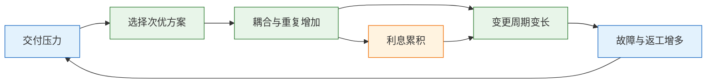
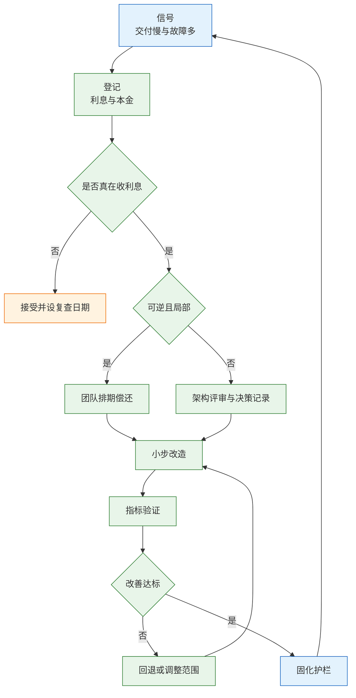

# 技术债与架构治理

---

## 一、技术债与架构治理是什么

### 1.1 核心概念

技术债（Technical Debt）指为了短期交付而选择的次优方案，以及它在后续变更中持续产生的额外成本。这个比喻有两个变量：本金是修复所需的一次性投入，利息是每次变更多花的等待、返工、故障处理和沟通成本。只有同时看这两个变量，才能判断一笔债该不该还。

架构治理（Architecture Governance）是让技术决策可追溯、系统边界可执行、债务状态可见的机制集合。它包含登记、分级、评审、执行、验证和护栏六个环节，核心不是审批，而是让正确的做法成为默认路径。

三个常见误读需要先排除。第一，把所有代码风格问题都叫技术债，导致登记册变成缺陷列表。第二，把治理等同于开会评审，导致决策速度下降。第三，把还债等同于重写，导致高风险的大爆炸式改造。

| 概念 | 定义 | 观察对象 |
|---|---|---|
| 本金 | 修复的一次性投入 | 人日、迁移与回归 |
| 利息 | 每次变更的额外成本 | 等待、返工、故障 |
| 杠杆 | 债务影响的范围 | 单团队到全公司 |
| 偿还 | 降低利息的动作 | 重构、替换、下线 |

> **注意**：一段从未被修改的丑陋代码，利息接近零。用静态扫描结果直接排优先级，会把大量资源投向无人使用的模块。

### 1.2 与相邻技术的关系

技术债治理经常与代码质量工具、持续集成、可观测性、架构测试一起出现，但它们不是同一件事。静态扫描发现坏味与重复，不能判断这笔债是否在收利息；持续集成提供快速反馈，是降低利息的手段，不替代债务决策；可观测性度量故障与延迟，为利息提供证据；架构测试把边界规则变成可执行检查，属于护栏而非治理本身。

概念层面还要区分四组近义说法。代码坏味是局部结构信号，例如重复、超长函数、命名混乱。坏味可能产生利息，也可能只是难看。架构腐化是边界层面的退化，表现为循环依赖、共享数据库、跨层调用。遗留系统强调生命周期和技术栈老化，它是债务的载体，不必然是高利息资产。质量管理关注缺陷与测试，是控制利息的手段之一。

| 相邻实践 | 提供的能力 | 不替代的判断 |
|---|---|---|
| 静态扫描 | 发现坏味与重复 | 是否在收利息 |
| 持续集成 | 快速反馈与门禁 | 处理方式选择 |
| 可观测性 | 故障与延迟证据 | 本金估算 |
| 架构测试 | 边界规则检查 | 决策分级 |

| 概念 | 观察尺度 | 与技术债的关系 |
|---|---|---|
| 代码坏味 | 函数与类 | 可能的利息来源 |
| 架构腐化 | 模块与依赖 | 债务累积的结果 |
| 遗留系统 | 系统生命周期 | 债务的载体 |
| 质量管理 | 缺陷与回归 | 控制利息的手段 |

理解这层区别，才能避免用代码行数或坏味数量替代债务判断。治理的对象是变更成本，不是代码美观。

### 1.3 债务模型与治理组成

债务不是线性增长的。它通过一条回路自我强化：交付压力导致走捷径，捷径增加耦合与重复，耦合让后续变更变慢，变更慢又加重交付压力。打断回路的着力点不在末端加班，而在决策记录、边界约束和自动化护栏。



治理体系由六个部件组成：债务登记册记录事实；分级规则决定谁决策；评审与决策记录留下理由；执行机制保证小步交付；指标验证判断是否改善；护栏阻止同类债务重新长出来。

| 部件 | 作用 | 缺失后果 |
|---|---|---|
| 登记 | 让债可见 | 无人推动 |
| 分级 | 决定决策权 | 全部上会 |
| 决策记录 | 保留理由 | 反复争论 |
| 指标 | 验证改善 | 自我感觉良好 |
| 护栏 | 防止复发 | 还完又欠 |

六个部件里，最容易被跳过的是决策记录。没有记录"为什么暂时不拆"，半年后新人会重新提出同一方案，讨论从零开始。

---

## 二、技术债的形成机制

### 2.1 激励错位

债的产生通常不是懒惰，而是激励结构的结果。交付日期是硬的，可维护性是软的；上线数量可统计，架构质量难量化；架构师离代码远，评审容易变成签字；团队换人频繁，没人对三年前的决策负责。

| 错位 | 表现 | 后果 |
|---|---|---|
| 时间 | 排期只留开发不留重构 | 捷径成为唯一选项 |
| 指标 | 只看上线数量 | 质量无人负责 |
| 权责 | 决策者不承担维护 | 选型偏短期 |
| 人员 | 轮换快 | 上下文丢失 |

改变激励比呼吁重视更有效。把债务偿还写进季度目标、把变更前置时间纳入团队看板、让选型人参与一年后的维护，都是改变条件的动作。只发一封"重视质量"的邮件，不会让任何一笔债消失。

### 2.2 复利路径

同一笔债在不同阶段的利息形态不同。早期表现为多写几行重复代码；中期表现为改一处要回归五个模块；后期表现为没人敢改，发布只能靠手工验证；最终表现为系统只能冻结，业务需求绕道新系统。

| 阶段 | 利息形态 | 典型信号 |
|---|---|---|
| 早期 | 重复劳动 | 同一规则多处实现 |
| 中期 | 回归成本 | 改动牵连多个团队 |
| 后期 | 发布恐惧 | 发版靠手工清单 |
| 终局 | 冻结 | 需求绕道新建系统 |

复利路径解释了为什么"等有空再还"通常不会发生。利息随时间上升，而可用预算不会同步上升，拖到最后只能选择重写或下线。重写的成本又高于早期偿还，这就是债务的终局。

### 2.3 组织与架构的耦合

架构边界往往复制组织边界。两个团队共用一个数据库，是因为他们没有清晰的接口约定；一个服务被三个团队修改，是因为所有权没有定义。这类债务无法靠重构代码解决，必须先调整职责。

| 组织现象 | 架构表现 | 治理动作 |
|---|---|---|
| 团队共用库 | 表级耦合 | 定 Owner，收口写入 |
| 职责重叠 | 多团队改同一服务 | 划边界，建接口 |
| 决策集中 | 审批排队 | 分级授权 |
| 人员流失 | 知识断层 | 决策记录与轮岗 |

> **注意**：组织问题不解决，代码层面的解耦会被重新耦合回去。拆完服务仍然共用一张表，说明所有权没有真正划分。

组织调整的节奏比技术重构慢，治理方案要承认这个现实。先收口写入、再拆数据、最后拆服务，每一步都能在现有组织下执行，比一次组织改革加一次系统重写更可行。

---

## 三、技术债分类与分级模型

### 3.1 七类债务

分类的目的不是贴标签，而是匹配处理手段。

| 类型 | 典型信号 | 利息形式 |
|---|---|---|
| 代码债 | 重复逻辑、超长函数 | 改一处漏三处 |
| 设计债 | 循环依赖、共享数据库 | 变更牵连多团队 |
| 测试债 | 无回归、用例不稳定 | 不敢发版 |
| 数据债 | 口径不一、无血缘 | 报表打架 |
| 依赖债 | 停止维护、高危漏洞 | 升级连锁 |
| 运维债 | 手工发布、备份未演练 | 恢复慢 |
| 知识债 | 单人掌握、无文档 | 人走一片空白 |

七类债的处理成本差异很大。代码债可以在迭代内偿还；设计债需要跨团队排期；数据债要先统一口径再改系统；依赖债受上游社区节奏约束；知识债只能靠时间和机制，无法一次性买断。

### 3.2 债务分级

分级同时看影响范围和不可逆程度。

| 级别 | 判定 | 决策权 |
|---|---|---|
| P0 | 影响资金、安全、合规 | 架构组加业务负责人 |
| P1 | 跨团队、变更频繁 | 相关团队协商 |
| P2 | 单团队、可逆 | 团队自决 |
| P3 | 低变更、低影响 | 接受并记录 |

分级不是按代码量，而是按"如果不处理，最坏会发生什么"。一笔只影响内部报表的债，即使代码很乱，也很难进 P0；一笔涉及计费口径的债，即使只改几行，也必须上收。

分级还要看爆炸半径。影响单团队的问题，可以由团队自己排期；影响多条业务线的问题，必须有统一的协调者；影响全公司的，要进入季度规划而不是团队待办。

### 3.3 偿还判断

分类分级之后，用三个问题过滤。

| 问题 | 判断内容 | 不通过的处理 |
|---|---|---|
| 是否真在收利息 | 变更频率与返工 | 接受，设复查 |
| 利息落在谁身上 | 单团队还是全公司 | 找共同承担者 |
| 本金是多少 | 开发、迁移、回归、培训 | 拆小或暂缓 |

优先级用"影响 × 频率 × 爆炸半径 ÷ 修复成本"粗排。这个公式不追求精确，只用来把讨论从"我觉得重要"拉到可比较的维度上。公式的输出也不是排期表，而是排序依据，最终仍要结合季度目标调整。

> **注意**：修复成本要算上迁移、回归、停服和培训。只算编码人日，会系统性低估本金，导致排期一再超支。

---

## 四、技术债量化方法

### 4.1 指标组

单个指标容易被游戏，成组看才有意义。

| 指标 | 说明 | 配套观察 |
|---|---|---|
| 前置时间 | 提出到上线 | 等待时间占比 |
| 变更失败率 | 回滚与热修比例 | 小故障是否隐瞒 |
| 恢复时间 | 故障到恢复 | 覆盖系统范围 |
| 发布频率 | 批量大小 | 是否拆无意义发布 |

四个指标要一起看。发布频率上升但失败率也上升，说明批量变小了但质量没跟上；前置时间下降但恢复时间上升，说明为了快牺牲了可恢复性。单看任何一项，都能得出相反的结论。

### 4.2 利息测算

债务利息可以用一个简单模型估算：每次变更多花的等待时间，乘以变更频率和参与人数。

```bash
#!/usr/bin/env bash
set -euo pipefail

# ========== 输入参数 ==========
# 单次变更因债务多等的天数，按实际观察填写
EXTRA_DAYS="${EXTRA_DAYS:?请设置 EXTRA_DAYS}"
# 每月受影响的变更次数
CHANGES_PER_MONTH="${CHANGES_PER_MONTH:?请设置 CHANGES_PER_MONTH}"
# 每次变更涉及的人数
PEOPLE="${PEOPLE:-3}"
# 每人日成本，按内部核算口径填写
DAY_COST="${DAY_COST:?请设置 DAY_COST}"

# ========== 计算月度利息 ==========
INTEREST=$(awk -v d="$EXTRA_DAYS" -v c="$CHANGES_PER_MONTH" \
  -v p="$PEOPLE" -v cost="$DAY_COST" \
  'BEGIN { printf "%.2f", d * c * p * cost }')

# ========== 输出 ==========
printf '月度利息估算: %s\n' "$INTEREST"
printf '年度利息估算: %s\n' "$(awk -v i="$INTEREST" 'BEGIN { printf "%.2f", i * 12 }')"
```

运行方式：

```bash
# 全部单价与工时由内部口径传入，不内置报价
EXTRA_DAYS=1 CHANGES_PER_MONTH=6 PEOPLE=3 DAY_COST=0 ./debt.sh
```

脚本的价值是把"感觉很慢"变成可比较的量级，用它和本金对比，判断回收期。单价与工时全部由环境变量传入，不内置任何报价，避免把示例数字当成真实成本。

### 4.3 指标误用

| 误用 | 表现 | 后果 |
|---|---|---|
| 单指标排名 | 只看发布次数 | 拆无意义发布 |
| 覆盖率崇拜 | 追求行覆盖 | 断言恒真 |
| 故障美化 | 把事故标为咨询 | 趋势失真 |
| 只扫不修 | 高危依赖长期挂账 | 合规风险 |

指标一旦进入考核，团队会优化指标本身。正确用法是看趋势、找瓶颈、验证改善，而不是给团队排序。指标的解释权要留给复盘会议，而不是绩效系统。

---

## 五、治理方案对比

### 5.1 处理手段

同一笔债有六种处理方式，偿还只是其中之一。

| 手段 | 适合 | 代价 |
|---|---|---|
| 偿还 | 高频变更、利息明确 | 开发与回归 |
| 遏制 | 短期不能改 | 长期维护成本 |
| 封装 | 旧实现稳定、接口可抽象 | 适配层维护 |
| 替换 | 有成熟替代品 | 迁移与培训 |
| 下线 | 无人使用 | 依赖确认 |
| 接受 | 低价值、低变更 | 记录与复查 |

"接受"是正式决策，不是失败。最危险的状态是既不还也不记录，最后没人知道它为什么还在。遏制和封装经常被视为拖延，但它们在"短期不能动"的约束下是合理选择，前提是写清解除条件。

遏制是在债务外面加一道可控边界。旧报表直连主库，短期不能改，可以先给它单独的只读副本和连接数上限，把爆炸半径压住；接口没有鉴权，可以先在网关加统一认证，再逐步下沉。遏制不降低债务本身，但能把"随时可能出事"变成"出事只影响一块"。

封装是在旧实现外面加一层稳定接口。旧计费引擎逻辑混乱但结果正确，可以先用防腐层隔离它的数据模型，让新代码只依赖接口；等替换条件成熟，换实现而不改调用方。封装的代价是适配层要长期维护，所以接口要足够窄，不能把旧模型的全部细节透出去。

### 5.2 治理模式

治理模式决定决策速度和一致性。

| 模式 | 决策方式 | 适合 |
|---|---|---|
| 集中审批 | 架构组统一评审 | 系统少、合规强 |
| 联邦式 | 原则统一、域内自决 | 多团队、边界清晰 |
| 平台自服务 | 模板与护栏默认正确 | 规模大、重复多 |

集中审批在早期有效，系统变多后成为瓶颈；联邦式依赖清晰的域边界和共同的架构原则；平台自服务把规范编码进模板和流水线，是规模化后的主要方向。三者不是替代关系，通常并存：不可逆决策集中，域内设计下放，重复性工作平台化。

### 5.3 选择依据

| 维度 | 集中审批 | 联邦式 | 平台自服务 |
|---|---|---|---|
| 决策速度 | 慢 | 中 | 快 |
| 一致性 | 高 | 中 | 高 |
| 前期投入 | 低 | 中 | 高 |
| 规模上限 | 低 | 中高 | 高 |

选择依据是团队数量、系统耦合度和重复问题占比。团队少、系统耦合重时，集中审批能快速建立原则；团队多、边界清楚时，联邦式更可持续；同类问题反复出现时，应该把答案做成平台能力。

> **注意**：三种模式混用时，要明确哪类决策走哪条通道。否则团队会同时收到"自主决定"和"必须审批"两种信号，最后选择阻力最小的一条。

---

## 六、技术债治理流程

### 6.1 流程总览



| 阶段 | 产出 | 时限 |
|---|---|---|
| 登记 | 债务条目与 Owner | 发现后一周 |
| 决策 | 处理方式与理由 | 一个迭代内 |
| 执行 | 可验证的中间交付 | 按能力切分 |
| 验证 | 指标对比 | 改造后一个月 |

流程的价值在于把"要不要还"从情绪争论变成固定动作。登记之后必须有一次决策，决策之后必须有验证，验证不通过可以回退，而不是无限期挂着。

### 6.2 登记

登记册不需要复杂工具，一张表就够，但字段要能支撑决策。

| 字段 | 说明 |
|---|---|
| 编号与标题 | 一句话说清问题 |
| 影响能力 | 对应哪个业务能力或流程 |
| 利息 | 具体表现与量级 |
| 本金 | 修复人日与迁移成本 |
| 爆炸半径 | 单团队、单业务线或全公司 |
| Owner | 一个具体的人 |
| 触发条件 | 什么情况下必须还 |
| 到期时间 | 主动借债的复查日期 |

其中触发条件与到期时间最容易被省略。主动借的债必须写复查日期，否则"暂时"会变成永久。登记册每月要有状态变化：新增、偿还、降级、接受、关闭，长期不动的条目会被遗忘。

### 6.3 决策与执行

决策输出三件事：选哪种手段、谁负责、什么条件下重新评估。执行要小步，每两周有可验证的中间状态。

把"拆库"拆成"收口写入、加只读副本、按服务分账号、最后拆库"，每一步都能独立上线和回滚。大爆炸式重构的问题是中间没有可交付状态，一旦延期就没有退路。

改造旧模块常用两种手法。分支抽象是在新旧实现之间加开关，让少量流量走新路径，验证后再扩大比例；绞杀者模式是在旧系统外围逐步重建能力，新请求走新实现，旧实现按功能逐块下线。两者共同的要求是旧路径在切换期保持可用，否则第一次失败就会被迫整体回滚。

执行还要控制并发改造的数量。同时改数据模型、接口协议和部署方式，出问题时无法判断是哪一层导致；一次只动一个维度，其他维度保持稳定，才能把故障归因清楚。

### 6.4 验证与固化

验证看改造前后的指标对比，不看代码行数。固化把一次性的修复变成默认规则：依赖检查进持续集成、建表规范进模板、发布门禁进流水线。

| 固化对象 | 实现方式 | 生效标志 |
|---|---|---|
| 依赖方向 | 架构测试 | 跨层引用构建失败 |
| 接口契约 | Schema 校验 | 破坏性变更被拦截 |
| 数据库变更 | 扩展收缩检查 | 直接删列被拒绝 |
| 新服务基线 | 脚手架模板 | 默认带监控与集成流水线 |

> **注意**：护栏上线初期先告警、后阻断。直接阻断会把历史遗留问题一次性暴露，导致团队集体申请豁免，最后规则形同虚设。

---

## 七、治理职责与决策分级

### 7.1 主体边界

| 主体 | 负责 | 不负责 |
|---|---|---|
| 架构组 | 跨系统原则、重大选型 | 每个需求的详细设计 |
| 平台团队 | 模板、流水线、可观测 | 业务功能取舍 |
| 业务团队 | 本域设计、债务登记 | 修改其他域模型 |
| 技术负责人 | 优先级、预算、人员 | 替团队做技术细节 |

架构组要小而固定，职责是制定原则和裁决争议，不是审所有设计。平台团队的产出是可复用的能力，不是替业务做定制。一旦平台团队开始接业务需求，铺路的工作就会停下来，重复问题会重新出现。

### 7.2 决策分级

| 类型 | 决策权 | 记录要求 |
|---|---|---|
| 可逆、局部 | 团队自决 | 变更说明 |
| 可逆、跨团队 | 协商 | 接口约定 |
| 不可逆、跨团队 | 架构评审 | 决策记录与回滚方案 |
| 涉及资金安全 | 独立评审 | 双人签认 |

"不可逆"是关键词。换数据库、改主键、拆服务、换云、改计费口径，撤回成本高，才值得上收。改一个内部函数命名，不需要委员会。分级的边界要写成例子，否则每个团队都会把自己的决策解释成"局部可逆"。

### 7.3 决策记录

决策记录（Architecture Decision Record，ADR）记录背景、选项、决定和后果，一条一页。

| 字段 | 内容 |
|---|---|
| 状态 | 提议、接受、取代、废弃 |
| 背景 | 约束与问题 |
| 决定 | 选了什么 |
| 后果 | 代价与触发条件 |

ADR 的价值在"后果"一栏。只写选了什么，不写放弃了什么、什么条件下重评，半年后无法判断是否仍然成立。ADR 也不该被篡改，新决策写新记录并标注取代关系，历史保留。

---

## 八、治理模式迁移路径

### 8.1 阶段划分

从审批型治理走向自服务治理，不能一步到位。


| 阶段 | 关键动作 | 退出条件 |
|---|---|---|
| 审批型 | 建立评审与决策记录 | 原则成文 |
| 原则型 | 明确边界与例外 | 域边界清晰 |
| 联邦型 | 下放域内决策 | 一致性可验证 |
| 自服务型 | 模板与护栏 | 例外率可控 |

每个阶段都要有退出条件，否则组织会停在某个阶段并把它当成终点。审批型的退出条件是原则成文且评审有固定分级；原则型的退出条件是域边界和数据所有权清晰；联邦型的退出条件是域内决策没有造成跨域事故。

### 8.2 回滚设计

治理改革也会做错，要留退路。

| 风险 | 回滚方式 | 触发条件 |
|---|---|---|
| 下放过快 | 收回特定类型决策 | 跨域事故增加 |
| 护栏误报 | 降级为告警 | 误报率过高 |
| 平台不好用 | 保留手工通道 | 采用率停滞 |
| 指标恶化 | 回退流程 | 前置时间连续上升 |

触发条件要提前写成阈值，例如"跨域 P1 事故两个月内达到两次"或"新流程使前置时间连续两月上升超过两成"。没有阈值，回滚会变成政治决策，谁声音大谁赢。

### 8.3 试点与推广

新规范先在一个团队、一个服务上跑，观察两周再推广。试点要选有代表性的服务：既不能是最简单的玩具服务，也不能是全公司最乱的遗留系统。

| 试点对象 | 适合验证 | 不适合验证 |
|---|---|---|
| 中等复杂度服务 | 规则可行性 | 极端性能约束 |
| 活跃变更团队 | 使用意愿 | 长期无人维护模块 |
| 有监控基线 | 效果对比 | 无指标系统 |

试点失败就停，不搞"全公司必须"。推广阶段保留例外申请通道，例外要有 Owner、有到期日、公开可见。

---

## 九、完整案例：订单与结算共库

### 9.1 现状与量化

订单、结算、报表三个服务直连同一套库，任何团队都能改表。订单相关变更平均等待数天，其中相当一部分时间在等结算团队确认；共库导致的锁冲突引发过多次故障。

量化动作有三项：统计过去半年的变更等待时间分布，按团队归因；统计锁冲突与死锁的故障次数；估算拆库与收口两种方案的本金。数字按内部口径填写，不引用外部基准。

| 观察项 | 数据来源 | 用途 |
|---|---|---|
| 变更等待 | 工单与流水线 | 计算利息 |
| 锁冲突故障 | 监控与复盘 | 判断爆炸半径 |
| 直连调用点 | 代码扫描 | 估算改造量 |
| 修复人日 | 团队估算 | 计算本金 |

### 9.2 方案对比

| 方案 | 周期 | 风险 | 可逆性 |
|---|---|---|---|
| 直接拆库 | 长 | 高 | 低 |
| 收口写入加只读副本 | 短 | 低 | 高 |
| 维持现状 | 无 | 持续累积 | 无 |

选择收口方案：结算团队提供写入接口，订单侧改为调用；加只读副本承接报表查询；数据库账号按服务拆分，只授予必要的表权限。决策记录写明为什么暂不拆库，以及什么条件下启动拆库。

这个选择的关键不是"哪个更先进"，而是"哪个能在当前组织条件下执行"。直接拆库需要三个团队同时改数据模型，协调成本高；收口只需要结算团队提供接口，订单团队改调用，边界清晰。

### 9.3 执行

执行分四步。第一步，梳理直连调用点并分级，区分读与写。第二步，结算侧提供幂等写接口和契约测试。第三步，订单侧切换调用，旧直连保留并打日志统计残留。第四步，按服务拆分数据库账号，回收多余权限。

| 步骤 | 产出 | 验证 |
|---|---|---|
| 梳理 | 调用点清单 | 读写分类完整 |
| 接口 | 幂等写接口 | 契约测试通过 |
| 切换 | 新调用链 | 残留调用下降 |
| 收权 | 分服务账号 | 越权写入失败 |

切换按服务灰度，不一次性全量。先切一个非核心写场景，观察接口错误率、写入延迟和结算侧的对账结果；稳定后再扩大。旧直连保留期间，每次调用都记录调用方、表名和 SQL 指纹，按周汇总残留量。残留不下降时先查是不是有团队没有排期，而不是直接切断连接。

权限回收放在最后，是因为它最容易暴露隐藏依赖。按服务拆分账号后，任何绕过接口的直接写入都会立刻失败，这既是收口完成的标志，也是一次真实的依赖验证。

### 9.4 验证与固化

验证看三项：变更等待是否下降、锁冲突故障是否归零、残留直连是否收敛到有到期日的少数几处。达标后固化：持续集成增加依赖检查，新代码直连结算库直接失败；每季度复查一次，满足预设条件时启动拆库。

> **注意**：收口不等于拆库。它降低的是写入耦合，读依赖仍然存在。把收口当成终点，会在数据量增长后重新遇到报表拖慢主库的问题。

---

## 十、治理机制

### 10.1 运行节奏

| 机制 | 频率 | 产出 |
|---|---|---|
| 债务评审 | 每月 | 状态变更与优先级 |
| 架构评审 | 按需 | 决策与记录 |
| 指标复盘 | 每季度 | 趋势与瓶颈 |
| 护栏校准 | 每半年 | 规则增删 |

节奏比强度重要。每月一次短会比每季度一次长会更容易坚持，也更容易发现状态停滞的条目。评审的输出要落到具体的人和日期，否则会议结束即失效。

### 10.2 护栏清单

| 护栏 | 工具类别 | 拦截对象 |
|---|---|---|
| 依赖方向 | 架构测试 | 跨层引用 |
| 接口契约 | Schema 校验 | 破坏性变更 |
| 数据库变更 | 迁移检查 | 直接删列 |
| 安全与许可 | 依赖扫描 | 高危组件 |

工具只解决可自动化的部分。命名、边界合理性、注释质量仍要靠评审，但评审应该聚焦这些无法自动化的判断。可自动化的规范不要写进文档要求人记，直接做成检查。

### 10.3 反游戏化

| 游戏方式 | 表现 | 对策 |
|---|---|---|
| 拆发布 | 频率高但无价值 | 看批量与失败率 |
| 标咨询 | 故障不计入统计 | 统一分级口径 |
| 堆覆盖率 | 断言恒真 | 抽查变异测试 |
| 豁免泛滥 | 人人申请例外 | 例外有到期日 |

治理指标要成组看，并且和业务结果关联。发布频率上升但客户投诉不变，说明改善有限；前置时间下降但故障恢复变慢，说明风险被推迟。

---

## 十一、常见故障与排查

### 11.1 故障判断表

| 现象 | 最可能原因 | 处理 |
|---|---|---|
| 评审会开成设计会 | 没有分级，全部上会 | 只审不可逆决策 |
| 债务表建了没人看 | 无 Owner、无月度节奏 | 纳入季度规划 |
| 重构长期不上线 | 范围过大、无中间交付 | 按能力切分 |
| 同类故障反复 | 只修现象不改机制 | 复盘输出护栏 |
| 新服务快速腐化 | 模板缺可观测与流水线 | 平台补齐基线 |
| 依赖升级排不上 | 无安全门禁 | 高危阻断合并 |
| 架构图与实际不符 | 图是交付物不是活文档 | 从代码生成并校对 |
| 团队互相甩锅 | 数据与接口无权威源 | 定 Owner 与裁决规则 |

### 11.2 处置顺序

1. 定位变更链路上哪一段在等待，区分开发、评审、测试、发布。
2. 判断等待是否由耦合、缺测试或环境问题导致。
3. 查债务登记册是否已有记录，避免重复立项。
4. 评估利息量级与本金，选择偿还、遏制、封装或接受。
5. 小步执行并设中间验证点，不同时改边界与实现。
6. 达标后固化护栏，未达标则回退范围而不是加人硬推。

> **核心结论**：债是激励与边界的产物；先量化利息再谈本金；治理靠分级与护栏，不靠记忆和运动；治理本身也要有试点、开关和退出条件。
