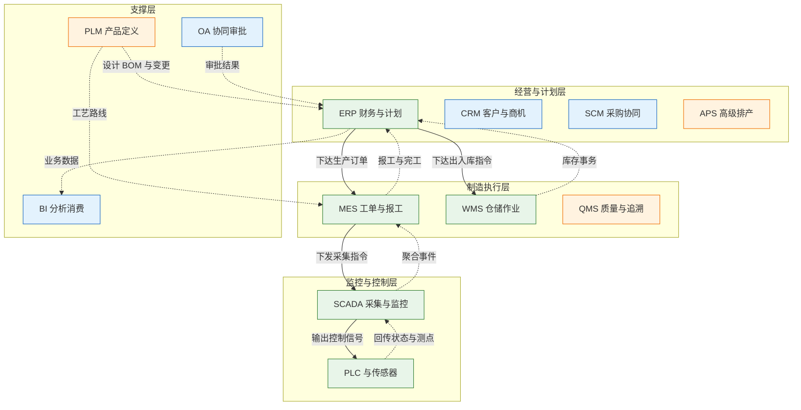
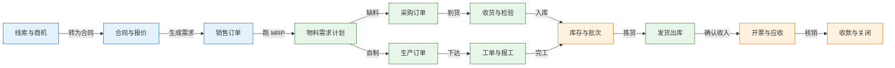
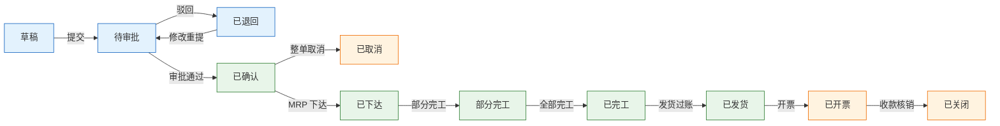

# 企业系统全景与分层

---

## 一、企业系统全景是什么

### 1.1 核心概念

企业系统全景（Enterprise System Landscape）是对一家企业全部业务系统、业务对象、端到端流程与数据流向的整体描述。它不回答“某个系统有哪些菜单”，而回答四个更基础的问题：业务对象由谁创建，流程跨过哪些系统，接口之间传什么，失败之后由谁兜底。

全景的最小构成单位不是系统，而是**业务对象**。客户、物料、销售订单、工单、库存、凭证，这些对象在现实业务里存在唯一含义，在系统里却常被复制成多份。全景的第一项工作，是把对象列全，并给每个对象指定唯一的权威写入源。

由此引出三个贯穿全篇的概念：

- **权威源（System of Record）**：某个对象唯一允许写入的系统。其他系统只能引用、订阅或只读，不能各自维护一套。
- **单据（Document）**：业务对象在一次流程中的载体，带单号、状态、行项目和审批记录。跨系统追踪靠单号，不靠数据库自增主键。
- **端到端流程（End-to-End Process）**：从客户需求到交付回款、从采购需求到付款的完整链路。它跨多个系统，任何单点系统都看不到全貌。

| 概念 | 含义 | 判断标准 |
|---|---|---|
| 权威源 | 对象唯一写入方 | 两个系统都能改即为设计缺陷 |
| 单据 | 流程中的业务凭证 | 有单号、状态、行项目 |
| 主数据 | 跨流程复用的基础数据 | 变更需审批与分发 |
| 事务数据 | 一次业务产生的记录 | 只追加，不随意修改 |

全景图的价值在于暴露“同一件事有多个系统在管”的位置。系统数量多不是问题，口径不统一才是问题。一张订单在五个部门得到五个答案，通常不是数据错了，而是没有一个跨系统的业务主线把合同、订单、工单、库存、发货、开票串起来。

> **注意**：全景图不是组织架构图，也不是网络拓扑图。它描述的是业务对象与单据的流向，箭头代表数据或指令，不代表汇报关系。

### 1.2 与相邻概念的关系

企业系统全景容易与企业架构、业务流程管理、系统集成、数据治理混为一谈。四者关注点不同，交付物也不同。

企业架构（EA）覆盖业务架构、应用架构、数据架构、技术架构，全景图只是应用架构中的一张现状图。业务流程管理（BPM）关注流程如何设计、执行与优化，全景图只标注流程经过哪些系统，不展开流程内部的审批规则。系统集成（EAI）解决系统之间如何通信，全景图先确定“哪些系统之间需要通信”。数据治理关注主数据的标准、质量与责任，全景图为其提供对象清单与权威源依据。

| 概念 | 解决的问题 | 与全景图的关系 |
|---|---|---|
| 企业架构 | 业务与 IT 如何对齐 | 全景图是其中一张现状视图 |
| 业务流程管理 | 流程如何设计与优化 | 提供端到端流程清单 |
| 系统集成 | 系统之间如何通信 | 消费全景图中的集成点 |
| 数据治理 | 主数据标准与质量 | 消费全景图中的对象与权威源 |

全景图应先于选型完成。先画对象和流程，再决定买什么系统；顺序反过来，就会得到一堆功能重叠、接口互斥的产品。

### 1.3 分层架构组成

制造业常用 ISA-95（IEC 62264）作为分层参考，把企业活动分为经营计划、制造执行、监控采集、控制、物理过程五层。PLM、OA、BI 不属于这条主链，它们跨层提供支撑。



| 层级 | 典型系统 | 数据节奏 | 主要职责 |
|---|---|---|---|
| 经营与计划 | ERP、CRM、SCM、APS | 日/小时 | 订单、采购、计划、财务 |
| 制造执行 | MES、WMS、QMS | 分钟/秒 | 工单、报工、仓储、质量 |
| 监控与控制 | SCADA、PLC | 秒/毫秒 | 采集、报警、逻辑控制 |
| 支撑 | PLM、OA、BI | 按事件 | 产品定义、审批、分析 |

分层的目的不是把图画整齐，而是确定数据 Owner 与集成边界。秒级测点不应直接写入经营层业务库，应先进入时序库或数据平台，由 MES 补齐工单、批次等上下文再向上汇总。经营层的计划也不应直接控制现场设备，必须经过 MES 或 SCADA 的指令校验与人工确认。

> **注意**：Purdue 模型描述工业控制网络的层级（Level 0–5），偏网络与安全；ISA-95 描述制造运营与业务系统的功能分层。两者可以配合使用，但不是同一个标准，汇报时写清引用的是哪一个。

---

## 二、端到端业务流程

### 2.1 四条主流程

企业按流程运转，不按模块运转。跨系统主线至少画清四条，每条都要写明起点、终点、主系统与业务承诺。

| 流程 | 起点与终点 | 主系统 | 业务承诺 |
|---|---|---|---|
| 线索到回款（L2C） | 线索/商机 → 回款核销 | CRM→ERP→MES→WMS | 交期、开票、回款 |
| 采购到付款（P2P） | 请购 → 供应商付款 | ERP→SRM→WMS→ERP | 到料、对账、付款 |
| 计划到生产（P2P） | 需求预测 → 完工入库 | ERP/APS→MES→WMS | 计划达成、质量、成本 |
| 问题到解决（ITR） | 客户投诉 → 闭环 | CRM→QMS/MES→WMS | 响应时长、一次解决率 |

两条流程的英文缩写都是 P2P，团队沟通时应写全称：Procure-to-Pay 与 Plan-to-Produce。缩写混用会让接口文档出现方向性错误。

流程设计的关键不是画出顺利路径，而是设计异常路径。L2C 承诺交期，做不到时要改期、拆单或部分发货，并主动通知客户；P2P 承诺到料，做不到时要启用替代料、紧急采购或调整排产；计划到生产承诺完工，做不到时要加班、外协或重排；ITR 承诺闭环时间，超时要升级、赔付或召回。没有兜底动作的流程，一旦某个系统卡住，业务就整体停摆。

### 2.2 订单履约主线

订单履约是最能检验全景图是否成立的链路。它从商机开始，经过订单、计划、采购、生产、仓储、开票，最终落到回款。每一个环节都产生单据，单据号把链路串起来。



这条链上最容易断的三处：合同号与订单号混用，导致销售与财务对不上；工单在 ERP 与 MES 各建一套，导致重复生产；发货与开票分离后没人对账，导致收入确认滞后。三处都能靠“单号唯一 + 状态订阅 + 日对账”解决，不需要更换系统。

### 2.3 流程承诺与异常兜底

| 流程 | 典型异常 | 兜底动作 | 可观测信号 |
|---|---|---|---|
| L2C | 缺料导致交期延误 | 拆单、改期、部分发货 | 订单延期天数 |
| P2P | 供应商断供 | 替代料、紧急采购 | 缺料工单数 |
| 计划到生产 | 设备故障 | 外协、调序、加班 | 计划达成率 |
| ITR | 一次修不好 | 升级、换件、召回 | 重复报修率 |

异常兜底必须落到具体系统动作，不能只写“及时处理”。例如拆单要在 ERP 生成新的订单行并保留原单关联，改期要触发交期重算并通知 CRM，替代料要走工程变更并更新 BOM 版本。兜底动作没有系统承载，现场就会用 Excel 和电话补，数据随即失真。

> **业务红线**：任何跨系统补偿都不能直接修改下游已完成单据的数量或金额。正确做法是生成冲销单或调整单，保留原单据与操作人，否则账实与审计同时失效。

---

## 三、核心数据模型

### 3.1 业务对象与权威源

对象清单是全景图的核心资产。每个对象只允许一个系统写入，其他系统引用编码或订阅变更。

| 对象 | 权威源 | 其他系统角色 | 常见冲突 |
|---|---|---|---|
| 客户 | CRM | ERP 管信用，BI 只读 | 两套客户编码 |
| 物料 | ERP | PLM 管设计，MES 管现场 | 一物多码 |
| 设计 BOM | PLM | ERP/MES 转制造 BOM | 变更未同步 |
| 销售订单 | ERP | CRM 管合同，BI 只读 | 合同号当订单号 |
| 工单 | MES | ERP 只读进度 | ERP 重复建工单 |
| 实物库存 | WMS | ERP 管财务库存 | 两边都能调整 |
| 财务凭证 | ERP | BI 只读 | 跨期过账 |

这张表最重要的是“其他系统角色”一列。系统边界不是由功能清单定义的，而是由“哪些事不归它管”定义的。给每个对象写清四件事：谁创建、谁维护、谁只读、冲突怎么裁决。没有裁决规则，集成越多，数据越乱。

### 3.2 订单状态机

订单状态必须有唯一权威状态机，其他系统通过事件订阅状态，不各自维护一套“订单进度”。状态机的每个迁移都要有触发条件、操作权限与下游可见性。



| 状态 | 进入条件 | 允许动作 | 下游可见性 |
|---|---|---|---|
| 草稿 | 录入未提交 | 编辑、删除 | 仅创建人 |
| 待审批 | 提交成功 | 同意、驳回、撤回 | 审批人 |
| 已确认 | 审批通过 | 下达、取消 | 计划与财务 |
| 已下达 | 生成生产/采购需求 | 完工确认 | MES、WMS |
| 已发货 | 出库过账 | 开票、退货 | CRM、财务 |
| 已关闭 | 收款核销完成 | 只读 | 全部 |

状态迁移必须幂等。接口重发同一“发货过账”请求时，系统应识别订单已处于“已发货”并返回原结果，而不是再扣一次库存。实现方式是在状态迁移上带版本号或唯一事件号，数据库用条件更新：只有当前状态等于预期前置状态时才允许更新。

### 3.3 核心表结构示例

跨系统追踪依赖业务单号，不依赖自增 ID。下面三张表覆盖订单头、订单行与库存事务，是履约链路的最小闭环。

```sql
-- 销售订单头：金额、状态、交期以本表为权威
CREATE TABLE sales_order (
  order_no       VARCHAR(32)   NOT NULL,  -- 业务订单号，跨系统追踪主键
  customer_code  VARCHAR(32)   NOT NULL,  -- 客户编码，来自 CRM 映射
  order_type     VARCHAR(16)   NOT NULL,  -- 标准/样品/返修
  order_status   VARCHAR(16)   NOT NULL,  -- 状态机当前状态
  currency       CHAR(3)       NOT NULL,  -- ISO 4217 币种
  total_amount   DECIMAL(18,4) NOT NULL,  -- 含税总额，四位小数
  promised_date  DATE          NULL,      -- 对客户的承诺交期
  version_no     INT           NOT NULL,  -- 乐观锁版本，防并发覆盖
  created_at     TIMESTAMP     NOT NULL,
  PRIMARY KEY (order_no)
);

-- 销售订单行：一个物料一行，数量与价格在行上核算
CREATE TABLE sales_order_line (
  line_id        BIGINT        NOT NULL,  -- 行标识，仅库内使用
  order_no       VARCHAR(32)   NOT NULL,  -- 关联订单头
  line_no        INT           NOT NULL,  -- 行号，对外展示与对账
  material_code  VARCHAR(32)   NOT NULL,  -- 物料编码，ERP 权威
  quantity       DECIMAL(18,3) NOT NULL,  -- 订单数量，三位小数
  unit_code      VARCHAR(8)    NOT NULL,  -- 销售单位
  unit_price     DECIMAL(18,4) NOT NULL,  -- 不含税单价
  tax_rate       DECIMAL(6,4)  NOT NULL,  -- 税率，如 0.1300
  PRIMARY KEY (line_id),
  UNIQUE KEY uk_order_line (order_no, line_no)
);

-- 库存事务：只追加，不更新，余额由事务汇总得出
CREATE TABLE inventory_txn (
  txn_no         VARCHAR(32)   NOT NULL,  -- 事务号，幂等键
  material_code  VARCHAR(32)   NOT NULL,  -- 物料编码
  warehouse_code VARCHAR(16)   NOT NULL,  -- 仓库编码
  batch_no       VARCHAR(32)   NULL,      -- 批次号，可空
  txn_type       VARCHAR(16)   NOT NULL,  -- 收货/发料/发货/盘盈亏
  quantity       DECIMAL(18,3) NOT NULL,  -- 正数入库，负数出库
  source_doc     VARCHAR(32)   NOT NULL,  -- 来源单据号
  occurred_at    TIMESTAMP     NOT NULL,
  PRIMARY KEY (txn_no)
);
```

| 表 | 关键字段 | 设计要点 |
|---|---|---|
| sales_order | order_no、order_status | 单号即主键，状态带版本 |
| sales_order_line | order_no、line_no | 联合唯一，防止重复行 |
| inventory_txn | txn_no、source_doc | 只追加，事务号幂等 |

> **业务红线**：库存余额不得由人工直接 UPDATE。所有变动必须写 inventory_txn 并带来源单据，余额通过汇总或快照重算。直接改余额会让账实差异失去追溯链，月结时无法定位。

---

## 四、典型系统模块与职责

### 4.1 计划层系统

计划层负责“该做什么、什么时候做、需要多少资源”。ERP 承担订单、采购、库存、财务与主计划；APS 承担工序级排产；SCM 承担供应商协同与到料计划。

| 系统 | 核心对象 | 主要输出 | 不承担 |
|---|---|---|---|
| ERP | 订单、物料、凭证 | 需求计划、采购订单 | 工序排产 |
| APS | 工序、产能、交期 | 排产序列、设备负荷 | 财务核算 |
| SCM | 供应商、ASN、合同 | 到料计划、协同确认 | 库存保管 |

APS 与 ERP 的边界常被混淆。ERP 的 MRP 给出“需要什么、需要多少”，APS 解决“在哪台设备、按什么顺序做”。前者是物料维度的净算，后者是产能维度的排序；ERP 自带的排产能力通常只到粗能力平衡。

### 4.2 执行层系统

执行层负责“实际怎么做、做了多少、合格多少”。MES 管工单、派工、报工、追溯；WMS 管库位、波次、拣货、盘点；QMS 管检验、判定、不合格品；EAM 管设备台账与维修。

| 系统 | 核心对象 | 数据频率 | 向上输出 |
|---|---|---|---|
| MES | 工单、工序、批次 | 分钟级 | 报工、完工、消耗 |
| WMS | 库位、库存、任务 | 秒级 | 收货、发货、库存事务 |
| QMS | 检验单、缺陷 | 按批次 | 合格率、放行结论 |
| EAM | 设备、工单、备件 | 按事件 | 停机、维修成本 |

执行层的数据必须带业务上下文才能向上汇总。SCADA 采集到“设备停机 8 分钟”，只有关联到工单、工序、班次、原因码，才能变成 MES 可用的停机分析；否则只是一个孤立测点。

### 4.3 支撑层系统

支撑层不直接产生履约单据，但决定主数据质量与协同效率。PLM 管产品定义与变更，CRM 管客户关系与商机，OA 管审批与公文，BI 管指标与分析。

| 系统 | 权威数据 | 主要消费方 | 边界提示 |
|---|---|---|---|
| PLM | 设计 BOM、图纸、变更 | ERP、MES | 不保存量产库存 |
| CRM | 客户、商机、合同 | ERP、BI | 不管信用与应收 |
| OA | 流程实例、公文 | 各业务系统 | 不写业务库 |
| BI | 指标、报表 | 管理层 | 不反向写源系统 |

> **注意**：把 BI 当“准实时大屏”使用，会让团队误以为数据是实时的。BI 的口径依赖抽取频率与清洗规则，展示层必须标注数据时间与统计口径，否则会议上的数字无法复核。

---

## 五、系统集成与数据同步

### 5.1 集成方式与取舍

企业集成常见五种方式。选型原则是：能批量不实时，能异步不同步，能点对点不建总线，能标准化不自定义。每增加一个实时集成点，就多一个失败点、一个对账口径和一个值班电话。

| 方式 | 适用场景 | 主要代价 | 一致性 |
|---|---|---|---|
| 点对点 API | 少量系统、实时性高 | 接口数量膨胀 | 强，需幂等 |
| ESB/集成平台 | 多系统、协议多样 | 总线成为单点 | 中，需监控 |
| 消息队列 | 异步、削峰、事件 | 重复、乱序、积压 | 最终一致 |
| 文件批量 | 大数据量、日终对账 | 延迟高、格式易错 | 批量一致 |
| CDC | 数据库增量同步 | 源库压力、结构敏感 | 最终一致 |

实时不等于可靠。一个同步调用链跨五个系统，任何一环超时都会让上游事务悬挂。对时效要求不高的场景，用“本地事务 + 待发送事件 + 异步投递”比同步调用更稳。

### 5.2 关键集成点

关键集成点控制在十个以内，每个都要定义内容、频率、幂等键与失败处理。集成点越多，治理成本呈平方增长。

| 集成点 | 内容 | 频率 | 失败处理 |
|---|---|---|---|
| CRM→ERP | 客户、合同、订单需求 | 准实时 | 暂存重放，人工核对 |
| PLM→ERP | 物料、设计 BOM、变更 | 准实时 | 版本校验，旧版拒绝 |
| ERP→MES | 生产订单、BOM、交期 | 准实时 | 单号幂等，重发 |
| MES→ERP | 报工、完工、物料消耗 | 准实时 | 按工单汇总重报 |
| ERP→WMS | 出入库指令 | 准实时 | 指令号幂等 |
| WMS→ERP | 收货、发货、库存事务 | 准实时 | 事务日志重放 |
| MES→BI | 产量、质量、设备数据 | 小时/日 | 补采、重跑 |

集成设计有三条底线：单据号是跨系统主键；接口必须幂等；对账要覆盖数量、金额、状态三类，不能只对“接口返回成功”。接口成功只说明消息送达，不代表业务生效。

### 5.3 主数据治理

主数据是集成的底座。物料、客户、供应商、组织、科目五类，必须定唯一来源、统一编码、变更流程、分发对账。主数据不一致时，接口写得再漂亮，业务也对不平。

| 主数据 | 编码规则 | 变更审批 | 分发方式 |
|---|---|---|---|
| 物料 | 分类码+流水，禁用语义 | 工程与物料联合 | 事件推送+日全量 |
| 客户 | 区域码+流水 | 销售与财务 | 事件推送 |
| 供应商 | 分类码+流水 | 采购与财务 | 事件推送 |
| 组织 | 上级编码+层级码 | HR 发起 | 日全量+事件 |
| 科目 | 按会计准则编制 | 财务独有 | 版本化下发 |

主数据变更要带生效日期与版本。新物料在某个日期前不可采购，旧 BOM 在切换日后不可下达，这类规则必须由系统校验，不能靠邮件通知。

> **业务红线**：库存与财务的期初、期末数据只能通过结账与调整单变更。禁止在新旧系统并行期用脚本双向同步余额，否则两边互相覆盖，差异永远无法收敛。

---

## 六、实施路径与边界判断

### 6.1 上线顺序

企业系统上线有依赖关系，顺序错了会反复返工。合理路径是先主数据，再库存与采购，再销售与生产，最后成本与总账。

| 阶段 | 范围 | 退出条件 |
|---|---|---|
| 主数据 | 物料、BOM、客户、供应商 | 编码唯一率达标 |
| 供应链 | 采购、收货、库存 | 账实差异可解释 |
| 销售生产 | 订单、MRP、工单 | 履约链路跑通 |
| 财务成本 | 应收应付、成本、总账 | 月结一次通过 |

一上来就上总账的项目，通常以手工调账收场。业务单据没有闭环，财务只能倒挤数字，系统越上越假。

### 6.2 边界裁决规则

系统争议不能靠开会投票，要有可复用的裁决规则。

| 争议 | 裁决依据 | 示例 |
|---|---|---|
| 谁能改库存 | 实物归 WMS，价值归 ERP | 盘盈亏由 WMS 发起，ERP 记账 |
| 谁建工单 | 执行细度归 MES | ERP 只下生产订单 |
| 谁管客户 | 商业关系归 CRM | 信用额度归 ERP |
| 谁定 BOM | 设计归 PLM，制造归 ERP | 变更需双签 |

裁决结果要写进接口契约与权限配置。只写在会议纪要里，下一次项目仍会重演。

### 6.3 运行度量

全景图是否落地，看跨系统指标，不看系统数量。

| 指标 | 定义 | 用途 |
|---|---|---|
| 主数据一致率 | 抽样对象编码一致比例 | 判断集成底座 |
| 手工补录次数 | 单位订单跨系统手工录入 | 判断流程断点 |
| 端到端周期 | 订单确认到回款时长 | 判断履约效率 |
| 对账差异率 | 日终未平事务占比 | 判断接口质量 |

指标要能下钻到单据。只给一个百分比，无法定位问题；能点进去看到具体订单号，才具备运营价值。

---

## 七、常见失败模式与排查

### 7.1 失败模式

| 现象 | 最可能原因 | 处置 |
|---|---|---|
| 订单状态多个版本 | 各系统自存状态 | 建统一状态机，事件订阅 |
| 同一物料多套编码 | 新系统自编主数据 | 建映射表，源头收口 |
| 库存账实不符 | 两边都能调整 | 定实物与价值边界，日对账 |
| 工单重复生产 | ERP 重发且 MES 无幂等 | 工单号做幂等键 |
| 设计变更仍用旧料 | 变更未同步采购生产 | 版本校验，旧单冻结 |
| 审批通过业务未执行 | OA 无回调与对账 | 回调、死信、日对账 |
| 报表收入与总账不符 | 口径、期间、币种不同 | 指标定义加血缘 |
| 离职人员仍可登录 | 组织同步延迟 | HR 事件触发停权 |

### 7.2 排查顺序

1. 定位这笔业务当前在哪个系统、哪个单据、哪个状态。
2. 查状态变更事件是否发出，发送记录与时间戳是否完整。
3. 查下游是否消费，消费是否报错，是否进入死信。
4. 查数据映射与主数据，编码、单位、币种是否一致。
5. 查期间与权限，单据是否跨期、操作人是否有权。
6. 最后才查报表与展示层，确认口径与抽取时间。

> **核心结论**：全景图先定对象与权威源，再定流程与集成；分层是为了划边界，不是为了画得好看；系统越多不等于数字化，跨系统手工录入次数才是真实水平。
