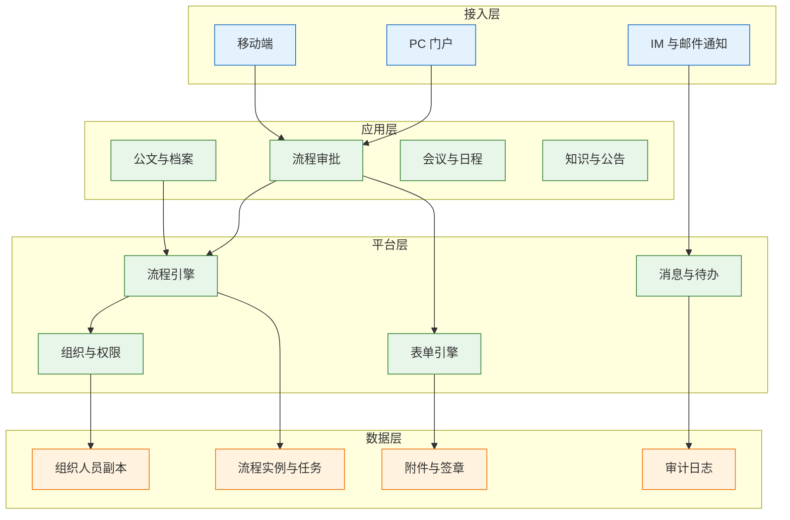
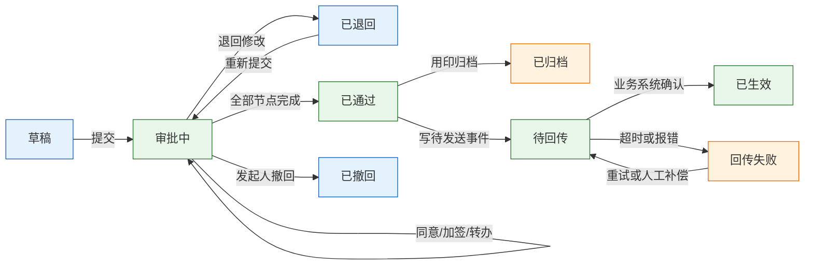
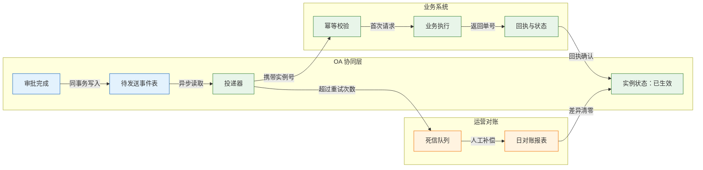

# OA 与协同办公

---

## 一、OA 是什么

### 1.1 核心概念

OA（Office Automation，办公自动化）是承载企业审批、公文、协同与门户的系统族。它解决的是“事怎么批、文怎么传、人怎么协同”，不拥有业务结果。审批通过只是流程节点结束，业务是否生效，要看业务系统有没有真正执行。

理解 OA 要先分清四类对象：

- **流程定义**：一类审批的模板，包含节点、路由条件、表单、时限。发布后应版本化，不覆盖旧版。
- **流程实例**：一次具体审批的运行记录，绑定发起人、业务单号、流程版本与当前状态。
- **任务**：实例在某个节点上的待办，有处理人、动作、期限。加签、转办、退回都产生新任务。
- **表单**：业务数据在审批时的快照，用于展示与留痕，不是业务主数据的权威源。

| 概念 | 生命周期 | 权威性 |
|---|---|---|
| 流程定义 | 草稿、发布、停用 | OA 权威 |
| 流程实例 | 运行、通过、撤回、归档 | OA 权威 |
| 任务 | 待办、已办、超时 | OA 权威 |
| 表单数据 | 随实例保存 | 仅快照，业务系统权威 |

OA 的边界由此确定：它可以是审批的**见证者**和**发起者**，不能是库存、合同金额、供应商银行账号的**持有者**。把业务规则复制进 OA，等于同一套规则维护两份，改一处必然漏一处。

> **注意**：审批流走完不等于业务完成。流程状态必须区分“已通过”和“已生效”，前者是审批结论，后者是业务系统确认执行。两者混用，事故现场就无法判断责任落在哪一侧。

### 1.2 与相邻系统的关系

OA 常与 BPM、IM、企业门户、业务系统、电子签章平台同时出现。它们的能力有重叠，但定位不同。

BPM（Business Process Management，业务流程管理）强调流程建模、执行、监控与优化，覆盖范围比 OA 更广，可以编排跨系统服务。OA 更偏办公协同，流程以人工审批为主。IM 负责即时消息与群组沟通，只做通知，不承载审批结论。企业门户是统一入口，聚合待办与资讯，本身不产生流程数据。业务系统负责执行，OA 负责授权。

| 相邻系统 | 核心能力 | 与 OA 的边界 |
|---|---|---|
| BPM | 流程建模与跨系统编排 | OA 可视为其办公场景子集 |
| IM | 消息、群组、音视频 | 只推送提醒，不存审批结论 |
| 企业门户 | 统一入口与待办聚合 | 展示 OA 待办，不判断权限 |
| 业务系统 | 执行与记账 | OA 回传结果，不替其执行 |
| 电子签章 | 签名、时间戳、验签 | OA 调用能力，不自制章图 |

选型时常见的误区是把 OA 当集成总线。OA 的流程引擎适合低频、人工参与、需要留痕的场景；高并发、强一致、批量数据交换不适合放在 OA 里跑。

### 1.3 分层架构组成

OA 可以纵向拆成接入、应用、平台、数据四层。分层的目的，是让流程引擎、权限、消息、存储各自独立演进，避免一个模块变更拖垮全站。



| 层 | 主要内容 | 关键约束 |
|---|---|---|
| 接入 | 门户、移动端、消息 | 弱网重试必须幂等 |
| 应用 | 审批、公文、会议、知识 | 不直接写业务库 |
| 平台 | 引擎、表单、权限、消息 | 版本化与可观测 |
| 数据 | 组织副本、实例、附件、日志 | 附件防篡改，日志可追溯 |

组织人员数据在 OA 中是副本，权威源在 HR。副本可以缓存姓名、部门、岗位用于展示，但不能反向修改，也不能作为人事决定的依据。

---

## 二、审批业务主流程

### 2.1 流程生命周期

一条完整的审批链有六段：发起、路由、审批、归档、回传、对账。多数人只关注审批，漏掉后两段，事故就出在这里。



| 状态 | 进入条件 | 允许动作 | 下游影响 |
|---|---|---|---|
| 草稿 | 发起人保存未提交 | 编辑、删除 | 无 |
| 审批中 | 提交成功 | 同意、退回、转办 | 占用待办 |
| 已通过 | 全部节点完成 | 归档、回传 | 触发业务事件 |
| 待回传 | 已写待发送事件 | 重试、查询 | 业务未生效 |
| 已生效 | 业务系统返回成功 | 只读 | 流程闭环 |
| 回传失败 | 超时或业务报错 | 重试、人工补偿 | 进入对账清单 |

状态机里最重要的是“已通过”和“已生效”分开。只做到“已通过”，OA 就只是一张电子纸；只有业务系统确认，流程才算闭环。

### 2.2 路由与会签规则

路由决定单据下一站去哪，会签决定一个节点需要多少人同意。两者配错，轻则卡单，重则越权审批。

| 路由方式 | 适用场景 | 主要风险 |
|---|---|---|
| 按组织层级 | 行政、人事、费用 | 组织调整后路由错 |
| 按金额或类型 | 采购、合同、付款 | 拆单绕过阈值 |
| 按岗位或角色 | 法务、财务专业审核 | 角色空缺导致卡单 |
| 按矩阵 | 部门与项目双线 | 规则复杂难解释 |
| 指定人员 | 特批、专项 | 人一走流程就断 |

会签规则要写清三件事：是全部同意、比例同意还是顺序同意；弃权是否计入；退回后是重走全部节点还是回到当前节点。规则不清，系统只能按实现者的理解执行，审计时无法解释。

路由条件应可读、可测试。最怕在引擎里配一棵几十层的条件树，只有实施顾问看得懂。规则变更要版本化，并保留“这单为什么走这个分支”的判定记录，包含命中的条件、当时的组织快照与操作人。

> **注意**：按金额路由时，必须用含税总额还是不含税金额，要在制度里写死并由系统统一取数。口径不一致会出现“同一张单在 OA 走三级、在 ERP 走一级”的荒唐结果。

### 2.3 公文与用印流程

公文比普通审批多三个约束：文号、密级、用印。三者都涉及合规，不能当普通字段处理。

| 环节 | 关键动作 | 控制点 |
|---|---|---|
| 拟稿 | 起草正文、选择文种 | 模板与格式校验 |
| 核稿 | 内容与文字审核 | 修改留痕 |
| 会签 | 相关部门意见 | 意见与正文分离 |
| 签发 | 领导签批 | 身份与时间戳 |
| 用印 | 绑定最终版正文 | 正文哈希校验 |
| 归档 | 正文、附件、记录入档 | 保留期与密级 |

文号按年度、机关、文种编号，不能重复，作废也要留号。密级决定可见范围、打印水印与下载权限。用印必须绑定最终版正文，正文改一个字，原用印即失效。归档要保存正文、附件、审批记录与签章信息，满足审计年限。

电子签章不是“贴一张图”。可靠的电子签名要能验证签名值、证书、时间戳与文档哈希；只把章图盖在 PDF 上，不构成可靠电子签名，也无法在纠纷中举证。

---

## 三、核心数据模型

### 3.1 组织与人员模型

组织与人员是 OA 的地基。模型要支持历史、兼职与代理，否则调岗和离职就会留下权限残影。

| 对象 | 关键字段 | 说明 |
|---|---|---|
| 组织 | 组织编码、上级、类型 | 公司、部门、班组，带有效期 |
| 人员 | 工号、姓名、状态 | 在职、调岗、离职 |
| 任职 | 工号、组织、岗位 | 一人可多岗，主岗唯一 |
| 角色 | 角色码、数据范围 | 决定功能与数据权限 |
| 委托 | 委托人、受托人、期限 | 出差与离职代理 |

组织要有生效区间，不能只存当前状态。审批记录引用的是“当时的组织与岗位”，不是今天的组织树。只存当前值，历史单据的责任人就会被后来的调岗改写。

### 3.2 流程实例与任务模型

流程实例绑定流程定义版本，任务绑定实例与节点。版本绑定是保证在途单据不被新流程影响的关键。

```sql
-- 流程实例：一次审批一行，业务单号用于跨系统幂等
CREATE TABLE wf_instance (
  instance_no    VARCHAR(32)  NOT NULL,  -- 实例号，OA 内唯一
  def_code       VARCHAR(32)  NOT NULL,  -- 流程定义编码
  def_version    INT          NOT NULL,  -- 发起时绑定的版本
  biz_doc_no     VARCHAR(64)  NOT NULL,  -- 业务单号，回传幂等键
  initiator_id   VARCHAR(32)  NOT NULL,  -- 发起人工号
  current_node   VARCHAR(32)  NULL,      -- 当前节点，结束为空
  inst_status    VARCHAR(16)  NOT NULL,  -- 审批中/已通过/已生效等
  created_at     TIMESTAMP    NOT NULL,
  finished_at    TIMESTAMP    NULL,
  PRIMARY KEY (instance_no),
  UNIQUE KEY uk_biz (def_code, biz_doc_no)
);

-- 审批任务：一个节点可产生多条，加签与转办都新增记录
CREATE TABLE wf_task (
  task_id        BIGINT       NOT NULL,  -- 任务标识
  instance_no    VARCHAR(32)  NOT NULL,  -- 关联实例
  node_code      VARCHAR(32)  NOT NULL,  -- 节点编码
  assignee_id    VARCHAR(32)  NOT NULL,  -- 处理人工号
  task_action    VARCHAR(16)  NULL,      -- 同意/退回/转办/加签
  task_status    VARCHAR(16)  NOT NULL,  -- 待办/已办/超时/取消
  due_at         TIMESTAMP    NULL,      -- 节点时限
  acted_at       TIMESTAMP    NULL,      -- 实际处理时间
  PRIMARY KEY (task_id),
  KEY idx_assignee (assignee_id, task_status)
);
```

| 表 | 关键字段 | 设计要点 |
|---|---|---|
| wf_instance | instance_no、biz_doc_no | 业务单号联合唯一，防重复发起 |
| wf_task | instance_no、assignee_id | 待办索引按人加状态 |
| wf_form_data | instance_no、field_code | 表单按字段存，便于版本兼容 |
| wf_attachment | file_id、sha256 | 哈希校验，防替换 |

> **注意**：业务单号做唯一键时，要区分“同一业务允许重新发起”的场景。退货、变更、补充协议应使用新的业务单号，而不是复用原单号，否则第二次审批会被幂等规则挡住。

### 3.3 表单与附件模型

表单是业务数据的快照。字段要带版本，否则流程升级后老实例无法渲染。附件要版本化并计算哈希，任何替换都要留审计记录。

| 字段类型 | 存储方式 | 校验要求 |
|---|---|---|
| 文本 | 变长字符串 | 长度与敏感词 |
| 金额 | 定点小数 | 币种、精度、上下限 |
| 组织人员 | 工号或组织码 | 提交时快照 |
| 附件 | 对象存储加元数据 | 哈希、密级、病毒扫描 |

金额字段禁止用浮点数。审批单上的金额要与业务系统一致，币种与精度要在表单层固定，不能由前端自由输入。

---

## 四、典型模块

### 4.1 流程引擎

流程引擎负责解析定义、驱动实例、分配任务、记录轨迹。核心能力包括串行、并行、条件分支、会签、加签、转办、退回、撤回、超时升级。

| 能力 | 实现要点 | 常见缺陷 |
|---|---|---|
| 条件分支 | 表达式可测试、可回放 | 条件重叠导致多分支命中 |
| 会签 | 明确全部/比例/顺序 | 弃权与缺席未定义 |
| 加签 | 前加签、后加签区分 | 加签人越权 |
| 退回 | 指定回退节点 | 退回到已删除节点 |
| 超时 | 按节点设时限与升级 | 只提醒不升级 |

引擎不应内嵌业务规则。金额校验、预算占用、供应商准入属于业务系统或规则服务，OA 只负责收集审批结论。把规则写进流程脚本，升级时无法回归测试。

### 4.2 公文与档案

公文模块管理文号、密级、正文、签章与归档。档案模块负责保留期、检索、借阅与销毁。两者常被合并实施，但生命周期不同：公文关注流转，档案关注留存。

| 模块 | 核心对象 | 保留要求 |
|---|---|---|
| 公文 | 文号、正文、签章 | 按档案期限 |
| 档案 | 案卷、件、保管期限 | 到期鉴定后销毁 |
| 用印 | 印章、用印记录 | 与正文哈希绑定 |
| 借阅 | 借阅单、审批 | 留痕与归还 |

档案的销毁必须有审批与清单，不能由管理员直接删除。电子档案还要考虑格式迁移，十年前的文件格式今天可能无法打开。保留期从归档日或业务终结日起算，规则要写进档案分类表，不能由各部门自行解释；到期鉴定要留下鉴定人、结论与销毁清单，缺一项都不算完成闭环。

### 4.3 门户与待办

门户聚合待办、已办、公告、日程与常用应用。它的价值是减少切换，不是替代业务系统。待办要能跳转到具体单据，跳转链接必须带鉴权，不能只靠 URL 参数。

| 能力 | 说明 | 风险 |
|---|---|---|
| 待办聚合 | 多系统待办统一展示 | 链接失效或越权 |
| 消息提醒 | IM、邮件、短信 | 重复轰炸 |
| 统一搜索 | 跨模块检索 | 权限过滤遗漏 |
| 个人工作台 | 常用应用与指标 | 数据口径不一 |

待办数量不是越多越好。把不需要本人处理的抄送也做成待办，会让真正紧急的单据被淹没。抄送与待办要分开统计。

### 4.4 权限体系

OA 权限分三层：功能权限决定能进哪个菜单，数据权限决定能看哪个组织与密级的数据，流程权限决定能发起、审批、转办哪类流程。

| 层级 | 控制对象 | 校验位置 |
|---|---|---|
| 功能 | 菜单、按钮、接口 | 网关与服务端 |
| 数据 | 组织、密级、业务域 | 查询条件与返回过滤 |
| 流程 | 发起、审批、撤回 | 引擎与业务规则 |

三层要同时校验。只做菜单权限，用户仍可能通过接口拿到别的部门单据；只做数据权限，离职人员仍能登录。前端隐藏按钮只是体验优化，不构成安全控制。

---

## 五、集成与身份

### 5.1 组织人员同步

组织同步建议“全量校对 + 增量事件”。全量修正漂移，增量保证及时，两者缺一不可。

| 方向 | 内容 | 频率 | 失败处理 |
|---|---|---|---|
| HR→OA | 组织、人员、任职 | 日全量 | 差异报告 |
| HR→OA | 入职、调岗、离职 | 实时事件 | 重试加死信 |
| OA→各系统 | 人员状态变更 | 实时事件 | 对账补偿 |

离职处理顺序不能反：先停权，再走交接，最后归档。先交接后停权，会出现交接期间继续审批的空窗。停权要覆盖账号、令牌、API Key、移动端设备绑定。

同步要有可核对的位点。每次增量事件带序号，OA 记录最后消费位点；位点长时间不前进，说明消费链路已断。每日全量比对组织人数、在职状态与任职关系，差异超过阈值就告警，不要等到员工发现待办消失才排查。

### 5.2 单点登录

身份集成通常走 SSO，协议按现有 IdP 选择 OIDC、SAML 或 CAS。

| 协议 | 适用 | 关键校验 |
|---|---|---|
| OIDC | 现代 Web 与移动端 | nonce、签名、过期时间 |
| SAML | 企业 IdP 互通 | 断言签名、受众、时效 |
| CAS | 传统内网系统 | 票据一次性 |

登录成功只解决“是谁”，不解决“能做什么”。权限仍由 OA 本地判断，不能把 IdP 的属性直接当授权结果。管理员账号与普通账号要分离，操作全部留审计。

### 5.3 审批结果回传

审批结果回传推荐“事务外盒 + 至少一次投递 + 业务幂等”。OA 在完成审批的同一事务里写待发送事件，投递器异步发送，失败重试，超过次数进死信。



| 环节 | 设计要点 | 失败表现 |
|---|---|---|
| 事件写入 | 与审批同事务 | 审批成功但事件丢失 |
| 投递 | 至少一次，带实例号 | 重复投递 |
| 消费 | 幂等键加唯一约束 | 重复建单 |
| 对账 | 已通过未生效清单 | 长期悬挂 |

> **业务红线**：OA 不得直接更新财务系统的付款状态、发票金额或库存数量。审批结论只能作为业务系统的输入，由业务系统在自己的事务里完成校验、记账与过账；绕过业务系统直接改库，等于放弃可回滚与可审计。

---

## 六、实施与边界

### 6.1 流程梳理与版本化

流程梳理先定事项，再定节点，最后定表单。顺序反过来，会得到一张字段很多但没人填的表单。

| 阶段 | 产出 | 验收标准 |
|---|---|---|
| 事项清单 | 流程目录与责任人 | 无重复事项 |
| 节点设计 | 审批链与时限 | 每节点有唯一责任人 |
| 表单设计 | 字段、校验、附件 | 字段有来源与用途 |
| 版本发布 | 定义版本与生效日 | 在途单不受影响 |

流程定义发布后不覆盖旧版。新实例走新版本，旧实例继续走旧版本直到结束。需要强制迁移时，先列出在途清单，逐单确认，不做批量刷状态。

### 6.2 边界判断

| 问题 | 判断依据 | 结论 |
|---|---|---|
| 是否在 OA 建合同台账 | 合同金额是否需权威核算 | 归合同或 ERP |
| 是否在 OA 存供应商账号 | 是否涉及付款 | 归 ERP 或资金系统 |
| 是否在 OA 做预算占用 | 是否需强一致 | 归预算或 ERP |
| 是否在 OA 做报表 | 是否需跨系统口径 | 归 BI |

判断标准只有一条：这份数据是否需要强一致、可审计、可回滚。需要，就放在业务系统；不需要，OA 可以存快照。

### 6.3 运行指标

| 指标 | 定义 | 用途 |
|---|---|---|
| 平均审批时长 | 提交到通过的时长 | 发现瓶颈节点 |
| 超时率 | 超时限任务占比 | 判断时限合理性 |
| 回传成功率 | 已生效占已通过比例 | 判断集成质量 |
| 一次通过率 | 未退回直接通过占比 | 判断表单质量 |

指标要能按组织、流程、节点下钻。只给全公司平均值，无法定位是哪个部门、哪个节点在拖。

---

## 七、常见失败模式与排查

### 7.1 失败模式

| 现象 | 最可能原因 | 处置 |
|---|---|---|
| 审批卡在离职人员 | 未转办且节点无代理 | 离职强制转办，超时升级 |
| 新员工收不到待办 | 组织同步延迟 | 查同步位点，补推 |
| OA 通过但 ERP 未执行 | 回调失败且无对账 | 查死信，补发，建差异报表 |
| 同一单发起两次 | 业务重试且 OA 无幂等 | 业务单号唯一约束 |
| 老流程改完在途单走错 | 定义覆盖发布 | 实例绑定版本 |
| 会签少一人也通过 | 会签规则配错 | 明确全部/比例/顺序 |
| 附件被替换 | 无版本无哈希 | 版本化加哈希加审计 |
| 跨部门看到密级文件 | 只做菜单权限 | 数据权限在接口层校验 |
| 移动端重复提交 | 弱网重试且无幂等 | 提交令牌加服务端幂等 |

### 7.2 排查顺序

1. 看流程实例状态与当前节点，确认单据停在哪个环节。
2. 看当前处理人是否有效，是否离职、调岗、长期出差。
3. 看审批完成后的待发送事件是否写入，投递是否成功。
4. 看业务系统是否消费，是否因幂等或校验被拒绝。
5. 看组织与权限数据，确认可见范围与审批资格。
6. 最后看表单与附件，确认数据与版本是否一致。

> **核心结论**：OA 是协同层，不是业务层；“已通过”必须变成“已生效”；组织与权限是活数据，必须由 HR 事件驱动；流程定义要版本化，改流程不能改写历史。
