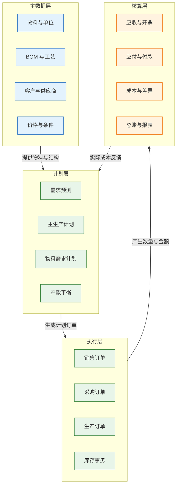
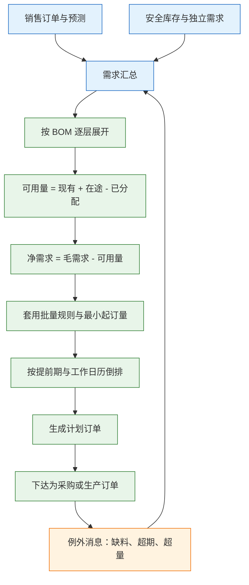
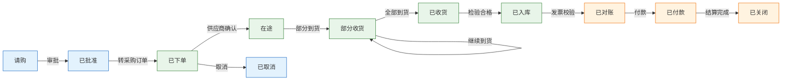

# ERP 与企业资源计划

---

## 一、ERP 是什么

### 1.1 核心概念

ERP（Enterprise Resource Planning，企业资源计划）是以一套主数据、一套单据、一套账为核心的企业管理系统。它把销售、采购、库存、生产、财务串在同一条业务链上，让计划、执行与核算使用同一份数据。

ERP 的价值不在“模块多”，而在**同源**。同一张销售订单，销售看到的是交期，计划看到的是需求，仓库看到的是出库任务，财务看到的是应收与收入。四个视角引用的订单号、物料号、金额必须一致，否则月底只能靠手工调账。

理解 ERP 要抓住四个概念：

- **主数据**：物料、BOM、客户、供应商、工作中心、价格条件。跨单据复用，变更受控。
- **单据**：销售订单、采购订单、生产订单、收货单、发货单、发票。单据有单号、行项目、状态。
- **事务**：每一次库存变动、每一笔分录。事务只追加，不改历史。
- **期间**：财务与成本的核算区间。期间关闭后禁止过账，保证账套可复算。

| 概念 | 作用 | 变更方式 |
|---|---|---|
| 主数据 | 跨流程复用的基础 | 审批加版本 |
| 单据 | 承载一次业务 | 状态机驱动 |
| 事务 | 记录数量与金额变动 | 只追加，冲销更正 |
| 期间 | 划分核算边界 | 月结关闭 |

ERP 管“该做什么、花了多少”，不管“工位怎么干、库位怎么拣”。工序级派工、报工、设备采集属于 MES；库位、波次、拣货路径属于 WMS。边界不清，ERP 会被迫承载现场细节，越做越重。

> **注意**：ERP 里的“生产模块”通常只到生产订单、BOM 展开与完工入库。若企业需要工序级报工、批次追溯、设备联网，仍需 MES；若 ERP 已支持工序与报工，则它实际带了 MES 能力，边界要重新划分，不能按产品名称判断。

### 1.2 与相邻系统的关系

ERP 位于企业系统的中心，但不是全部。它向上接 CRM 的客户与合同，向下接 MES 与 WMS 的执行，向侧接 PLM 的产品定义与 SRM 的供应商协同。

| 系统 | 提供什么 | ERP 的角色 |
|---|---|---|
| CRM | 客户、商机、合同 | 接收需求，管信用与应收 |
| PLM | 设计 BOM、图纸、变更 | 转制造 BOM，管量产 |
| MES | 工单执行、报工、消耗 | 下达生产订单，接收完工 |
| WMS | 库位、拣货、盘点 | 下达出入库指令，管价值 |
| SRM | 供应商协同、ASN | 管采购订单与应付 |
| 财务共享 | 报销、支付、税务 | 提供凭证与发票数据 |

CRM 与 ERP 最容易打架的是客户编码。CRM 按商业关系建客户，ERP 按核算主体建客户，同一集团下的不同收货地址可能对应多个核算对象。正确做法是建映射表，以 ERP 的核算客户为准，CRM 保留商业客户视图，两者用映射关联，不强行合并。

PLM 与 ERP 的冲突集中在 BOM。设计 BOM 按功能结构组织，制造 BOM 按装配顺序与工厂组织，两者不是一张表。ERP 接收的是制造 BOM，设计变更必须经过工程变更单转成制造版本，不能直接把设计结构覆盖到量产。

### 1.3 分层架构组成

ERP 可以按“主数据—计划—执行—核算”四层理解。四层共用一套物料与组织，任何一层的数据错误都会向上传导。



| 层 | 核心数据 | 主要使用者 | 失败影响 |
|---|---|---|---|
| 主数据 | 物料、BOM、价格 | 工程、采购、销售 | 全线失真 |
| 计划 | 预测、MPS、MRP | 计划、采购 | 缺料或积压 |
| 执行 | 订单、收货、发货 | 销售、采购、仓库 | 账实不符 |
| 核算 | 凭证、成本、报表 | 财务 | 月结失败 |

分层的意义是确定“谁改什么”。主数据层变更要审批，计划层参数要版本化，执行层单据要状态机，核算层期间要锁定。四层混在一起改，出了问题无法判断是数据错、参数错还是分录错。

---

## 二、业务主流程

### 2.1 订单到收款

订单到收款（Order-to-Cash）从客户下单开始，到回款核销结束。它是 ERP 最核心的履约链路，也是跨系统集成最密集的一段。

| 步骤 | 动作 | 关键校验 |
|---|---|---|
| 1 | 录入或导入销售订单 | 客户、物料、价格、交期有效 |
| 2 | 信用检查 | 额度、逾期、担保 |
| 3 | 可用量承诺 | 现有库存、在途、已分配 |
| 4 | 发货出库 | 批次、序列号、数量 |
| 5 | 开票 | 价格、税率、折扣、收货确认 |
| 6 | 应收确认 | 账龄、收款认领、核销 |
| 7 | 凭证过账 | 收入、成本、税金 |

信用检查必须在订单确认前完成，不能等到发货。订单确认后再冻结，会让仓库与销售陷入“货已备好但不能发”的僵局。可用量承诺要区分物理库存与可用库存：被其他订单锁定、质检中、冻结的库存不能承诺给新订单。

发货与开票分离是常态，但两者之间要有对账。发货未开票、开票未发货、部分发货重复开票，都会让收入确认与库存成本脱节。做法是按订单行维护“已发未开”“已开未发”两张清单，日终核对。

### 2.2 采购到付款

采购到付款（Procure-to-Pay）从请购开始，到供应商付款结束。核心控制是三单匹配：采购订单、收货单、供应商发票，数量、单价、金额在容差内才允许付款。

| 步骤 | 单据 | 控制点 |
|---|---|---|
| 1 | 请购单 | 预算与需求合理性 |
| 2 | 采购订单 | 供应商准入、价格审批 |
| 3 | 收货单 | 数量、批次、质检 |
| 4 | 发票 | 发票号唯一、税率 |
| 5 | 付款申请 | 三单匹配、账期 |
| 6 | 付款与核销 | 银行流水、凭证 |

没有三单匹配，重复付款与价格欺诈几乎必然发生。同一张发票重复录入、收货数量大于订单数量、单价被手工修改，都是常见漏洞。匹配容差要写进制度：数量允许百分比、单价允许绝对值、运费与税差单列，超出容差走审批，不允许直接改账。

> **业务红线**：付款前的三单匹配必须在系统内完成，禁止以线下签字替代。发票号加供应商编码要做唯一约束；已付款发票再次录入时必须被拦截，不能靠人工记忆。

### 2.3 计划到生产与 MRP

MRP（Material Requirements Planning，物料需求计划）不是“算一下缺多少”，而是一串有顺序的净算：汇总需求、按 BOM 展开、扣减可用供应、按批量与提前期倒排、生成计划订单、输出例外消息。



净算可以用一个例子说明。某成品需 100 台，BOM 每台用 4 个电机，毛需求为 400 个；现有库存 120 个，在途 80 个，已被其他订单占用 50 个，可用量为 150 个，净需求为 250 个。若供应商最小起订 100 个，则建议采购 300 个；若采购提前期 21 天，到货日期要倒排到开工前 21 天。工作日历漏掉春节假期，倒排日期就会整体偏移，交期随之失真。

| 输入 | 常见错误 | 后果 |
|---|---|---|
| 需求 | 预测版本混用 | 需求虚高或漏项 |
| 供应 | 在途未冲减 | 重复采购 |
| 结构 | BOM 用量或损耗错 | 齐套率低 |
| 参数 | 提前期与批量不准 | 交期不可信 |

MRP 通常每天跑一次全量，订单变更时跑净改变。全量保证一致，净改变保证及时；只跑全量，急单看不到；只跑净改变，参数与结构变更容易漏。跑完必须看例外消息，而不是直接下达全部计划订单。

---

## 三、核心数据模型

### 3.1 主数据模型

物料主数据不是一个表，而是一组视图。基本视图存编码与单位，采购视图存采购单位与提前期，销售视图存销售单位与价格，MRP 视图存安全库存与批量，财务视图存评估类与成本价。

| 视图 | 关键字段 | 维护方 |
|---|---|---|
| 基本 | 物料编码、描述、基本单位 | 物料管理 |
| 采购 | 采购单位、默认供应商、提前期 | 采购 |
| 销售 | 销售单位、价格组、税分类 | 销售 |
| MRP | 安全库存、批量、计划策略 | 计划 |
| 财务 | 评估类、标准成本、科目 | 财务 |

同一个物料在不同视图可以有不同单位，但换算关系必须唯一、受控。采购按箱、库存按个、销售按套，三套单位之间的换算率要存在物料主数据里，变更走审批并带生效日期。

> **注意**：把单位换算率当普通字段随手改，是库存差异的常见来源。换算率变更不能回改历史单据，只能对新生效日期之后的业务起作用；历史事务保留原换算关系，否则已结账期间的库存金额会被重算。

BOM 要区分设计 BOM 与制造 BOM。设计 BOM 的父件是产品，子件按功能组织；制造 BOM 的父件是工厂级产品，子件按装配层级组织，还要带损耗率、替代料、生效期。工艺路线描述工序、工作中心、工时与替代工序，是排产与成本核算的输入。

### 3.2 单据与状态机

采购订单的状态机是 ERP 控制的典型样本：它同时约束数量、金额、收货与付款，任一状态错位都会导致账实不符。



| 状态 | 数量控制 | 财务影响 |
|---|---|---|
| 已下单 | 不占用库存 | 无 |
| 在途 | 计入在途量 | 无 |
| 部分收货 | 按实收增加库存 | 暂估应付 |
| 已入库 | 可用量增加 | 存货增加 |
| 已对账 | 冻结收货数量 | 应付确认 |
| 已付款 | 不可再付 | 银行存款减少 |

状态迁移要校验数量：累计收货不能超过订单数量加容差，累计开票不能超过收货数量，累计付款不能超过发票金额。校验放在服务端事务里，不能只靠界面限制。并发收货要用行级锁或版本号，避免两张收货单同时通过校验后超收。

### 3.3 核心表结构示例

下面三张表覆盖物料、库存余额与凭证。字段类型按主流关系库给出，金额统一用定点小数。

```sql
-- 物料主数据：基本视图，单位换算在此受控
CREATE TABLE material (
  material_code   VARCHAR(32)   NOT NULL,  -- 物料编码，全局唯一
  material_name   VARCHAR(128)  NOT NULL,  -- 物料描述
  base_unit       VARCHAR(8)    NOT NULL,  -- 基本单位，库存记账单位
  purchase_unit   VARCHAR(8)    NULL,      -- 采购单位
  conversion_rate DECIMAL(18,6) NOT NULL,  -- 采购单位对基本单位换算率
  material_type   VARCHAR(16)   NOT NULL,  -- 原材料/半成品/成品
  cost_price      DECIMAL(18,4) NOT NULL,  -- 标准成本，财务维护
  status          VARCHAR(8)    NOT NULL,  -- 研发/量产/停用
  PRIMARY KEY (material_code)
);

-- 库存余额：按物料、仓库、批次汇总，事务写入后重算
CREATE TABLE inventory_balance (
  material_code   VARCHAR(32)   NOT NULL,
  warehouse_code  VARCHAR(16)   NOT NULL,
  batch_no        VARCHAR(32)   NOT NULL DEFAULT '',  -- 无批次用空串
  qty_on_hand     DECIMAL(18,3) NOT NULL,  -- 物理库存
  qty_allocated   DECIMAL(18,3) NOT NULL,  -- 已分配，订单占用
  qty_available   DECIMAL(18,3) NOT NULL,  -- 可用量，承诺依据
  amount          DECIMAL(18,4) NOT NULL,  -- 库存金额
  version_no      INT           NOT NULL,  -- 乐观锁
  PRIMARY KEY (material_code, warehouse_code, batch_no)
);

-- 总账分录：一借一贷成对写入，期间关闭后禁止新增
CREATE TABLE journal_entry (
  entry_id        BIGINT        NOT NULL,  -- 分录号
  period          CHAR(6)       NOT NULL,  -- 会计期间，YYYYMM
  voucher_no      VARCHAR(32)   NOT NULL,  -- 凭证号
  account_code    VARCHAR(32)   NOT NULL,  -- 科目编码
  debit_amount    DECIMAL(18,2) NOT NULL,  -- 借方金额
  credit_amount   DECIMAL(18,2) NOT NULL,  -- 贷方金额
  currency        CHAR(3)       NOT NULL,  -- 币种
  source_doc      VARCHAR(32)   NOT NULL,  -- 来源单据号
  posted_at       TIMESTAMP     NULL,      -- 过账时间，空为草稿
  PRIMARY KEY (entry_id),
  KEY idx_period_account (period, account_code)
);
```

| 表 | 关键约束 | 说明 |
|---|---|---|
| material | 编码唯一、换算率非空 | 停用物料不可新下单 |
| inventory_balance | 物料加仓库加批次唯一 | 可用量不得为负 |
| journal_entry | 借贷平衡、期间有效 | 过账后只能冲销 |

> **业务红线**：库存余额不得由人工直接修改，所有变动必须写库存事务并带来源单据；已过账凭证不得删除或改金额，只能用红字冲销并保留原分录。破坏这两条，账实与审计同时失效。

---

## 四、典型模块

### 4.1 财务与成本

财务模块包括总账、应收、应付、资产、成本与报表。成本核算通常分标准成本、实际成本与差异分析，三者关系要一次讲清：标准成本用于日常记账，实际成本月末归集，差异单独分析。

| 模块 | 核心对象 | 关键控制 |
|---|---|---|
| 总账 | 科目、凭证、期间 | 借贷平衡、期间锁定 |
| 应收 | 发票、收款、账龄 | 核销、坏账 |
| 应付 | 发票、付款、账期 | 三单匹配、重复付款 |
| 成本 | 工单成本、分摊、差异 | WIP 结算、差异还原 |

月结是关键动作的集合：关闭业务期间，禁止跨期过账；检查未过账单据、负库存、未结算生产订单；重估库存、分摊差异、结算在制品；生成凭证并核对总账与明细账；出报表并锁期。

月结卡住，十有八九不是财务公式错，而是业务侧有未清事务：收货没开票、发货没出库、工单没完工、库存为负。把月结清单做成可执行的检查项，比月底临时找人更快。

### 4.2 供应链与库存

供应链模块覆盖请购、采购、收货、库存、发货与盘点。库存要区分物理库存、可用库存、在途库存、锁定库存四个口径。

| 口径 | 含义 | 用途 |
|---|---|---|
| 物理库存 | 仓库实际数量 | 盘点基准 |
| 可用库存 | 物理减锁定减质检 | 订单承诺 |
| 在途库存 | 已下单未到货 | MRP 供应 |
| 锁定库存 | 已被订单或工单占用 | 防超卖 |

只看物理库存做承诺，会把别人已订的货卖两次；只看可用库存做盘点，会永远对不上实物。四个口径要在报表上并列展示，并注明取数时间。

### 4.3 生产与计划

生产模块覆盖生产订单、BOM 展开、领料、报工、完工入库与成本归集。计划模块覆盖预测、主生产计划、MRP 与粗能力平衡。

| 对象 | 作用 | 与执行层关系 |
|---|---|---|
| 生产订单 | 授权生产多少 | 下达成 MES 工单 |
| 领料单 | 按 BOM 领用 | WMS 执行拣货 |
| 报工 | 记录工时与产量 | MES 采集 |
| 完工入库 | 增加成品库存 | WMS 收货上架 |

ERP 的生产订单是“授权”，MES 的工单是“执行”。一个生产订单可以拆成多张工单，也可以合并；关键是单号关联与数量汇总规则要固定，不能一边按订单汇总、一边按工单汇总。

---

## 五、系统集成

### 5.1 集成方式

ERP 处于集成中心，接口数量最多。选型仍遵循“能批量不实时，能异步不同步”，并对每类接口定义幂等键与对账口径。

| 方式 | 适用 | 幂等键 | 主要风险 |
|---|---|---|---|
| API 同步 | 订单、主数据查询 | 业务单号 | 超时悬挂 |
| 消息队列 | 完工、库存事务 | 事件号 | 重复与乱序 |
| 文件批量 | 日终对账、总账 | 批次号加日期 | 格式与编码 |
| CDC | 报表抽取 | 变更序列 | 结构变更 |
| 数据库视图 | 只读查询 | 无 | 绕过业务校验 |

### 5.2 关键集成点

| 集成点 | 内容 | 频率 | 失败处理 |
|---|---|---|---|
| CRM→ERP | 客户、合同、订单 | 准实时 | 暂存重放 |
| PLM→ERP | 物料、设计 BOM、变更 | 准实时 | 版本校验 |
| ERP→MES | 生产订单、BOM、交期 | 准实时 | 单号幂等 |
| MES→ERP | 报工、完工、消耗 | 准实时 | 按单汇总重报 |
| ERP→WMS | 出入库指令 | 准实时 | 指令号幂等 |
| WMS→ERP | 收货、发货、库存事务 | 准实时 | 事务日志重放 |
| ERP→税务 | 发票、申报数据 | 按月 | 期间校验 |

集成的三条底线：单据号是主键；接口幂等；对账覆盖数量、金额、状态。只对“接口成功”不算对账，接口成功只说明消息送达，业务可能因校验失败而未生效。

### 5.3 期间与对账

ERP 的对账不是月底才做，而是按日积累。库存、应收、应付、总账四个方向都要有日终清单。

| 对账项 | 比对双方 | 差异处理 |
|---|---|---|
| 库存数量 | WMS 实物与 ERP 账面 | 查事务，盘盈亏调整 |
| 库存金额 | 库存明细与总账 | 查评估与分摊 |
| 应收 | 发票与客户对账单 | 查开票与收款认领 |
| 应付 | 收货、发票与付款 | 三单匹配差异 |

> **业务红线**：跨期调整必须走调整单并注明原因，禁止直接修改已关闭期间的凭证或库存。期间锁定的意义是保证账套可复算，一旦破例，历史报表全部失去可比性。

---

## 六、实施与边界

### 6.1 上线顺序

ERP 上线有严格依赖。合理顺序是先主数据，再库存与采购，再销售与生产，最后成本与总账。

| 阶段 | 范围 | 退出条件 |
|---|---|---|
| 主数据 | 物料、BOM、客户、供应商 | 编码唯一、换算率完整 |
| 供应链 | 采购、收货、库存 | 账实差异可解释 |
| 销售生产 | 订单、MRP、生产订单 | 履约链路跑通 |
| 财务成本 | 应收应付、成本、总账 | 月结一次通过 |

一上线就做总账的项目，通常以手工调账收场。业务单据没有闭环，财务只能倒挤数字，系统越上越假。

### 6.2 数据迁移与切换

迁移不是把 Excel 导入新库，而是清洗、映射、验证、切换四步。历史数据要决定保留几年、以什么粒度保留、是否只保留余额。

| 步骤 | 动作 | 验收 |
|---|---|---|
| 清洗 | 去重、补全、统一单位 | 重复率与完整率 |
| 映射 | 旧编码到新编码 | 映射覆盖率 |
| 验证 | 抽样核对数量与金额 | 差异可解释 |
| 切换 | 期初导入、冻结旧系统 | 期初平衡 |

切换期要设只读窗口，旧系统停止写入，新系统开始记账。双跑期间不能双向同步余额，否则两边互相覆盖。

### 6.3 边界判断

| 问题 | 判断依据 | 结论 |
|---|---|---|
| 工序派工放哪 | 是否需要秒级现场数据 | 归 MES |
| 库位拣货放哪 | 是否涉及路径与波次 | 归 WMS |
| 设计 BOM 放哪 | 是否含图纸与变更 | 归 PLM |
| 客户商机放哪 | 是否含跟进过程 | 归 CRM |

判断标准是“数据的产生现场与变更频率”。现场高频产生的数据放执行层，低频核算数据放 ERP。

---

## 七、常见失败模式与排查

### 7.1 失败模式

| 现象 | 最可能原因 | 处置 |
|---|---|---|
| 库存差十倍 | 双单位换算被改 | 锁定换算率，变更审批 |
| MRP 建议大量采购 | 参数错或在途未冲减 | 查参数版本与在途 |
| 缺料却显示有库存 | 库存被锁定或质检 | 看可用量口径 |
| 负库存 | 先出后入、收货未过账 | 禁止负库存，补收货 |
| 三单匹配不平 | 容差、运费、税差 | 定容差规则，差异审批 |
| 月结关不掉 | 未过账、WIP 未结算 | 按清单逐项清零 |
| 同一发票付两次 | 发票号无唯一约束 | 发票号加供应商幂等 |
| 客户信用失效 | CRM 与 ERP 编码不通 | 主数据映射，ERP 为准 |
| 工单重复下达 | ERP 重发且 MES 无幂等 | 生产订单号做幂等键 |
| 报表收入与总账差 | 口径、期间、币种不同 | 指标定义加钻取 |

### 7.2 排查顺序

1. 确认单据在哪个状态、对应哪张凭证，先锁定业务对象。
2. 核对数量与金额的单位、换算率、币种与精度。
3. 核对会计期间是否打开，是否存在跨期或反冲。
4. 查接口是否重复投递、漏发或消费失败。
5. 查主数据与参数版本，确认 BOM、提前期、批量是否生效。
6. 最后才怀疑计算公式与报表口径。

> **核心结论**：ERP 的价值在一套账，不在功能多；MRP 是参数系统，参数不准输出必然不可信；ERP 管计划与核算，不管现场执行；月结是架构问题，平时事务不闭环，月底加班补不回来。
