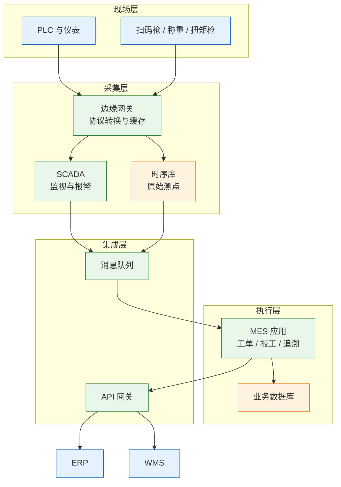
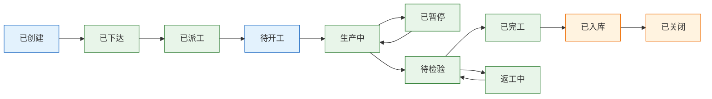
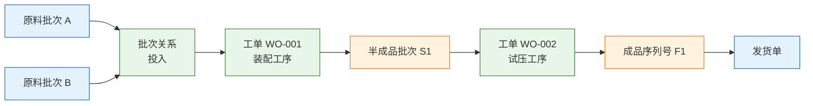
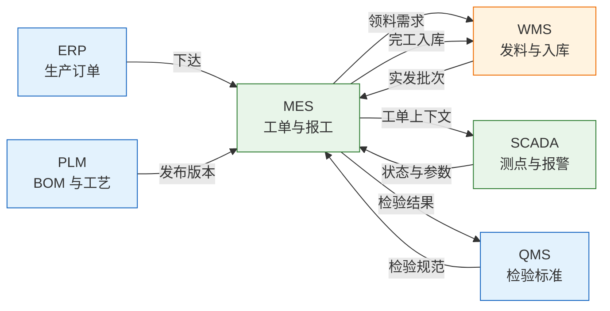

# MES 与 SCADA

---

## 一、MES 与 SCADA 是什么

### 1.1 核心概念

MES（Manufacturing Execution System，制造执行系统）位于企业计划层与车间控制层之间，把生产计划翻译成工单、工序、派工和报工，记录人、机、料、法、环的执行事实。SCADA（Supervisory Control and Data Acquisition，数据采集与监视控制）连接 PLC、仪表和传感器，把设备状态、工艺参数与报警转成可读数据。

两者的产出不同。MES 的产出是带业务语义的事件：某工单在某工序、某工位、某班次完成多少件，消耗了哪批物料，参数是否落在工艺窗口内。SCADA 的产出是测点时序：某设备某时刻的温度、压力、转速和运行状态。前者用于核算与追溯，后者用于监视与控制。

ISA-95 把企业系统分为五层：ERP 管经营计划，MES 管制造运行，SCADA 管监控采集，PLC 与仪表管现场控制，最下层是物理过程。分层依据是数据语义：越往下采样越密、业务上下文越少，越往上聚合越强、越强调责任与核算。

| 维度 | MES | SCADA |
|---|---|---|
| 核心对象 | 工单、工序、批次、报工 | 设备、测点、报警 |
| 时间尺度 | 秒到班次、日 | 毫秒到秒 |
| 数据形态 | 业务事件、关系记录 | 时序值、状态变位 |
| 主要使用者 | 计划、生产、质量、财务 | 值班、设备、自控 |
| 失败后果 | 追溯断链、核算失真 | 监视盲区、控制误判 |

> **注意**：MES 不是电子工单，SCADA 也不是大屏。纸质单据拍照上传只是形式电子化；没有工序、批次、设备与时间的关系，仍然无法追溯。

### 1.2 与相邻系统的关系

边界判断只看一条：同一个数据谁写、谁读。生产订单由 ERP 写，MES 读；工序级工单与报工由 MES 写，ERP 读汇总；实物库存由 WMS 写，MES 读可用量；设备测点由 SCADA 写，MES 补业务上下文；设计 BOM 与工艺版本由 PLM 写，MES 只读已发布版本。

| 相邻系统 | 提供给 MES | MES 回传 | 边界 |
|---|---|---|---|
| ERP | 生产订单、物料、BOM、工艺路线 | 完工数量、废品、工时、领料 | 财务库存归 ERP |
| APS | 工序排产、设备占用、交期 | 实际进度、异常停机 | 有限产能排产归 APS |
| WMS | 发料批次、线边库存、退料 | 领料需求、完工入库 | 库位与实物归 WMS |
| QMS | 检验标准、缺陷代码 | 检验结果、不良明细 | 客诉与质量体系归 QMS |
| PLM | 设计 BOM、工艺版本 | 现场变更反馈 | 图纸与设计变更归 PLM |
| SCADA | 测点值、设备状态、报警 | 工单上下文、工艺目标 | 原始时序归 SCADA |

> **注意**：两个系统都能写同一字段，最后一定不一致。集成先定权威源，再定同步方向，最后谈接口协议。

### 1.3 分层与架构组成

MES 通常分为现场层、采集层、执行层与集成层：现场层是 PLC、仪表与扫码设备，采集层是边缘网关、SCADA 与时序库，执行层是 MES 应用与业务库，集成层是消息队列与 API 网关。



| 层 | 组件 | 职责 | 典型故障 |
|---|---|---|---|
| 现场层 | PLC、仪表、扫码设备 | 采集信号、执行动作 | 信号抖动、条码破损 |
| 采集层 | 网关、SCADA、时序库 | 协议转换、缓存、报警 | 断网丢数、时钟漂移 |
| 执行层 | MES 应用、业务库 | 工单、报工、追溯、检验 | 事务冲突、重复报工 |
| 集成层 | 消息队列、API 网关 | 跨系统事件传递 | 重复消费、顺序错乱 |

> **运维提示**：IT 与 OT 之间设 DMZ，SCADA 不直接暴露给 ERP 网段。采集网关放在 DMZ，只允许受控数据流，远程维护走跳板与审计。

---

## 二、工单执行主流程

### 2.1 计划下达到工单生成

ERP 生产订单回答“生产什么、多少、什么时候要”，MES 工单回答“在哪条线、按哪个工艺版本、分几道工序做”。下达动作包含四项校验：物料与 BOM 版本有效、工艺路线已发布、工作中心产能可用、检验规范齐全。

工单必须绑定 BOM 与工艺版本并在生命周期内冻结。否则现场会按新工艺生产旧订单，追溯无法解释参数差异，成本也按错误定额归集。

| 检查项 | 校验内容 | 不通过处理 |
|---|---|---|
| 物料 | 编码、单位、批次属性 | 挂起，退回主数据维护 |
| BOM | 版本、用量、替代料 | 冻结旧版本或重新下达 |
| 工艺 | 路线、工序、工作中心 | 补齐工艺后重新展开 |
| 交期 | 开工日、完工日、班次 | 与 APS 重排或拆单 |

> **注意**：工单数量与生产订单数量允许分批，但分批关系要记录。只改工单数量、不留拆分记录，完工汇总时会对不上原订单。

### 2.2 派工与开工

派工把工序分配到工位、班组、人员与班次，并准备物料、模具、程序、量检具与检验规范。它决定追溯链里的“谁做的”和“在哪台设备上做的”。

开工前要满足四个条件：上道工序已完工或允许并行、物料已领用或线边可用、设备可用、首检完成。首检属于开工的一部分；首检未通过就批量生产，返工成本按批量放大。

| 前置条件 | 数据来源 | 校验方式 |
|---|---|---|
| 上道工序 | MES 报工记录 | 完工数量不小于本序需求 |
| 物料齐套 | WMS 发料、线边库存 | 按 BOM 用量与批次校验 |
| 设备可用 | EAM 台账、SCADA 状态 | 非维修、非停机、点检合格 |
| 首检合格 | QMS 检验记录 | 检验项全部判定通过 |

### 2.3 报工与完工入库

报工记录数量、良品、不良、工时、人员、设备与消耗批次。常见方式有三种：设备计数自动报工、扫码报工、人工录入。自动采集要校准与防抖，人工报工要权限控制与班后复核。

报工接口必须幂等，唯一键由工单号、工序号、班次、报工序号组成。重复提交返回原记录，冲正另起负向记录，不修改历史。完工入库前处理尾数、报废、返工品与留样，四项之和必须等于投入数量。

| 报工方式 | 适用场景 | 数据可信度 | 控制手段 |
|---|---|---|---|
| 设备计数 | 连续生产、节拍稳定 | 高，但需校准 | 边沿触发、单件脉冲校验 |
| 扫码报工 | 离散装配、批次切换 | 中高 | 工单码与物料码绑定 |
| 人工录入 | 返工、试制、异常补录 | 中 | 权限、复核、原因必填 |

> **业务红线**：报工数量不得超过工单剩余数量；确需超产，先走工单增量审批。超产不入账会造成物料消耗与产出长期不平衡。

### 2.4 工单状态机

工单状态必须单向推进，回退只能通过冲正或新单据完成。状态机固定“谁在什么条件下可以做什么”，避免绕过业务校验。



| 状态 | 进入条件 | 允许动作 | 责任方 |
|---|---|---|---|
| 已下达 | ERP 订单校验通过 | 派工、拆单、挂起 | 计划 |
| 待开工 | 派工完成、物料齐套 | 首检、开工、退料 | 班组 |
| 生产中 | 首检合格并开工 | 报工、巡检、暂停 | 班组 |
| 待检验 | 报工数量达到工单数量 | 完工检、返工、报废 | 质量 |
| 已完工 | 检验判定合格 | 入库、打印标签 | 质量 |
| 已入库 | WMS 收货确认 | 关闭、对账 | 仓储 |
| 已关闭 | 工时与消耗结算完成 | 只读、归档 | 财务 |

> **业务红线**：工单未完成报工与检验，不得置为已入库；已入库工单不得回退到生产中。需要返修时开返工单，保留原工单的产出与消耗记录。

---

## 三、核心数据模型

### 3.1 对象关系与主键设计

工单是聚合根，下挂工序、报工、物料消耗、参数快照、检验记录与设备占用。批次和序列号是两条追溯线：批次管原料与流程行业，序列号管单件与离散行业，两者可以同时使用。

主键设计遵循三条规则：业务单号唯一可读，数据库主键与业务单号分离，所有表带工厂、租户与版本号。跨工厂单号带工厂前缀；删除用状态字段，不物理删除。

| 对象 | 主键 | 外键关系 | 说明 |
|---|---|---|---|
| 工单 | work_order_id | 生产订单号 | 聚合根，冻结 BOM 与工艺版本 |
| 工序 | operation_id | work_order_id | 按工序号排序，含工作中心 |
| 报工 | report_id | operation_id | 幂等键含班次与报工序号 |
| 批次关系 | genealogy_id | 父批、子批、工单 | 记录投入与产出的血缘 |
| 参数快照 | snapshot_id | 工单、工序、批次 | 按时间窗聚合的工艺值 |
| 检验记录 | inspection_id | 工单、工序、批次 | 含检验项、结果、缺陷码 |

### 3.2 工单与工序表

工单表保存计划属性，工序表保存执行属性；数量与状态不要同时存在于两张表。

```sql
CREATE TABLE mes_work_order (
  id             BIGINT       NOT NULL COMMENT '主键',
  order_no       VARCHAR(32)  NOT NULL COMMENT '工单号，业务唯一',
  erp_order_no   VARCHAR(32)  NOT NULL COMMENT 'ERP 生产订单号',
  material_code  VARCHAR(64)  NOT NULL COMMENT '产品物料编码',
  plan_qty       DECIMAL(18,4) NOT NULL COMMENT '计划数量',
  done_qty       DECIMAL(18,4) DEFAULT 0 COMMENT '已报工数量',
  bom_version    VARCHAR(16)  NOT NULL COMMENT '冻结的 BOM 版本',
  route_version  VARCHAR(16)  NOT NULL COMMENT '冻结的工艺版本',
  status         VARCHAR(16)  NOT NULL COMMENT '工单状态',
  plan_start     DATETIME     NOT NULL COMMENT '计划开工时间',
  plan_end       DATETIME     NOT NULL COMMENT '计划完工时间',
  factory_code   VARCHAR(16)  NOT NULL COMMENT '工厂编码',
  created_at     DATETIME     NOT NULL COMMENT '创建时间',
  PRIMARY KEY (id),
  UNIQUE KEY uk_order_no (order_no)
) COMMENT='MES 工单';

CREATE TABLE mes_operation (
  id             BIGINT       NOT NULL COMMENT '主键',
  work_order_id  BIGINT       NOT NULL COMMENT '工单主键',
  op_seq         INT          NOT NULL COMMENT '工序号，从 10 起递增',
  op_code        VARCHAR(32)  NOT NULL COMMENT '工序编码',
  work_center    VARCHAR(32)  NOT NULL COMMENT '工作中心',
  station_code   VARCHAR(32)  COMMENT '工位编码',
  standard_hours DECIMAL(10,3) COMMENT '标准工时',
  status         VARCHAR(16)  NOT NULL COMMENT '工序状态',
  PRIMARY KEY (id),
  UNIQUE KEY uk_wo_seq (work_order_id, op_seq)
) COMMENT='MES 工序';
```

| 字段 | 类型 | 说明 |
|---|---|---|
| order_no | VARCHAR(32) | 业务唯一，接口幂等依据 |
| plan_qty | DECIMAL(18,4) | 支持小数，避免单位换算丢精度 |
| bom_version | VARCHAR(16) | 下达时冻结，变更需重新确认 |
| status | VARCHAR(16) | 与状态机枚举一致，禁止自由文本 |
| work_center | VARCHAR(32) | 与 APS、EAM 使用同一编码 |

### 3.3 批次、序列号与追溯表

追溯依靠关系表，不依靠一张大宽表。每次投料、拆分、合并、返工都写一条父子关系，记录工单、工序、数量、时间与操作人；正向与反向追溯共用这张表。



| 字段 | 类型 | 说明 |
|---|---|---|
| parent_type | VARCHAR(16) | 父对象类型：批次、序列号、工单 |
| parent_id | VARCHAR(64) | 父对象标识 |
| child_type | VARCHAR(16) | 子对象类型 |
| child_id | VARCHAR(64) | 子对象标识 |
| relation_type | VARCHAR(16) | 投入、产出、拆分、合并、返工 |
| qty | DECIMAL(18,4) | 关系数量，拆分合并时必填 |

> **业务红线**：批次关系必须在线写入，不能班后补录；换批必须扫码确认，尾数单独建批。混批、拆批、并批都要留父子关系，否则召回时只能整批封存。

### 3.4 采集事件与报警表

SCADA 的原始测点不进 MES 业务库。MES 只存与工单、工序、批次相关的事件、聚合值和参数快照；原始时序留在时序库，按时间窗查询。

| 字段 | 类型 | 说明 |
|---|---|---|
| event_id | VARCHAR(64) | 全局唯一，补传去重依据 |
| tag_code | VARCHAR(64) | 测点编码，与 SCADA 一致 |
| event_time | DATETIME(3) | 设备时间，毫秒精度 |
| value | DECIMAL(18,6) | 数值或状态码 |
| quality | TINYINT | 0 坏值、1 好值、2 不确定 |
| work_order_id | BIGINT | 关联工单，可空 |
| operation_id | BIGINT | 关联工序，可空 |

> **注意**：坏值不能当 0 参与 OEE 和均值计算。质量码为坏值的区间要单独统计，并在报表中标注数据完整率。

---

## 四、典型功能模块

### 4.1 生产执行与在制管理

生产执行覆盖工单下达、派工、开工、报工、暂停、完工与入库。在制管理关注已投入、已产出、在制结存三个量，任何时点的在制都应能用“投入减产出减报废”解释。

| 模块 | 核心功能 | 关键输出 | 常见问题 |
|---|---|---|---|
| 工单管理 | 下达、拆分、冻结、关闭 | 工单与工序 | 版本未冻结 |
| 派工 | 工位、班组、班次 | 派工记录 | 代班未记录 |
| 报工 | 数量、工时、不良 | 产出与消耗 | 重复报工 |
| 在制管理 | 工序结存、流转 | 在制台账 | 尾数不清 |
| 完工入库 | 尾数、报废、留样 | 入库申请 | 数量不闭合 |

### 4.2 质量管理与 SPC

质量模块管首检、巡检、完工检、抽检与不良处理。检验记录绑定工单、工序、批次与检验版本，缺陷用标准代码。返工、返修、让步与报废的成本含义不同。

SPC（统计过程控制）用控制图判断过程是否稳定。关键不是画图，而是先定控制特性、抽样频率、子组大小与控制限来源。控制限由历史数据计算；过程能力指数只在过程受控时才有意义。

| 检验类型 | 触发时机 | 抽样方式 | 不合格处理 |
|---|---|---|---|
| 首检 | 开工前 | 首件全检 | 禁止开工 |
| 巡检 | 按时间或数量 | 固定间隔抽检 | 停线、隔离 |
| 完工检 | 报工完成 | 按批或按序 | 返工、让步、报废 |
| 抽检 | 入库或出货前 | 按 AQL 方案 | 加严或拒收 |

### 4.3 设备管理与 OEE

设备模块管状态、点检、保养、停机与故障。MES 不替代 EAM 台账，但从 EAM 取维修计划、从 SCADA 取状态，把停机归集到工单与班次。

OEE（Overall Equipment Effectiveness，设备综合效率）等于可用率乘性能乘良率。三个分母最容易各算各的：计划时间是否含换型与班前会，理论节拍按铭牌还是工艺定额，返工后合格是否算良品。口径要写进指标定义，附公式与示例。

| 指标 | 公式 | 分母口径 | 常见偏差 |
|---|---|---|---|
| 可用率 | 实际运行时间 ÷ 计划运行时间 | 计划时间含哪些停机 | 换型算不算停机 |
| 性能 | 实际产量 ÷ 理论产量 | 理论节拍来源 | 铭牌与定额不一致 |
| 良率 | 良品数 ÷ 总产量 | 返工品如何计 | 返工后合格算不算 |
| OEE | 可用率 × 性能 × 良率 | 三项口径统一 | 两边系统差 10 个点 |

### 4.4 追溯、看板与报表

追溯要回答五个问题：用了什么料、谁做的、哪台设备、什么参数、发给了谁。看板是执行与追溯的输出，每个数字都要能下钻到工单、工序和原始记录。

报表分执行、质量、成本三类，时间口径必须一致，否则同一班组会在三个报表里出现三个产量。

---

## 五、SCADA 数据采集

### 5.1 采集层次与通信协议

现场协议按设备能力选择：Modbus TCP 简单通用，适合仪表与小型 PLC；S7 用于西门子控制器；EtherNet/IP 常见于罗克韦尔体系；OPC UA 提供统一模型与安全通道；MQTT 轻量，适合边缘到平台的上行数据。

| 协议 | 所在层次 | 典型用途 | 限制 |
|---|---|---|---|
| Modbus TCP | 设备到网关 | 寄存器读写、仪表采集 | 无原生安全、语义弱 |
| S7 | 设备到网关 | 西门子 PLC 数据访问 | 依赖控制器型号与配置 |
| EtherNet/IP | 设备到网关 | 工业以太网设备 | 需 CIP 对象模型支持 |
| OPC UA | 网关到 SCADA | 统一建模、订阅、证书 | 设备侧支持不齐 |
| MQTT | 网关到平台 | 上行遥测、断网缓存 | 需自定义载荷语义 |

> **注意**：不要假设所有设备都支持 OPC UA。老设备往往只有串口或 Modbus，由边缘网关做协议转换和点位映射，再统一上行。

### 5.2 测点模型与质量码

测点模型至少包含：测点编码、设备编码、数据类型、单位、量程、采样周期、死区、报警阈值与质量码。测点编码一旦被 MES 引用就不能随意改，改名要通过映射表过渡。

质量码来自 OPC 等协议的状态位，分好值、坏值、不确定三类。坏值可能来自断线、超量程或设备故障，不确定可能来自校准过期或替代值。质量码要随值存储，否则无法区分“真实为零”和“采集失败”。

| 属性 | 说明 | 示例 |
|---|---|---|
| tag_code | 全局唯一测点编码 | TEMP_LINE1_01 |
| data_type | 数值、布尔、枚举 | FLOAT |
| unit | 工程单位 | ℃ |
| sample_ms | 采样周期 | 1000 |
| deadband | 死区，抑制微小波动 | 0.5 |
| quality | 好、坏、不确定 | GOOD |

### 5.3 测点到业务事件的转换

SCADA 只看设备，MES 要看业务。转换规则要显式配置：运行状态按工单与班次归集为可用时间，计数脉冲换算产量，模拟量按工序与批次形成参数快照，报警关联工单、批次与处理人。

| SCADA 侧 | MES 侧 | 转换规则 |
|---|---|---|
| 运行 / 停机 | 设备状态、可用率 | 按工单与班次切分时间 |
| 计数脉冲 | 完工数量 | 脉冲数 ÷ 单件脉冲，校准后使用 |
| 模拟量 | 工艺参数 | 按工序时间窗取均值、最大值 |
| 报警 | 异常事件 | 关联工单、批次与处置结果 |
| 停机代码 | 停机原因 | 映射到统一分类，允许人工修正 |

> **业务红线**：参数快照要按批次留存，不能只存实时值。只保留当前值，事后无法证明那批产品生产时的温度、压力与扭矩是否在工艺窗口内。

### 5.4 时间同步与边缘缓存

追溯时间对不上，多数是时钟问题。设备、网关、SCADA、MES 要统一到同一时间源，优先用 NTP，精度要求高时用 PTP。存储统一用带时区时间戳，展示时再转本地时区。

断网时边缘网关本地缓存并按时间戳补传。补传必须幂等：每条记录带全局唯一 ID，服务端去重或 upsert；顺序按时间排序，避免晚到数据覆盖新状态。

| 机制 | 目的 | 实现要点 |
|---|---|---|
| 时间同步 | 统一时间轴 | NTP 主从、时区固定、漂移监控 |
| 边缘缓存 | 断网不丢数 | 环形缓冲、磁盘持久化、容量告警 |
| 幂等补传 | 避免重复 | 全局事件 ID、服务端去重表 |
| 死区采样 | 控制存储量 | 模拟量死区、计数边沿触发 |

---

## 六、系统集成

### 6.1 与 ERP 的集成

ERP 向 MES 下生产订单、物料、BOM 与工艺路线，MES 回传完工、废品、工时与领料。工单下达与完工入库走实时，成本归集走批量。

| 方向 | 内容 | 机制 | 幂等键 |
|---|---|---|---|
| ERP → MES | 生产订单、BOM、工艺 | API 或消息 | 生产订单号 + 版本 |
| MES → ERP | 完工、废品、工时 | API 或消息 | 工单号 + 工序号 |
| MES → ERP | 领料与退料 | 批量或实时 | 工单号 + 物料 + 批次 |
| ERP → MES | 物料主数据变更 | 主数据分发 | 物料编码 + 版本 |

### 6.2 与 WMS 的集成

MES 向 WMS 发领料需求，WMS 按批次与库位发料并回传实发数量；完工后 MES 发入库申请，WMS 收货并回传库位与批次。线边仓实物归 WMS，消耗归 MES。



### 6.3 与 QMS、EAM、PLM 的集成

QMS 提供检验标准与缺陷代码，MES 回传检验结果；EAM 提供设备台账与保养计划，MES 回传状态与停机；PLM 提供 BOM 与工艺版本，MES 回传现场变更。

| 系统 | 主数据方向 | 事务方向 | 一致性要求 |
|---|---|---|---|
| QMS | 标准与缺陷码下发 | 检验结果上行 | 检验版本与工单绑定 |
| EAM | 设备与保养计划下发 | 状态与停机上行 | 设备编码统一 |
| PLM | BOM 与工艺下发 | 变更反馈上行 | 只消费已发布版本 |

### 6.4 接口契约与对账

接口契约要写清字段语义、单位、时间格式、幂等键、错误码与重试策略。语义不清最危险，“数量”可能指投入、产出、良品或可用量。

对账分三层：单据看工单与订单数量，事务看报工与领料，财务看工时与成本。差异要定位到单据与时间点，不能月底调账。

| 层级 | 对账对象 | 频率 | 差异处理 |
|---|---|---|---|
| 单据 | 工单与生产订单 | 每日 | 挂起并补传 |
| 事务 | 报工、领料、入库 | 每班 | 按幂等键查重 |
| 财务 | 工时、消耗、成本 | 每月 | 冲正或调整单 |

---

## 七、实施方法与边界

### 7.1 实施顺序

实施按“先执行、后优化”推进：一期跑通工单、派工、报工与完工入库；二期补批次追溯、质量检验与设备状态；三期做 OEE 与 SPC。顺序反过来，基础数据不稳，高级功能只会放大错误。

| 阶段 | 范围 | 验收标准 | 风险 |
|---|---|---|---|
| 一期 | 工单、报工、入库 | 数量闭合、单据可追 | 现场抵触补录 |
| 二期 | 批次、检验、设备 | 追溯链完整 | 扫码执行不到位 |
| 三期 | OEE、SPC、排产 | 口径统一、可下钻 | 指标争议 |
| 四期 | 多工厂推广 | 模板复用、主数据一致 | 本地化差异 |

### 7.2 主数据与现场准备

主数据准备包括物料、BOM、工艺路线、工作中心、设备、班组、人员、缺陷代码与检验项。现场准备包括条码标签、扫码设备、网络覆盖、网关点位、时间同步与设备接口授权。

| 对象 | 责任方 | 完成标志 |
|---|---|---|
| 物料与 BOM | 工程、计划 | 版本发布、用量校验通过 |
| 工艺路线 | 工艺 | 工序与工作中心对应 |
| 设备与测点 | 设备、自控 | 点位表签字、采样验证 |
| 人员与班组 | 人事、车间 | 工号与班次可用 |

> **注意**：点位表是采集项目的命门。点位编码、量程、单位、采样周期、报警阈值要由设备方与业务方共同确认，单方面修改会导致历史数据不可比。

### 7.3 边界判断与取舍

MES 不承担财务核算、库位作业、设备维修与设计变更。判断边界用“谁写谁读”：工单进度 MES 写、ERP 读，实物库存 WMS 写、MES 读，测点 SCADA 写、MES 读。

---

## 八、常见失败模式与排查

### 8.1 失败模式对照

MES 项目失败很少是功能缺失，多数是数据链断在某个环节。下表按现象归类，先定位断点，再谈优化。

| 现象 | 最可能原因 | 处理 |
|---|---|---|
| 追溯时间对不上 | 设备与 MES 时钟漂移 | 统一 NTP，记录时区，按设备时间补采 |
| 产量比实际多 | 计数抖动、重复补采 | 边沿触发，去重键含设备与时间戳 |
| 断网恢复后数据翻倍 | 补传无幂等 | 全局事件 ID，服务端 upsert |
| 批次混批查不清 | 换批未扫码、尾数并入下批 | 强制扫描，尾数单独建批 |
| 报工重复 | 重试无幂等、多人同时报 | 工单加工序加班次加报工序号唯一 |
| 工单按旧 BOM 生产 | 变更未同步、工单未冻结 | 工单绑定版本，变更重新确认 |
| OEE 两边差很多 | 计划时间与节拍口径不一致 | 统一公式与分母，写进指标定义 |
| 停机原因全是其他 | 选项太粗、人工补填 | 细分代码，PLC 自动判停，班后复核 |
| 关键参数没有留痕 | 只存实时值，未落快照 | 按批次存快照与超限事件 |
| SCADA 直接写 ERP | 绕过业务校验 | 只让 MES 发业务事件，ERP 保持权威 |

### 8.2 处置顺序

1. 确认工单与批次是否正确，排除下达与绑定错误。
2. 查看报工、领料、入库流水，核对数量闭合与幂等键。
3. 核对设备与测点映射，确认点位编码、量程与单位。
4. 检查时间戳与质量码，排除时钟漂移与坏值污染。
5. 最后才检查 OEE 与报表公式，确认分母口径一致。
6. 故障结束后补监控项与校验规则，更新点位表与接口契约。

> **核心结论**：SCADA 给数据，MES 给语义；追溯靠关系表；自动采集必须有校准、质量码与幂等补传。先跑通工单、报工与追溯，再谈排产优化。
