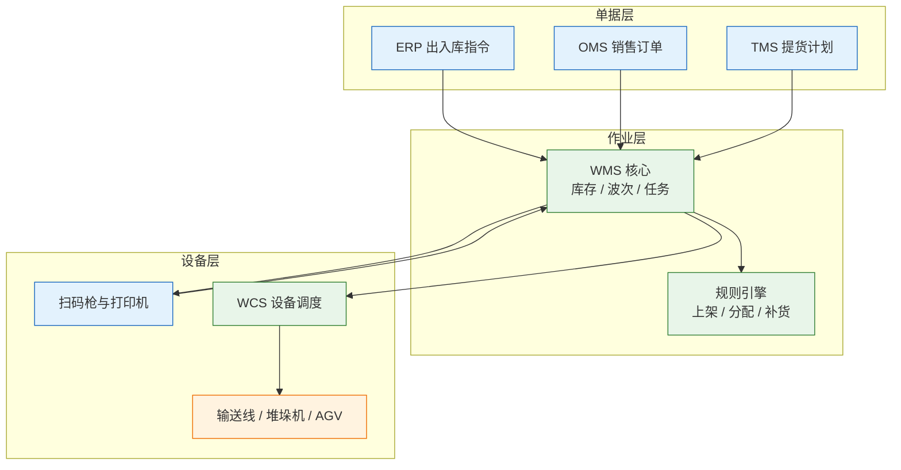
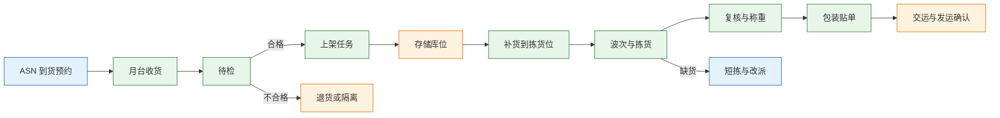
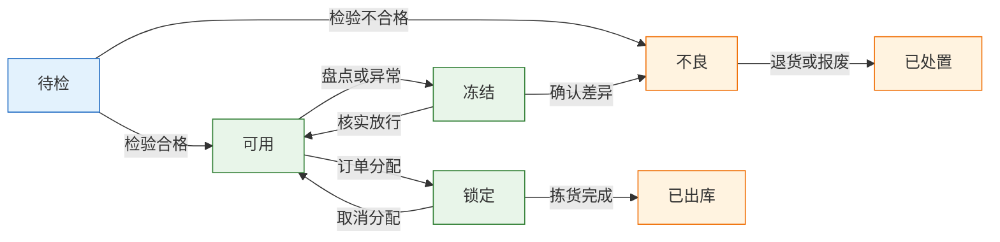
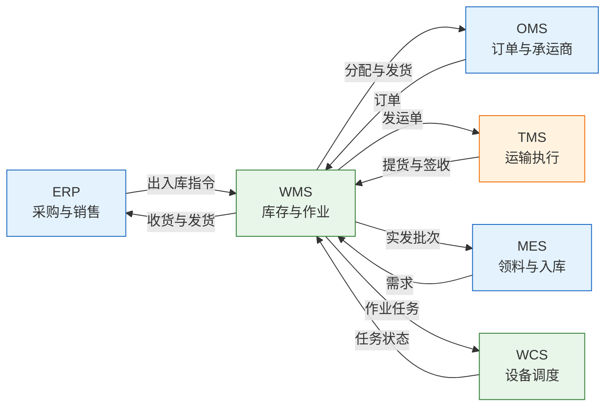

# WMS 与仓储管理

---

## 一、WMS 与仓储管理是什么

### 1.1 核心概念

WMS（Warehouse Management System，仓储管理系统）管理仓库内的实物作业：收货、质检、上架、移库、拣选、复核、包装、发运、盘点与退货。它回答的不是“账上有多少”，而是“这批货在哪个库位、处于什么状态、下一步该做什么动作、由谁在什么时间完成”。

ERP 的库存是财务口径的数量与金额，WMS 的库存是物理口径的库位、容器、批次与状态。数量对得上而库位、批次、状态不对，仓库照样发错货。两套库存必须对账，但不能互相替代。

| 维度 | ERP 库存 | WMS 库存 |
|---|---|---|
| 管理目标 | 数量、金额、账期 | 库位、批次、作业效率 |
| 最小粒度 | 物料 + 工厂 + 批次 | 物料 + 批次 + 容器 + 库位 + 状态 |
| 主要使用者 | 财务、采购、计划 | 仓管、拣货、复核、发运 |
| 典型动作 | 过账、结算、对账 | 收货、上架、拣货、盘点 |

> **注意**：WMS 不是库存余额表加几个按钮。没有库位编码、容器管理和状态区分，系统只能记录总数，无法指导现场作业。

### 1.2 与相邻系统的关系

边界判断同样看“谁写谁读”。采购订单与库存价值由 ERP 写，WMS 读；订单受理与履约策略由 OMS 写，WMS 读；运输执行与运费由 TMS 管；线边消耗由 MES 写；设备动作由 WCS 执行，WMS 只下发任务与回收状态。

| 相邻系统 | 提供给 WMS | WMS 回传 | 边界 |
|---|---|---|---|
| ERP | 采购入库、销售出库、调拨单 | 收货、发货、库存事务、损益 | 库存价值归 ERP |
| OMS | 销售订单、优先级、承运商 | 拣货进度、缺货、发货 | 订单受理归 OMS |
| TMS | 承运商、路由、提货计划 | 包裹、重量体积、交运确认 | 运费结算归 TMS |
| MES | 领料需求、退料、完工入库 | 实发批次、线边库存 | 工序消耗归 MES |
| WCS | 设备状态、任务结果 | 上架、拣选、搬运任务 | 设备控制归 WCS |
| SRM | 供应商、ASN、预约 | 收货差异、质检结果 | 供应商协同归 SRM |

> **注意**：库存以谁为准要分口径。实物库存以 WMS 为准，财务库存以 ERP 为准；差异按单据定位，不能靠月底调账抹平。

### 1.3 分层与架构组成

WMS 通常分为单据层、作业层、设备层与集成层。单据层接收 ERP、OMS 的出入库指令；作业层把单据拆成收货、上架、拣货、补货、盘点任务；设备层对接扫码枪、打印机、电子标签、输送线与堆垛机；集成层负责接口、消息与对账。



| 层 | 组件 | 职责 | 典型故障 |
|---|---|---|---|
| 单据层 | ERP、OMS、TMS | 下达出入库与运输指令 | 单据重复、状态不同步 |
| 作业层 | WMS、规则引擎 | 库存分配、波次、任务 | 规则冲突、任务积压 |
| 设备层 | 扫码、打印、WCS | 执行搬运与识别 | 条码破损、设备离线 |
| 集成层 | API、消息、对账 | 跨系统同步 | 重复消费、顺序错乱 |

> **运维提示**：仓库网络覆盖要按作业区域实测，金属货架和冷库对无线信号衰减明显。扫码枪离线会直接停线，网络冗余与备机属于生产条件，不是办公设施。

---

## 二、仓储作业主流程

### 2.1 到货预约与收货

到货预约把供应商、车辆、月台、时段与 ASN 绑定，减少月台排队和卸货冲突。收货时核对采购单、ASN、实物三者的数量、批次与包装，差异当场记录，不把问题留到上架之后。

| 环节 | 关键控制 | 常见问题 |
|---|---|---|
| 预约 | 月台、时段、供应商、ASN | 不预约导致排队 |
| 卸货 | 车辆、封条、外包装 | 破损未拍照 |
| 收货 | 订单号、数量、批次、效期 | 超收、混批、无单收货 |
| 差异 | 短收、溢收、破损、错料 | 先收货后处理 |

> **业务红线**：无采购单或 ASN 的到货不得直接进入正品库；超收、混批、破损必须进待处理区并挂状态。先收进来再说的做法，会把责任和批次一起搅乱。

### 2.2 质检与上架

质检按物料属性决定是否免检、抽检或全检。待检库存要单独存放并标记状态，不能与可用库存混放。检验合格后转可用，不合格转退货、返修或报废，三种流向对应不同单据。

上架策略常见有就近上架、固定库位、按周转率、按品类、按批次。策略没有通用最优，关键是规则可解释、可调整、可回放。上架任务要校验库位容量、承重、混放规则与危险品隔离要求。

| 上架策略 | 适用场景 | 优点 | 代价 |
|---|---|---|---|
| 就近上架 | 收货量大、库位充足 | 行走短、上架快 | 库位碎片化 |
| 固定库位 | SKU 稳定、拣货频繁 | 好找、培训成本低 | 库位利用率低 |
| 按周转率 | ABC 分类明显 | 拣货路径短 | 需定期重排 |
| 按批次 | 效期、追溯要求高 | 批次清晰 | 库位占用多 |

### 2.3 波次与拣选

波次把一批订单按承运商截单时间、区域、优先级、SKU 重合度与设备容量组合，生成拣货任务。波次不是越大越好：太大造成拣货区拥堵与分播错误，太小则行走浪费。

| 拣选方式 | 适用场景 | 优点 | 代价 |
|---|---|---|---|
| 单订单拣选 | 大件、少量、定制 | 简单、不易混单 | 路径长 |
| 批量拣选 | 小件、订单多 | 行走少 | 需分播 |
| 分区拣选 | 仓库大、品类分区 | 并行度高 | 跨区合并复杂 |
| 波次拣选 | 截单集中、时效强 | 平衡效率与时效 | 波次设计难 |
| 货到人 | 高密度、自动化 | 人不动货动 | 投资高 |

拣货要按容器与库位顺序生成路径，扫码校验 SKU、批次与数量。相似型号、相邻库位、同包装不同规格是错发高发区，必须用扫码与称重做双重防错。

### 2.4 复核、包装与发运

复核台核对订单、商品、数量、批次与包装，称重比对理论重量，差异拦截。包装按承运商与商品属性选择材料，贴单后生成包裹号与跟踪号。交运时与承运商逐件交接，异常当场登记。

| 步骤 | 校验内容 | 异常处理 |
|---|---|---|
| 复核 | SKU、数量、批次、序列号 | 缺货改派或拆单 |
| 称重 | 实际重量与理论重量 | 超差开箱复查 |
| 包装 | 材料、防护、标签 | 重包并记录 |
| 交运 | 包裹数、承运商、时间 | 少件挂起、补发 |



---

## 三、库存模型与状态机

### 3.1 库存粒度与可用量

库存的最小粒度不是“SKU + 数量”，而是“SKU + 批次 + 容器 + 库位 + 状态”。少一个维度，就会出现“系统有 100 件，能拣的只有 20 件”。可用量要由在库量减去分配量、锁定量、冻结量与待检量，口径写进库存视图。

| 量 | 定义 | 用途 |
|---|---|---|
| 在库量 | 物理存在于仓库的数量 | 盘点与对账 |
| 可用量 | 在库量减分配、锁定、冻结、待检 | 接单与分配 |
| 分配量 | 已被订单或工单预占 | 防止超卖 |
| 锁定量 | 盘点、复核、异常处理中占用 | 防止并发修改 |

> **业务红线**：可用量不等于在库量。接单、分配、波次都必须读可用量，不能读在库量；任何手工调整都要留事务与原因。

库存准确率按库位、批次与容器抽查，不能只看总数；A 类 SKU 的目标应高于 C 类，抽查覆盖比一年一次全盘更能反映真实水平。

### 3.2 库存状态机

库存状态决定一批货能不能被分配、拣选、发运。状态流转必须由业务动作触发，不能由人工直接改数据库。常见状态包括待检、可用、锁定、冻结、不良、退货待处理。



| 状态 | 可分配 | 可拣选 | 进入条件 |
|---|---|---|---|
| 待检 | 否 | 否 | 收货完成、等待检验 |
| 可用 | 是 | 是 | 检验合格或免检 |
| 锁定 | 否 | 是 | 已被订单或波次预占 |
| 冻结 | 否 | 否 | 盘点、异常、质量调查 |
| 不良 | 否 | 否 | 检验不合格或破损 |
| 退货待处理 | 否 | 否 | 退货收货、等待判定 |

### 3.3 库位、容器与编码

库位编码要能被人读、也能被系统排序。常见格式为区-巷-排-层-位，例如 A-03-02-1-04。编码里不要塞会变化的业务含义，否则调整布局一次，全仓标签作废。

容器用 LPN（License Plate Number，容器标识）管理，托盘、周转箱、纸箱都可以是一个 LPN。整箱收货、整托上架、拆零拣选都围绕 LPN 展开。LPN 与库位是多对一关系，一个库位可以放多个 LPN，一个 LPN 在同一时点只能在一个库位。

| 对象 | 编码规则 | 关键属性 |
|---|---|---|
| 库位 | 区-巷-排-层-位 | 类型、容量、承重、温区 |
| LPN | 前缀 + 序列号 | 类型、容量、所属批次 |
| 拣货位 | 与存储位分开编号 | 补货水位、最大容量 |
| 暂存位 | 按区域编号 | 用途、停留时限 |

### 3.4 库存事务与余额

库存要按“事务日志 + 当前余额”设计。每次收货、上架、移库、拣货、发货、调整、盘点盈亏都写一条不可变事务；余额由事务汇总或增量维护，可重算。事务带业务单号、批次、库位、容器、操作人与时间。

| 事务类型 | 方向 | 影响 | 触发单据 |
|---|---|---|---|
| 收货 | 入 | 在库量增加 | 收货单 |
| 上架 | 移 | 库位变化、总量不变 | 上架任务 |
| 拣货 | 移 | 库位到暂存区 | 拣货任务 |
| 发货 | 出 | 在库量减少 | 发运单 |
| 调整 | 双向 | 盈亏修正 | 调整单 |
| 盘点 | 双向 | 差异过账 | 盘点单 |

> **注意**：只存余额、不存事务，出了问题无法回溯，也无法证明差异发生在哪一步。事务表只追加，不更新，冲正另起一条反向记录。

---

## 四、核心表结构

### 4.1 库存与事务表

库存表按“物料 + 批次 + 容器 + 库位 + 状态”唯一，数量字段只保存当前值；事务表保存每一次变化。两表通过事务关联，余额可从事务重算。

```sql
CREATE TABLE wms_stock (
  id             BIGINT        NOT NULL COMMENT '主键',
  sku_code       VARCHAR(64)   NOT NULL COMMENT '物料编码',
  lot_no         VARCHAR(64)   NOT NULL COMMENT '批次号',
  lpn_code       VARCHAR(64)   NOT NULL COMMENT '容器标识',
  location_code  VARCHAR(32)   NOT NULL COMMENT '库位编码',
  stock_status   VARCHAR(16)   NOT NULL COMMENT '库存状态',
  qty_on_hand    DECIMAL(18,4) NOT NULL COMMENT '在库数量',
  qty_allocated  DECIMAL(18,4) DEFAULT 0 COMMENT '分配数量',
  production_date DATE         COMMENT '生产日期',
  expiry_date    DATE          COMMENT '有效期',
  version        INT           NOT NULL DEFAULT 0 COMMENT '乐观锁版本',
  PRIMARY KEY (id),
  UNIQUE KEY uk_stock (sku_code, lot_no, lpn_code, location_code, stock_status)
) COMMENT='WMS 库存';

CREATE TABLE wms_stock_txn (
  id             BIGINT        NOT NULL COMMENT '主键',
  txn_no         VARCHAR(40)   NOT NULL COMMENT '事务号，全局唯一',
  txn_type       VARCHAR(16)   NOT NULL COMMENT '收货/上架/拣货/发货/调整',
  sku_code       VARCHAR(64)   NOT NULL COMMENT '物料编码',
  lot_no         VARCHAR(64)   COMMENT '批次号',
  from_location  VARCHAR(32)   COMMENT '出库位',
  to_location    VARCHAR(32)   COMMENT '入库位',
  qty            DECIMAL(18,4) NOT NULL COMMENT '变动数量',
  biz_no         VARCHAR(40)   NOT NULL COMMENT '业务单号',
  operator       VARCHAR(32)   NOT NULL COMMENT '操作人',
  created_at     DATETIME      NOT NULL COMMENT '发生时间',
  PRIMARY KEY (id),
  UNIQUE KEY uk_txn_no (txn_no)
) COMMENT='WMS 库存事务';
```

| 字段 | 类型 | 说明 |
|---|---|---|
| stock_status | VARCHAR(16) | 与状态机枚举一致 |
| qty_on_hand | DECIMAL(18,4) | 支持拆零与称重品类 |
| qty_allocated | DECIMAL(18,4) | 分配量不超过可用量 |
| lpn_code | VARCHAR(64) | 整箱、整托作业的关键 |
| version | INT | 并发扣减用乐观锁 |

### 4.2 入库与出库单据表

入库单关联采购单或 ASN，出库单关联销售订单或调拨单。单据状态与库存事务分离：单据可以分批执行，事务逐笔发生，数量以事务汇总为准。

入库单与出库单的状态与库存状态分开管理。单据状态描述流程走到哪一步，库存状态描述货能不能用，两者不能合并成一个字段。

**单据状态**

| 单据 | 状态 | 进入条件 | 下一步 |
|---|---|---|---|
| 入库单 | 已创建 | ERP 或 ASN 下达 | 预约 |
| 入库单 | 已收货 | 月台清点完成 | 质检 |
| 入库单 | 待检 | 收货过账 | 检验 |
| 入库单 | 已上架 | 上架任务完成 | 关闭 |
| 出库单 | 已创建 | 订单或调拨下达 | 分配 |
| 出库单 | 已分配 | 库存预占成功 | 拣货 |
| 出库单 | 拣货中 | 拣货任务下发 | 复核 |
| 出库单 | 已发运 | 交运确认 | 关闭 |

**主要表**

| 表 | 关键字段 | 说明 |
|---|---|---|
| 入库单 | inbound_no、source_no、supplier、status | 一行一物料一批次 |
| 入库明细 | inbound_no、sku、lot、expected_qty | 应收数量与实收对比 |
| 出库单 | outbound_no、order_no、carrier、status | 支持拆单与合并 |
| 出库明细 | outbound_no、sku、lot、required_qty | 需求数量与分配数量 |
| 发运单 | shipment_no、package_no、tracking_no | 与 TMS 交接 |

### 4.3 库位与容器表

库位表定义容量、类型、温区与是否可拣；容器表定义 LPN 的当前库位与状态。库位与容器都要支持停用，停用前必须先清空，不能直接删除。

| 所属表 | 字段 | 类型 | 说明 |
|---|---|---|---|
| 库位表 | location_code | VARCHAR(32) | 库位唯一编码 |
| 库位表 | location_type | VARCHAR(16) | 存储、拣货、暂存、退货 |
| 库位表 | capacity | DECIMAL(18,4) | 容量上限 |
| 库位表 | temp_zone | VARCHAR(8) | 常温、冷藏、冷冻 |
| 库位表 | pickable | TINYINT | 是否允许拣选 |
| 容器表 | lpn_status | VARCHAR(16) | 空、占用、封存 |

---

## 五、典型功能模块

### 5.1 收货与上架策略

收货模块处理预约、卸货、清点、差异登记与收货过账。上架模块根据物料属性、库位容量、混放规则与周转率推荐库位，允许人工改位但必须记录原因。

| 模块 | 核心功能 | 关键输出 | 常见问题 |
|---|---|---|---|
| 预约 | 月台、时段、ASN | 预约单 | 月台冲突 |
| 收货 | 清点、批次、差异 | 收货单 | 超收、混批 |
| 质检 | 抽检、判定、隔离 | 检验结果 | 先上架后检验 |
| 上架 | 推荐库位、任务下发 | 上架任务 | 随意放、找不到 |

### 5.2 拣选与补货策略

拣选模块把波次拆成任务，按路径排序并校验扫码。补货模块监控拣货位水位，按最小/最大水位或看板触发，从存储位补到拣货位。补货不及时是短拣的主要原因之一。

| 策略 | 触发条件 | 优点 | 风险 |
|---|---|---|---|
| 最小最大 | 低于最小水位 | 简单可控 | 峰值补货滞后 |
| 看板补货 | 拣货位空箱 | 贴近实际 | 依赖人工触发 |
| 波次前补货 | 波次生成时 | 减少短拣 | 需预测波次量 |
| 紧急补货 | 拣货缺货 | 响应快 | 打断正常作业 |

### 5.3 盘点与效期管理

盘点分循环盘点、动碰盘点与全盘。循环盘点按库位或品类轮盘，不影响整体作业；动碰盘点优先盘有出入库的库位；全盘用于年度或审计，需要冻结库存并提前停单。

效期管理按 FEFO（First Expired First Out，先到期先出）分配，不只看入库时间。近效期要设预警天数，触发促销、调拨、退货或报废；过期库存必须冻结，不能参与分配。

| 盘点方式 | 范围 | 对作业影响 | 适用场景 |
|---|---|---|---|
| 循环盘点 | 按库位或品类 | 小 | 日常准确率管理 |
| 动碰盘点 | 有变动的库位 | 小 | 高频周转区 |
| 全盘 | 全仓 | 大，需停单 | 年度审计 |

> **业务红线**：盘点差异不得直接改账。差异先挂待处理，复盘原因、审批后才过账；盘点期间相关库位要冻结，避免边盘边动。

### 5.4 退货与越库

退货要独立建模：退货单关联原发货单或订单，收货后进入退货待处理区，质检判定为可再销售、返修、报废。可再销售的批次重新上架，但不能与正品混放；返修要回流到维修或生产环节。

越库适合“到货即分拨”：收货后不进入存储位，直接按门店或订单分播到发运区。它省掉上架与拣货，但对 ASN 准确率、月台协调与分播能力要求很高；ASN 不准，越库就会变成在月台翻箱。

| 场景 | 关键前提 | 收益 | 风险 |
|---|---|---|---|
| 退货再销售 | 质检、批次可追 | 减少报废 | 混入正品 |
| 越库 | ASN 准确、月台充足 | 缩短在库时间 | 分播错误 |
| 调拨 | 库存可见、在途可查 | 平衡库存 | 在途丢失 |

---

## 六、系统集成

### 6.1 与 ERP 的集成

ERP 下采购入库、销售出库与调拨指令，WMS 回传收货、发货、库存事务与损益。指令要带唯一业务单号，WMS 按单号幂等接收；ERP 按事务号过账，避免重复记账。

| 方向 | 内容 | 机制 | 幂等键 |
|---|---|---|---|
| ERP → WMS | 采购入库、销售出库 | API 或消息 | 单据号 + 行号 |
| WMS → ERP | 收货、发货、损益 | API 或批量 | 事务号 |
| ERP → WMS | 物料、供应商、价格 | 主数据分发 | 编码 + 版本 |
| WMS → ERP | 库存余额 | 定时快照 | 仓库 + 日期 |

### 6.2 与 OMS、TMS 的集成

OMS 下销售订单、优先级、承运商与增值服务，WMS 回传分配结果、缺货、拣货进度与发货确认。TMS 接发运单、包裹与重量体积，回传提货与签收状态。订单取消要能拦截未拣货任务。

| 链路 | 内容 | 时效 | 异常处理 |
|---|---|---|---|
| OMS → WMS | 订单、优先级、承运商 | 实时 | 重复单拦截 |
| WMS → OMS | 分配、缺货、发货 | 实时 | 部分发货拆单 |
| WMS → TMS | 包裹、重量、体积 | 发运前 | 称重差异挂起 |
| TMS → WMS | 提货、签收 | 准实时 | 超时人工确认 |

### 6.3 与 MES、WCS 的集成

MES 向 WMS 发领料、退料与完工入库需求，WMS 按批次与库位执行并回传实发数量。WCS 接 WMS 的上架、拣选、搬运任务，回传任务状态与设备异常；WMS 不直接控制设备动作。



### 6.4 对账与异常处理

对账顺序是事务、余额、财务库存。先对事务数量与业务单据，再对余额与事务汇总，最后对 ERP 财务库存。差异要落到具体单据、库位与批次，不能只报一个总数。

| 层级 | 对账对象 | 频率 | 差异处理 |
|---|---|---|---|
| 单据 | 收货单、发货单 | 每日 | 补传或冲正 |
| 事务 | 库存事务与任务 | 每班 | 查重复与漏记 |
| 余额 | 库存表与事务汇总 | 每日 | 重算并挂差异 |
| 财务 | WMS 与 ERP 库存 | 每月 | 定位后调整 |

---

## 七、实施方法与边界

### 7.1 实施顺序

实施先做收货、上架、拣货、发货四条主链，再做批次效期、盘点、退货与越库，最后接自动化设备与优化波次。基础数据不稳就上立库，错误会被设备放大。

| 阶段 | 范围 | 验收标准 | 风险 |
|---|---|---|---|
| 一期 | 收货、上架、拣货、发货 | 账实一致、单据可追 | 库位不准 |
| 二期 | 批次、效期、盘点、退货 | FEFO 生效、差异可查 | 扫码执行不到位 |
| 三期 | 波次优化、WCS、越库 | 效率提升、异常可控 | 设备与流程不匹配 |

### 7.2 基础数据准备

基础数据包括物料、单位换算、包装规格、批次规则、库位、容器、供应商、承运商与作业人员。库位与容器要在上线前完成编码、贴标与实测，不能边上线边补。

| 对象 | 责任方 | 完成标志 |
|---|---|---|
| 物料与包装 | 采购、商品 | 单位换算唯一、包装规格明确 |
| 库位与容器 | 仓储、工程 | 编码贴标、容量实测 |
| 批次与效期 | 质量、商品 | 规则可执行、预警天数确定 |
| 人员与权限 | 仓储、人事 | 角色与作业区域绑定 |

> **注意**：单位换算是 WMS 与 ERP 对账的高发点。采购箱、库存件、拣货包之间的换算必须唯一且受控，不能按供应商临时改。

### 7.3 自动化取舍与边界

自动化适合高密度、少 SKU、稳定波次的场景；多品类、强波动、低投资的仓库，先做流程与数据，再考虑设备。WMS 负责作业规则与任务，WCS 负责设备调度，PLC 负责动作执行，三层不能混。

| 方案 | 适用条件 | 投资 | 风险 |
|---|---|---|---|
| 人工加扫码 | 品类多、波动大 | 低 | 依赖执行力 |
| 电子标签 | 拆零拣选、SKU 多 | 中 | 标签维护 |
| 输送线与分拣 | 单量稳定、包裹多 | 高 | 峰值堵点 |
| 立库与 AGV | 高密度、少品类 | 很高 | 柔性不足 |

> **运维提示**：自动化仓库的瓶颈常在软件而非设备。任务排序、异常回流、人工兜底通道要在设计阶段定义清楚，否则设备一停，整仓停摆。

---

## 八、常见失败模式与排查

### 8.1 失败模式对照

仓储问题多数不是“系统算错”，而是作业没有按规则执行，或者基础数据本身不准。排查先看事务，再看状态，最后看规则。

| 现象 | 最可能原因 | 处理 |
|---|---|---|
| 系统有货，拣不出来 | 库存锁定、待检、冻结或库位不可拣 | 查可用量口径与库存状态 |
| 账实不符 | 收货漏记、手工调账、混批 | 事务回溯，日对账，差异冲正 |
| 重复收货 | 供应商重复送、接口重试无幂等 | ASN 加收货单号唯一，超收审批 |
| 负库存 | 先出后入、出库未校验 | 禁止负库存，补入账，查事务顺序 |
| 发错货 | 相似 SKU 邻近、未扫码复核 | 库位错位设计、扫码加称重 |
| 批次过期仍发出 | 未按 FEFO 分配、效期未维护 | 分配加效期，近效期预警 |
| 波次大量短拣 | 库存不准、补货不及时 | 波次前预占，拣货位补货触发 |
| 包裹称重不符 | 多品漏扫、包装错误 | 复核台强制称重，差异拦截 |
| 盘点后库存更乱 | 差异直接改账、未复盘 | 差异挂账，复盘后审批调整 |
| 退货混入正品 | 退货区未隔离、状态未区分 | 独立退货库位，质检后转可用 |

### 8.2 处置顺序

1. 查这笔库存的事务流水，确认最后一次变动的时间、单据与操作人。
2. 查当前余额与库存状态，确认可用量、分配量与冻结量。
3. 查库位与容器，确认是否可拣、是否被占用、是否混放。
4. 查接口日志，确认是否重复收货、漏发或状态未回传。
5. 查盘点与调整记录，确认差异是否已审批。
6. 恢复后补校验规则与监控项，把差异原因写进作业规范。

> **核心结论**：WMS 管的是库位、批次、容器与状态，不是一张库存余额表；实物库存与财务库存分口径，靠事务对账连接；拣货效率来自波次、路径与复核，不来自增加人手。
