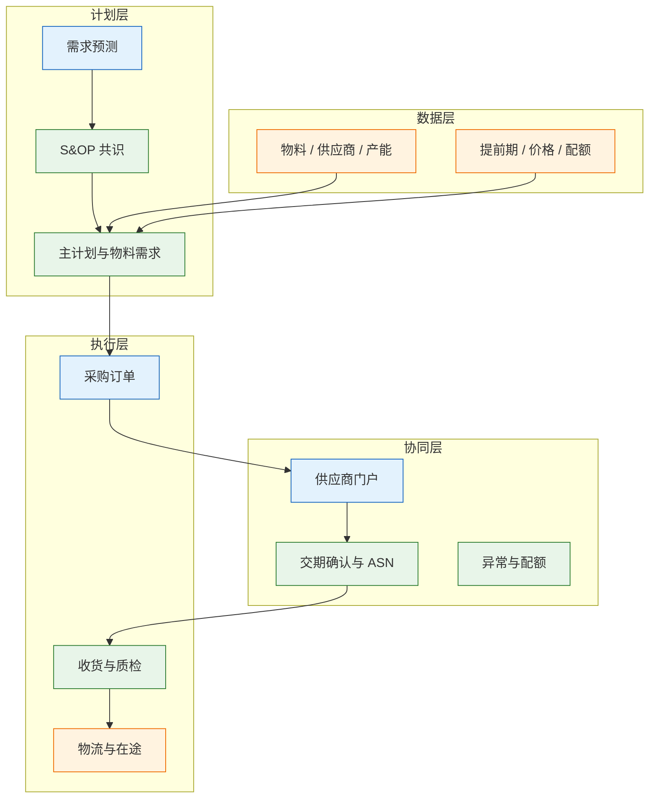
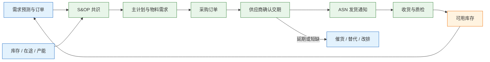
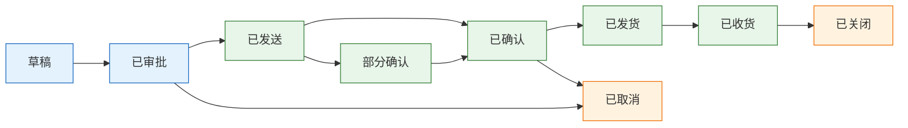
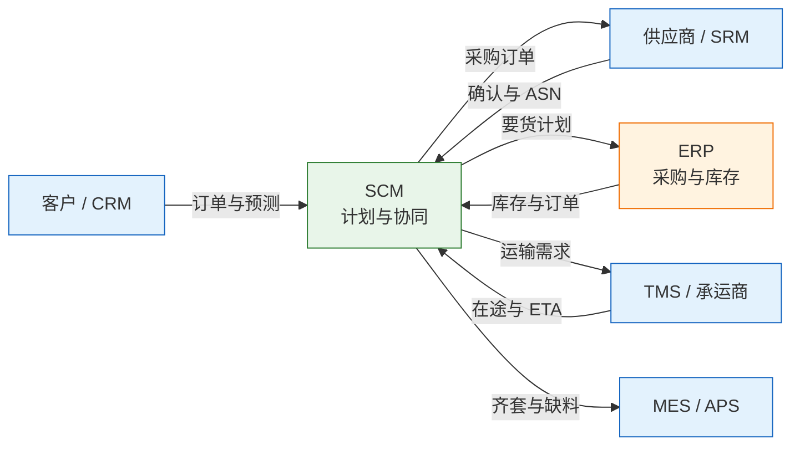

# SCM 与供应链管理

---

## 一、SCM 与供应链管理是什么

### 1.1 核心概念

SCM（Supply Chain Management，供应链管理）跨企业协调需求、供应、库存与物流，让“客户要什么、工厂能做什么、供应商能供什么、货什么时候到”落在同一条时间轴上。它管协同与计划，不替 ERP 记账，也不替 WMS 收发货。

供应链的核心是一条承诺链：销售向客户承诺交期，采购向供应商承诺需求，物流向仓库承诺到货。承诺日期一变，生产、库存、资金计划都要重算。SCM 的价值不是把采购流程搬到线上，而是让每个承诺可验证、可追溯、可重排。

| 维度 | 计划层 | 执行层 |
|---|---|---|
| 关注点 | 需求、供应、库存、产能 | 订单、收货、发运、结算 |
| 时间尺度 | 月、周、日 | 小时、天 |
| 主要系统 | SCM、APS、ERP 计划模块 | ERP、WMS、TMS、MES |
| 失败后果 | 缺料、积压、承诺失真 | 错发、漏收、对账不平 |

> **注意**：预测不是订单，订单不等于供应商承诺，承诺不等于实际到货。四类数据必须分开存储、分别带版本，混用会让库存和交期同时失真。

### 1.2 与相邻系统的关系

ERP 是采购订单、库存价值与财务凭证的权威源；SCM 做需求计划、供应协同、交期确认与异常跟踪；WMS 管实物收货与库位；TMS 管运输执行；MES 管工序消耗；SRM 管供应商准入与绩效；CRM 管客户与商机。

| 相邻系统 | 提供给 SCM | SCM 回传 | 边界 |
|---|---|---|---|
| ERP | 采购订单、库存、物料、供应商 | 预测、交期变更、缺料预警 | 记账与应付归 ERP |
| APS | 产能、排产、工序占用 | 需求优先级、物料齐套 | 工序排产归 APS |
| WMS | 收货、库存、批次 | 到货计划、ASN、质检要求 | 库位作业归 WMS |
| TMS | 运输能力、在途、ETA | 运输需求、提货计划 | 运费结算归 TMS |
| MES | 消耗、在制、完工 | 齐套需求、缺料停线 | 工序执行归 MES |
| SRM | 供应商准入、产能、绩效 | 订单履约、质量反馈 | 供应商主数据归 SRM |

> **注意**：SCM 与 ERP 最容易重叠的是采购订单。常见分工是 ERP 为订单权威源，SCM 负责供应商确认、交期版本、ASN 与异常；两边都能改订单，就一定对不上。

### 1.3 分层与架构组成

SCM 分为计划层、协同层、执行层与数据层。计划层做需求预测、S&OP、主计划与库存计划；协同层做供应商门户、交期确认、ASN 与异常；执行层对接采购、收货、物流与结算；数据层维护物料、供应商、产能、提前期与价格协议。



| 层 | 组件 | 职责 | 典型故障 |
|---|---|---|---|
| 计划层 | 预测、S&OP、主计划 | 需求与供应平衡 | 版本混乱、参数失准 |
| 协同层 | 门户、ASN、异常 | 供应商承诺与到货可视 | 承诺不落系统 |
| 执行层 | 采购、收货、物流 | 订单履约 | 单据与实物不一致 |
| 数据层 | 物料、供应商、提前期 | 计划输入 | 主数据重复、过期 |

> **运维提示**：供应链系统的可用性依赖外部伙伴。供应商门户、EDI 网关、物流接口都要有降级通道，邮件与表格只能作为临时兜底，事后必须补录系统。

---

## 二、需求计划与产销协同

### 2.1 需求预测与版本

需求预测按物料、区域、渠道、期间分桶，按月或按周滚动。预测必须带版本、发布人、生效时间与口径说明；下游只消费最新有效版本，旧版本保留用于复盘准确率。

预测不是越细越好。按单个 SKU 按日预测，噪声会淹没信号；通常按品类或 ABC 分类分层，A 类细到周，C 类粗到月，再按比例分解。新品、促销、季节品要单独建模，不能直接套历史均值。

多级供应链中，每一级都按自己的提前期与缺货风险加安全库存，需求波动沿链条逐级放大，形成牛鞭效应。缓解手段不是要求每级预测更准，而是共享终端销售、缩短信息延迟、减少批量规则。

| 预测层级 | 时间粒度 | 适用对象 | 调整频率 |
|---|---|---|---|
| 战略 | 季度、年度 | 产能与投资 | 季度 |
| 战术 | 月、周 | 品类、主力 SKU | 每月 |
| 执行 | 周、日 | A 类 SKU、关键件 | 每周 |

### 2.2 S&OP 产销对齐

S&OP（Sales and Operations Planning，销售与运营计划）按月跑一轮，把无约束需求与供应能力放在一张桌上，形成有优先级、有决策记录的共识计划。它不是开会，而是有数据、有版本、有责任人的循环。

| 阶段 | 输入 | 输出 | 参与者 |
|---|---|---|---|
| 需求评审 | 历史、订单、市场、促销 | 无约束需求 | 销售、市场 |
| 供应评审 | 产能、库存、在途、供应商产能 | 供应能力与缺口 | 生产、采购 |
| 共识会议 | 需求与供应缺口 | 共识计划、优先级 | 管理层 |
| 执行 | 主计划、采购计划、排产 | 可执行订单与工单 | 计划、采购、生产 |
| 复盘 | 达成率、偏差原因 | 下轮改进项 | 全体 |

> **注意**：S&OP 的输出必须是可执行的数字与优先级，不能停在“加强协同”。没有取舍的共识计划，执行时会退回各自为政。



### 2.3 主计划与物料需求

主计划把共识需求转成产品级生产计划，物料需求按 BOM 展开，扣除现有库存、在途、已分配与安全库存，得到净需求。净算顺序不能乱：先看需求，再看供给，再算缺口，最后按批量和提前期倒排。

| 步骤 | 输入 | 输出 | 常见错误 |
|---|---|---|---|
| 需求汇总 | 订单、预测、安全库存 | 毛需求 | 预测与订单重复计算 |
| 供给汇总 | 库存、在途、在制 | 可用供给 | 在途未确认 |
| 净算 | 毛需求减可用供给 | 净需求 | 忽略分配与冻结 |
| 批量与倒排 | 批量规则、提前期 | 采购与生产建议 | 提前期用承诺值 |

### 2.4 承诺与 ATP、CTP

ATP（Available to Promise，可承诺量）表示现有库存与已确认供应中还能承诺给新订单的数量；CTP（Capable to Promise，可承诺能力）进一步考虑产能与物料约束。ATP 回答“现在能给多少”，CTP 回答“调整产能后能给多少”。

承诺要区分三层：销售对客户的交期承诺、采购对供应商的需求承诺、物流对仓库的到货承诺。三层承诺共用一条时间轴，任何一层变更都要触发重排与通知。

| 承诺类型 | 依据 | 变更影响 | 责任方 |
|---|---|---|---|
| 客户交期 | ATP、CTP、运输时效 | 订单优先级、罚款 | 销售 |
| 采购需求 | 主计划、库存、批量 | 供应商产能、价格 | 采购 |
| 到货承诺 | ASN、承运商 ETA | 齐套、停线风险 | 物流 |

---

## 三、采购与供应协同

### 3.1 请购到采购订单

请购由需求部门或 MRP 产生，经预算与权限审批后转采购订单。采购订单要写清物料、数量、单价、交期、交付地点、Incoterms、质量条款与包装要求。价格来自合同或价格协议，不能由采购员临时填写。

| 环节 | 关键控制 | 常见问题 |
|---|---|---|
| 请购 | 需求日、预算、审批 | 需求日拍脑袋 |
| 询价 | 供应商范围、比价规则 | 只找单一供应商 |
| 下单 | 价格协议、交期、条款 | 价格未审批 |
| 确认 | 供应商接受、改期、部分接受 | 口头确认无记录 |

> **注意**：Incoterms 只定义费用、风险与手续的转移点，不定义货物所有权转移，FOB、CIF、DDP 的分界各不相同。到厂成本要把运费、保险、关税、码头费与汇率一起计入，不能只看采购单价。

### 3.2 交期确认与 ASN

采购订单发出只是开始，关键是供应商确认。确认要版本化：原承诺日期、变更后日期、变更原因、确认人、确认时间都要保留。没有原承诺，就无法计算准时率，也无法判断谁该为延期负责。

ASN（Advanced Shipping Notice，到货通知）在货物离厂时发出，包含数量、批次、包装、承运商、预计到货时间。ASN 是收货前的关键凭证，也是越库与预约的基础。

| 单据 | 触发时点 | 关键字段 | 下游动作 |
|---|---|---|---|
| 采购订单 | 需求确认后 | 物料、数量、交期、价格 | 供应商确认 |
| 订单确认 | 供应商接受 | 承诺日期、确认数量 | 排产与齐套 |
| ASN | 货物离厂 | 批次、包装、ETA | 预约收货 |
| 收货单 | 到货清点 | 实收、差异、批次 | 质检与入库 |



### 3.3 收货、三单匹配与付款

收货核对 ASN、采购订单与实物，差异挂起。三单匹配把采购订单、收货单、发票放在一起，比较数量、单价、税额与运费，在容差内才付款。容差规则要写进制度，不能由财务逐单手工判断。

| 匹配项 | 比较对象 | 容差示例 | 差异处理 |
|---|---|---|---|
| 数量 | 订单、收货、发票 | 按比例或绝对值 | 短收按实付 |
| 单价 | 订单、发票 | 合同约定 | 超差审批 |
| 税额 | 发票、税率 | 法定税率 | 退回重开 |
| 运费 | 合同、账单 | 按线路 | 核对后调整 |

> **业务红线**：三单不匹配不得直接改账或手工付款。差异要走审批与调整单，保留原单与证据；绕过匹配付款，会把采购、收货与财务的差异永久埋掉。

### 3.4 供应商配额与绩效

同一物料有多家供应商时，要定配额与分配规则：按比例、按价格、按交期、按风险。配额不是固定值，缺料时可临时调整，但调整要留记录，否则绩效与成本都无法解释。

供应商绩效至少看四类：准时率、质量合格率、价格竞争力、响应速度。统计口径要固定：以承诺日期还是原交期、部分到货如何计、取消单是否排除。口径一变，绩效排名就失去可比性。

| 指标 | 定义 | 数据来源 | 用途 |
|---|---|---|---|
| 准时率 | 按承诺日期到货批次 ÷ 总批次 | ASN、收货单 | 配额与评审 |
| 质量合格率 | 合格批次 ÷ 检验批次 | 收货质检 | 准入与加严 |
| 响应速度 | 确认订单的平均时长 | 门户记录 | 协同改进 |
| 价格竞争力 | 同规格比价结果 | 价格协议 | 谈判依据 |

---

## 四、核心数据模型

### 4.1 需求与订单对象

需求预测、销售订单、采购申请、采购订单是四类不同对象。预测带版本、可覆盖；订单唯一、不可重复；请购是内部需求，需审批；采购订单是对供应商的正式承诺。

| 对象 | 主键 | 版本策略 | 说明 |
|---|---|---|---|
| 需求预测 | forecast_id | forecast_id + version | 按期间分桶，保留历史 |
| 销售订单 | order_no | 行级版本 | 客户承诺，唯一 |
| 采购申请 | request_no | 审批版本 | 内部需求，可合并 |
| 采购订单 | po_no | 行级交期版本 | 供应商承诺，唯一 |

### 4.2 采购订单与交期版本

采购订单表保存当前有效交期，交期版本表保存每一次承诺变更。当前值用于执行，版本表用于绩效与追责，两者不能合并。

```sql
CREATE TABLE scm_purchase_order (
  id             BIGINT        NOT NULL COMMENT '主键',
  po_no          VARCHAR(32)   NOT NULL COMMENT '采购订单号',
  line_no        INT           NOT NULL COMMENT '行号',
  supplier_code  VARCHAR(32)   NOT NULL COMMENT '供应商编码',
  material_code  VARCHAR(64)   NOT NULL COMMENT '物料编码',
  qty            DECIMAL(18,4) NOT NULL COMMENT '订单数量',
  unit_price     DECIMAL(18,6) NOT NULL COMMENT '含税单价',
  currency       CHAR(3)       NOT NULL COMMENT '币种',
  incoterms      VARCHAR(8)    COMMENT '贸易术语',
  promise_date   DATE          COMMENT '当前承诺到货日',
  status         VARCHAR(16)   NOT NULL COMMENT '订单状态',
  PRIMARY KEY (id),
  UNIQUE KEY uk_po_line (po_no, line_no)
) COMMENT='采购订单';

CREATE TABLE scm_po_schedule (
  id             BIGINT        NOT NULL COMMENT '主键',
  po_no          VARCHAR(32)   NOT NULL COMMENT '采购订单号',
  line_no        INT           NOT NULL COMMENT '行号',
  version_no     INT           NOT NULL COMMENT '交期版本号',
  promise_date   DATE          NOT NULL COMMENT '承诺到货日',
  change_reason  VARCHAR(128)  COMMENT '变更原因',
  confirmed_by   VARCHAR(32)   COMMENT '供应商确认人',
  confirmed_at   DATETIME      COMMENT '确认时间',
  PRIMARY KEY (id),
  UNIQUE KEY uk_po_version (po_no, line_no, version_no)
) COMMENT='采购交期版本';
```

| 字段 | 类型 | 说明 |
|---|---|---|
| po_no | VARCHAR(32) | 采购订单唯一号，接口幂等依据 |
| qty | DECIMAL(18,4) | 支持小数计量单位 |
| promise_date | DATE | 当前有效承诺，绩效以此为准 |
| version_no | INT | 每次变更递增，不覆盖历史 |
| incoterms | VARCHAR(8) | 只定义费用与风险转移 |

### 4.3 库存计划参数

库存计划参数按物料、仓库、ABC 分类维护：安全库存、补货点、批量、提前期、服务水平。参数要有责任人、生效日期与复盘记录，不能一次设置多年不动。

安全库存的简化公式为：

```text
安全库存 ≈ Z × √(提前期 × 需求方差 + 平均需求² × 提前期方差)
```

Z 由目标服务水平决定，95% 单侧服务水平约对应 1.65。公式假设需求与提前期近似独立，实际系统会用历史误差、季节性与促销修正。参数的关键不是公式精度，而是有人对结果负责。

| 参数 | 含义 | 影响因素 | 复盘频率 |
|---|---|---|---|
| 安全库存 | 缓冲需求与提前期波动 | 服务水平、方差 | 每季 |
| 补货点 | 触发补货的库存水位 | 日均耗、提前期 | 每月 |
| 批量 | 单次下单或生产数量 | 起订量、仓储成本 | 每季 |
| 提前期 | 从下单到可用的时间 | 运输、清关、质检 | 每季 |

### 4.4 供应关系与绩效表

供应关系表记录物料与供应商的对应、配额、价格协议与生效期。绩效表按期间汇总准时率、质量与响应，供配额调整与年度评审使用。

| 字段 | 类型 | 说明 |
|---|---|---|
| supplier_code | VARCHAR(32) | 供应商唯一编码 |
| material_code | VARCHAR(64) | 物料编码 |
| quota_ratio | DECIMAL(5,2) | 配额比例，合计为 100 |
| price_version | VARCHAR(16) | 价格协议版本 |
| valid_from | DATE | 生效日期 |
| valid_to | DATE | 失效日期 |

---

## 五、典型功能模块

### 5.1 需求计划

需求计划模块做历史清洗、基线预测、事件调整与版本发布。历史清洗要剔除断货、促销、一次性大单造成的虚假需求；事件调整要记录促销、竞品、政策等外部因素。

| 功能 | 输入 | 输出 | 常见问题 |
|---|---|---|---|
| 历史清洗 | 出货、订单、库存 | 可用历史 | 断货未还原 |
| 基线预测 | 历史、季节、趋势 | 统计预测 | 颗粒度过细 |
| 事件调整 | 促销、新品、政策 | 调整后预测 | 无记录 |
| 版本发布 | 审批后的预测 | 下游可消费版本 | 旧版本仍在用 |

### 5.2 供应计划与齐套

供应计划把需求与产能、库存、在途、供应商产能对齐，输出缺口与补货建议。齐套分析按 BOM 展开，看关键件是否齐全，不能只看库存总额。库存高但齐套率低，说明结构错了。

| 分析 | 目的 | 数据来源 | 输出 |
|---|---|---|---|
| 产能平衡 | 判断能否按时生产 | APS、工作中心 | 产能缺口 |
| 物料齐套 | 判断能否开工 | BOM、库存、在途 | 缺料清单 |
| 库存结构 | 判断积压与短缺 | ABC、效期、批次 | 调整建议 |
| 在途可视 | 判断到货风险 | TMS、ASN | 延误预警 |

### 5.3 供应商管理

供应商管理覆盖准入、分类、配额、绩效与风险。准入看资质、产能、质量体系与财务稳定性；分类按物料重要度与供应风险；配额按绩效与风险分配；风险看产能、财务与地理集中度。

关键物料要做双源，但双源不等于平均分配。常见做法是主供占大头、备供占小头，备供也要有真实订单，否则关键时刻产线无法启动。备供长期没有订单，工艺与质量都会生疏。

| 管理项 | 关注内容 | 频率 | 输出 |
|---|---|---|---|
| 准入 | 资质、产能、质量体系 | 引入时 | 合格供应商 |
| 配额 | 比例、调整记录 | 每季 | 分配方案 |
| 绩效 | 准时、质量、响应 | 每月 | 评分与排名 |
| 风险 | 产能、财务、地理 | 每季 | 风险清单 |

### 5.4 物流协同与在途

物流协同把运输计划、承运商、提货、在途与到货串起来。关键在于 ETA 的可信度：承运商回传节点，系统按节点更新预计到货，超时触发预警。只显示“在途”而没有节点，等于没有可视。

| 节点 | 数据来源 | 用途 | 异常处理 |
|---|---|---|---|
| 已提货 | 承运商 | 起运确认 | 未提货催办 |
| 在途 | GPS、节点扫描 | ETA 计算 | 偏航预警 |
| 到达口岸 | 货代、报关行 | 清关准备 | 单证缺失 |
| 到厂 | 门禁、收货 | 收货预约 | 排队与卸货 |

---

## 六、集成与 EDI

### 6.1 集成拓扑

SCM 位于 ERP、供应商、物流与工厂之间，集成方向多、伙伴多、协议杂。拓扑要按“主数据、计划、订单、物流、结算”五类数据分别设计，不能用一个接口包打天下。



### 6.2 EDI 报文与 API

EDI 适合批量、标准、对方系统老旧的场景；API 适合实时查询与中小供应商。两者不是新老之争，能稳定跑、可对账的就是好方案。常见报文覆盖订单、订单确认、发货通知与发票。

| 业务 | 报文 | 方向 | 关键字段 |
|---|---|---|---|
| 采购订单 | ORDERS | 企业 → 供应商 | 单号、物料、数量、交期 |
| 订单确认 | ORDRSP | 供应商 → 企业 | 接受、改期、数量 |
| 发货通知 | DESADV | 供应商 → 企业 | 批次、包装、承运商 |
| 发票 | INVOIC | 供应商 → 企业 | 金额、税额、订单号 |

### 6.3 幂等、版本与对账

接口要满足三条底线：订单幂等、预测带版本、ASN 与收货可匹配。订单以采购单号加行号唯一；预测以 forecast_id 加 version 唯一；ASN 以发货单号唯一，收货按 ASN 行匹配。

| 控制点 | 机制 | 失败后果 |
|---|---|---|
| 订单幂等 | 单号加行号唯一键 | 重复下单 |
| 预测版本 | 版本号递增，旧版失效 | 下游用错需求 |
| ASN 匹配 | ASN 行与收货行关联 | 数量对不上 |
| 三单匹配 | 订单、收货、发票容差 | 多付或漏付 |

### 6.4 异常处理

供应链异常分四类：需求异常、供应异常、物流异常、单据异常。每类要有责任人与时限，不能全部堆给采购。异常关闭要写原因与措施，供后续复盘。

| 异常 | 触发条件 | 首选动作 | 兜底 |
|---|---|---|---|
| 需求突增 | 订单超预测阈值 | 重排优先级 | 限量接单 |
| 供应延期 | 承诺日期后移 | 催货、替代料 | 改排或外协 |
| 物流延误 | ETA 超阈值 | 换承运商 | 空运补货 |
| 单据不符 | 三单超容差 | 退回更正 | 审批调整 |

---

## 七、实施方法与边界

### 7.1 实施顺序

实施按“先可视、再协同、后优化”推进。一期做需求与订单可视、交期版本、ASN 与收货匹配；二期做 S&OP、配额、绩效与异常闭环；三期做多级计划、ATP/CTP 与网络优化。

| 阶段 | 范围 | 验收标准 | 风险 |
|---|---|---|---|
| 一期 | 订单、交期、ASN | 承诺可查、到货可追 | 供应商不配合 |
| 二期 | S&OP、配额、绩效 | 共识计划可执行 | 口径争议 |
| 三期 | 多级计划、承诺 | 交期承诺准确率提升 | 参数失准 |

### 7.2 参数治理

供应链参数比功能更容易出错：提前期、安全库存、批量、配额、服务水平。每个参数要有 owner、生效日期、计算口径与复盘记录。参数变更要评估对库存与交期的影响，不能随手改。

| 参数 | Owner | 复盘周期 | 变更影响 |
|---|---|---|---|
| 提前期 | 采购、物流 | 每季 | 补货点与安全库存 |
| 安全库存 | 计划 | 每季 | 库存资金占用 |
| 批量 | 采购、计划 | 每半年 | 库存与运输成本 |
| 配额 | 采购 | 每季 | 供应稳定与价格 |

> **注意**：提前期要用实测分布，不用供应商承诺的名义值。名义值通常偏乐观，按它算安全库存，缺料时没有缓冲。

### 7.3 边界判断

SCM 不承担财务记账、库位作业、工序排产与运输执行。判断边界用“谁写谁读”：采购订单 ERP 写、SCM 读并协同；实物库存 WMS 写、SCM 读；工序进度 MES 写、SCM 读；运费 TMS 算、SCM 看。

| 需求 | 归属 | 理由 |
|---|---|---|
| 供应商交期协同 | SCM | 跨企业承诺与异常跟踪 |
| 采购订单记账 | ERP | 涉及应付与会计期间 |
| 库位与拣货 | WMS | 涉及实物作业 |
| 工序排产 | APS | 涉及有限产能 |
| 运费结算 | TMS | 涉及承运商计费 |

---

## 八、常见失败模式与排查

### 8.1 失败模式对照

供应链问题往往跨系统、跨企业，现象在仓库，根因在需求版本或交期承诺。排查先对齐时间轴，再查数量，最后查参数。

| 现象 | 最可能原因 | 处理 |
|---|---|---|
| 需求越预测越离谱 | 牛鞭效应、多级加库存 | 缩短信息链，共享终端销售 |
| 越缺越抢、越抢越缺 | 短缺时重复下单、夸大需求 | 共享产能，按配额分配 |
| 供应商说发了，仓库没收到 | 发货定义不一致、ASN 缺失 | 合同定义到厂，ASN 强制 |
| 采购重复下单 | 接口重试无幂等、手工补单 | 单号加行号唯一，重复拦截 |
| 齐套率低但库存高 | 库存结构错、缺关键件 | 按 BOM 齐套分析 |
| 交期天天变 | 确认无版本、插单无优先级 | 交期版本化，变更审批 |
| 三单匹配不平 | 运费、税差、分批收货 | 容差规则，差异审批 |
| 供应商绩效算不准 | 承诺日期被覆盖、取消单未排除 | 保留原承诺，固定口径 |
| 进口料成本忽高忽低 | 汇率、关税、Incoterms 未入账 | 到厂成本模型，汇率固定 |
| 物流状态一直停在途 | 承运商不回传、接口断 | ETA 预警，人工兜底 |

### 8.2 处置顺序

1. 确认需求版本与订单优先级，排除用错预测或重复下单。
2. 对齐采购订单、订单确认、ASN、收货单的数量与日期。
3. 查库存可用量、在途、已分配与安全库存，判断缺口是否真实。
4. 查物流节点与清关状态，确认 ETA 是否可信。
5. 查供应商产能与配额，确认延期是能力问题还是分配问题。
6. 恢复后补参数、补接口校验、补异常闭环，更新承诺链记录。

> **核心结论**：SCM 的主线是承诺链，客户、供应商、物流三端承诺要对得上；预测有版本，订单唯一，交期留历史；库存问题多数是结构问题，不是总量问题。
