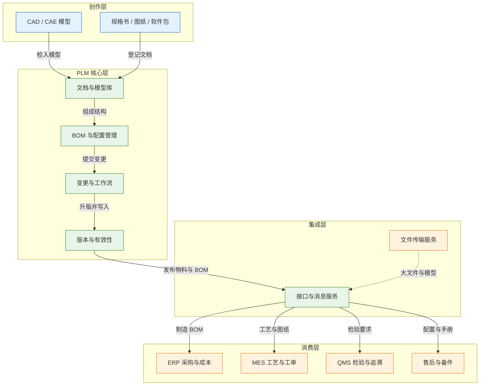
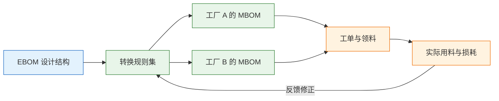

# PLM 与产品数据

---

## 一、PLM 是什么

### 1.1 核心概念

PLM（Product Lifecycle Management，产品生命周期管理）是管理**产品定义**与**产品变更**的企业系统。它回答四个问题：产品由哪些零件和文档组成、当前哪一版有效、一次改动影响哪些对象、新版从哪个时点开始执行。

产品定义不是一张图纸，而是一条链：需求、设计模型、图纸、设计 BOM、制造 BOM、工艺、变更记录。链上每个对象都有编号、修订版、状态和责任人，任何系统引用时都能回答“用的是哪一版”。

PLM 由四个基本要素构成：

| 要素 | 含义 | 落地形态 |
|---|---|---|
| 对象 | 被管理的产品数据单元 | 零件、图纸、模型、BOM 行 |
| 版本 | 同一对象的多次正式状态 | 修订版 A/B/C，迭代 1/2/3 |
| 结构 | 对象之间的组成与约束 | EBOM、MBOM、配置特征 |
| 有效性 | 版本对外生效的范围 | 日期、批次、序列号、工厂 |

> **注意**：PLM 不是“图纸网盘”。把图纸集中存放只解决了检索问题，没有解决“哪一版可用于生产”和“改动影响哪些工单”这两个核心问题。

### 1.2 与相邻系统的关系

PLM 与 ERP 的分工常被概括为：PLM 管“怎么设计”，ERP 管“怎么买、怎么造、怎么算钱”。这只对一半：PLM 还要管变更何时生效，ERP 还要管物料主数据与成本。边界要落到对象上，不能按部门切。

PDM（Product Data Management，产品数据管理）是 PLM 的子集，重点在文档库、检入检出和版本；PLM 增加变更流程、BOM 配置与合规。CAD 是创作工具，产出模型和图纸，不维护编码，也不承担审批。

| 系统 | 主要职责 | 与 PLM 的边界 |
|---|---|---|
| ERP | 物料主数据、采购、库存、成本 | 接收已发布物料与 BOM，不回写设计结构 |
| MES | 工单、领料、工序执行 | 接收制造 BOM 与工艺，反馈实际用料 |
| CAD / CAE | 建模、仿真、出图 | 通过集成检入检出，不直接改已发布对象 |
| QMS | 检验、不合格品、质量追溯 | 接收设计 FMEA 与检验要求 |
| CRM / 售后 | 客户配置、服务工单、备件 | 按序列号查询产品配置与维修手册 |
| MDM | 物料、客户、供应商主数据 | 提供编码规则，PLM 是其数据源之一 |

PLM 与 ERP 最容易冲突的是物料编码：设计强调功能复用，采购强调供应商与价格可区分，制造强调工厂与工艺可执行。三者各自建码，同一种零件就会出现多个码，库存与成本随之分裂。

> **业务红线**：未发布或未生效的图纸、BOM、变更单不得流入采购与生产。系统集成只允许传输“已发布且已生效”的版本，人工绕过审批发图等同于把设计风险转嫁给现场。

### 1.3 分层与架构组成

从数据产生到被消费，PLM 分为创作层、核心层、集成层和消费层。每层只承担一种职责：产生内容、管理版本与结构、传输转换、执行使用。



| 层 | 组件 | 关键能力 |
|---|---|---|
| 创作层 | CAD、CAE、办公工具 | 建模、出图、仿真、编写规范 |
| 核心层 | 文档库、BOM、变更、版本 | 检入检出、结构校验、审批、升版 |
| 集成层 | 接口、消息、文件服务 | 数据映射、转换、重试、审计 |
| 消费层 | ERP、MES、QMS、售后 | 采购、排产、检验、备件供应 |

核心层的元数据与文件分开存储：数据库保存编号、版本、状态和权限，对象存储保存模型与图纸本体。

---

## 二、产品数据对象与编码

### 2.1 对象模型

产品数据由相互引用的对象构成：“零件有修订版、修订版有结构、结构引用子件修订版”。理解这张图，才能理解为什么改一个零件会牵动多个型号。

| 对象 | 关键字段 | 说明 |
|---|---|---|
| 零件 / 组件 | 物料码、名称、分类、单位 | 设计件与制造件可能编码不同 |
| 图纸 / 文档 | 文档号、类型、密级、格式 | PDF、DWG、STEP、JT 等 |
| CAD 模型 | 模型号、版本、装配关系 | 设计源头，不等于 BOM |
| EBOM | 父件、子件、用量、单位、版本 | 设计视角的产品结构 |
| MBOM | 父件、子件、工序、替代料、版本 | 制造视角，含工艺与损耗 |
| 修订版 | A/B/C 或 1/2/3 | 已发布的正式版本，变更才升版 |
| 迭代 | 工作版本的小步保存 | 设计过程草稿，不对外 |
| 基线 | 产品在某一时点的固定结构 | 用于追溯、复现、审计 |
| 变更申请 | 问题、理由、初步影响 | 提出“要不要改” |
| 变更单 | 变更内容、影响范围、生效方式 | 批准“怎么改、何时生效” |
| 有效性 | 日期、批次、序列号、工厂 | 决定新版从哪一批开始用 |
| 替代料 | 主料、替代料、优先级、条件 | 缺料时使用，需经批准 |

修订版与迭代必须分开：修订版是对采购、生产、售后的承诺，升版走变更；迭代是设计过程保存，不应被下游看到。压成一个版本号，就会出现“设计改了十次，采购不知道哪次算数”。

### 2.2 编码规则

物料编码有两种思路：有含义编码把分类、材质、规格写进码段，便于识别，但分类一变就要改规则；无含义编码只保证唯一，属性放在字段里，扩展性好，但依赖系统查询。

| 码段 | 示例 | 规则 |
|---|---|---|
| 前缀 | P / A / M | 设计件、装配件、制造件 |
| 分类码 | 02 / 15 | 取自有限分类表，不随规格变化 |
| 流水号 | 000135 | 由系统统一分配，不复用 |
| 版本 | 不进入编码 | 版本挂在修订版对象上 |

编码里不要放版本：物料码标识“这是什么”，修订版标识“哪一次状态”。混在一起，同一个零件会在 ERP 里变成多个物料。供应商、客户、旧系统料号用映射表关联，不能当内部主键。

> **注意**：替代料不是“随便找个能用的”。替代关系要记录批准人、适用条件、正反向影响和有效期；电气参数、安装尺寸、认证要求任一不满足，替代就会变成质量事故。

### 2.3 版本与有效性

版本解决“哪一次状态”，有效性解决“从哪里开始用”。只发布新版本而不写生效点，现场只能靠口头通知，新旧混用几乎必然发生。

| 生效方式 | 适用场景 | 主要风险 |
|---|---|---|
| 日期生效 | 连续生产、按时间切换 | 当天在制批次归属不清 |
| 批次生效 | 批次管理、批量追溯 | 批次划分粒度不一致 |
| 序列号生效 | 单件追溯、重大安全件 | 记录量大，扫描易漏 |
| 旧料用完为止 | 成本敏感、旧料库存多 | 新旧混用，售后难追溯 |
| 立即生效 | 安全、法规、召回 | 在制、在途、库存处理压力大 |

“最新版”不是可执行指令。生产要知道哪张工单、哪一批、从哪道工序换版；采购要知道哪张订单还能收旧料；售后要知道哪个序列号装的是旧结构。这些必须写进工单、采购订单和发货记录。

---

## 三、设计发布与变更主流程

### 3.1 发布流程

设计发布是把个人成果转为组织承诺：发布前完成结构、图纸、工艺、合规、成本和权限六类检查，发布后对象只读，任何修改都走变更。

```mermaid
stateDiagram-v2
    [*] --> 设计中
    设计中 --> 评审中: 提交评审
    评审中 --> 设计中: 退回修改
    评审中 --> 已发布: 批准发布
    已发布 --> 变更分析: 提出变更申请
    变更分析 --> 变更执行: 批准变更单
    变更分析 --> 已发布: 驳回变更
    变更执行 --> 验证中: 完成改图与改 BOM
    验证中 --> 已发布: 验证通过并升版
    验证中 --> 变更执行: 验证失败
    已发布 --> 已停用: 淘汰或替代
    已停用 --> [*]
    classDef client fill:#e3f2fd,stroke:#1565c0;
    classDef engine fill:#e8f5e9,stroke:#2e7d32;
    classDef image fill:#fff3e0,stroke:#ef6c00;
    class 设计中 client
    class 评审中 client
    class 已发布 engine
    class 变更分析 engine
    class 变更执行 engine
    class 验证中 engine
    class 已停用 image
```

| 状态 | 进入条件 | 允许动作 |
|---|---|---|
| 设计中 | 对象创建并分配责任人 | 编辑、检入检出、提交评审 |
| 评审中 | 结构完整、附件齐全 | 评审、退回、批准 |
| 已发布 | 评审通过并完成签署 | 被下游引用、发起变更 |
| 变更执行 | 变更单批准 | 创建新迭代、修改结构 |
| 已停用 | 替代件生效或产品退市 | 只读查询、历史追溯 |

发布检查要自动执行一部分：BOM 无缺件、自引用和循环；用量单位与子件基本单位可换算；图纸、模型、BOM 指向同一修订版；合规属性非空。自动检查挡格式问题，人工评审判断设计合理性。

### 3.2 变更影响分析

变更流程里，审批快慢不是关键，影响分析是否完整才是。一次变更要回答六个问题：改什么、为什么改、影响谁、何时生效、怎么切换、怎么验证。

| 影响面 | 核查对象 | 输出 |
|---|---|---|
| 设计 | 图、模型、BOM、配置规则 | 受影响对象清单 |
| 供应 | 在途采购、替代料、供应商能力 | 旧料消化与新材料计划 |
| 制造 | 在制工单、工艺、工装、检验 | 冻结与切换工单清单 |
| 交付 | 已发产品、库存、售后备件 | 返工、召回或服务方案 |

最常见的漏洞是“只改图纸附件，不改 BOM 结构”：图纸换了，BOM 仍指向旧子件，ERP 按旧结构采购，MES 按旧结构领料，现场就出现“新图配旧料”。变更单必须强制关联对象清单，不能只挂附件。

同时要做反向查询：一个密封件可能用在三个型号、五个项目上，只分析主型号会让其他型号静默失效。

> **业务红线**：变更单的影响清单必须包含在制、在途、库存和已发产品四类对象。缺少任何一类，变更不得关闭；用“后续补处理”关闭变更，等于把风险留给现场。

### 3.3 变更执行与切换

变更批准后，执行是一组跨系统动作：PLM 升修订版，ERP 建新物料，MES 冻结未开工工单，采购调整在途订单，仓库盘点旧料，质量安排试制。

切换计划要写清：旧料能不能用、用到何时、新料从哪张工单开始、旧版何时停用。旧料用完为止看似省钱，却最容易新旧混用；追溯要求高时，应改为批次或序列号生效，并接受旧料报废。

试制验证是切换前置条件，至少覆盖关键尺寸、材料性能、装配干涉和客户验收；不通过就回到变更执行。验证通过后旧版停用，但历史工单与发货记录仍要能查到旧结构。

### 3.4 配置管理

按订单配置的产品（电梯、工程机械、非标设备）不能只维护一张 BOM。正确做法是先建 150% BOM，把所有可选特征和可选件都放进去，再按客户订单裁剪成具体配置。

| 特征类型 | 含义 | 校验规则 |
|---|---|---|
| 必选 | 每个配置都必须选 | 缺失即阻止下单 |
| 可选 | 从列表中选择 | 与互斥项联动 |
| 互斥 | 选了 A 就不能选 B | 提交时强校验 |
| 依赖 | 选了 C 必须带 D | 生成 BOM 时补齐 |

配置规则要能被系统执行，不能只写在销售手册里。规则错误会导致承诺的配置做不出来或装不上；规则变更同样要走版本管理，否则历史订单无法复现。

---

## 四、核心数据模型

### 4.1 表结构示例

产品数据模型的关键设计是：结构挂在修订版上，不挂在零件上。零件是抽象身份，修订版是可执行状态；BOM 行引用父子修订版，历史结构才不会被后续修改污染。

```sql
-- 零件主数据：编码唯一，不含版本
CREATE TABLE item (
  item_id       BIGINT       PRIMARY KEY,
  item_code     VARCHAR(64)  NOT NULL UNIQUE,
  item_name     VARCHAR(128) NOT NULL,
  item_type     VARCHAR(16)  NOT NULL,   -- 零件/组件/虚拟件/包装件
  base_unit     VARCHAR(16)  NOT NULL,
  life_cycle    VARCHAR(16)  NOT NULL,   -- 设计中/已发布/已停用
  created_at    TIMESTAMP    NOT NULL
);

-- 修订版：对外承诺的正式版本
CREATE TABLE item_revision (
  revision_id   BIGINT       PRIMARY KEY,
  item_id       BIGINT       NOT NULL REFERENCES item(item_id),
  revision      VARCHAR(8)   NOT NULL,   -- A/B/C
  status        VARCHAR(16)  NOT NULL,   -- 工作中/审核中/已发布/已冻结
  released_at   TIMESTAMP,
  UNIQUE (item_id, revision)
);

-- BOM 行：父子都指向具体修订版
CREATE TABLE bom_line (
  bom_line_id   BIGINT        PRIMARY KEY,
  parent_rev_id BIGINT        NOT NULL REFERENCES item_revision(revision_id),
  child_rev_id  BIGINT        NOT NULL REFERENCES item_revision(revision_id),
  quantity      NUMERIC(18,6) NOT NULL,
  unit          VARCHAR(16)   NOT NULL,
  line_no       INT           NOT NULL,
  alternate_group VARCHAR(32),
  UNIQUE (parent_rev_id, child_rev_id, line_no)
);

-- 变更单：记录生效方式与批准时间
CREATE TABLE change_order (
  eco_id        BIGINT       PRIMARY KEY,
  eco_no        VARCHAR(32)  NOT NULL UNIQUE,
  change_type   VARCHAR(16)  NOT NULL,   -- 设计/工艺/文档
  status        VARCHAR(16)  NOT NULL,
  effectivity   VARCHAR(16)  NOT NULL,   -- DATE/LOT/SN/IMMEDIATE
  effective_from DATE,
  approved_at   TIMESTAMP
);

-- 受影响对象：一张变更单覆盖多个对象
CREATE TABLE change_affected_item (
  eco_id        BIGINT      NOT NULL REFERENCES change_order(eco_id),
  object_type   VARCHAR(16) NOT NULL,    -- ITEM/DOC/BOM
  object_id     BIGINT      NOT NULL,
  from_revision VARCHAR(8),
  to_revision   VARCHAR(8),
  PRIMARY KEY (eco_id, object_type, object_id)
);
```

| 表 | 作用 | 关键约束 |
|---|---|---|
| item | 零件身份与生命周期 | 编码唯一，不复用 |
| item_revision | 版本状态与发布记录 | 零件加版本唯一 |
| bom_line | 装配结构与用量 | 父子均引用修订版 |
| change_order | 变更生效范围 | 生效方式与日期必填 |
| change_affected_item | 变更影响清单 | 变更单与对象联合唯一 |

### 4.2 BOM 遍历与校验

BOM 是树，也可能是图（同一子件被多个父件引用）。查询展开结构要用递归查询，并设置深度上限和环检测；否则一个误操作形成的循环会让查询无限递归。

```sql
-- 从指定修订版向下展开，path 用于阻断环
WITH RECURSIVE bom_tree AS (
  SELECT child_rev_id, quantity, 1 AS level,
         ARRAY[parent_rev_id] AS path
  FROM bom_line
  WHERE parent_rev_id = :root_rev
  UNION ALL
  SELECT b.child_rev_id, b.quantity, t.level + 1,
         t.path || b.parent_rev_id
  FROM bom_line b
  JOIN bom_tree t ON b.parent_rev_id = t.child_rev_id
  WHERE NOT b.child_rev_id = ANY(t.path)
    AND t.level < 20
)
SELECT child_rev_id, quantity, level
FROM bom_tree
ORDER BY level, child_rev_id;
```

查询返回单层用量，累计用量要在应用层按层级相乘；生产用量还要叠加损耗率、包装倍数和替代料比例。

发布前至少做四类校验：缺件、自引用、循环、单位不一致。校验结果要能定位到具体 BOM 行，不能只报“结构错误”。

### 4.3 指标口径

产品数据指标容易“看起来都对，算法不同”：BOM 准确率按行抽检和按物料抽检结果差异很大；变更周期从申请算和从批准算也不是一回事。指标必须写清公式、数据源、周期和责任人。

| 指标 | 计算口径 | 数据来源 |
|---|---|---|
| BOM 准确率 | 抽检一致行数 ÷ 抽检总行数 | PLM 结构 + 现场实盘 |
| 变更按期落地率 | 按期完成变更数 ÷ 到期变更数 | 变更单任务完成时间 |
| 一物多码率 | 重复物料组数 ÷ 物料总数 | 物料主数据查重结果 |
| 变更影响遗漏率 | 复盘发现漏项数 ÷ 已关闭变更数 | 变更复盘记录 |

指标要固定抽检规则。BOM 准确率只挑简单产品，结果偏好但说明不了问题；应按产品族、批量、变更频率分层抽样，并公开样本清单。

---

## 五、典型功能模块

### 5.1 文档与模型管理

文档管理的核心是检入检出和权限。工程师检出后锁定对象，其他人只读；检入生成新迭代并记录差异；发布后修改必须走变更。

| 模块 | 主要能力 | 关键配置 |
|---|---|---|
| 文档库 | 分类、检索、版本、预览 | 文档类型与密级 |
| 模型库 | 大文件存储、轻量化预览 | 文件服务器与缓存 |
| 检入检出 | 锁定、比对、冲突处理 | 锁超时与强制解锁权限 |
| 外发管理 | 水印、有效期、下载审计 | 外发审批与访问范围 |

模型预览要生成轻量化格式，不能让每个查看者都下载原始模型。预览与原始文件建立版本关联，模型更新后预览必须同步刷新。

### 5.2 BOM 与配置管理

BOM 模块要支持多视图：设计看功能结构，制造看工序与损耗，采购看供应商与包装，服务看备件层级。多视图不是多份数据，而是同一结构在不同视角下的转换。

BOM 比对要能按行识别新增、删除、用量变化和替代关系变化，结果可导出为变更清单。只做文本 diff，会把排序变化误报成结构变化。

### 5.3 变更与工作流

变更模块由申请、影响分析、审批、任务执行和验证组成。审批流可配置，但不能替代影响分析；签字只表示同意方案，不表示影响清单完整。

任务要落到人和日期。变更单关闭前，采购、生产、质量、售后的任务必须完成或有豁免记录；只标记“已通知”不算完成。

### 5.4 权限、密级与外发

产品数据是核心资产，权限按对象、角色、项目控制：密级决定范围，角色决定动作，项目决定临时授权。供应商用独立门户，只开放供货范围图纸。

> **业务红线**：对外发送图纸必须经过外发审批，使用带水印和有效期的链接，并记录下载人与时间。把未发布图纸直接发到聊天工具，无法撤回，也无法追责。

---

## 六、系统集成设计

### 6.1 集成链路

PLM 是产品数据的源头，不是终点。集成要明确每条链路的方向、触发方式、内容和失败处理，避免“双方都能改”。

| 链路 | 传输内容 | 触发方式 |
|---|---|---|
| PLM → ERP | 物料申请、设计 BOM、变更 | 发布或变更生效时推送 |
| PLM → MES | 制造 BOM、工艺、图纸 | 工单下达前同步 |
| PLM → QMS | 检验要求、设计 FMEA | 版本发布时同步 |
| PLM → 售后 | 产品配置、维修手册、备件 | 发货前按序列号绑定 |
| CAD ↔ PLM | 模型、属性、装配关系 | 检入检出时双向交互 |

集成方向要单向为主。PLM 推送物料与结构到 ERP，ERP 回传物料创建结果和成本，不允许 ERP 直接修改 PLM 的结构。双向写入必须有明确的主人，否则一次网络重试就可能覆盖对方的新数据。

### 6.2 EBOM 到 MBOM 转换

EBOM 不能直接复制成 MBOM：设计关注功能与装配，制造关注工序、损耗、包装和供应。转换包括增加虚拟件、包装件、辅料，按工厂拆分，加损耗率与替代料，绑定工序，调整单位。



| 转换项 | 设计视角 | 制造视角 |
|---|---|---|
| 结构 | 功能模块与装配关系 | 工序、工位、产线拆分 |
| 用量 | 设计净用量 | 净用量加损耗与包装 |
| 物料 | 设计件、标准件 | 增加辅料、虚拟件、替代料 |
| 单位 | 个、套 | 千克、箱、批 |

转换规则要版本化、可测试。同一 EBOM 在不同工厂生成不同 MBOM 是正常的，但必须能解释“为什么这个工厂多一个件”；规则变更后要重跑历史样例。

### 6.3 接口契约与幂等

PLM 接口最容易出的问题不是连不通，而是重复推送和顺序错乱：事件可能重发，创建可能超时重试，BOM 行可能先于父件到达。契约要定义幂等键和依赖顺序。

| 接口 | 幂等键 | 顺序要求 |
|---|---|---|
| 物料发布 | 物料码 + 修订版 | 父件先于子件 |
| BOM 发布 | 父修订版 + 行号 | 结构整体生效 |
| 变更通知 | 变更单号 + 版本 | 先通知冻结，再通知新结构 |
| 文件同步 | 文件哈希 | 元数据先于文件 |

接口要返回明确结果：成功、可重试失败、不可重试失败。超时不能一律当失败重发，否则会产生重复物料。接收方按幂等键去重，双方记录请求号，排障才能对上。

---

## 七、实施路径与能力边界

### 7.1 实施顺序

PLM 实施不能先上全套流程：先统一编码和文档，再建 BOM，再做变更，最后做配置与集成。每步都要有可验证产出。

| 阶段 | 主要工作 | 产出 |
|---|---|---|
| 编码治理 | 统一物料、文档、版本规则 | 编码规范与查重规则 |
| 文档入库 | 清理历史图纸、建立权限 | 受控文档库 |
| 结构建模 | 选典型产品建 EBOM | 可展开的 BOM |
| 变更上线 | 定义 ECR/ECO 与生效方式 | 变更流程与模板 |
| 系统集成 | 打通 ERP、MES、QMS | 接口与对账报告 |
| 配置扩展 | 特征、规则、150% BOM | 按单配置能力 |

先选结构清晰、变更适中的产品试点，不要拿最复杂的非标产品开局。目标是验证版本、结构、变更、集成四条链路闭环，而不是一次覆盖全部产品线。

### 7.2 数据迁移与清理

历史数据迁移的难点不是导入，而是决定“哪些数据值得迁”。多年积累的图纸里，大量是过程稿、重复件和已停产结构；全量迁移会把无效数据带进新系统。

迁移要做四件事：清洗物料、合并重复件、重建版本与结构、校验附件。合并必须保留旧编码映射，历史合同、工单、售后记录仍要能查到旧码。

> **注意**：迁移后的 BOM 要抽样展开验证，不能只核对总行数。行数一致但父子关系错位，是最难发现的一类迁移事故。

### 7.3 能力边界

PLM 管产品定义与变更，不承担交易执行。把采购订单、工单排产、应收核算纳入 PLM，会让系统变成第二套 ERP，接口与权限都会失控。

| 场景 | 是否适合 PLM | 说明 |
|---|---|---|
| 图纸与模型受控 | 适合 | 版本、权限、外发审计 |
| 设计 BOM 与配置 | 适合 | 结构、特征、基线 |
| 设计变更管理 | 适合 | 影响分析、生效控制 |
| 采购订单与库存 | 不适合 | 归 ERP 或 WMS |
| 工单排产与报工 | 不适合 | 归 MES |
| 财务成本核算 | 不适合 | 归 ERP 或财务系统 |

---

## 八、常见失败模式与排查

### 8.1 失败模式

PLM 的故障很少表现为系统宕机，更多是数据状态与现场执行不一致。排查时要沿着“对象—版本—结构—变更—集成”的顺序走，不要一上来就怀疑软件缺陷。

| 现象 | 最可能原因 | 处理 |
|---|---|---|
| 一物多码 | 设计、采购、生产各自建码 | 统一申请入口，按规则查重合并 |
| BOM 出现循环 | 组件误指向父件 | 发布前环检测，禁止自引用 |
| 新图配旧料 | 只改图纸未改 BOM | 变更单强制关联对象清单 |
| 旧工单继续生产 | 工单未绑定 BOM 版本 | 工单记录版本，变更触发冻结 |
| 采购多买旧料 | 未同步在途与库存 | 影响分析覆盖在途、库存、替代料 |
| 售后发错备件 | 配置与序列号未绑定 | 发货即绑定 SN 与配置 |
| 供应商拿到未发布图 | 外发权限缺失 | 密级、水印、审批、有效期 |
| 变更审批快但落地慢 | 没有任务与验证 | 变更单带责任人、到期日、验证 |
| 接口重复建料 | 超时重试无幂等 | 幂等键去重，失败分类重试 |

### 8.2 处置顺序

1. 确认对象身份：物料码、文档号、修订版是否唯一，是否存在重复件。
2. 确认结构版本：BOM 指向的是哪个父件修订版，子件是否已停用。
3. 查变更单：影响清单是否覆盖图、料、BOM、工艺和在制对象。
4. 查生效点：ERP 物料、MES 工单、采购订单上的版本与日期是否一致。
5. 查存量：在制、在途、库存、已发产品各自该用哪一版。
6. 查集成：接口是否重复推送、顺序是否颠倒、失败是否被吞掉。
7. 查权限与外发：谁在何时下载或转发了未发布数据。

> **核心结论**：PLM 的主线是“定义加变更”，不是“存图纸”；版本与有效性必须一起管；EBOM 不能直接当 MBOM；变更的难点在影响分析，不在审批流。
