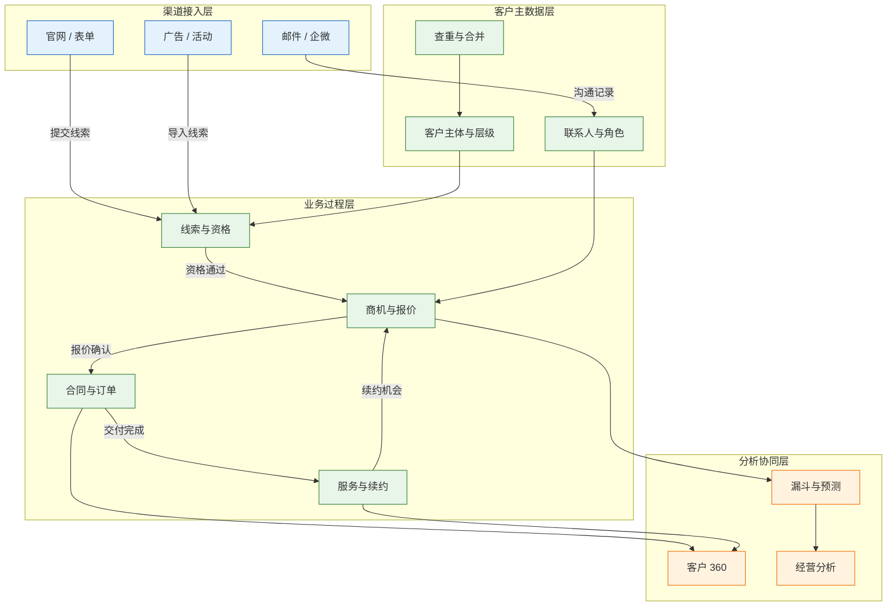
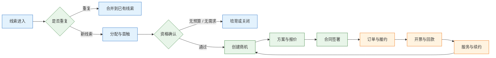

# CRM 与客户运营

---

## 一、CRM 是什么

### 1.1 核心概念

CRM（Customer Relationship Management，客户关系管理）是管理客户主数据与客户经营过程的企业系统。它覆盖线索获取、商机推进、报价签约、订单回款、服务续约的完整链路，目标是把分散在个人手里的客户关系变成公司可管理、可交接、可审计的资产。

CRM 的第一价值不是“管销售”，而是建立客户主体的唯一性。客户、联系人、商机、合同、订单、服务工单必须归到同一个客户主体上；主体不唯一，信用检查、交付、服务和报表都会失真。

| 概念 | 含义 | 可观察产物 |
|---|---|---|
| 客户主体 | 签约、开票、发货、信用对应的法人或组织 | 唯一客户编码 |
| 联系人 | 客户内部的角色与沟通入口 | 决策人、使用人、采购人 |
| 商机 | 一次有金额和时间的销售机会 | 阶段、金额、预计成交日 |
| 合同 | 双方的法律承诺 | 合同号、条款、版本 |
| 服务工单 | 售后问题的处理记录 | SLA、处理过程、回访 |

CRM 管“关系与过程”，不管“记账与履约”。应收、库存、发货执行在 ERP 或 OMS，CRM 展示这些状态，但不自己维护一套账。

### 1.2 与相邻系统的关系

CRM 与 ERP 的分界是交易执行。CRM 记录客户意向、合同条款和销售过程，ERP 负责订单履约、库存分配、开票与应收。合同是法律承诺，订单是履约指令，两者必须分开建模。

营销自动化负责广告投放、邮件、短信和活动执行，CRM 负责线索接收、去重、分配和转化。客服系统或现场服务系统负责工单处理，CRM 负责客户视图和服务合同。BI 负责跨系统指标，CRM 提供过程数据，不承担财务口径。

| 系统 | 主要职责 | 与 CRM 的边界 |
|---|---|---|
| ERP | 订单、库存、开票、应收 | CRM 只读状态，不修改账务 |
| 营销平台 | 投放、触达、活动执行 | 线索进 CRM，退订与同意回传 |
| 客服 / FSM | 工单、派工、备件 | CRM 展示工单，不重复建单 |
| BI | 漏斗、赢率、客户价值 | CRM 提供过程数据与归属 |
| MDM | 客户、供应商主数据 | 统一编码，CRM 是来源之一 |
| 协作工具 | 邮件、会议、即时消息 | 沟通记录按授权归档 |

CRM 与 ERP 的客户编码必须一对一映射。常见做法是 CRM 申请、ERP 赋码，或由 MDM 统一赋码；无论哪种，只能有一个新建入口。销售为了方便自己建客户，是数据分裂的源头。

> **业务红线**：客户主数据只能有一个创建入口，编码必须与 ERP、MDM 一一对应。任何系统私自建码、合并后删除旧记录，都会让合同、发票、工单失去关联。

### 1.3 分层与架构组成

CRM 可以分成渠道接入、客户主数据、业务过程、分析协同四层。渠道层负责把线索和沟通接进来，主数据层保证主体唯一，业务过程层管理销售与服务，分析层提供漏斗和客户价值。



| 层 | 组件 | 关键能力 |
|---|---|---|
| 渠道接入 | 表单、广告、邮件、企微 | 线索捕获、来源归因、同意记录 |
| 客户主数据 | 客户、联系人、层级 | 查重、合并、归属、权限 |
| 业务过程 | 线索、商机、合同、服务 | 阶段推进、审批、SLA |
| 分析协同 | 漏斗、360、经营分析 | 预测、客户价值、预警 |

主数据层是地基。渠道层可以换，销售流程可以调，主数据一旦分裂，上层所有报表和自动化都会建立在错误主体上。

---

## 二、客户主数据与主体层级

### 2.1 客户主体模型

客户不是一个平面列表，而是“集团—法人—门店/工厂”的层级。集团用于整体关系与协议，法人用于签约、开票和信用，门店或工厂用于收货、服务和设备安装。

| 层级 | 用途 | 关键字段 |
|---|---|---|
| 集团 | 战略客户、框架协议 | 集团编码、母公司、行业 |
| 法人 | 签约、开票、信用 | 统一社会信用代码、注册地址 |
| 门店 / 工厂 | 收货、安装、服务 | 地址、联系人、设备清单 |

信用额度通常挂在法人，合同可能签在集团，发货却到门店。层级不清，信用检查就会查错主体：集团整体逾期，门店仍在正常下单，货照样发出去。

客户主体还要区分角色：签约主体、开票主体、收货主体、付款主体可能不是同一个。系统要用关系字段表达，而不是复制多条客户记录。

### 2.2 查重与合并

客户查重不能只按名称精确匹配。名称有简称、后缀、括号和错别字，同一法人可能以多种写法进入系统。

| 规则 | 判断 | 处理 |
|---|---|---|
| 统一社会信用代码完全匹配 | 高度疑似同一法人 | 直接提示合并 |
| 名称去后缀后相似 | 可能同一主体 | 人工确认 |
| 电话、邮箱、地址匹配 | 辅助判断 | 进入待审队列 |
| 集团关系匹配 | 同一集团下的法人 | 保留法人，挂到集团 |

合并要保留历史：商机、合同、工单、活动全部迁移到主记录，旧编码标记“已合并”并保留映射，不能物理删除。删除会让历史合同失去关联，审计也无法追溯。

合并后要指定黄金记录（Golden Record）：以哪个名称、地址、信用代码为准，其他来源作为别名保留。黄金记录不是“最新一条”，而是经过确认的权威值。

> **注意**：查重规则不能只在新建时执行。批量导入、接口同步、展会名单都会绕过页面校验，必须在入库层统一执行。

### 2.3 归属与权限

客户归属决定谁跟进、谁拿提成、谁能在离职时交接。归属规则要按区域、行业、集团、渠道明确分配，并支持团队共享，不能只挂在个人账号下。

| 场景 | 归属规则 | 控制点 |
|---|---|---|
| 新线索 | 按区域或行业轮询 | 分配记录可查 |
| 集团客户 | 归集团账号，法人挂子关系 | 跨法人可见性 |
| 渠道客户 | 归渠道经理，设保护期 | 保护期到期回收 |
| 销售离职 | 强制转交上级或团队 | 离职流程阻断 |

销售离职是客户资产流失的高发点。离职流程要包含客户、商机、合同、服务工单的转交清单，账号立即停用，未完成审批自动转交。只靠口头交接，客户会留在离职账号下，最终失联。

---

## 三、线索到回款主流程

### 3.1 线索获取与资格确认

线索是未验证的潜在客户。来源包括官网表单、广告、展会、渠道、老客推荐和销售自拓。每条线索要记录来源、活动、同意状态和归属，否则后续无法归因，也无法判断投放是否有效。



资格确认至少看四件事：客户是否有明确需求、预算是否可落实、决策链是否清楚、时间窗是否合理。四项都不清楚就转商机，销售漏斗会充满无法推进的记录。

线索转商机要保留来源。商机赢了以后，市场、渠道、展会各自贡献多少，靠的就是这条来源链；来源字段缺失，增长只能靠感觉。

### 3.2 商机与销售阶段

销售阶段最常见的毛病是名称漂亮但没有退出标准。每个阶段要写清“客户做了什么、我们交了什么、有什么证据”，否则阶段推进只是销售的主观判断。

| 阶段 | 退出标准 | 可验证证据 |
|---|---|---|
| 资格 | 需求、预算、决策人、时间窗基本确认 | 需求纪要 |
| 方案 | 技术方案与报价已提交 | 报价版本 |
| 商务 | 价格、条款进入谈判 | 合同草稿 |
| 赢单 | 合同签署或中标通知 | 合同号 |
| 回款 | 首款到账并完成核销 | 收款凭证 |

阶段要留历史，不能只存当前值。商机从“方案”退回“资格”、在某一阶段停留多久、谁改过金额，都要可追溯。没有阶段历史，预测准确率无法复盘，赢率也无法按阶段校准。

### 3.3 报价与合同

报价不是合同。报价有版本、折扣、有效期和适用范围；合同是法律承诺，包含条款、付款方式、交付范围和违约责任。用报价单代替合同，后续变更、开票和争议处理都会失去依据。

报价审批要绑定折扣权限。超过底线折扣、非标条款、超长账期，必须走审批并留下理由。审批通过后生成新版本，旧版本标记失效，不能直接覆盖。

合同要版本化。补充协议、延期、金额调整都生成新版本，订单关联具体合同行。一个合同可以拆多张订单，一张订单也可能来自框架合同；用合同号当订单号，改单、拆单、退货都会乱。

### 3.4 订单、开票与回款

订单履约在 ERP 或 OMS，CRM 只展示状态。下单前要做信用检查：客户是否有逾期、是否超额度、是否存在未清争议。信用检查必须以 ERP 的应收余额和核销结果为准。

回款认领是容易出错的环节。客户打款附言可能只写“货款”，财务要按金额、日期、合同、发票匹配。CRM 展示“已回款”时，要引用 ERP 的收款核销，不能自己维护一个状态字段。

> **业务红线**：回款、应收、信用余额以 ERP 财务账为准，CRM 不得自建一套金额口径。两套口径同时存在，销售与财务会在经营会上用不同数字争论。

---

## 四、核心数据模型

### 4.1 表结构示例

客户模型的关键是主体、层级和角色分开。客户表存法人主体，用 parent_id 表达集团与父子关系，联系人表存角色；商机、合同、工单都引用客户主键，不引用名称。

```sql
-- 客户主体：一个法人一行，编码全局唯一
CREATE TABLE account (
  account_id     BIGINT       PRIMARY KEY,
  account_code   VARCHAR(32)  NOT NULL UNIQUE,
  account_name   VARCHAR(200) NOT NULL,
  uscc           VARCHAR(18),              -- 统一社会信用代码
  parent_id      BIGINT REFERENCES account(account_id),
  account_type   VARCHAR(16)  NOT NULL,    -- 集团/法人/门店
  credit_limit   NUMERIC(18,2),            -- 信用额度，挂法人
  owner_id       BIGINT       NOT NULL,
  status         VARCHAR(16)  NOT NULL     -- 活跃/合并/停用
);

-- 联系人：一个客户多个角色
CREATE TABLE contact (
  contact_id     BIGINT       PRIMARY KEY,
  account_id     BIGINT       NOT NULL REFERENCES account(account_id),
  contact_name   VARCHAR(64)  NOT NULL,
  role_type      VARCHAR(16),              -- 决策/使用/采购/财务
  phone          VARCHAR(32),
  email          VARCHAR(128),
  is_primary     BOOLEAN      DEFAULT FALSE
);

-- 商机：阶段与金额，阶段历史另表记录
CREATE TABLE opportunity (
  opp_id         BIGINT       PRIMARY KEY,
  opp_no         VARCHAR(32)  NOT NULL UNIQUE,
  account_id     BIGINT       NOT NULL REFERENCES account(account_id),
  stage          VARCHAR(16)  NOT NULL,
  amount         NUMERIC(18,2) NOT NULL,
  currency       CHAR(3)      DEFAULT 'CNY',
  expected_close DATE,
  win_rate       NUMERIC(5,2),
  owner_id       BIGINT       NOT NULL
);

-- 合同：法律承诺，版本与合同行分开
CREATE TABLE contract (
  contract_id    BIGINT       PRIMARY KEY,
  contract_no    VARCHAR(32)  NOT NULL,
  account_id     BIGINT       NOT NULL REFERENCES account(account_id),
  version        INT          NOT NULL DEFAULT 1,
  amount         NUMERIC(18,2) NOT NULL,
  sign_date      DATE,
  status         VARCHAR(16)  NOT NULL,    -- 草稿/生效/终止
  UNIQUE (contract_no, version)
);

-- 服务工单：SLA 与处理过程
CREATE TABLE service_ticket (
  ticket_id      BIGINT       PRIMARY KEY,
  account_id     BIGINT       NOT NULL REFERENCES account(account_id),
  contract_id    BIGINT REFERENCES contract(contract_id),
  severity       VARCHAR(8)   NOT NULL,
  opened_at      TIMESTAMP    NOT NULL,
  first_response TIMESTAMP,
  resolved_at    TIMESTAMP,
  status         VARCHAR(16)  NOT NULL
);
```

| 表 | 作用 | 关键约束 |
|---|---|---|
| account | 客户主体与层级 | 编码唯一，合并保留映射 |
| contact | 联系人与决策角色 | 每客户至少一个主联系人 |
| opportunity | 商机阶段与金额 | 阶段变更写历史 |
| contract | 合同版本与条款 | 合同号加版本唯一 |
| service_ticket | 服务请求与 SLA | 关联客户与合同 |

### 4.2 商机状态与预测

商机状态机要覆盖赢、输、暂停和重新激活。输单必须记录原因，否则产品、价格、竞争策略的复盘没有输入。

```mermaid
stateDiagram-v2
    [*] --> 资格确认
    资格确认 --> 方案报价: 需求与预算明确
    方案报价 --> 商务谈判: 报价被接受
    商务谈判 --> 赢单: 合同签署
    商务谈判 --> 输单: 竞品中标或预算取消
    方案报价 --> 暂停: 客户延期
    暂停 --> 方案报价: 项目重启
    赢单 --> 回款中: 订单生效
    回款中 --> 已回款: 核销完成
    输单 --> [*]
    已回款 --> [*]
    classDef client fill:#e3f2fd,stroke:#1565c0;
    classDef engine fill:#e8f5e9,stroke:#2e7d32;
    classDef image fill:#fff3e0,stroke:#ef6c00;
    class 资格确认 client
    class 方案报价 client
    class 商务谈判 engine
    class 赢单 engine
    class 回款中 engine
    class 暂停 engine
    class 输单 image
    class 已回款 image
```

预测要把“商机金额”与“预测类别”分开。预测类别由销售主观承诺（如 pipeline、best case、commit），赢率由历史阶段转化率计算。两者混在一起，预测会变成主观判断。

### 4.3 指标口径

客户运营指标最容易口径不一。赢率是按商机数还是金额、销售周期从创建算还是从资格算、续约率是否含涨价，都必须写清。

| 指标 | 计算口径 | 数据来源 |
|---|---|---|
| 商机赢率 | 赢单数 ÷ 已关闭商机数 | 商机阶段历史 |
| 销售周期 | 赢单日期减商机创建日期 | 商机时间戳 |
| 净收入留存率 | 本期存量收入 ÷ 上期存量收入 | 合同与回款 |
| 回款率 | 已核销金额 ÷ 到期应收 | ERP 应收与核销 |
| 服务 SLA 达成率 | 按时解决工单数 ÷ 总工单数 | 工单时间戳 |

赢率按金额算和按数量算会给出不同结论。大项目少但金额高，按数量看赢率低，按金额看可能正常；报表必须标明口径，预测校准也要用同一口径。

---

## 五、典型功能模块

### 5.1 销售自动化

销售自动化覆盖线索分配、拜访计划、商机推进、报价审批和合同签署。它的价值是让过程可见，而不是替代销售判断。

| 模块 | 主要能力 | 关键配置 |
|---|---|---|
| 线索管理 | 捕获、去重、分配、培育 | 来源、保护期、回收规则 |
| 商机管理 | 阶段、金额、竞争、团队 | 阶段退出标准、赢率模型 |
| 报价管理 | 版本、折扣、审批 | 折扣底线、审批矩阵 |
| 合同管理 | 条款、版本、签署 | 模板、法务审核、用印 |

移动端要能快速记录拜访和语音转文字，但记录不是考勤。把拜访数量当唯一考核指标，会催生大量无效果的活动记录。

### 5.2 市场营销与同意管理

营销模块负责活动、名单、触达和归因。线索来源要能追到具体活动、渠道和关键词；只记录“市场部”，无法判断预算该投哪里。

同意管理是合规底线。收集时要说明用途，提供退订入口，退订要在邮件、短信、电话等渠道同步生效。客户明确拒绝后继续触达，不是系统问题，是流程问题。

### 5.3 客户服务与 SLA

服务工单要关联客户、合同、设备和序列号。没有设备关联，工程师到场才发现型号不对；没有合同关联，无法判断是否在保、按什么响应级别处理。

SLA 要按严重级别定义响应与解决时限，并记录首次响应、每次沟通、解决和回访时间。只记录“已解决”，无法计算达成率，也无法发现重复故障。

### 5.4 客户 360 与分析

客户 360 让销售和客服在一个页面看到客户买了什么、欠不欠钱、有没有投诉、谁在负责。数据来自 CRM、ERP、WMS、服务系统，但不能由 CRM 各自复制一份。

务实做法是“引用加快照”：主数据引用全局 ID；订单、发票、回款展示 ERP 的准实时状态并附同步时间；工单展示服务系统状态；交互记录留在 CRM。每张卡片标明来源和更新时间，避免把旧快照当现状。

> **注意**：客户 360 做不好，通常不是前端聚合能力不够，而是客户主体不唯一、各系统编码不通。先修主数据，再谈 360。

### 5.5 续约与客户健康度

存量经营不能只看新签。健康度由使用、服务、商务、关系四类信号组成，评分要能触发动作，而不是只做报表装饰。

| 信号 | 示例 | 触发动作 |
|---|---|---|
| 使用 | 设备开机时长、耗材复购 | 闲置预警、使用培训 |
| 服务 | 工单数、重复故障、SLA | 技术回访、根因分析 |
| 商务 | 合同到期、回款逾期 | 续约任务、信用冻结 |
| 关系 | 联系人变更、拜访间隔 | 关系维护、交接提醒 |

续约要单独建模，关联原合同、原设备和服务记录，不能复制成一条新商机。复制会丢掉原合同关系，留存率和客户终身价值都算不准。

---

## 六、系统集成设计

### 6.1 与 ERP 的主数据及交易集成

CRM 与 ERP 的集成分两条线：主数据线同步客户、联系人、物料；交易线同步合同、订单、发货、开票、回款。两条线的触发方式和权威源不同，不能混在一个接口里。

| 链路 | 内容 | 权威源 |
|---|---|---|
| CRM → ERP | 客户申请、合同、订单需求 | CRM 发起，ERP 赋码 |
| ERP → CRM | 订单状态、发货、开票、回款 | ERP |
| CRM → 服务 | 客户、设备、服务合同 | CRM |
| 营销 → CRM | 线索、来源、同意状态 | 营销平台 |
| CRM → BI | 漏斗、阶段、归属 | CRM |

客户编码由谁生成要一次定清。CRM 先生成临时码、ERP 再换正式码，会让历史商机在换码时断链；更稳妥的做法是申请时即由统一编码服务分配，双方都引用同一个码。

### 6.2 与营销、服务及协作工具集成

营销平台回传线索时，要带去重字段、来源、活动和同意状态。CRM 接收后先查重再分配，不能直接插入。重复线索反复分配给不同销售，是客户投诉的常见原因。

协作工具集成要区分“记录”与“监控”。归档邮件、会议纪要、聊天记录，应有员工授权和用途说明；未经告知抓取个人通信，既不合规，也会破坏信任。

### 6.3 同步机制与冲突处理

同步要定义幂等键、更新时间和冲突策略。客户名称在 CRM 改了、地址在 ERP 改了，下一次同步不能互相覆盖。

| 场景 | 策略 | 说明 |
|---|---|---|
| 同一字段双写 | 按权威源覆盖 | 客户名称以 MDM 为准 |
| 不同字段分别修改 | 字段级合并 | 只更新发生变化的字段 |
| 删除 | 逻辑停用 | 保留历史关联 |
| 重复推送 | 幂等键去重 | 请求号加业务主键 |

同步失败要能重放，不能靠人工补录。接口日志记录请求号、业务主键、结果和耗时；失败分类为可重试与不可重试，避免死循环。

---

## 七、实施路径与能力边界

### 7.1 实施顺序

CRM 实施先修主数据，再上销售过程，最后做服务与分析。顺序反了，后面每一步都在补前面的数据债。

| 阶段 | 主要工作 | 产出 |
|---|---|---|
| 主数据治理 | 编码、查重、合并、归属 | 唯一客户库 |
| 线索与商机 | 来源、阶段、退出标准 | 可复盘的漏斗 |
| 报价与合同 | 版本、折扣、审批 | 合同与报价台账 |
| 交易集成 | 订单、开票、回款 | 客户 360 基础 |
| 服务与续约 | 工单、SLA、健康度 | 存量经营闭环 |

试点应选客户结构清晰、销售流程稳定的团队。先跑通“线索—商机—合同—回款”一条链，再复制到其他区域；一开始就全公司铺开，主数据问题会被放大。

### 7.2 数据迁移

迁移前先定义“什么算一个客户”。历史系统里常见一客多码、销售个人库、展会名单和重复联系人；直接导入会把旧问题原样搬进新系统。

迁移步骤包括：抽取、标准化、查重、合并、映射、试运行、正式切换。每一步都要有数量对账：源记录数、合并数、成功数、失败数、待人工处理数。

> **注意**：合并客户后必须保留旧编码映射，否则历史合同、发票、工单无法追溯。只在新系统里保留黄金记录，审计时会对不上。

### 7.3 能力边界

CRM 不记账、不管库存、不做生产排程。把这些纳入 CRM，会让系统变成第二套 ERP，接口和权限都会失控。

| 场景 | 是否适合 CRM | 说明 |
|---|---|---|
| 客户与联系人管理 | 适合 | 主数据、层级、归属 |
| 商机与销售预测 | 适合 | 阶段、金额、赢率 |
| 合同与报价 | 适合 | 版本、审批、条款 |
| 应收与信用 | 不适合 | 以 ERP 财务为准 |
| 库存与发货 | 不适合 | 归 ERP / WMS |
| 生产排程 | 不适合 | 归 MES / APS |

---

## 八、常见失败模式与排查

### 8.1 失败模式

CRM 的故障多表现为“数据对不上、流程推不动、客户没人管”，很少是系统宕机。排查要沿客户主体、交易关联、财务核销、归属权限的顺序走。

| 现象 | 最可能原因 | 处理 |
|---|---|---|
| 同一客户多个编码 | 销售自建、无查重 | 统一入口，查重合并，保留映射 |
| 信用额度查错主体 | 集团、法人、门店层级不清 | 信用挂法人，合同关联法人 |
| 销售离职客户失联 | 归属在个人账号 | 离职强制转交，账号停用 |
| 合同金额与订单不符 | 合同变更未同步、拆单未记录 | 合同版本化，订单关联合同行 |
| 预测总是偏高 | 阶段无退出标准、赢率主观估计 | 阶段证据加历史赢率校准 |
| 回款状态不同步 | CRM 自维护字段 | 以 ERP 核销为准，定时同步 |
| 工单找不到设备 | 序列号未绑定客户与合同 | 发货即绑定 SN、客户、合同 |
| 线索重复骚扰 | 无同意管理、跨渠道未去重 | 记录同意来源，退订同步 |
| 客户数据被导出 | 权限过宽、导出无审计 | 最小权限、水印、导出审批 |
| 360 页面数据陈旧 | 快照无时间戳、同步失败 | 标注来源与更新时间，监控延迟 |

### 8.2 处置顺序

1. 确认客户主体：编码是否唯一，集团、法人、门店关系是否正确。
2. 查交易关联：商机、合同、订单、发票是否指向同一主体和合同行。
3. 查财务口径：应收余额、核销记录、信用占用是否以 ERP 为准。
4. 查归属与权限：客户归谁、离职是否转交、导出是否留痕。
5. 查同步：接口请求号、更新时间、失败队列是否积压。
6. 查流程：阶段退出标准是否被绕过，审批是否只走了形式。
7. 查报表：指标口径、统计周期、归属时点是否一致。

> **业务红线**：客户名单、联系方式、合同金额属于敏感数据，导出必须审批、脱敏并留痕；离职账号立即停用。客户数据泄露通常不是外部攻击，而是权限过宽和离职流程缺失。

> **核心结论**：CRM 的地基是客户主数据；阶段必须有退出标准；合同、订单、回款分开建模；客户归公司不归个人；应收与信用以 ERP 为准。
