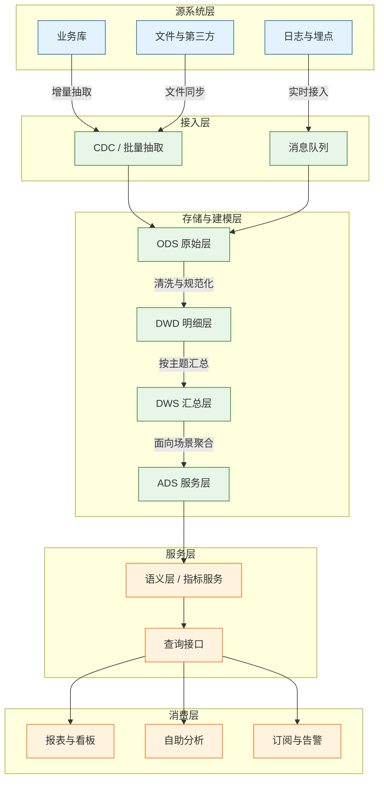
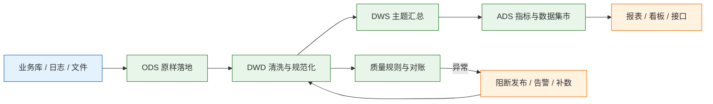
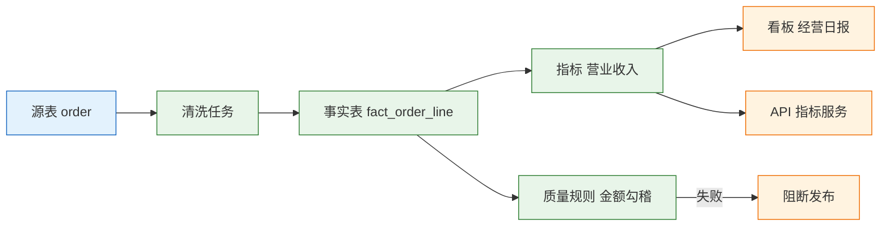

# BI 与数据平台

---

## 一、BI 与数据平台是什么

### 1.1 核心概念

BI（Business Intelligence，商业智能）是把业务数据加工成可比较、可追溯、可行动的指标与报表的系统。数据平台是它背后的采集、存储、计算和治理底座。两者合起来回答四个问题：指标由谁定义、按什么口径计算、数据从哪里来、错了怎么重跑。

BI 不是“把库里的表画成图”。同一张订单表，财务按开票确认收入，销售按发货统计业绩，供应链按出库计算履约；三种口径都合理，但不能共用一个指标名。BI 的第一件事是建指标字典，让每个指标有 owner、定义、公式、数据源、时间口径和版本。

| 概念 | 含义 | 常见问题 |
|---|---|---|
| 指标 | 可计算的业务度量 | 同名不同义、公式散落 |
| 维度 | 分析的视角 | 层级不一致、归属变化 |
| 事实 | 业务事件的可加度量 | 粒度不清、重复计数 |
| 数据集 | 面向主题的宽表或视图 | 字段膨胀、口径漂移 |
| 血缘 | 指标到源表的链路 | 断链、无人维护 |
| 质量规则 | 非空、唯一、值域、勾稽 | 只告警不处理 |

指标要分三类：原子指标直接可加，如订单行金额；派生指标是原子指标加维度或条件，如“华东区本月新客收入”；复合指标由多个指标运算，如毛利率、客单价、库存周转天数。复合指标必须引用原子或派生指标，不能各自写 SQL。

### 1.2 与相邻系统的关系

业务系统是数据的权威源，负责交易录入和规则执行；数据平台是分析副本，负责整合、历史和计算；BI 工具是消费端，负责展示和交互。三者职责不能颠倒。

数据仓库与数据湖的区别在存储与计算组织方式，不在“新旧”。数仓强调结构化建模和口径稳定，数据湖强调原始数据和多样格式；湖仓一体把两者放在同一存储上，但建模、质量和权限仍要单独做。

| 系统 | 主要职责 | 与 BI 的边界 |
|---|---|---|
| 业务库 | 交易录入、事务一致性 | BI 只读抽取，不回写 |
| 数据仓库 | 结构化建模、历史留存 | 承担指标计算 |
| 数据湖 | 原始数据、半结构化存储 | 需建表与治理后才能分析 |
| 指标平台 | 指标定义、版本、服务 | 统一口径，不替代数仓 |
| BI 工具 | 报表、看板、自助查询 | 不做复杂数据加工 |
| 调度系统 | 任务依赖、重跑、告警 | 保障时效，不定义口径 |

BI 库不是备份库。业务库误删数据，分析副本可能还在，但它不承担恢复业务的责任；反过来，BI 也不应该直接写回业务库。分析副本与业务权威源必须分开。

### 1.3 分层架构组成

数据平台从源到消费可以分成源系统、接入、存储建模、服务、消费五层。分层的目的不是追求架构名词，而是让原始数据、清洗逻辑、指标定义和展示各自可替换。



| 层 | 组件 | 关键能力 |
|---|---|---|
| 源系统 | 业务库、日志、文件 | 产生数据、保证事务 |
| 接入 | CDC、批量、消息 | 抽取、断点续传、幂等 |
| 存储建模 | ODS、DWD、DWS、ADS | 留存、清洗、汇总、服务 |
| 服务 | 语义层、查询接口 | 统一口径、行列权限 |
| 消费 | 报表、自助、订阅 | 展示、探索、预警 |

小团队不必强上四层，但要有“原始层”和“服务层”的区分。直接从业务库查报表，短期快，长期一定被慢查询、锁表和口径变更拖慢。

---

## 二、指标与维度建模

### 2.1 指标分类与指标字典

指标字典是 BI 的合同。每个指标至少登记名称、编码、定义、公式、粒度、维度、过滤条件、数据源、时间口径、币种税率、刷新频率、owner 和版本。

| 字段 | 说明 | 示例 |
|---|---|---|
| 指标编码 | 全局唯一，不随展示名变化 | revenue_invoice |
| 业务定义 | 一句话说清业务含义 | 已开票不含税收入 |
| 计算公式 | 分子、分母、过滤条件 | 开票金额减退货 |
| 时间口径 | 业务日期还是入账日期 | 按开票日期 |
| 责任方 | 对口径负责的人或部门 | 财务收入组 |

指标命名要稳定。展示名可以叫“营业收入”，编码必须唯一；改名不影响历史，改公式必须升版本。否则同一个名字在不同月份对应不同算法，趋势图会给出错误结论。

派生指标要写明维度组合和过滤条件。比如“新客收入”要先定义“新客”的时间窗和首单规则，否则每个团队都会给出不同数字。

### 2.2 事实表与维度表

分析模型通常按“事实加维度”组织。事实表一行代表一个业务事件，存可加度量和外键；维度表描述谁、什么、哪里、何时。

| 表类型 | 内容 | 设计要点 |
|---|---|---|
| 事实表 | 订单行、发货、收款、库存快照 | 粒度一句话说清 |
| 维度表 | 客户、产品、组织、日期 | 编码稳定、层级清晰 |
| 桥接表 | 多对多关系、账户与客户 | 避免事实表重复 |
| 汇总表 | 按主题预聚合 | 可回溯到明细 |

事实表的度量要区分可加、半可加和不可加。金额可按任意维度加总；库存数量可按时间点加，不能跨时间加；比率不能直接加，必须先算分子分母。把比率存进事实表再加总，是最常见的错误之一。

### 2.3 粒度与缓慢变化维

粒度是事实表一行代表什么。常见粒度有“一个订单行”“一次发货”“一天一仓一 SKU”。粒度必须在建表时写进注释和指标字典，不能靠字段猜。

粒度不清会导致两种错误：一是把订单头和订单行混在一张表，金额按行重复；二是 join 维度表时一对多放大，金额翻倍。解决顺序是先确定事实粒度，再找维度，最后才做宽表。

缓慢变化维（SCD）用于保留历史归属。客户换销售、产品换品类、组织调整，如果直接覆盖维度属性，去年的业绩会被今年的归属改写。

| 类型 | 做法 | 适用 |
|---|---|---|
| SCD1 | 直接覆盖 | 纠错、无关历史 |
| SCD2 | 增加版本与生效区间 | 归属、层级、价格 |
| SCD3 | 增加前一值字段 | 只保留一次变化 |

SCD2 的维度表要有 valid_from、valid_to 和 is_current。事实表按业务日期关联对应版本，不能一律关联当前版本。

---

## 三、数据加工主流程

### 3.1 抽取与落地

抽取的第一要求是可靠，不是快。批量抽取要记录位点，CDC 要记录日志序列号，文件同步要记录文件哈希；失败后从位点续传，不能整表重来。

ODS 层尽量原样落地，保留源字段、抽取时间和来源标识。不要在 ODS 做业务清洗，否则出问题时无法回溯原始值。ODS 可以按日期分区，保留周期由合规和成本共同决定。



### 3.2 清洗与明细

DWD 层做四件事：去重、规范化、关联维度、按业务过程建明细事实。去重要有业务主键；规范化包括统一编码、单位、币种、时区和状态枚举；关联维度要保留未知成员，不能因为维表缺记录就丢事实。

清洗规则要版本化。同一个字段今天按“去除空格”处理，明天按“保留原值”处理，历史数据就不可比。规则变更要重跑受影响分区，并在指标字典标注生效日期。

> **注意**：不要在报表层写复杂清洗逻辑。报表里的一段 `CASE WHEN` 一旦被复制到第二个看板，就会变成两套口径；逻辑要沉到 DWD 或语义层。

### 3.3 汇总与服务

DWS 按主题和维度汇总，控制粒度，避免宽表无限膨胀；ADS 面向具体报表或接口做最终聚合与权限过滤。汇总层要能回溯到明细，不能只存结果。

预聚合解决性能，不解决口径。汇总表必须引用同一套指标定义，不能为了快而另写一套公式。汇总粒度变化时，要保留旧粒度一段时间，供历史报表对比。

### 3.4 调度、回填与重跑

调度系统管理任务依赖、并发、超时和告警。依赖要声明到表或分区级，不能只写“上游完成后跑”；上游产出了空分区，下游照样成功，是典型的数据事故。

| 机制 | 要求 | 常见问题 |
|---|---|---|
| 依赖 | 按分区或表声明 | 只按任务名，顺序错乱 |
| 超时 | 设置任务与查询上限 | 长查询占满集群 |
| 重跑 | 幂等，按分区覆盖 | 追加写导致重复 |
| 回填 | 限并发、先小后大 | 一次性全量压垮源库 |
| 告警 | 落到 owner，有静默期 | 只发群，无人认领 |

回填要先在小分区验证，再扩大范围；回填期间要监控源库压力和下游时效。补数不是“越多越好”，补错分区比不补更难排查。

---

## 四、核心数据模型

### 4.1 表结构示例

分析模型以订单行为例：事实表一行代表一个订单行的一次成交，维度表保留客户、产品、日期和组织。事实表只存外键与度量，不存描述性文本。

```sql
-- 订单行事实：粒度为一个订单行
CREATE TABLE fact_order_line (
  order_line_id  BIGINT        PRIMARY KEY,
  order_id       BIGINT        NOT NULL,
  customer_id    BIGINT        NOT NULL,
  product_id     BIGINT        NOT NULL,
  order_date     DATE          NOT NULL,
  ship_date      DATE,
  quantity       NUMERIC(18,3) NOT NULL,
  net_amount     NUMERIC(18,2) NOT NULL,   -- 不含税金额
  tax_amount     NUMERIC(18,2) NOT NULL,
  cost_amount    NUMERIC(18,2),
  currency       CHAR(3)       NOT NULL,
  status         VARCHAR(16)   NOT NULL
);

-- 客户维度：SCD2 保留历史归属
CREATE TABLE dim_customer (
  customer_sk    BIGINT       PRIMARY KEY,  -- 代理键
  customer_id    BIGINT       NOT NULL,     -- 业务主键
  customer_name  VARCHAR(200) NOT NULL,
  industry       VARCHAR(64),
  region         VARCHAR(64),
  sales_owner    VARCHAR(64),
  valid_from     DATE         NOT NULL,
  valid_to       DATE,
  is_current     BOOLEAN      NOT NULL
);

-- 指标定义：公式与版本
CREATE TABLE metric_def (
  metric_code    VARCHAR(64)  NOT NULL,
  metric_name    VARCHAR(128) NOT NULL,
  formula        TEXT         NOT NULL,
  grain          VARCHAR(64)  NOT NULL,
  source_ref     VARCHAR(256) NOT NULL,
  owner_dept     VARCHAR(64)  NOT NULL,
  version        INT          NOT NULL,
  effective_from DATE         NOT NULL,
  status         VARCHAR(16)  NOT NULL,
  PRIMARY KEY (metric_code, version)
);
```

| 表 | 作用 | 关键约束 |
|---|---|---|
| fact_order_line | 订单行度量 | 订单行唯一，金额不含税 |
| dim_customer | 客户属性与历史 | 代理键唯一，区间不重叠 |
| dim_date | 日期层级 | 日期主键，覆盖完整 |
| metric_def | 指标公式与版本 | 指标加版本唯一 |

### 4.2 指标口径示例

指标口径要写到可以复算。只说“营收”，无法判断含税、退货、折扣、跨期怎么处理；写到公式和数据源，才能由第二个人复现。

| 指标 | 计算口径 | 数据源 |
|---|---|---|
| 营业收入 | 不含税开票金额减当期退货 | ERP 发票与退货 |
| 毛利率 | （营业收入减销售成本）÷ 营业收入 | 财务总账与出库成本 |
| 订单履约率 | 按时交付订单行 ÷ 应交付订单行 | OMS 与发货记录 |
| 库存周转天数 | 平均库存 ÷ 销售成本 × 统计天数 | WMS 与财务成本 |
| 活跃客户数 | 统计期内有有效交易的去重客户 | 订单事实表 |

同一指标要固定时间口径。按开票日期、按发货日期、按自然月还是按财务期间，结果都不同；跨月退货冲减哪个月，也要在字典里写明。口径变更要新增版本，旧版本保留，历史报表才能解释。

### 4.3 幂等与增量

增量抽取用更新时间、自增 ID 或 CDC。更新时间要可靠，避免源表“更新不改时间”；自增 ID 只能捕获新增，捕获不到更新和删除；CDC 最完整，但要看日志保留期和 schema 变更。

幂等重跑要求同一分区重跑结果一致。常用做法是按分区覆盖（INSERT OVERWRITE）或按主键合并（MERGE）。追加写加去重只能在查询时补救，存储会越来越大。

> **注意**：事实表要有业务主键。没有主键，重跑只能整表删除重建；有主键才能按行合并，也才能在 join 前做去重。

---

## 五、典型功能模块

### 5.1 数据集成

数据集成负责把源系统数据稳定地搬到平台。它要管理连接、抽取策略、字段映射、错误队列和重试，不是写几条同步 SQL 就结束。

| 模块 | 主要能力 | 关键配置 |
|---|---|---|
| 批量同步 | 全量、增量、分片 | 位点、并发、超时 |
| CDC | 日志解析、变更捕获 | 日志保留、心跳 |
| 文件接入 | CSV、Excel、对象存储 | 编码、分隔符、校验 |
| 错误队列 | 失败记录、重放 | 分类、告警、责任人 |

源系统 schema 变更要纳入发布流程。新增字段可以忽略，删除或改类型必须提前通知，否则抽取任务会在凌晨失败。

### 5.2 指标平台

指标平台把指标定义从报表 SQL 中抽出来，统一管理公式、维度、权限和版本。它对外提供指标查询接口，对内约束所有报表引用同一套定义。指标开发按六步走：登记字典、业务确认、在 DWD 或 DWS 实现、与源系统勾稽、发布版本、变更评审。

指标平台不等于语义层。语义层解决“怎么查”，指标平台解决“算什么”；两者可以合并实现，但职责要分清。没有指标版本，口径变更就无法追溯。

### 5.3 报表与自助分析

报表面向固定决策，自助分析面向探索。两者要共用数据集和权限，不能各自复制一份数据。自助分析要提供受控的维度和度量，不能让业务随意写 SQL 直连生产库。

看板设计要围绕行动。一个页面堆二十个指标，读者不知道先看哪个；应突出目标、实际、差异和责任人，异常能下钻到明细。

### 5.4 数据质量与血缘

质量规则至少覆盖非空、唯一、值域、波动和勾稽。规则要有 owner、阈值、处理动作和静默期；只告警不阻断，等于没有质量。

血缘要能回答“这个指标来自哪些表、经过哪些任务、影响了哪些报表”。排障时从异常指标向上追，比从源表向下猜快得多。



### 5.5 权限与成本

权限要分层：数据集层做行级过滤，语义层做列级脱敏，展示层只做按钮控制。只在前端隐藏字段，导出接口仍会泄露。

成本控制靠分区裁剪、列式存储、预聚合和冷热分层。记录查询人、扫描量、耗时，才能发现占满集群资源的异常报表。

> **业务红线**：客户明细、手机号、身份证、银行账号必须按角色最小授权，明细导出单独审批并留痕。给分析师开全表只读，是数据泄露最常见的路径。

---

## 六、系统集成设计

### 6.1 源系统接入方式

接入方式由源系统能力和时效要求决定。能走 CDC 就不做全量，能做增量就不扫全表；但 CDC 依赖日志保留和权限，不能假设所有库都支持。

| 方式 | 适用 | 主要限制 |
|---|---|---|
| 批量 JDBC | 中小表、T+1 | 锁表、慢查询 |
| CDC | 大表、实时 | 日志保留、schema 变更 |
| 文件 | 第三方、离线 | 格式、重复、迟到 |
| API | SaaS、外部数据 | 限流、分页、配额 |

接入要只读账号、独立连接池、限制并发。直接用业务高峰期的生产库跑大查询，会把分析成本转嫁给交易系统。

### 6.2 实时与离线选型

“实时大屏”是 BI 最常见的过度需求。先问决策需要多快：经营日报 T+1 足够，运营监控 5 到 15 分钟，风控告警才需要秒级。

| 场景 | 时效 | 方案 |
|---|---|---|
| 经营日报 | T+1 | 批量抽取加凌晨调度 |
| 运营监控 | 5–15 分钟 | 微批或 CDC 加流式聚合 |
| 风控告警 | 秒级 | 事件流加规则引擎 |
| 财务结账 | 日或月 | 批量加严格对账 |

实时链路成本高、口径难统一、回补麻烦。能用微批解决，不要上全流式；必须实时时，也只实时核心指标，明细仍在离线层。实时与离线两套口径必须有勾稽。

### 6.3 语义层与消费端

语义层把表结构翻译成业务对象：客户、产品、区域、收入。它统一维度层级、指标公式和权限，让 BI 工具、API、订阅共用一套定义。

语义层要版本化。指标公式变更、维度层级调整，都要发布新版本并记录生效日期；消费端按版本查询，避免旧看板突然变形。

---

## 七、实施路径与能力边界

### 7.1 建设顺序

数据平台建设按“先可用、再可信、后自助”推进。先打通一条业务链，再扩主题，最后开放自助分析；顺序反了，会得到一堆没人维护的宽表。

| 阶段 | 主要工作 | 产出 |
|---|---|---|
| 指标盘点 | 统一口径、确定 owner | 指标字典初版 |
| 链路打通 | 源接入、ODS、DWD | 可追溯的明细 |
| 主题建模 | 订单、客户、库存 | 一致性维度 |
| 报表上线 | 核心看板、对账 | 经营日报 |
| 自助开放 | 数据集、权限、培训 | 受控自助分析 |
| 治理常态 | 质量、血缘、成本 | 运行指标 |

试点选一个主题，比如订单履约或收入，不要同时铺十个主题。先把一个指标的源表、任务、口径、权限、对账全部打通，再复制方法。

### 7.2 治理机制

治理不是开一次会。指标评审、质量复盘、权限审计、成本复盘要有固定节奏和明确产出。

| 机制 | 频率 | 产出 |
|---|---|---|
| 指标评审 | 新指标上线前 | 定义、公式、owner |
| 质量复盘 | 每周 | 失败规则与修复 |
| 权限审计 | 每季度 | 授权清单与回收 |
| 成本复盘 | 每月 | 扫描量、存储、异常 |

指标 owner 必须是业务方，不能只由数据团队兼任。业务不认的指标，上线后仍会被另一套 Excel 取代。

### 7.3 能力边界

BI 不写业务库，也不承担业务库的灾难恢复。分析副本可以保留历史，但不能替代备份与恢复演练；BI 也不负责交易规则执行，下单、扣库存、开票仍在业务系统。

| 场景 | 是否适合 BI | 说明 |
|---|---|---|
| 指标与报表 | 适合 | 统一口径、历史趋势 |
| 自助分析 | 适合 | 受控数据集与权限 |
| 数据质量监控 | 适合 | 规则、告警、阻断 |
| 交易录入 | 不适合 | 归业务系统 |
| 业务库恢复 | 不适合 | 归数据库备份 |
| 实时反欺诈决策 | 视情况 | 需事件流与规则引擎 |

---

## 八、常见失败模式与排查

### 8.1 失败模式

BI 的故障多表现为“数字不对、数据晚了、报表慢了”，很少是平台完全不可用。排查要沿指标定义、分区行数、关联去重、抽取位点、展示层的顺序走。

| 现象 | 最可能原因 | 处理 |
|---|---|---|
| 同指标不同值 | 口径、税率、时间、币种不同 | 建指标字典，统一数据集 |
| 金额翻倍 | join 一对多、重复抽取 | 先聚合再 join，按主键去重 |
| 今天数据变少 | 增量漏数、分区未就绪 | 查抽取位点，补跑分区 |
| 报表越跑越慢 | 全量刷新、无分区 | 增量、分区裁剪、预聚合 |
| 历史数据对不上 | 公式悄悄改、维度重算 | 指标版本化，保留快照 |
| 用户看到无权数据 | 只做页面权限 | 数据集层强制行级过滤 |
| 任务成功但数据为空 | 上游空分区、过滤条件错 | 行数与波动校验，失败阻断 |
| 补数后重复 | 重跑非幂等 | 按分区覆盖或主键合并 |
| 日期差一天 | 源系统 UTC、报表本地时区 | 统一时区，明确业务日期 |
| 看板没人看 | 指标堆砌、无行动指向 | 围绕目标与差异重构 |

### 8.2 处置顺序

1. 确认指标定义与版本：名称、公式、时间口径、币种税率是否一致。
2. 查数据集分区：分区是否就绪，行数与昨日、上周同期是否异常。
3. 查关联与去重：事实粒度是否被 join 放大，业务主键是否重复。
4. 查源系统：抽取位点、CDC 延迟、源表是否补数或改 schema。
5. 查质量规则：勾稽是否通过，异常分区是否被阻断。
6. 查权限：行级过滤是否生效，导出是否绕过。
7. 最后查展示层：聚合方式、排序、缓存和时区。

> **业务红线**：同一个指标名只能对应一个公式、一个数据源和一个时间口径。口径变更必须升版本并通知消费方，不得在报表层悄悄改公式。

> **核心结论**：指标字典是 BI 的地基；先定粒度再建宽表；能增量不全量，能重跑不手工修；质量规则要能阻断发布；分析副本不是备份，数据治理必须有业务 owner。
