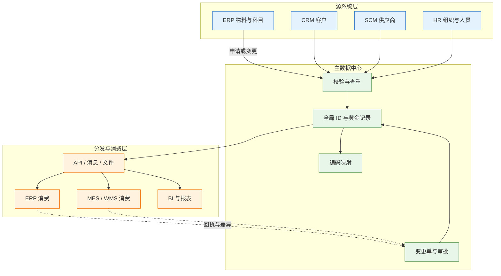
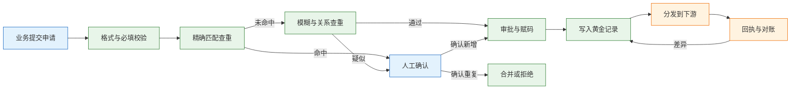
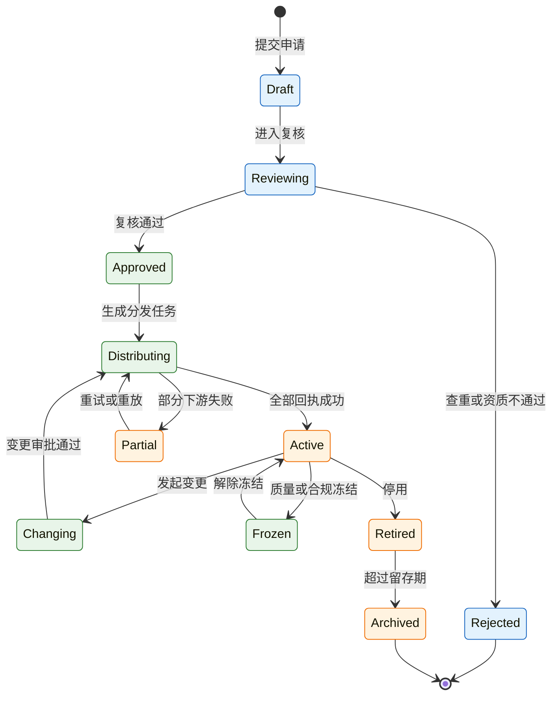
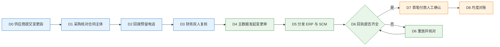

# 企业集成与主数据

---

## 一、企业集成与主数据是什么

### 1.1 核心概念

企业集成（Enterprise Integration）是让多个独立系统围绕同一笔业务交换单据、状态和数据的整套机制。它由三段组成：传输负责把数据送到，语义负责让双方对字段理解一致，治理负责确定谁可以改、何时生效、出了差异谁处理。只做传输，得到的是一批能连通但解释不一致的接口。

主数据（Master Data）是跨系统共享、相对稳定、被多个业务流程反复引用的核心实体记录，典型域包括物料、客户、供应商、组织与人员、会计科目、仓库与库位、设备。主数据管理（MDM，Master Data Management）回答三个问题：同一实体在不同系统里是不是同一个对象、以哪份记录为准、变更如何被下游接受。

三个基础概念必须分开：

- **权威源（System of Record）**：某个对象唯一允许写入的系统，其他系统只能引用或订阅。
- **全局 ID**：主数据中心的内部主键，不承载业务含义、永不复用，跨系统引用只认它。
- **业务编码**：给人阅读和录入的编码，可能因并购、分类调整而变化，不能直接充当跨系统外键。

事务数据与分析数据不属于主数据。订单、工单、发票变化快，由单一业务流程产生；指标、宽表由分析平台加工产生。把它们塞进主数据域，主数据中心就会退化成第二个业务系统。

| 数据类型 | 变化频率 | 权威源 | 典型对象 |
|---|---|---|---|
| 主数据 | 低，按变更单 | MDM 或指定业务系统 | 物料、客户、供应商、科目 |
| 参考数据 | 极低 | 标准或监管口径 | 国家、币种、计量单位、税率 |
| 事务数据 | 高，按单据 | 业务系统 | 订单、工单、发票、付款 |
| 分析数据 | 按批量刷新 | 数据平台 | 指标、宽表、报表 |

集成的价值不在接口数量，而在业务结果：一笔付款能追到变更单，一张发票能追到订单行，一条库存差异能追到收货批次。

### 1.2 与相邻系统的关系

主数据与周边概念经常被混用，边界不清会导致重复建设。

ERP、CRM、PLM、SCM 既可能是某域的权威源，也可能是消费者：物料量产权威在 ERP，设计定义在 PLM；客户关系在 CRM，财务主体在 ERP；供应商准入在 SCM，应付在 ERP。集成平台只解决传输与转换，不判定字段对错；数据仓库只消费，不回写。组织与人员的主数据源是 HR，离职停权由 HR 事件触发。

| 相邻概念 | 解决的问题 | 与主数据的关系 | 常见混淆 |
|---|---|---|---|
| ERP/CRM/PLM | 业务过程与单据 | 可能是某域的权威源 | 把业务系统当唯一主数据平台 |
| ESB/iPaaS | 传输、路由、协议转换 | 主数据分发的通道 | 认为总线能保证数据正确 |
| 数据仓库/数据湖 | 分析、历史留存 | 主数据的消费方 | 允许报表回写主数据 |
| 统一身份/HR | 账号、组织、人员 | 组织域权威源 | 各系统自建人员表 |
| 数据治理 | 标准、质量、责任 | 主数据的制度基础 | 把治理等同于买工具 |

> **注意**：集成平台的成功率指标只说明“消息送到了”，不说明“下游认了”。主数据是否一致，要单独用映射覆盖率、下游一致率和变更回执率衡量。

### 1.3 分层与架构组成

主数据架构可以按“源系统—主数据中心—消费系统”三层理解，两侧通过集成通道连接，中间由治理与监控贯穿。



| 组件 | 主要职责 | 关键产出 |
|---|---|---|
| 源系统接入 | 提交新增、变更、停用申请 | 申请单与原始凭证 |
| 校验与查重 | 非空、值域、唯一性、相似度 | 通过、疑似重复、拒绝 |
| 黄金记录 | 合并多源字段，形成唯一版本 | 全局 ID、生效版本 |
| 编码映射 | 维护源系统编码与全局 ID 对应 | 映射表与覆盖率报告 |
| 变更与审批 | 风险分级、双人复核、留痕 | 变更单、审批记录 |
| 分发通道 | API、消息、文件批量 | 投递记录与回执 |
| 监控与对账 | 数量、字段、状态比对 | 差异清单与处置记录 |

分层之后，源系统不直接改下游库，主数据中心不替业务系统做单据，消费端不反向覆盖黄金记录。

---

## 二、主数据治理流程

### 2.1 主数据域与归属

主数据治理的第一步不是建平台，而是给每个域指定唯一 owner。Owner 不是“数据部”这个部门名，而是对业务规则负责的岗位，例如物料由计划或工程负责人担任，供应商由采购负责人担任，会计科目由财务负责人担任。

| 数据域 | 权威源 | 其他系统角色 | 高风险字段 |
|---|---|---|---|
| 物料 | ERP 或 MDM | PLM 管设计定义，MES 管现场使用 | 计量单位、税分类、批次属性 |
| 客户 | CRM 或 MDM | ERP 管财务主体与信用 | 统一社会信用代码、信用额度 |
| 供应商 | SCM、SRM 或 MDM | ERP 管采购与应付 | 银行账号、税号、法人 |
| 组织与人员 | HR | OA 与业务系统订阅 | 岗位、权限、在职状态 |
| 会计科目 | 财务 | 各系统只读 | 科目性质、借贷方向 |
| 仓库与库位 | WMS | ERP 只读库存价值 | 库位属性、冻结状态 |
| 设备 | EAM | MES、SCADA 引用 | 设备编码、能力参数 |

编码设计遵循三条：全局 ID 不承载含义；业务编码只编码稳定属性；会变化的信息放属性并带生效日期。可读编码方便识别，但区域、分类一旦进入编码，调整时就会牵动所有下游。

> **注意**：用业务编码做外键，改一次编码就会断开全部历史关联。跨系统引用统一用全局 ID，业务编码只用于展示和检索。

### 2.2 新增与查重流程

新增主数据必须走统一入口。每多一个创建按钮，就多一份重复数据。



查重分三类规则：

| 规则类型 | 匹配内容 | 处理方式 |
|---|---|---|
| 精确匹配 | 统一社会信用代码、税号、规格加品牌 | 直接判定重复 |
| 模糊匹配 | 名称去后缀、地址标准化、电话邮箱 | 给出相似度，人工确认 |
| 关系匹配 | 集团关系、同一联系人、同一银行账号 | 标记关联，人工判断 |

查到疑似重复，只能人工确认，不能自动合并。自动合并一旦判断错误，历史合同、库存、发票、收付款都要重新挂接，修复成本远高于新增一条记录。

合并要做影响分析：被合并记录出现在哪些单据和映射中、保留哪个全局 ID、旧 ID 是否作为别名继续可查。合并后要触发下游同步，并保证历史单据只读可查。

### 2.3 高风险字段变更流程

不同字段的风险不同，审批强度也应不同。把备注修改和银行账号修改放进同一个审批流，只会让高风险审批被稀释。

| 风险级别 | 字段示例 | 审批要求 |
|---|---|---|
| 高 | 银行账号、税号、法人、信用额度 | 双人复核、回拨验证、附件留存 |
| 中 | 名称、地址、联系人、付款条件 | 业务与财务审批 |
| 低 | 备注、内部标签 | 业务自审 |

银行账号变更是最典型的攻击面。邮件伪造、印章伪造、联系人冒充都很常见，收到盖章函件不等于身份已核实。可靠做法是回拨合同预留电话、核对合同主体、双人复核，并对变更后的首笔付款做人工到账确认。

一次完整的银行账号变更应包含八个动作：

| 步骤 | 动作 | 责任岗位 | 留痕 |
|---|---|---|---|
| 1 | 供应商提交盖章变更函与营业执照 | 供应商 | 函件、证照 |
| 2 | 核对合同主体、联系人、收款户名 | 采购 | 核对记录 |
| 3 | 回拨合同预留电话确认 | 采购 | 通话时间、经办工号 |
| 4 | 复核账号、税号、户名一致性 | 财务 | 双人签字 |
| 5 | 在主数据中心发起变更单 | 数据管理员 | 前后值、原因、附件 |
| 6 | 分发到 ERP 与 SCM，等待回执 | 集成平台 | 消息 ID、回执状态 |
| 7 | 首笔付款人工确认到账 | 财务 | 付款备注、银行回单 |
| 8 | 月度对账确认无旧账号残留 | 数据管理员 | 对账报告 |

> **业务红线**：银行账号、税号、法人一类字段，不得由单一岗位在单一系统中直接修改；没有回拨核实、双人复核和变更留痕的变更，一律视为无效变更。

变更单要记录生效时间：立即生效适合纠错，指定日期适合合同切换，按批次适合物料替代。只写“已发布”，下游只能各自猜测。

### 2.4 停用与历史保留

主数据停用采用状态变更，不做物理删除。状态通常包括草稿、待审、生效、冻结、停用、归档。停用后禁止新单据引用，历史单据仍可查询和打印。

| 状态 | 可否新建单据 | 可否查询历史 | 典型场景 |
|---|---|---|---|
| 草稿 | 否 | 否 | 申请中，尚未赋码 |
| 生效 | 是 | 是 | 正常业务 |
| 冻结 | 否 | 是 | 质量、合规或欠款调查 |
| 停用 | 否 | 是 | 业务终止，保留追溯 |
| 归档 | 否 | 是，需授权 | 超过留存期的冷数据 |

物理删除会破坏历史订单、发票、库存的关联，审计无法解释。确需清理时，先归档、再脱敏、最后按留存策略处理。

> **注意**：停用要同步到所有消费系统。只在主数据中心停用、下游仍可下单，等于没有停用；停用事件也要回执。

---

## 三、核心数据模型

### 3.1 主数据表结构

主数据表保存黄金记录与生效版本。全局 ID 与业务编码分离，状态与有效期分离，避免用删除表达业务终止。

```sql
CREATE TABLE md_master (
    global_id      VARCHAR(32)  PRIMARY KEY,
    domain         VARCHAR(32)  NOT NULL,
    business_code  VARCHAR(64)  NOT NULL,
    name           VARCHAR(256) NOT NULL,
    status         VARCHAR(16)  NOT NULL,
    version        INT          NOT NULL DEFAULT 1,
    valid_from     DATE         NOT NULL,
    valid_to       DATE,
    source_system  VARCHAR(32)  NOT NULL,
    updated_at     TIMESTAMPTZ  NOT NULL DEFAULT now(),
    CONSTRAINT uk_master_code UNIQUE (domain, business_code)
);

CREATE TABLE md_master_attribute (
    global_id   VARCHAR(32) NOT NULL,
    attr_code   VARCHAR(64) NOT NULL,
    attr_value  TEXT,
    valid_from  DATE        NOT NULL,
    valid_to    DATE,
    PRIMARY KEY (global_id, attr_code, valid_from)
);
```

| 表 | 关键字段 | 设计要点 |
|---|---|---|
| md_master | global_id、domain、business_code、status | 编码唯一，ID 不复用 |
| md_master_attribute | global_id、attr_code、有效期 | 属性变化保留历史 |
| md_cross_reference | 源系统、源编码、global_id | 一源一码，支持多源 |
| md_change_request | 变更单号、前后值、风险级别 | 高风险字段强制审批 |

属性表用有效期而不是覆盖更新，才能回答“当时是什么值”。银行账号、税率这类字段，历史值在审计和纠纷中比当前值更重要。

### 3.2 映射与变更表结构

映射表解决“同一实体在不同系统编码不同”的问题。一个全局 ID 可以对应多个源系统编码，但同一源系统内一个编码只能指向一个全局 ID。

```sql
CREATE TABLE md_cross_reference (
    global_id      VARCHAR(32) NOT NULL,
    source_system  VARCHAR(32) NOT NULL,
    source_code    VARCHAR(64) NOT NULL,
    is_primary     BOOLEAN     NOT NULL DEFAULT false,
    created_at     TIMESTAMPTZ NOT NULL DEFAULT now(),
    PRIMARY KEY (source_system, source_code),
    UNIQUE (global_id, source_system, source_code)
);

CREATE TABLE md_change_request (
    change_no      VARCHAR(32) PRIMARY KEY,
    global_id      VARCHAR(32) NOT NULL,
    field_code     VARCHAR(64) NOT NULL,
    old_value      TEXT,
    new_value      TEXT,
    risk_level     VARCHAR(8)  NOT NULL,
    reason         TEXT        NOT NULL,
    status         VARCHAR(16) NOT NULL,
    applicant      VARCHAR(64) NOT NULL,
    reviewer       VARCHAR(64),
    effective_at   TIMESTAMPTZ,
    created_at     TIMESTAMPTZ NOT NULL DEFAULT now()
);
```

| 变更类型 | 影响范围 | 生效方式 |
|---|---|---|
| 纠错 | 当前记录与未结单据 | 立即生效，通知下游 |
| 合同切换 | 新单据 | 指定日期生效 |
| 物料替代 | 在途采购、在制工单、库存 | 按批次或旧料用完 |
| 停用 | 全部新业务 | 立即冻结，保留历史 |

变更单是审计对象，不是日志。前后值、原因、附件、审批人、生效时间缺一不可。

### 3.3 接口与对账登记

接口和消息都要登记，否则故障时无人认领。登记表至少覆盖上下游、协议、频率、owner、SLA 和当前状态。

| 表 | 关键字段 | 用途 |
|---|---|---|
| int_interface | 接口编码、上下游、协议、频率、owner | 接口台账与责任 |
| int_message | message_id、business_key、类型、状态、重试次数 | 单条消息追踪 |
| int_receipt | 消息 ID、消费系统、结果、时间 | 下游回执 |
| int_reconciliation | 任务、对象、口径、差异数量、差异金额 | 对账结果 |
| int_diff | 差异编号、类型、单据号、责任人、状态 | 差异闭环 |

接口台账要写明“下线计划”。下线像删表一样处理：先标记废弃、通知消费方、统计调用量、保留只读窗口，最后关闭。直接关接口，等于停掉别人的业务。

### 3.4 状态机

主数据记录与变更单各有一套状态。两套状态混在一起，会出现“记录已生效但变更还没审批”的矛盾。



| 状态 | 含义 | 允许动作 |
|---|---|---|
| Draft | 申请已建，未提交 | 编辑、撤回 |
| Reviewing | 查重与资质复核中 | 通过、拒绝、补件 |
| Distributing | 正在向下游分发 | 重试、查看回执 |
| Active | 已生效，可被引用 | 变更、冻结、停用 |
| Partial | 部分下游未确认 | 重放、人工核对 |
| Frozen | 暂停使用 | 解冻、调查 |
| Retired | 停用，保留历史 | 查询、归档 |

状态迁移必须用条件更新，例如 `UPDATE md_master SET status='Retired' WHERE global_id=? AND status='Active'`。影响行数为零说明状态已被其他操作改变，应重新读取再判断，不能强行覆盖。

---

## 四、集成模式与消息机制

### 4.1 集成模式分类

企业集成没有“刚好一次”的保证。消息可能重复、乱序、丢失或延迟，设计目标应是“至少一次投递 + 消费端幂等 + 定期对账”。

| 模式 | 适合场景 | 代价 | 一致性 |
|---|---|---|---|
| 同步 API | 实时查询、强校验 | 下游故障会拖住上游 | 请求内一致 |
| 异步消息 | 解耦、削峰、事件驱动 | 重复、乱序、积压 | 最终一致 |
| 文件批量 | 大量数据、日终对账 | 延迟高、格式易错 | 批次一致 |
| CDC | 数据库增量同步 | 源库压力、结构变更敏感 | 准实时 |
| ESB 或集成平台 | 多协议、多系统 | 总线可能成为瓶颈与单点 | 依实现 |

选型顺序是：能批量不实时，能异步不同步，能点对点不建总线。每增加一个同步调用点，就多一个超时、一个降级、一个值班电话。

多系统集成常建规范模型（Canonical Model），把各系统字段映射到统一结构。只对核心对象建规范模型：订单、物料、客户、供应商、工单；字段按业务语义命名，不照搬某个厂商；映射表版本化；保留扩展字段，但禁止把业务规则塞进扩展字段。

### 4.2 消息结构与幂等键

一条可运维的集成消息，信封至少包含以下字段：

| 字段 | 作用 | 示例 |
|---|---|---|
| message_id | 消息唯一标识，用于追踪 | 全局 UUID |
| event_type | 事件类型 | supplier.bank_account.changed |
| schema_version | 结构版本，消费者兼容 | 2.1 |
| business_key | 业务主键，用于幂等与分区 | 供应商全局 ID 或变更单号 |
| occurred_at | 业务发生时间 | 带时区的时间戳 |
| producer | 生产系统 | mdm-hub |
| trace_id | 跨系统链路追踪 | 请求级追踪号 |
| payload | 业务载荷 | 变更前后值与生效时间 |

幂等键必须来自业务，不用 message_id。消息重投时 message_id 可能变化，业务键不变；用 message_id 做幂等，重复业务仍然会发生。

| 操作 | 幂等键 | 唯一约束位置 | 重复后果 |
|---|---|---|---|
| 主数据新增 | 域 + 统一社会信用代码或规格 | 主数据表 | 产生重复实体 |
| 主数据变更 | 变更单号 | 变更表 | 重复审批与重复分发 |
| 下游消费 | 消费者 + 业务键 + 事件类型 | 消费记录表 | 重复写入或重复触发 |
| 文件导入 | 批次号 + 行号 | 导入明细表 | 重复记账 |

消费端去重表记录业务键、事件类型、处理结果和时间，并设唯一索引。去重窗口要覆盖最长重投周期。

### 4.3 事务外盒与投递

“业务写成功、消息没发出”是集成里最常见的数据缺口。用分布式事务去保证数据库与消息队列同时成功，代价高且容易把系统拖死；更稳妥的是事务外盒（Transactional Outbox）。

| 阶段 | 动作 | 失败处理 |
|---|---|---|
| 本地事务 | 写业务表与事件表，同一事务提交 | 整体回滚，不产生半成品 |
| 投递器 | 轮询未发送事件，发送到消息队列 | 失败保留，按退避重试 |
| 标记 | 发送成功后标记已投递 | 标记失败会导致重复发送，由幂等兜底 |
| 消费 | 消费者处理并写去重记录 | 失败重试，超过上限进死信 |

```sql
-- 事件表：与业务表在同一本地事务中写入
CREATE TABLE int_outbox (
    event_id      BIGSERIAL PRIMARY KEY,
    business_key  VARCHAR(64)  NOT NULL,
    event_type    VARCHAR(64)  NOT NULL,
    schema_version VARCHAR(16) NOT NULL,
    payload       JSONB        NOT NULL,
    status        VARCHAR(16)  NOT NULL DEFAULT 'pending',
    attempts      INT          NOT NULL DEFAULT 0,
    next_retry_at TIMESTAMPTZ,
    created_at    TIMESTAMPTZ  NOT NULL DEFAULT now(),
    sent_at       TIMESTAMPTZ
);

CREATE INDEX idx_outbox_pending ON int_outbox (status, next_retry_at);
```

投递器只负责送出事件，不判断业务对错；消费端只负责按业务键处理一次，不假设消息只来一次。两侧职责清楚，才能不用分布式事务而保持最终一致。

> **注意**：不要在外部系统回调里直接调用下游并因失败回滚本地状态。外部系统已经完成动作，本地回滚只会制造两边不一致；正确做法是本地落账、写事件、异步重试。

### 4.4 顺序、重试与死信

顺序只在同一业务键内有意义。按全局 ID 分区能保证同一供应商的变更先后；按 message_id 分区则无法保证。

| 机制 | 建议做法 | 说明 |
|---|---|---|
| 分区键 | 业务键或全局 ID | 同一实体进同一分区 |
| 重试 | 指数退避加随机抖动 | 避免同时重试打垮下游 |
| 上限 | 按接口设定最大次数 | 超过后进死信，不无限重试 |
| 死信 | 独立队列、指定 owner、处理时限 | 死信无人处理等于丢消息 |
| 重放 | 按业务键或时间范围重放 | 重放前确认消费端幂等 |
| 毒消息 | 单独隔离并告警 | 结构错误的消息重试不会成功 |

重试要区分错误类型：网络超时、下游 5xx 可重试；字段缺失、验签失败、状态非法应直接进死信。

---

## 五、接口与对账

### 5.1 接口契约设计

接口契约不是字段清单，而是双方对行为的一致约定。至少要写清请求结构、响应结构、错误码、超时、重试语义、版本策略和责任人。

| 契约项 | 内容 | 验收方式 |
|---|---|---|
| 结构 | 字段、类型、必填、示例 | 契约测试 |
| 错误码 | 可重试与不可重试分类 | 故障注入 |
| 超时 | 连接、读取、总时长 | 压测与演练 |
| 重试 | 次数、退避、幂等要求 | 重复投递测试 |
| 版本 | 兼容策略、废弃周期 | 新旧消费者并行 |
| 责任 | 上下游 owner、值班方式 | 台账核对 |

结构演进遵循“只加不改”：新增字段可选，旧字段不删除、不改语义；必须破坏兼容时升级主版本并并行一段时间。消费者要忽略未知字段。

### 5.2 对账项与差异分类

对账不是财务的专属工作。技术侧要提供可追溯的流水、业务键和差异分类，财务才能定位到具体单据。

| 对账项 | 比对内容 | 差异类型 | 处理方式 |
|---|---|---|---|
| 主数据数量 | 源系统与主数据的记录数 | 缺失、重复 | 补录或合并 |
| 字段一致性 | 名称、税号、账号等关键字段 | 值不一致、版本旧 | 重发或人工修正 |
| 映射覆盖率 | 下游编码是否都有全局 ID | 未映射 | 补映射并冻结新建 |
| 变更回执 | 变更单与下游确认 | 未消费、处理失败 | 重放并核对 |
| 停用状态 | 下游是否仍可引用 | 状态未同步 | 强制冻结并排查 |

差异分类要固定，常用五类：时间性、单据缺失、金额或数量错误、重复记录、版本过期。分类不清，对账就会退化成每月重查。

> **业务红线**：主数据差异不得由下游自行改数，只能回到权威源修正并重新分发。

### 5.3 主数据一致性度量

主数据治理要能量化，否则会变成“又建了一个系统”。指标不求多，求能持续采集和追责。

| 指标 | 定义 | 用途 |
|---|---|---|
| 新增一次通过率 | 首次提交即通过的比例 | 衡量申请质量与规则清晰度 |
| 重复率 | 查重命中的申请占比 | 衡量入口收口效果 |
| 下游一致率 | 关键字段一致的下游记录占比 | 衡量分发与消费质量 |
| 变更平均时长 | 提交到全部回执完成的时间 | 衡量流程效率 |

指标要绑定口径、数据源和责任人，否则一个百分比无法定位问题。

---

## 六、完整案例：供应商银行账号变更

### 6.1 背景与初始状态

某制造企业的供应商主数据同时存在于 SCM、ERP 和 OA。SCM 管准入与合同，ERP 管采购订单与应付，OA 管用印审批。三套系统各有供应商编码，靠人工维护的对照表关联。

| 系统 | 供应商编码 | 银行账号字段 | 变更历史 |
|---|---|---|---|
| SCM | GYS-0182 | 有 | 无 |
| ERP | 100237 | 有 | 无 |
| OA | 供应商 0182 | 仅有附件 | 无 |

供应商发来盖章的账号变更函。采购在 SCM 中直接修改，财务没有收到通知，付款仍使用 ERP 中的旧账号。

### 6.2 变更执行过程

改进后的流程由主数据中心统一受理，按高风险变更处理。



执行中的关键记录：

| 时点 | 动作 | 结果 | 证据 |
|---|---|---|---|
| D0 | 收到变更函 | 函件与执照齐全 | 扫描件、邮件头 |
| D1 | 核对合同主体 | 户名与合同一致 | 合同编号、核对人 |
| D2 | 回拨预留电话 | 联系人确认变更 | 通话记录、工号 |
| D3 | 财务复核 | 账号与税号无误 | 双人签字 |
| D4 | 创建变更单 | 风险级别为高 | 变更单号、前后值 |
| D5 | 分发下游 | ERP 成功，SCM 超时 | 消息 ID、回执 |
| D6 | 重放 | SCM 已消费，未重复写入 | 幂等记录 |
| D7 | 首笔付款 | 到账账号为新账号 | 银行回单 |
| D8 | 月度对账 | 无旧账号残留 | 对账报告 |

SCM 超时属于“下游已提交、响应丢失”。消费端若用 message_id 去重，重放会生成第二条记录；本案用变更单号做幂等键，第二次投递被识别为重复。

### 6.3 对账与验证

变更完成后做三项验证：

```sql
-- 检查三个系统的账号是否一致
SELECT m.global_id, m.business_code, x.source_system, x.source_code
FROM md_master m
JOIN md_cross_reference x ON x.global_id = m.global_id
WHERE m.domain = 'SUPPLIER'
  AND m.business_code = 'GYS-0182';

-- 检查是否仍有单据引用旧账号
SELECT doc_no, supplier_code, bank_account
FROM ap_payment
WHERE supplier_code = '100237'
  AND bank_account = :old_account
  AND status IN ('pending', 'approved');

-- 检查变更回执是否齐全
SELECT i.interface_code, r.consumer, r.result, r.received_at
FROM int_receipt r
JOIN int_message m ON m.message_id = r.message_id
WHERE m.business_key = :change_no;
```

验证标准是：三个系统账号一致、未结付款无旧账号、消费系统回执齐全、首笔付款到账。缺一项，变更就不能关闭。

### 6.4 结果与改进

改造后，同类变更的处理时间明显缩短，变更单可追、回执可查、旧账号可检索。责任也随之清楚：采购核实身份，财务复核账号，数据管理员负责分发与对账，集成平台负责投递与重试。

---

## 七、边界与取舍

### 7.1 适用边界

主数据治理适合“多系统共享、变更影响面大、错误代价高”的域。单一系统内部使用的配置项，不必上升为主数据；变化极快的事务数据，也不应纳入主数据。

| 场景 | 是否适合主数据治理 | 理由 |
|---|---|---|
| 物料、客户、供应商跨三个以上系统 | 适合 | 编码与口径冲突成本高 |
| 单一系统内的字典表 | 不适合 | 无跨系统一致性需求 |
| 订单、工单等事务单据 | 不适合 | 由业务流程唯一产生 |
| 组织与人员跨系统授权 | 适合 | 离职停权依赖一致性 |
| 报表指标口径 | 部分适合 | 属于指标治理，不是主数据 |

集中式适合强管控的集团企业；联邦式保留各域权威源，由中心维护映射与标准。选择取决于变更频率和裁决成本。

### 7.2 产品与自建的取舍

MDM 不是必须购买的产品。小企业可以用主数据服务、审批流和映射表实现核心能力；系统数量多、域复杂、审计要求高时，才需要专门平台。

| 能力 | 自建方式 | 采购平台 | 判断依据 |
|---|---|---|---|
| 唯一标识 | 全局 ID 服务 | 内置编码引擎 | 域数量与编码规则复杂度 |
| 查重 | 规则加人工 | 相似度算法与合并 | 数据量与重复率 |
| 流程 | OA 或工作流引擎 | 内置审批与建模 | 审批复杂度 |
| 分发 | 消息队列加适配器 | 多协议连接器 | 下游数量 |

自建或采购，标准都是三条：唯一 owner、变更留痕、下游对账。

### 7.3 组织与责任

主数据治理是跨部门机制，不是 IT 项目。角色至少包括数据 owner、数据 steward、系统 owner 和集成 owner。

| 角色 | 职责 | 产出 |
|---|---|---|
| 数据 owner | 决定业务规则与高风险变更 | 规则、审批结论 |
| 数据 steward | 日常查重、清洗、合并 | 数据质量报告 |
| 系统 owner | 保证本系统写入与消费正确 | 接口与字段说明 |
| 集成 owner | 消息、重试、对账与故障升级 | 运行报告、差异闭环 |
| 财务与审计 | 复核资金相关字段 | 复核记录 |

治理节奏固定：月度看质量，季度评审规则，年度审计权限。

---

## 八、常见失败模式与排查

### 8.1 失败模式

| 现象 | 最可能原因 | 处理 |
|---|---|---|
| 同一物料多个编码 | 各系统自建、无统一入口 | 收口申请入口，补映射，合并历史 |
| 供应商账号变更未生效 | 只改一个系统、无分发 | 建变更单，重发并核对回执 |
| 消息乱序导致状态回退 | 按消息 ID 分区 | 改按业务键或全局 ID 分区 |
| 接口故障拖垮全链路 | 同步调用无超时与降级 | 加超时、舱壁、异步化 |
| 重试风暴打垮下游 | 无上限、无退避 | 指数退避加抖动，超限进死信 |
| 新字段上线老消费者崩溃 | 结构不兼容 | 只加不改，版本化，契约测试 |

### 8.2 处置顺序

1. 用业务键定位到具体主数据记录、变更单和消息，确认问题发生在哪一层。
2. 查主数据当前状态与版本，确认黄金记录是否正确。
3. 查变更单审批与生效时间，确认变更是否合法。
4. 查消息投递记录与消费回执，确认下游是否收到、是否处理成功。
5. 查映射与字段版本，再查对账差异分类，确认是时间性差异还是真实错账。
6. 修正后重放，验证下游状态、历史单据和未结业务。
7. 复盘入口、审批、幂等、对账四个环节，补规则而非只补数据。

### 8.3 预防清单

| 检查项 | 频率 | 证据 |
|---|---|---|
| 域 owner 与规则是否有效 | 每季度 | 责任矩阵 |
| 高风险变更是否双人复核 | 每月抽查 | 变更单与附件 |

> **核心结论**：集成解决“怎么传”，主数据解决“传的是谁”。先定唯一权威源和变更流程，再谈接口与消息；至少一次投递、业务键幂等、定期对账，是跨系统一致性的最低配置。
