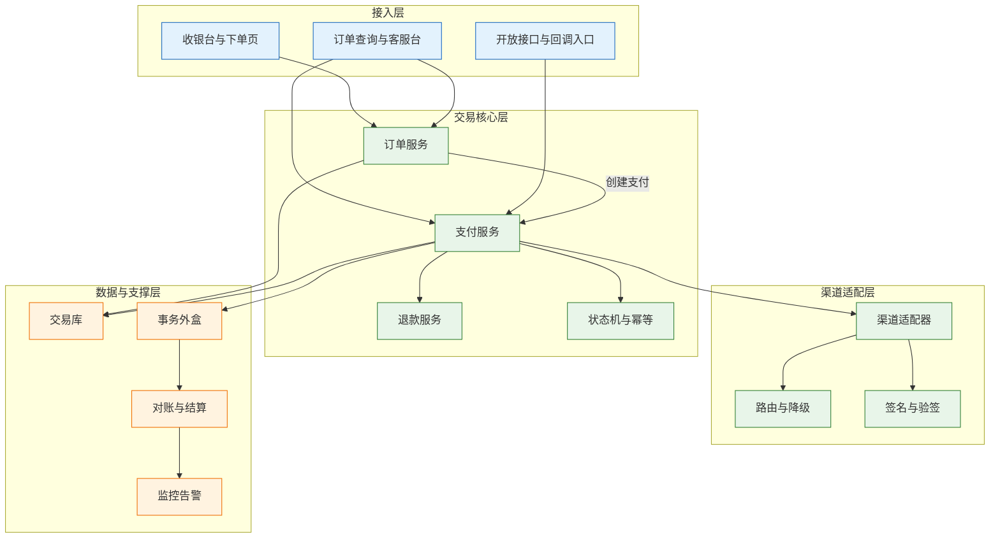
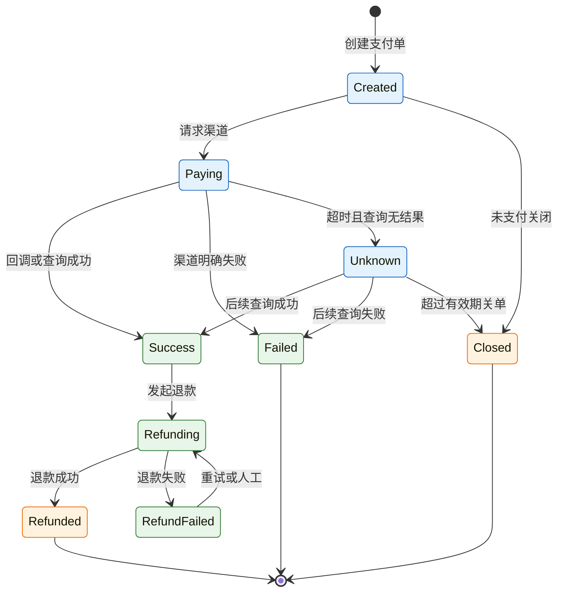
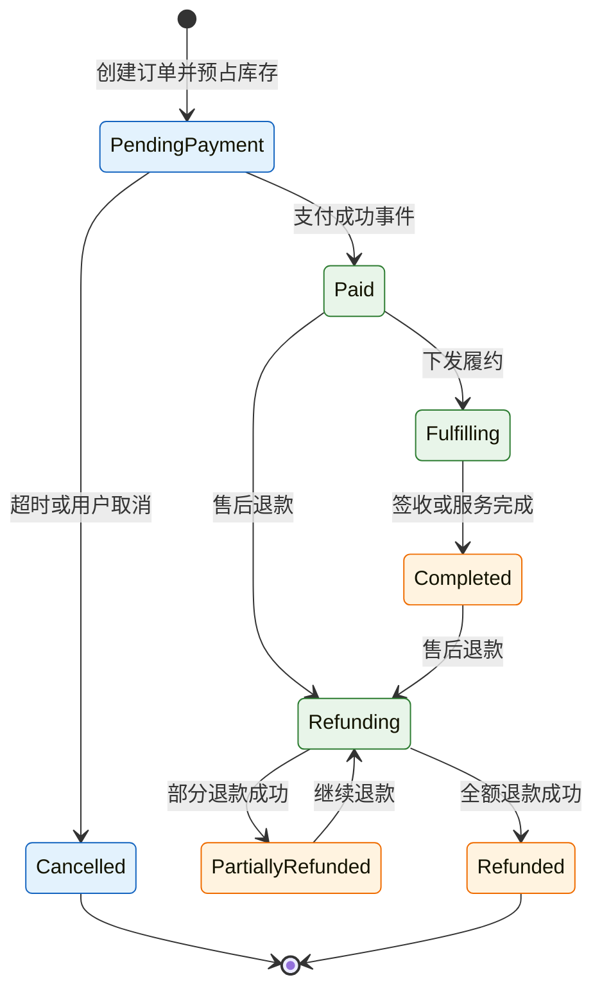

# 订单与支付系统

---

## 一、订单与支付系统是什么

### 1.1 核心概念

订单系统记录“买什么、多少钱、怎么履约”，支付系统记录“钱有没有真的到、到了多少、退了多少”。两者之间不是一次接口调用，而是三本账：订单账、支付账、账务账。三本账各自有状态、单号和责任人，靠业务键关联，不能用一个状态字段贯穿到底。

订单是商业承诺。它包含商品行、价格快照、优惠分摊、收货信息、履约方式。订单一旦提交，价格和优惠就应固化，后续调价不能影响已成交订单。

支付是资金动作。它包含支付意图、渠道交互、渠道流水、退款和结算。支付成功只说明资金到账，不说明订单已完成；订单完成还要经过发货、收货或服务履约。

| 概念 | 定义 | 不负责 |
|---|---|---|
| 订单 | 交易主单，记录应付与履约 | 资金到账确认 |
| 订单行 | 履约与退款的最小单位 | 渠道交互 |
| 支付单 | 一次支付意图，关联订单 | 订单履约 |
| 支付流水 | 渠道侧的一笔资金记录 | 订单优惠计算 |
| 退款单 | 一次退款意图，可部分退款 | 渠道清算 |
| 结算单 | 按账期汇总的应结金额 | 单笔交易状态 |
| 账务凭证 | 会计口径的借贷记录 | 支付渠道签名 |

金额必须分字段存储：应付金额、实付金额、已退金额、待结金额、手续费。用一个 `amount` 字段到处传，最后一定分不清“应付、实付、已退、待结”。

> **注意**：订单状态与支付状态必须分开建模。订单显示“待支付”不代表支付单没有在途请求，客服按订单状态引导用户重复支付，是重复扣款最常见的来源。

### 1.2 与相邻系统的关系

订单与支付位于交易域中心，向上接流量入口，向下接履约与账务。每个相邻系统只负责一段，边界要在接口契约里写清。

| 系统 | 主要职责 | 与订单支付的交互 | 不负责 |
|---|---|---|---|
| 商品与定价 | 商品、价格、促销规则 | 提供算价输入 | 订单成交与资金 |
| 库存与 WMS | 预占、实占、出库 | 接收预占与释放指令 | 支付状态 |
| 履约与 TMS | 发货、配送、签收 | 接收已支付订单 | 退款金额计算 |
| 财务与 ERP | 应收、开票、总账 | 接收收款、退款、手续费 | 渠道回调处理 |
| 风控 | 欺诈、限额、名单 | 支付前校验与拦截 | 订单履约 |
| 支付渠道 | 扣款、退款、清算、对账单 | 签名、查询、回调 | 商户订单状态 |
| 客服系统 | 工单、退款申请 | 查询支付状态、发起退款 | 直接改支付单 |

订单系统不能把“支付成功”当成“订单完成”，支付系统也不能替订单决定是否发货。状态各自维护，再通过事件同步，是跨系统协作的基本约束。

> **注意**：库存预占属于订单侧动作，支付系统不碰库存。支付成功事件到达后，订单侧再把预占转为实占；把库存操作塞进支付回调，会让渠道重试直接放大库存事务。

### 1.3 分层与架构组成

交易系统按职责分为接入、交易核心、渠道适配和数据支撑四层。分层的目的，是让渠道变化不影响订单模型，让账务口径不污染交易状态。



| 层 | 组件 | 职责 | 关键约束 |
|---|---|---|---|
| 接入 | 收银台、客服台、开放接口 | 参数校验、限流、幂等入口 | 不直接写交易表 |
| 交易核心 | 订单、支付、退款、状态机 | 单据生命周期与业务规则 | 状态只能条件更新 |
| 渠道适配 | 适配器、路由、签名 | 协议转换、超时、重试 | 同一支付单只走一个渠道 |
| 数据支撑 | 交易库、外盒、对账、监控 | 持久化、事件、差异发现 | 账务与交易分库或分表 |

渠道适配层要隔离渠道差异。订单和支付核心只认内部统一模型，渠道字段、签名方式、状态码映射都收敛在适配器内。新增渠道时只加适配器，不改订单表结构。

---

## 二、下单与支付主流程

### 2.1 下单校验与库存预占

下单是交易链路中规则最密集的一步。顺序不能乱：先校验，再算价，再预占，最后落单。先落单再预占，会出现大量无法支付的死单。

| 步骤 | 关键动作 | 失败处理 |
|---|---|---|
| 1 | 校验用户、商品、收货信息 | 返回明确错误，不创建订单 |
| 2 | 计算商品价、活动、券、运费、税 | 价格失败则整单失败 |
| 3 | 优惠分摊到订单行 | 分摊余数按规则落到指定行 |
| 4 | 按 SKU 预占库存并设过期时间 | 预占失败则不进入支付 |
| 5 | 创建订单与订单行 | 订单号全局唯一 |
| 6 | 返回支付参数 | 金额用最小货币单位 |

下单接口必须幂等。用户连点、网络重试、网关重发，都可能创建多张订单。幂等键用“用户 + 客户端请求号”，并在订单表建唯一约束；重复请求返回同一张订单，而不是新建。

算价结果要保存快照。商品原价、活动价、券抵扣、运费、税额、每行实付，都要落到订单行。退款时按行实付退，不能按当前商品价重算。

优惠分摊用最大余数法：先按比例计算每行应摊金额，再把舍入余数依次分给金额最大的行，保证分摊总额等于优惠总额。分摊规则要版本化，事后改规则不能影响历史订单。

> **注意**：金额一律用整数最小单位存储和传输，禁止用浮点数。零点几分的差异在单笔看很小，在日终对账时会变成大量无法解释的尾差。

### 2.2 支付发起与结果确认

支付结果不能只依赖回调。回调是通知，不是可靠投递；发版、网络抖动、渠道重试策略变化都可能让回调丢失。



支付结果确认分四道：

- **同步返回**：只代表请求已受理，不代表扣款成功。
- **异步回调**：验签、验金额、验商户号后幂等更新。
- **主动查询**：回调超时或丢失时，按支付单号查询渠道。
- **日终对账**：下载渠道对账单，逐笔勾稽。

超时处理要分级，不能一次查询无结果就判失败。

| 时点 | 动作 | 目的 |
|---|---|---|
| 请求后数秒 | 查询一次 | 处理同步返回丢失 |
| 30 秒 | 再查询 | 覆盖渠道处理延迟 |
| 5 分钟 | 查询并标记待确认 | 避免用户重复支付 |
| 30 分钟 | 查询后决定关单或挂起 | 释放订单与库存 |
| 日终 | 渠道对账 | 发现查询遗漏的差异 |

> **业务红线**：同一支付单在同一时刻只允许一个在途支付请求。前一笔结果未确认前，不得发起第二笔；客服台也不得提供“再付一次”的按钮。

### 2.3 退款处理

退款要回答五个问题：退哪几行、退多少、优惠怎么摊、运费退不退、发票是否红冲。回答不清，退款就会变成人工拍数。

| 退款场景 | 金额计算 | 关键约束 |
|---|---|---|
| 整单退 | 实付金额减已退金额 | 累计不超过实付 |
| 部分行退 | 按行实付加对应分摊优惠 | 优惠按比例扣回 |
| 运费退 | 按合同或规则单独计算 | 不与商品金额混算 |
| 售后退 | 按售后单指定金额 | 需关联原订单行 |
| 重复退款 | 拒绝并返回原退款单 | 退款单号唯一 |

退款单号是幂等键。同一支付单的累计退款金额不能超过实付金额，校验要在数据库事务内完成，不能先查后改。

渠道退款通常是异步的，必须保留“退款中”状态并主动查询。退款失败可以重试，但重试前要先查渠道结果，避免第一次已成功、第二次又发起。

> **注意**：退款只能原路退回。主渠道故障时应排队重试，不应换渠道退款；换渠道会造成渠道账与商户账都无法勾稽。

### 2.4 超时取消与库存释放

待支付订单通常设置 30 分钟有效期，但“到点取消”不能直接改状态。取消前必须确认没有在途支付。

| 并发场景 | 风险 | 处理 |
|---|---|---|
| 取消与支付同时发生 | 钱到了订单已取消 | 条件更新，失败则查支付结果 |
| 取消任务重复执行 | 重复释放库存 | 释放指令带幂等键 |
| 支付成功事件延迟 | 已取消订单又变已支付 | 进入退款或人工处理 |
| 库存预占过期 | 支付成功但库存已释放 | 支付前校验预占有效性 |

取消的标准动作是：先查支付单是否处于支付中或待确认；确认未支付后，用条件更新把订单改为已取消；再释放库存、退回优惠券、关闭支付单。释放动作失败要重试，库存预占本身也要能按过期时间自动回收。

条件更新是并发控制的核心：

```sql
UPDATE orders
SET status = 'cancelled', cancelled_at = now()
WHERE order_no = :order_no
  AND status = 'pending_payment';
```

影响行数为零，说明订单状态已被其他操作改变，此时应重新读取订单与支付单，再决定是否继续取消或转入退款。

---

## 三、核心数据模型

### 3.1 订单与订单行

订单表保存交易主单，订单行保存商品与分摊结果。金额字段全部用整数最小单位，订单号与用户请求号分离。

```sql
CREATE TABLE orders (
    order_no        VARCHAR(32) PRIMARY KEY,
    user_id         BIGINT      NOT NULL,
    client_req_no   VARCHAR(64) NOT NULL,
    status          VARCHAR(24) NOT NULL,
    currency        CHAR(3)     NOT NULL,
    payable_amount  BIGINT      NOT NULL,
    paid_amount     BIGINT      NOT NULL DEFAULT 0,
    refunded_amount BIGINT      NOT NULL DEFAULT 0,
    created_at      TIMESTAMPTZ NOT NULL DEFAULT now(),
    expired_at      TIMESTAMPTZ,
    CONSTRAINT uk_order_req UNIQUE (user_id, client_req_no)
);

CREATE TABLE order_items (
    item_id         BIGSERIAL PRIMARY KEY,
    order_no        VARCHAR(32) NOT NULL,
    sku_id          BIGINT      NOT NULL,
    quantity        INT         NOT NULL,
    unit_price      BIGINT      NOT NULL,
    discount_amount BIGINT      NOT NULL DEFAULT 0,
    paid_amount     BIGINT      NOT NULL,
    refunded_amount BIGINT      NOT NULL DEFAULT 0
);

CREATE TABLE inventory_reservation (
    reservation_no VARCHAR(32) PRIMARY KEY,
    order_no       VARCHAR(32) NOT NULL,
    sku_id         BIGINT      NOT NULL,
    quantity       INT         NOT NULL,
    status         VARCHAR(16) NOT NULL,
    expired_at     TIMESTAMPTZ NOT NULL
);
```

| 表 | 关键字段 | 设计要点 |
|---|---|---|
| orders | order_no、status、金额 | 请求号唯一，金额分字段 |
| order_items | sku、数量、实付、已退 | 退款最小单位 |
| inventory_reservation | 预占号、过期时间、状态 | 可自动回收 |

订单行金额之和必须等于订单应付，已退之和必须等于订单已退，两个等式要每日校验。

### 3.2 支付单与支付流水

支付单表达一次支付意图，支付流水表达渠道侧的一次交互结果。两者是一对多：一次支付意图可能因重试或多次交互产生多条流水，退款流水单独存放。

```sql
CREATE TABLE payment_order (
    payment_no      VARCHAR(32) PRIMARY KEY,
    order_no        VARCHAR(32) NOT NULL,
    channel_code    VARCHAR(32) NOT NULL,
    amount          BIGINT      NOT NULL,
    currency        CHAR(3)     NOT NULL,
    status          VARCHAR(24) NOT NULL,
    channel_trade_no VARCHAR(64),
    idempotency_key VARCHAR(64) NOT NULL,
    created_at      TIMESTAMPTZ NOT NULL DEFAULT now(),
    paid_at         TIMESTAMPTZ,
    CONSTRAINT uk_payment_key UNIQUE (idempotency_key)
);

CREATE TABLE payment_transaction (
    transaction_no  VARCHAR(32) PRIMARY KEY,
    payment_no      VARCHAR(32) NOT NULL,
    channel_code    VARCHAR(32) NOT NULL,
    channel_flow_no VARCHAR(64) NOT NULL,
    amount          BIGINT      NOT NULL,
    fee_amount      BIGINT      NOT NULL DEFAULT 0,
    status          VARCHAR(24) NOT NULL,
    occurred_at     TIMESTAMPTZ NOT NULL,
    CONSTRAINT uk_channel_flow UNIQUE (channel_code, channel_flow_no)
);

CREATE TABLE refund_order (
    refund_no       VARCHAR(32) PRIMARY KEY,
    payment_no      VARCHAR(32) NOT NULL,
    order_no        VARCHAR(32) NOT NULL,
    amount          BIGINT      NOT NULL,
    reason          VARCHAR(256),
    status          VARCHAR(24) NOT NULL,
    created_at      TIMESTAMPTZ NOT NULL DEFAULT now(),
    finished_at     TIMESTAMPTZ
);

CREATE TABLE refund_transaction (
    refund_transaction_no VARCHAR(32) PRIMARY KEY,
    refund_no       VARCHAR(32) NOT NULL,
    channel_code    VARCHAR(32) NOT NULL,
    channel_flow_no VARCHAR(64) NOT NULL,
    amount          BIGINT      NOT NULL,
    status          VARCHAR(24) NOT NULL,
    occurred_at     TIMESTAMPTZ NOT NULL,
    CONSTRAINT uk_refund_flow UNIQUE (channel_code, channel_flow_no)
);
```

| 表 | 唯一键 | 作用 |
|---|---|---|
| payment_order | payment_no、idempotency_key | 一次支付意图 |
| payment_transaction | transaction_no、渠道流水号 | 渠道资金记录 |
| refund_order | refund_no | 一次退款意图 |
| refund_transaction | 退款流水号 | 渠道退款记录 |

渠道流水号必须建唯一约束。同一渠道流水重复回调时，第二次插入会失败，业务层据此判断为重复通知，直接返回成功即可。

### 3.3 结算与对账表

结算单按渠道和账期汇总，对账任务按日生成差异。结算金额不是支付金额的简单相加，要扣除手续费、退款和冻结。

| 表 | 关键字段 | 用途 |
|---|---|---|
| settlement_bill | 渠道、账期、交易额、手续费、应结额 | 与渠道结算 |
| recon_task | 任务号、对象、账期、状态 | 对账调度 |
| recon_detail | 内部单号、渠道单号、金额、结果 | 逐笔勾稽 |
| recon_diff | 差异号、类型、单据号、责任人 | 差异闭环 |

对账结果要能下钻到单笔。只给一个差异总额，财务无法定位，技术也无法修复。

### 3.4 状态机

订单状态与支付状态分别维护，通过事件关联。订单状态不因支付回调直接跳到完成，支付状态也不因订单取消而回滚。



| 状态 | 含义 | 允许迁移 |
|---|---|---|
| 待支付 | 订单已创建，未确认收款 | 已支付、已取消 |
| 已支付 | 资金确认到账 | 履约中、退款中 |
| 履约中 | 已下发发货或服务 | 已完成、退款中 |
| 已完成 | 履约结束 | 退款中 |
| 退款中 | 存在处理中的退款 | 部分退款、全额退款 |
| 已取消 | 未支付关闭 | 终态 |

状态迁移必须校验前置状态。例如只有“已支付”才能进入“履约中”，只有“已支付”或“已完成”才能进入“退款中”。跳过前置状态直接改库，会让后续对账无法解释。

---

## 四、幂等键与一致性设计

### 4.1 幂等键选取

幂等键要来自业务动作，不是消息或请求的传输标识。重试时传输标识可能变化，业务键不变。

| 操作 | 幂等键 | 唯一约束 | 重复后果 |
|---|---|---|---|
| 创建订单 | 用户 + 客户端请求号 | orders | 多张订单 |
| 创建支付 | 订单号 + 支付尝试号 | payment_order | 重复扣款 |
| 支付回调 | 渠道 + 渠道流水号 | payment_transaction | 重复入账 |
| 发起退款 | 退款单号 | refund_order | 重复退款 |
| 退款回调 | 渠道 + 退款流水号 | refund_transaction | 重复冲减 |
| 通知订单 | 支付单号 + 事件类型 | 消费记录表 | 重复履约 |

> **业务红线**：支付、退款、扣减库存三类操作，幂等键必须落库并建唯一约束。只靠应用层“先查再写”，在并发下一定穿透。

### 4.2 状态机与条件更新

幂等解决“同一请求重复到达”，状态机解决“请求顺序不对”。两者要一起用。

```sql
-- 支付成功：只允许从支付中或待确认迁移
UPDATE payment_order
SET status = 'success', paid_at = now(), channel_trade_no = :channel_trade_no
WHERE payment_no = :payment_no
  AND status IN ('paying', 'unknown');

-- 退款成功：只允许从退款中迁移
UPDATE refund_order
SET status = 'success', finished_at = now()
WHERE refund_no = :refund_no
  AND status = 'refunding';
```

影响行数为一是迁移成功；为零说明状态已变化，应读取后再判断，不能先查后无条件更新。

| 当前状态 | 收到事件 | 处理 |
|---|---|---|
| 支付中 | 支付成功 | 迁移成功，写流水 |
| 已成功 | 支付成功 | 幂等返回，不重复入账 |
| 已关闭 | 支付成功 | 挂起，转退款或人工 |
| 退款中 | 退款成功 | 迁移成功，冲减 |
| 已退款 | 退款成功 | 幂等返回 |
| 待支付 | 退款成功 | 异常，告警并人工核对 |

### 4.3 事务外盒与事件投递

支付系统更新支付单后，要通知订单、履约、账务。跨系统不能依赖分布式事务，推荐本地事务加事务外盒。

| 阶段 | 动作 | 失败处理 |
|---|---|---|
| 本地事务 | 更新支付单、写事件表 | 整体回滚 |
| 投递 | 轮询事件表发送消息 | 退避重试 |
| 消费 | 订单按支付单号幂等处理 | 失败重试或进死信 |
| 对账 | 比对支付与订单状态 | 差异补偿 |

> **注意**：渠道已经扣款后，不能因为通知订单失败就回滚支付单。外部资金动作不可回滚，本地只能落账、重试、对账。

### 4.4 金额与优惠分摊

金额设计要满足三个不变量：订单行金额之和等于订单金额；已退金额不超过实付金额；支付流水金额之和等于支付单金额。

| 字段 | 含义 | 来源 |
|---|---|---|
| 应付金额 | 优惠后的应收 | 算价结果 |
| 实付金额 | 渠道确认到账 | 支付流水汇总 |
| 已退金额 | 已成功退款累计 | 退款流水汇总 |
| 待结金额 | 尚未结算的净额 | 实付减退款减手续费 |
| 手续费 | 渠道收取的服务费 | 对账单或结算单 |

优惠分摊、退款分摊、手续费计算都要使用整数运算。除法产生的余数按固定规则分配，不能在不同系统各算一遍。

---

## 五、渠道接口与对账

### 5.1 渠道接口对照

支付渠道的接口名称和字段以渠道文档为准，系统内部要统一抽象。适配器至少覆盖下单、查询、关单、退款、退款查询和回调。

| 接口 | 方向 | 幂等依据 | 失败处理 |
|---|---|---|---|
| 创建支付 | 商户到渠道 | 商户支付单号 | 超时先查询再重试 |
| 查询支付 | 商户到渠道 | 支付单号 | 退避重试 |
| 关闭支付 | 商户到渠道 | 支付单号 | 已支付则转退款 |
| 发起退款 | 商户到渠道 | 商户退款单号 | 先查后重试 |
| 查询退款 | 商户到渠道 | 退款单号 | 退避重试 |
| 结果回调 | 渠道到商户 | 渠道流水号 | 验签后幂等处理 |
| 对账单下载 | 商户到渠道 | 账期 | 失败重下并核对 |

适配器要统一超时、重试和错误码。渠道返回“处理中”不能当失败，渠道返回“系统繁忙”也不能当成功；状态不明确时，一律进入待确认并查询。

### 5.2 回调处理与验签

回调是外部输入，必须按不可信请求处理。顺序是：先验签，再验业务要素，最后才改状态。

| 校验项 | 不通过处理 |
|---|---|
| 签名 | 拒绝，记录来源与摘要 |
| 商户号 | 拒绝，告警 |
| 金额与币种 | 挂起，人工核对 |
| 支付单号 | 拒绝，记录陌生来款 |
| 渠道流水号 | 重复则幂等返回 |
| 时间戳与随机数 | 过期或重放则拒绝 |

回调处理要先落库再返回成功。事务提交失败时返回失败，让渠道重试；但不能把“返回成功”当成处理完成的标志，最终仍要靠主动查询和对账兜底。

> **业务红线**：任何未验签、金额不符或商户号不符的回调，都不得修改支付单状态。回调内容只能作为线索，不能作为记账依据。

### 5.3 三账对账

三账对账是支付系统的最后一道防线。订单与支付、支付与渠道、退款与渠道，三组数据每天都要勾稽。

| 对账项 | 比对键 | 常见差异 | 处理时限 |
|---|---|---|---|
| 订单 vs 支付 | 订单号、金额 | 掉单、重复支付 | 当日 |
| 支付 vs 渠道 | 渠道流水号、金额 | 长款、短款、手续费 | 次日 |
| 退款 vs 渠道 | 退款单号、金额 | 退款失败、重复退款 | 当日 |
| 结算 vs 银行 | 账期、应结额 | 手续费、冻结、跨期 | 账期内 |

差异分类固定为：时间性差异、单据缺失、金额错误、重复记账、测试单。每类差异有责任人和处理时限，不能只报差异率。

> **业务红线**：对账差异不得直接修改交易金额或删除流水。只能新增调整单、冲正单或退款单，保留原始记录和审批链。

### 5.4 渠道路由与降级

多渠道支付要有路由，但路由不是越多越好。每接一个渠道，就多一套签名、对账、退款和客服流程。

| 场景 | 路由策略 | 约束 |
|---|---|---|
| 常规支付 | 按成功率与费率选择 | 同一支付单只走一个渠道 |
| 主渠道故障 | 切备用渠道 | 切换前确认原单未成功 |
| 渠道超时 | 先查询再决定 | 不直接换渠道重发 |
| 渠道维护 | 提前关闭入口 | 页面提示可用渠道 |
| 退款 | 原路退回 | 主渠道故障时排队重试 |

路由要有开关和灰度。新渠道先小流量验证成功率、回调及时性与对账差异，再逐步放量。

---

## 六、完整案例：回调丢失导致的重复支付

### 6.1 事故经过

用户在收银台完成支付，银行卡已扣款，订单仍显示待支付。客服按流程引导用户再次支付，第二笔成功后订单才更新，第一笔成为陌生来款，退款又走了两周。

| 时点 | 事件 | 系统状态 |
|---|---|---|
| T0 | 创建订单与支付单 | 订单待支付，支付中 |
| T1 | 渠道扣款成功 | 渠道已扣款 |
| T2 | 发版期间回调丢失 | 支付单仍为支付中 |
| T3 | 订单超时任务未查到结果 | 订单仍待支付 |
| T4 | 客服引导再次支付 | 新支付单创建 |
| T5 | 第二笔支付成功 | 订单变已支付 |
| T6 | 第一笔回调重放 | 识别为陌生来款 |
| T7 | 发起退款 | 退款超时后重试 |
| T8 | 退款重试成功 | 形成两笔退款申请 |

根因是三条：回调被当成可靠投递，没有主动查询；订单与支付状态混用；退款接口没有幂等，超时重试形成两笔申请。

### 6.2 排查过程


排查顺序是：先按订单号找到全部支付单和渠道流水，确认实际扣款笔数；再查回调日志与验签结果，确认是丢失还是拒绝；再查主动查询任务是否执行、查询结果是否落库；最后查退款单与渠道退款流水，确认重复退款。

### 6.3 修复方案

| 问题 | 修复措施 | 验证方式 |
|---|---|---|
| 回调丢失 | 增加分级主动查询与日终对账 | 模拟回调丢失，状态能补齐 |
| 状态混淆 | 客服台同时展示订单与支付状态 | 待确认时禁止再次支付 |
| 重复支付 | 同一订单只允许一个在途支付单 | 并发发起测试 |
| 重复退款 | 退款单号唯一，重试前先查询 | 超时重试测试 |
| 陌生来款 | 按渠道流水匹配，无法匹配则挂账 | 构造无主流水 |

客服台要显示“支付中”与“待确认”，并提供“查询渠道”按钮，而不是只显示订单状态。支付中或待确认时，禁止创建第二笔支付。

### 6.4 验证与指标

修复后验证三类场景：回调丢失能否补齐、并发支付是否只成功一笔、退款重试是否只退一次。

| 指标 | 目标 | 用途 |
|---|---|---|
| 支付状态一致率 | 接近 100% | 订单与支付比对 |
| 回调处理成功率 | 持续监控 | 发现验签或解析问题 |
| 主动查询补齐率 | 可统计 | 衡量兜底有效性 |
| 重复支付率 | 零 | 资金安全 |
| 对账差异关闭时长 | 按账期 | 衡量闭环效率 |

---

## 七、边界与取舍

### 7.1 自建与采购边界

订单、支付编排、退款、对账属于交易核心能力，通常自建；渠道连接、风控数据、短信通知可以采购或使用成熟服务。判断依据是“是否形成业务差异”和“是否承担资金责任”。

| 能力 | 建议 | 判断依据 |
|---|---|---|
| 订单与履约编排 | 自建 | 直接决定业务规则 |
| 支付编排与状态机 | 自建 | 资金安全与可追溯 |
| 渠道适配 | 自建或采购 | 渠道数量与维护人力 |
| 风控决策 | 采购加自建规则 | 数据积累与行业模型 |
| 对账平台 | 自建或采购 | 单据量与财务协同方式 |
| 账务系统 | 自建或成熟产品 | 会计准则与审计要求 |

采购不转移责任。渠道出问题、对账有差异、退款失败，最终仍由商户承担客户解释和资金处理。

### 7.2 一致性与可用性取舍

支付状态属于强一致要求最高的部分。渠道结果不明确时，宁可让订单停留在待确认，也不能猜测成功或失败。

| 场景 | 取舍 | 理由 |
|---|---|---|
| 渠道超时 | 标记待确认，后续查询 | 避免误判导致重复扣款 |
| 数据库主库故障 | 停止写支付单 | 不能产生两套状态 |
| 回调处理失败 | 返回失败并重试 | 保留渠道重试机会 |
| 对账任务失败 | 重跑，不跳过账期 | 避免差异累积 |
| 通知订单失败 | 重试加对账补偿 | 支付已成功，不能回滚 |

可用性可以通过读降级、排队和页面提示改善，但不能用“先放行、后补账”的方式处理资金。

### 7.3 合规与资金安全边界

支付涉及商户资质、资金清算、发票与交易留存，技术方案要服从监管规定和渠道协议。

| 边界项 | 要求 | 责任方 |
|---|---|---|
| 商户资质 | 主体、经营范围、结算账户一致 | 商户与渠道 |
| 资金清算 | 由持牌机构处理，不自行沉淀 | 渠道与合规 |
| 交易留存 | 订单、支付、退款记录可追溯 | 商户 |
| 敏感信息 | 卡号、证件号最小化存储 | 商户 |
| 发票 | 与订单、退款对应 | 财务 |

> **安全警告**：支付密钥、渠道证书和回调验签密钥不得写入代码库或前端。密钥轮换要有双人审批和回滚方案。

---

## 八、常见失败模式与排查

### 8.1 失败模式

| 现象 | 最可能原因 | 处理 |
|---|---|---|
| 支付成功订单仍待支付 | 回调丢失、无主动查询 | 按支付单号查渠道，补状态 |
| 用户付了两次 | 支付中未禁止再次发起 | 同一订单只允许一个在途支付 |
| 金额差一分 | 浮点计算、分摊舍入 | 改整数分，统一分摊规则 |
| 重复退款 | 退款无幂等、重试前未查询 | 退款单号唯一，先查后重试 |
| 超卖 | 预占失败仍可支付 | 支付前校验预占有效性 |
| 回调被伪造 | 未验签或验签不严 | 验签、验商户号、验金额 |
| 订单取消后钱到了 | 取消与支付并发 | 条件更新，到账转退款 |
| 对账长期有长款 | 手续费、退款、测试单混入 | 分类勾稽，测试单隔离 |

### 8.2 处置顺序

1. 用订单号拉出全部支付单、支付流水和退款单，确认资金实际笔数。
2. 查支付单状态与渠道流水状态，判断是未支付、支付中还是已成功。
3. 查回调日志与验签结果，确认回调是否到达、是否被拒绝。
4. 查主动查询任务与查询结果，确认兜底是否执行。
5. 查订单状态与库存预占，确认是否存在取消、释放或重复履约。
6. 查对账差异分类，确认是时间性差异还是真实错账。
7. 需要退款时，先查渠道退款结果，再决定重试或人工处理。
8. 修复后补幂等约束、查询任务和对账规则，避免同类问题复发。

### 8.3 监控指标

| 指标 | 观察对象 | 异常信号 |
|---|---|---|
| 支付成功率 | 渠道与支付方式 | 单渠道骤降 |
| 回调延迟 | 渠道到商户 | 分位数持续上升 |
| 待确认支付单数 | 支付单状态 | 长时间不下降 |
| 重复支付告警 | 同订单多笔成功 | 出现即需人工 |
| 对账差异率 | 三账比对 | 连续多日超阈值 |

> **核心结论**：订单、支付、账务是三本账，分开建模、用单号关联；回调不可靠，主动查询与对账才是兜底；金额用整数最小单位，幂等键用业务单号；支付成功不等于订单完成，履约、开票、结算各自有状态。
