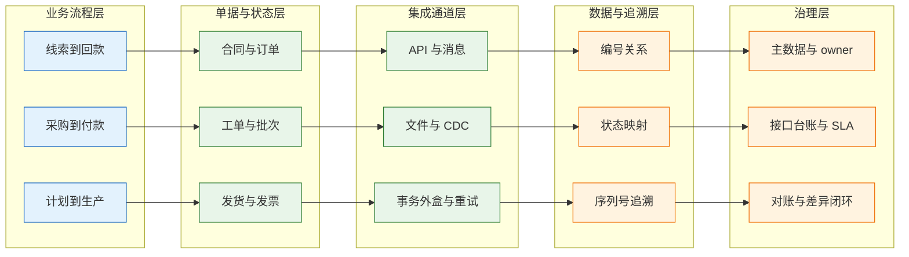
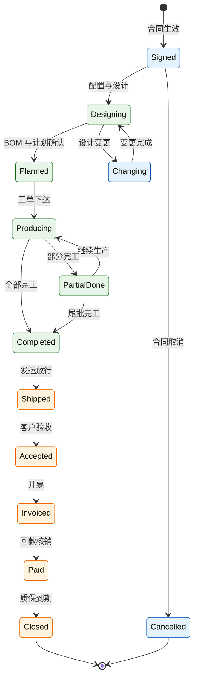
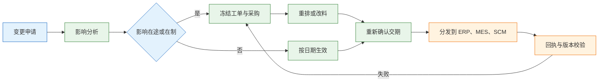
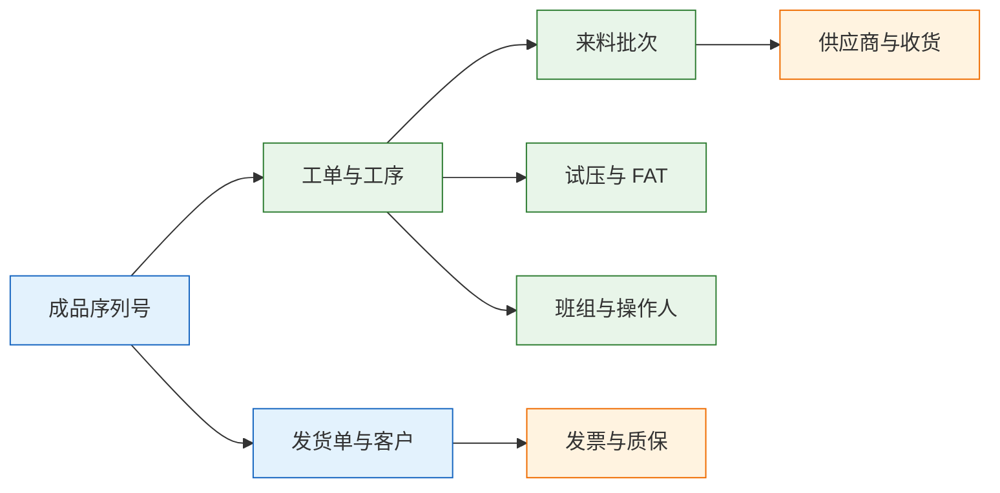

# 端到端集成案例

---

## 一、端到端集成是什么

### 1.1 核心概念

端到端集成（End-to-End Integration）是让一笔业务从客户签约走到回款，在所有相关系统里保持同一套单据、状态和追溯关系。它不是把系统两两连起来，而是围绕一条业务主链，明确每个环节的权威系统、输入输出、状态迁移和失败补偿。

判断是否真正端到端，看四个能力：

- **唯一编号**：合同、订单、项目、配置、工单、批次、发货、发票、服务单之间能互相追溯。
- **唯一状态**：同一笔业务在任何系统查询，得到的进度不矛盾。
- **失败可补**：任一环节中断，能定位到最后成功事件并重放。
- **结果可对**：数量、金额、交期能按单据勾稽，差异有分类和责任人。

端到端集成与接口联调的区别在于目标。接口联调只验证“消息能通”，端到端集成验证“业务结果正确”。接口全部返回成功，仍可能出现工单用旧 BOM、货已发但款未到、发票金额与合同不一致。

| 概念 | 含义 | 判断证据 |
|---|---|---|
| 业务主链 | 从签约到回款的连续流程 | 每条链有起点、终点、owner |
| 权威系统 | 某个对象唯一写入方 | 读写矩阵与接口方向 |
| 编号关系 | 跨系统单据的对应关系 | 任一编号可查全链 |
| 端到端状态 | 业务当前阶段的统一口径 | 各系统状态映射表 |
| 变更传播 | 设计、订单、交期变更的影响范围 | 影响清单与冻结规则 |
| 对账闭环 | 数量与金额的定期勾稽 | 差异分类与关闭记录 |

端到端集成的产物不是接口清单，而是编号关系表、状态映射表、主链清单和对账规则。接口只是实现这些产物的手段。

### 1.2 与相邻系统的关系

端到端集成横跨交易、研发、计划、采购、制造、仓储、运输和财务。ERP 通常是订单与财务的主干，PLM 管产品定义，MES 管执行，WMS 管实物，SCM 管供应商协同，CRM 管客户与合同，TMS 管运输，BI 管分析。

| 系统 | 在端到端中的位置 | 权威数据 | 常见越界 |
|---|---|---|---|
| CRM | 商机、合同、客户 | 客户与合同条款 | 直接改订单金额 |
| OA | 折扣、信用、用印审批 | 审批结论 | 替业务系统保存单据 |
| PLM | 选配、设计 BOM、变更 | 设计定义与版本 | 直接改工单 |
| ERP | 销售订单、MRP、采购、发票 | 订单与财务 | 直接管工序与库位 |
| SCM | 采购订单、交期、ASN | 供应商协同 | 改库存账面 |
| MES | 工单、工序、报工、FAT | 制造执行与追溯 | 改主计划 |
| WMS | 收货、库位、领料、发运 | 实物库存 | 确认收入 |
| TMS | 承运、路由、签收 | 运输轨迹 | 库存所有权 |
| BI | 指标、报表 | 分析口径 | 回写业务单据 |

集成平台负责传输、转换、重试和监控，不替任何系统做业务裁决。主数据平台负责客户、物料、供应商、组织的唯一标识，不替 ERP 决定订单能否成立。两者是端到端的地基，不是业务主链本身。

> **注意**：一个对象只能有一个权威写入方。出现两个系统都能改 BOM、都能调库存、都能改订单金额时，端到端一定退化成人工对账。

### 1.3 分层与架构组成

端到端架构可以按“业务流程—单据—集成—数据—治理”五层理解。越往上越接近业务结果，越往下越接近传输与存储。



| 层 | 主要内容 | 关键产出 |
|---|---|---|
| 业务流程 | 主链、节点、承诺 | 主链清单与 owner |
| 单据与状态 | 单据号、状态机、版本 | 状态映射表 |
| 集成通道 | 协议、消息、重试、回执 | 接口台账 |
| 数据与追溯 | 编号关系、序列号、批次 | 追溯链 |
| 治理 | 主数据、SLA、对账 | 差异闭环记录 |

分层之后，任何一次故障都能落到具体层：是流程规则缺失，还是单据状态不对，还是消息没送到，还是主数据错了。定位层次比追问“接口为什么不通”更有效。

---

## 二、端到端主流程

### 2.1 订单结构与业务对象

以按订单配置（CTO，Configure to Order）的泵组厂为例。客户订购 12 套恒压供水泵组，每套配置不同：3 套带变频柜，2 套要求不锈钢管路，其余为标准配置。合同金额 860 万元，付款条件为 30% 预付、60% 发货前、10% 质保金，交期 70 天，延迟按日计罚。

这笔订单同时牵动九个系统：

| 环节 | 系统 | 本订单中的动作 |
|---|---|---|
| 商机与合同 | CRM | 客户、联系人、报价、合同、特殊折扣 |
| 特殊审批 | OA | 折扣、信用例外、合同用印 |
| 配置与设计 | PLM | 选配、EBOM、图纸、设计变更 |
| 订单与计划 | ERP | 销售订单、MRP、采购申请、开票 |
| 采购与物流 | SCM | 采购订单、供应商确认、ASN |
| 生产 | MES | 工单、工序、报工、FAT |
| 仓储 | WMS | 收货、领料、完工入库、发运 |
| 运输与安装 | TMS 与服务 | 运输、现场安装、验收 |
| 分析 | BI | 订单进度、OTIF、毛利、回款 |

一笔订单在九个系统里有九个编号：合同号、订单号、项目号、配置号、工单号、批次号、发货单号、发票号、服务单号。端到端集成的第一件事，是建编号关系表，让任一编号都能追到其余八个。

> **注意**：合同号与订单号不能混用。合同可能对应多张订单，订单也可能分批履约；把合同号当订单主键，拆单和变更时必然出现重号或错挂。

### 2.2 合同到订单

合同签署后，CRM 把客户、合同条款、配置需求和折扣申请传给 OA 审批，审批通过再由 ERP 创建销售订单与项目号。这个阶段的关键是“承诺可执行”：价格、交期、信用、配置都要在订单成立前确认。

| 动作 | 权威系统 | 输出 | 失败处理 |
|---|---|---|---|
| 合同签署 | CRM | 合同号、条款、付款条件 | 退回补充条款 |
| 折扣与信用审批 | OA | 审批结论 | 超时升级，不默认通过 |
| 客户与物料校验 | 主数据 | 全局 ID 与编码 | 缺码则先建主数据 |
| 销售订单创建 | ERP | 订单号、项目号、交期 | 幂等重发，人工核对 |
| 订单确认回传 | CRM | 订单状态与交期 | 订阅事件更新 |

客户编码、物料编码、付款条件必须来自主数据。销售在 CRM 里手工填写客户名称、在 ERP 里再建一次客户，是后续对账差异的常见起点。

### 2.3 设计到采购

CTO 订单的核心是配置。PLM 按选配规则生成配置号和 EBOM，ERP 把 EBOM 转为 MBOM 并运行 MRP，产生采购申请；SCM 再把采购申请转为采购订单，向供应商确认交期。

长周期件决定交期。电机、变频柜、柜体通常需要提前下单，设计未冻结就采购，会出现“料到了、配置又变了”的返工。可行的做法是先冻结影响长周期件的关键配置，再允许非关键配置在变更窗口内调整。

| 阶段 | 输入 | 输出 | 冻结对象 |
|---|---|---|---|
| 选配 | 合同配置需求 | 配置号、选配清单 | 关键选配项 |
| 设计 | 配置号 | EBOM、图纸 | EBOM 版本 |
| 转制造 | EBOM | MBOM、工艺路线 | MBOM 版本 |
| 计划 | MBOM、交期 | 采购申请、生产订单 | 长周期件需求 |
| 采购 | 采购申请 | 采购订单、交期确认 | 供应商交期版本 |

设计变更必须做影响分析：在途采购、在制工单、已入库库存各受影响多少；变更按日期、批次还是旧料用完生效；哪些工单需要冻结重排。只发一张变更通知，不标注影响范围，下游只能凭经验处理。

### 2.4 生产到发运

物料齐套后，MES 按工单组织装配、接线、试压和 FAT。完工后由 WMS 办理完工入库，ERP 根据收款条件决定是否放行发运，TMS 承接运输。

| 时点 | 事件 | 系统 | 业务结果 |
|---|---|---|---|
| D35 | 柜体到货、收货质检 | SCM、WMS | 可用库存增加 |
| D40 | 电机到货、齐套 | WMS、MES | 工单可开工 |
| D42 | 装配、接线、试压 | MES | 报工、参数、FAT 记录 |
| D55 | 完工入库、发货前收款 | WMS、ERP | 未达收款条件不放行 |
| D58 | 发运、在途跟踪 | WMS、TMS | 客户签收 |

发运放行不能靠仓库看群消息。放行条件应写成规则：信用通过、收款比例达标、质量放行、配置版本有效。任一条件不满足，WMS 发运任务保持冻结；例外放行必须走 OA 审批并记录责任人与到期日。

### 2.5 验收与回款

设备到达现场后由服务团队安装调试，客户签署验收单。ERP 依据验收与合同开票，确认应收与收入；质保金到期后收尾款，项目关闭。

| 阶段 | 触发单据 | 系统 | 财务结果 |
|---|---|---|---|
| 安装调试 | 服务单 | 服务系统 | 成本归集 |
| 客户验收 | 验收单 | 服务系统、CRM | 满足收入确认条件 |
| 开票 | 发票 | ERP | 应收增加 |
| 收款 | 收款单 | ERP、银行 | 应收冲减 |
| 质保到期 | 尾款通知 | ERP | 项目关闭 |

验收单是收入确认的重要依据，不能由发货单替代。发货只代表实物转移，安装未完成、验收未通过时确认收入，会在项目失败时形成冲回。

---

## 三、核心数据模型

### 3.1 编号关系表

编号关系表是端到端的主索引。它不复制业务单据，只保存订单与各系统单据的对应关系。一张订单可能对应多个工单、多个批次、多张发货单和多张发票，因此采用“订单号 + 单据类型 + 单据号”的明细结构，而不是在订单行上堆字段。

```sql
CREATE TABLE e2e_order_link (
    link_id        BIGSERIAL PRIMARY KEY,
    sales_order_no VARCHAR(32) NOT NULL,
    link_type      VARCHAR(24) NOT NULL,
    link_no        VARCHAR(64) NOT NULL,
    customer_id    VARCHAR(32) NOT NULL,
    current_stage  VARCHAR(24) NOT NULL,
    updated_at     TIMESTAMPTZ NOT NULL DEFAULT now(),
    CONSTRAINT uk_order_link UNIQUE (sales_order_no, link_type, link_no)
);

CREATE INDEX idx_link_no ON e2e_order_link (link_no);
CREATE INDEX idx_link_stage ON e2e_order_link (current_stage);
```

| 字段 | 作用 | 维护方 |
|---|---|---|
| sales_order_no | 订单主键 | ERP |
| link_type | 合同、配置、工单、批次、发货、发票、服务 | 各权威系统 |
| link_no | 对应系统的单据号 | 各权威系统 |
| current_stage | 端到端阶段 | 集成平台 |

任一 link_no 都要能反查订单，任一订单也要能列出全部关联单据。唯一约束保证同一订单下同一类型同一单号只登记一次，重放不会产生重复关系。

### 3.2 单据与状态表

端到端状态不是简单取某个系统的状态，而是各系统状态的映射结果。映射表要写清每个系统状态对应哪个阶段。

| 端到端阶段 | 关键单据状态 | 推进系统 |
|---|---|---|
| 已签约 | 合同生效、订单已创建 | CRM、ERP |
| 设计中 | 配置确认、订单已确认 | PLM、ERP |
| 已投产 | 生产订单与工单下达、已领料 | ERP、MES、WMS |
| 已完工 | 工单完工、成品入库 | MES、WMS |
| 已发运 | 已出库、运输在途 | WMS、TMS |
| 已验收 | 验收单签署、待开票 | 服务、ERP |
| 已回款 | 应收已核销、项目关闭 | ERP |

映射表要处理“部分完成”：12 套中 8 套完工、4 套在制，端到端阶段应显示“部分完工”，不能简单取最早或最晚的状态。

### 3.3 追溯链模型

序列号追溯把成品与工单、批次、来料、测试、发货、发票连起来。客户报修时，扫铭牌序列号应能回答：哪张工单生产、用了哪批密封圈、谁操作、试压结果如何、发往哪个客户、对应哪张发票。

```sql
CREATE TABLE e2e_serial_bind (
    serial_no       VARCHAR(64) PRIMARY KEY,
    work_order_no   VARCHAR(32) NOT NULL,
    batch_no        VARCHAR(32),
    material_lot    VARCHAR(64),
    supplier_id     VARCHAR(32),
    test_record_no  VARCHAR(32),
    shipment_no     VARCHAR(32),
    invoice_no      VARCHAR(32),
    customer_id     VARCHAR(32),
    bound_at        TIMESTAMPTZ NOT NULL DEFAULT now()
);
```

| 追溯对象 | 绑定时机 | 缺失后果 |
|---|---|---|
| 工单 | 开工或完工 | 无法定位生产批次 |
| 来料批次 | 领料 | 无法缩小召回范围 |
| 测试记录 | FAT 完成 | 无法证明出厂状态 |
| 发货单 | 出库 | 无法定位客户 |
| 发票 | 开票 | 无法关联质保与收款 |

追溯链要能在 30 分钟内走完。走不完，说明批次、工序、来料、发货中至少有一环没有绑定。

### 3.4 端到端状态机

端到端状态机描述业务阶段，不替代各系统内部状态机。它只回答“这笔订单现在处于哪个阶段、下一个阶段由谁推进”。



| 状态 | 进入条件 | 推进方 |
|---|---|---|
| 已签约 | 合同生效、预付款到账 | CRM |
| 设计中 | 配置号生成 | PLM |
| 已计划 | MBOM 与交期确认 | ERP |
| 生产中 | 工单下达并领料 | MES |
| 部分完工 | 部分序列号完工 | MES |
| 已完工 | 全部工单关闭 | MES、WMS |
| 已发运 | 放行条件满足并出库 | WMS |
| 已验收 | 客户签署验收单 | 服务 |
| 已开票 | 发票开具 | ERP |
| 已回款 | 应收核销 | ERP |

状态推进要校验前置条件。例如“已发运”必须有发货单和放行记录，“已验收”必须有验收单，“已回款”必须有收款核销记录。缺少证据就推进，端到端报表会好看，业务实际没有完成。

---

## 四、五条集成主链与接口

### 4.1 主链清单

九个系统之间有几十条潜在接口，真正决定业务连续性的只有五条主链。先打通主链，再补周边。

| 主链 | 内容 | 关键设计 | 失败处理 |
|---|---|---|---|
| CRM 到 ERP | 客户、合同、订单需求 | 客户编码映射，合同号与订单号分离 | 暂存重放，人工核对 |
| PLM 到 ERP、MES | 配置、EBOM、变更 | 版本加有效期，工单冻结 | 旧版本拒绝，变更重确认 |
| ERP 到 SCM | 采购申请、采购订单、交期 | 采购单号幂等，交期版本化 | 重发，供应商确认 |
| SCM、WMS 到 ERP | ASN、收货、库存事务 | 事务日志，按单对账 | 补传，差异冲正 |
| MES、WMS 到 ERP | 报工、完工、发运 | 工单号与发货单号幂等 | 汇总重报，防重复 |

主链的接口方向必须固定。ERP 向 MES 下工单，MES 向 ERP 报完工；如果 MES 也能自建工单、ERP 也能直接改工序，主链就失去权威源。

### 4.2 接口契约与版本

接口契约要写清业务键、字段含义、状态枚举、版本、回执和重放方式。跨系统单据不能只传一个“状态”字符串，必须传状态码加发生时间。

| 契约项 | 要求 | 验收 |
|---|---|---|
| 业务键 | 订单号、工单号、变更单号 | 重复投递只处理一次 |
| 版本 | schema_version 加业务版本 | 新旧版本并行 |
| 生效时间 | 变更按日期或批次生效 | 旧单不受影响 |
| 回执 | 下游返回处理结果 | 未回执进入对账 |
| 重放 | 按业务键或时间范围 | 重放不产生重复 |
| 下线 | 通知、观察、只读窗口 | 调用量归零后关闭 |

五条主链的幂等键设计如下：

| 主链 | 幂等键 | 重复投递结果 |
|---|---|---|
| CRM 到 ERP 订单 | 客户请求号加合同号 | 返回原订单 |
| ERP 到 MES 工单 | 订单号加订单行号 | 返回原工单 |
| MES 到 ERP 报工 | 工单号加工序号加报工批次 | 只累加一次 |
| WMS 到 ERP 发运 | 发货单号 | 只冲减一次 |
| PLM 到 ERP 变更 | 变更单号加版本号 | 返回原变更 |

消息 ID 只用于追踪，不用于去重。重投时消息 ID 可能变化，业务键不变；用业务键落库并建唯一约束，才能真正挡住重复。

> **业务红线**：BOM、配置、交期、收款条件四类数据，下游只能引用权威系统的有效版本；任何系统不得用本地缓存或手工录入覆盖，否则主数据不一致会直接变成错料、错发或错账。

### 4.3 变更传播

变更是端到端最容易断的环节。设计变更、订单变更、交期变更、收款条件变更，都必须先算影响，再决定冻结范围。



| 变更类型 | 影响范围 | 冻结对象 | 生效方式 |
|---|---|---|---|
| 设计变更 | BOM、采购、工单、库存 | 在制工单、在途采购 | 日期、批次或旧料用完 |
| 订单变更 | 数量、配置、交期 | 未开工工单、未发运订单 | 新版本订单 |
| 交期变更 | 计划、采购、运输 | 排产与运输计划 | 按订单行生效 |
| 收款条件变更 | 发运放行、信用 | 待发运订单 | 审批后立即生效 |

变更单必须关联影响清单，不能只写“已发布”。影响清单至少包含在途采购、在制工单、已入库库存和已发运未验收订单。

---

## 五、对账与追溯

### 5.1 数量与金额对账

端到端对账要落到单据，不能只报差异率。每项差异都要有来源 A、来源 B、比对键和责任人。

| 对账项 | 来源 A | 来源 B | 差异处理 |
|---|---|---|---|
| 合同额与订单额 | CRM 合同 | ERP 订单 | 变更或折扣未同步 |
| 订单额与发票额 | ERP 订单 | ERP 发票 | 分批开票、运费、税率 |
| 发票额与收款额 | 发票 | 银行或支付 | 预付款、质保金、认领错 |
| 应收与总账 | 应收明细 | 总账 | 期间、币种、凭证 |
| BOM 用量与领料 | PLM、ERP | WMS、MES | 损耗、替代、退料 |
| 完工数与发货数 | MES | WMS | 在库、样机、返修 |
| 发货数与验收数 | WMS | 服务 | 在途、安装未验收 |

差异分类固定为：时间性差异、单据缺失、金额错误、数量错误、重复记账。分类不清，每月都在重新查。

> **业务红线**：对账差异不得用改单、删单或直接调金额的方式抹平。只能新增冲正、调整或退款单据，保留原单与审批链。

### 5.2 序列号追溯

追溯链从成品序列号出发，向前追到工单、工序、来料批次和供应商，向后追到发货、客户、发票和质保。



追溯链的完整性要在完工时校验：没有工单绑定、没有来料批次、没有测试记录的序列号，不允许入库。事后补录只能作为例外，不能成为常态。

### 5.3 指标与口径

端到端指标最容易出现“口径不同”。同一个 OTIF，销售按合同交期算，计划按确认交期算，仓库按实际发货算，三个结果都“正确”。

| 指标 | 定义 | 常见口径问题 |
|---|---|---|
| 订单到发货周期 | 订单确认到实际发货 | 起算点不统一 |
| 订单到回款周期 | 订单确认到应收核销 | 预付款是否计入 |
| OTIF | 准时且足量交付 | 部分发货、取消单 |
| 手工补录次数 | 跨系统人工修正次数 | 统计范围不清 |
| 端到端对账差异 | 数量与金额差异笔数 | 时间性差异未剔除 |

指标要写进指标字典：分子、分母、起止时间、数据源、责任人。没有字典，BI 上的数字无法用于考核。

---

## 六、完整案例：配置变更与发货放行

### 6.1 案例背景

承接前文的 12 套泵组订单。D0 合同签署并收到 30% 预付，D1 完成选配并发布 EBOM，D2 MRP 产生采购申请，D5 供应商确认电机 35 天、柜体 30 天。D10 客户提出 3 套泵的密封材质由不锈钢改为双相钢。

### 6.2 设计变更未冻结工单

PLM 发布了变更，ERP 更新了物料，但 MES 中 3 张工单已下达并预领了密封圈，仍按旧 BOM 发料。直到 FAT 时发现材质不符，返工 6 天。

| 环节 | 应有动作 | 实际动作 |
|---|---|---|
| PLM | 变更单关联影响工单 | 只发布变更 |
| ERP | 标记受影响工单与采购 | 只更新物料 |
| MES | 开工绑定 BOM 版本 | 工单仍用旧版本 |
| WMS | 领料校验版本 | 按旧料发料 |

根因不是接口没通，而是变更没有“影响在制”的规则。修复分四步：变更单必须关联在制工单、在途采购和库存；工单开工时绑定 BOM 版本，版本变化触发冻结；MES 领料前校验工单版本是否为最新有效版；变更生效方式写清日期、批次或旧料用完。

### 6.3 发货前收款校验缺失

D55 客户 60% 货款晚了两天到账，WMS 已生成发运任务，仓库按计划装车。财务发现时货已到客户现场，只能事后催款。

| 放行条件 | 应有校验 | 实际状态 |
|---|---|---|
| 信用通过 | ERP 信用检查 | 通过 |
| 收款比例达标 | 实收除以应收 | 未达标 |
| 质量放行 | FAT 与质检结论 | 通过 |
| 配置版本有效 | 工单与发货版本一致 | 一致 |

根因是 ERP 的收款状态没有参与 WMS 的发运释放。修复方案是：发运释放条件统一为信用通过、收款比例达标、质量放行、版本有效；WMS 订阅 ERP 的放行与冻结事件；例外放行走 OA 审批并记录责任人与到期日；每日对账“已发运未达收款条件”的订单。

### 6.4 修复与验证

| 验证项 | 方法 | 通过标准 |
|---|---|---|
| 变更影响清单 | 构造 D10 类变更 | 受影响工单全部冻结 |
| 工单版本校验 | 旧版本工单领料 | 领料被拒绝 |
| 发运放行 | 收款未达标订单 | WMS 任务保持冻结 |
| 例外放行 | 发起 OA 审批 | 有责任人与到期日 |
| 端到端追溯 | 扫序列号 | 30 分钟内查全链 |

改造后连续三个月观察四个数：订单到发货周期、订单到回款周期、跨系统手工补录次数、端到端对账差异。四个数稳定，才说明流程真正跑通。

---

## 七、上线顺序与组织边界

### 7.1 上线顺序

端到端集成最忌讳九个系统一起上线。可行顺序是先定编号和主数据，再通三条主链，然后补变更与采购，最后接财务、运输与分析。

| 阶段 | 范围 | 退出条件 |
|---|---|---|
| 1 | 客户、物料、供应商、组织编码 | 映射覆盖率达标 |
| 2 | CRM 到 ERP、ERP 到 MES、WMS 到 ERP | 三条主链可重放 |
| 3 | PLM 变更、ERP 到 SCM | 变更能冻结在制与在途 |
| 4 | 财务、TMS、BI | 对账与指标可追溯 |
| 5 | 端到端演练 | 一笔真实订单走完全程 |

每个阶段都要做一次端到端演练，用真实订单从合同走到开票。只做接口测试，不验证业务结果，上线后仍会暴露状态和单据问题。

### 7.2 角色与责任

端到端不是 IT 项目组的独角戏。业务 owner 对流程结果负责，系统 owner 对接口和数据负责，集成 owner 对消息、对账和故障升级负责。

| 角色 | 职责 | 关键产出 |
|---|---|---|
| 业务 owner | 流程规则、交期与收款承诺 | 主链清单、例外审批 |
| 系统 owner | 本系统数据与接口正确 | 读写矩阵、接口说明 |
| 集成 owner | 消息、重试、对账、升级 | 运行报告、差异闭环 |
| 数据 owner | 主数据规则与质量 | 编码规则、变更记录 |
| 财务 | 开票、收款、对账口径 | 对账报告 |

只有 IT 项目组、没有业务 owner，端到端一定退化成“接口项目”。接口通了，业务规则仍靠会议和电话。

### 7.3 验收指标

验收不能只看“接口通了”。四个数连续三个月达标，才算真正跑通。

| 指标 | 观察内容 | 达标含义 |
|---|---|---|
| 订单到发货周期 | 从订单确认到出库 | 计划与执行衔接 |
| 订单到回款周期 | 从订单确认到核销 | 履约与财务闭环 |
| 跨系统手工补录次数 | 人工修单与补录 | 集成覆盖充分 |
| 端到端对账差异 | 数量与金额差异 | 数据可信 |

指标要按订单行、按客户、按产品族拆分。只看总数，异常会被平均掉。

---

## 八、常见失败模式与排查

### 8.1 失败模式

| 现象 | 最可能原因 | 处理 |
|---|---|---|
| 订单进度靠打电话 | 没有统一状态与事件 | 建状态机，各系统订阅 |
| 配置变更后仍买旧料 | 变更未做影响分析 | 变更关联在途、在制、库存 |
| 工单与 BOM 版本不一致 | 工单未绑定版本 | 开工冻结，变更重确认 |
| 发货数与验收数对不上 | 在途与未验收混算 | 分状态对账，回传签收 |
| 发票金额与合同差 | 变更、运费、税率未同步 | 合同版本化，开票前核对 |
| 预付款认领错客户 | 银行附言不清、无合同号 | 按合同或发票匹配，人工复核 |
| BI 的 OTIF 与业务不符 | 交期口径、取消单、部分发货 | 指标字典，按订单行定义 |
| 集成一停全线停 | 同步调用无降级 | 异步化、超时、人工兜底 |

### 8.2 处置顺序

1. 用订单号或序列号定位全链，确认问题落在哪个阶段。
2. 查端到端状态与最后一条事件，确认各系统进度是否一致。
3. 查上下游单据是否存在，单号关系是否断裂。
4. 查主数据与版本，确认物料、客户、BOM 是否用错。
5. 查变更影响清单与冻结记录，确认在制与在途是否处理。
6. 查接口投递、回执与重试，确认消息是否消费。
7. 查对账差异分类，区分时间性差异与真实错账。
8. 修正后重放并验证，再补规则与监控，避免复发。

### 8.3 预防机制

| 机制 | 频率 | 产出 |
|---|---|---|
| 编号关系完整性检查 | 每日 | 断裂清单 |
| 状态映射核对 | 每周 | 状态不一致清单 |
| 变更影响分析抽查 | 每月 | 冻结与生效记录 |
| 发运放行条件复核 | 每周 | 例外放行台账 |
| 端到端对账 | 每月 | 差异分类与关闭记录 |
| 主数据一致率 | 每月 | 映射与字段报告 |

> **核心结论**：端到端的第一产物是编号关系表，不是接口清单；每个环节只能有一个权威系统；变更与收款是最容易断的两环，必须能影响在制、在途和在库；对账要落到单据和分类；实时只是手段，状态可追、失败可补才是目标。
