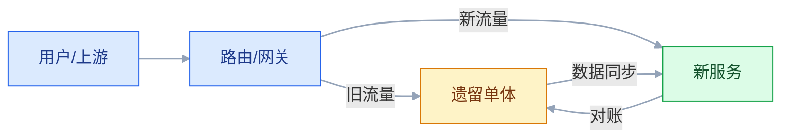
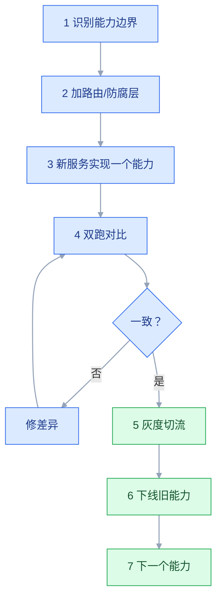

# 遗留系统改造

## 一、工程案例：不重写，把 12 年的单体逐步换掉

**场景**：一个 12 年的订单系统，200 万行代码，3 个数据库，没人敢改。业务规则散落在存储过程、定时任务、页面事件里；没有自动化测试，文档是五年前的 Word；每次发版靠“老员工盯着”。业务要求：一年内支持新渠道、新计费规则，不能停服。团队第一反应是“重写一套”。

**目标**：不搞“大爆炸重写”，用绞杀者模式逐步替换，交付：

- 一张遗留系统评估表；
- 一张 seams（接缝）与防腐层设计；
- 一套绞杀者迁移路线；
- 一套双跑与回滚方案；
- 一套数据迁移与对账规则；
- 一份验收清单（8 项）。

**为什么必须做**：重写最大的风险不是技术，是“业务规则丢失”和“迁移期间双系统不一致”。遗留系统里有很多没人记得的规则，重写时一定会漏。

**动手前确认**：先做三件事：跑通现有核心流程、整理数据字典、补关键路径的特征测试。没有这三样，改造就是蒙眼开车。下面的系统数据是示例。

### 1.1 遗留系统评估

| 维度 | 问题 | 评分 |
|---|---|---|
| 业务价值 | 是否核心收入/合规 | 高/中/低 |
| 变更频率 | 每月变更次数 | 高/中/低 |
| 代码质量 | 测试覆盖率、圈复杂度 | 1～5 |
| 数据质量 | 重复、缺失、口径 | 1～5 |
| 技术栈 | 是否已停止维护 | 1～5 |
| 依赖 | 被多少系统依赖 | 数量 |
| 可替代性 | 是否有商业产品 | 高/中/低 |

评估结果决定策略：高价值 + 高变更 → 优先改造；低价值 + 低变更 → 维持/封装。

### 1.2 找接缝

接缝（Seam）是“不改内部实现就能替换行为”的地方。

| 接缝类型 | 例子 |
|---|---|
| 入口 | 页面/API/消息 |
| 数据 | 数据库视图/同步表 |
| 依赖 | 外部接口/适配器 |
| 流程 | 定时任务/状态机 |
| 配置 | 开关/路由 |

找不到接缝，就先加接缝：在旧系统前加路由、在旧库上建视图、在调用处加适配器。

### 1.3 绞杀者路线

一次只换一个能力，不要一次换整个系统。

### 1.4 防腐层

| 作用 | 说明 |
|---|---|
| 隔离模型 | 旧模型不渗入新服务 |
| 协议转换 | SOAP/文件/DB → API |
| 数据映射 | 旧字段 → 新字段 |
| 失败隔离 | 旧系统故障不影响新服务 |
| 可回滚 | 开关切回旧实现 |

防腐层放在调用方，不放在旧系统里。旧系统尽量不改。

### 1.5 双跑与对账

| 阶段 | 做法 | 退出条件 |
|---|---|---|
| 影子读 | 新服务读，不返回 | 结果一致 |
| 双写 | 新旧都写 | 数据一致 |
| 双跑 | 新旧都算，只返回旧 | 差异 < 0.1% |
| 灰度 | 按用户/流量切新 | 指标稳定 |
| 切流 | 全量新 | 连续 3 天稳定 |
| 回滚 | 开关切回旧 | 10 分钟内 |

双跑要比较“结果”和“副作用”，不只是“接口成功”。

### 1.6 数据迁移

| 方式 | 适用 |
|---|---|
| 全量 + 增量 | 大多数 |
| 双写 | 迁移期 |
| CDC | 准实时 |
| 视图/同义词 | 过渡期 |
| 影子表 | 验证 |

迁移前要清洗：重复、缺失、格式、编码。迁移后要校验：行数、金额、抽样、业务规则。

### 1.7 测试策略

| 测试 | 目的 |
|---|---|
| 特征测试 | 锁定旧系统行为 |
| 契约测试 | 保证接口兼容 |
| 双跑对比 | 新旧结果一致 |
| 回归测试 | 核心流程 |
| 混沌演练 | 故障切换 |

遗留系统没有测试，先补“特征测试”：记录旧系统输入输出，作为新系统的验收基线。

### 1.8 验收（8 项）

1. 核心流程：新服务覆盖 100% 主流程，旧系统只读/下线。
2. 双跑：连续 7 天，新旧结果差异 ≤ 0.1%。
3. 数据：迁移后行数、金额、状态一致，抽样 1000 条无差异。
4. 回滚：10 分钟内切回旧系统，数据不丢。
5. 性能：新服务 P99 ≤ 旧系统，容量达标。
6. 兼容：旧客户端/上下游不受影响。
7. 可观测：新服务有日志/指标/追踪，故障可定位。
8. 文档：接缝、路由、开关、回滚、数据映射齐全。

## 二、高频问答：会卡住你的地方，也是面试最常问的

### 2.1 重写一套更快

**现场**

先问：所有业务规则都有人能说清吗？说不清就先别重写，去做代码考古和数据考古。

**要点**

- 重写最大的风险不是技术，是业务规则丢失，以及迁移期双系统不一致。
- 老系统里的隐性规则、边界、数据口径很难完整迁移。
- 第二系统效应会让重写越做越大，加入一堆“以后可能用”的功能。

**追问**

- 什么情况下可以重写？→ 系统小、规则清楚、有完整测试基线。
- 规则在谁脑子里？→ 老员工、代码和数据里，要先挖出来。
- 重写和绞杀者怎么选？→ 能切分就绞杀，业务简单才整体重写。

### 2.2 大爆炸切换最省事

**现场**

问一句：切失败 10 分钟内能回滚吗？不能就别大爆炸。

**要点**

- 一次性切换没有回滚空间，出问题就是全停。
- 双跑麻烦，但它是发现新旧差异的唯一可靠方式。
- 切换要留旧系统做回滚窗口，窗口太短等于没有。

**追问**

- 大爆炸什么时候能接受？→ 系统很小、影响面可控、有回滚方案。
- 回滚窗口要多长？→ 旧系统保留到新系统稳定。
- 灰度按什么切？→ 按用户、流量或业务能力。

### 2.3 旧系统不用管，直接封装

**现场**

问：旧系统的慢查询、锁、数据质量谁负责？只封装不治理，就是转移问题。

**要点**

- 封装能隔离，但旧系统的性能、数据、故障还在，会透过来。
- 防腐层放在调用方，旧系统尽量不改。
- 封装是过渡手段，不是终点，核心能力还要继续绞杀。

**追问**

- 防腐层解决什么？→ 隔离旧模型、协议转换、失败隔离、可回滚。
- 封装后旧系统还会拖累吗？→ 会，性能和数据问题会透过来。
- 什么时候该继续替换？→ 核心且高频的能力要逐步绞杀。

### 2.4 没有测试也能改

**现场**

看核心路径有没有特征测试或回归测试；没有就先补，再动代码。

**要点**

- 遗留系统缺测试，改了不知道影响哪里，没有基线也无法验证。
- 特征测试记录现有输入输出，锁定行为，不追求内部实现。
- 它比“读代码理解”更可靠，因为记录的是系统真实行为。

**追问**

- 特征测试和单元测试的区别？→ 前者锁定现有行为，不判断对错。
- 覆盖率要到多少？→ 覆盖核心路径优先，不追求全量。
- 没有文档怎么补测试？→ 用生产流量和日志回放真实输入。

### 2.5 数据迁移就是导数据

**现场**

问：迁移后怎么证明数据对？行数、金额、抽样、业务规则四项都要有，没有对账就是没迁完。

**要点**

- 数据有重复、缺失、口径不一致，迁移前必须先清洗。
- 迁移后要校验行数、金额、抽样和业务规则。
- 旧库要保留，支持回滚。

**追问**

- 全量还是增量？→ 全量快照加增量 CDC，大多数场景。
- 迁移期间还在写怎么办？→ 双写或 CDC 追平，再切读。
- 怎么发现“暗数据”？→ Excel、邮件、纸质单据也要进清单。

### 2.6 双跑太麻烦，直接切

**现场**

问：新旧结果差异多少？没数据就是没验证。

**要点**

- 双跑是发现差异的唯一可靠方式，不双跑，差异会在上线后爆发。
- 双跑要比业务结果和副作用，不只是接口成功。
- 退出条件要量化，比如连续 7 天差异 ≤ 0.1%。

**追问**

- 双跑有哪几种形态？→ 影子读、双写、双算、灰度。
- 双跑成本高怎么办？→ 只跑核心能力，按能力分批。
- 差异怎么定位？→ 按业务键比对，分类到输入、规则或数据。

### 2.7 旧系统没人懂，先放着

**现场**

评估业务价值和变更频率两个维度；核心且高频的系统不能一直放。

**要点**

- 不动会继续腐化，最终无法维护，越晚改成本越高。
- 知识集中在少数人是最大风险，老员工一走就断。
- 对策是结对、文档、录屏、轮岗，加上代码考古。

**追问**

- 低价值低变更的系统怎么办？→ 维持或封装，不必改造。
- 知识怎么留下来？→ 结对、文档、录屏，配合代码考古。
- 什么时候必须动？→ 核心且变更频繁，或者技术栈已停止维护。

### 2.8 用新框架重写业务

**现场**

问：这次变更同时改了框架和业务规则吗？是就拆开。

**要点**

- 框架升级和业务重写混在一起，风险叠加，出问题分不清是框架还是规则。
- 应该先隔离，再逐步替换。
- 分支抽象可以让新旧实现并存，用开关选择。

**追问**

- 先换框架还是先换业务？→ 先隔离边界，两个变更分开做。
- 分支抽象适合什么？→ 同一功能替换，不需要路由。
- 扩展-收缩解决什么？→ schema/API 迁移时先兼容新旧再删旧。

### 2.9 迁移可以停服

**现场**

算三笔账：停服成本、迁移时长、回滚方案。超过窗口就改用双写或灰度。

**要点**

- 核心业务停服损失大，数据量大时迁移加校验可能超窗口。
- 窗口里最容易被低估的是校验和回滚时间，不是导数据本身。
- 超窗口就改成不停服方案：全量、增量、双写、灰度。

**追问**

- 不停服怎么迁？→ 全量加增量，双写追平后灰度切读。
- 窗口怎么估？→ 导数据、校验、回滚演练三段相加。
- 切读和切写要一起吗？→ 分开，先切读再切写更安全。

### 2.10 改造完就结束

**现场**

问：新系统的 owner、SLO、技术债预算有吗？没有就是下一轮遗留。

**要点**

- 新系统也会腐化，没有 owner、监控和治理，几年后又是遗留系统。
- 改造不是一次项目，是组织持续重构和技术债管理的能力。
- 要留技术债预算和定期重构机制。

**追问**

- 怎么防止新系统变遗留？→ owner、SLO、架构评审、监控告警、定期重构。
- 技术债预算怎么定？→ 每期留固定比例，别等爆了再还。
- 旧系统什么时候下线？→ 新系统稳定并过回滚窗口后，清理旧接口和临时表。

## 三、核心知识

### 3.1 遗留系统的定义

遗留系统不是“老代码”，是“仍然承载核心业务、但难以安全变更的系统”。

特征：

- 缺测试；
- 缺文档；
- 依赖过时；
- 知识集中在少数人；
- 变更成本高。

### 3.2 改造策略

| 策略 | 适用 | 风险 |
|---|---|---|
| 维持 | 低价值、低变更 | 腐化 |
| 封装 | 低变更、接口化 | 性能/数据问题 |
| 重构 | 代码可测、边界清楚 | 工期 |
| 绞杀者 | 核心、可切分 | 双跑成本 |
| 重写 | 业务简单、规则清楚 | 规则丢失 |
| 替换 | 有商业产品 | 迁移/锁定 |

### 3.3 绞杀者模式

用新系统逐步替换旧系统：

1. 在旧系统前加路由；
2. 新系统实现一个能力；
3. 双跑/灰度；
4. 切流；
5. 下线旧能力；
6. 重复。

关键是“每次只换一块”，每块可回滚。

> **面试**：常问「绞杀者模式的关键是什么？」答：一次只换一个能力，靠路由和防腐层隔离，每块都能回滚。

### 3.4 防腐层

防腐层隔离旧模型：

- 转换：字段、枚举、单位；
- 适配：协议、接口；
- 隔离：旧系统故障不扩散；
- 可回滚：开关切回。

### 3.5 分支抽象

用抽象层让新旧实现并存：

- 定义接口；
- 旧实现 + 新实现；
- 开关选择；
- 逐步切换；
- 删除旧实现。

适合“同一功能替换”，不需要路由。

> **面试**：常问「分支抽象和绞杀者模式怎么选？」答：同一功能替换、不需要路由用分支抽象，要按能力逐步替换用绞杀者。

### 3.6 双跑

| 类型 | 说明 |
|---|---|
| 影子读 | 新逻辑读，不返回 |
| 双写 | 新旧都写 |
| 双算 | 新旧都算，比结果 |
| 灰度 | 部分流量走新 |

双跑要比较业务结果，不只是技术指标。

### 3.7 数据迁移

| 阶段 | 动作 |
|---|---|
| 清洗 | 去重、补全、格式 |
| 映射 | 旧字段 → 新字段 |
| 全量 | 快照迁移 |
| 增量 | CDC/binlog |
| 校验 | 行数、金额、抽样 |
| 切流 | 读/写逐步 |
| 回滚 | 旧库保留 |

### 3.8 特征测试

没有测试的遗留系统，先补“特征测试”：

- 记录输入和输出；
- 覆盖核心路径；
- 作为新系统的验收基线；
- 不追求内部实现。

> **面试**：常问「没有测试的遗留系统怎么开始改？」答：先补特征测试，记录现有输入输出作为验收基线，不追求内部实现。

### 3.9 组织与知识

| 风险 | 对策 |
|---|---|
| 老员工离职 | 结对、文档、录屏 |
| 知识集中 | 轮岗、代码评审 |
| 没人敢改 | 特征测试、灰度 |
| 业务不配合 | 业务 owner 参与 |

### 3.10 改造后的治理

- owner；
- SLO；
- 技术债预算；
- 架构评审；
- 监控告警；
- 定期重构。

没有治理，新系统也会变遗留。

## 四、冷门知识汇总

- **Michael Feathers 的《修改代码的艺术》**：提出“遗留代码是没有测试的代码”，强调特征测试和接缝。
- **接缝（Seam）**：不改代码就能替换行为的地方；分为对象接缝、链接接缝、预处理接缝。
- **特征测试（Characterization Test）**：记录现有行为，而不是验证“正确行为”；用于锁定遗留系统。
- **绞杀者模式（Strangler Fig）**：Martin Fowler 提出，用新系统逐步替换旧系统，像榕树包裹宿主。
- **分支抽象（Branch by Abstraction）**：用抽象层让新旧实现并存，适合大范围替换。
- **扩展-收缩（Expand-Contract）**：先兼容新旧，再删除旧；用于 schema/API 迁移。
- **暗发布（Dark Launch）**：新功能上线但不暴露给用户，先验证性能和逻辑。
- **并行运行（Parallel Run）**：新旧系统同时处理，比较结果；迁移核心账务常用。
- **第二系统效应**：重写时容易过度设计，加入太多“以后可能用”的功能，导致失败。
- **大爆炸重写**：一次性替换，风险最高；除非系统很小、规则很清楚，否则不建议。
- **“遗留系统不是技术问题，是知识问题”**：规则在人的脑子里，不在代码里；改造要先挖知识。
- **代码考古**：通过日志、数据库、页面、老员工访谈还原业务规则；比读代码更有效。
- **数据考古**：从历史数据反推业务规则和边界；常发现“文档里没有”的规则。
- **迁移的“暗数据”**：Excel、邮件、纸质单据里的数据，往往不在系统清单里，但会影响迁移。
- **回滚窗口**：旧系统要保留到新系统稳定；窗口太短，出问题无法回退。
- **“改造不是项目，是能力”**：组织要有持续重构、治理、技术债管理的能力，否则改完又腐化。