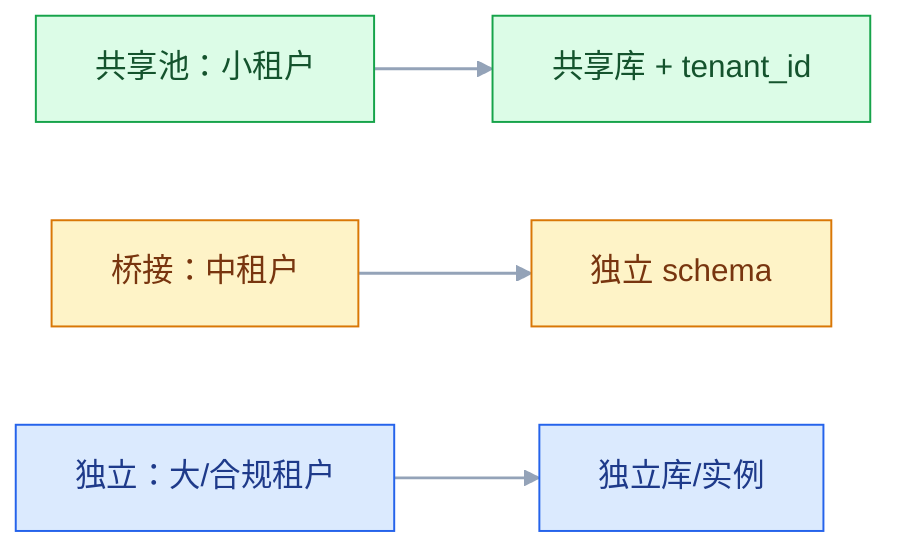

# 多租户与 SaaS 架构

## 一、工程案例：200 个租户，两个大客户要独立数据库

**场景**：一个 B2B SaaS 产品，200 个租户，共享一个数据库，所有表都有 `tenant_id`。问题是：某个大租户的报表把数据库 CPU 打到 100%，所有租户都变慢；两个大客户要求“数据物理隔离、独立备份、独立升级”；销售给客户承诺了自定义字段，开发只能加表；续费时算不清每个租户用了多少资源；租户注销后数据还在，合规审计过不了。

**目标**：不做“所有租户一套库”的一刀切，交付一套可扩展的多租户架构：

- 一张租户隔离模型选型；
- 一套租户上下文与鉴权；
- 一套数据分区与迁移规则；
- 一套噪声邻居与配额方案；
- 一套计费与生命周期；
- 一份验收清单（8 项）。

**为什么必须做**：多租户的核心不是“加 tenant_id”，是“在共享与隔离之间做分层”：小租户共享、大租户独立、合规租户专属。一套模型打天下，不是贵就是乱。

**动手前确认**：先盘点租户规模、合同隔离要求、数据量、QPS、合规要求。没有这些，选型只能拍脑袋。下面的数据是示例。

### 1.1 隔离模型

| 模型 | 数据 | 成本 | 隔离 | 适合 |
|---|---|---|---|---|
| 共享库共享表 | tenant_id | 最低 | 最弱 | 小租户、标准化 |
| 共享库独立 schema | schema/tenant | 中 | 中 | 中租户、少量定制 |
| 独立库 | DB/tenant | 高 | 强 | 大租户、合规 |
| 独立实例 | 实例/tenant | 最高 | 最强 | 金融、政务 |

常见组合：小租户共享，大租户独立库，合规租户独立实例。

### 1.2 租户上下文

租户来源：子域名、Token claim、请求头、路径。解析后要校验“用户确实属于这个租户”，不能只信前端。

### 1.3 数据隔离

| 层 | 做法 |
|---|---|
| 应用 | 所有查询强制带 tenant_id |
| 数据库 | 行级安全/视图/独立 schema |
| 缓存 | key 带 tenant_id |
| 消息 | 消息头带 tenant_id |
| 文件 | 路径/桶按租户隔离 |
| 搜索 | 索引/过滤带 tenant_id |

最危险的是“某条 SQL 忘了带 tenant_id”。要有框架级拦截、代码扫描、测试用例兜底。

### 1.4 噪声邻居

| 问题 | 方案 |
|---|---|
| 单租户 QPS 高 | 按租户限流 |
| 单租户报表重 | 独立报表库/队列 |
| 单租户数据大 | 独立库/归档 |
| 单租户批任务 | 错峰/独立调度 |
| 单租户缓存热 | 独立缓存/配额 |

配额要可配置、可告警、可升级。没有配额，一个租户能拖垮全部。

### 1.5 定制化

| 方式 | 灵活度 | 维护成本 |
|---|---|---|
| 配置项 | 低 | 低 |
| 自定义字段 | 中 | 中 |
| 插件/扩展点 | 高 | 高 |
| 独立分支 | 最高 | 最高 |

优先“配置 + 自定义字段”，谨慎“客户专属分支”。分支一多，升级就是噩梦。

### 1.6 计费与计量

| 模式 | 说明 |
|---|---|
| 按席位 | 用户数 |
| 按用量 | API 调用、存储、消息 |
| 按功能 | 套餐 |
| 混合 | 席位 + 用量 |

计量要“可采集、可对账、可审计”。计费错误比功能 bug 更伤客户信任。

### 1.7 生命周期

| 阶段 | 动作 |
|---|---|
| 开通 | 初始化租户、配置、管理员 |
| 试用 | 限额、到期提醒 |
| 转正 | 合同、计费、配额 |
| 扩容 | 升配、迁移 |
| 冻结 | 欠费/违规 |
| 注销 | 数据导出、删除、审计 |

注销要“可导出、可删除、可证明”。合规要求越来越高，不能只把 `status` 改成 deleted。

### 1.8 迁移

| 场景 | 方案 |
|---|---|
| 共享 → 独立 | 导出、导入、双跑、切流 |
| 独立 → 共享 | 合并、去重、校验 |
| 跨区迁移 | 数据同步、DNS 切换 |

迁移要保证租户无感，至少要有维护窗口和回滚。

### 1.9 安全与合规

| 要求 | 措施 |
|---|---|
| 数据隔离 | 行级/库级隔离、测试 |
| 访问控制 | 租户 + 角色 + 数据范围 |
| 审计 | 谁访问了哪个租户 |
| 加密 | 传输/存储/KMS |
| 数据驻留 | 按区域部署 |
| 删除 | 硬删除/匿名化 |

多租户的安全底线是“租户 A 不能看到租户 B 的任何数据”，包括缓存、日志、导出、备份。

### 1.10 验收（8 项）

1. 隔离：租户 A 的 token 访问租户 B 的数据，100% 被拒绝。
2. 数据：所有查询强制带 tenant_id，代码扫描 0 漏网。
3. 噪声：单租户压测打满配额，其他租户 P99 不受影响。
4. 迁移：共享 → 独立库，租户无感，数据一致。
5. 计费：用量可采集、可对账，账单误差 ≤ 0.1%。
6. 注销：数据可导出、可删除，审计可查。
7. 定制：自定义字段不影响其他租户，升级不丢数据。
8. 合规：数据驻留、加密、审计满足合同要求。

## 二、高频问答：会卡住你的地方，也是面试最常问的

### 2.1 多租户就是加 tenant_id

**现场**

问：缓存 key 带租户吗？消息带租户吗？备份能按租户恢复吗？三个都答不上来，就只是加了个字段。

**要点**

- 加 tenant_id 只是第一步，还要解决上下文、鉴权、缓存、消息、文件、备份、迁移和噪声。
- 隔离分三个维度：数据隔离、行为隔离、资源隔离。
- 最危险的是某条 SQL 忘了带 tenant_id，一条就能串数据。

**追问**

- 怎么防漏带 tenant_id？→ 框架级拦截、代码扫描、测试用例兜底。
- ORM 拦截够吗？→ 够一层，原生 SQL 和报表查询要单独兜。
- 数据库层还能怎么兜？→ 行级安全或视图。

### 2.2 所有租户共享最省钱

**现场**

看租户规模分布和合同隔离要求；一刀切早晚要迁。

**要点**

- 大租户会拖垮小租户，合规租户不接受共享。
- 分层隔离更可持续：小租户共享、中租户独立 schema、大租户独立库。
- 成本要看总拥有成本，不只是机器钱。

**追问**

- 分层之后运维会不会更复杂？→ 会，但比一次性全独立便宜。
- 什么时候必须独立库？→ 数据量大、合规要求、要独立备份和升级。
- 共享池的上限在哪？→ 噪声邻居和单库容量，到了就迁。

### 2.3 独立库最安全

**现场**

算成本：200 个库的备份、监控、升级、连接数，再决定哪些真的需要独立。

**要点**

- 独立库隔离最强，但成本高、运维复杂、升级要逐个执行。
- 小租户不值得独立，隔离收益抵不过运维成本。
- 安全边界靠隔离模型加权限和审计，不是只有独立库一条路。

**追问**

- 独立 schema 和独立库差在哪？→ 隔离强度和运维成本都在中间。
- 连接数为什么会成问题？→ 每库一套连接池，实例连接上限会被吃满。
- 哪些租户值得独立？→ 大租户、合规租户、要独立备份和升级的。

### 2.4 租户 ID 从请求头取

**现场**

做一次篡改请求头测试，能越权就是没校验。

**要点**

- 前端可伪造，租户必须从 Token 或域名解析。
- 解析后还要校验用户确实属于这个租户，不能只信来源。
- 请求头只用于内部服务之间传递已校验的租户上下文。

**追问**

- 子域名和 Token 哪个优先？→ 以 Token claim 为准，域名只做入口识别。
- 内部服务怎么传租户？→ 请求头或消息头，但必须来自已校验的上下文。
- 越权测试怎么自动化？→ 用租户 A 的 token 访问租户 B 的资源，必须全部拒绝。

### 2.5 缓存不用隔离

**现场**

看缓存 key 是否含 tenant_id；没有就是串数据风险。

**要点**

- 不同租户可能有相同的业务 ID，key 不带租户会串数据。
- 缓存、消息、文件、搜索都要带租户维度。
- 隔离要一层层做，不能只做数据库。

**追问**

- key 前缀和 key 里带 ID 有区别吗？→ 本质一样，要保证租户参与唯一性。
- 缓存里已有脏数据怎么办？→ 按租户清，别全量清。
- 消息也要带吗？→ 要，消息头带 tenant_id，消费端校验。

### 2.6 大租户慢是正常

**现场**

看单租户 QPS 和数据量对其他租户 P99 的影响；影响了就不是正常。

**要点**

- 大租户拖慢其他租户是架构问题，不是业务特性。
- 要靠限流、隔离、独立库来解决。
- 配额要可配置、可告警、可升级，没有配额一个租户能拖垮全部。

**追问**

- 先限流还是先隔离？→ 先限流止疼，再按租户分层隔离。
- 报表重怎么办？→ 独立报表库或独立任务队列。
- 配额怎么定？→ 按套餐和合同，可调可告警。

### 2.7 客户定制就开分支

**现场**

统计分支数和升级时长；超过阈值就要收敛到配置或扩展点。

**要点**

- 分支越多升级越难，最后每个客户一个版本。
- 优先配置项和自定义字段，谨慎插件，尽量不开专属分支。
- 分支是技术债，不是服务能力。

**追问**

- 自定义字段怎么实现？→ 扩展表或 JSON，别改主表。
- 插件和分支差在哪？→ 插件有统一升级路径，分支没有。
- 已经开了分支怎么收？→ 把差异逐项收敛成配置，再合回主线。

### 2.8 计费以后再说

**现场**

问：用量数据从哪来？能对账吗？不能就是没设计。

**要点**

- 计量埋点、账单、对账要提前设计，后补容易漏数据、算错账。
- 计费错误比功能 bug 更伤客户信任。
- 计量要可采集、可对账、可审计。

**追问**

- 常见计费模式？→ 席位、用量、功能、混合。
- 埋点要在哪一层？→ 产生资源消耗的地方，别在报表层补算。
- 账单误差要求多少？→ 验收要求 ≤ 0.1%。

### 2.9 注销就是改状态

**现场**

问：注销后数据真的删了吗？能证明吗？备份、日志、缓存里还有没有？

**要点**

- 合规要求数据可导出、可删除、可证明，改个 status 不算。
- 备份、日志、缓存里都可能有残留。
- 删除要覆盖全链路并留审计。

**追问**

- 硬删除还是匿名化？→ 看合规要求，两者都可接受，但要口径一致。
- 备份里的数据怎么删？→ 按租户备份，或等备份过期并写进说明。
- 怎么证明删了？→ 审计记录加可验证的删除报告。

### 2.10 多租户只是技术问题

**现场**

看合同里有没有隔离、驻留、审计条款；有就必须进架构。

**要点**

- 合同隔离、数据驻留、计费模式、SLA 都直接影响架构选型。
- 销售承诺的“物理隔离”就是架构约束。
- 多租户不是架构师一个人的事，销售和法务要提前进来。

**追问**

- 数据驻留影响什么？→ 部署区域和跨区迁移方案。
- 销售先承诺后架构怎么办？→ 把隔离条款变成选型输入，别等上线补。
- BYOK 适合谁？→ 高合规租户。

## 三、核心知识

### 3.1 多租户的定义

多租户（Multi-Tenancy）是“一套系统服务多个租户，租户之间数据和行为隔离”。

三个隔离维度：

- 数据隔离；
- 行为隔离（配置、功能）；
- 资源隔离（CPU、QPS、存储）。

### 3.2 隔离模型

| 模型 | 数据 | 成本 | 隔离 |
|---|---|---|---|
| 共享表 | tenant_id | 低 | 弱 |
| 独立 schema | schema | 中 | 中 |
| 独立库 | DB | 高 | 强 |
| 独立实例 | 实例 | 最高 | 最强 |

### 3.3 租户上下文

| 来源 | 说明 |
|---|---|
| 子域名 | tenant.example.com |
| Token claim | JWT 里的 tenant_id |
| 请求头 | 内部服务传递 |
| 路径 | /t/{tenant}/... |

解析后要校验用户归属，不能只信来源。

> **面试**：常问「租户 ID 应该从哪里取？」答：从 Token claim 或子域名解析，并校验用户确属该租户，不能信前端传的请求头。

### 3.4 数据访问

| 层 | 强制隔离 |
|---|---|
| ORM | 拦截器自动加 tenant_id |
| SQL | 视图/行级安全 |
| 缓存 | key 前缀 |
| 消息 | header |
| 文件 | 路径/桶 |
| 搜索 | filter |

“框架级强制”比“开发自觉”可靠。

> **面试**：常问「怎么保证每条 SQL 都带 tenant_id？」答：靠 ORM 拦截、视图或行级安全、代码扫描和隔离测试，不能靠开发自觉。

### 3.5 噪声邻居

| 资源 | 隔离方式 |
|---|---|
| CPU | 独立实例/限流 |
| 数据库 | 独立库/只读副本 |
| 缓存 | 独立实例/key 配额 |
| 消息 | 独立 topic/队列 |
| 报表 | 独立任务队列 |

> **面试**：常问「什么是噪声邻居，怎么治？」答：一个租户占满资源拖慢其他租户，靠配额、限流和独立资源隔离。

### 3.6 配置与定制

| 层 | 内容 |
|---|---|
| 系统配置 | 全局 |
| 租户配置 | 功能开关、限额 |
| 用户配置 | 偏好 |
| 自定义字段 | 扩展表/JSON |
| 插件 | 扩展点 |

### 3.7 计费

| 模式 | 计量 |
|---|---|
| 席位 | 活跃用户 |
| 用量 | API/存储/消息 |
| 功能 | 套餐 |
| 混合 | 组合 |

计费要“采集 → 聚合 → 账单 → 对账 → 审计”。

### 3.8 生命周期

开通 → 试用 → 转正 → 扩容 → 冻结 → 注销。

每个阶段要有：配置、权限、计费、数据、通知。

### 3.9 迁移

| 场景 | 关键 |
|---|---|
| 共享→独立 | 导出、导入、双跑、切流 |
| 独立→共享 | 合并、去重、校验 |
| 跨区 | 同步、DNS、合规 |

### 3.10 安全

| 风险 | 措施 |
|---|---|
| 越权 | 租户校验、RLS |
| 缓存串数据 | key 隔离 |
| 日志泄露 | 脱敏 |
| 备份混租户 | 按租户备份 |
| 删除不彻底 | 硬删除/匿名化 |

## 四、冷门知识汇总

- **Silo/Pool/Bridge**：独立实例、共享池、桥接（独立 schema）。多租户三种典型模型。
- **行级安全（RLS）**：数据库层面按 tenant_id 过滤，应用忘记加条件也能兜底。PostgreSQL 支持较好。
- **schema per tenant**：每个租户一个 schema，隔离比共享表强，成本比独立库低。
- **database per tenant**：每个租户一个库，隔离强，运维复杂。
- **cell architecture**：把租户分到独立单元，每单元完整应用+数据；故障隔离、扩容简单。
- **噪声邻居（Noisy Neighbor）**：一个租户占用过多资源，影响其他租户。要配额、限流、隔离。
- **租户隔离测试**：用租户 A 的 token 访问租户 B 的资源，必须全部拒绝；要自动化。
- **数据驻留（Data Residency）**：合同/法规要求数据存放在特定区域；影响部署架构。
- **BYOK（Bring Your Own Key）**：客户自带加密密钥；适合高合规租户。
- **子域名路由**：tenant.example.com，便于隔离 cookie、证书、品牌。
- **租户迁移**：共享 ↔ 独立，要求无感、可回滚、可对账。
- **租户注销**：数据导出、删除、备份清理、审计；不是改状态。
- **SaaS 指标**：MRR、ARR、NRR、GRR、churn、CAC、LTV；多租户架构要支持按租户统计。
- **“共享数据库不是多租户”**：没有租户上下文、隔离、配额，只是多个客户共用一套库。
- **“多租户不是免费”**：隔离越强，成本越高；要按租户分层，不要一刀切。
- **“租户 ID 泄露”**：日志、错误信息、导出文件都可能泄露租户 ID；要脱敏和权限控制。