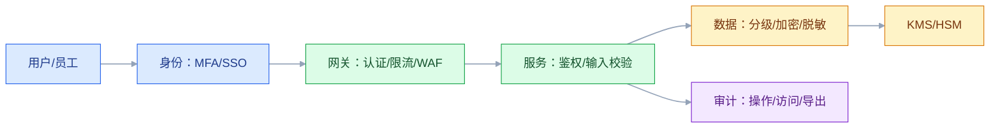

# 安全与合规架构

## 一、工程案例：把“等保能过”变成“真的扛得住攻击”

**场景**：一家做企业信贷的 SaaS，客户是银行。系统已经过了等保 2.0 三级，但安全团队做了一次渗透测试：越权查询客户资料、导出接口没有限流、日志里有身份证号、离职员工账号还能登录、第三方 SDK 有高危漏洞。客户安全问卷有 200 项，研发每次都要临时补材料。

**目标**：不做“为了过审补文档”，交付一套可落地、可审计的安全与合规架构：

- 一张威胁模型与攻击面；
- 一套身份、权限、数据分级；
- 一套加密、密钥、审计；
- 一套网络与供应链安全；
- 一张合规映射表；
- 一份验收清单（8 项）。

**为什么必须做**：安全不是“加个防火墙”，是“在架构上减少攻击面、限制爆炸半径、让行为可审计”。合规是底线，不是上限；过了等保不等于安全。

**动手前确认**：先做三件事：数据分类分级、资产清单、最近一次渗透/漏洞报告。没有这三样，安全方案只能堆产品。下面的数据是示例。

### 1.1 威胁建模

用 STRIDE 对核心链路做威胁建模：

| 威胁 | 例子 | 对策 |
|---|---|---|
| 伪造 | 伪造 token、伪造回调 | 签名、mTLS、校验 |
| 篡改 | 改请求参数、改金额 | 签名、服务端校验 |
| 抵赖 | 否认操作 | 审计日志、签名 |
| 信息泄露 | 越权查客户、日志泄露 | 鉴权、脱敏、加密 |
| 拒绝服务 | 刷接口、慢查询 | 限流、熔断、配额 |
| 提权 | 普通用户变管理员 | 最小权限、审批 |

威胁建模不是一次性文档，每次新增外部接口/数据流都要更新。

### 1.2 身份与认证

| 场景 | 方案 |
|---|---|
| 员工 | SSO + MFA |
| 客户 | 账号密码 + MFA/短信 |
| 服务间 | mTLS/服务身份 |
| 第三方 | OAuth2 客户端凭证 |
| 高敏操作 | 二次认证 |

认证要防：撞库、暴力破解、会话固定、Token 泄露、离职未停权。

### 1.3 授权

| 模型 | 适合 |
|---|---|
| RBAC | 功能权限 |
| ABAC | 属性/条件 |
| ReBAC | 关系/层级 |
| 数据范围 | 行级 |
| 字段权限 | 列级 |

授权要“默认拒绝”，并且每次请求都校验，不能只在前端隐藏按钮。

### 1.4 数据分级

| 级别 | 例子 | 措施 |
|---|---|---|
| 公开 | 产品介绍 | 无 |
| 内部 | 订单、库存 | 登录 + 部门 |
| 敏感 | 客户、价格 | 行级/列级、脱敏 |
| 高敏 | 身份证、银行卡、薪资 | 加密、审计、最小权限 |

分级不是给数据贴标签，是决定“谁能看、怎么存、传哪里、留多久”。

### 1.5 加密与密钥

| 场景 | 做法 |
|---|---|
| 传输 | TLS 1.2+，内部 mTLS |
| 存储 | 磁盘/字段加密 |
| 密钥 | KMS/HSM，定期轮换 |
| 密码 | 慢哈希（bcrypt/Argon2） |
| 脱敏 | 动态/静态脱敏 |

不要把密钥写在代码/配置/镜像里；不要用可逆加密存密码。

### 1.6 审计

| 审计对象 | 内容 |
|---|---|
| 登录 | 谁、何时、IP、结果 |
| 权限变更 | 谁改了谁、改了什么 |
| 数据访问 | 谁查了/导出了什么 |
| 高危操作 | 删除、转账、配置 |
| 管理后台 | 所有操作 |

审计日志要“不可篡改、可检索、保留期合规”。只记应用日志，不算审计。

### 1.7 网络与供应链

| 层 | 措施 |
|---|---|
| 边界 | WAF、DDoS、限流 |
| 网络 | 分区、最小开放、DMZ |
| 服务 | mTLS、NetworkPolicy |
| 依赖 | 漏洞扫描、SBOM |
| CI/CD | 代码扫描、镜像扫描、签名 |

供应链攻击越来越常见：第三方 SDK、开源组件、构建环境都要管。

### 1.8 合规映射

| 要求 | 架构动作 |
|---|---|
| 等保 2.0 | 分区分域、审计、备份、入侵检测 |
| GDPR | 同意、删除权、数据出境 |
| 个人信息保护法 | 告知、最小化、授权 |
| 行业监管 | 数据留存、报送、审计 |
| 客户问卷 | 证据链、自动化导出 |

合规不是“写文档”，是“有机制、有证据、能持续”。

### 1.9 应急响应

| 阶段 | 动作 |
|---|---|
| 发现 | 监控/告警/报告 |
| 遏制 | 隔离、封禁、降权 |
| 取证 | 日志、快照 |
| 恢复 | 修复、回滚 |
| 复盘 | 根因、改进 |
| 通知 | 客户/监管（按法规） |

应急要演练，联系人、权限、话术提前准备。

### 1.10 验收（8 项）

1. 越权：租户/用户交叉访问 100% 拒绝。
2. 认证：离职账号 5 分钟内停用，MFA 覆盖管理员。
3. 数据：高敏字段加密/脱敏，日志无明文。
4. 审计：高危操作 100% 有日志，可检索、不可篡改。
5. 漏洞：高危漏洞 7 天内修复，依赖扫描进 CI。
6. 网络：分区/最小开放，管理后台不暴露公网。
7. 合规：等保/隐私/合同要求有映射和证据。
8. 演练：应急响应半年一次，恢复时间达标。

## 二、高频问答：会卡住你的地方，也是面试最常问的

### 2.1 安全就是防火墙

**现场**

怎么判断：把最近一次渗透测试和漏洞报告拿出来，按原因归类。

- 越权、弱口令、配置错误、依赖漏洞占多数，说明只做了边界防护。
- 边界设备日志里没有内部横向访问记录，说明内网是默认信任。
- 第三方 SDK、开源组件没有扫描记录，是同一个短板的另一面。

**要点**

- 安全不是买设备，是在架构上减少攻击面、限制爆炸半径、让行为可审计。
- 大部分事故来自越权、弱口令、配置错误和供应链，边界设备挡不住这些。
- 判断标准是渗透报告里问题的分布，不是防火墙的型号。

**追问**

- WAF 上了还被越权查数据，为什么？→ WAF 看请求特征，越权是业务层的授权缺失。
- 边界挡住了外部，内部横向移动怎么拦？→ 分区、最小权限、mTLS，也就是零信任那套。
- 安全投入怎么向老板证明有效？→ 用高危漏洞数、修复时长这类基线指标，不靠感觉。

### 2.2 HTTPS 就安全了

**现场**

怎么判断：查四件事——授权校验、输入校验、密钥管理、日志脱敏。缺一项，HTTPS 就只是传输层保护。

**要点**

- HTTPS 只保护传输，不保护数据本身。
- 越权、注入、密钥泄露、日志泄露，在加密通道里一样发生。
- 判断安全不能只看浏览器有没有小锁图标。

**追问**

- 抓包看不到明文，为什么还能被攻击？→ 攻击者不需要解密，直接调接口就行。
- 内部服务要不要也上 TLS？→ 要，mTLS 顺带解决服务身份认证。
- 证书过期算不算安全事故？→ 算可用性事故，客户端会直接拒绝连接。

### 2.3 认证就是登录

**现场**

怎么判断：用普通账号直接调管理员接口，能访问就是授权缺失。

**要点**

- 认证回答“你是谁”，授权回答“你能做什么”，是两件事。
- 只认证不授权，登录后什么都能看。
- 授权要默认拒绝，每次请求都在服务端校验。

**追问**

- 前端隐藏了按钮，为什么还不够？→ 攻击者绕过页面直接调接口，前端不参与鉴权。
- RBAC 和 ABAC 怎么选？→ 功能权限用 RBAC，带属性条件的用 ABAC。
- 服务间调用怎么认证？→ mTLS 或服务身份令牌，不能靠内网可信。

### 2.4 加密就是 AES

**现场**

怎么判断：问三句——密钥在哪？谁有权限？多久轮换？答不上来就是没管。

**要点**

- 加密的难点在密钥，不在算法。
- 密钥泄露，加密等于没做。
- 密码不能用可逆加密，要用 bcrypt、Argon2 这类慢哈希。

**追问**

- 密钥放配置中心算安全吗？→ 比放代码好，但仍要 KMS 托管和权限审计。
- 为什么不能用 AES 存密码？→ 可逆，拿到密钥就能还原成明文。
- 字段加密后查询变慢怎么办？→ 只加密高敏字段，检索走不可逆哈希或独立索引。

### 2.5 合规就是审计

**现场**

怎么判断：看五项——漏洞修复、权限变更、数据删除、应急演练、证据链。只有一张证书不够。

**要点**

- 合规是持续机制，审计只是其中的证据。
- 过了等保不代表扛得住攻击，等保是底线不是上限。
- 合规要能持续产出证据，客户问卷不该靠临时补材料。

**追问**

- 过了等保三级还有什么风险？→ 渗透测出来的越权、无限流、日志带身份证号，等保不覆盖这么细。
- 审计日志和普通应用日志差在哪？→ 不可篡改、可检索、保留期合规。
- 客户 200 项问卷怎么答得快？→ 把合规要求映射成架构动作，证据自动导出。

### 2.6 零信任就是 VPN

**现场**

怎么判断：问一句——内网访问还默认信任吗？是，就不是零信任。

**要点**

- 零信任是“每次访问都验证、最小权限、持续评估”，不是单一产品。
- VPN 只解决通道加密，进来之后还是默认信任。
- 落地靠微分段、服务身份、持续评估三件事。

**追问**

- 零信任要一步到位吗？→ 不用，先做高敏系统的微分段和最小权限。
- 服务网格和零信任什么关系？→ mTLS 和策略下发是手段之一，不是全部。
- 内网资产随便就能扫到，算漏洞吗？→ 算攻击面，内部资产清单也要收敛。

### 2.7 安全是安全团队的事

**现场**

怎么判断：看研发有没有安全培训、代码扫描、威胁建模。没有就是甩锅。

**要点**

- 大部分漏洞在代码、配置和架构里，安全团队替研发写不了安全代码。
- 安全团队的价值是建机制：扫描进 CI、威胁建模、评审清单。
- 安全左移是在需求和设计阶段做，不是上线前扫一遍。

**追问**

- 扫描工具买了，漏洞为什么还多？→ 没进 CI、没人看报告、没人负责修。
- 威胁建模谁来做？→ 研发主导，安全团队给方法和模板。
- 安全需求怎么进排期？→ 变成验收项和完成的定义，否则永远排在下个版本。

### 2.8 我们小，没人攻击

**现场**

怎么判断：看暴露面——公网端口、弱口令、旧组件版本。有就是风险。

**要点**

- 自动化扫描和撞库不挑公司大小。
- 小公司的数据一样能卖，而且防护更弱。
- 判断风险看暴露面，不看知名度。

**追问**

- 小公司最低限度该做什么？→ 补丁、MFA、最小开放、备份，这四件成本最低。
- 被撞库了怎么发现？→ 盯登录失败率和异常 IP，别等用户投诉。
- 云上安全组全开常见吗？→ 是最常见的低级问题之一。

### 2.9 越权是前端问题

**现场**

怎么判断：用普通账号直接调管理员接口，能成功就是后端没校验。

**要点**

- 前端隐藏按钮只是体验，不是安全边界。
- 攻击者根本不走页面，直接构造请求。
- 校验必须在服务端，而且每次请求都要做。

**追问**

- 水平越权和垂直越权怎么分？→ 水平是同角色跨用户数据，垂直是低权限访问高权限功能。
- 接口带 token 就够了吗？→ 不够，还要校验这个主体有没有该数据的权限。
- 网关统一鉴权能替代服务内校验吗？→ 只能做粗粒度，数据范围还得业务层判断。

### 2.10 日志越多越安全

**现场**

怎么判断：看三件事——日志是否脱敏、保留多久、谁有权限看。

**要点**

- 日志本身是敏感数据，全量明文就是一个新的泄露面。
- 审计要记“谁在什么时候做了什么”，不是把所有请求体打出来。
- 保留期要满足合规，存储成本也要算。

**追问**

- 排查需要明文怎么办？→ 留可关联的 ID，必要时走审批临时开通。
- 日志被篡改怎么防？→ 追加写加哈希链，或写到独立的审计存储。
- 保留多久合适？→ 按法规和行业要求，等保一般不少于六个月。

## 三、核心知识

### 3.1 安全架构的目标

- 减少攻击面；
- 限制爆炸半径；
- 让行为可审计；
- 满足合规；
- 可恢复。

安全不是“没有漏洞”，是“漏洞不会导致系统性灾难”。

### 3.2 威胁建模

| 方法 | 用途 |
|---|---|
| STRIDE | 六类威胁 |
| DREAD | 风险评级 |
| 攻击树 | 路径分析 |
| 数据流图 | 找边界 |

威胁建模要覆盖：外部接口、数据流、信任边界、权限提升点。

### 3.3 认证与授权

| 概念 | 说明 |
|---|---|
| 认证 | 你是谁 |
| 授权 | 你能做什么 |
| 审计 | 你做了什么 |
| 最小权限 | 只给必要权限 |
| 职责分离 | 关键操作多人 |

> **面试**：常问「认证和授权有什么区别？」答：认证确认你是谁，授权确认你能做什么，审计记录你做了什么。

### 3.4 数据安全

| 状态 | 措施 |
|---|---|
| 传输 | TLS/mTLS |
| 存储 | 加密、KMS |
| 使用 | 脱敏、最小权限 |
| 共享 | 水印、审计 |
| 销毁 | 删除、覆写 |

### 3.5 密钥管理

| 项 | 要求 |
|---|---|
| 生成 | 安全随机 |
| 存储 | KMS/HSM |
| 轮换 | 定期 |
| 权限 | 最小 |
| 审计 | 使用记录 |
| 备份 | 安全备份 |

> **面试**：常问「密钥应该怎么管？」答：KMS/HSM 托管、最小权限、定期轮换、使用留痕，绝不写进代码和镜像。

### 3.6 审计

| 项 | 要求 |
|---|---|
| 完整性 | 不可篡改 |
| 可用性 | 可检索 |
| 保留 | 合规期限 |
| 脱敏 | 不泄露敏感 |
| 告警 | 异常行为 |

### 3.7 零信任

| 原则 | 说明 |
|---|---|
| 永不信任 | 内网也不默认信任 |
| 持续验证 | 每次访问都校验 |
| 最小权限 | 按需授权 |
| 微分段 | 限制横向移动 |
| 假设失陷 | 设计爆炸半径 |

> **面试**：常问「零信任的核心是什么？」答：内网也不默认信任，每次访问都验证，最小权限加微分段。

### 3.8 供应链安全

| 风险 | 措施 |
|---|---|
| 开源漏洞 | SCA、SBOM |
| 镜像漏洞 | 扫描、签名 |
| 构建污染 | 隔离、审计 |
| 第三方 SDK | 评估、最小化 |
| 供应商 | 安全问卷、合同 |

> **面试**：常问「供应链安全要管哪些环节？」答：开源组件、镜像、构建环境和第三方 SDK，靠 SCA、SBOM、扫描和签名。

### 3.9 合规

| 框架 | 关注 |
|---|---|
| 等保 2.0 | 分区分域、审计、备份、入侵检测 |
| GDPR | 同意、删除、出境 |
| 个人信息保护法 | 告知、最小化、授权 |
| ISO 27001 | 管理体系 |
| SOC 2 | 控制与审计 |

### 3.10 应急响应

| 阶段 | 关键 |
|---|---|
| 发现 | 监控、报告 |
| 遏制 | 隔离、封禁 |
| 取证 | 日志、快照 |
| 恢复 | 修复、回滚 |
| 复盘 | 根因、改进 |
| 通知 | 法规、客户 |

## 四、冷门知识汇总

- **STRIDE**：Spoofing、Tampering、Repudiation、Information Disclosure、Denial of Service、Elevation of Privilege。
- **DREAD**：Damage、Reproducibility、Exploitability、Affected users、Discoverability；用于风险排序。
- **OWASP Top 10**：Web 应用常见风险清单，不是完整安全标准。
- **OWASP ASVS**：应用安全验证标准，适合做安全需求和测试清单。
- **等保 2.0**：中国网络安全等级保护制度，分五级；三级要求分区分域、审计、备份、入侵检测等。
- **GDPR/PIPL**：欧盟/中国个人信息保护法规，强调告知、同意、最小化、删除、出境。
- **KMS/HSM**：密钥管理服务/硬件安全模块；密钥不要和应用代码放一起。
- **mTLS**：双向 TLS，服务间身份认证；服务网格常用。
- **零信任**：不是产品，是架构原则；核心是持续验证、最小权限、微分段。
- **最小权限**：只给完成工作所需的最小权限；权限越大，爆炸半径越大。
- **纵深防御**：多层防护，单层失效不至于全失守。
- **SBOM**：软件物料清单，列出依赖和版本；供应链安全的基础。
- **供应链攻击**：通过第三方组件、构建环境、更新包入侵；比直接攻击更难防。
- **安全左移**：在需求/设计/编码阶段做安全，而不是上线前扫描。
- **“合规不等于安全”**：过审只说明满足最低要求，不代表扛得住攻击。
- **“安全by obscurity”**：只靠隐藏（如改端口、藏接口）不是安全；要被假设会发现。
- **“爆炸半径”**：一次失陷能影响多大范围；分区、最小权限、隔离都能缩小半径。